# Rights and use

**From the First Token: Building Language Models from Scratch**

Author: **Wanglong Lu (卢望龙)**. Copyright 2026.

The book is shared under **Creative Commons Attribution–NonCommercial–NoDerivatives 4.0 International (CC BY-NC-ND 4.0)**, except for separately identified software and third-party material. You may copy and share the unchanged book noncommercially while retaining the author, title, version and license notice. Sharing an altered or translated edition requires separate permission. Private annotations, permitted format changes and applicable statutory rights are not removed by this notice. [Full license](https://creativecommons.org/licenses/by-nc-nd/4.0/legalcode.en).

The separately supplied teaching exercises and author-owned executable code examples are available under **PolyForm Noncommercial 1.0.0**. That software license permits changes and sharing for its defined permitted purposes, with its required notices. Commercial uses outside those permissions require separate authorization. [Software terms](https://polyformproject.org/licenses/noncommercial/1.0.0).

The author retains the ability to grant separate commercial permissions for material the author has the right to license. Third-party software, fonts and cited works retain their own rights and terms.

# A note to the reader

In early 2023, I gave GPT a serious try for the first time. I had heard about it, but the descriptions had not made much of an impression on me. Then I asked it to write some PyTorch code. I remember being surprised by what appeared on the screen. I did not even run that first snippet. Seeing it write familiar code from a short conversation was enough to make me stop and pay attention.

By then, I had been researching deep learning algorithms for four or five years, often working with PyTorch and Transformer-based methods. I continued to follow new models and papers, and later built agent workflows in my day-to-day work. Those experiences kept bringing me back to one question: how did all the pieces inside a language model actually work together? Using a model, reading its architecture and tracing an implementation each reveal different parts of the answer. I wanted to connect them.

That led me back through the whole pipeline. I took each step apart, worked through a small example, wrote and ran the code, and checked the intermediate results. Then I put the pieces together and trained a small model from scratch. Each run gave me something concrete to examine: a shape I had misunderstood, a loss that needed explaining, or a result that did not support the conclusion I had expected. Writing those explanations down became this book.

For me, learning by doing means giving an idea a calculation and an implementation that I can inspect. The small examples matter because they make it possible to follow every value. Connecting those examples matters because a working system creates questions that isolated formulas leave open. I hope the route in these pages gives you room to try things, make mistakes, and work out why a correction helps.

You may be building your first language model, or revisiting methods you already use. Either way, take your time with the examples. Change a value, predict what should happen, and then run the code. I hope you enjoy the process, and that the next model or paper you encounter becomes a little easier to reason about.

## The route through the book

To understand a language model, follow one prediction from start to finish. Text becomes a list of IDs. Each ID selects a vector. The model uses the vectors to score each possible next token, then turns the scores into probabilities. A training example supplies the actual next token. Its predicted probability gives us a loss. We then calculate how the loss changes with each parameter and use those gradients to update the model.

This book builds that chain without asking you to accept its middle steps on trust. We begin with bytes and short lists, then use small tensors whose entries can be checked by hand. Attention appears when a model needs context. Position information appears when order matters. Checkpoints appear when a training run must survive interruption. Evaluation appears when a plausible answer is no longer enough to establish an improvement. Each addition answers a problem created by the implementation that came before it.

The book grew from a learning project called OneLong. It keeps questions that many tutorials skip: Is a token ID a count? Why does lookup add a dimension? Why can training predict at several known positions, while generation chooses one new token? Which mask applies to which axis? Answering these questions helps us understand what the code does and why it works.

The chapters have a practical rhythm. Read the idea and its notation, trace a complete example, then write the core of a small function. The supplied check driver helps you locate mistakes. It cannot replace an explanation of why the calculation works. Return to the example whenever a line of code looks like an unexplained trick.

The later chapters extend the model to instruction tuning, efficient execution and reproducible experiments. Each exercise develops one part of the system; the chapter summaries show how those parts fit into a training or inference run. For an experiment, record the data, budget and evaluation method alongside its result so the calculation can be reconstructed.

The ten chapters follow this route from text representation to a complete model and its experiments. Read them in order when the material is new. When reviewing a familiar topic, begin with its worked example: explain the shapes, reproduce the values, then compare your reasoning with the implementation guidance.

## How to read the figures

Square brackets describe a tensor's **shape**, such as `[B,T,D]`. A displayed matrix contains **values**. A shape labels an axis; a value occupies a position on that axis. When a figure shows both, read the shape first and then trace the selected values through the operation. A vocabulary index, a position index and a feature index are different quantities even when an example happens to give them the same number.

## How to use the companion code

The chapter and section numbers match the shared assignment filenames. For example, Section 04.04 uses `exercises/04_04_scaled_attention.py`. Work from the companion package root and create the Python environment described in its README. Read the function contract before editing the region marked `START LEARNER CODE`. The surrounding setup and supplied driver make the exercise repeatable.

The book gives derivations, examples and implementation guidance. It leaves the central implementation to you. If a helper requires an unfinished earlier exercise, finish that prerequisite before interpreting a failure as an environment problem. Details of the repository layout, checks and release identity appear in the appendices.

## How to follow the sources

Key methods have a Method sources paragraph near their introduction. A citation such as “Su et al., 2021; R07” identifies the authors and year and the matching full entry in References; its link opens the primary source. These notes distinguish the method from our small implementation and examples. Software behavior is tied to the cited documentation version. Appendix A gives English definitions of the book’s terms.

# Technical Introduction

A language model takes text and predicts what may come next. It first turns text into integer IDs. Each ID selects a vector. The model uses these vectors to score the next possible tokens, then turns the scores into probabilities. To generate text, it selects a token and repeats this process. Training uses examples to change the model's parameters.

We will build a language model step by step. We start with examples that can be checked by hand. At each step, we track the data and show which parameters change. We then add context, attention, and the rest of the training system. Before adding a part, we explain what problem it solves and how to check it.

The goal is to explain each prediction, gradient calculation, and parameter update in your code. You should also be able to explain an experiment's result and decide what to try next.

## Start with a model whose workings you can see

The main subject is a causal language model that predicts the next token from an available prefix. A token is a unit defined by a tokenizer: it may represent a byte, a text fragment, or an agreed special marker. Its ID is an index in the vocabulary. Selecting a new token, appending it to the input, and predicting again produces incremental generation.

With our first byte tokenizer, `hello` becomes `[104, 101, 108, 108, 111]`. This known text provides the input `hell` and target `ello`: every target is one source position after its corresponding input. In a causally constrained model, a position can use only the input prefix through that position. Training has the targets supplied by the source text; generation selects new continuation IDs step by step.

We then connect integer IDs to learnable floating-point parameters, calculate scores for vocabulary candidates, and form a loss using the true targets' probabilities. Gradients describe how local parameter changes affect the loss, and an update rule adjusts the parameters accordingly. The earliest baseline scores each current ID independently. Its limitations give us a concrete reason to introduce context.

Small examples show how one step depends on another. We can count a tensor's rows, check which rows are used more than once, and note which parameter values produced a loss. The same checks matter in large models. We still need to know each dimension, which data each step uses, which parameters receive gradients, and how results are measured.

## Your starting point

You can begin Chapter 01 if you can read Python functions, lists, dictionaries, loops, indexing, and slicing. Tensors, matrix multiplication, derivatives, and the chain rule are developed through small examples when they become necessary. If a topic is familiar, skim its derivation and use the example to check the notation and conventions used here.

Building from scratch means writing the main data-processing steps, model parts, and training loop. The first tokenizer exercises use Python's standard library. Later sections use PyTorch for tensor operations and automatic differentiation. We explain what PyTorch does and what your code must do.

Start with small examples and tiny models. Before using more data or a larger model, measure speed, memory use, and model quality. Check that the next run fits your training budget. The companion instructions list the required environment and software versions.

## An implementation that grows in stages

The first two chapters establish text representation. We distinguish Unicode, UTF-8, bytes, and token IDs, then implement BPE counting, merging, training, encoding, decoding, and persistence. Since model parameters depend on stable ID meanings, tokenizer rules and vocabulary become artifacts to preserve and reuse.

Chapter 03 connects those IDs to training. Embeddings, loss, gradients, output projection, generation, and evaluation first appear as small components, then form a baseline pipeline. Chapters 04 and 05 build a causal Transformer that can use earlier context, followed by modern components and reliable optimization, saving, and recovery.

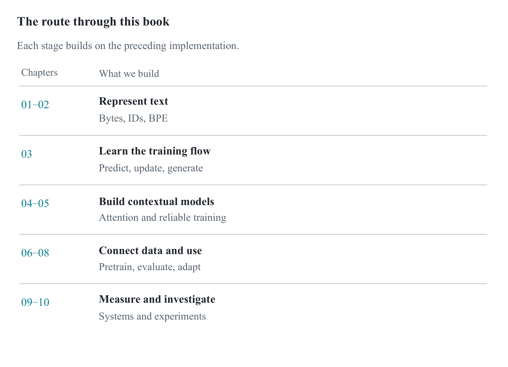{width=100%}

Read the rows from top to bottom. Each chapter range names a stage that adds a capability or a way to verify the preceding implementation. Follow the numbered sections in the contents to work through that route.

Chapters 06 through 08 place the model within a fuller data and usage workflow: preparing data, splitting documents, training and freezing a tokenizer, organizing pretraining, defining fixed evaluation, and studying inference and instruction tuning. Preference optimization and policy objectives provide foundations for further experiments; a concrete task determines which methods to use.

The final two chapters focus on measurement and research. You will inspect where time and memory go, understand the effects of precision, gradient accumulation, and distributed training, and turn your own ideas into testable hypotheses with controlled comparisons and ablations. OneLong serves as the implementation and experimental project that develops along this route.

## Work through a section completely

Each section follows a consistent rhythm: establish the problem, define the quantities in a formula, trace a complete small example, and express the calculation through a function interface. Rows, columns, arrows, and highlights in the figures use the same symbols and values as the text. You should be able to point to the source of every displayed result.

When implementing a section, follow this sequence:

1. Read the inputs, outputs, and assumptions. Separate fixed data from parameters to be learned.
2. Predict the example's intermediate results, especially shapes, indices, summation ranges, and return timing.
3. Use the numbered hints to write the core implementation, preserving the supplied initialization and check driver.
4. Run the checks, then change an input or boundary condition and compare the result with your explanation.
5. Explain the key relationship in your own words, or set the hints aside and reconstruct a small step.

The supplied checks examine behavior; your explanations and reconstructions help examine understanding. When a check fails, follow the example to locate the cause: an incorrect position, a confused dimension, or a value recorded at a different parameter state after an update. An error you can explain often becomes a useful clue when diagnosing a more complicated computation later.

Syntax and library interfaces can be looked up, and tools can help compare explanations. While practicing core logic, leave room to reason through it and write an attempt yourself. Check suggested changes against the formulas, examples, and observed execution.

## From implementation to your own experiments

Once a model generates text, we need a way to assess it. Training loss, performance on data held out from training, and a few generated samples provide different information. We make data splits, tokenizer versions, valid-target counting, and evaluation protocols explicit so that comparisons between runs have a defined basis.

Before changing a model, state what you expect to improve and design a comparison that can test that expectation. Retain the training budget, seeds, code version, and results, including attempts that did not help. Experiments show the conditions under which an idea works and the evidence still needed.

The intended result is a language-model implementation whose essential mechanisms you can explain, whose training you can check, and whose results you can examine independently. It provides a starting point for larger training runs and original ideas. Actual data and evaluation establish its capabilities and limits.

Chapter 01 begins with a short piece of text. Turning it into bytes, and then into IDs usable for training, gives the model its first computable input.

Each section names its numbered companion assignment. Appendix B, Companion exercises, explains how to use the supplied checks. Use the matching companion edition and follow its README for setup. Work through a complete example before moving from the mathematics to the implementation.

[Begin with 01.01: text, tokens, and training windows](#section-01-01)

# Notation and conventions

The same letter can mean different things in different sections. Check its definition before using a formula. This table lists common tensor dimensions. Some examples use different axis lengths so that a wrong transpose is easier to spot.

| Symbol | Meaning | Typical example |
| --- | --- | --- |
| $B$ | Number of sequences in a batch |2 independent sequences |
| $T$ | Number of token positions in one input window |8 positions per sequence |
| $V$ | Number of vocabulary candidates |259 entries in one teaching vocabulary |
| $D$ | Width of a model representation |An 8-component vector per position |
| $H$ | Number of attention heads when used as a count |4 heads |
| $d$ | Matching width of a query and key in one head |$D/H$ in the standard equal-width layout |
| $d_v$ | Width of a value vector in one head |May differ from $d$ in an attention fixture |
| $K$ | Number of selected targets when defined as a loss denominator |Count of True mask entries |
| $P$ | Parameter count or cached-prefix length as locally defined |Never infer its meaning from the letter alone |

`[B,T,D]` is a shape, not a vector's values. `[[1,2],[3,4]]` is an explicit matrix with shape `[2,2]`. An embedding table `[V,D]` maps an ID tensor `[B,T]` to selected vectors `[B,T,D]`; it does not change its number of stored rows when the batch changes.

Python positions and IDs are zero-based. A token ID is a vocabulary index, and repeated IDs can occupy different sequence positions. Special IDs must be reserved against the actual frozen tokenizer. ID 0 is not automatically padding, and IDs greater than 255 are not automatically special: ordinary BPE merges can also use them.

For a token sequence `s`, pair `x=s[:-1]` with `y=s[1:]`. Each input position predicts the following token. Chapter 03 makes these pairs before calling the model. Sections 08.01–08.02 handle complete conversations differently: pass all of `ids` to the model, then align each prediction with the next ID and that ID's target flag inside the loss. Both methods train next-token prediction. Slice only where the function's input and output rules say to slice. Doing it twice skips a token and changes the target.

Logarithms use the natural base unless marked base 2. Cross-entropy then uses nats per selected target. To calculate bits per byte, also count the original UTF-8 bytes for the text being scored. Do not use tensor memory or tensor element count as that denominator. EOS and padding can both add no source bytes, but the target mask can treat them differently.

Approximate equality in numerical tests uses a stated tolerance. Exact arithmetic examples explain a relationship; they are not measurements of trained-model quality. A formula estimating FLOPs or state bytes is not a measurement of elapsed time or peak allocation.

# 01 Text becomes data {#chapter-01}

A model needs numbers as input. This chapter shows how text becomes bytes and token IDs. We also check why one visible character can use several bytes, why a partial byte sequence may not decode, and why an ID is not a word meaning.

We start with UTF-8 bytes because we can check every step without learning a vocabulary. Each byte gets one ID. We then use the ID sequence to build inputs and next-token targets. Later, a tokenizer can group bytes into larger tokens while keeping the same prediction task.

## 01.01 Text, Tokens, and Next-Token Targets {#section-01-01}

### Method sources

Unicode code points and UTF-8 encoding are defined in [Unicode Consortium, 2024; R01](https://www.unicode.org/versions/Unicode16.0.0/) and [Yergeau, 2003; R02](https://www.rfc-editor.org/rfc/rfc3629).

A language model takes numbers as input. To train it on a sentence, we must turn the text into integers and identify the next integer at each position. We must also be able to recover the text from those integers. We will start with one byte per token, so we can follow every step from text to numbers and back.

Work through the example before editing 01_01_text_to_tokens.py. The numbered steps below explain the interface and guide the core implementation; the supplied setup and check driver remain separate.

### 1. Encode text into token IDs

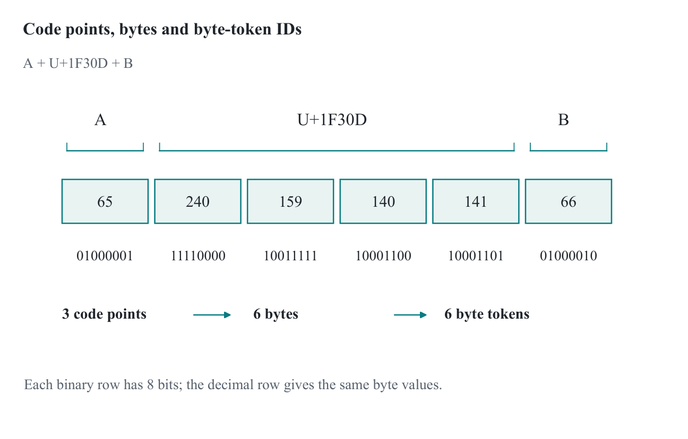{width=100%}

Use the brackets to group the byte cells under their code points. The four middle cells belong to one code point; six cells still mean six byte tokens, not six characters.

Implement `ByteTokenizer.encode`:

- Encode text using UTF-8.
- Return a list of byte values, each an integer from 0 through 255.
- Preserve whitespace and case. Empty text produces an empty list.

Examples:

```text
"hello" -> [104, 101, 108, 108, 111]
"A🌍B"  -> [65, 240, 159, 140, 141, 66]
```

The second string contains three Unicode code points but six UTF-8 bytes. Token count depends on the tokenizer. Here, every byte is one token and the vocabulary contains exactly 256 IDs. This tokenizer has no learned vocabulary or special tokens yet.

Hint: inspect `str.encode` and how iterating over a `bytes` object behaves. Then run:

```sh
python3 exercises/01_01_text_to_tokens.py --check encode
```

### 2. Decode token IDs back into text

Implement `ByteTokenizer.decode` using the reverse path: integer IDs to bytes, then strict UTF-8 decoding.

For text that can be encoded as UTF-8, the round-trip requirement is:

```text
decode(encode(text)) == text
```

Use strict decoding in this exercise. Out-of-range byte values should raise `ValueError`; invalid or incomplete UTF-8 should raise `UnicodeDecodeError`. Do not discard undecodable bytes with `errors="ignore"`.

Encoding a complete string and then decoding it recovers the original text. Decoding a slice of its tokens may fail, because the slice can end inside a character that uses several bytes. Later, we will account for this when displaying generated text.

Hint: inspect the `bytes` constructor and `bytes.decode`. Then run:

```sh
python3 exercises/01_01_text_to_tokens.py --check decode
```

### 3. Construct next-token training examples

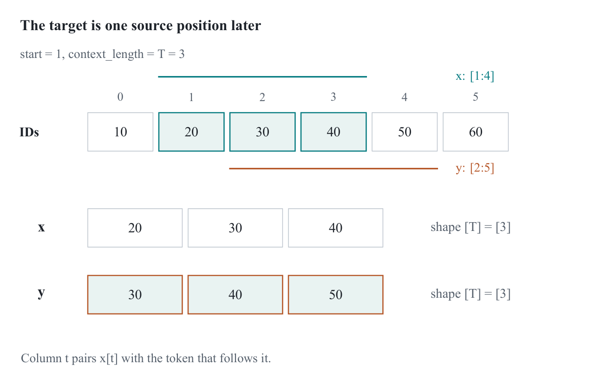{width=100%}

Compare the two rows by column: each target comes from exactly one source position after its input. T=3 therefore needs four source IDs from the starting point.

Implement `make_example(token_ids, start, context_length)`:

- Return two new lists, `x` and `y`, each containing `context_length` tokens.
- `x` starts at `start`; `y` starts at `start + 1`.
- Require `start >= 0`, `context_length > 0`, and enough tokens for the input plus one following token. Raise `ValueError` otherwise.
- Leave the original list unchanged.

For `[10, 20, 30, 40, 50, 60]`, `start=1`, and `context_length=3`:

```text
x = [20, 30, 40]
y = [30, 40, 50]
```

Five tokens in `"hello"` provide four supervised positions:

| Input prefix | Next-token target |
| --- | --- |
| `h` | `e` |
| `he` | `l` |
| `hel` | `l` |
| `hell` | `o` |

These prefixes describe what the model will be allowed to see at each position. We will enforce that visibility with causal masking when implementing attention; constructing shifted labels alone does not prevent future-token leakage.

Hint: use list slicing, but validate the available length first. Python silently truncates an oversized slice. Then run:

```sh
python3 exercises/01_01_text_to_tokens.py --check example
```

### Finish the lesson

Run all acceptance checks from the repository root:

```sh
python3 exercises/01_01_text_to_tokens.py
```

The final line should read `Lesson 01.01 checks passed.` Passing these checks verifies this small exercise; it does not yet verify a trainable language model.

In your own words, explain:

1. Why does `"A🌍B"` produce six tokens here?
2. Why must the target window be shifted by one token?
3. At the second position of the `"hello"` example, which input tokens may causal attention see?

Run the exercise, then explain the token counts and shifted targets in your own words before continuing.

### Variables and implementation review

| Name | Type | Meaning |
| --- | --- | --- |
| `text` | `str` | Input to `ByteTokenizer.encode`; Python text, before UTF-8 encoding. |
| `token_ids` | `list[int]` | Input to `ByteTokenizer.decode` and `make_example`; in this lesson each ID is a byte value. |
| `start` | `int` | Zero-based start of the input window. |
| `context_length` | `int` | Number of positions in each input/target window. |
| `x`, `y` | `list[int]` | Returned input window and one-position-shifted target window. |

For encoding, first obtain bytes with `text.encode("utf-8")`; then use `list(text.encode("utf-8"))` to obtain their integer values and return the list. For decoding, use `bytes(token_ids).decode("utf-8", errors="strict")` to decode the complete byte sequence and return a string.

For `make_example`, check the allowed start and length before slicing. An `if` runs its indented block only when its condition is true; `raise ValueError(...)` reports an invalid request. Ensure at least `context_length + 1` tokens remain from `start`. Then take an input slice beginning at `start` and a target slice beginning at `start + 1`, each of the requested length. Slice ends are excluded. Return `(x, y)` after constructing both lists.

### Questions from practice

#### Why is the byte vocabulary size 256, and the largest value 255?

A byte in this representation has eight bits. Each bit has two possible states, so there are $2^{8}=256$ distinct bit patterns. Zero-based values run from 0 to 255; `11111111` is 255. Thus 256 counts possible values, not bits, stored bytes, or the sum of the values. The choice of an eight-bit byte determines this limit; it is not an arbitrary homework constant.

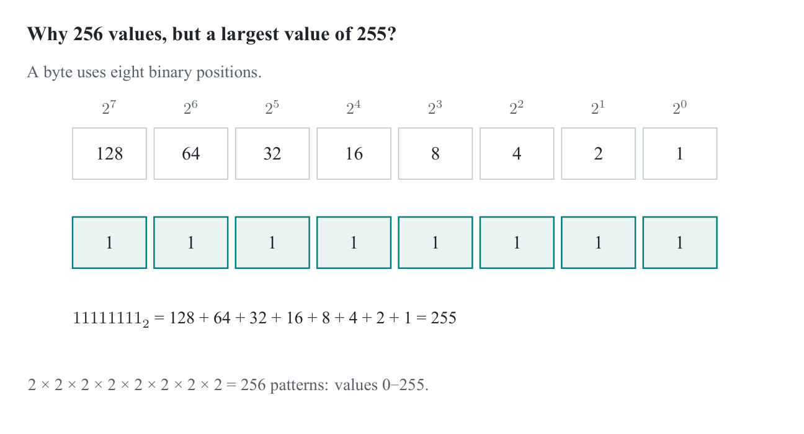{width=100%}

Read the eight columns as place values: a bit contributes its column's value when it is one, and zero otherwise. The all-zero pattern would represent zero; the displayed all-one row represents 128 + 64 + 32 + 16 + 8 + 4 + 2 + 1 = 255. There are 256 distinct patterns including zero.

This limit belongs to one raw byte. A token ID is an integer vocabulary index. Byte-pair encoding (BPE), introduced in Chapter 02, adds IDs such as 256 and 257 without changing the raw-byte range. With $k$ learned merges and no special tokens, our contiguous vocabulary has $256+k$ entries and largest ID $255+k$. Any later special tokens must be counted separately.

#### How do Unicode and UTF-8 relate?

Unicode assigns code points to characters. UTF-8 represents a Unicode scalar value as a sequence of bytes. A scalar value is a code point that is not in the surrogate range. It uses one to four UTF-8 bytes. For example, `"你"` has code point `U+4F60` and UTF-8 byte values `[228, 189, 160]`: three bytes, or 24 bits, not three bits.

A newly encountered character does not need a new byte value. If it has a valid Unicode scalar value, UTF-8 represents it by combining existing byte values. An arbitrary byte sequence, however, is not necessarily valid UTF-8. A visible character can also involve several code points, so visible-character count and byte count need not agree.

#### What are `b"a"`, byte IDs, and embedding vectors?

`"a"` is a Python `str`; `b"a"` is a `bytes` object containing the single value 97. `list(b"a")` produces `[97]`, and `bytes([97])` reconstructs that byte object. The leading `b` is Python syntax and is not an extra byte in the contents. For a non-ASCII string named `text`, `text.encode("utf-8")` produces its byte representation.

In this first tokenizer, the byte value itself is the token ID. Later BPE IDs label byte sequences through a vocabulary. Embedding vectors are a separate model representation: the ID selects a row of floating-point values. Joining bytes does not create an embedding vector, and an embedding dimension is a count of components, not a numeric range from 0 to 256.

#### If three code points produce six tokens, must every shorter output fail to decode?

No. For `"A🌍B"`, the six byte IDs are `[65, 240, 159, 140, 141, 66]`. The first five already contain the complete `A` and the complete globe, so they decode to `"A🌍"`. The first three stop inside the globe's four-byte encoding and cannot yet be strictly decoded. Completion of byte sequences determines validity, rather than whether the expected token count was reached.

Generated IDs can also map to invalid byte patterns; merely generating more IDs does not guarantee a repair. Strict decoding reports incomplete or invalid UTF-8. Later streaming display can buffer an incomplete suffix. Decoding success and predicting the intended text are separate properties.

#### Does training predict five tokens at once, or one next token?

At each training position, the model uses the tokens it is allowed to see to predict the next token. A length-five input window provides five such predictions. A causal model can compute all their probability distributions in one training pass because the input tokens are known. Generating five unknown future tokens requires a different process.

Generation normally selects one next token, adds it to the sequence, and predicts again. `make_example` prepares shifted labels; the causal model and loss will be implemented later. A `PASS encode` line confirms that the supplied cases behaved as expected; it does not show that a language model has been trained or that every concept has been independently mastered.

Chapter 02 builds on this byte vocabulary with byte-pair encoding (BPE). We will count adjacent token pairs, merge the most frequent pair, and assign its byte sequence a new token ID. The first checks ask whether those larger units shorten a sequence while preserving its original bytes.

### References

- [Python string encoding](https://docs.python.org/3.9/library/stdtypes.html#str.encode) and [byte decoding](https://docs.python.org/3.9/library/stdtypes.html#bytes.decode): API behavior for this exercise.
- [minbpe](https://github.com/karpathy/minbpe): a compact reference for the next lesson. Try implementing your own first, then compare the designs.

- [Python Unicode HOWTO](https://docs.python.org/3/howto/unicode.html): code points, encodings, and byte representations.

## Looking back

We can now turn text into input and target IDs. Byte sequences can be long, so the next chapter groups common byte sequences into larger tokens. Decoding must still recover the original bytes.

# 02 Learn a vocabulary {#chapter-02}

A tokenizer defines how text maps to IDs. Those meanings must stay fixed while the language model uses them. In byte-pair encoding, tokenizer training adds entries by merging common adjacent pairs. Encoding new text only applies the learned rules in order. It does not create new IDs.

We build one function for each step. Count the pairs, choose a rule, and merge a sequence. Repeat these steps to train the tokenizer. To encode, use the saved rules. To decode, rebuild the bytes and decode them as UTF-8. Keeping these steps separate prevents an ID from changing its meaning during model training.

## 02.01 BPE and Adjacent Pair Counts {#section-02-01}

### Method sources

For byte-pair encoding in neural text models, see [Sennrich et al., 2016; R03](https://aclanthology.org/P16-1162/); for the byte-level variant used in GPT-2, see [Radford et al., 2019; R25](https://cdn.openai.com/better-language-models/language_models_are_unsupervised_multitask_learners.pdf).

The byte tokenizer can represent new text, but common byte sequences take several tokens each time they occur. We can shorten some sequences by assigning them a single token. To decide which sequences to combine, BPE first counts every pair of neighboring tokens.

Work through the example before editing 02_01_bpe_pair_counts.py. The numbered steps below explain the interface and guide the core implementation; the supplied setup and check driver remain separate.

### Why extend the byte tokenizer?

Our first tokenizer represents every byte separately. Giving a repeated byte sequence its own token ID can reduce the token count for some texts. A context with a fixed number of tokens can then hold more text. But the larger vocabulary also needs a larger embedding table and output layer. A shorter token sequence alone does not show that a language model is better.

Tokenizer training here means learning merge rules from frequency counts. It does not use gradient descent. The language model will learn its own parameters separately.

### A single BPE merge

Start with `"ababab"`:

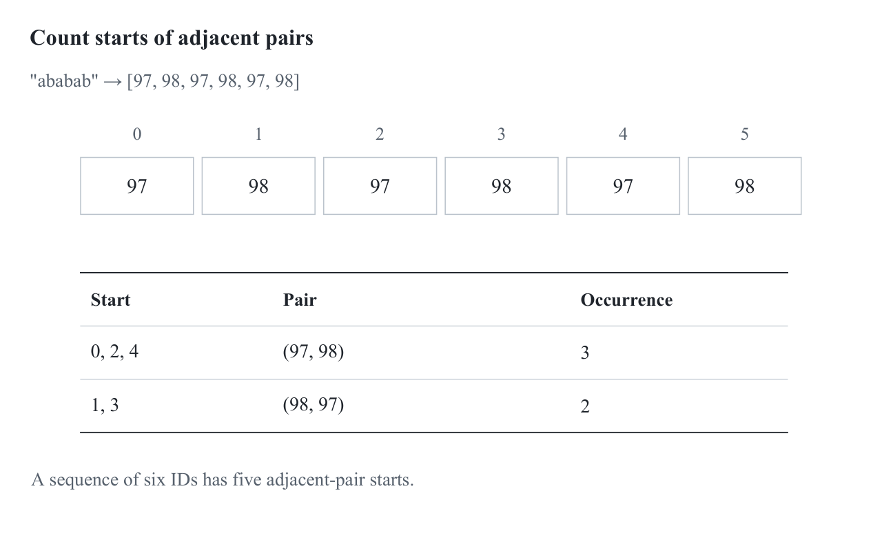{width=100%}

Read the ID sequence from left to right and compare the table's two rows. Starts 0, 2 and 4 have the ordered pair (97,98); starts 1 and 3 have (98,97). Sharing an endpoint does not remove a count.

```text
UTF-8 byte IDs: [97, 98, 97, 98, 97, 98]
```

Scan each adjacent position:

| Start position | Pair | Byte text |
| --- | --- | --- |
| 0 | `(97, 98)` | `ab` |
| 1 | `(98, 97)` | `ba` |
| 2 | `(97, 98)` | `ab` |
| 3 | `(98, 97)` | `ba` |
| 4 | `(97, 98)` | `ab` |

The counts are:

```text
{(97, 98): 3, (98, 97): 2}
```

Choose the most frequent pair, `(97, 98)`, and introduce token ID `256` for its byte sequence `b"ab"`. A left-to-right merge produces:

```text
[97, 98, 97, 98, 97, 98] -> [256, 256, 256]
```

There are now 257 vocabulary entries: the original 256 byte tokens plus one new token. Each new token still gets one embedding vector. Its ID is a lookup index, not the concatenation of embedding vectors.

The raw UTF-8 encoding has not changed. A BPE vocabulary records what bytes each token represents:

```text
97  -> b"a"
98  -> b"b"
256 -> b"ab"
```

To decode merged IDs, find each ID's bytes in the vocabulary. Join the bytes in order, then decode them as UTF-8. The operation `bytes([256])` cannot look up vocabulary contents. A BPE token may contain only part of a UTF-8 character, so slices and generated sequences can have the decoding problems discussed in Lesson 01.01.

### Your function

Implement:

```python
def count_pairs(token_ids: list[int]) -> dict[tuple[int, int], int]:
    ...
```

The keys are ordered two-token tuples; the values are occurrence counts. At each valid index `i`, inspect the tokens at `i` and `i + 1` and increment that pair's count.

- Visit every adjacent position. A sequence of length $n$ has $n-1$ adjacent positions when $n\ge1$.
- Preserve order: `(97, 98)` and `(98, 97)` are different pairs.
- Include overlaps: `[42, 42, 42]` contains two occurrences of `(42, 42)`.
- Return `{}` for empty or one-token input.
- Accept already merged IDs such as `256`; keep the source list unchanged.

Counting includes pairs that share a token. Replacement must use each source token only once. For example, the two pairs in `[42, 42, 42]` share the middle token, so a single left-to-right pass cannot replace both. We will implement replacement in the next lesson.

Hint: use a dictionary with tuple keys and a loop over adjacent positions. You may inspect pairs with indexing or with two offset views of the list.

### Check your implementation

#### Variables and numbered review

`token_ids` is `list[int]`. The returned `pair_counts` is `dict[tuple[int, int], int]`. The implementation uses `i` as a source index and `pair` as the current two-ID tuple.

1. Start an empty dictionary named `pair_counts`. `{}` creates a dictionary.
2. Visit valid adjacent starts with `range(len(token_ids) - 1)`. `range` excludes its endpoint; for six tokens it yields indices 0 through 4. With zero or one token this range is empty.
3. Inside the loop, form `pair` from `token_ids[i]` and `token_ids[i + 1]`. Parentheses with a comma create a tuple. After the first position in `"ababab"`, the key is `(97, 98)`.
4. Increment that key's count. `pair_counts.get(pair, 0)` reads the previous count or zero if the key is absent. The first two positions produce `{(97, 98): 1, (98, 97): 1}`.
5. Return `pair_counts` after the loop, including `{}` when no adjacent pair exists.

#### Classroom clarification

This function counts pair occurrences; it does not choose the winner, allocate a token ID, or merge anything. A pair occurring once is still a real pair and receives count 1. Only empty input or one token produces no adjacent pair. Counting all positions includes overlap, while the next lesson's replacement must avoid reusing the same source token.

```sh
python3 exercises/02_01_bpe_pair_counts.py
```

The final line should be `Lesson 02.01 checks passed.`

Explain why `[97, 98, 97, 98]` contains both `(97, 98)` and `(98, 97)`. Share your implementation and check output for review.

### Later BPE steps

1. Implement non-overlapping pair replacement.
2. Repeat counts and merges with deterministic tie-breaking; store the ordered merge rules and token-to-byte vocabulary.
3. Encode new text using the fixed learned merge ranking, rather than relearning merges for each input.
4. Decode via byte lookup and verify round trips, vocabulary serialization, special tokens, and boundary cases.
5. Define text segmentation and document boundaries, fit on training data, and compare compression and throughput before choosing a working vocabulary size.

### Next exercise

Continue with [Lesson 02.02: non-overlapping BPE merges](#section-02-02) after the pair-count checks and review.

### Reference

[minbpe's pair-counting and merge helpers](https://github.com/karpathy/minbpe/blob/master/minbpe/base.py) are a reference for later review. The exercise checks specify the behavior; write your version before comparing implementations.

## 02.02 Non-Overlapping BPE Merges {#section-02-02}

A pair can be counted at two positions that share a token. Replacing both occurrences would use that token twice and change the text. We will scan from left to right and use each source token once. This keeps the original bytes unchanged.

Work through the example before editing 02_02_bpe_merge.py. The numbered steps below explain the interface and guide the core implementation; the supplied setup and check driver remain separate.

### Byte values and token IDs

One byte contains eight bits, so it has $2^{8}=256$ possible values, numbered `0` through `255`. This is a count of possible values, not a quantity of stored bytes.

Our initial tokenizer uses those byte values as its token IDs. BPE adds vocabulary entries: token ID `256` can represent the two bytes `b"ab"`. A token ID is an integer lookup index and is not restricted to a single byte. In binary, integer `256` is `100000000`, which requires nine bits in an unsigned representation; that does not change what its vocabulary entry represents. Actual token-array storage uses a chosen integer dtype, which we will consider when preparing data.

### One merge pass

For pair `(97, 98)` and new ID `256`:

```text
Source: [97, 98, 97, 98, 97, 98]
Result: [256, 256, 256]
```

The caller chooses the pair and its new ID. This helper performs the replacement; vocabulary construction is a separate step.

### Why counting and merging handle overlap differently

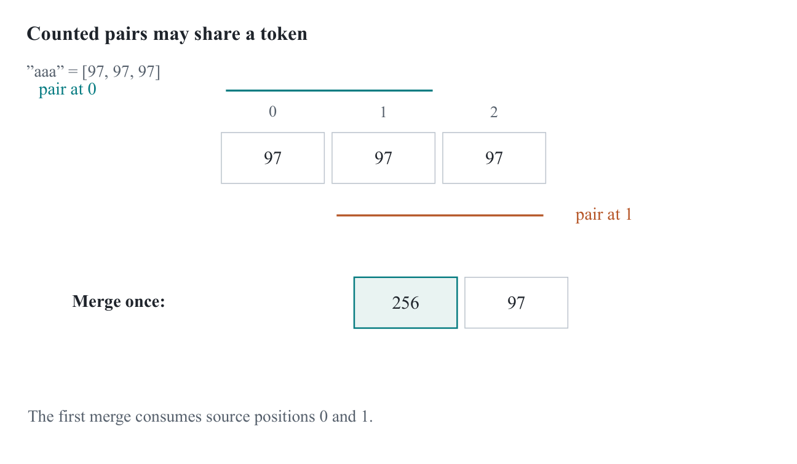{width=100%}

Track which source positions have been consumed. The valid result keeps three original bytes; the rejected overlapping replacement would produce four.

For `"aaa"`, the source is `[97, 97, 97]`. Pair counting sees `(97, 97)` twice: at positions 0–1 and 1–2. Both occurrences share the middle token.

If new ID `256` represents `b"aa"`, left-to-right replacement consumes the first two tokens and leaves the third:

```text
[97, 97, 97] -> [256, 97]
bytes: aaa  ->       aa + a
```

Replacing both overlapping occurrences would produce `[256, 256]`, representing `"aaaa"`, which changes the source text. For four `a` tokens, two non-overlapping replacements are possible and `[256, 256]` is correct.

### Algorithm to implement

Build a new output list and track the current source position `i`:

1. If two source tokens remain and they match `pair`, append `new_id` and advance `i` by two.
2. Otherwise, append the current source token and advance `i` by one.
3. Continue until all source tokens are consumed, then return the new list.

Before inspecting `i + 1`, check that this next position exists. Scan the original sequence throughout the pass, rather than scanning the output as it grows. Copy unmatched tokens in their original order. Return a new list even for empty or one-token inputs.

Each replacement reduces the token count by one. In the vocabulary, `new_id` must represent the first matched token's bytes followed by the second token's bytes. With that entry, reconstructing the result gives exactly the original bytes.

### Check your implementation

#### Variables and control flow

`token_ids` is `list[int]`, `pair` is `tuple[int, int]`, and `new_id` is `int`. Return a new `list[int]`. The output list is named `new_res`, and `i` tracks the current source position.

Start with an empty `new_res` and set `i` to zero. A `while` loop repeats its indented body while its condition is true. Here the condition is `i < len(token_ids)`. Use `if` for a match and `else` for all other cases. First test `i + 1 < len(token_ids)` to check that the second ID exists. Python evaluates the right side of `and` only when the left side is true. Put the boundary check first to protect the lookup.

For `"aaa"`, start with `new_res=[]` and `i=0`. A match appends 256 and advances `i` to 2. Only one source token remains, so the unmatched branch appends 97 and advances `i` to 3. The loop stops and returns `[256, 97]`. `i += 2` adds two to the index; it does not modify the source list. Keep the final return outside the loop and never reuse tokens consumed by a match.

```sh
python3 exercises/02_02_bpe_merge.py
```

The final line should read `Lesson 02.02 checks passed.` The checks include repeated and overlapping pairs, a match at the end, already merged IDs, and preservation of the source sequence.

Explain why counting two `(97, 97)` pairs in `[97, 97, 97]` leads to only one replacement. Share your implementation and output for review.

### Next step

Continue with [Lesson 02.03: the BPE training loop](#section-02-03). Select a most frequent pair, assign the next vocabulary ID, store its bytes and merge rank, apply the merge, and recompute counts on the changed sequence. Tie-breaking and stopping behavior are explicit parts of that lesson; encoding unseen text with fixed rules follows afterward.

### Reference

[minbpe's helper functions](https://github.com/karpathy/minbpe/blob/master/minbpe/base.py) provide a reference for review after implementing your version.

## 02.03 The BPE Training Loop {#section-02-03}

### Method sources

The iterative vocabulary-merge procedure follows the BPE approach of [Sennrich et al., 2016; R03](https://aclanthology.org/P16-1162/). For its byte-level language-model variant, see [Radford et al., 2019; R25](https://cdn.openai.com/better-language-models/language_models_are_unsupervised_multitask_learners.pdf).

We can now count adjacent pairs and replace a selected pair. Repeating these steps learns BPE rules. In each round, select a pair, give its byte sequence a new ID, and save the rule. Then count pairs again in the shorter sequence. A selected pair may occur once or several times.

Work through the example before editing 02_03_bpe_train.py. The numbered steps below explain the interface and guide the core implementation; the supplied setup and check driver remain separate.

### Inputs, state, and returned values

| Name | Type | Meaning |
| --- | --- | --- |
| `text` | `str` | Text supplied for learning merge rules. |
| `vocab_size` | `int` | Requested upper bound on vocabulary entries, at least 256. |
| `ids` | `list[int]` | Current token sequence for the training text. |
| `vocab` | `dict[int, bytes]` | Each token ID and its byte contents. |
| `merges` | `dict[tuple[int, int], int]` | Each learned pair and its new token ID. |
| `next_id` | `int` | Next ID to allocate, starting at 256. |
| `pair_counts` | Pair-to-count dictionary | Adjacent-pair counts for the current `ids`. |
| `max_account` | `int` | Local variable for the maximum current pair count. |
| `candidates` | List of two-ID tuples | Highest-count pairs before numeric tie-breaking. |
| `best_pair` | Two-ID tuple | Pair selected by the exercise's tie rule. |
| Returned value | Three-object tuple | `(ids, merges, vocab)` in that order. |

Start with all 256 byte entries, including byte values absent from this particular text. Their IDs are `0` through `255`. The initializer is provided:

```python
vocab = {idx: bytes([idx]) for idx in range(256)}
```

For example, `vocab[97]` is `b"a"` and `vocab[98]` is `b"b"`. A vocabulary entry stores bytes, not an embedding vector.

### Trace two rounds

Use `text="ababab"` and `vocab_size=258`:

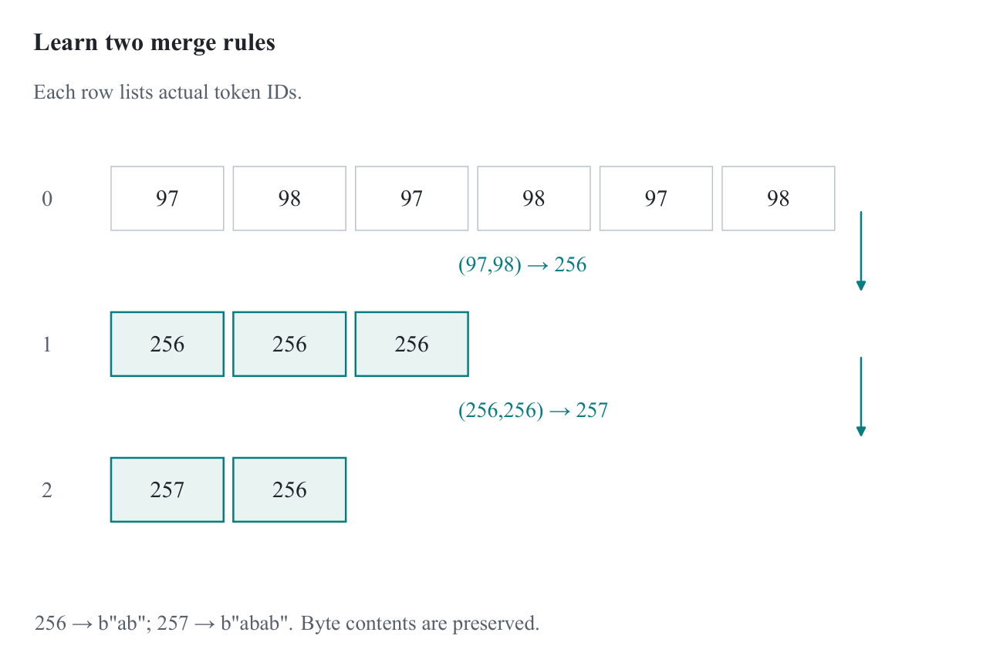{width=100%}

Read downward through the three sequence states. A new vocabulary entry appears each round, while joining its byte contents always recovers the same six bytes.

| Stage | Current IDs | Vocabulary entries |
| --- | --- | ---: |
| Initial | `[97, 98, 97, 98, 97, 98]` | 256 |
| After round 1 | `[256, 256, 256]` | 257 |
| After round 2 | `[257, 256]` | 258 |

In round 1, `(97, 98)` occurs three times and `(98, 97)` twice. Select `(97, 98)`, assign the next ID `256`, and record:

```text
merges[(97, 98)] = 256
vocab[256] = b"ab"
```

After replacement, count again on `[256, 256, 256]`. Now `(256, 256)` occurs twice. The two occurrences overlap, so the replacement pass makes one replacement. Introduce ID `257` for `b"abab"` and obtain `[257, 256]`.

The reconstructed bytes are `b"abab" + b"ab"`, which preserves `"ababab"`. The vocabulary now has 258 entries, so stop. The maximum allocated ID is 257; the text uses two token positions at this stage. Vocabulary size, maximum ID, and sequence length are three different quantities.

### Record the new token's meaning

Let the selected pair be `(a, b)`. Because each child ID already has a vocabulary entry, its new byte contents are:

```python
vocab[a] + vocab[b]
```

For bytes, `+` joins the sequences in order. Save the joined bytes under the new ID. A child token may already stand for several bytes; looking up its contents before joining makes the same step work in later rounds.

The next ID can be `len(vocab)` because IDs start at zero and have no gaps. Save the pair and its new ID in `merges`. The IDs increase in learning order, so they also tell the encoder which learned rule has priority.

### Loop behavior

Repeat while the actual vocabulary contains fewer than `vocab_size` entries:

1. Call `count_pairs` on the current `ids`.
2. Stop early if the count dictionary is empty.
3. Select a pair with the largest occurrence count, using the tie rule below.
4. Allocate a fresh ID and record both its byte contents and merge rule.
5. Call `merge_pair` and replace `ids` with its returned sequence.

Return `(ids, merges, vocab)` after the loop. A limit of 256 allows no new entries. An empty or one-token sequence has no adjacent pair, so it may stop below the requested limit. This exercise allows frequency-one pairs to be merged.

The implementation rejects limits below 256 and imports your previous helpers. Its `max_account` variable stores the maximum current pair count. This frequency-based choice is specific to training; the encoding selector in Lesson 02.04 compares learned rule IDs instead.

### Deterministic tie rule

When several pairs have the same highest count, we need a fixed rule so repeated training gives the same result. Choose the numerically smallest pair tuple among them. Compare the first IDs; if they are equal, compare the second IDs.

For `"bac"`, the pairs `(98, 97)` and `(97, 99)` each occur once. Choose `(97, 99)` because 97 is smaller than 98. Different tie policies can produce different vocabularies; this policy fixes the expected results for our exercise.

### Check the implementation

```sh
python3 exercises/02_03_bpe_train.py
```

The final line should read `Lesson 02.03 checks passed.` The first demonstrated result is:

```text
ababab -> [257, 256]; vocabulary entries: 258
```

The checks verify new counts after each merge, byte preservation, retained base entries, the vocabulary budget, tie-breaking, and early stopping.

Individual vocabulary entries may contain incomplete UTF-8 characters. Reconstruct a complete training string by joining all token byte contents before UTF-8 decoding. This preserves the decoding distinction from Lesson 01.01.

Share your implementation and output. Explain why the second round counts `(256, 256)` instead of continuing to count `(97, 98)`.

### Classroom questions and Python details

#### What does `{idx: bytes([idx]) for idx in range(256)}` do?

This is a dictionary comprehension. `range(256)` supplies integers 0 through 255; `idx` is the current integer. The expression before the colon supplies the key, and `bytes([idx])` supplies a one-byte value. For `idx=97`, the entry is `97: b"a"`. For `idx=0`, it is `0: b"\x00"`. All 256 entries are created, including bytes absent from the training text. Values are bytes, not vectors.

`b"a" + b"b"` gives `b"ab"`. The displayed `b` prefixes mark Python bytes literals; they are not inserted into the contents. Concatenation also works with chunks that are not independently decodable as UTF-8; decode only the joined complete byte stream.

#### What does `if not pair_counts: break` test? Does a count of one stop training?

`pair_counts` is a dictionary. An empty dictionary is false in a condition, so `not pair_counts` is true only when this dictionary is empty. A dictionary such as `{(97, 99): 1}` is nonempty even though the count is one. `break` exits the nearest loop; it does not return the function's final values by itself. After leaving the loop, execution reaches the return.

Our trainer permits frequency-one merges. It stops when the vocabulary budget is reached or the current sequence has no adjacent pair. A requested size is an upper bound; small inputs can stop before reaching it.

#### How do frequency ties work, and what do I need to remember?

First retain the pairs with the largest count. Then choose the numerically smallest tuple among those candidates. Tuple comparison examines the first ID, then the second if the first IDs match. This is different from choosing whichever dictionary entry appears first.

For counts `{(98, 99): 4, (97, 99): 4}`, both pairs have the highest count. Choose `(97, 99)` by numeric tuple order. The method `pair_counts.items()` yields `(pair, count)` entries, so a loop can collect the pairs with the maximum count. The variable `max_account` stores that count. Use that exact name when following the code.

Remember the state transitions rather than memorizing a whole program: count the current sequence, choose a pair, record a new ID and its bytes, replace, then count the changed sequence again. Practice a small trace and reconstruct one step without AI completion.

Continue with [Lesson 02.04: selecting a learned rule](#section-02-04), then [Lesson 02.05: encoding new text](#section-02-05). Decoding and save/load follow encoding. Corpus preparation, segmentation boundaries, special tokens, and efficiency follow the verified basic implementation.

### Reference

[minbpe's basic tokenizer](https://github.com/karpathy/minbpe/blob/master/minbpe/basic.py) illustrates the count/merge/vocabulary loop. Our exercise specifies its own numeric tie rule and early-stopping behavior.

## 02.04 Select a Learned BPE Rule {#section-02-04}

A trained tokenizer uses a fixed set of rules for new inputs. During encoding, first find the learned rules that match pairs in the current sequence. Then choose the rule learned earliest. This selector performs that choice; the full encoder will call it after each merge.

Work through the example before editing 02_04_bpe_select_rule.py. The numbered steps below explain the interface and guide the core implementation; the supplied setup and check driver remain separate.

### Match the explanation to the actual exercise

This lesson is in `exercises/02_04_bpe_select_rule.py`. Its exercise function is exactly:

```python
select_merge_pair(pair_counts, merges)
```

`pair_counts` and `merges` are passed into this function by `check_selection()`. Each check uses its own example dictionaries. The examples represent separate rule sets; they do not all share the vocabulary learned from `"ababab"`.

| Part of the file | Purpose |
| --- | --- |
| `select_merge_pair` | Assigned function: return an applicable pair, or `None`. |
| `check_selection` | Supplied checks: pass dictionaries to the exercise function and check its result. |
| The main guard | Run the supplied checks when the file is executed. |

There is no `max_count` argument in this exercise. `train_bpe` in the previous exercise uses its `max_account` variable for frequency-based selection. Here the choice depends on `merges[pair]`. This helper returns a pair; the next lesson's `encode_bpe(text, merges)` returns the complete encoded sequence.

### Inputs and returned value

| Name | Type | Meaning |
| --- | --- | --- |
| `pair_counts` | `dict[tuple[int, int], int]` | Current adjacent pairs and their occurrence counts; its keys determine which pairs are present. |
| `merges` | `dict[tuple[int, int], int]` | Fixed learned pairs and their replacement IDs; smaller learned IDs have earlier priority in our format. |
| `candidates` | List of two-integer tuples | Current pairs that also have a learned rule. |
| `best_pair` | Two-integer tuple | Candidate with the smallest learned replacement ID. |
| Returned value | `Optional[tuple[int, int]]` | One selected pair, or `None` when no learned rule applies. |

Leave both dictionaries unchanged. Use the keys of the current counts to find pairs that are present. Use the learned IDs to decide which matching rule comes first. Return `None` when no rule applies, so the caller knows to stop. It is not a token ID.

### Training and encoding have different jobs

Training discovers a vocabulary: count the current adjacent pairs, choose the highest-frequency pair using the specified tie policy, allocate an ID, and record a new rule.

Encoding uses the vocabulary and rules already learned. Start with the new text's UTF-8 byte IDs. Apply the earliest learned rule that matches a current pair, update the sequence, and choose again. Stop when no learned rule matches. Keep the vocabulary fixed throughout; encoding does not add entries.

| Operation | How the next pair is selected | Creates new entries? |
| --- | --- | --- |
| Training | Highest frequency; numeric pair order breaks ties in our exercise. | Yes, within the requested budget. |
| Encoding | Earliest learned rule among pairs currently present. | No. |

This remains tokenizer processing. Predicting the next token with a neural language model comes later.

### Select by learned order

Our trainer allocates IDs 256, 257, and so on in learning order. For this implementation, the smallest new ID identifies the earliest learned rule. This is a property of our allocation scheme; other tokenizer formats can store rule ranks separately.

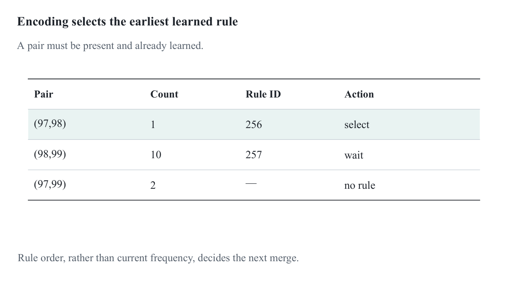{width=100%}

In the first two rows, the less frequent pair wins because ID 256 records an earlier learned rule. The last row is the separate no-rule example: presence alone does not make a pair eligible.

Suppose the current input has these pair counts:

```python
pair_counts = {(97, 98): 1, (98, 99): 10}
merges = {(97, 98): 256, (98, 99): 257}
```

Both pairs have learned rules. Select `(97, 98)` because its rule was learned earlier: 256 is smaller than 257. Current frequency does not set rule priority during encoding.

One actual acceptance case reverses the rule order:

```python
pair_counts = {(97, 98): 3, (98, 99): 1}
merges = {(97, 98): 257, (98, 99): 256}
```

The expected result is `(98, 99)` because its learned ID is 256. Taking `min(candidates)` would choose the numerically smaller pair `(97, 98)` and fail this case. Compare the candidates' `merges[pair]` values instead. This case is named `"rule order overrides numeric child-pair order"` in `check_selection()`.

Consider only pairs that occur in the current sequence and have a learned rule. A rule absent from the current sequence cannot apply; a present pair absent from `merges` cannot apply either.

### Complete small trace

Use the second rule-order example above. Both current pairs have a rule, so collecting eligible pairs gives `[(97, 98), (98, 99)]`. The list is nonempty. Compare their learned IDs: 257 for `(97, 98)` and 256 for `(98, 99)`. The selected pair is `(98, 99)`, and that tuple is the returned value. The caller will look up ID 256 and perform replacement.

If `pair_counts` is `{(97, 99): 2}` with the same `merges`, the candidate list is empty and the returned value is `None`. Encoding cannot invent a rule for that pair.

### Numbered implementation review

Review the completed `select_merge_pair(pair_counts, merges)`:

1. Start `candidates` as an empty list. Visit each current pair using a `for` loop. Keep only pairs for which `pair in merges` is true, and append each eligible pair. In the worked example, the result is `[(97, 98), (98, 99)]`. An `if` runs its indented block only when its condition is true; dictionary membership checks keys.
2. Test `not candidates`. An empty list makes this condition true. Return `None` in that case, leaving the function before selection. A nonempty list proceeds to the next step.
3. Select `best_pair` by comparing `merges[pair]`, rather than pair counts or the numeric order of child pairs. `min(..., key=...)` compares the values supplied by its key function while returning the original pair. The `lambda x: merges[x]` is a small function mapping a candidate `x` to its learned ID. The example selects `(98, 99)`.
4. Return `best_pair` after selection. The selector returns one pair; the caller performs the merge.

Keep input dictionaries unchanged. Prefer explicit loops while learning. Syntax references are allowed; practice without AI completion. The file separates exercise code from the supplied `check_selection()` driver.

### Run the checks

```sh
python3 exercises/02_04_bpe_select_rule.py
```

The expected final line is:

```text
Lesson 02.04 checks passed.
```

Checks cover learned order, currently applicable rules, empty inputs, unknown pairs, and unchanged input dictionaries.

### Classroom questions: candidates and selection

#### Why is the frequency-based candidate loop no longer the right one?

This function applies rules learned earlier. `pair_counts` tells us which pairs are present; `merges` tells us which of those pairs are legal and which rule came first. The selected output is a pair tuple, not a count or a replacement ID.

A loop using `if pair in merges: continue` skips the learned pairs that encoding needs. The keyword `continue` skips the rest of the current iteration and moves to the next item. Encoding candidates must appear in both dictionaries. Training uses a different choice: it keeps highest-frequency pairs and may create a new rule.

#### How do `pair_counts.items()`, `item[0]`, and `item[1]` relate?

For an item `((97, 98), 3)` from `pair_counts.items()`, `item[0]` is `(97, 98)` and `item[1]` is 3. Unpacking it as `pair, count` gives the same two objects with clearer names. Comparing `item[1]` with a maximum count belongs to training, not learned-rule selection. Here a candidate's comparison value is `merges[pair]`.

Our IDs encode learning order only because the trainer assigns them consecutively. A `lambda` used as the `key` for `min` tells Python what value to compare for each candidate. The returned result is still the candidate pair itself.

Continue with [Lesson 02.05: encode new text](#section-02-05), connecting this selector with `count_pairs` and `merge_pair`.

## 02.05 Encode New Text with Frozen BPE Rules {#section-02-05}

### Method sources

For encoding text with learned BPE merge rules, see [Sennrich et al., 2016; R03](https://aclanthology.org/P16-1162/). The byte-level language-model variant is described in [Radford et al., 2019; R25](https://cdn.openai.com/better-language-models/language_models_are_unsupervised_multitask_learners.pdf).

The tokenizer has learned a vocabulary and merge rules. We can now use them to encode new text. Repeatedly apply learned rules that match current pairs, and leave unmatched byte tokens as they are. A pair with no learned rule can stay as separate tokens because every byte already has an ID.

Work through the example before editing 02_05_bpe_encode.py. The numbered steps below explain the interface and guide the core implementation; the supplied setup and check driver remain separate.

### Training and encoding have different jobs

Training discovers a vocabulary: count the current adjacent pairs, choose the highest-frequency pair using the specified tie policy, allocate an ID, and record a new rule.

Encoding applies the existing vocabulary to a new input. Its vocabulary and rules remain fixed. Start from the new text's UTF-8 byte IDs, apply eligible learned rules, and stop when no learned rule applies. New text does not create new vocabulary entries.

| Operation | How the next pair is selected | Creates new entries? |
| --- | --- | --- |
| Training | Highest frequency; numeric pair order breaks ties in our exercise. | Yes, within the requested budget. |
| Encoding | Earliest learned rule among pairs currently present. | No. |

This remains tokenizer processing. Predicting the next token with a neural language model comes later.

### Trace one new input

Training on `"ababab"` with a vocabulary budget of 258 learned:

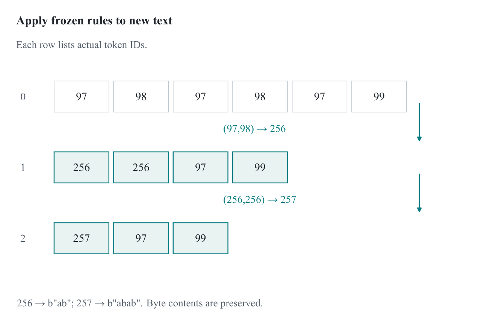{width=100%}

After each merge, read the newly formed sequence before choosing again. The final three IDs still contain pairs, but none has an applicable learned rule.

```text
(97, 98)   -> 256   contents: b"ab"     first learned rule
(256, 256) -> 257   contents: b"abab"   second learned rule
```

Now encode `"ababac"` with those same rules:

```text
Initial bytes: [97, 98, 97, 98, 97, 99]
After rule 1:  [256, 256, 97, 99]
After rule 2:  [257, 97, 99]
```

The final sequence has adjacent pairs, but neither has a learned rule. Stop. In particular, `(97, 99)` cannot receive a fresh ID during encoding. The base vocabulary already contains ID 99 for the byte in `"c"`.

The reconstructed bytes are `b"abab" + b"a" + b"c"`, preserving the complete input.

### Connect the helpers

Implement the `encode_bpe` region in `exercises/02_05_bpe_encode.py`. The file supplies helper imports, byte conversion, checks, and a complete example. Numbered comments now sit beside the corresponding implementation steps. No package installation is needed.

#### Variables used in this exercise

| Name | Type | Meaning |
| --- | --- | --- |
| `text` | `str` | New text supplied by the caller. |
| `merges` | Pair-to-ID dictionary | Fixed learned rules supplied by the caller. |
| `ids` | List of integers | Current encoding state; replaced after each merge pass. |
| `pairs` | Pair-to-count dictionary | Adjacent pairs in the current `ids`, recomputed each round. The encoder passes this object to the selector's `pair_counts` parameter. |
| `pair` | Two-integer tuple or `None` | Result of the rule selector. |
| `merges[pair]` | Integer expression | Existing replacement ID passed directly to `merge_pair`. |

The grading code also uses a byte vocabulary to check reconstruction. That vocabulary is not an argument needed by your encoder.

#### Numbered implementation steps

1. Start a repeating loop. `while True` runs until `break` leaves the loop.
2. Call `count_pairs` on the current `ids` and store its dictionary in `pairs`.
3. Call `select_merge_pair` with `pairs` and `merges`, storing its result in `pair`.
4. If `pair is None`, use `break`. This test belongs before dictionary lookup.
5. Look up `merges[pair]`, call `merge_pair` with the current sequence and chosen rule, and store the returned sequence back in `ids`.
6. After the loop, return the final `ids`.

For the worked input `"ababac"`, the state checkpoints are:

| Checkpoint | `ids` |
| --- | --- |
| Provided starting state | `[97, 98, 97, 98, 97, 99]` |
| After the first replacement | `[256, 256, 97, 99]` |
| After the second replacement | `[257, 97, 99]` |
| No applicable rule; returned result | `[257, 97, 99]` |

The result still has three tokens. Stop when no learned rule matches, even if adjacent pairs remain. After each merge, assign the returned sequence back to `ids` so the next round counts the new pairs. Put the final return outside the loop so encoding can perform all needed rounds.

#### Run and interpret the checks

```sh
python3 exercises/02_05_bpe_encode.py
```

Each named `PASS` line identifies a tested behavior. The final line is `Lesson 02.05 checks passed.` Checks cover empty inputs, multiple rounds, unlearned pairs, non-overlapping replacement, fixed rule priority, Unicode bytes, and unchanged rules.

The [Lesson 02.04 selector](#section-02-04) remains available as a review reference. Both exercises use independent rule sets in some acceptance cases, so always inspect the `merges` dictionary supplied to that case.

### Classroom question: can `"abac"` create an `ac` token?

Suppose the frozen rules contain only $(97, 98) \to  256$. New text `"abac"` starts as `[97, 98, 97, 99]`; applying the learned `ab` rule produces `[256, 97, 99]`. The current pairs are `(256, 97)` and `(97, 99)`, neither of which has a rule. Return those three IDs. The final `ac` stays as two byte tokens.

During training, the trainer could select a present `ac` pair and assign a new ID if the vocabulary budget allows it. Encoding keeps the learned vocabulary fixed, so it must keep this pair as separate byte tokens. The base vocabulary can still represent the complete text. Encoding stops when no learned rule applies, even when pairs remain.

The encoder also differs from neural generation: it receives the complete known text and determines its IDs. It is not predicting unknown next tokens.

### Next lessons

Continue with [Lesson 02.06: BPE decoding](#section-02-06) and its decoding exercise: look up each token's bytes, join them in sequence order, and decode the complete byte stream as UTF-8.

After decoding, [Lesson 02.07](#section-02-07) saves and reloads the tokenizer. [Lesson 03.01: embedding lookup](#section-03-01) then starts the model calculations. These helpers treat each supplied text as one continuous byte sequence. For a corpus, we must specify document boundaries and special tokens to decide which neighbors may merge or form training pairs. Keep each ID's meaning unchanged when saving and reusing the tokenizer.

## 02.06 Decode BPE Tokens Back to Text {#section-02-06}

To recover text from an ID, look up its bytes in the matching vocabulary. Collect each token's bytes in sequence order, join them, and then decode the complete byte stream. Do not decode each token separately: a token may contain only part of a UTF-8 character.

Work through the example before editing 02_06_bpe_decode.py. The numbered steps below explain the interface and guide the core implementation; the supplied setup and check driver remain separate.

### Function and variables

```python
decode_bpe(token_ids: list[int], vocab: dict[int, bytes]) -> str
```

| Name | Type | Meaning |
| --- | --- | --- |
| `token_ids` | `list[int]` | IDs supplied by the caller, in sequence order. These are vocabulary keys and may exceed 255. |
| `vocab` | `dict[int, bytes]` | The caller's learned mapping from each ID to its byte contents. |
| `token_id` | `int` | One ID visited inside your loop. |
| `chunks` | `list[bytes]` | Byte contents collected by your implementation, one item per input ID. |
| `raw_bytes` | `bytes` | All chunks joined without adding a separator. |
| Returned value | `str` | Text obtained by decoding the complete byte stream as UTF-8. |

The trainer returns `(ids, merges, vocab)`. The checks use `_, merges, vocab = train_bpe("ababab", 258)` to save its third result as `vocab`. The name `_` is an ordinary variable; here it marks the first result as unused. The checks pass the vocabulary as the decoder's second argument. Use that supplied vocabulary rather than training inside the decoder.

### Trace the whole example first

Training on `"ababab"` with budget 258 learned these relevant entries:

| ID | Byte contents | How the entry was created |
| --- | --- | --- |
| 97 | `b"a"` | Base byte vocabulary. |
| 99 | `b"c"` | Base byte vocabulary; it exists even though the training text has no `c`. |
| 256 | `b"ab"` | First merge, `(97, 98)`. |
| 257 | `b"abab"` | Second merge, `(256, 256)`. |

Your encoder maps new text `"ababac"` to `[257, 97, 99]`. Decode it in this order:

1. Look up ID 257: `vocab[257]` is `b"abab"`. Now `chunks` is `[b"abab"]`.
2. Look up ID 97: append `b"a"`. Now `chunks` is `[b"abab", b"a"]`.
3. Look up ID 99: append `b"c"`. Now `chunks` is `[b"abab", b"a", b"c"]`.
4. Join the chunks with an empty byte separator: `raw_bytes` is `b"ababac"`.
5. Decode the complete bytes as UTF-8: the returned text is `"ababac"`.

ID 257 is a label for four bytes. It is not a raw byte whose numeric value is 257. The old byte-only operation `bytes(token_ids)` cannot handle this sequence, because raw byte values must be between 0 and 255. Vocabulary lookup recovers the bytes associated with each BPE ID.

### Why decoding belongs after the loop

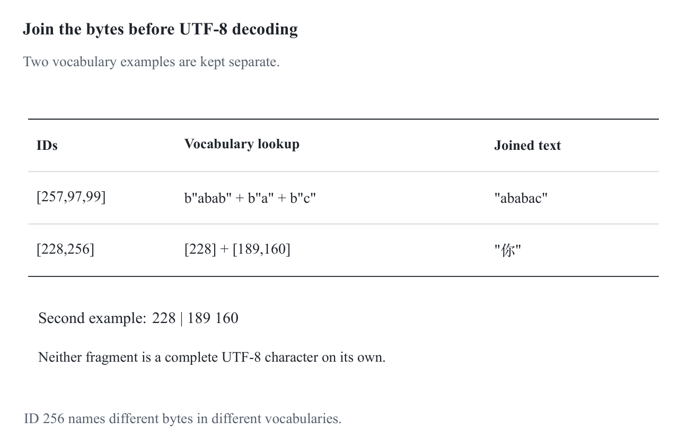{width=100%}

The first table row recovers an ASCII example. The second row uses a different vocabulary trained on “你”: neither byte fragment is text by itself, but their ordered concatenation is valid UTF-8.

UTF-8 represents `"你"` with the three bytes `[228, 189, 160]`. With budget 257, our trainer first merges `(189, 160)`, so encoding returns `[228, 256]`:

```text
vocab[228] = bytes([228])       first byte of the character
vocab[256] = bytes([189, 160])  the remaining two bytes
```

Neither chunk can be decoded as UTF-8 on its own. Joining them in order recovers the complete three-byte character. Collect the bytes inside the loop, then decode once after the loop. Decoding each token separately would fail even though the full input is valid.

An arbitrary generated sequence can end with an incomplete character or contain invalid bytes. Strict decoding then raises `UnicodeDecodeError`. Collecting all bytes does not make an invalid sequence valid. In a later generation lesson, we will distinguish incomplete display buffers from invalid output and deliberate stopping.

### Review the implementation steps

Implement the region in `decode_bpe` inside `exercises/02_06_bpe_decode.py`:

1. Create an empty `chunks` list. Visit `token_ids` in order with `for token_id in token_ids`. Inside the loop, look up `vocab[token_id]` and append that entire bytes object to `chunks`.
2. After the loop, join `chunks` into `raw_bytes`. The bytes method `separator.join(parts)` combines byte chunks. Use an empty byte separator so the original text receives no extra spaces or punctuation.
3. Decode the complete `raw_bytes` with UTF-8 and `errors="strict"`, and return the resulting string. Keep this operation and the return outside the loop.

The numbered comments explain list creation, loop indentation, dictionary lookup, `append`, byte joining, and `.decode`, including expected intermediate values. The implementation follows these steps; the placeholder has been removed.

For empty input, the loop performs no iterations, the empty list joins to `b""`, and decoding returns `""`. No separate empty-input branch is required.

An ID absent from `vocab` naturally raises `KeyError` at lookup. Invalid or incomplete UTF-8 naturally raises `UnicodeDecodeError` during strict decoding. Leave these errors visible; the supplied checks require them. Keep both input objects unchanged.

### Run the checks

From the repository root:

```sh
python3 exercises/02_06_bpe_decode.py
```

Named `PASS` lines cover empty inputs, base and merged IDs, ordering and repetition, Unicode across token boundaries, encoder/decoder round trips, input preservation, and the required errors. The final line is:

```text
Lesson 02.06 checks passed.
```

If the Unicode boundary case fails, inspect whether you decode inside the loop. If an ID above 255 fails, inspect whether you tried to convert IDs directly to raw bytes. If output contains extra characters, inspect the join separator.

### Classroom questions: byte joining and failures

#### Why can bytes be joined even when their display looks strange?

The `bytes` representation is a Python display of integer byte values. `b"\xe4"` and `b"\xbd\xa0"` can be concatenated even though neither can be independently decoded as UTF-8. In the decoder, `b"".join(chunks)` uses an empty bytes separator to assemble their values in order, and the joined bytes decode to `"你"`.

`append` stores a complete bytes object as one item in `chunks`. It does not decode it or turn it into a vector. `.join` combines the collected objects after the loop; an empty collection produces `b""`, which decodes to the empty string.

#### Does a failed prediction always mean decoding fails?

An incorrect next-token prediction may still form valid UTF-8 text, so prediction correctness and decoding validity are different. A sequence that stops inside a multi-byte character is incomplete; a sequence with an illegal byte pattern is invalid. Our strict decoder raises `UnicodeDecodeError` for either case, regardless of how many token positions were generated. An unknown vocabulary ID instead raises `KeyError` before byte decoding.

Use the same vocabulary as the encoder or model that produced the IDs. Another learned vocabulary may assign the same integer to different bytes. An ID identifies text only through its vocabulary.

### What follows

Continue with [Lesson 02.07](#section-02-07) and exercises/02_07_bpe_save_load.py. Stage A prepares JSON-compatible records; stage B restores the exact vocabulary and rules. Then continue to the prepared embedding lookup lesson, which maps IDs to learned numeric vectors rather than byte contents.

## 02.07 Save and Reload a Tokenizer {#section-02-07}

We need to load the same tokenizer after the Python process ends. Saving its vocabulary size is not enough: we must save the exact bytes for every ID and the priority of every merge rule. We will convert the Python objects to JSON records, then restore the same rules and bytes.

Work through the example before editing 02_07_bpe_save_load.py. The numbered steps below explain the interface and guide the core implementation; the supplied setup and check driver remain separate.

### JSON and the representation problem

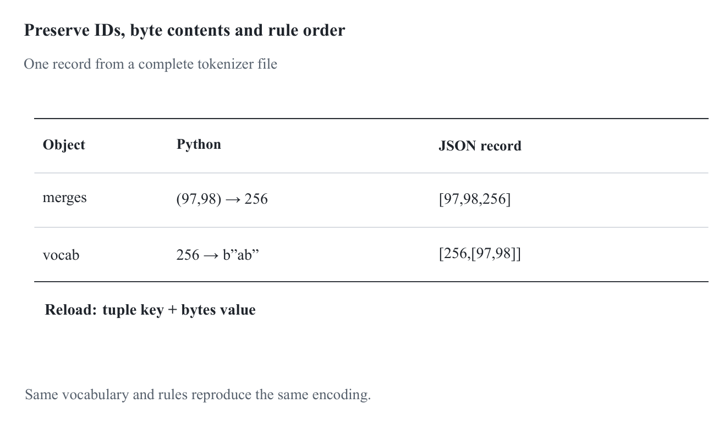{width=100%}

Compare the Python and JSON columns, then the reload statement below. Serialization changes the representation; reloading must restore the child IDs, replacement ID and byte values unchanged.

JSON stores structured data as text. It supports objects, arrays, strings, numbers, booleans, and null. Python dictionaries and lists usually become JSON objects and arrays. But JSON objects cannot use our tuple keys, and JSON has no bytes type. We must convert both before saving.

Our portable format stores record lists:

| In-memory data | Saved record | Meaning |
| --- | --- | --- |
| `merges[(97, 98)] = 256` | `[97, 98, 256]` | Left ID, right ID, original learned replacement ID. |
| `vocab[256] = b"ab"` | `[256, [97, 98]]` | Original token ID and the exact integer byte values. |

The payload also saves `"format": "onelong-byte-bpe"` and `"version": 1`. These fields identify the file structure, not the learned vocabulary. To identify a tokenizer in an experiment, retain the exact saved file and its checksum.

Keep all base vocabulary entries, including bytes absent from the training text. Preserve every merged entry and the original IDs. Store byte values without decoding individual tokens as UTF-8: a token can contain only part of a character, as the previous lesson demonstrated.

### Stage A inputs and output

```python
pack_tokenizer(merges: dict[tuple[int, int], int], vocab: dict[int, bytes]) -> dict
```

| Name | Type | Meaning |
| --- | --- | --- |
| `merges` | `dict[tuple[int, int], int]` | Learned rules supplied by the caller, from `train_bpe`. |
| `vocab` | `dict[int, bytes]` | Matching vocabulary supplied by the caller. |
| `payload` | `dict` | Provided outer structure; fill its `"merges"` and `"vocab"` lists. |
| `item` | `tuple[tuple[int, int], int]` | One key/value pair from `merges.items()`, such as `((97, 98), 256)`. |
| `out_merges` | `list[list[int]]` | Collected three-integer rule records. |
| `out_vocab` | `list` | Collected records containing each ID and its byte-value list. |
| `token_id` | `int` | One vocabulary key, visited inside your second loop. |
| `token_bytes` | `bytes` | That token's original contents. |
| `list(token_bytes)` | `list[int]` expression | Integer values obtained from those bytes, used directly in the record. |
| Returned value | `dict` | Complete JSON-compatible `payload`; the file helper writes it. |

Assume valid matching dictionaries from our trainer. Leave both input dictionaries unchanged. There is no file path argument in this exercise function; file writing is supplied separately.

### Trace the completed stage A

Train on `"ababab"` with budget 258. Start with the provided payload containing metadata and two empty lists.

1. The first rule $(97, 98) \to  256$ becomes `[97, 98, 256]`. After appending it, `out_merges` is `[[97, 98, 256]]`.
2. The second rule $(256, 256) \to  257$ becomes `[256, 256, 257]`. The list is now `[[97, 98, 256], [256, 256, 257]]`.
3. Each base vocabulary entry becomes a record: ID 0 becomes `[0, [0]]`, ID 1 becomes `[1, [1]]`, and so on through ID 255.
4. ID 256 contains `b"ab"`. `list(token_bytes)` produces `[97, 98]`; its complete record is `[256, [97, 98]]`.
5. ID 257 contains `b"abab"`; its complete record is `[257, [97, 98, 97, 98]]`.
6. Assign `out_merges` and `out_vocab` to the corresponding payload fields, then return `payload`. It has two merge records and 258 vocabulary records.

`list(b"ab")` exposes the byte values. It does not decode text and does not modify the original bytes. This is reversible: `bytes([97, 98])` restores `b"ab"`.

### Review stage A's implementation

Collect the record lists before assigning them to the provided payload:

1. Visit `merges.items()` with the name `item`. `item[0]` is the child pair and `item[1]` is its learned replacement ID. `item[0][0]` and `item[0][1]` supply the two child IDs. Append the three-integer record to `out_merges`.
2. Visit `vocab.items()` with names `token_id` and `token_bytes`. Convert the contents to integer byte values, build a two-item record containing the ID and that nested list, and append it to `out_vocab`.
3. After both loops, assign the collected lists to `payload["merges"]` and `payload["vocab"]`, then return `payload`.

The file's comments give the relevant loop, indexing, `append`, conversion, and indentation hints. With zero merges, the first list stays empty; the vocabulary loop still saves the 256 base entries.

Run:

```sh
python3 exercises/02_07_bpe_save_load.py --check pack
```

Stage A checks cover: exact IDs and bytes, all entries, partial UTF-8 contents, unchanged inputs, JSON compatibility, and file writing. The final line is `Lesson 02.07 stage A checks passed.` These checks exercise packing independently of restoration.

### Stage B: inputs and returned value

`unpack_tokenizer(payload)` creates new `merges` and `vocab` dictionaries from the parsed JSON data. A merge record supplies the original tuple key and replacement ID. A vocabulary record supplies its original ID and byte values, which `bytes(...)` restores. Return `(merges, vocab)` in that order.

| Name | Type | Meaning |
| --- | --- | --- |
| `payload` | `dict` | Saved-format data passed by the caller; leave it unchanged. |
| `payload["merges"]` | `list[list[int]]` | Rule records, each containing three integers. |
| `item` | `list` | One saved record from the list currently being visited. |
| `a`, `b`, `c` | `int` | Local variable names for the left ID, right ID, and original replacement ID. |
| `payload["vocab"]` | `list` | Vocabulary records, each containing an ID and byte-value list. |
| `token_id` | `int` | Saved vocabulary ID. |
| `byte_list` | `list[int]` | Local variable name for the saved integer byte values. |
| `merges` | `dict[tuple[int, int], int]` | Newly reconstructed rules. |
| `vocab` | `dict[int, bytes]` | Newly reconstructed byte vocabulary. |
| Returned value | `tuple` | `(merges, vocab)` for the caller to unpack. |

The provided file reader handles JSON parsing and format/version checks. Your exercise function receives the resulting dictionary, not a path or JSON text string. Assume a valid matching payload.

### Trace the completed stage B

Start with empty `merges` and `vocab` dictionaries. Use the payload from the stage A worked example:

1. Read rule record `[97, 98, 256]`. Its left, right, and replacement IDs are 97, 98, and 256. The restored rule is `merges[(97, 98)] = 256`.
2. Read `[256, 256, 257]`. The rules now contain both `{(97, 98): 256, (256, 256): 257}`.
3. Restore each base entry: `[0, [0]]` supplies ID 0 and its original byte, continuing through ID 255.
4. Read vocabulary record `[256, [97, 98]]`. `bytes([97, 98])` restores `b"ab"`; store it under key 256.
5. Read `[257, [97, 98, 97, 98]]`. The bytes restore to `b"abab"`; store them under key 257.
6. Return the two dictionaries. There are two rules and 258 vocabulary entries. Encoding `"ababac"` returns `[257, 97, 99]`, and decoding returns the original text.

### Review stage B's implementation

Review the stage B learner region in `unpack_tokenizer`:

1. Create empty dictionaries named `merges` and `vocab`. `{}` creates a dictionary.
2. Loop directly over the records in `payload["merges"]`; this value is a list. The implementation names each record `item` and unpacks it into `a`, `b`, and `c`. These represent the left ID, right ID, and saved replacement ID. Use the tuple `(a, b)` as the key and `c` as its value. Keep this assignment inside the first loop.
3. Loop over `payload["vocab"]`. Unpack each two-item `item` into `token_id` and `byte_list`. Convert the byte values with `bytes(byte_list)` and associate those bytes with the original `token_id`. Keep this assignment inside the second loop. Do not decode partial token contents into text.
4. After both loops, return the two dictionaries in the order `(merges, vocab)`. A comma-separated return produces a tuple. The stage B placeholder has been removed.

Restore every ID exactly as saved. Rebuild each child pair as a tuple because a list cannot be a dictionary key. Convert the saved byte values back to `bytes`. This restores the original contents without changing or allocating IDs.

Run stage B checks first:

```sh
python3 exercises/02_07_bpe_save_load.py --check unpack
```

The final line is `Lesson 02.07 stage B checks passed.` Checks cover exact dictionary reconstruction, rule priority even when record order changes, zero merges, partial UTF-8 contents, unchanged payloads, and file reading.

Then run the complete save/load checks:

```sh
python3 exercises/02_07_bpe_save_load.py --check all
```

The supplied writer converts the packed data to JSON text; the supplied reader parses JSON text back into data, checks the format/version, and calls the unpacker. The complete flow is:

```text
merges + vocab -> pack_tokenizer -> JSON file
JSON file -> unpack_tokenizer -> restored merges + restored vocab
```

### Classroom questions: preserving meaning

#### Why save all 256 base entries, including unseen bytes?

Encoding new text may need bytes absent from the training example. The full base vocabulary preserves byte coverage. Saving only the entries used by the training string would lose that coverage. Merged entries and their original IDs must also survive reload.

#### Is saving the schema version enough to identify the tokenizer?

No. `version=1` identifies the file structure. Different learned vocabularies can use the same structure. Save the exact tokenizer file and its checksum with the experiment's code and data versions. This exercise saves rules and bytes; later, model parameters will need their own checkpoint.

#### Why use lists of records and restore tuples and bytes?

JSON object keys cannot directly represent our tuple keys, and JSON has no bytes type. A merge record `[97, 98, 256]` preserves the two child IDs and learned ID. A vocabulary record `[256, [97, 98]]` preserves the ID and byte values. Restoration rebuilds `(97, 98)` as a tuple key and `[97, 98]` as bytes. It does not decode text, renumber IDs, or train again. List records can appear in a different order while the saved IDs still determine learned priority.

## Looking back

The tokenizer now gives each token a stable ID. Chapter 03 uses these IDs to select trainable vectors and shows how gradients update them.

# 03 Make a model learn {#chapter-03}

A vocabulary lists the possible tokens. It does not tell the model which token should come next. To learn that choice, the model needs parameters: numbers that training can change. An embedding lookup selects vectors. An output layer scores the possible tokens. A loss uses the probability assigned to the observed target.

We first calculate a gradient for one number, then for tensors and an embedding table. We connect logits, softmax, and cross-entropy, then add prediction, sampling, and batches. At every step, ask what is fixed, what can change, where the next-token target comes from, and which parameter values produced the loss.

The first model stays small so we can find mistakes. Its limited use of context will show why we need attention.

## 03.01 Token IDs to Embedding Vectors {#section-03-01}

### Method sources

Trainable word embeddings in a probabilistic language model are developed in [Bengio et al., 2003; R24](https://www.jmlr.org/papers/v3/bengio03a.html).

A token ID identifies an entry in the vocabulary. An embedding table gives that ID a vector of floating-point values that the model can adjust during training. We will use ordinary Python lists to follow the lookup. Keep track of the full table and the rows selected for this input as two separate objects.

Work through the example before editing 03_01_embedding_lookup.py. The numbered steps below explain the interface and guide the core implementation; the supplied setup and check driver remain separate.

### Follow one complete input

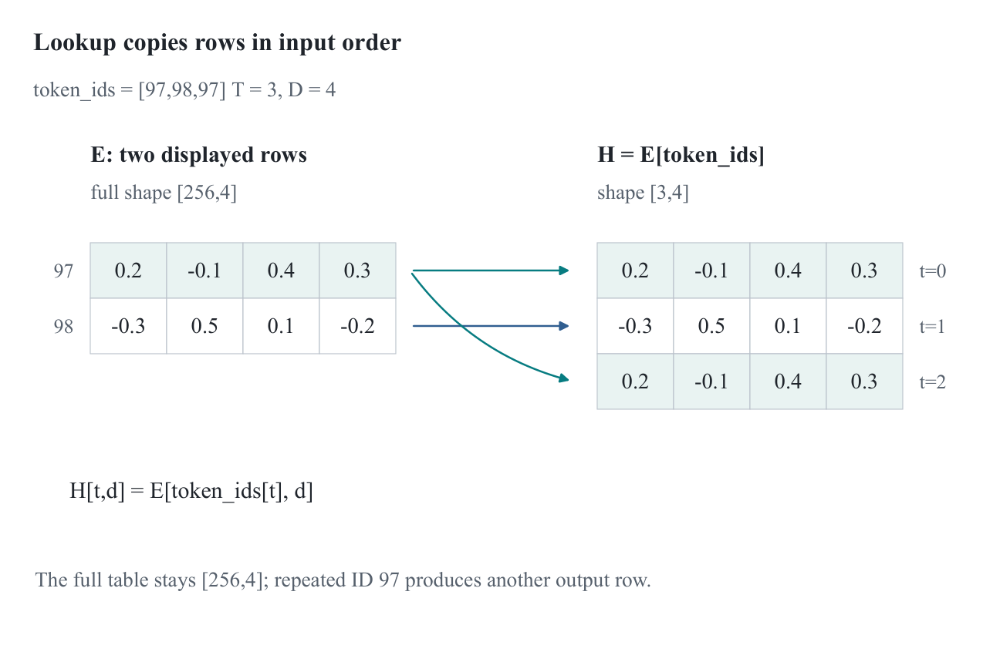{width=100%}

The arrows select rows from the same table in input order. Positions zero and two both use ID 97, so their four-component output rows agree.

The byte tokenizer encodes `"aba"` as:

```text
text:       "aba"
token IDs:  [97, 98, 97]
```

An embedding table contains one floating-point row per vocabulary entry. Choose vocabulary size $V = 256$ and embedding dimension $D = 4$. The table $E$ has shape `[256, 4]`.

For a lookup demonstration, give two of its rows these values:

| Token ID | Embedding row |
| --- | --- |
| 97 | `[0.2, -0.1, 0.4, 0.3]` |
| 98 | `[-0.3, 0.5, 0.1, -0.2]` |

These numbers are supplied demonstration values. In the eventual model, embedding parameters start from an initialization and are updated through the training loss.

Lookup follows the token sequence in order:

```text
97 -> E[97] -> [ 0.2, -0.1, 0.4,  0.3]
98 -> E[98] -> [-0.3,  0.5, 0.1, -0.2]
97 -> E[97] -> [ 0.2, -0.1, 0.4,  0.3]
```

The resulting sequence has three rows and four columns:

```text
[
    [ 0.2, -0.1, 0.4,  0.3],
    [-0.3,  0.5, 0.1, -0.2],
    [ 0.2, -0.1, 0.4,  0.3],
]
```

Repeated token IDs retrieve the same row from the same table at this stage. Later model layers use position and context to produce contextual representations.

### Three quantities and two shapes

| Symbol | Meaning | Value in this example |
| --- | --- | ---: |
| $V$ | Number of vocabulary entries; number of table rows. | 256 |
| $D$ | Number of floating-point components in each embedding. | 4 |
| $T$ | Number of input token positions. | 3 |

The embedding table has shape `[V, D]`. A sequence lookup has shape `[T, D]`. The table contains $VD$ parameters in a trainable implementation; input length does not change the table size.

With $T = 6$ and $D = 8$, the lookup result has shape `[6, 8]` and contains 48 scalar values. With a batch of $B$ equal-length sequences, the corresponding output shape is `[B, T, D]`; batching will be implemented later.

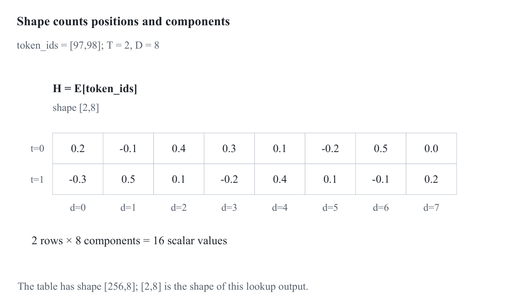{width=100%}

This second example uses $D=8$, rather than the exercise's $D=4$, to make the distinction explicit. In a shape label, `[2, 8]` means two rows of eight components, or 16 scalar entries. Inside a value row, `[0, 0]` means two actual zero-valued components. Changing the input from three positions to two changes the output's first dimension; it does not resize the vocabulary table.

### What each representation means

Token IDs select rows. The numeric order of IDs does not order their meanings, and the difference between IDs does not define the distance between their vectors. The vector components are floating-point parameters. Their values are not restricted to the byte range `0` through `255`.

The tokenizer's vocabulary maps an ID to byte contents. The model's embedding table maps that ID to a learnable vector. For a BPE token representing `b"ab"`, its embedding is its own table row; byte concatenation does not determine that vector.

Tokenizer vocabulary size and embedding-table row count must agree. A vocabulary of 258 entries permits IDs `0` through `257` and requires 258 embedding rows. The byte-tokenizer example above uses only the original 256 entries.

### Exercise: retrieve rows in sequence order

Review the completed function:

```python
lookup_embeddings(token_ids, embedding_table)
```

Return a list of rows, one for each input token position. Keep input order and repeated IDs. An empty input returns an empty list. Assume valid nonnegative IDs and a rectangular table; input validation and tensor operations are outside this small exercise. Keep the input sequence and table unchanged.

The relevant Python operation is `embedding_table[token_id]`, which retrieves the row at that index. A result list can be built using the loop and `append` operations already encountered.

The inputs are `token_ids: list[int]` and `embedding_table: list[list[float]]`. The output is `list[list[float]]`. The supplied checks construct the table; your function only retrieves rows. Use `vectors` for the output list and `token_id` for the current ID, matching the numbered hints in the actual file.

| Name | Type | Meaning |
| --- | --- | --- |
| `token_ids` | `list[int]` | Ordered input IDs supplied by the caller. |
| `embedding_table` | `list[list[float]]` | Supplied table with one row per vocabulary entry and $D$ components per row. |
| `vectors` | `list[list[float]]` | Output rows collected by the learner. |
| `token_id` | `int` | Current ID visited in the input loop. |
| Returned value | `list[list[float]]` | One whole row per token position, including repeated IDs. |

The numbered implementation review is:

1. Create an empty `vectors` list before the loop. `[]` creates a list; this is the starting result with zero rows.
2. Visit `token_ids` in its existing order, including repeated IDs. `for token_id in token_ids:` assigns each ID to `token_id` in turn. Keep its body indented; a set would remove repeats.
3. Inside the loop, bracket indexing in `embedding_table[token_id]` selects one row. The call `vectors.append(embedding_table[token_id])` adds that whole row as one element at the end of `vectors`. After IDs 97 and 98, the result has two rows of four values. Append the whole row, rather than extending the result with its individual components.
4. After the loop, return `vectors`. Align the return with the loop header, outside the body, so all positions are processed. Empty input naturally returns the empty list. Keep both input objects unchanged; this exercise permits reusing or copying row lists because it only reads their values.

Run the completed exercise for review:

```sh
python3 exercises/03_01_embedding_lookup.py
```

The expected final success line is `Lesson 03.01 checks passed.`

### Classroom questions: IDs, dimensions, and repeated rows

#### Does a dimension of 8 mean values range from 0 to 256?

No. $D=8$ means eight numeric components per vector. Their values can be negative or positive floating-point numbers and are not limited to the raw-byte range. For $T=6$ token positions, the output shape is `[6, 8]` with 48 scalar values. Shape counts rows and columns; it does not specify their numeric limits.

#### Where do the numbers in `embedding_table[97]` come from?

The table supplied by our checks contains hand-chosen demonstration numbers. ID 97 simply selects row 97; it does not compute those values from the integer 97. In a trainable model, a parameter table is initialized and updated through the training loss. This exercise performs lookup only, without training or automatic differentiation.

#### Why do the first and third rows match, and is a BPE embedding a concatenation?

Both positions contain ID 97 and use the same table, so both retrieve the same row. Preserve both occurrences in the output. Later positional and attention operations can distinguish the positions using their contexts.

A merged BPE ID has its own embedding row with the same dimension $D$. Its tokenizer byte contents are a concatenation, but its model vector is not defined by concatenating the children's vectors. Growing the vocabulary grows the row count $V$; it does not automatically change $D$.

### Explanation checkpoint and next lesson

#### Follow-up clarification: a shape, a table, and repeated IDs

`[3, 8]` describes the output shape: three token positions, each represented by eight numbers. A shape describes dimensions; it is not itself the tensor containing those numbers. The current exercise returns a nested Python list. A later tensor implementation can represent the same rectangular values as a rank-two tensor.

For $V=258$, $D=8$, and `token_ids=[256, 97, 256]`, distinguish the two objects:

| Object | Rows | Components per row | Shape |
| --- | ---: | ---: | --- |
| Full `embedding_table` | 258 vocabulary entries | 8 | `[258, 8]` |
| Returned `vectors` | 3 input positions | 8 | `[3, 8]` |

The first and third output rows match because the first and third IDs are both 256. Their lookups are:

```text
position 0: ID 256 -> embedding_table[256]
position 1: ID  97 -> embedding_table[97]
position 2: ID 256 -> embedding_table[256]
```

Both positions read the same row of the same fixed table, so the lookup values match. At this stage, surrounding tokens and position do not affect the selected row. Later operations will use that information. Different IDs select different rows, but two rows can happen to contain the same values.

For another short trace, change the input to `[256, 97]` while keeping the table fixed. What is the returned shape, and does the full table change size? This checks whether input length and vocabulary size are being distinguished.

In this example, the output has shape `[2, 8]`, while the lookup table stays the same size. This demonstrates the distinction between input length and vocabulary size in this example. Write a shape with a comma, `[2, 8]`; the product $2 \times  8$ counts 16 scalar values.

Explain what $V$, $D$, and $T$ count. Trace the three output rows for `"aba"`, and explain why the first and third are equal at the lookup stage. Then reconstruct the lookup loop without AI completion.

For an explanation checkpoint, use $V=258$, $D=8$, and `token_ids=[256, 97, 256]`. State the shape of the full table and the returned sequence, then explain why the first and third lookup rows match.

The submitted loop starts an empty `vectors`, visits each `token_id`, and appends `embedding_table[token_id]` as a whole row. Its return is outside the loop, so every position is processed and an empty input returns the empty result. This is the correct lookup behavior. The table is still supplied data; this function does not update embedding parameters.

Next, read [Lesson 03.02: parameters, loss, and gradients](#section-03-02), which develops a scalar loss and assigns one gradient-descent step before moving to a training loop. Then represent these operations with trainable tensors, produce vocabulary logits in a minimal next-token model, and connect predictions to shifted targets and cross-entropy. Attention and the Transformer follow after the minimal training path is understood.

## 03.02 Parameters, Loss, and Gradients {#section-03-02}

Training adjusts embedding values to reduce prediction errors. Before updating a whole table, we will train one number. We can draw its squared-error loss as a curve. The slope tells us which direction can lower the loss, and the curve shows why a step can be too large.

Work through the example before editing 03_02_scalar_gradient_step.py. The numbered steps below explain the interface and guide the core implementation; the supplied setup and check driver remain separate.

### What will change during training?

The floating-point values in the embedding table are model parameters: numbers that training can adjust. Vocabulary size and embedding dimension fix the table's shape. An input selects rows, and the prediction loss determines how training updates their values. A longer input selects more rows; it does not enlarge the table.

In a language model, the broader path is:

```text
token IDs -> embedding rows -> model computation -> next-token prediction
                                                -> loss against known targets
loss -> gradients of parameters -> parameter update
```

The tokenizer supplies IDs. Training adjusts model parameters. Later lessons will implement the forward computation, the next-token objective, automatic differentiation, and parameter updates.

### A small task with one adjustable number

For this example only, let the prediction be the parameter itself, $\mathrm{prediction}=w$. Set the desired target to `1.0`. Use squared error to measure the discrepancy:

```text
L(w) = (w - target)^2
```

This is a teaching example, not the language model's next-token objective. The scalar target here is deliberately chosen. Real language-model embedding values receive gradients through the model and a prediction loss, rather than being given desired coordinates manually.

| Symbol | Type | Meaning | Example value |
| --- | --- | --- | --- |
| `w` | Floating-point scalar | Adjustable parameter and prediction in this toy task. | `0.2` |
| `target` | Floating-point scalar | Fixed desired prediction. | `1.0` |
| `error` | Floating-point scalar | Prediction minus the target: `w - target`. | `-0.8` initially |
| $L$ | Nonnegative scalar | Squared-error loss; lower means closer to the target here. | `0.64` initially |
| $g$ | Floating-point scalar | Gradient: derivative of the loss with respect to `w`. | `-1.6` initially |
| `learning_rate` | Positive scalar | Step size used for the update. | `0.1` |
| `w_new` | Floating-point scalar | Parameter after one update. | `0.36` |

### What does the gradient tell us?

The gradient describes how the loss changes locally when the parameter increases a little. With one scalar, it is a derivative. For this squared-error example:

```text
g = dL/dw = 2 * (w - target)
```

If $g$ is positive, a small increase in `w` increases the loss locally, so a descent update moves `w` downward. If $g$ is negative, a small increase in `w` decreases the loss locally, so the update moves `w` upward. In this example, zero gradient occurs when the prediction equals the target.

The elementary gradient-descent update is:

```text
w_new = w - learning_rate * g
```

The learning rate sets how far the parameter moves. The gradient describes the loss only near the current value. If a step moves too far, the loss can increase. Training does not guarantee a decrease after every update.

### Why is the gradient $2(w-\mathrm{target})$?

A derivative measures the local rate of change. Increase `w` by a small amount $h$, keep `target` fixed, and compare the change in loss with the change in the parameter:

```text
change in loss / change in w = (L(w + h) - L(w)) / h
```

Here, $h$ is a small nonzero change used to measure the loss function. We compare the loss before and after that change. It is separate from the learning rate and the training update. For example, with `w=0.2`, `target=1.0`, and `h=0.01`:

1. The original loss is $(0.2 - 1.0)^{2} = 0.64$.
2. The perturbed parameter is `0.21`, with loss $(0.21 - 1.0)^{2} = 0.6241$.
3. The loss change is $0.6241 - 0.64 = -0.0159$.
4. The ratio is $-0.0159 / 0.01 = -1.59$, close to the gradient `-1.6`.

The exact expression follows by expanding the square. Write $a=w-\mathrm{target}$ temporarily:

```text
L(w + h) - L(w) = (a + h)^2 - a^2
                 = 2 * a * h + h^2
(L(w + h) - L(w)) / h = 2 * a + h
```

As $h$ approaches zero, the ratio approaches $2a=2(w-\mathrm{target})$. That limit is the derivative $\frac{dL}{dw}$, which is the scalar gradient in this task. The factor `2` comes from expanding the squared error. A different loss or prediction formula generally has a different derivative.

For a sufficiently small parameter change, the gradient gives a local estimate:

```text
change in loss approximately equals g * change in w
```

For this squared loss, the exact change also includes $(\Delta w)^2$. The approximation becomes more accurate as the change becomes smaller.

### Complete worked update

Use `w=0.2`, `target=1.0`, and `learning_rate=0.1`.

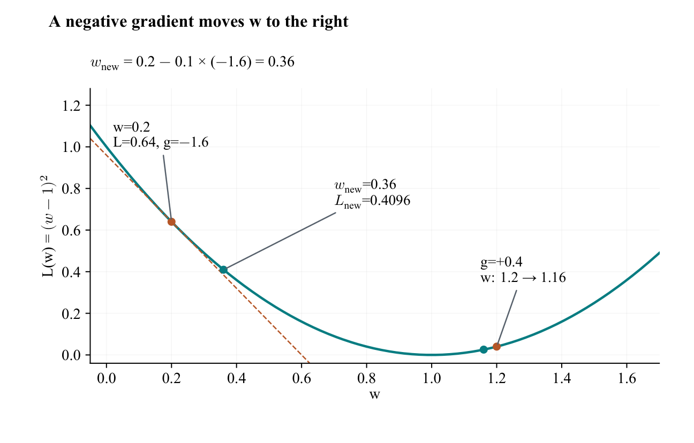{width=100%}

The dashed tangent has negative slope at $w=0.2$. Subtracting that negative gradient moves right to $w=0.36$; the new point lies lower on the actual loss curve.

1. **Predict:** the toy task returns `0.2` because its prediction is `w` itself.
2. **Compute the loss:** $(0.2 - 1.0)^{2} = (-0.8)^{2} = 0.64$.
3. **Compute the gradient:** $g=2 \times  (0.2 - 1.0) = -1.6$.
4. **Update the parameter:** $w_{\mathrm{new}}=0.2 - 0.1 \times  (-1.6) = 0.36$. Subtracting a negative quantity increases `w`.
5. **Check the new prediction:** the next prediction is `0.36`, and its loss is $(0.36 - 1.0)^{2} = 0.4096$, smaller than `0.64`.

This update moved the adjustable number toward the target. It changed a parameter value; it did not change any table dimensions or vocabulary IDs.

### Classroom follow-up: arithmetic and update direction

**Why does a negative gradient make `w` increase?** Subtracting a negative number is equivalent to adding a positive number. Here, $0.1 \times  (-1.6) = -0.16$, so the update adds `0.16` to `w`.

Connect that arithmetic to the purpose of learning: a negative gradient means that increasing `w` a little decreases the loss locally. The update therefore moves in a direction that can reduce the error, with the learning rate controlling how far it moves.

**Does training always increase a parameter?** Consider the same task with `w=1.2`, `target=1.0`, and `learning_rate=0.1`:

1. **Compute the loss:** $(1.2 - 1.0)^{2} = 0.04$.
2. **Compute the gradient:** $g=2 \times  (1.2 - 1.0) = 0.4$, a positive value.
3. **Update the parameter:** $w_{\mathrm{new}}=1.2 - 0.1 \times  0.4 = 1.16$. This time, `w` decreases.
4. **Check the new loss:** $(1.16 - 1.0)^{2} = 0.0256$, smaller than `0.04`.

In these two examples, the updates approach the target from opposite sides. Gradient descent adjusts the parameter according to the gradient; it does not always increase the parameter.

**What happens when `w` already equals the target?** For `w=1.0`, `target=1.0`, and `learning_rate=0.1`, the result is $g=0$ and `w_new=1.0`. The full calculation is $g=2 \times  (1.0 - 1.0) = 0$, followed by $w_{\mathrm{new}}=1.0 - 0.1 \times  0 = 1.0$. The loss is zero, and this update leaves the parameter unchanged. This squared-error example has reached its minimum.

**What does $g=-1.6$ predict for a parameter increase of `0.001`?** The loss decreases by `0.0016`, using the supplied relation between gradient and local loss change:

```text
estimated loss change = -1.6 * 0.001 = -0.0016
exact new loss = (0.201 - 1.0)^2 = 0.638401
exact loss change = 0.638401 - 0.64 = -0.001599
```

The gradient gives a local linear approximation. For this squared loss, the difference is the additional $h^{2}=0.000001$ term from the expansion. The exact calculation here is supplied explanation.

### Returning to the embedding table

An embedding row has $D$ adjustable values. A model can calculate a gradient for each participating parameter and use those gradients to update the numbers. The gradients come from how those values affect the prediction loss. The table remains shape `[V, D]` after an update.

Lesson 03.01's list lookup reads the existing values and does not calculate a loss, gradients, or updates. The coming tensor implementation will connect those operations. With many parameters, the same basic idea applies to arrays of values and gradients.

### From the update rule to a function

The interface in 03_02_scalar_gradient_step.py is `gradient_step(w, target, learning_rate)`. Retain the numbered implementation plan below for review and independent reconstruction. The inputs are three finite floats: the current parameter `w`, the fixed desired prediction `target`, and a positive `learning_rate`. The caller supplies these inputs; do not replace them with the example numbers.

Return a three-float tuple `(loss, gradient, w_new)` in that exact order. Both `loss` and `gradient` must describe the original `w`; `w_new` is the result of one update. The worked call `gradient_step(0.2, 1.0, 0.1)` should return approximately `(0.64, -1.6, 0.36)`. The new loss, `0.4096`, is checked separately by the supplied driver and is not the returned `loss`.

Follow these numbered steps, using four spaces of indentation inside the function:

1. **Calculate `error`.** Subtract `target` from `w`. The worked example gives `-0.8`.
2. **Calculate `loss`.** Square `error`. Python's power syntax is `value ** 2`; `^` is a different operator. The example gives `0.64`.
3. **Calculate `gradient`.** Multiply `error` by `2`, using `*`, and retain the sign. The example gives `-1.6`.
4. **Calculate `w_new`.** Multiply `gradient` by `learning_rate`, then subtract that quantity from the original `w`. The example gives `0.36`. Keep the original `w` available for the other calculations.
5. **Return the three values.** The pattern `return first, second, third` returns a tuple. Use the required order, and keep the return at the same indentation as the calculations. One update needs no loop.

The original scaffold used `raise NotImplementedError(...)` to stop the unfinished assignment. Replace that placeholder with your implementation. The supplied check driver remains unchanged. The bottom `if __name__ == "__main__":` calls that driver when the file is run directly; this control flow is supplied.

Run from the repository root to review the completed exercise:

```bash
python3 exercises/03_02_scalar_gradient_step.py
```

Expected success output:

```text
PASS: negative gradient increases w and reduces loss
PASS: positive gradient decreases w and reduces loss
PASS: zero gradient leaves the parameter unchanged
PASS: supplied target and learning rate control the update
PASS: a large learning rate can increase loss
Lesson 03.02 checks passed.
```

The driver compares floats with a tolerance because decimal values can have small rounding differences. It also checks a larger step: `learning_rate=1.2` moves `w=0.2` to `2.12`, giving a new loss of `1.2544`, larger than `0.64`. Calculate the requested update faithfully; a positive learning rate does not guarantee a decrease for every step.

This function performs one training step in the toy task. Repeated training would feed `w_new` into the next call, then calculate the loss and gradient again at that new value. A training loop and automatic differentiation are later steps.

### Next concept: repeated updates use the latest parameter

Keep `target=1.0` and `learning_rate=0.1`. One call returns an updated parameter; the next call must use that value as its input `w` and recalculate the loss and gradient.

| Update | Input `w` | Loss before update | Gradient at input `w` | Returned `w_new` |
| --- | --- | --- | --- | --- |
| 1 | `0.2` | `0.64` | `-1.6` | `0.36` |
| 2 | `0.36` | `0.4096` | `-1.28` | `0.488` |
| 3 | `0.488` | `0.262144` | `-1.024` | `0.5904` |

For update 2, $\mathrm{gradient}=2 \times  (0.36 - 1.0) = -1.28$, then $w_{\mathrm{new}}=0.36 - 0.1 \times  (-1.28) = 0.488$. After update 3, the loss is $(0.5904 - 1.0)^{2} = 0.16777216$.

The gradient depends on the current parameter. Reusing `-1.6` at input `w=0.36` would produce `0.52`; that uses a derivative measured at a different point rather than the gradient at the current value. Recalculate both loss and gradient on each iteration.

Returning `w_new` does not automatically replace the caller's `w`. This function uses ordinary floats and returns a new value; the caller must keep that value for the next step. Calling the function repeatedly with `w=0.2` would keep returning the same first update. Repeated training connects each update's output to the next update's input.

At the second update, `w` became `0.36`, its error is `-0.64`, and multiplying by `2` gives `-1.28`. This demonstrates recalculation at the latest parameter. Keeping returned values in caller state and implementing the loop are separate tasks.

Continue with [Lesson 03.03: a scalar training loop](#section-03-03). Its guided exercise is now prepared; trainable tensors follow later.

### Explanation checkpoint

Continue with the loop assignment in Lesson 03.03. Independently explain why the function returns the original loss, why a larger learning rate can overshoot, and which quantity changes when training updates an embedding table: its number of rows, or its floating-point values?

## 03.03 A Scalar Training Loop {#section-03-03}

After an update, calculate the next loss and gradient at the new parameter value. A training loop saves each updated value for the next call and records the loss before each update. We will trace a small example by hand before using the same loop structure in larger models.

Work through the example before editing 03_03_scalar_training_loop.py. The numbered steps below explain the interface and guide the core implementation; the supplied setup and check driver remain separate.

### What a training loop connects

For each requested update, the loop:

1. Calls `gradient_step` with the current parameter.
2. Records the returned loss, measured before that update.
3. Keeps the returned `w_new` as the parameter for the next call.

Keep the target and learning rate fixed. Pass the updated parameter to each new helper call so it calculates the loss and gradient at that value. Perform exactly the requested number of updates. Do not stop early when the gradient is zero or the loss increases.

The helper returns an updated float; it does not change the caller's variable for you. Assign the returned value to the working parameter. If you keep passing the original value, every call repeats the first update.

### Exact inputs, state, and returned values

Implement `train_scalar(initial_w, target, learning_rate, num_steps)`.

| Name | Type | Meaning | Example |
| --- | --- | --- | --- |
| `initial_w` | `float` | Parameter before any updates. | `0.2` |
| `target` | `float` | Fixed desired prediction. | `1.0` |
| `learning_rate` | `float` | Positive update multiplier. | `0.1` |
| `num_steps` | `int` | Nonnegative number of updates. | `3` |
| `w` | `float` | Working parameter, initialized once and carried forward. | `0.2`, then `0.36` |
| `losses` | `list[float]` | One loss before each update, in order. | `[0.64, 0.4096, 0.262144]` |
| `step` | `int` | Loop repetition counter; not a parameter or learning rate. | `0`, `1`, `2` |

Assume finite float inputs, a positive learning rate, and `num_steps >= 0`; input validation is outside this learner task. Return a tuple `(w, losses)` of type `tuple[float, list[float]]`, containing the final parameter and the history. Its list has exactly `num_steps` items. For zero updates, return the original parameter and an empty list.

Each helper call returns three local values: `loss`, `gradient`, and `w_new`. The loop needs the loss for its history and the new parameter for the next call. The helper has already used the gradient to calculate `w_new`.

### Complete worked example

Use `initial_w=0.2`, `target=1.0`, `learning_rate=0.1`, and `num_steps=3`.

{width=100%}

Read each table row from the pre-update parameter through its loss and gradient to the updated parameter. The three loss entries form the returned history. The last row ends at the final parameter; its separately evaluated loss appears in the footer.

Before the loop, the working parameter is `w=0.2` and `losses=[]`.

1. **First iteration, `step=0`:** call the helper with `w=0.2`. It returns approximately `(0.64, -1.6, 0.36)`. Append `0.64` and keep `w=0.36`. State: `losses=[0.64]`.
2. **Second iteration, `step=1`:** use `w=0.36`, not the initial value. The helper returns approximately `(0.4096, -1.28, 0.488)`. Append `0.4096` and keep `w=0.488`. State: `losses=[0.64, 0.4096]`.
3. **Third iteration, `step=2`:** use `w=0.488`. The helper returns approximately `(0.262144, -1.024, 0.5904)`. Append `0.262144` and keep `w=0.5904`.

After all three iterations, return approximately:

```text
(0.5904, [0.64, 0.4096, 0.262144])
```

The final parameter's loss is `0.16777216`. This list records the loss used before each update, so it does not add that final loss as a fourth item. Logging time matters: a record should say which parameter state its loss describes.

For `num_steps=0`, no helper call occurs. The initialized `w` and empty history are returned directly. For example, `train_scalar(0.2, 1.0, 0.1, 0)` returns `(0.2, [])`.

### Syntax and indentation before implementation

`range(3)` produces counters `0`, `1`, and `2`: exactly three repetitions. Its last counter is `2`, because the stopping value is excluded. `range(0)` is empty.

The header `for step in range(num_steps):` repeats its indented body once per counter. It belongs at four-space indentation inside the function. The loop body uses eight spaces. `step` controls repetition; pass the current `w` to the helper, not this counter.

Tuple unpacking assigns by position. For example, `a, b, c = (10, 20, 30)` assigns `10` to `a`, `20` to `b`, and `30` to `c`. Use the helper's order when assigning `loss`, `gradient`, and `w_new`.

`losses.append(loss)` adds the single loss float named `loss` to the end of the history list `losses`. Initialize the history before the loop so each iteration adds to the same list.

`return` leaves the whole function. Place it after the loop at four-space indentation, so all requested updates finish and the zero-update case also returns.

### Guided implementation

Use this plan to implement the function and review the reasoning.

1. **Initialize `w` from `initial_w`.** Use ordinary assignment at four-space indentation. Do this once before looping.
2. **Initialize `losses`.** Create a fresh empty list with `[]`, also before the loop.
3. **Create the fixed-length loop.** Use `for step in range(num_steps):` at four-space indentation. Steps 4–6 go inside its body at eight spaces.
4. **Call the completed helper.** Pass the current `w`, `target`, and `learning_rate` to `gradient_step`. Unpack the return into `loss`, `gradient`, and `w_new`. The second call should receive `w=0.36` in the example.
5. **Record `loss`.** Append that one float to `losses`. After two iterations, the list should be approximately `[0.64, 0.4096]`.
6. **Keep the updated parameter.** Assign `w_new` to the working `w`. This is the value the next call will read. After two iterations, it should be `0.488`.
7. **Return after the loop.** Return `w` and `losses`, in that order, at four-space indentation. The pattern `return first, second` returns a two-item tuple.

The supplied setup loads `gradient_step` from `03_02_scalar_gradient_step.py` without running that exercise's driver. The setup and supplied check driver remain unchanged. The bottom `if __name__ == "__main__":` calls the checks when this file is run directly.

### Run and expected success output

From the repository root, to review the completed exercise:

```bash
python3 exercises/03_03_scalar_training_loop.py
```

Expected output:

```text
PASS: current parameter, recalculated gradients, and loss history
PASS: zero and one update
PASS: requested step count and separate calls
PASS: different starting values, targets, and learning rates
PASS: zero gradient still records every requested step
PASS: large steps remain visible in loss history
Lesson 03.03 checks passed.
```

The checks allow small floating-point rounding differences. They verify more than the three-step example: zero and one step, another step count, independent histories across calls, changed inputs, zero gradients, and a large learning rate. With `learning_rate=1.2`, two updates return approximately `(-0.568, [0.64, 1.2544])`; faithfully retain the requested history even when a loss increases.

### Reading a tuple assignment

Consider this implementation:

```python
loss, gradient, w = gradient_step(w, target, learning_rate)
```

This correctly combines unpacking the helper's results and carrying the new parameter forward. Python first evaluates the right-hand-side call with the old `w`, then assigns its three returned values to the left-hand-side variables. For the first update:

1. The helper receives the old `w=0.2`.
2. It returns approximately `(0.64, -1.6, 0.36)`.
3. Assignment gives `loss=0.64`, `gradient=-1.6`, and the new `w=0.36`.
4. `losses.append(loss)` records the pre-update loss `0.64`, even though `w` now holds the updated parameter.
5. The next iteration calls the helper with `w=0.36`.

The helper's third return value is called `w_new` inside that helper; the caller may bind it directly to `w`. The tuple's positions determine which value is assigned. The loop counter name `step` is also valid and is now used consistently in these notes. The unused returned `gradient` does not require an additional update: the helper already used it to compute the third result.

### Classroom follow-up: zero updates

For `train_scalar(0.2, 1.0, 0.1, 0)`, the result is `(0.2, [])`: `range(0)` skips the loop body, and the return after the loop still executes.

The complete trace is:

1. `w = initial_w` gives `w=0.2`.
2. `losses = []` creates the empty history.
3. `range(0)` provides no counters, so neither the helper call nor the append runs.
4. The final `return w, losses`, at the loop header's indentation, executes and returns `(0.2, [])`.

An empty loop skips its body; execution then continues with the following statement.

### Questions to work through

Why must the parameter and loss history be initialized before the loop? In the tuple assignment, which value of `w` reaches `gradient_step`, and when is the returned value bound to `w`? Why does the history record the loss before each update rather than an extra loss at the final parameter? Use the three-step trace and the zero-step example to explain your answers.

Continue with [Lesson 03.04: chain rule and automatic differentiation](#section-03-04). The remaining loop checkpoints stay available for review. Trainable tensors follow the chain-rule introduction.

## 03.04 Chain Rule and Automatic Differentiation {#section-03-04}

### Method sources

For neural-network backpropagation, see [Rumelhart et al., 1986; R39](https://doi.org/10.1038/323533a0); for PyTorch computation graphs and gradient rules, see [PyTorch, v2.0 autograd; R16](https://docs.pytorch.org/docs/2.0/notes/autograd.html).

A parameter usually affects the loss through several operations. We will follow one path: multiply the parameter by an input, subtract a target, and square the error. Each operation has a derivative that describes how its output changes when its input changes a little. The chain rule combines these derivatives to find how the loss changes with the parameter.

This section develops the chain rule without a separate code assignment. The next section turns the same calculation into PyTorch operations.

### Define the functions and gradient before calculating numbers

Hold $x$ and `target` fixed. The model and objective are functions of the adjustable parameter $w$:

```text
prediction(w) = w * x
L(w) = loss = (prediction(w) - target) ** 2
     = (w * x - target) ** 2
```

The gradient sought here is $\frac{dL}{dw}$: the derivative of the loss with respect to the parameter. For a differentiable scalar function, its definition is:

```text
dL/dw = limit as h approaches 0 of (L(w + h) - L(w)) / h
```

Here $h$ is a nonzero change in $w$. Compare the losses before and after the change, divide their difference by the parameter change, then let that change approach zero. The derivative is the resulting rate of change as $w$ changes, with the fixed quantities held constant. It is not the current loss divided by the current parameter.

The **chain rule**, for this composition through `prediction`, is:

```text
dL/dw = dL/d(prediction) * d(prediction)/dw

dL/d(prediction) = 2 * (prediction - target)
d(prediction)/dw = x

gradient = dL/dw = 2 * (prediction - target) * x
                = 2 * (w * x - target) * x
```

The first derivative tells us how a small change in the prediction affects the loss. The second tells us how a small change in the parameter affects the prediction. Multiplying them gives the loss's rate of change with the parameter. Below, we derive this result from the derivative definition before using numbers.

### Parameter, input, prediction, and loss

For this example, every quantity is a scalar number. Python examples use `float` values.

| Name | Role | Initial value |
| --- | --- | --- |
| $w$ | Adjustable model parameter. | `0.2` |
| $x$ | Fixed input for this example. | `2.0` |
| `target` | Fixed desired prediction. | `1.0` |
| `prediction` | Model output, calculated as $wx$. | `0.4` |
| `error` | Prediction minus target. | `-0.6` |
| `loss` | Squared error, a scalar objective to reduce. | `0.36` |
| `gradient` | Derivative of loss with respect to $w$ at its current value. | Calculated below. |
| `learning_rate` | Positive multiplier used in the parameter update. | `0.1` |

The parameter and the prediction now have different values. With `x=1.0`, this model reduces to the earlier $\mathrm{prediction}=w$ example. For this calculation, hold $x$ and `target` fixed while considering a change in $w$.

### Derivation: why the two rates multiply

At the original $w$, write $\mathrm{error}=wx-\mathrm{target}$. Changing $w$ to $w+h$ changes the prediction and error by exactly $xh$:

```text
prediction(w + h) = prediction(w) + x * h
error_new = error + x * h
```

Expand the square to obtain the exact finite loss change:

```text
L(w + h) - L(w)
    = (error + x * h) ** 2 - error ** 2
    = 2 * error * x * h + x ** 2 * h ** 2
```

Divide by the parameter change, then take the limit:

```text
(L(w + h) - L(w)) / h = 2 * error * x + x ** 2 * h

as h approaches 0:
    dL/dw = 2 * error * x
          = 2 * (w * x - target) * x
```

The term $x^{2}h$ approaches zero. The factor $2\,\mathrm{error}$ measures how the loss changes with the prediction. The factor $x$ measures how the prediction changes with $w$. Their product accounts for both steps. We have derived the formula for this example; the general chain rule applies the same reasoning to a sequence of differentiable operations.

Using the intermediate `error` explicitly gives the three-factor form:

```text
dL/dw = dL/d(error) * d(error)/d(prediction) * d(prediction)/dw
      = (2 * error) * 1 * x
```

Subtracting a fixed target has derivative `1`, so the two-factor and three-factor forms give the same result. The value $2\,\mathrm{error}$ gives the loss derivative with respect to `error`, and also with respect to `prediction` here. To obtain the derivative with respect to $w$, include the prediction's derivative $x$. When `x=1`, this reduces to the earlier formula in Lesson 03.02.

### Worked forward pass: substitute the values

Follow the operations in order:

```python
prediction = w * x
error = prediction - target
loss = error ** 2
```

With `w=0.2`, `x=2.0`, and `target=1.0`:

1. $\mathrm{prediction}=0.2 \times  2.0 = 0.4$.
2. $\mathrm{error}=0.4 - 1.0 = -0.6$.
3. $L=(-0.6) ^{2} = 0.36$.

This calculation from the inputs and parameter to the loss is the **forward pass**. Its dependency path is `w → prediction → error → loss`. A computation graph records such dependencies and operations; the fixed input and target also feed their respective operations.

### Local derivatives: how each operation responds

The notation $\frac{dA}{dB}$ means the derivative of $A$ with respect to $B$: the local rate at which $A$ changes as $B$ changes. It is not ordinary division of the values $A$ and $B$. A rate can be negative or greater than one.

Read the operations backward, starting at the loss:

1. **Square:** $L=\mathrm{error}^{2}$. Its derivative with respect to `error` is $2\,\mathrm{error}$. At `error=-0.6`, this is `-1.2`.
2. **Subtract a fixed target:** $\mathrm{error}=\mathrm{prediction}-\mathrm{target}$. Increasing `prediction` by a small amount increases `error` by the same amount. Its derivative with respect to `prediction` is `1`.
3. **Multiply by a fixed input:** $\mathrm{prediction}=wx$. Increasing $w$ by a small amount changes `prediction` by $x$ times that amount. Its derivative with respect to $w$ is `x=2.0`.

The square derivative uses the rule introduced in Lesson 03.02. Here it is first applied to the intermediate variable `error`; the chain rule connects it to the parameter.

### Worked chain rule: evaluate the derived formula

The loss depends on the error, the error on the prediction, and the prediction on $w$. The derivative along this single path is the product of its local derivatives:

```text
d(loss)/d(w)
    = d(loss)/d(error) * d(error)/d(prediction) * d(prediction)/d(w)
    = (2 * error) * 1 * x
    = (-1.2) * 1 * 2.0
    = -2.4
```

Therefore, for this model and loss:

```text
gradient = 2 * (w * x - target) * x
```

The final factor $x$ tells us how much the prediction changes for a small parameter change. Increasing $w$ by `0.001` increases `prediction` and `error` by `0.002`. Multiplying that change by the current loss derivative gives the estimate $-1.2 \times  0.002 = -0.0024$. This also equals $\mathrm{gradient}\times0.001$. It estimates the loss change near the current values; it is not the exact change for a finite step.

Multiply the derivative factors associated with the operations. The prediction value `0.4` and loss value `0.36` are forward results, not extra derivative factors.

### Backward pass and automatic differentiation

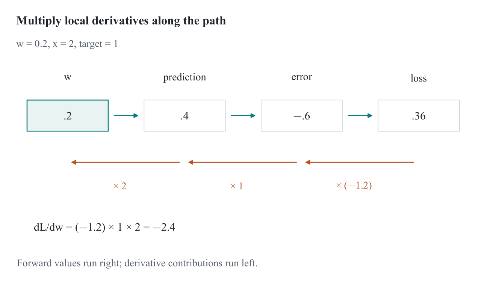{width=100%}

Teal arrows follow the forward calculation; the reverse orange arrows carry local derivatives. Multiply the three displayed factors to obtain dL/dw=-2.4.

Computing the loss gradient through the operations in reverse order is the **backward pass**, also called **backpropagation** in model training. In this example:

| Gradient being computed | Rule | Result |
| --- | --- | --- |
| Loss with respect to `error` | $2\,\mathrm{error}$ | `-1.2` |
| Loss with respect to `prediction` | Previous gradient times `1` | `-1.2` |
| Loss with respect to $w$ | Previous gradient times $x$ | `-2.4` |

**Automatic differentiation** records the operations and intermediate values needed to compute derivatives. It then applies each operation's derivative rule and combines the results with the chain rule. A framework can do this for many parameters. For a scalar loss, each parameter's gradient tells us how the loss changes near that parameter value while the other parameters stay fixed.

This lesson follows one dependency path. When a parameter contributes through multiple paths, their gradient contributions are added; a later lesson will work through that case.

The training responsibilities remain distinct:

1. Define the model's forward computation and the loss.
2. Calculate gradients with a backward pass.
3. Apply an update rule, using the selected learning rate.
4. Recompute the forward values and gradients at the updated parameters for the next iteration.

Automatic differentiation supplies gradients. The parameter update is a separate operation.

### One complete update

With `gradient=-2.4` and `learning_rate=0.1`, gradient descent gives:

```text
w_new = w - learning_rate * gradient
      = 0.2 - 0.1 * (-2.4)
      = 0.44
```

Recompute the forward pass with this new parameter:

```text
prediction_new = 0.44 * 2.0 = 0.88
error_new = 0.88 - 1.0 = -0.12
loss_new = (-0.12) ** 2 = 0.0144
```

This example's loss decreased from `0.36` to `0.0144`. These values establish the result for this update; a large learning rate can still increase loss, as Lesson 03.02 demonstrated. The forward pass, backward pass, and update together make one training iteration.

### A hand-calculation exercise

The numerical checkpoint used `w=0.6`, `x=2.0`, and `target=1.0`. Retain its calculation plan for optional review:

1. Calculate $\mathrm{prediction}=wx$.
2. Calculate $\mathrm{error}=\mathrm{prediction}-\mathrm{target}$.
3. Calculate the square operation's local derivative, $2\,\mathrm{error}$.
4. Multiply it by the subtraction derivative `1` and multiplication derivative $x$ to obtain `d(loss)/d(w)`.

With `w=0.6`, `x=2`, and `target=1`, prediction is `1.2`, error is `0.2`, loss is `0.04`, and the parameter gradient is $2\times 0.2\times 2=0.8$. The factor $x$ comes from differentiating the prediction with respect to w.

## 03.05 Scalar Automatic Differentiation with PyTorch {#section-03-05}

### Method sources

For the backpropagation background, see [Rumelhart et al., 1986; R39](https://doi.org/10.1038/323533a0). PyTorch documents computation graphs, leaf tensors and gradient accumulation in [PyTorch, v2.0 autograd; R16](https://docs.pytorch.org/docs/2.0/notes/autograd.html).

PyTorch computes gradients using the same chain rule as our hand calculation. We write the forward operations with a tensor that tracks gradients, calculate a scalar loss, and call backward. PyTorch then stores the parameter's gradient. We will connect each library call to the previous section's arithmetic.

Work through the example before editing 03_05_scalar_autograd.py. The numbered steps below explain the interface and guide the core implementation; the supplied setup and check driver remain separate.

### The model, loss, and gradient

Keep `x` and `target` fixed, and differentiate with respect to `w`:

```text
prediction = w * x
error = prediction - target
L = loss = error ** 2

dL/dw = dL/d(error) * d(error)/d(prediction) * d(prediction)/dw
      = (2 * error) * 1 * x
      = 2 * (w * x - target) * x
```

The derivative formula is our reference for understanding and verification. In the exercise, write the forward computation and let automatic differentiation calculate the gradient from that computation.

### Principle: reverse differentiation through recorded operations

For an intermediate quantity $u$, define $g_u=\frac{dL}{du}$: the loss's derivative with respect to that quantity. For an operation $v=f(u)$, its reverse contribution is:

```text
g_u += g_v * d(v)/d(u)
```

To follow this reverse calculation by hand, start each gradient total at zero. At the scalar loss, set $g_L=\frac{dL}{dL}=1$. The notation `+=` adds a contribution to the total already stored. Add contributions when several paths reach the same quantity. This exercise has one path, so each quantity receives one contribution.

During the forward pass, PyTorch calculates tensor values and saves the operations and information needed for their derivatives. During backward, it follows those operations in reverse. At each operation, it multiplies the arriving gradient by the local derivative, then passes the result to the preceding quantity. This is reverse-mode automatic differentiation. The [official autograd tutorial](https://docs.pytorch.org/tutorials/beginner/basics/autogradqs_tutorial.html) explains the process.

Autograd uses the values from the current forward pass when applying derivative rules. Floating-point calculations may introduce rounding. Finite differences instead change the input a little and estimate the derivative from the change in output; the driver uses this as an independent check. Symbolic differentiation works on formulas, as in Lesson 03.04. These approaches check the same derivative in different ways.

### Complete forward and backward example

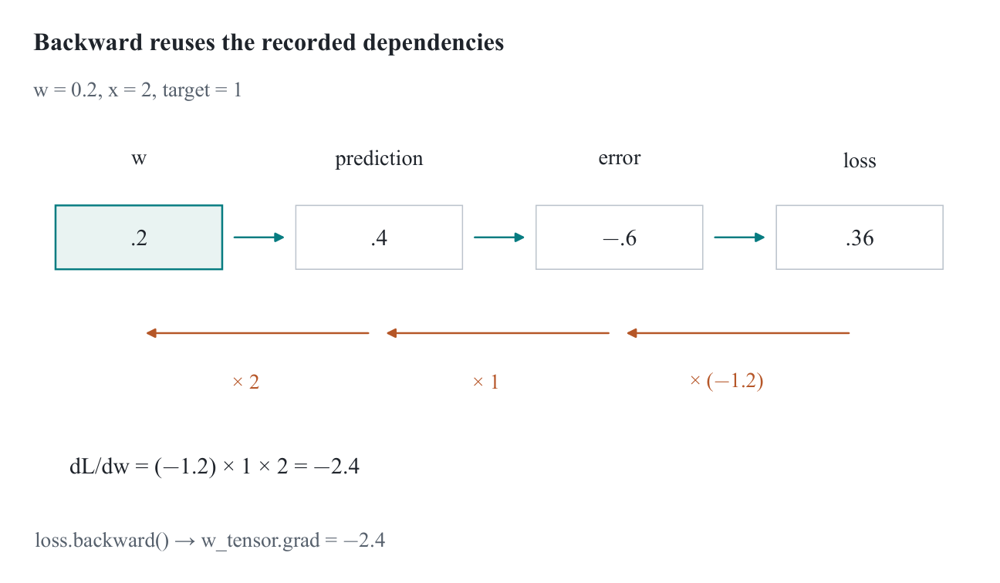{width=100%}

The forward values match the hand calculation. Backward uses those dependencies to populate the leaf parameter’s .grad; extracting a reporting number with .item() is a different operation.

In the exercise, `w_tensor` stores the parameter called `w` in the formulas, and `prediction_tensor` stores its prediction. Both remain tensors during differentiation. `grad_value` is the ordinary Python number extracted from the computed gradient afterward.

Use `w_value=0.2`, `x=2.0`, and `target=1.0`.

| Forward quantity | Formula | Value |
| --- | --- | --- |
| Parameter `w_tensor` | Tensor created from `w_value` | `0.2` |
| `prediction_tensor` | `w_tensor * x` | `0.4` |
| `error` | `prediction_tensor - target` | `-0.6` |
| `loss` | `error ** 2` | `0.36` |

Before backward, the fresh parameter's `w_tensor.grad` is `None`: no gradient has been stored yet. The conceptual reverse trace is:

```text
g_L = 1
g_error = g_L * (2 * error) = 1 * (-1.2) = -1.2
g_prediction = g_error * 1 = -1.2
g_w = g_prediction * x = (-1.2) * 2.0 = -2.4
```

`None` differs from a zero gradient: it represents the absence of a stored gradient. A computed zero derivative is stored as a zero-valued gradient tensor after backward.

After backward, `w_tensor.grad` contains approximately `-2.4`. The parameter still holds `0.2`; backward calculated its loss derivative. A separate update would use `w_new = w - learning_rate * gradient`. This function returns only loss and gradient, so it has no learning-rate argument or update step. The expected return is approximately `(0.36, -2.4)`.

For the positive-error example, `w_value=0.6`, `x=2.0`, and `target=1.0` give prediction `1.2`, error `0.2`, loss `0.04`, and parameter gradient `0.8`.

A useful boundary case is `x=0` and `target=1`: the prediction is zero for every `w_tensor`, so the loss is `1` and the parameter gradient is `0`. Changing this parameter cannot change the prediction for that input. A zero gradient alone does not imply a zero loss.

### The PyTorch objects and syntax

`import torch` loads the library. A tensor stores numerical data and supports operations that can participate in automatic differentiation. A scalar tensor contains one number and has zero dimensions; it is distinct from an empty tensor. Later lessons extend tensors to vectors and tables.

An isolated constructor example is:

```python
parameter = torch.tensor(0.6, dtype=torch.float64, requires_grad=True)
```

The first argument supplies the number. `dtype=torch.float64` chooses 64-bit floating-point precision; this is a numeric representation, not a tensor shape or embedding dimension. `requires_grad=True` requests gradient tracking for operations involving this tensor in normal gradient mode. `True` is a Boolean value with a capital $T$. This directly created parameter is a **leaf tensor**, the starting parameter node. See the [tensor constructor](https://docs.pytorch.org/docs/2.0/generated/torch.tensor.html).

Arithmetic with this tensor produces connected tensor results. Keep `prediction_tensor`, `error`, and `loss` as tensors through the forward computation. This example can multiply by a Python float `x` and subtract a Python float `target` while preserving the dependency on `w_tensor`.

`loss.backward()` calls a method on the loss tensor. The dot selects the method; parentheses run it. For this scalar loss, backward starts with gradient `1`. The method returns `None`. It stores the computed gradient on each participating leaf tensor, including `w_tensor.grad`. Read `.grad` after the call. Intermediate tensors usually do not keep their own `.grad`, although backward uses their derivatives. Every call in this exercise creates a fresh `w_tensor`. Later, we will clear stored gradients when reusing a parameter. See [Tensor.backward](https://docs.pytorch.org/docs/2.0/generated/torch.Tensor.backward.html).

`w_tensor.grad` holds the gradient as a tensor. Call `w_tensor.grad.item()` to read its value as a Python number. Call `loss.item()` to read the loss in the same way. The method `.item()` requires a one-element tensor and is not differentiable. Extract reporting numbers after backward. If you replace `loss` with a Python float first, you lose the tensor needed to call backward. See [Tensor.item](https://docs.pytorch.org/docs/2.0/generated/torch.Tensor.item.html).

### Exact inputs, local variables, and return

| Name | Type | Meaning |
| --- | --- | --- |
| `w_value` | `float` | Parameter number at the start of this call. |
| `x` | `float` | Fixed input multiplier. |
| `target` | `float` | Fixed desired prediction. |
| `w_tensor` | Scalar `torch.Tensor` | Fresh parameter with gradient tracking enabled. |
| `prediction_tensor`, `error`, `loss` | Scalar `torch.Tensor` | Connected forward results. |
| `w_tensor.grad` | `None`, then scalar `torch.Tensor` | Uncomputed gradient, then stored loss derivative with respect to `w_tensor`. |
| `grad_value` | `float` | Number extracted from the computed parameter gradient. |

Assume finite input floats. Return a tuple `(loss_value, grad_value)` of two Python floats, both describing the original parameter. The implementation stores the extracted loss in local variable `loss_value` and the extracted gradient in `grad_value`. The function does not need loops, conditions, or input validation.

### Guided implementation

Retain this plan for reviewing or reconstructing the implementation, using its actual local names. Keep the supplied imports and driver. Each implementation statement uses four spaces of indentation inside the function.

1. **Create `w_tensor` from `w_value`.** Use `torch.tensor(w_value, dtype=torch.float64, requires_grad=True)`. Here `w_value` supplies the value, `torch.float64` selects the floating-point type, and `requires_grad=True` enables gradient tracking. Its value is `0.2` in the example, with `w_tensor.grad` initially `None`. Create it inside the function for an independent calculation on every call.
2. **Calculate `prediction_tensor`.** Multiply tensor `w_tensor` by argument `x` using `*` and ordinary assignment. The example result is a scalar tensor holding `0.4`.
3. **Calculate `error`.** Subtract argument `target` from `prediction_tensor`. The example result holds `-0.6`.
4. **Calculate `loss`.** Square `error` with `** 2`. The example result holds `0.36`. Keep the tensor connected to `w_tensor`.
5. **Run backward once.** Call `loss.backward()` on its own line. `w_tensor.grad` then holds `-2.4`, while `w_tensor` still holds `0.2`.
6. **Read `grad_value`.** Extract the number from `w_tensor.grad` with `.item()`. The example Python float is approximately `-2.4`; obtain it from autograd rather than the manual derivative formula.
7. **Return two numbers.** Extract the number from `loss`, then return it followed by `grad_value`. The syntax `return first, second` produces a two-item tuple. The example result is approximately `(0.36, -2.4)`.

### Run, expected output, and troubleshooting

Activate the existing PyTorch environment in your terminal. Run from the project root with that environment's `python`:

```bash
python exercises/03_05_scalar_autograd.py
```

The example produces:

```text
PASS: negative and positive parameter gradients
PASS: unit input matches the earlier scalar loss
PASS: changed inputs and targets
PASS: zero gradients with zero and nonzero losses
PASS: separate calls produce independent results
PASS: finite-difference gradient agreement
Lesson 03.05 checks passed.
```

If `torch` cannot be imported, check the selected interpreter and activate the existing environment. If the loss has no gradient history, check `requires_grad=True` and that tensor results were preserved. If `w_tensor.grad` is `None`, check that backward ran on the connected loss before reading it. `loss.backward()` returning `None` is normal; retrieve the gradient from the parameter's attribute. The checks allow floating-point rounding differences.

### Questions to work through

Optional review: explain what `requires_grad` enables, why reverse differentiation starts with `1`, where the computed gradient is stored, why backward leaves `w_tensor` unchanged, and when `.item()` is appropriate. Continue with [Lesson 03.06](#section-03-06) to clear old gradients and apply a tensor parameter update. Later lessons connect these steps to training loops and embeddings.

## 03.06 Updating a Tensor Parameter {#section-03-06}

### Method sources

The tensor backward operation follows the autograd rules in [PyTorch, v2.0 autograd; R16](https://docs.pytorch.org/docs/2.0/notes/autograd.html). For the underlying neural-network chain rule, see [Rumelhart et al., 1986; R39](https://doi.org/10.1038/323533a0).

A gradient describes how a parameter affects the loss; it does not update the parameter. To complete a training step, clear the stored gradient, compute the current gradient, and update the same tensor. Record the forward calculation for differentiation. Temporarily stop recording only while applying the update.

Work through the example before editing 03_06_tensor_gradient_step.py. The numbered steps below explain the interface and guide the core implementation; the supplied setup and check driver remain separate.

### Derivative and update

Hold the input `x` and desired prediction `target` fixed. For the scalar parameter `w`:

```text
prediction = w * x
error = prediction - target
L(w) = loss = error ** 2
g = dL/dw = 2 * (w * x - target) * x
w_new = w - learning_rate * g
```

The derivative comes from Lesson 03.04's chain rule. A small parameter change $\Delta w$ gives the loss-change estimate $\Delta L\approx g\,\Delta w$. Gradient descent chooses $\Delta w=-\texttt{learning\_rate}\,g$. Substituting this choice gives $\Delta L\approx-\texttt{learning\_rate}\,g^{2}$. If the learning rate is positive and the gradient is nonzero, the estimate is negative. This explains the update direction. It does not guarantee that a large step lowers the loss.

For this particular squared loss, the exact finite change is:

```text
L(w + delta_w) - L(w) = g * delta_w + x ** 2 * delta_w ** 2
```

The extra square term can outweigh the negative first-order term. The supplied checks retain the earlier large-learning-rate example as a boundary case.

### Classroom Q&A: prediction minus target, or target minus prediction?

Consider whether `error = predicted_tensor - target` could instead subtract in the opposite order, and what difference `target - predicted_tensor` would make. Let $a=\mathrm{prediction}=wx$ and $b=\mathrm{target}$, with `x` and `target` fixed. Both signed-error conventions are valid for this squared-error objective:

```text
error = a - b
error_reversed = b - a = -error

loss = error ** 2 = error_reversed ** 2
```

`error_reversed` is a name for this explanatory alternative, not a new variable added to the completed exercise. The current exercise code keeps `error = predicted_tensor - target`.

The sign describes opposite meanings:

| Signed-error definition | Positive value means | Negative value means |
| --- | --- | --- |
| `a - b` | Prediction is above the target | Prediction is below the target |
| `b - a` | Prediction is below the target | Prediction is above the target |

For prediction `0.4` and target `1.0`, the two errors are `-0.6` and `+0.6`; their squares both equal `0.36`. For prediction `1.2` and target `1.0`, they are `+0.2` and `-0.2`; their squares both equal `0.04`. The opposite sign changes the description of the deviation, not the value of this squared loss.

Reversing the error also reverses its derivative with respect to the prediction. Apply the chain rule consistently:

```text
prediction = w * x

Original definition:
    error = prediction - target
    d(error)/d(prediction) = +1
    dL/dw = (2 * error) * (+1) * x

Reversed definition:
    error_reversed = target - prediction
    d(error_reversed)/d(prediction) = -1
    dL/dw = (2 * error_reversed) * (-1) * x
```

Why is the reversed subtraction's derivative `-1`? When prediction increases by a small amount, `target - prediction` decreases by that same amount. Meanwhile $\mathrm{error}_{\mathrm{reversed}}=-\mathrm{error}$, so the two sign changes cancel and the final parameter gradients agree.

With `w=0.2`, `x=2.0`, and `target=1.0`, the complete comparison is:

| Quantity | Prediction minus target | Target minus prediction |
| --- | --- | --- |
| Prediction | `0.4` | `0.4` |
| Signed error | `-0.6` | `+0.6` |
| Squared loss | `0.36` | `0.36` |
| Error derivative with respect to prediction | `+1` | `-1` |
| Loss derivative with respect to `w` | $2 \times  (-0.6) \times  (+1) \times  2 = -2.4$ | $2 \times  (+0.6) \times  (-1) \times  2 = -2.4$ |

Both updates with learning rate `0.1` give $w_{\mathrm{new}}=0.2-0.1\times (-2.4)=0.44$. Reversing the error changes the signs of both the error and its local derivative. Those changes cancel, leaving the squared loss, parameter gradient, and update unchanged. Keep subtracting the scaled gradient in the update rule.

When manually deriving a gradient for `error_reversed`, use the factor `-1`: its formula is `-2 * error_reversed * x`, not `2 * error_reversed * x`. In this exercise, `loss.backward()` differentiates the written forward expression, so it accounts for that factor automatically. This equivalence follows from the symmetric square; it is not a rule that subtraction order is irrelevant to every possible objective.

### Classroom Q&A: why subtract `learning_rate * gradient`?

A common question is why the update subtracts the scaled gradient rather than adding it. Start with what the gradient means: $g=\frac{dL}{dw}$ describes the local change in loss when the parameter increases. It is a derivative, not the prediction error or a direct instruction to increase the parameter.

For a small parameter change, write:

```text
delta_L ≈ g * delta_w
```

We want a negative loss change. With a positive learning rate, choose a parameter change with the opposite sign to the gradient:

```text
delta_w = -learning_rate * g
delta_L ≈ g * (-learning_rate * g)
        = -learning_rate * g ** 2
```

For nonzero $g$, this local estimate is negative. Adding the scaled gradient instead gives $\Delta L\approx+\texttt{learning\_rate}\,g^{2}$, a positive local estimate. The negative sign chooses the descent direction; the positive learning rate sets the step size.

| Gradient at the current parameter | Effect of a small increase in `w` | Descent choice |
| --- | --- | --- |
| $g>0$ | Loss increases locally | Decrease `w` |
| $g<0$ | Loss decreases locally | Increase `w` |
| $g=0$ | First-order change is zero | This update leaves `w` unchanged |

Using the existing example, `w=0.2`, `x=2.0`, and `target=1.0` give `prediction=0.4`, `error=-0.6`, `loss=0.36`, and $g=-2.4$. Compare the two signs at `learning_rate=0.1`:

| Update | New `w` | New prediction | New error | Recomputed loss |
| --- | --- | --- | --- | --- |
| Subtract: $0.2 - 0.1 \times  (-2.4)$ | `0.44` | `0.88` | `-0.12` | `0.0144` |
| Add: $0.2 + 0.1 \times  (-2.4)$ | `-0.04` | `-0.08` | `-1.08` | `1.1664` |

Subtracting this negative gradient increases the parameter and lowers the loss for this step. Adding it decreases the parameter and raises the loss. In both cases, recalculate the loss from the new parameter to assess the finite step. The local descent argument still needs a sufficiently small step; a large learning rate can overshoot. A zero gradient alone does not prove a minimum.

The useful interpretation is: read the gradient as a local slope, choose the opposite direction to reduce the loss, and use the learning rate to scale that change.

### Classroom Q&A: numerical examples of positive and negative slopes

For this comparison, set the fixed input to `x=1.0` and `target=1.0`, returning to the earlier scalar model. Define the loss and derivative before substituting values:

```text
L(w) = (w - 1) ** 2
g(w) = dL/dw = 2 * (w - 1)
```

The squared distance to `1` is smallest at `w=1`. The derivative is evaluated at the current parameter, so the same function can have different gradient signs at different points. Compare two starting points without using an optimizer; simply recalculate the loss after increasing or decreasing `w` by `0.1`.

**Start at `w=2`: a positive gradient.** The derivative is $g(2)=2(2-1)=+2$.

| Action from the starting point | Parameter | Exact loss |
| --- | --- | --- |
| Original | `2.0` | $(2.0 - 1) ^{2} = 1.0$ |
| Increase by `0.1` | `2.1` | $(2.1 - 1) ^{2} = 1.21$ |
| Decrease by `0.1` | `1.9` | $(1.9 - 1) ^{2} = 0.81$ |

Increasing the parameter moves farther from the target and raises the loss. Decreasing it moves toward the target and lowers the loss. Thus a positive gradient calls for a negative parameter change in gradient descent.

**Start at `w=0`: a negative gradient.** The derivative is $g(0)=2(0-1)=-2$.

| Action from the starting point | Parameter | Exact loss |
| --- | --- | --- |
| Original | `0.0` | $(0.0 - 1) ^{2} = 1.0$ |
| Increase by `0.1` | `0.1` | $(0.1 - 1) ^{2} = 0.81$ |
| Decrease by `0.1` | `-0.1` | $(-0.1 - 1) ^{2} = 1.21$ |

Increasing the parameter now moves toward the target and lowers the loss. Decreasing it moves farther away and raises the loss. Thus a negative gradient calls for a positive parameter change in gradient descent.

The two original losses both equal `1`, while their gradients are `+2` and `-2`. A gradient's sign describes the local slope, not whether the loss itself is positive or negative. For this example, being on different sides of the minimum explains the opposite slopes; general models require examining their own loss derivatives.

Connect both cases to the update with `learning_rate=0.05`:

```text
At w=2, g=+2:
    w_new = 2 - 0.05 * 2 = 1.9
    loss: 1.0 -> 0.81

At w=0, g=-2:
    w_new = 0 - 0.05 * (-2) = 0.1
    loss: 1.0 -> 0.81
```

One subtraction rule selects the appropriate direction at both starting points. The table values are exact finite-step calculations up to floating-point rounding, whereas $\Delta L\approx g\,\Delta w$ is a first-order estimate. At a change of `0.1`, the square term accounts for the difference between an estimated change of `0.2` and the exact increase `0.21`, or between an estimated decrease of `0.2` and the exact decrease `0.19`. These examples illustrate the sign locally; very large changes may cross the minimum.

### A complete first update

Use `w=0.2`, `x=2.0`, `target=1.0`, and `learning_rate=0.1`. In code, the parameter is named `w_tensor` and the prediction is `predicted_tensor`.

| Stage | Calculation | Result |
| --- | --- | --- |
| Clear prior gradient | Discard the stored `.grad` value | Parameter still `0.2` |
| Forward prediction | $0.2 \times  2.0$ | `0.4` |
| Forward error | `0.4 - 1.0` | `-0.6` |
| Forward loss | $(-0.6) ^{2}$ | `0.36` |
| Backward gradient | $2 \times  (-0.6) \times  2.0$ | `-2.4` |
| Parameter update | $0.2 - 0.1 \times  (-2.4)$ | `0.44` |

Backward stores the gradient and leaves the parameter at `0.2`. The update changes it to `0.44`. Recomputing afterward gives prediction `0.88`, error `-0.12`, and loss `0.0144`.

Return the original `(loss_value, grad_value)`, approximately `(0.36, -2.4)`. Separately, the caller's tensor now holds `0.44`. The returned loss describes the forward pass used to obtain that gradient; it is not the newly recomputed loss `0.0144`. This matches the pre-update logging convention in Lesson 03.03.

### Why old gradients must be cleared

Backward adds contributions to a leaf tensor's existing `.grad`. Reusing a parameter across new forward calculations does not automatically clear this stored value. The [official autograd tutorial](https://docs.pytorch.org/tutorials/beginner/basics/autogradqs_tutorial.html) demonstrates this accumulation.

Clear the stored gradient at the start of each step so the update uses only the current forward calculation. Assigning `None` to `w_tensor.grad` discards the stored gradient without changing the parameter. Backward then stores the new result. The same reset works on the first call, when `.grad` is already `None`.

Two calls on the same parameter illustrate the distinction:

```text
First call:
    w_before = 0.2
    loss = 0.36
    gradient = -2.4
    w_after = 0.44

Second call, after clearing the old gradient:
    w_before = 0.44
    prediction = 0.88
    error = -0.12
    loss = 0.0144
    gradient = 2 * (-0.12) * 2.0 = -0.48
    w_after = 0.44 - 0.1 * (-0.48) = 0.488
```

If the second call omitted the reset, `.grad` would contain $-2.4 + (-0.48) = -2.88$. Updating with that accumulated value would give `0.728`, not `0.488`. Accumulation can be intentional when combining multiple batches, but that later technique needs its own scaling and update schedule. Here each call is one complete update, so clear old gradients first. Clearing at the start also lets the caller inspect the current gradient after the step.

### Why the update uses `torch.no_grad()`

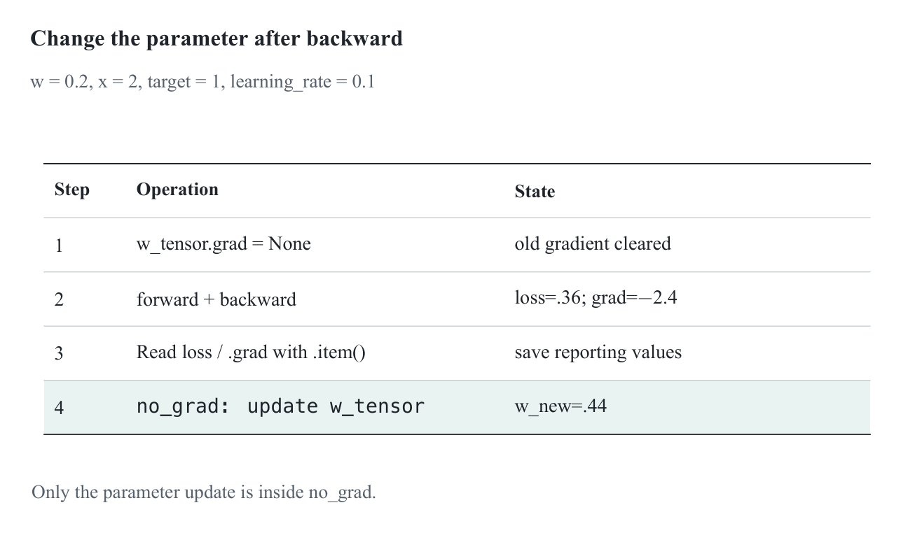{width=100%}

Read the numbered rows from top to bottom, keeping the old-state loss and gradient separate from the new parameter. Only the final in-place update belongs inside torch.no_grad().

The forward operations must be recorded to compute $\frac{dL}{dw}$ at the current parameter. After backward, update the parameter for the next step without recording the update as part of this calculation. Put only the update inside `torch.no_grad()`. The [autograd mechanics documentation](https://docs.pytorch.org/docs/2.0/notes/autograd.html) explains this use.

The new Python keyword `with` enters a temporary context for its indented block. For `torch.no_grad()`, operations inside that block are excluded from reverse-mode graph recording; leaving the block restores the prior gradient mode. The syntax in a function is:

```python
    with torch.no_grad():
        # Write the parameter update here, with eight spaces of indentation.
        ...
    # Outside the block: return with four spaces of indentation.
```

The colon starts the block. `...` is an illustration placeholder, not the finished update. Existing `w_tensor.requires_grad` remains `True`; the temporary context does not permanently freeze the parameter. A later forward calculation outside the block can still record operations on it. Keep the forward pass and backward outside this context. See the [no_grad API](https://docs.pytorch.org/docs/2.0/generated/torch.no_grad.html).

Trying the leaf parameter's in-place update in normal gradient mode raises a runtime error. The appropriate sequence here is forward, backward, then the parameter update inside the context. Advanced differentiation through an optimizer is a separate topic.

### Update the parameter the caller holds

Unlike Lesson 03.05's function, this function receives an already-created tensor. The local name `w_tensor` refers to the same tensor object that the caller supplied. Its values must change in place so the caller and the next call see the updated parameter.

The operator `-=` subtracts a value and assigns the result. For this tensor, it changes the stored values in place. For an integer counter, `counter -= 2` subtracts two. In the no-grad block, subtract the learning rate times the gradient from `w_tensor`. Writing `w_tensor = ...` with a new tensor only changes what the local name refers to; the caller still holds the old tensor. Keep the original leaf tensor and its storage. Do not use `.data` to bypass tracking.

### Classroom continuation: replace the `.data` update

The `.data` access shares the parameter's storage while bypassing normal autograd tracking; modifying it can evade modification checks and give incorrect gradients if another backward calculation needs the overwritten value. The [official migration guide](https://pytorch.org/blog/pytorch-0_4_0-migration-guide/) illustrates this issue. The earlier `.data` implementation's single-step numerical results passed because its update occurred after that step's backward calculation. That check did not exercise a later backward calculation needing an overwritten value, so it could not expose the bypassed modification checks. Use the explicit no-grad context for the parameter update while retaining PyTorch's normal modification bookkeeping.

`with torch.no_grad():` enters a temporary mode for its indented block; it is not a loop or a condition. The parameter's existing `requires_grad=True` remains unchanged, and its computed `.grad` stays stored. In-place updates retain normal modification bookkeeping while adding no update operations to the reverse graph. Leaving the block restores the prior mode, so the next forward pass can record operations again.

Use the same complete example before editing:

| Moment | `w_tensor` value | Stored gradient | Return values being saved |
| --- | --- | --- | --- |
| After clearing old gradients | `0.2` | `None` | Not yet computed |
| After forward and backward | `0.2` | `-2.4` | `(0.36, -2.4)` |
| After the no-grad update | `0.44` | `-2.4` | Still the original `(0.36, -2.4)` |

The update formula stays `w_new = w - learning_rate * gradient`: $0.2 - 0.1 \times  (-2.4) = 0.44$. The context changes how that update participates in autograd bookkeeping; it does not change the arithmetic.

1. Immediately above the existing update, enter `with torch.no_grad():` at four-space indentation. The parentheses call the context manager; the colon begins its block.
2. Indent the update to eight spaces. Update `w_tensor` directly with `-=`, removing `.data`; subtract the product of `learning_rate` and `w_tensor.grad`. Keep the original parameter object.
3. Keep the return at four spaces, outside the context. Return the already-saved `loss_value` and `grad_value`, then run the same exercise command. No new loop or replacement parameter is needed.

### Classroom follow-up: only the update belongs in the context

A common mistake is to put `predicted_tensor`, `error`, `loss`, and `loss.backward()` inside `with torch.no_grad()`. Backward then stops with:

```text
element 0 of tensors does not require grad and does not have a grad_fn
```

The context also stops recording the forward operations, so this `loss` has no recorded path back to the parameter. Backward cannot reconstruct operations that were never recorded. Moving backward outside the block is therefore not enough: the forward calculation must also run outside no-grad mode. The parameter's `requires_grad=True` does not override this mode.

The intended order is: record the forward computation, differentiate that recorded computation, save the results, and then temporarily stop recording while updating the parameter. With `w_tensor=0.2`, `x=2.0`, and `target=1.0`, forward gives loss `0.36`; backward stores gradient `-2.4` while the parameter stays `0.2`. Only the update changes the parameter to `0.44` at learning rate `0.1`.

Correct the calculation as follows:

1. Keep gradient clearing, the forward calculations, `loss.backward()`, and extraction of `loss_value`/`grad_value` at four-space function indentation, outside the context.
2. Place `with torch.no_grad():` after those operations at four spaces; keep only the parameter update inside it at eight spaces. Its subtraction still uses `learning_rate` and `w_tensor.grad`.
3. Keep the return at four spaces outside the context, then run the same exercise command again.

### Exact inputs, variables, return, and side effect

Follow this sequence: reset the stored gradient, calculate `predicted_tensor`, `error`, and `loss`, run backward, extract `loss_value` and `grad_value`, update `w_tensor` inside the no-grad block, then return the saved numbers. For the first example, the return is approximately `(0.36, -2.4)` while the caller's parameter becomes `0.44`. The next call starts at `0.44`, returns approximately `(0.0144, -0.48)`, and updates the same parameter to `0.488`. The supplied checks verified this sequence, persistent storage, fresh gradients, and a trainable leaf.

| Name | Type | Meaning |
| --- | --- | --- |
| `w_tensor` | Scalar floating-point `torch.Tensor` | Supplied trainable leaf with `requires_grad=True`; its stored gradient may be `None` or old data. |
| `x` | `float` | Fixed input multiplier. |
| `target` | `float` | Fixed desired prediction. |
| `learning_rate` | Nonnegative `float` | Multiplier determining the update size. |
| `predicted_tensor`, `error`, `loss` | Scalar `torch.Tensor` | Current forward computation, kept connected to the parameter. |
| `loss_value`, `grad_value` | `float` | Values extracted after backward, describing the parameter before the update. |

Assume finite inputs and the stated tensor prerequisites; input validation is not part of this exercise. The supplied driver creates CPU `float64` parameters. Return exactly two Python floats `(loss_value, grad_value)`. The supplied parameter is updated in place, remains a trainable leaf, and retains this step's `.grad` until the next call clears it. A zero learning rate changes no parameter value even though backward still computes the gradient.

### Guided implementation

Retain this full plan for reviewing or reconstructing the implementation. The imports, parameter setup, and checks are supplied. Use four spaces for statements in the function; only the update inside `with` uses eight.

1. **Reset the previous gradient.** Use attribute assignment, `object.attribute = value`, to put `None` in `w_tensor.grad`. The parameter stays `0.2` in the example.
2. **Calculate `predicted_tensor`.** Multiply `w_tensor` by `x` using `*` and save the tensor result. It holds `0.4`.
3. **Calculate `error` and `loss`.** Subtract `target` from the prediction, then square the error using `** 2`. They hold `-0.6` and `0.36`. Preserve the tensor dependency.
4. **Run backward.** Call the `backward()` method on `loss`, once, outside the no-grad context. `w_tensor.grad` now holds `-2.4`; the parameter still holds `0.2`.
5. **Save the return values.** Use `.item()` on `loss` for `loss_value` and on `w_tensor.grad` for `grad_value`. These are Python floats from the original forward/backward calculation.
6. **Apply the update.** At four spaces, enter `with torch.no_grad():`. At eight spaces inside it, use `-=` on `w_tensor`, subtracting `learning_rate` multiplied by `w_tensor.grad`. The same tensor now holds `0.44`.
7. **Return outside the context.** At four spaces, return `loss_value`, then `grad_value`, using `return first, second`. The example returns approximately `(0.36, -2.4)`. Leave the current gradient stored.

No loop is needed in the exercise function: one call performs one step. The supplied driver calls it again on the same tensor to verify the next step.

### Run and expected output

Activate the existing PyTorch environment, then run from the project root:

```bash
python exercises/03_06_tensor_gradient_step.py
```

The corrected implementation produced:

```text
PASS: both gradient directions and in-place trainable parameters
PASS: repeated steps use current parameters and fresh gradients
PASS: previously stored gradients are cleared
PASS: zero gradients and zero learning rate
PASS: changed inputs, targets, and learning rates
PASS: a large learning rate can increase loss
Lesson 03.06 checks passed.
```

Keep forward/backward outside the no-grad update block. The examples below help diagnose mistakes. A leaf in-place error suggests the update lies outside the no-grad block. An incorrect second gradient suggests old gradients were retained. An unchanged caller parameter suggests local rebinding or an omitted update. A return of `0.0144` in the first example suggests returning a post-update loss instead of the required original loss. These checks also allow floating-point rounding.

### Questions to work through

Optional review: why does clearing `.grad` leave the parameter unchanged? Why is the second step's fresh gradient `-0.48`? Why is only the update inside `no_grad`, and how does the caller observe the changed parameter? Continue with [Lesson 03.07](#section-03-07) to connect the verified update to a tensor training loop. Trainable embeddings follow.

## 03.07 A Tensor Training Loop {#section-03-07}

The scalar loop had to save a new Python number after each step. The tensor helper changes the parameter it receives in place. Create that tensor once before the loop. Call the helper once per iteration and record its returned loss. The helper has already updated the parameter, so the loop must not update it again.

Work through the example before editing 03_07_tensor_training_loop.py. The numbered steps below explain the interface and guide the core implementation; the supplied setup and check driver remain separate.

### The recurrence we will implement

Keep `x`, `target`, and `learning_rate` fixed. Let $w_t$ be the parameter before update number $t$, with $w_0=\texttt{initial\_w}$. For $t=0,1,\ldots,\texttt{num\_steps}-1$:

```text
w_0 = initial_w
prediction_t = w_t * x
error_t = prediction_t - target
loss_t = error_t ** 2
gradient_t = 2 * error_t * x
w_(t+1) = w_t - learning_rate * gradient_t
```

Each gradient is evaluated at the current parameter $w_t$, not at `initial_w` again. The parameter after one update is the starting parameter for the next. These equations describe repeated gradient descent; the helper obtains each gradient through autograd rather than a handwritten derivative in the loop.

The history and return are:

```text
losses = [loss_0, loss_1, ..., loss_(num_steps-1)]
final_w = w_(num_steps)
return (final_w, losses)
```

For `num_steps=0`, the history is empty and the final parameter is the initial value. There are exactly `num_steps` recorded pre-update losses, with no extra post-training entry.

### Principle: one persistent parameter, one step per iteration

Create `w_tensor` once before the loop. Its numerical value changes, while the same tensor object stays available to the following iteration. The completed helper is:

```text
tensor_gradient_step(w_tensor, x, target, learning_rate)
    returns (loss_value, grad_value)
    updates the supplied w_tensor in place
```

The helper clears the old gradient, computes the current prediction and loss, and runs backward. It then saves the loss and gradient before updating the parameter inside its own no-grad block. The outer loop only calls the helper and appends its returned loss. Do not repeat backward or the update. Keep normal gradient mode in the outer loop so the helper can record its forward operations.

Each helper call performs a new forward calculation and creates a new graph. Keep the parameter tensor for the next iteration, rather than keeping an old `loss` or its graph. There is no need for `retain_graph=True`: backward runs on a new loss each time. The helper clears stored gradients before each backward call.

Compare the helper interfaces:

| Earlier scalar loop | This tensor loop |
| --- | --- |
| `gradient_step` returns `(loss, gradient, w_new)` | `tensor_gradient_step` returns `(loss_value, grad_value)` |
| The caller must keep the returned `w_new` | The passed `w_tensor` is already updated in place |
| The working parameter is a Python number | The working parameter is one trainable tensor |

The two returned numbers do not include a new parameter. In this loop, `grad_value` is unpacked for clarity but does not need to be stored in the loss history. Do not replace `w_tensor` with the helper's return tuple.

### Complete three-update example

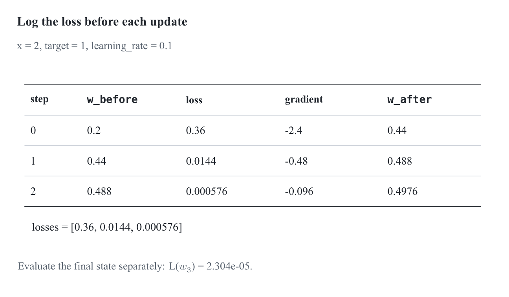{width=100%}

Each table row records one helper call on the same tensor, with its before/after values. The three loss entries are the returned old-state history; $L_{3}$ is evaluated separately in the footer.

Use `initial_w=0.2`, `x=2.0`, `target=1.0`, `learning_rate=0.1`, and `num_steps=3`.

Before the loop, create one trainable `w_tensor` holding `0.2` and a fresh `losses=[]`.

| Loop counter | Parameter before update | Prediction | Error | Pre-update loss | Gradient | Parameter after update |
| --- | --- | --- | --- | --- | --- | --- |
| `0` | `0.2` | `0.4` | `-0.6` | `0.36` | `-2.4` | `0.44` |
| `1` | `0.44` | `0.88` | `-0.12` | `0.0144` | `-0.48` | `0.488` |
| `2` | `0.488` | `0.976` | `-0.024` | `0.000576` | `-0.096` | `0.4976` |

For the first update, $\mathrm{gradient}=2\times (-0.6)\times 2=-2.4$ and $w_{\mathrm{new}}=0.2-0.1\times (-2.4)=0.44$. Save the returned loss `0.36`. The same parameter now holds `0.44`.

For the second, the helper uses `0.44`: `prediction=0.88`, `error=-0.12`, `loss=0.0144`, and $\mathrm{gradient}=2\times (-0.12)\times 2=-0.48$. It updates the parameter to $0.44-0.1\times (-0.48)=0.488$; append `0.0144`.

For the third, it uses `0.488`: `prediction=0.976`, `error=-0.024`, `loss=0.000576`, and `gradient=-0.096`. The parameter becomes `0.4976`; append `0.000576`.

The changing state is:

```text
Before looping: w_tensor=0.2, losses=[]
After counter 0: w_tensor=0.44, losses=[0.36]
After counter 1: w_tensor=0.488, losses=[0.36, 0.0144]
After counter 2: w_tensor=0.4976, losses=[0.36, 0.0144, 0.000576]

Return approximately:
(0.4976, [0.36, 0.0144, 0.000576])
```

All values are subject to floating-point rounding. The comparison driver allows a small tolerance.

### Why appending after the helper still records the old loss

The helper reads the loss as a Python float before updating the parameter. When the call returns, `w_tensor` has changed, but `loss_value` still contains the earlier loss. Appending that number after the call therefore records the loss before the update.

The loss at the final parameter is $(0.4976\times 2-1)^{2}=0.00002304$. That is a separate evaluation at $w_3$; the requested three updates used and recorded $L_0$, $L_1$, and $L_2$. Do not append the final evaluation as a fourth entry. Later training systems can report final evaluations separately from update history.

### Inputs, local variables, and returned values

Check that `w_tensor` and `losses` are initialized before `for i in range(num_steps)`. The loop body calls `tensor_gradient_step` once and appends `loss_value`; the final return extracts `w_tensor.item()` after the loop. Naming the counter `i` is valid: it receives `0, 1, 2` in the three-step example, just as the original hint's `step` did. The helper updates the tensor directly, so no returned `w_new` assignment is needed. `grad_value` is unpacked but unused because this task records only losses.

The checks observe the same tensor reaching the helper at `0.2`, `0.44`, and `0.488`; the result is approximately `(0.4976, [0.36, 0.0144, 0.000576])`. They also verify that zero steps return the initial value and an empty list.

| Name | Type | Meaning |
| --- | --- | --- |
| `initial_w` | `float` | Parameter value before this training call. |
| `x` | `float` | Fixed input multiplier. |
| `target` | `float` | Fixed desired prediction. |
| `learning_rate` | Nonnegative `float` | Multiplier used in each parameter update. |
| `num_steps` | Nonnegative `int` | Number of requested updates. |
| `w_tensor` | Scalar `torch.Tensor` | One trainable parameter created with `float64` and `requires_grad=True` before the loop. |
| `losses` | `list[float]` | Fresh history with one pre-update loss per step. |
| `i` | `int` | Loop counter; it counts repetitions, not the parameter or learning rate. |
| `loss_value`, `grad_value` | `float` | Two numbers returned by the completed step helper. |
| `final_w` | `float` | Final parameter number extracted with `.item()`; a separate local variable with this name is optional. |

Assume finite floating-point inputs and the stated nonnegative learning rate/step count; no input validation is required. Return a tuple `(final_w, losses)`, consisting of a Python float and a list of Python floats. Separate calls create separate parameter tensors and history lists. For zero updates, return `(initial_w, [])`.

The supplied `runpy.run_path` setup finds `03_06_tensor_gradient_step.py` beside the current exercise and loads the helper without running its check driver. Numbered filenames and the loading pattern match the existing exercises; the learner does not need to implement this setup.

### Syntax and indentation before implementation

`torch.tensor(value, dtype=torch.float64, requires_grad=True)` creates the trainable scalar. Use `initial_w` as its value, and create it outside the loop. `[]` creates the fresh history list, also outside the loop.

The `for` keyword repeats a block. `range(num_steps)` supplies the counters: `range(3)` gives `0, 1, 2`, exactly three iterations, while `range(0)` supplies no counters and skips the body. The loop header's colon starts its indented body. Inside the function, setup and the loop header use four spaces; the helper call and append use eight.

Tuple unpacking binds two returned values in order, as in the unrelated syntax example `first, second = (10, 20)`. Here the first result is `loss_value` and the second is `grad_value`. `losses.append(loss_value)` adds one loss float to the end of the list.

`return` exits the function. Place it after the loop at four spaces so all updates finish, and so the zero-step case still returns. Extract the final parameter with `w_tensor.item()`. If the return were inside the loop, it would exit after the first iteration and never execute when `num_steps=0`.

### Guided implementation

Keep the supplied setup and checks; retain these six steps for reviewing or reconstructing the implementation:

1. **Create `w_tensor` once.** At four-space indentation, use the tensor constructor with `initial_w`, `torch.float64`, and `requires_grad=True`. The example starts at `0.2`. This stays before the loop.
2. **Create `losses`.** At four spaces, create a fresh empty list with `[]`. Its initial value is `[]` even when zero updates are requested.
3. **Start the loop.** At four spaces, use `for i in range(num_steps):`. With `num_steps=3`, the body runs for counters `0`, `1`, and `2`.
4. **Call the completed helper.** At eight spaces, call `tensor_gradient_step(w_tensor, x, target, learning_rate)` and unpack the two results into `loss_value` and `grad_value`. The first call returns approximately `(0.36, -2.4)` and already changes `w_tensor` to `0.44`. Do not assign a new parameter from those results.
5. **Record the loss.** At eight spaces, append only `loss_value` to `losses`. After two iterations, it is approximately `[0.36, 0.0144]`. No extra backward or update is needed in the loop.
6. **Return after the loop.** Back at four spaces, extract the final parameter with `.item()` and return that float followed by `losses`, using `return first, second`. The three-step result is approximately `(0.4976, [0.36, 0.0144, 0.000576])`; the zero-step result is `(initial_w, [])`.

### Optional mathematical review: why this example's loss falls quickly

For this fixed scalar example, substitute the update into the next error:

```text
error_(t+1)
    = x * (w_t - learning_rate * 2 * error_t * x) - target
    = (1 - 2 * learning_rate * x ** 2) * error_t

loss_(t+1) = (1 - 2 * learning_rate * x ** 2) ** 2 * loss_t
```

With `x=2` and `learning_rate=0.1`, each error is multiplied by `0.2` and each loss by `0.04`: $0.36 \to  0.0144 \to  0.000576$. For nonzero `x`, the error gets smaller in magnitude when $0<\texttt{learning\_rate}<\frac{1}{x^{2}}$. This exact result applies to this fixed scalar squared loss. If `x=0`, the parameter cannot affect the prediction. If the learning rate is zero, the parameter does not move. Large steps can raise the loss. Record the values actually produced and complete all requested steps.

### Run and expected output

Activate the existing PyTorch environment and run from the repository root:

```bash
python exercises/03_07_tensor_training_loop.py
```

The example produces:

```text
PASS: repeated tensor updates and pre-update loss history
PASS: zero and one update
PASS: requested step count and separate calls
PASS: supplied helper reuse and one persistent parameter tensor
PASS: changed inputs, targets, and learning rates
PASS: zero gradients and zero learning rate still record every step
PASS: large-step loss increases remain visible
Lesson 03.07 checks passed.
```

An incorrect history length can come from returning inside the loop or appending a final extra loss. Repeated first-step values can come from recreating the initial parameter in the loop. A loss without gradient history can come from wrapping the outer loop in no-grad mode. A tuple or tensor where a float is expected suggests appending the whole helper return or failing to extract the final parameter number.

### Questions to work through

Optional review: why create the parameter and history before the loop? Why does the second helper call see `0.44` without assigning `w_new`? Why is the last history value `0.000576` instead of the final loss `0.00002304`? Why can zero steps still return?

 Continue with [Lesson 03.08: trainable embeddings](#section-03-08). A minimal next-token objective follows that assignment.

## 03.08 Trainable Embeddings {#section-03-08}

### Method sources

For embedding learning in neural language models, see [Bengio et al., 2003; R24](https://www.jmlr.org/papers/v3/bengio03a.html); for the PyTorch gradient mechanics used below, see [PyTorch, v2.0 autograd; R16](https://docs.pytorch.org/docs/2.0/notes/autograd.html).

We will now train an embedding table instead of one number. Lookup selects the rows used to calculate the loss. Backward calculates each selected row's contribution to the table gradient. For this lesson, we supply target vectors so we can inspect every step. Later, the observed next token will define the loss.

Work through the example before editing 03_08_embedding_gradient_step.py. The numbered steps below explain the interface and guide the core implementation; the supplied setup and check driver remain separate.

### From one scalar parameter to a table of parameters

In Lesson 03.06, one floating-point number `w_tensor` was the parameter. Here every floating-point entry of `embedding_table` is a parameter. A table with $V$ rows and $D$ columns therefore contains $VD$ trainable numbers. Lookup selects some of them for the current loss; it does not reduce the table to the selected rows.

The mechanism remains the same: calculate the loss from the current parameters, differentiate that loss with respect to the parameters, then update those parameters. Integer token IDs choose rows. The floating-point values in the rows are what learning changes.

### Symbols, shapes, and how to read the indices

We use the following symbols throughout the formulas and code:

| Symbol | Exact code name | Meaning | Shape or range |
| --- | --- | --- | --- |
| $E$ | `embedding_table` | Trainable floating-point lookup table | `[V, D]` |
| $V$ | Table row count | Vocabulary size | Positive integer |
| $D$ | Table column count | Number of components in each embedding vector | Positive integer |
| $T$ | Input length | Number of token positions in this call | Positive integer |
| $i_t$ | `token_ids[t]` | ID at input position $t$ | Integer from `0` to $V-1$ |
| $Z$ | `selected_vectors` | Vectors selected in input order | `[T, D]` |
| $Y$ | `target_vectors` | Fixed target vectors for this teaching objective | `[T, D]` |
| $e$ | `errors` | Componentwise prediction minus target | `[T, D]` |
| $L$ | `loss_value` before `.item()` | One scalar measuring the current error | Scalar tensor |
| $G$ | `embedding_table.grad` after backward | Loss derivative for every table entry | `[V, D]` |
| $\eta$ | `learning_rate` | Update multiplier | Nonnegative float |

The table is a real-valued matrix, written $E\in\mathbb{R}^{V\times D}$ in mathematics and stored as a floating-point tensor in the exercise. $V$ comes from the tokenizer vocabulary and can exceed 256. $D$ counts components; it does not bound their values. A vector can contain negative numbers or values larger than one.

All indices start at zero, matching Python. $t$ runs from `0` to $T-1$ over input positions; $r$ runs from `0` to $V-1$ over table rows; $d$ runs from `0` to $D-1$ over vector components. A subscript $E_{r,d}$ means the same entry as `embedding_table[r, d]`.

Distinguish an input position from a table row. For `token_ids=[0,2]`, input position `t=1` contains ID `2`, so it reads table row `r=2`. Repeated IDs can make several input positions read the same row.

During differentiation, the IDs, targets, and dimensions are fixed. We ask how the loss changes when a floating-point table entry changes. We do not differentiate the integer row addresses.

### Lookup, loss, gradient, and update

#### 1. Lookup chooses a source row

$$
Z_{t,d}=E_{i_t,d}
$$

Read this as: component $d$ at input position $t$ equals component $d$ in the row named by that position's token ID. The code operation is `embedding_table[token_ids]`. It produces `[T,D]` while the parameter table remains `[V,D]`.

#### 2. Error and mean squared loss

$$
e_{t,d}=Z_{t,d}-Y_{t,d}
$$

$$
L=\frac{1}{TD}\sum_{t=0}^{T-1}\sum_{d=0}^{D-1}\left(Z_{t,d}-Y_{t,d}\right)^2
$$

The two sums visit every input position and every vector component. Compute each component's deviation, square it, add the squares, then divide by the number of selected components, $TD$. For two positions and two components, the divisor is four. The vocabulary size $V$ is not the divisor because the loss is formed from the selected output, not all vocabulary rows.

The matching tensor operations are elementwise subtraction, `** 2`, and `.mean()` without a dimension argument. That mean turns all `[T,D]` squared errors into one scalar. This is the all-element mean described by the [MSELoss documentation](https://docs.pytorch.org/docs/2.0/generated/torch.nn.MSELoss.html).

#### 3. Derive the gradient of one selected component

First consider the selected output $Z$ as a set of separate variables. Choose one entry $Z_{t,d}$. When differentiating with respect to it, the other squared-error terms stay constant. Its target $Y_{t,d}$ and the divisor $TD$ also stay fixed. Apply the square derivative and chain rule:

$$
\frac{\partial L}{\partial Z_{t,d}}
=\frac{1}{TD}\cdot 2\left(Z_{t,d}-Y_{t,d}\right)\cdot 1
=\frac{2e_{t,d}}{TD}
$$

The final factor `1` comes from the derivative of $Z_{t,d}-Y_{t,d}$ with respect to $Z_{t,d}$. The symbol $\partial$ means a partial derivative: change this one component while keeping the other selected components fixed. The result describes the local loss change per small increase in that component.

For error `1` with four total components, the derivative is $2\times 1/4=0.5$. For error `2`, it is $2\times 2/4=1.0$. This is the gradient of the selected output; we still need to send it to the table parameters that produced that output.

#### 4. Use the chain rule to route gradients back to the table

For a fixed component $d$, lookup has the local derivative:

$$
\frac{\partial Z_{t,d}}{\partial E_{r,d}}=
\begin{cases}
1,& i_t=r,\\
0,& i_t\ne r.
\end{cases}
$$

If position $t$ reads row $r$, changing that table entry changes the selected component by the same amount. Its derivative is therefore `1`. If the position reads a different row, changing this entry has no effect, giving derivative `0`. Lookup also keeps vector components separate: changing one component does not change another.

The parameter gradient adds contributions from every position that depends on it:

$$
\begin{aligned}
G_{r,d}&=\frac{\partial L}{\partial E_{r,d}}\\
&=\sum_{t=0}^{T-1}
\frac{\partial L}{\partial Z_{t,d}}
\frac{\partial Z_{t,d}}{\partial E_{r,d}}\\
&=\frac{2}{TD}\sum_{\substack{0\le t<T\\i_t=r}}\left(E_{r,d}-Y_{t,d}\right)
\end{aligned}
$$

The last sum includes positions whose ID selects row $r$. A row read by no positions receives no contributions, so its gradient is zero. If several positions read the same row, add their contributions. Even a selected row can have zero gradient: its errors may be zero, or positive and negative contributions may cancel.

$G$ has shape `[V,D]` because there is one derivative per table parameter. The selected-output gradient has shape `[T,D]`. Keeping these two shapes distinct explains why backward returns a full table gradient even when the input reads only two rows.

#### 5. Update every table component

$$
E_{\mathrm{new}}=E-\eta G
$$

Equivalently, for each table entry:

$$
(E_{\mathrm{new}})_{r,d}=E_{r,d}-\eta G_{r,d}
$$

A positive gradient makes the update decrease that entry; a negative gradient makes it increase. A zero gradient leaves it unchanged. This is the same gradient-descent rule as in [Lesson 03.06](#section-03-06), applied to all entries. A sufficiently large step can still increase loss; the rule does not guarantee improvement for every learning rate.

These zero-gradient statements concern this lookup-only objective with plain gradient descent. Later objectives can introduce other paths to table parameters. In the exercise function, `loss_value.backward()` performs the derivatives and routing; the formulas explain the mechanism, rather than requiring a manual gradient implementation.

### Complete small example: every forward and backward step

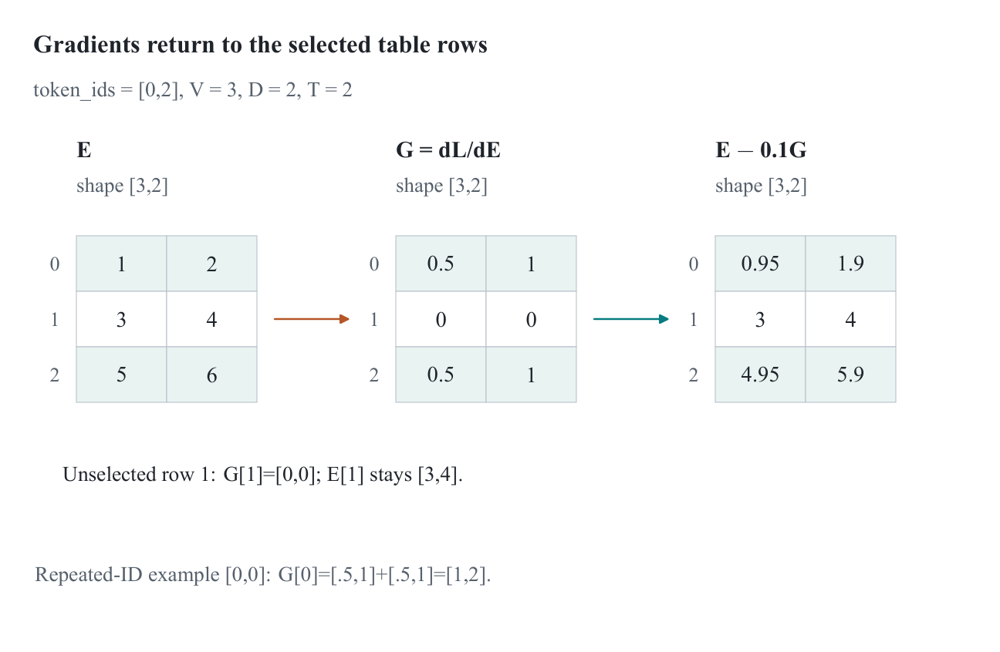{width=100%}

The three matrices compare the full table, its gradient and its update. The footer gives a separate `[0,0]` example with zero targets: two normalized contributions accumulate into row 0.

Start with:

$$
\begin{aligned}
E&=\begin{bmatrix}1&2\\3&4\\5&6\end{bmatrix}\\
\mathrm{token\_ids}&=[0,2]\\
Y&=\begin{bmatrix}0&0\\4&4\end{bmatrix}\\
\eta&=0.1
\end{aligned}
$$

For comparison with the exercise, the same inputs in plain text are:

```text
embedding_table E =
    row 0: [1.0, 2.0]
    row 1: [3.0, 4.0]
    row 2: [5.0, 6.0]

token_ids = [0, 2]
target_vectors Y = [[0.0, 0.0], [4.0, 4.0]]
learning_rate = 0.1
```

Here $V=3$, $D=2$, $T=2$, and $TD=4$. The three hypothetical token IDs are `0`, `1`, and `2`; this tiny vocabulary is only for hand calculation.

#### Step 1: Select the rows in input order

Position `t=0` has ID `0`, so it reads `[1,2]`. Position `t=1` has ID `2`, so it reads `[5,6]`:

$$
Z=\begin{bmatrix}1&2\\5&6\end{bmatrix}
$$

The table shape is `[3,2]`, and the selected-output shape is `[2,2]`. Table row `1` still exists even though this call does not read it.

#### Step 2: Subtract targets and square each error

$$
e=Z-Y
=\begin{bmatrix}1-0&2-0\\5-4&6-4\end{bmatrix}
=\begin{bmatrix}1&2\\1&2\end{bmatrix}
$$

The operation `errors ** 2` squares each entry separately. It is not matrix multiplication:

$$
\text{squared errors}=\begin{bmatrix}1^2&2^2\\1^2&2^2\end{bmatrix}
=\begin{bmatrix}1&4\\1&4\end{bmatrix}
$$

#### Step 3: Average all four squared errors

$$
L=\frac{1+4+1+4}{2\times 2}=\frac{10}{4}=2.5
$$

The scalar `loss_value` is `2.5`. Using a sum would give `10`; dividing only by the two token positions would give `5`. Both would describe a different objective from this assignment's mean over all components.

#### Step 4: Differentiate the selected output

Apply $2e_{t,d}/4$ to every component:

$$
\frac{\partial L}{\partial Z}
=\begin{bmatrix}2\times 1/4&2\times 2/4\\2\times 1/4&2\times 2/4\end{bmatrix}
=\begin{bmatrix}0.5&1\\0.5&1\end{bmatrix}
$$

The following trace keeps the position, source row, error, and contribution separate:

| Position $t$ | Component $d$ | Source row `token_ids[t]` | Selected value | Target | Error | Contribution `2*error/4` |
| --- | --- | --- | --- | --- | --- | --- |
| `0` | `0` | `0` | `1` | `0` | `1` | `0.5` |
| `0` | `1` | `0` | `2` | `0` | `2` | `1.0` |
| `1` | `0` | `2` | `5` | `4` | `1` | `0.5` |
| `1` | `1` | `2` | `6` | `4` | `2` | `1.0` |

#### Step 5: Send those contributions to the original table

Position `0` sends `[0.5,1.0]` to table row `0`; position `1` sends `[0.5,1.0]` to table row `2`. Table row `1` receives no contribution:

$$
G=\frac{\partial L}{\partial E}
=\begin{bmatrix}0.5&1\\0&0\\0.5&1\end{bmatrix}
$$

You can also write the loss directly in terms of table entries to see why:

$$
L(E)=\frac14\left[(E_{0,0}-0)^2+(E_{0,1}-0)^2+(E_{2,0}-4)^2+(E_{2,1}-4)^2\right]
$$

Neither $E_{1,0}$ nor $E_{1,1}$ appears. Changing either of them leaves this loss unchanged, so both derivatives are zero. `loss_value.backward()` stores this full `[3,2]` tensor in `embedding_table.grad`.

#### Step 6: Subtract the scaled gradient from the table

$$
E_{\mathrm{new}}=
\begin{bmatrix}1&2\\3&4\\5&6\end{bmatrix}
-0.1\begin{bmatrix}0.5&1\\0&0\\0.5&1\end{bmatrix}
=\begin{bmatrix}0.95&1.9\\3&4\\4.95&5.9\end{bmatrix}
$$

| Table row | Original values | Gradient | Updated values |
| --- | --- | --- | --- |
| `0` | `[1.0, 2.0]` | `[0.5, 1.0]` | `[0.95, 1.9]` |
| `1` | `[3.0, 4.0]` | `[0.0, 0.0]` | `[3.0, 4.0]` |
| `2` | `[5.0, 6.0]` | `[0.5, 1.0]` | `[4.95, 5.9]` |

For the first entry, $1.0-0.1\times0.5=0.95$. For its second component, $2.0-0.1\times1.0=1.9$. Row `1` subtracts zero, and row `2` uses the same component gradients as row `0`. The table keeps shape `[3,2]`, and the IDs remain `[0,2]`.

#### Step 7: Distinguish returned values from updated parameters

The function returns the pre-update loss `2.5` and the full gradient snapshot shown above. Its side effect is to update the supplied table in place. Those returned values describe the calculation that produced the update.

If you subsequently run a new lookup and evaluate the updated table, the errors are `[0.95,1.9]` at both positions, giving:

$$
L(E_{\mathrm{new}})=\frac{0.95^2+1.9^2+0.95^2+1.9^2}{4}=2.25625
$$

This re-evaluation is a new calculation. It does not change the returned Python loss value `2.5` or its copied gradient snapshot.

### Repeated IDs: two positions, one shared row

Start again from the original table. Change the input and targets to:

$$
\mathrm{token\_ids}=[0,0],
\qquad Y=\begin{bmatrix}0&0\\0&0\end{bmatrix}
$$

Both positions read the same parameter row `[1,2]`. Therefore:

$$
\begin{aligned}
Z&=\begin{bmatrix}1&2\\1&2\end{bmatrix}\\
e&=\begin{bmatrix}1&2\\1&2\end{bmatrix}\\
L&=\frac{1+4+1+4}{4}=2.5
\end{aligned}
$$

With four selected components, each position contributes `[0.5,1.0]`. The lookup chain rule sends both contributions to row `0`:

$$
G_{0,:}=[0.5,1.0]+[0.5,1.0]=[1.0,2.0]
$$

Here the colon in `G[0, :]` means all components of row `0`. The full gradient and update are:

$$
G=\begin{bmatrix}1&2\\0&0\\0&0\end{bmatrix},
\qquad E_{\mathrm{new}}=\begin{bmatrix}0.9&1.8\\3&4\\5&6\end{bmatrix}
$$

The row is shared. Backward adds both contributions; it does not create a separate parameter row for each occurrence. Only row `0` changes in this example.

#### Why repeating inputs does not always multiply the final gradient

Keep the mean denominator in the calculation. Compare these two calls, each starting from row `[1,2]` with zero targets:

| Input | Number of selected components | Contribution from each position | Total row-0 gradient |
| --- | --- | --- | --- |
| `[0]` | $1\times 2=2$ | $[2\times 1/2, 2\times 2/2]=[1,2]$ | `[1,2]` |
| `[0,0]` | $2\times 2=4$ | $[2\times 1/4, 2\times 2/4]=[0.5,1]$ | $[0.5,1]+[0.5,1]=[1,2]$ |

The two half-sized contributions add to the same final gradient. Earlier, changing `[0,2]` to `[0,0]` kept $T=2$ fixed and changed the rows receiving the contributions. Here, repeating the input also increases the number of components in the mean. Track both effects: which paths contribute, and what divisor the loss uses.

Contributions can also cancel. With IDs `[0,0]`, row `[1,2]`, and targets `[0,0]` at the first position and `[2,4]` at the second, the errors are `[1,2]` and `[-1,-2]`. Their row contributions `[0.5,1]` and `[-0.5,-1]` sum to zero. A selected row is therefore not guaranteed a nonzero gradient.

### Tensor operations and new syntax

`embedding_table[token_ids]` selects rows in order, preserving repetitions, and keeps a differentiable connection to the floating-point table. This replaces the Python-list representation of the earlier lookup exercise. Keep `selected_vectors` as a tensor; converting it to ordinary numbers and reconstructing a new tensor would lose the original dependency.

Subtracting matching-shape tensors and applying `** 2` act element by element. `.mean()` without a dimension argument averages every element into a scalar. It is not just the sum, and its denominator is neither $V$ nor $T$ alone. The table's gradient after backward has shape `[V,D]`, not the selected output's `[T,D]`.

`.item()` extracts the scalar loss as a Python float. A multi-element gradient matrix cannot be extracted with one `.item()`. Keep the returned `gradient_table` as a tensor.

`.clone()` makes a tensor copy with separate storage. After ordinary backward, copy `embedding_table.grad` so later changes to the stored gradient cannot change the returned snapshot. Here the gradient already has `requires_grad=False`. Copying a tensor does not generally turn off differentiation. See the [clone documentation](https://docs.pytorch.org/docs/2.0/generated/torch.clone.html).

The update uses `with torch.no_grad():` exactly as in Lesson 03.06. Forward and backward stay outside it. Inside, subtract the scaled full table gradient from `embedding_table` itself, not from the selected output. Keep the original trainable leaf and leave the current gradient stored for inspection; the next call resets it.

### Connect the mathematics to the tensor operations

The supplied table is a trainable leaf: it is the original parameter tensor, rather than the result of a calculation from other tracked tensors. Lookup produces a new result connected to that parameter. In normal gradient mode, PyTorch records the dependence through lookup, subtraction, squaring, and averaging:

$$
E\longrightarrow Z\longrightarrow e\longrightarrow L
$$

Backward follows those dependencies in reverse, computes the derivatives, and stores the parameter gradient in `embedding_table.grad`. Calling backward does not update the parameter values. The explicit update is a separate step.

| Mathematics or purpose | Tensor operation | Expected result in the example |
| --- | --- | --- |
| $Z_{t,d}=E_{i_t,d}$ | `embedding_table[token_ids]` | Selected values `[[1,2],[5,6]]`, `[T,D]` |
| $e=Z-Y$ | Subtract `target_vectors` from `selected_vectors` | Errors `[[1,2],[1,2]]` |
| Square each error | `errors ** 2` | `[[1,4],[1,4]]` |
| Mean over $TD$ components | `.mean()` on the squared errors | Scalar tensor `2.5` |
| $G=\partial L/\partial E$ | `loss_value.backward()` | Full gradient stored in the table's `.grad` |
| Save scalar loss for return | `loss_value.item()` | Python float `2.5` |
| Save an independent gradient snapshot | `.clone()` on the table's `.grad` | A separate `[V,D]` gradient tensor |
| $E_{\mathrm{new}}=E-\eta G$ | In-place subtraction on the table inside `torch.no_grad()` | Updated parameter table |

Keep the tensor `loss_value` available for backward. A Python float obtained by `.item()` has no recorded tensor dependency through which backward can reach the table. Extracting the final return value after backward leaves the earlier computation intact.

Assigning the stored gradient to another name does not copy it: both names refer to the same tensor. An in-place change is then visible through both names. Use `.clone()` to give the returned snapshot separate storage. Setting `.grad` to `None` instead removes the table's reference to its old gradient buffer. It leaves the parameter values unchanged. Because backward adds to an existing buffer, clear that buffer before each independent update.

The selected output is a calculation result. Updating that result does not perform this exercise's parameter-table update. Apply the full `[V,D]` gradient to `embedding_table` itself.

Forward and backward need the recorded dependency; parameter updating is performed inside a temporary `with torch.no_grad():` context. `with` enters that context for its indented block and restores the previous gradient mode afterward. The indentation pattern is:

```python
    with torch.no_grad():
        ...  # Update the original table here: eight spaces.
    ...  # Return outside the context: four spaces.
```

This fragment shows the block structure, not the assignment solution. The seven implementation steps below explain where each operation belongs.

### Exact inputs, variables, and return

| Name | Type and shape | Meaning |
| --- | --- | --- |
| `embedding_table` | Floating-point `torch.Tensor`, `[V,D]` | Supplied trainable leaf with `requires_grad=True`; update it in place. |
| `token_ids` | Integer `torch.Tensor`, `[T]`, `torch.long` | Valid indices selecting table rows; not trainable. |
| `target_vectors` | Fixed floating-point `torch.Tensor`, `[T,D]` | Supplied desired output vectors for this teaching loss, same dtype/device as the table. |
| `learning_rate` | Nonnegative `float` | Update multiplier. |
| `selected_vectors`, `errors` | Floating-point `torch.Tensor`, `[T,D]` | Connected lookup result and componentwise deviations. |
| `loss_value` before `.item()` | Scalar `torch.Tensor` | Mean of all selected squared deviations. |
| `loss_value` after `.item()` | `float` | Extracted pre-update loss. |
| `gradient_table` | Floating-point `torch.Tensor`, `[V,D]` | Independent copy of the current loss derivative with respect to the table. |

Assume finite values, valid IDs, $V>0$, $D>0$, $T>0$, fixed targets with `requires_grad=False`, and normal gradient mode. No validation or constructor work is required in the exercise function. An empty lookup can exist, but this mean-loss assignment requires at least one selected component; there is no empty-training case. Supplied checks use CPU `float64` table/target tensors and `torch.long` IDs.

Return `(loss_value, gradient_table)`. Both describe the table before updating; the passed table now holds updated values and remains a trainable leaf. The IDs and target vectors keep their values. The gradient return is a snapshot, not a replacement parameter table.

### Guided implementation

Use these seven steps to implement `embedding_gradient_step` in `03_08_embedding_gradient_step.py`. The input tensors and check driver are supplied. Ordinary function statements use four spaces; only the update inside the context uses eight. The example names the deviations `errors` and uses `loss_value` first for the loss tensor, then for the extracted float.

1. **Clear the old gradient.** At four spaces, assign `None` to `embedding_table.grad`, using attribute assignment `object.attribute = value`. The original table values stay unchanged. This makes the next backward calculate the current step gradient without adding the previous step's gradient.
2. **Look up `selected_vectors`.** At four spaces, use `embedding_table[token_ids]` and save the result as `selected_vectors`. Bracket indexing selects whole rows in order; a tensor of integer indices can select several rows at once and retain repeats. The example result is `[[1,2],[5,6]]`, shape `[2,2]`. Keep this connected tensor for the loss calculation.
3. **Calculate `errors` and `loss_value`.** Keep both statements at four spaces. Subtract `target_vectors` from `selected_vectors` to form `errors`, square each element with `** 2`, and use `.mean()` without a dimension argument to form `loss_value`. Parentheses group the squared-error expression before its mean. The error is `[[1,2],[1,2]]`, the squares are `[[1,4],[1,4]]`, and the scalar loss is `2.5`.
4. **Run backward once.** At four spaces, call `loss_value.backward()`, using method-call syntax `object.method()`. Keep this outside no-grad mode. The stored `embedding_table.grad` is `[[0.5,1],[0,0],[0.5,1]]`, shape `[3,2]`. This operation calculates and stores gradients; the table has not yet been updated.
5. **Save the return values.** At four spaces, copy `embedding_table.grad` with `.clone()` into `gradient_table`, then extract the scalar loss with `.item()` and reassign `loss_value` to that float.  Expect a `[3,2]` gradient tensor and Python float `2.5`. A multi-element matrix cannot use one `.item()`. The clone gives the saved gradient independent storage.
6. **Update the table in place.** At four spaces, enter `with torch.no_grad():`. At eight spaces, use `-=` on `embedding_table`, subtracting `learning_rate` times `embedding_table.grad`. In the example, row `0` becomes `[0.95,1.9]` and row `1` stays `[3,4]`.
7. **Return outside the context.** Return to four spaces and use `return first, second`. Return `loss_value`, then `gradient_table.detach()`. The method `.detach()` removes the autograd connection. It is valid here but not needed: ordinary backward already produces an untracked gradient, and `.clone()` already provides separate storage. The comma creates a two-item tuple for the caller to unpack. The loss is `2.5`, and the snapshot describes the original table. The caller already holds the updated table, so do not return it as a third value.

No learner loop is needed: indexing and arithmetic act on tensors together. You write the core; hints are not a completed function.

### Run and expected output

Activate the existing PyTorch environment, then run from the repository root:

```bash
python exercises/03_08_embedding_gradient_step.py
```

After completing the implementation, expect:

```text
PASS: indexed lookup, mean loss, table gradients, and untouched rows
PASS: repeated token positions add gradient contributions to one row
PASS: different vector dimensions and vocabulary IDs above 255
PASS: zero loss and zero learning rate
PASS: old gradients are cleared and repeated steps use the updated table
PASS: returned gradient snapshots have independent storage
PASS: full table gradients agree with finite differences
Lesson 03.08 checks passed.
```

 A loss of `10` in the first example indicates summing rather than averaging the four squared errors. A missing repeated-row contribution suggests overwriting contributions or breaking the lookup dependency. An unchanged table can come from updating only the selected output. A changed old gradient snapshot suggests returning an alias instead of a copy. Keep the supplied inputs and driver unchanged.

### Questions to work through

Optional review: distinguish table, selected-output, and gradient shapes; explain the $TD$ denominator; explain why an unselected row has zero gradient in this objective; trace repeated-ID contributions including normalization; distinguish token IDs from trainable values; explain why the gradient snapshot is cloned. This teaching loss verifies lookup gradients. Continue with [Lesson 03.09: logits and softmax](#section-03-09) to turn vectors into candidate probabilities. [Lesson 03.10](#section-03-10) then uses the observed next-token ID to define the loss, replacing the supplied target vectors used here.

## 03.09 Logits and Softmax {#section-03-09}

An embedding vector does not assign probabilities to tokens. First, multiply it by output weights and add a bias to give every vocabulary token a score. Then use softmax to turn those scores into probabilities. Apply these steps separately at each input position. The vector width, input length, and vocabulary size each describe a different part of the calculation.

Work through the example before editing 03_09_logits_and_softmax.py. The numbered steps below explain the interface and guide the core implementation; the supplied setup and check driver remain separate.

### Where logits fit in a language model

A tokenizer supplies token IDs. Embedding lookup supplies floating-point vectors. A language model processes the input to produce a vector at each position, then an output projection scores every candidate vocabulary token. Softmax converts one position's scores into probabilities.

```text
input token IDs -> embedding vectors -> position vectors [T,D]
               -> vocabulary logits [T,V] -> probabilities [T,V]
```

Here `hidden_vectors` contains supplied position vectors. In a minimal model these can come straight from lookup. A Transformer later uses contextual processing before the output projection. This exercise implements the projection and probability conversion; it does not yet implement attention or a full language model.

In next-token prediction, probability column $v$ corresponds to vocabulary ID $v$. A row represents the candidate distribution for the next token at that position. The toy vocabulary below has three hypothetical IDs, `0`, `1`, and `2`; they are not a complete byte tokenizer.

A logit is a real-valued score before softmax. It can be negative, zero, or positive. It need not lie between zero and one, and a row of logits need not sum to one. A higher score gives a higher softmax probability within that same row. The input vector has $D$ components; the output has $V$ candidate scores. $D$ and $V$ count different things and need not match.

The example weights are chosen for arithmetic, not learned from data. A probability from this untrained toy head is an output of that calculation; it does not establish useful language-model capability.

### What does the input-position count T mean?

What does an input position mean, and why can there be several? For the single sequence discussed here, a position is one slot in the tokenized input. $T$ counts how many token occurrences the input contains. A text prompt usually contains several tokens, so it has several positions.

Conceptually:

$$
T=\operatorname{len}(\mathrm{token\_ids})
$$

The current `compute_logits` function receives vectors rather than IDs. Each row of `hidden_vectors` represents one of those positions, so its $T$ is `hidden_vectors.shape[0]`. No extra `token_ids` parameter is being added to the exercise. This lesson uses one sequence; a separate batch dimension for multiple sequences comes later.

#### A concrete token sequence

For illustration, assume a tokenizer splits the text `我爱猫` into the three tokens `我`, `爱`, and `猫`:

| Zero-based position | Token occupying that position |
| --- | --- |
| `0` | `我` |
| `1` | `爱` |
| `2` | `猫` |

There are three occupied positions, so $T=3$. This one-character-per-token split is an explicit teaching assumption, not a claim about the existing byte/BPE tokenizer. Actual token boundaries depend on the tokenizer. Count the resulting tokens, not the original characters. For example, the earlier sequence `[256,97,256]` also has $T=3$, even though there are only two distinct IDs; the repeated ID occupies another position.

Each position gets one vector. If the vector dimension is $D=8$, the shapes are:

```text
position 0 -> one 8-component vector
position 1 -> one 8-component vector
position 2 -> one 8-component vector

hidden_vectors: [3,8]
logits:         [3,V]
probabilities:  [3,V]
```

$T$ counts the input occurrences, $D$ counts components of each vector, and $V$ counts all vocabulary candidates. The vocabulary size need not equal three. If a separate toy vocabulary contained exactly `我`, `爱`, `猫`, and `。`, it would have $V=4$, giving probabilities `[3,4]`: three input positions, four candidates per position.

The existing numeric example in this lesson has `hidden_vectors=[[1,2],[2,1]]`. That is two vectors, one per position, so $T=2$ and $D=2$. The first vector is `[1,2]`; the second is `[2,1]`. Its logits have shape `[2,3]` because that example's vocabulary has three candidates. The text illustration above is a different example and does not replace those exercise inputs.

#### Why training can return a prediction row at every position

Assume the full training sequence is `我`, `爱`, `猫`, `。`. The earlier shifted-window idea uses:

```text
input tokens:  [我, 爱, 猫]
target tokens: [爱, 猫, 。]
```

In a causal next-token model, the intended alignment is:

| Position | Context permitted at that position | Next-token target during training |
| --- | --- | --- |
| `0` | `我` | `爱` |
| `1` | `我爱` | `猫` |
| `2` | `我爱猫` | `。` |

The three output rows predict the next token after three different available prefixes. Their targets are already known in the training data, so training can calculate several next-token predictions and losses in one forward pass. A causal model must prevent an earlier position from seeing later tokens in the input; otherwise it could read its answer. Causal masking and attention are later topics.

A model that processes context can make each hidden vector depend on the allowed prefix. Here, `hidden_vectors` is supplied, and the projection handles each row separately. It neither combines earlier tokens nor enforces a causal mask. This exercise only turns position vectors into scores and probabilities.

#### How this relates to generating one next token

When the current prompt tokenizes to `我`, `爱`, `猫`, it already has three input positions. For next-token generation, use the distribution at the final input position to select the next token. If the selected token is `。`, appending it gives four positions; a later generation step predicts what follows that longer prefix.

The input positions hold tokens already supplied as context. Generating the next token still selects one new token. If we calculate all probability rows, earlier rows describe shorter prefixes and the last row describes the full current prefix. Thus $T$ counts input positions, not future tokens selected in a generation step.

### Symbols, exact code names, and shapes

| Symbol | Code name | Meaning | Shape or range |
| --- | --- | --- | --- |
| $H$ | `hidden_vectors` | Supplied floating-point vector at each position | `[T,D]` |
| $W$ | `output_weights` | Weights connecting vector components to candidate scores | `[D,V]` |
| $b$ | `output_bias` | One added score offset per vocabulary token | `[V]` |
| $Z$ | `logits` | Scores for all candidate tokens at all positions | `[T,V]` |
| $P$ | `probabilities` | Softmax probability distribution at each position | `[T,V]` |
| $T$ | Position count | Number of input vectors in this call | Positive integer |
| $D$ | Vector dimension | Number of components per input vector | Positive integer |
| $V$ | Vocabulary size | Number of candidate token IDs | Positive integer |
| $t,d,v$ | Formula indices | Position, vector component, vocabulary candidate | Zero-based |
| $m_t$ | `row_max[t,0]` | Maximum score at position $t$ | `row_max` is `[T,1]` |

Indices start at zero: $0\le t<T$, $0\le d<D$, and $0\le v<V$. The subscript $Z_{t,v}$ means `logits[t,v]`. In this lesson $Z$ denotes logits; Lesson 03.08's selected embedding vectors can supply this lesson's $H$.

Assume finite floating-point inputs, $T>0$, $D>0$, $V>0$, matching shapes, matching dtype/device, and normal gradient mode. The supplied driver uses CPU `float64`. Inputs may require gradients. No tensor construction or input-validation logic is assigned to the learner. Empty rows and nonfinite inputs are outside this exercise's contract.

### From a vector to vocabulary scores

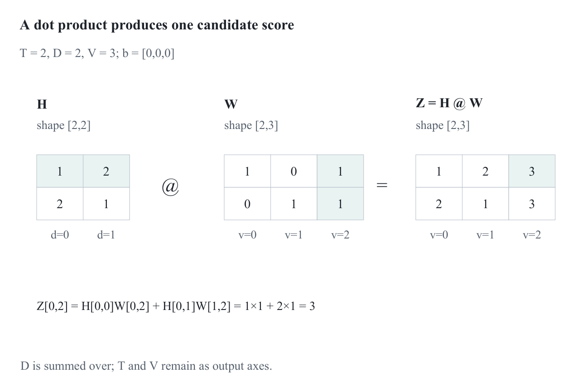{width=100%}

Read one row of H against one column of W. Their two products sum to one candidate score; changing D into V changes columns, while the two input positions remain two rows.

For each position and candidate token:

$$
Z_{t,v}=\sum_{d=0}^{D-1}H_{t,d}W_{d,v}+b_v
$$

To calculate one candidate score, multiply each input component by that candidate's weight. Add the products, then add the candidate's bias. Each column of $W$ belongs to one candidate. Column $v$ contains the $D$ weights for candidate $v$.

The matrix form is:

$$
Z=HW+b
$$

The shape calculation is:

$$
[T,D]\;@\;[D,V]\longrightarrow[T,V]
$$

The inner sizes $D$ must match. The outer sizes give $T$ rows and $V$ columns. Python's `@` performs this matrix product for two-dimensional tensors; the [matrix-product documentation](https://docs.pytorch.org/docs/2.0/generated/torch.matmul.html) explains its shape behavior. `*` is elementwise multiplication and does not calculate these row-column weighted sums.

Adding bias `[V]` to scores `[T,V]` uses the same bias vector in every row. Broadcasting treats `[V]` as `[1,V]`, then applies it across $T$ rows. The [broadcasting rules](https://docs.pytorch.org/docs/2.0/notes/broadcasting.html) describe this alignment. You do not need to copy the bias or write a loop.

$W$ and `b` can be trained along with the embedding table in a later loss-based training loop. Softmax itself has no learned parameters. This exercise returns logits while keeping their dependence on the supplied vectors, weights, and bias.

### From scores to probabilities

At position $t$, softmax is:

$$
P_{t,v}=\frac{e^{Z_{t,v}}}{\sum_{j=0}^{V-1}e^{Z_{t,j}}}
$$

Here $e\approx2.71828$ is Euler's number, the base of natural logarithms, and $e^x=\exp(x)$ is the exponential function. This `e` is not Lesson 03.08's error variable. $j$ visits all vocabulary candidates in the same row, and $v$ denotes the particular candidate whose probability we want.

The exponential turns any finite real score into a positive weight and preserves score ordering. Dividing by the sum of those weights normalizes the row:

$$
\sum_{v=0}^{V-1}P_{t,v}
=\frac{\sum_{v=0}^{V-1}e^{Z_{t,v}}}{\sum_{j=0}^{V-1}e^{Z_{t,j}}}=1
$$

For finite real scores and $V>1$, the mathematical probabilities lie strictly between zero and one. If $V=1$, the only probability is one. On a computer, a tiny probability can round down to zero through underflow. The checks therefore accept `[0,1]` and allow rounding when checking the row sum. The [official softmax documentation](https://docs.pytorch.org/docs/2.0/generated/torch.nn.functional.softmax.html) defines the operation along a chosen dimension.

The denominator belongs to one position's $V$ candidates. It does not combine probabilities across the $T$ positions. Every output row sums to one independently; the sum of the entire `[T,V]` output is consequently $T$.

Softmax preserves score ordering. For two candidates in one row:

$$
\frac{P_{t,a}}{P_{t,b}}=e^{Z_{t,a}-Z_{t,b}}
$$

A score gap of one gives a probability ratio of approximately `2.71828`. The relative differences matter. Equal logits give equal probabilities, including when the common score is negative.

Softmax calculates the distribution. Selecting a token is a subsequent operation: a greedy rule chooses a largest-probability candidate, while sampling can choose according to the distribution. Neither is performed inside these two exercise functions.

### Stable softmax: subtract the row maximum

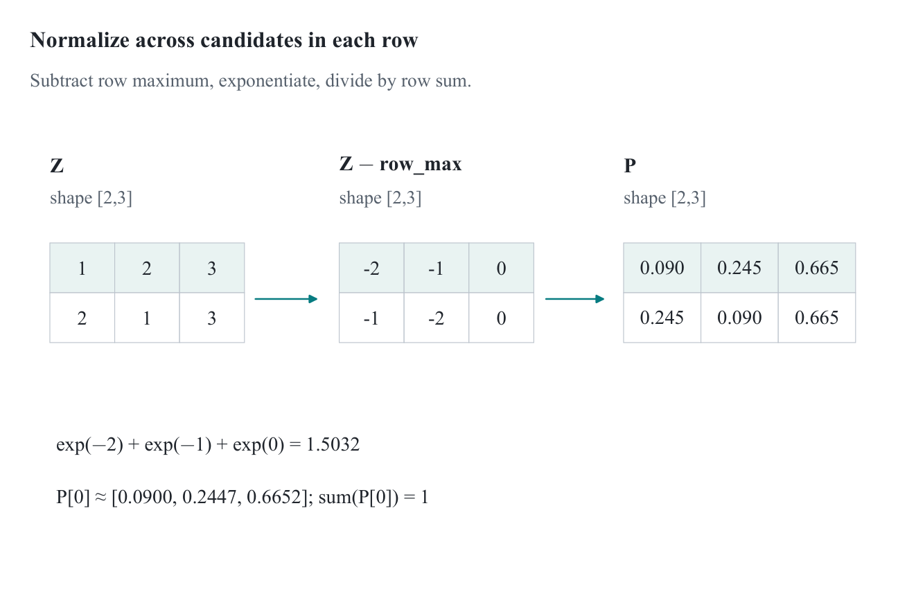{width=100%}

Follow a row through maximum subtraction and normalization. Candidate order stays fixed, and each output row sums to one independently of every other row.

Directly evaluating `exp(1000)` exceeds the range of ordinary floating-point formats. Very negative scores can make every unshifted exponential underflow to zero. The quotient can then become undefined numerically even though the mathematical softmax is well-defined.

First prove that shifting all scores in a row by the same finite constant `c` preserves the distribution:

$$
\begin{aligned}
\frac{e^{Z_{t,v}-c}}{\sum_j e^{Z_{t,j}-c}}
&=\frac{e^{-c}e^{Z_{t,v}}}{e^{-c}\sum_j e^{Z_{t,j}}}\\
&=\frac{e^{Z_{t,v}}}{\sum_j e^{Z_{t,j}}}
\end{aligned}
$$

The common factor cancels in exact arithmetic. We choose each row's largest score:

$$
m_t=\max_{0\le j<V}Z_{t,j},\qquad
P_{t,v}=\frac{e^{Z_{t,v}-m_t}}{\sum_{j=0}^{V-1}e^{Z_{t,j}-m_t}}
$$

After this shift, no score is above zero, so no exponential exceeds one. At least one score is zero, and $\exp(0)=1$. This avoids excessively large positive exponentials. It also ensures that the finite `float64` rows in these examples have at least one nonzero weight. Very small weights can still underflow to zero.

Each position uses its own maximum and denominator. One global maximum for the whole tensor can leave a distant row with all exponentials numerically zero; the supplied driver includes rows with widely separated offsets to detect that mistake.

For example, `[1001,1002,1003]` becomes `[-2,-1,0]` after subtracting `1003`. It gives the same mathematical probabilities as `[1,2,3]`, while avoiding the large exponentials.

### Complete worked example: projection and softmax

Use:

$$
\begin{aligned}
H&=\begin{bmatrix}1&2\\2&1\end{bmatrix}\\
W&=\begin{bmatrix}1&0&1\\0&1&1\end{bmatrix}\\
b&=[0,0,0]
\end{aligned}
$$

Here $T=2$, $D=2$, and $V=3$. There are two input positions, two components per vector, and three candidate tokens.

#### Step 1: Calculate each row-column score

For position `0`, the vector is `[1,2]`. The three weight columns are `[1,0]`, `[0,1]`, and `[1,1]`:

$$
\begin{aligned}
Z_{0,0}&=1\times1+2\times0+0=1\\
Z_{0,1}&=1\times0+2\times1+0=2\\
Z_{0,2}&=1\times1+2\times1+0=3
\end{aligned}
$$

For position `1`, the vector is `[2,1]`:

$$
\begin{aligned}
Z_{1,0}&=2\times1+1\times0+0=2\\
Z_{1,1}&=2\times0+1\times1+0=1\\
Z_{1,2}&=2\times1+1\times1+0=3
\end{aligned}
$$

Thus:

$$
Z=\begin{bmatrix}1&2&3\\2&1&3\end{bmatrix}
$$

The input vectors are `[2,2]`, while logits are `[2,3]`. The projection changes the component count into the candidate count.

To see nonzero bias, keep $H$ and $W$, but change `b` to `[0.5,-1,2]`:

$$
Z=\begin{bmatrix}1+0.5&2-1&3+2\\2+0.5&1-1&3+2\end{bmatrix}
=\begin{bmatrix}1.5&1&5\\2.5&0&5\end{bmatrix}
$$

The following softmax trace uses the original zero-bias logits `[1,2,3]` and `[2,1,3]`.

#### Step 2: Find a maximum for each row and keep a column shape

$$
\mathrm{row\_max}=\begin{bmatrix}3\\3\end{bmatrix}
$$

Its shape is `[2,1]`. Subtract row `0`'s maximum from row `0`, and row `1`'s maximum from row `1`:

$$
\mathrm{shifted\_logits}
=\begin{bmatrix}1-3&2-3&3-3\\2-3&1-3&3-3\end{bmatrix}
=\begin{bmatrix}-2&-1&0\\-1&-2&0\end{bmatrix}
$$

The logits input itself remains unchanged.

#### Step 3: Exponentiate each shifted score

$$
\mathrm{exp\_scores}
=\begin{bmatrix}e^{-2}&e^{-1}&e^0\\e^{-1}&e^{-2}&e^0\end{bmatrix}
\approx\begin{bmatrix}0.1353352832&0.3678794412&1\\0.3678794412&0.1353352832&1\end{bmatrix}
$$

These are positive weights, not yet normalized probabilities.

#### Step 4: Sum each row's candidate weights

For either row:

$$
0.1353352832+0.3678794412+1\approx1.5032147244
$$

Therefore `row_sums` is approximately `[[1.5032147244],[1.5032147244]]`, shape `[2,1]`. The shape keeps a separate denominator for each position.

#### Step 5: Divide every weight by its row denominator

| Position | Candidate ID | Logit | Shifted logit | Exponential weight | Probability, approximately |
| --- | --- | --- | --- | --- | --- |
| `0` | `0` | `1` | `-2` | `0.1353352832` | `0.0900305732` |
| `0` | `1` | `2` | `-1` | `0.3678794412` | `0.2447284711` |
| `0` | `2` | `3` | `0` | `1.0` | `0.6652409558` |
| `1` | `0` | `2` | `-1` | `0.3678794412` | `0.2447284711` |
| `1` | `1` | `1` | `-2` | `0.1353352832` | `0.0900305732` |
| `1` | `2` | `3` | `0` | `1.0` | `0.6652409558` |

For the first row's candidate `0`, calculate $0.1353352832 / 1.5032147244$, approximately `0.0900305732`. Apply the same division to each component:

$$
P\approx\begin{bmatrix}0.0900305732&0.2447284711&0.6652409558\\0.2447284711&0.0900305732&0.6652409558\end{bmatrix}
$$

Each row sums to one, and the output shape remains `[2,3]`. Candidate `2` has the largest probability in both rows. Returning the probability tensor does not yet choose or generate that token.

Displayed decimals are rounded. The actual calculation keeps full tensor precision, and checks use a tolerance.

### New syntax: dimensions, keepdim, and broadcasting

Stage A introduces `@`; Stage B introduces exponential and reductions along a chosen axis. No new loop or context keyword is needed. All learner statements are indented four spaces inside their function.

For `[T,V]`, `dim=0` is the position axis and `dim=1` is the vocabulary axis. `dim=-1` names the last axis, which is also the vocabulary axis here. Maxima and sums must reduce that last axis.

`logits.max(dim=-1, keepdim=True)` returns two pieces: maximum values and their index locations. Select the numerical maxima with `.values`, giving the `row_max` tensor. The [max documentation](https://docs.pytorch.org/docs/2.0/generated/torch.max.html) specifies both results. Indices are not the score values we need to subtract.

`keepdim=True` retains the reduced dimension with size one. Without it, a reduction of `[2,3]` produces `[2]`; with it, the result is `[2,1]`. Broadcasting aligns dimensions from the right:

```text
logits:    [T,V]
row_max:   [T,1]
subtraction result: [T,V]

exp_scores: [T,V]
row_sums:   [T,1]
division result: [T,V]
```

Each row's single maximum or sum must apply to that row's $V$ entries. A shape `[T]` does not express this column layout. With scores `[2,3]`, its trailing size `2` conflicts with `3`. If $T=V$, broadcasting can succeed but use the wrong direction. Keep `[T,1]` to align each value with its row.

`torch.exp(shifted_logits)` applies $e^x$ elementwise and returns a tensor with the same shape. `exp_scores.sum(dim=-1, keepdim=True)` gives one denominator per row. A `.sum()` without the dimension would add every row together; the [sum documentation](https://docs.pytorch.org/docs/2.0/generated/torch.sum.html) explains dimension reduction and retained shape.

Keep forward results connected to their inputs. Unlike the previous lesson's recorded gradient snapshot, this returned probability tensor is a forward result through which a future loss must differentiate. Avoid `.item()`, `.detach()`, rebuilding tensors from lists, or no-grad mode in these exercise functions. No backward or parameter update belongs inside them.

### Exact inputs, intermediate values, and returns

| Name | Type and shape | Meaning |
| --- | --- | --- |
| `hidden_vectors` | Floating `torch.Tensor`, `[T,D]` | Position vectors supplied to Stage A. |
| `output_weights` | Floating `torch.Tensor`, `[D,V]` | One weight column per candidate, in this exercise's explicit layout. |
| `output_bias` | Floating `torch.Tensor`, `[V]` | Shared candidate offsets added to each row. |
| `weighted_scores` | Floating `torch.Tensor`, `[T,V]` | Matrix product before bias. |
| `logits` | Floating `torch.Tensor`, `[T,V]` | Stage A return and Stage B input. |
| `row_max` | Floating `torch.Tensor`, `[T,1]` | Stage B row maxima, selected from the reduction's `.values`. |
| `shifted_logits`, `exp_scores` | Floating `torch.Tensor`, `[T,V]` | Shifted scores and their exponential weights. |
| `row_sums` | Floating `torch.Tensor`, `[T,1]` | Sum of weights per position. |
| `probabilities` | Floating `torch.Tensor`, `[T,V]` | Stage B return, normalized over candidates in each row. |

Both functions return one tensor, with matching dtype/device and the appropriate autograd connection when inputs require gradients. Neither changes any input. Input creation and checks are supplied; the learner implements only the two forward calculations.

### Stage A: numbered implementation plan for compute_logits

Open `03_09_logits_and_softmax.py` and find the Stage A learner region in `compute_logits`. Ordinary statements use four spaces.

1. **Form `weighted_scores`.** Use the `@` operator with `hidden_vectors` on the left and `output_weights` on the right. The inner $D$ sizes match; the result is `[T,V]`. The worked example gives `[[1,2,3],[2,1,3]]` before bias.
2. **Add `output_bias` to produce `logits`.** Use tensor addition `left + right`. `[V]` broadcasts across the rows; zero bias leaves the example unchanged, while `[0.5,-1,2]` produces `[[1.5,1,5],[2.5,0,5]]`. Preserve the input tensors.
3. **Return `logits`.** Use `return value` at four spaces. Keep the tensor and its dependence on the input vectors, weights, and bias.

After implementing Stage A, run its checks:

```bash
python exercises/03_09_logits_and_softmax.py --check logits
```

Expected final line for this stage:

```text
PASS logits: all three check categories
```

This command checks only Stage A. Both stages are now implemented and can also be checked separately.

### Stage B: numbered implementation plan for softmax_probabilities

After Stage A, find the learner region in `softmax_probabilities(logits)`. All six steps remain at four spaces; tensor operations handle the whole input, so there is no learner loop.

1. **Find `row_max`.** Use `logits.max(dim=-1, keepdim=True).values`. The keyword arguments choose the vocabulary axis and retain a one-column shape; `.values` selects maxima instead of indices. The example gives `[[3],[3]]`, `[2,1]`.
2. **Compute `shifted_logits`.** Subtract `row_max` from `logits`, using a new subtraction result. The example is `[[-2,-1,0],[-1,-2,0]]`. Do not subtract in place from the supplied logits.
3. **Compute `exp_scores`.** Call `torch.exp` on `shifted_logits`. The first row is approximately `[0.1353352832,0.3678794412,1.0]`, with shape `[2,3]` unchanged.
4. **Compute `row_sums`.** Call `.sum(dim=-1, keepdim=True)` on `exp_scores`. Add the weights, not the original logits. The example produces `[[1.5032147244],[1.5032147244]]`, `[2,1]`.
5. **Compute `probabilities`.** Use elementwise `/` to divide `exp_scores` by `row_sums`. Broadcasting applies each denominator to its row. The first row is approximately `[0.0900305732,0.2447284711,0.6652409558]`.
6. **Return `probabilities`.** Keep the `[T,V]` tensor connected for later differentiation. This function does not select a token or update parameters.

Implement the primitive operations yourself for this assignment; the driver's built-in `torch.softmax` is a supplied reference. The learner core stays yours to write. Run:

```bash
python exercises/03_09_logits_and_softmax.py --check softmax
```

Expected final line for this stage:

```text
PASS softmax: all five check categories
```

This command checks Stage B independently. Once both stages are complete, run:

```bash
python exercises/03_09_logits_and_softmax.py --check all
```

Expected complete output:

```text
PASS: row-column score projection and shared vocabulary bias
PASS: different vector/vocabulary dimensions and preserved inputs
PASS: projection gradients reach vectors, weights, and bias
PASS logits: all three check categories
PASS: worked-example probabilities and vocabulary-axis normalization
PASS: equal logits, negative logits, and a one-token vocabulary
PASS: row-wise shift invariance and large-score numerical stability
PASS: varied shapes and unchanged input scores
PASS: softmax gradients agree with the PyTorch reference
PASS softmax: all five check categories
PASS: connected vectors-to-probabilities forward and backward pipeline
Lesson 03.09 checks passed.
```

 Keep the supplied setup and driver unchanged. A `.values` omission can leave a reduction result object instead of a tensor; missing `keepdim` can cause shape errors; normalizing every element together gives incorrect row sums; unshifted exponentials can overflow; disconnected returns stop later training gradients.

### Reading questions and clarified distinctions


**Why are logits allowed to be negative?** They are scores. For `[-2,-1,0]`, exponentials are positive and softmax still defines a normalized distribution. A negative logit is not a negative probability.

**Does subtracting the maximum destroy information?** The same constant is subtracted from every score in one row, so all score differences remain unchanged. The common exponential factor cancels. Subtracting different arbitrary offsets per candidate would generally change the distribution.

**Are the input token IDs and output candidate IDs the same axis?** Input positions choose which vectors enter the calculation. Output columns enumerate all $V$ vocabulary candidates. An input of length $T=2$ still gives three candidate probabilities per row when $V=3$; it does not shrink the vocabulary.

**Do two output rows mean generating two future tokens simultaneously?** The example computes the distributions for two supplied positions. In a causal model, each training position predicts its own next-token target using permitted context. Autoregressive generation selects the next token from the current position, appends it, and recomputes the next distribution. Context processing and generation loops follow later.

**Is softmax itself the training loss?** It returns a distribution, without knowing which candidate is correct. In [03.10](#section-03-10), cross-entropy selects the probability assigned to the observed next-token ID and takes its negative logarithm. That scalar loss can then guide the joint parameter update in [03.11](#section-03-11).

### Optional reference: how softmax can pass gradients

This derivation is saved for completeness and is not a manual-derivative coding task. Consider one position, with $s=\sum_k e^{z_k}$ and $p_i=e^{z_i}/s$. Differentiating the numerator and shared denominator gives:

$$
\frac{\partial p_i}{\partial z_j}
=\frac{\mathbf{1}_{i=j}e^{z_i}s-e^{z_i}e^{z_j}}{s^2}
=p_i\left(\mathbf{1}_{i=j}-p_j\right)
$$

The indicator $\mathbf{1}_{i=j}$ is one when the candidates match and zero otherwise. The derivative is therefore $p_i(1-p_i)$ when $i=j$, and $-p_ip_j$ for different candidates. Raising one score can raise its own probability and lower others because all probabilities share a denominator. The stable form computes the same mathematical function. Autograd follows the tensor operations, and the driver checks their gradients; you do not need to implement this derivative.

### Questions to work through

Optional checkpoints: distinguish $D$ from $V$; trace a row-column logit calculation and bias broadcasting; calculate one probability row; prove shift invariance; explain the vocabulary axis and `[T,1]` reductions; explain why returned probabilities stay connected. Continue with [Lesson 03.10: next-token cross-entropy](#section-03-10).

## 03.10 Cross-Entropy for Next-Token Targets {#section-03-10}

### Method sources

The next-word training objective in [Bengio et al., 2003; R24](https://www.jmlr.org/papers/v3/bengio03a.html) provides the language-modeling context for negative log-probability loss.

A probability distribution describes the model's prediction. To train the model, we need a loss that measures how much probability it gives the observed next token. Cross-entropy takes that token's probability, applies the negative logarithm, and averages the resulting losses across positions. Keep the calculation connected to the scores so gradients can reach the parameters.

Work through the example before editing 03_10_cross_entropy_loss.py. The numbered steps below explain the interface and guide the core implementation; the supplied setup and check driver remain separate.

### What the true target means

Each input position has one observed next-token ID from the training data. If a teaching tokenizer splits `我爱猫。` as `我`, `爱`, `猫`, `。`, shifted windows give:

```text
input tokens:  [我, 爱, 猫]
target tokens: [爱, 猫, 。]
```

This token split is an explicit example assumption, not a claim about the existing byte/BPE tokenizer. A full causal model lets a position use only its permitted prefix. Context processing and causal masking are still later topics; the current exercise receives scores directly.

`target_ids[t]` identifies the correct candidate column for position $t$. It is not a probability, a desired embedding vector, or a prediction chosen by argmax. For targets `[2,0]`, position `0` has true next-token ID `2`, and position `1` has true next-token ID `0`. ID zero does not mean probability zero.

### Symbols and shapes before the formulas

| Symbol | Exact code name | Meaning | Shape |
| --- | --- | --- | --- |
| $Z$ | `logits` | Supplied raw vocabulary scores | `[T,V]` |
| $P$ | Mathematical softmax probabilities | Distribution implied by each score row | `[T,V]` |
| $y_t$ | `target_ids[t]` | Observed next-token candidate at position $t$ | `target_ids` is `[T]` |
| $\ell_t$ | Per-position loss | Negative log-probability of the observed candidate | One value per position |
| $L$ | `loss` | Mean of those position losses | Scalar tensor |
| $m_t$ | `row_max[t,0]` | Largest score in one row | `row_max` is `[T,1]` |
| $S$ | `shifted_logits` | Scores after subtracting each row's maximum | `[T,V]` |

$T$ counts input positions, as clarified in Lesson 03.09. Each of those positions contributes one target loss. $V$ counts the candidates in each distribution. Indices are zero-based. Supplied logits are floating-point tensors; target IDs are fixed integer tensors with dtype `torch.long`, one valid ID in `[0,V)` per row.

Assume $T>0$, $V>0$, finite scores, valid target IDs, matching devices, and normal gradient mode. Checks use CPU `float64` scores. Input construction and validation are supplied; the only new tensor created by the learner is a row-index sequence. Both inputs must keep their values.

### Negative log-likelihood and mean loss

The probability implied by the scores is:

$$
P_{t,v}=\frac{e^{Z_{t,v}}}{\sum_{j=0}^{V-1}e^{Z_{t,j}}}
$$

For the observed next token $y_t$:

$$
\ell_t=-\ln P_{t,y_t}
$$

The function returns the mean over positions:

$$
L=-\frac1T\sum_{t=0}^{T-1}\ln P_{t,y_t}
$$

For each row, select the true candidate's probability, take its natural log, and negate the result. Then average the $T$ losses. Divide by $T$, not $V$ or $TV$. All candidates help determine the probability, but each position supplies only one observed next token. [CrossEntropyLoss](https://docs.pytorch.org/docs/2.0/generated/torch.nn.CrossEntropyLoss.html) documents this class-index form.

Natural logarithm is the inverse of the exponential: $\ln(e^x)=x$. `torch.log` applies it elementwise, as specified in the [log documentation](https://docs.pytorch.org/docs/2.0/generated/torch.log.html). For probabilities between zero and one, the log is nonpositive; negation makes the loss nonnegative. Higher true-token probability gives smaller loss:

| True-token probability | Loss $-\ln p$, approximately |
| --- | --- |
| `0.9` | `0.105361` |
| `0.5` | `0.693147` |
| `0.1` | `2.302585` |
| `0.01` | `4.605170` |

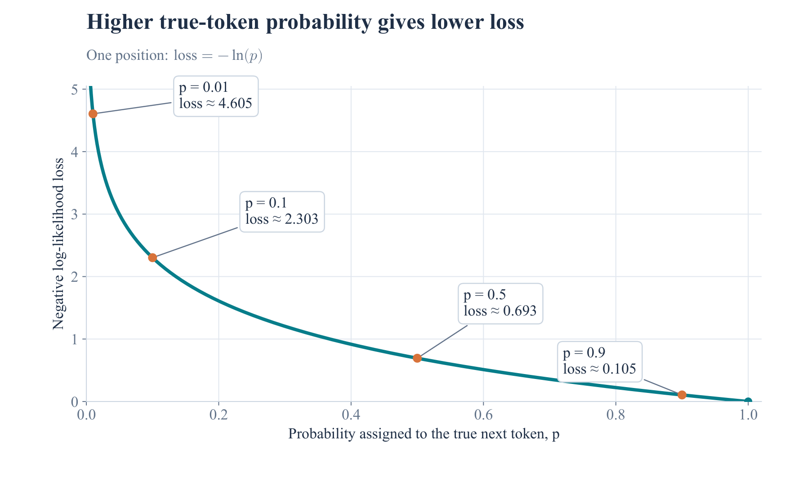{width=100%}

**Figure 03.10-1 — Read the formula as a curve.** The horizontal axis is the probability assigned to the observed token, and the vertical axis is its loss. Moving right along the curve increases that probability and lowers the loss; the orange points match the table above. The domain is $0<p\le1$. The visible vertical range ends near five, while loss continues growing without bound as `p` approaches zero. Labels are rounded.

At probability one, the loss is zero; as the probability approaches zero, the loss grows without bound. Locally:

$$
\frac{d(-\ln p)}{dp}=-\frac1p<0
$$

Thus increasing the observed token's probability decreases the objective. A correct argmax prediction can still have positive loss: assigning probability `0.665241` to the correct candidate is different from assigning probability one.

#### Why the name cross-entropy fits

For a hard class target, define a target distribution $Q_{t,v}$ that is one at the observed ID and zero elsewhere:

$$
Q_{t,v}=\mathbf{1}_{v=y_t},\qquad
\ell_t=-\sum_{v=0}^{V-1}Q_{t,v}\ln P_{t,v}=-\ln P_{t,y_t}
$$

This is cross-entropy between that target distribution and the model distribution. The index representation supplies the same target without constructing a whole `[T,V]` one-hot matrix.

For a sequence model, the likelihood of observed next tokens is a product of conditional probabilities. Taking its negative logarithm turns multiplication into addition:

$$
-\ln\left(\prod_{t=0}^{T-1}P_{t,y_t}\right)
=-\sum_{t=0}^{T-1}\ln P_{t,y_t}
$$

Dividing by $T$ gives the per-position mean used here. It helps compare average loss across examples of different lengths under the same tokenizer and evaluation setup.

### Derive the stable computation directly from logits

Substitute the softmax expression into the logarithm:

$$
\begin{aligned}
\ln P_{t,v}
&=\ln\left(\frac{e^{Z_{t,v}}}{\sum_j e^{Z_{t,j}}}\right)\\
&=Z_{t,v}-\ln\left(\sum_j e^{Z_{t,j}}\right)
\end{aligned}
$$

Therefore $\ell_t=\ln(\sum_j e^{Z_{t,j}})-Z_{t,y_t}$. Instead of first computing tiny probabilities and then taking their log, use the equivalent score expression.

Reuse the previous lesson's stable shift:

$$
\begin{aligned}
m_t&=\max_j Z_{t,j}\\
S_{t,v}&=Z_{t,v}-m_t\\
\ln P_{t,v}&=S_{t,v}-\ln\left(\sum_j e^{S_{t,j}}\right)
\end{aligned}
$$

Subtracting the same maximum from every score in a row leaves softmax unchanged. Every shifted score is at most zero, and at least one exponential is one. Thus the row sum remains positive in these examples, even if a tiny weight underflows to zero. Subtract the log of that sum from each shifted score to calculate log-probabilities directly.

For scores `[1000,0,-1000]` and true ID `2`:

```text
shifted logits: [0,-1000,-2000]
exponentials in float64: [1,0,0]
log of their sum: 0
true-target log-probability: -2000 - 0 = -2000
loss: 2000
```

Computing softmax first gives a numerical target probability of zero, and `log(0)` is not finite. The direct log-score expression still produces the appropriate finite loss `2000`. Clipping the probability with an added floor would alter that loss rather than reproduce this objective.

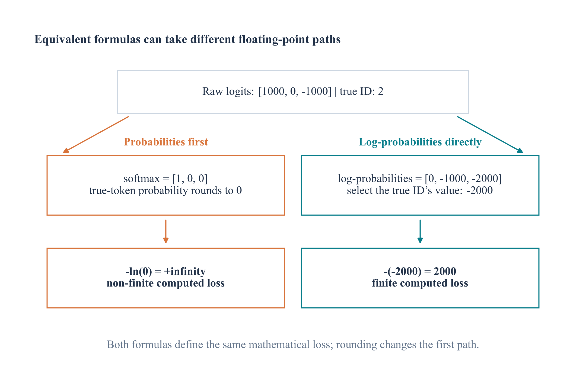{width=100%}

**Figure 03.10-2 — Follow the arrows from the same logits.** The left branch first stores probabilities in floating-point arithmetic; the true candidate's tiny probability underflows to zero before the log. The right branch computes the shifted log-probability directly, selects `-2000`, and negates it to obtain `2000`. The displayed values are computed floating-point results. The mathematical softmax probability of this candidate is still positive; the two branches define the same objective, but their numerical paths differ.

In practice, [cross_entropy](https://docs.pytorch.org/docs/2.0/generated/torch.nn.functional.cross_entropy.html) receives raw logits, and stabilized [logsumexp](https://docs.pytorch.org/docs/2.0/generated/torch.logsumexp.html) is a standard building block. Here you write the primitive operations to understand the calculation. The completed softmax remains useful for displaying distributions and selecting tokens; this loss uses its logarithm through an equivalent stable expression.

### Complete worked example

Reuse the score rows from Lesson 03.09, with supplied true targets:

$$
Z=\begin{bmatrix}1&2&3\\2&1&3\end{bmatrix},\qquad
\mathrm{target\_ids}=[2,0]
$$

Here $T=2$, $V=3$. From the previous softmax calculation:

$$
P\approx\begin{bmatrix}0.0900305732&0.2447284711&0.6652409558\\0.2447284711&0.0900305732&0.6652409558\end{bmatrix}
$$

#### Step 1: Identify the probability to evaluate in each row

| Position | True target ID | Selected probability | Position loss, approximately |
| --- | --- | --- | --- |
| `0` | `2` | `0.6652409558` | `0.4076059644` |
| `1` | `0` | `0.2447284711` | `1.4076059644` |

The first row assigns more probability to its true token, so it has the smaller loss. Although candidate `2` is the argmax in both rows, the second row's actual target is candidate `0`. Choosing the argmax as the target would reward the model's own prediction instead of assessing the observed outcome.

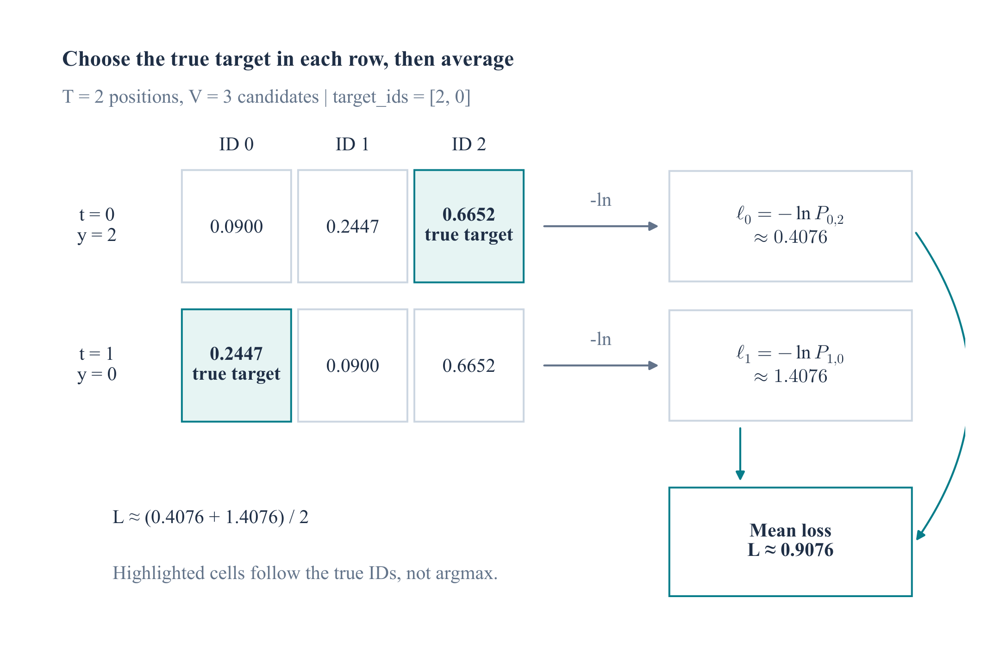{width=100%}

**Figure 03.10-3 — Read rows as positions and columns as candidate IDs.** Targets `[2,0]` select the teal cells at `(0,2)` and `(1,0)`. In the second row, the selected probability is approximately `0.2447`, even though candidate `2` has the largest probability. Each selected value yields one position loss through negative natural log. The final box averages those two losses, dividing by $T=2$; $V=3$ counts columns. Displayed probabilities and losses are rounded from full-precision calculations.

#### Step 2: Shift scores and calculate the row normalizers

```text
row_max = [[3],[3]]
shifted_logits = [[-2,-1,0],[-1,-2,0]]
exp_scores = [[0.1353352832,0.3678794412,1],
              [0.3678794412,0.1353352832,1]]
row_sums = [[1.5032147244],[1.5032147244]]
log_row_sums = [[0.4076059644],[0.4076059644]]
```

The maximum and row-sum tensors are `[2,1]`. The shifted scores and exponentials are `[2,3]`.

#### Step 3: Calculate all log-probabilities without logging tiny probabilities

$$
\ln P\approx
\begin{bmatrix}-2-0.4076059644&-1-0.4076059644&0-0.4076059644\\-1-0.4076059644&-2-0.4076059644&0-0.4076059644\end{bmatrix}
$$

Thus:

```text
log_probabilities =
    [[-2.4076059644,-1.4076059644,-0.4076059644],
     [-1.4076059644,-2.4076059644,-0.4076059644]]
```

Log-probabilities are not themselves probabilities. They can be negative and do not sum to one.

#### Step 4: Select one true-target coordinate per position

Construct `row_indices=[0,1]`. Pair these with `target_ids=[2,0]`:

```text
row_indices[0]=0, target_ids[0]=2 -> coordinate (0,2)
row_indices[1]=1, target_ids[1]=0 -> coordinate (1,0)

target_log_probabilities = [-0.4076059644,-1.4076059644]
```

The paired expression `log_probabilities[row_indices, target_ids]` produces `[T]`, not a cross-product matrix of every row and every listed target.

#### Step 5: Negate and average over the two positions

$$
L=\frac{0.4076059644+1.4076059644}{2}\approx0.9076059644
$$

Return this as a scalar tensor so it remains connected to the logits. Displayed decimals are rounded; checks use full precision and tolerances.

For comparison, equal scores over three candidates assign probability $\frac{1}{3}$ to any target and give loss $\ln3\approx1.098612$. A vocabulary with only one candidate assigns probability one and gives loss zero. Both are covered by the driver.

### New syntax: log, row indices, and paired indexing

`torch.log(row_sums)` applies the natural log to each row normalizer and keeps shape `[T,1]`. It is the log of a sum of exponentials, not a sum of logs and not the log of the original logits, which can be negative.

`logits.shape[0]` supplies $T$. `torch.arange(logits.shape[0], device=logits.device)` builds `[0,1,...,T-1]` on the score tensor's device. Integral bounds produce integer indices; see [arange](https://docs.pytorch.org/docs/2.0/generated/torch.arange.html). For two positions it produces `[0,1]`.

In `matrix[rows, columns]`, two same-length index tensors select paired coordinates. Here they select `(0,2)` and `(1,0)`. Embedding lookup selected whole rows; this expression selects one number from each row. Gradients can still pass through the selected floating-point log-probabilities. The integer labels and indices only choose locations.

Negation uses unary `-`. Parentheses group the negative selected vector before `.mean()`. At this point the vector has $T$ values, so the mean divides by $T$. The loss must remain a tensor; `.item()` belongs only in logging after the tensor has been retained for differentiation.

### Exact inputs, intermediate values, and return

| Name | Type and shape | Meaning |
| --- | --- | --- |
| `logits` | Floating `torch.Tensor`, `[T,V]` | Raw scores; preserve values and graph. |
| `target_ids` | Integer `torch.Tensor`, `[T]`, `torch.long` | Observed next-token column in each row. |
| `row_max` | Floating tensor `[T,1]` | Maximum score per position. |
| `shifted_logits`, `exp_scores` | Floating tensor `[T,V]` | Shifted scores and exponential weights. |
| `row_sums`, `log_row_sums` | Floating tensor `[T,1]` | Normalizers and their natural logs. |
| `log_probabilities` | Floating tensor `[T,V]` | Logarithm of each candidate's implied probability. |
| `row_indices` | Integer tensor `[T]` | Position indices aligned with `target_ids`. |
| `target_log_probabilities` | Floating tensor `[T]` | One selected value per observed outcome. |
| `loss` | Scalar floating tensor | Mean negative target log-probability. |

The returned dtype/device matches logits. The scalar stays connected when logits require gradients. Both inputs remain unchanged. No reset, backward, or parameter update belongs in this function.

### Guided implementation

Open `03_10_cross_entropy_loss.py` and find the completed `cross_entropy_loss(logits, target_ids)`. The following plan supports review or independent reconstruction while preserving the implementation. All statements use four spaces; no loop or context block is needed.

1. **Find `row_max`.** Reuse `logits.max(dim=-1, keepdim=True).values`. Example `[[3],[3]]`, shape `[T,1]`.
2. **Calculate `shifted_logits`.** Subtract `row_max` from `logits` into a new result. Example `[[-2,-1,0],[-1,-2,0]]`, shape `[T,V]`.
3. **Calculate `exp_scores` and `row_sums`.** Use `torch.exp`, then `.sum(dim=-1, keepdim=True)`. The example denominators are both approximately `1.5032147244`.
4. **Calculate `log_row_sums`.** Apply `torch.log` to `row_sums`. Example `[[0.4076059644],[0.4076059644]]`, shape `[T,1]`.
5. **Calculate `log_probabilities`.** Subtract `log_row_sums` from `shifted_logits`. Broadcasting applies one log normalizer to each row; the first row is approximately `[-2.407606,-1.407606,-0.407606]`.
6. **Construct `row_indices`.** Use `torch.arange(logits.shape[0], device=logits.device)`. Example `[0,1]`, an integer tensor `[T]`.
7. **Select `target_log_probabilities`.** Use paired indexing `log_probabilities[row_indices, target_ids]`. Example `[-0.407606,-1.407606]`, shape `[T]`.
8. **Form and return `loss`.** Negate the selected vector, average with `.mean()`, and return the scalar tensor. Example approximately `0.907606`. Keep it connected for later backward.

The core is yours to write. Reference helpers in the supplied driver do not replace the assigned primitive calculation. Setup loads the completed `compute_logits` from the sibling `03_09_logits_and_softmax.py`; it also checks gradients reaching the embedding table through indexed lookup. Do not edit the setup or driver.

Run in the existing PyTorch environment from the project root:

```bash
python exercises/03_10_cross_entropy_loss.py
```

Expected output after implementation:

```text
PASS: true-target selection and mean loss in the worked example
PASS: varied targets, vocabulary sizes, single-candidate case, and preserved inputs
PASS: row-shift invariance and finite loss for very unlikely targets
PASS: logit gradients equal mean-normalized probability minus target indicator
PASS: PyTorch loss agreement and finite-difference gradient agreement
PASS: loss gradients reach the embedding table and completed output projection
Lesson 03.10 checks passed.
```

### Formula reference: how this loss guides training

The following derivation is preserved for understanding, not assigned as manual derivative code. For one row:

$$
\ell_t=\ln\left(\sum_j e^{Z_{t,j}}\right)-Z_{t,y_t}
$$

Differentiate the log normalizer and selected score, then include the mean factor:

$$
\frac{\partial L}{\partial Z_{t,v}}
=\frac1T\left(\frac{e^{Z_{t,v}}}{\sum_j e^{Z_{t,j}}}-\mathbf{1}_{v=y_t}\right)
=\frac{P_{t,v}-\mathbf{1}_{v=y_t}}{T}
$$

The indicator is one for the true candidate and zero otherwise. If the true probability is below one, its score gradient is negative. Applying gradient descent directly to that score would raise it. Other candidates receive positive score gradients. A model instead updates the parameters that produce these scores, using the chain rule. Shared parameters can affect several positions.

In row `0` of the worked example, the true candidate is `2`, giving gradient $(0.6652409558-1)/2\approx-0.1673795221$ for that logit. Candidate `0` receives $0.0900305732/2\approx0.0450152866$. Even though the scalar loss selects the true log-probability, every candidate contributes through its shared normalizer.

### Reading questions

**Why average only true-target losses?** Each position supplies one observed next token. All vocabulary candidates affect its probability through normalization, but they are not $V$ separate observed outcomes.

**Why not use argmax as the target?** The target comes from data. Replacing it with the model's current favorite fails to measure the actual next-token prediction.

**Why does the helper not call backward?** It supplies the differentiable objective. A training step later clears parameter gradients, calculates scores and loss, calls backward, and updates parameters. Reusing this loss for evaluation should not force an update.

The continuation is the current guided [Lesson 03.11](#section-03-11): a minimal next-token training step using embeddings, the completed output projection, this loss, and parameter updates. Contextual attention remains a later chapter.

**Two spellings of a reduction.** `torch.sum(exp_scores, dim=-1, keepdim=True)` and `exp_scores.sum(dim=-1, keepdim=True)` perform the same reduction. Both retain one column per row so broadcasting remains explicit.

## 03.11 One Joint Next-Token Training Step {#section-03-11}

Lookup, vocabulary scores, and loss now form a connected calculation. One backward pass computes gradients for the embedding table, output weights, and bias. Compute all gradients before changing any parameter, so they describe the same state. Then update the three tensors using those gradients.

Work through the example before editing 03_11_next_token_train_step.py. The numbered steps below explain the interface and guide the core implementation; the supplied setup and check driver remain separate.

### Symbols, inputs, and the differentiation object

| Symbol | Exact parameter name | Type and shape | Role |
| --- | --- | --- | --- |
| $E$ | `embedding_table` | Floating trainable leaf tensor `[V,D]` | Input token vectors |
| $x$ | `token_ids` | Fixed `torch.long` tensor `[T]` | Input table row selectors |
| $W$ | `output_weights` | Floating trainable leaf tensor `[D,V]` | Vector-to-candidate weights |
| $b$ | `output_bias` | Floating trainable leaf tensor `[V]` | Shared candidate biases |
| $y$ | `target_ids` | Fixed `torch.long` tensor `[T]` | Observed next-token candidate IDs |
| $\eta$ | `learning_rate` | Nonnegative Python float | Step multiplier |
| $H$ | `selected_vectors` | Connected floating tensor `[T,D]` | Selected input vectors |
| $Z$ | `logits` | Connected floating tensor `[T,V]` | Raw output scores |
| $L$ | `loss` | Connected scalar tensor | Mean true-target cross-entropy |

$V$ is vocabulary size, $D$ vector dimension, and $T$ input-position count. Inputs and observed targets are fixed during the update. The loss is a function of all three trainable tensors, $L(E,W,b)$; a partial derivative with respect to one parameter component holds the other components fixed. Integer IDs select locations and are not differentiation variables.

Assume positive dimensions, finite values, valid IDs, matching dtype/device, and normal gradient mode. The three parameter tensors have separate storage, are leaves with `requires_grad=True`, and are not tied to one another. The supplied driver constructs them as CPU `float64`; the learner does not need new parameter construction or validation.

### Lookup, prediction, and one scalar objective

Lookup selects a table row for each input position:

$$
H_{t,d}=E_{x_t,d}
$$

The completed output projection computes:

$$
Z_{t,v}=\sum_{d=0}^{D-1}H_{t,d}W_{d,v}+b_v,\qquad Z=HW+b
$$

The completed loss evaluates the observed next-token IDs:

$$
P_{t,v}=\frac{e^{Z_{t,v}}}{\sum_j e^{Z_{t,j}}},\qquad
L(E,W,b)=-\frac1T\sum_{t=0}^{T-1}\ln P_{t,y_t}
$$

`compute_logits(selected_vectors, output_weights, output_bias)` supplies $Z$. `cross_entropy_loss(logits, target_ids)` supplies $L$ using the stable expression from 03.10. Calling the completed softmax separately is useful for displaying a distribution, but is unnecessary when passing raw logits to this loss helper.

The loss reaches three sets of parameters through the same connected computation:

$$
G_E=\frac{\partial L}{\partial E},\qquad
G_W=\frac{\partial L}{\partial W},\qquad
G_b=\frac{\partial L}{\partial b}
$$

Each gradient has the same shape as its parameter, with one derivative per parameter entry. One scalar loss can therefore give many derivatives. Call `loss.backward()` once to follow all recorded paths and store the leaf tensors' gradients in their `.grad` attributes. See the [PyTorch backward documentation](https://docs.pytorch.org/docs/2.0/generated/torch.Tensor.backward.html).

After all three gradients describe the same pre-update state, apply plain gradient descent:

$$
\begin{aligned}
E_{\mathrm{new}}&=E-\eta G_E\\
W_{\mathrm{new}}&=W-\eta G_W\\
b_{\mathrm{new}}&=b-\eta G_b
\end{aligned}
$$

The formulas act component by component. A positive component gradient decreases that parameter component; a negative one increases it. The objective guides the embedding values through prediction quality rather than a hand-chosen target vector.

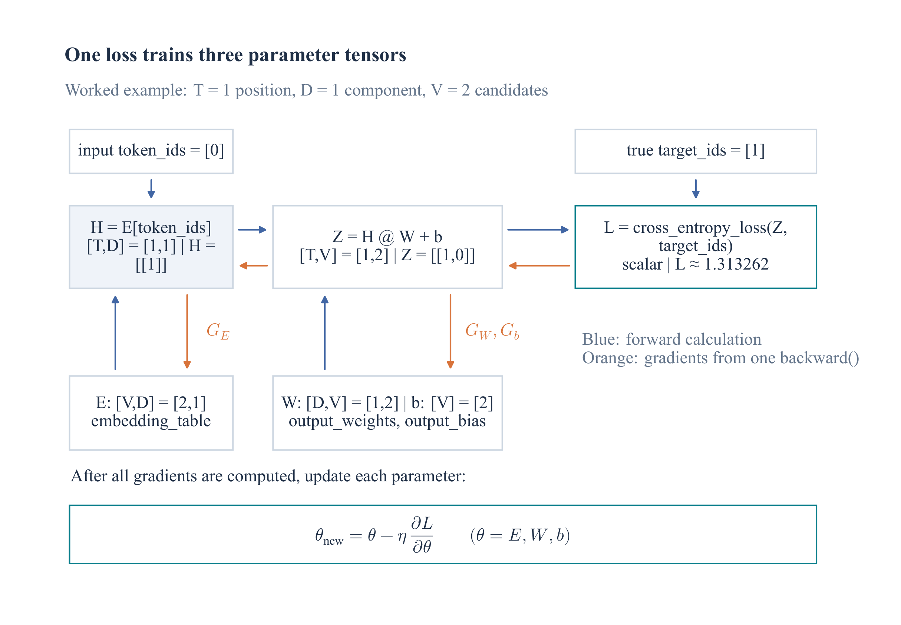{width=100%}

**Figure 03.11-1 — Read blue arrows forward, orange arrows backward.** Input IDs select $H$ from $E$; $W$ and $b$ turn it into $Z$; true target IDs determine the scalar loss. Reverse arrows show the derivative paths to all three parameters. There is no gradient/update arrow to the integer IDs. The boxed update follows the completed backward pass. Shapes and values match the small example below.

### Complete small example: two candidates and one input position

Use a teaching vocabulary of two IDs. A token sequence `[0,1]` supplies input `[0]` and target `[1]`. Choose $T=1$, $D=1$, $V=2$ to make every component visible; these small dimensions serve the example.

$$
E=\begin{bmatrix}1\\2\end{bmatrix},\quad
W=\begin{bmatrix}1&0\end{bmatrix},\quad
b=\begin{bmatrix}0&0\end{bmatrix},\quad
x=[0],\quad y=[1],\quad\eta=0.1
$$

Bias is stored as a one-dimensional `[2]` tensor even though mathematical row notation shows its two entries side by side.

#### 1. Forward: calculate scores, true probability, and loss

Select input row zero: $H=[[1]]$, shape `[1,1]`. Matrix multiplication and the bias give:

$$
Z=\begin{bmatrix}1\times1+0&1\times0+0\end{bmatrix}
=\begin{bmatrix}1&0\end{bmatrix}
$$

The two probabilities and the true-target loss are:

$$
P=\begin{bmatrix}\frac{e^1}{e^1+e^0}&\frac{e^0}{e^1+e^0}\end{bmatrix}
\approx\begin{bmatrix}0.7310585786&0.2689414214\end{bmatrix},\qquad
L=-\ln P_{0,1}\approx1.3132616875
$$

The true ID is `1`, whose probability is the second entry. $T=1$ means one position loss; dividing by $V=2$ would be incorrect. This forward calculation has not changed any parameter.

#### 2. Backward: derive every gradient in this example

The formula from 03.10 is:

$$
(G_Z)_{t,v}=\frac{P_{t,v}-\mathbf{1}_{v=y_t}}{T}
$$

Here the target indicator is `[0,1]`, so:

$$
G_Z=\begin{bmatrix}0.7310585786&-0.7310585786\end{bmatrix}
$$

For the weight $W_{0,0}$, the local derivative of score $Z_{0,0}=H_{0,0}W_{0,0}+b_0$ with respect to that weight is $H_{0,0}=1$. Multiplying by the loss derivative gives $1\times0.7310585786$. For $W_{0,1}$ it gives $1\times(-0.7310585786)$. Each bias has local score derivative one. Thus:

$$
G_W=\begin{bmatrix}0.7310585786&-0.7310585786\end{bmatrix},\qquad
G_b=\begin{bmatrix}0.7310585786&-0.7310585786\end{bmatrix}
$$

To reach the selected embedding, add the paths through both candidates:

$$
\frac{\partial L}{\partial H_{0,0}}
=\sum_v\frac{\partial L}{\partial Z_{0,v}}W_{0,v}
=0.7310585786\times1+(-0.7310585786)\times0
=0.7310585786
$$

Only $H_{0,0}=E_{0,0}$ was selected, so:

$$
G_E=\begin{bmatrix}0.7310585786\\0\end{bmatrix}
$$

Input table row one was not read. Target ID `1` selects an output candidate for the loss, not an input row for lookup. Here the input table and output head are separate parameters. This loss therefore gives the unused input row zero gradient under plain descent. The output weight and bias for candidate one still get nonzero gradients.

#### 3. Update all three parameters from those old gradients

For the selected embedding component, $1-0.1\times0.7310585786\approx0.9268941421$. For the second candidate weight, $0-0.1\times(-0.7310585786)\approx0.0731058579$. Applying the same rule to every component gives:

$$
\begin{aligned}
E_{\mathrm{new}}&\approx\begin{bmatrix}0.9268941421\\2\end{bmatrix},\\
W_{\mathrm{new}}&\approx\begin{bmatrix}0.9268941421&0.0731058579\end{bmatrix},\\
b_{\mathrm{new}}&\approx\begin{bmatrix}-0.0731058579&0.0731058579\end{bmatrix}.
\end{aligned}
$$

The table's unused row remains exactly `2`. The gradients are copied and the original loss is extracted before the update. The function returns, in order:

```text
loss_value = 1.3132616875
gradient_table = [[0.7310585786],[0]]
gradient_weights = [[0.7310585786,-0.7310585786]]
gradient_bias = [0.7310585786,-0.7310585786]
```

The floating tensors keep the full gradient values; displayed decimals are rounded. All four returned observations describe the pre-update state. The passed parameter objects now hold updated values.

#### 4. A separate forward check shows what the update changed

Recompute using all three updated parameters:

$$
\begin{aligned}
Z'_{0,0}&\approx0.9268941421\times0.9268941421-0.0731058579
\approx0.7860268929\\
Z'_{0,1}&\approx0.9268941421\times0.0731058579+0.0731058579
\approx0.1408672493
\end{aligned}
$$

The new true-target probability is approximately `0.3440811280`, and the new loss is approximately `1.0668778121`. The model still assigns higher probability to candidate zero; one useful update need not immediately fix the argmax. It increases probability on the actual target and lowers the loss in this example. This second forward belongs to the check driver, not the learner step's returned observations.

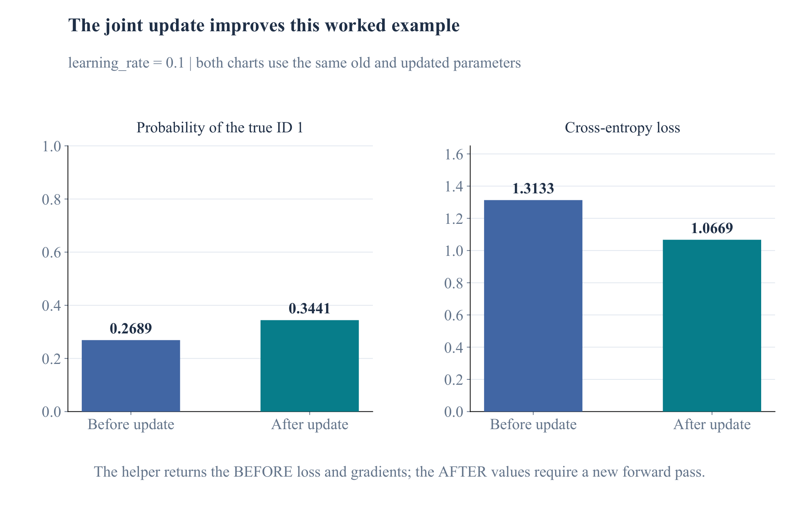{width=100%}

**Figure 03.11-2 — Compare one parameter state with the next.** Blue bars use the original $E,W,b$; teal bars use the three updated tensors with `learning_rate=0.1`. Read the left axis as a probability and the right axis as loss. The helper returns the original loss `1.3133`. A separate forward obtains the new loss `1.0669`. Bar labels are rounded. This measured improvement applies to the given example; a sufficiently large step can increase loss.

### Derivative reference for multiple positions

Autograd computes these derivatives. The formulas explain the shared-parameter paths and their shapes:

$$
G_W=H^{\mathsf T}G_Z,\qquad
(G_b)_v=\sum_t(G_Z)_{t,v},\qquad
G_H=G_ZW^{\mathsf T}
$$

The product for $G_W$ adds each position's contribution to the shared weights. The sum for $G_b$ adds the contributions from all rows that used the same bias. The product for $G_H$ adds the paths through all candidates back to each input vector component. For lookup:

$$
(G_E)_{r,d}=\sum_{t:x_t=r}(G_H)_{t,d}
$$

Repeated input IDs add contributions to the same table row. Unused rows have zero gradient in this objective. The division by $T$ already occurs in $G_Z$; do not divide again by $T$, $D$, or $V$ when applying these chains. In the small example $H=1$, so weight and bias gradients happen to have equal values; they need not agree in general.

For sufficiently small steps, a first-order loss estimate is:

$$
\Delta L\approx-\eta\left(\lVert G_E\rVert_F^2+\lVert G_W\rVert_F^2+\lVert G_b\rVert_2^2\right)
$$

The norms sum squared gradient components. This local approximation explains the descent direction; it does not guarantee lower loss at an arbitrary finite learning rate. The driver includes a larger step that increases loss.

### Exact return and gradient/reset semantics

Return `(loss_value, gradient_table, gradient_weights, gradient_bias)`. Read the first value as a Python float using the original loss's `loss.item()`. The remaining values are separate `.clone()` copies of the three `.grad` tensors. Their shapes are `[V,D]`, `[D,V]`, and `[V]`, and each keeps its parameter's dtype and device. Ordinary backward produces untracked gradients, so cloning needs no extra detach.

`loss` remains a tensor until backward completes. Its numeric extraction is for reporting; [item](https://docs.pytorch.org/docs/2.0/generated/torch.Tensor.item.html) returns a Python number without an autograd connection. Keep a distinct `loss_value` name for that report.

Reset all three `.grad` attributes at the start because backward accumulates gradients into leaves. This lesson wants the current step's gradient, rather than accumulated previous steps. Setting `.grad=None` clears the stored derivative, leaving parameter values intact. The next forward uses the updated values from the preceding call.

Only the parameter mutation is inside `with torch.no_grad():`. This context suppresses tracking of the update operation, while the same supplied leaves remain trainable for the next call. Lookup, score computation, loss computation, and backward stay in normal gradient mode. [No-grad documentation](https://docs.pytorch.org/docs/2.0/generated/torch.no_grad.html).

### New loop syntax and indentation before implementation

`parameters = (embedding_table, output_weights, output_bias)` groups references to the three existing tensors in a tuple. It does not copy them or merge their values. The loop `for parameter in parameters:` visits each tensor once. The colon starts its indented body. Resetting `.grad` there changes the gradient stored on the original parameter.

Inside the update loop, `parameter -= learning_rate * parameter.grad` mutates the original tensor under no-grad. Assigning `parameter = parameter - ...` would only bind the local loop variable to a new tensor, leaving the caller's original parameter unchanged. The assignment requires persistent original tensors.

| Region | Spaces from line start |
| --- | --- |
| Ordinary function statement and outer `for`/`with` | `4` |
| Body of the gradient-reset `for` | `8` |
| Parameter `for` inside no-grad | `8` |
| Update body inside both no-grad and parameter `for` | `12` |
| Final return, after leaving both blocks | `4` |

The two loops visit three parameters, not input positions or training steps. Tensor operations already calculate all $T$ positions together.

### Guided implementation

Open `03_11_next_token_train_step.py` and find `next_token_train_step(embedding_table, token_ids, output_weights, output_bias, target_ids, learning_rate)`. The following plan guides your implementation.

1. **Group and clear parameters.** At four spaces, create `parameters` using the three trainable tensors in the order table, weights, bias. At four spaces, begin `for parameter in parameters:`; at eight spaces, assign `parameter.grad = None`. Values remain unchanged.
2. **Look up `selected_vectors`.** Return to four spaces and index `embedding_table[token_ids]`. Shape `[T,D]`; the example yields `[[1]]`. Keep the graph connected to the supplied table.
3. **Calculate `logits`.** At four spaces, call `compute_logits(selected_vectors, output_weights, output_bias)`. Shape `[T,V]`; the example yields `[[1,0]]`. This helper includes the bias.
4. **Calculate `loss`.** At four spaces, call `cross_entropy_loss(logits, target_ids)`. It returns a connected scalar, approximately `1.3132616875` here. Keep `loss` as the tensor.
5. **Run one backward.** At four spaces, call `loss.backward()`. Table, weight, and bias gradients are now available and all describe the old parameter state. The selected table gradient is positive; candidate-one weight and bias gradients are negative.
6. **Save observations.** At four spaces, obtain `loss_value` with `.item()`. Obtain `gradient_table`, `gradient_weights`, and `gradient_bias` with `.clone()` on each corresponding parameter's `.grad`. Save separate full tensor copies.
7. **Update all three original tensors.** At four spaces, enter `with torch.no_grad():`; at eight spaces, write `for parameter in parameters:`; at twelve spaces, subtract `learning_rate * parameter.grad` with `-=`. The selected table value becomes approximately `0.9268941421`. Only this update loop belongs in no-grad.
8. **Return in the specified order.** At four spaces, outside both blocks, return `loss_value`, `gradient_table`, `gradient_weights`, and `gradient_bias`. These describe the pre-update state; no second forward or outer training loop is required.

The supplied loader exposes the completed helpers through portable sibling filenames. Preserve earlier implementations and the supplied setup/check driver. The learner core connects the pieces; it does not rewrite the loss or hand-derived gradients.

From the repository root in the existing PyTorch environment:

```bash
python exercises/03_11_next_token_train_step.py
```

Expected output after the learner implements the core:

```text
PASS: worked example, three parameter gradients, and joint in-place update
PASS: multiple positions, varied dimensions, repeated IDs, and untouched input rows
PASS: zero learning rate and single-candidate zero gradients
PASS: all old gradients cleared and repeated calls use updated trainable parameters
PASS: independent table, weight, and bias gradient snapshots
PASS: all parameter gradients agree with trusted autograd and finite differences
PASS: pre-update reporting, small-step improvement, and possible large-step loss increase
Lesson 03.11 checks passed.
```

### Reader questions

**How does one loss train several tensors?** Each parameter component has its own partial derivative. A connected backward pass follows every path contributing to the same scalar, including the head and lookup.

**Why does the embedding shrink while the true probability rises?** Embedding coordinates are features rather than probabilities. In this example, reducing the selected feature reduces the initially favored candidate's score contribution; changes to both head columns and biases also affect the prediction. Evaluate the complete updated model to see the effect.

**Why is the true target's input table row unchanged?** The input IDs select table rows. The target IDs select candidate columns in the loss. Those are different operations, with untied parameters in this exercise.

**Does backward update parameters?** It calculates and stores derivatives. The following no-grad mutation applies the learning-rate-scaled update.

**What happens at learning rate zero?** Loss and gradients are still calculated and reported. Parameter values remain unchanged. A zero gradient also leaves its corresponding parameter component unchanged.

**Example variable names.** The reset loop consistently uses `paramemter`, a valid local identifier. `loss_values` holds the connected scalar tensor, while `loss_value` holds its extracted Python float. Three explicit `-=` statements update the table, weights, and bias inside no-grad. With no inner parameter loop, those statements correctly use eight spaces. Twelve spaces apply only to the optional nested-loop form in the implementation plan. This form has the required behavior.

The continuation is the current guided [Lesson 03.12](#section-03-12): repeat this completed step while retaining parameters and recording pre-update loss history. Context processing remains a later chapter.

## 03.12 Repeat the Next-Token Training Step {#section-03-12}

We can now repeat the next-token training step on the same parameter tensors. Each history entry must identify the parameter state that produced its loss. We will reuse the same training pairs so we can focus on how parameter values carry forward and when the losses are measured.

Work through the example before editing 03_12_next_token_training_loop.py. The numbered steps below explain the interface and guide the core implementation; the supplied setup and check driver remain separate.

### Exact inputs and returned value

| Name | Type and shape | Meaning |
| --- | --- | --- |
| `embedding_table` | Trainable floating leaf tensor `[V,D]` | Existing input table, updated in place |
| `token_ids` | Fixed `torch.long` tensor `[T]` | Input row selectors |
| `output_weights` | Trainable floating leaf tensor `[D,V]` | Existing projection weights, updated in place |
| `output_bias` | Trainable floating leaf tensor `[V]` | Existing shared bias, updated in place |
| `target_ids` | Fixed `torch.long` tensor `[T]` | Observed next-token candidate IDs |
| `learning_rate` | Nonnegative Python float | Passed unchanged to the step helper |
| `num_steps` | Nonnegative Python int | Exact number of update calls |
| `losses` | Fresh `list[float]` | One pre-update loss per call, in order |

$T$ counts supervised input positions per step, $D$ vector components, and $V$ vocabulary candidates. Assume the valid IDs, finite values, matching dtype/device, separate parameter storage, and normal gradient mode from 03.11. The driver supplies CPU `float64` trainable leaves. The learner does not construct parameters or validate inputs.

The function returns only `losses`. The caller already holds the original three parameter objects, and their values become the final trained values. Every stored entry is a Python float rather than a loss tensor or gradient tuple. For `num_steps=0`, return a fresh empty list and leave parameter values and stored gradients untouched.

### Parameter states and loss history

Group the contents of the three parameter tensors after $k$ updates as:

$$
\theta_k=(E_k,W_k,b_k),\qquad \theta_0=(E_0,W_0,b_0)
$$

This notation describes changing values inside persistent tensors, not new tensor objects. The input IDs, target IDs, and learning rate are fixed during this exercise. Define the objective for a parameter state:

$$
L(\theta)=-\frac1T\sum_{t=0}^{T-1}\ln\operatorname{softmax}(E[x]W+b)_{t,y_t},\qquad
L_k=L(\theta_k)
$$

Here $x$ is `token_ids`, $y$ is `target_ids`, and softmax normalizes each row over vocabulary candidates. The completed stable loss helper implements this objective.

One call obtains the current gradient and changes the parameters:

$$
\theta_{k+1}=\theta_k-\eta\nabla_{\theta}L(\theta_k),\qquad k=0,\ldots,N-1
$$

$N=$ `num_steps`, and $\eta$ is `learning_rate`. The gradient is the three parameter-shaped derivatives from 03.11. Each call uses the latest values, with a new forward calculation and fresh gradients supplied by the helper. The next call therefore starts at $\theta_{k+1}$.

The returned numeric record is:

$$
\mathrm{losses}[k]=L(\theta_k),\qquad
\mathrm{losses}=[L_0,L_1,\ldots,L_{N-1}]\quad(N\ge1)
$$

After $N$ calls, the original tensors contain $\theta_N$. The last recorded value measures $\theta_{N-1}$, before the last update. A separate forward can evaluate $L(\theta_N)$; it is not another history entry under this contract. Thus $N$ updates visit $N+1$ parameter states while producing exactly $N$ recorded values.

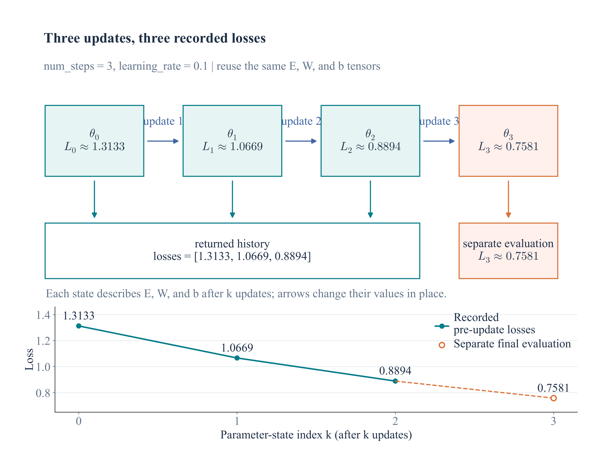{width=100%}

**Figure 03.12-1 — Follow the states, then the recorded values.** Each top box represents the contents of the same $E,W,b$ after $k$ updates. Blue arrows are the three update calls. Teal arrows collect the loss at each call's starting state. The orange state is the final trained state, whose loss is separately evaluated. In the curve, solid teal markers are the returned history; the hollow orange marker is the separate final evaluation. Values are rounded and use the complete example below.

### Complete three-update example

Reuse the exact 03.11 example:

```text
embedding_table = [[1],[2]]
output_weights = [[1,0]]
output_bias = [0,0]
token_ids = [0]
target_ids = [1]
learning_rate = 0.1
num_steps = 3
```

The table has shape `[2,1]`, the weights `[1,2]`, the bias `[2]`, and both ID tensors `[1]`. The token sequence `[0,1]` supplies the observed input/target pair. The first forward selects `[[1]]`, gives logits `[[1,0]]`, and obtains true probability approximately `0.2689414214`. Its loss is:

$$
L_0=-\ln(0.2689414214)\approx1.3132616875
$$

The first call uses the gradients already derived in 03.11 and leaves the table's selected component at approximately `0.9268941421`. The second call starts from all three updated tensors. Every active parameter component and the evaluated loss at each state are shown below. The unused table row `E[1,0]` stays exactly `2` throughout this fixed-window example.

| Updates completed $k$ | `E[0,0]` | `W[0,0]` | `W[0,1]` | `b[0]` | `b[1]` | Evaluated loss $L_k$ |
| --- | --- | --- | --- | --- | --- | --- |
| `0` | `1.0000000000` | `1.0000000000` | `0.0000000000` | `0.0000000000` | `0.0000000000` | `1.3132616875` |
| `1` | `0.9268941421` | `0.9268941421` | `0.0731058579` | `-0.0731058579` | `0.0731058579` | `1.0668778121` |
| `2` | `0.8708925573` | `0.8660974061` | `0.1339025939` | `-0.1386977451` | `0.1386977451` | `0.8894180392` |
| `3` | `0.8277585808` | `0.8147926734` | `0.1852073266` | `-0.1976082643` | `0.1976082643` | `0.7580921817` |

For example, at state one, $H\approx0.9268941421$ and the probability of candidate zero is approximately `0.6559188720`. For this one-position target `1`, the new score gradient is $[p_0,-p_0]$. The next selected-table gradient is:

$$
\begin{aligned}
\frac{\partial L_1}{\partial E_{0,0}}
&=p_0(W_{0,0}-W_{0,1})\\
&\approx0.6559188720\times(0.9268941421-0.0731058579)\\
&\approx0.5600158483.
\end{aligned}
$$

Thus the second call changes that component to approximately $0.9268941421-0.1\times0.5600158483=0.8708925573$. This gradient differs from the first call's `0.7310585786` because the parameters have changed. The wrapper delegates those calculations to the completed helper.

Track the Python list and caller-owned tensors in execution order:

| Call | Starting state | Helper's first returned item | State after the call | `losses` after append |
| --- | --- | --- | --- | --- |
| `1` | $\theta_0$ | `1.3132616875` | $\theta_1$ | `[1.3132616875]` |
| `2` | $\theta_1$ | `1.0668778121` | $\theta_2$ | `[1.3132616875,1.0668778121]` |
| `3` | $\theta_2$ | `0.8894180392` | $\theta_3$ | `[1.3132616875,1.0668778121,0.8894180392]` |

The helper reads the loss before changing parameters. It then applies the update and returns. The list append happens afterward, but the saved number still describes the earlier parameter state. When a number is stored and which state it measures are separate questions.

The function returns approximately:

```text
[1.3132616875, 1.0668778121, 0.8894180392]
```

The original parameter objects now contain:

```text
embedding_table = [[0.8277585808],[2]]
output_weights = [[0.8147926734,0.1852073266]]
output_bias = [-0.1976082643,0.1976082643]
```

The separate final loss `0.7580921817` is available from evaluating those parameters. Adding it to the returned list would change this exercise's history convention. It is also unnecessary to call the update helper again merely to evaluate: that would perform a fourth update. Displayed values are rounded; the driver uses full precision.

### Zero steps, repeated calls, and training budget

When `num_steps=0`, `range(0)` yields no iterations. No step helper runs, no gradient is reset, and no parameter is changed. The final return outside the loop still executes and returns `[]`. By contrast, zero learning rate with three steps still calls the helper three times and records three losses. Gradients are recalculated even though parameter values do not move.

Every function call creates its own fresh history list. If the caller passes the same trained parameters to another call, training continues from their current values. For the same fixed data and learning rate, three updates followed by two updates produce the same parameter trajectory as five uninterrupted updates. The two returned lists remain independent.

`num_steps` counts parameter-update calls, not generated tokens or epochs. Each call evaluates the $T$ supplied targets, so this budget performs $NT$ supervised-position calculations. Reusing those positions does not create $NT$ different examples. An epoch is one pass through a defined dataset; this fixed-window function does not implement that pass.

The example's losses fall for `learning_rate=0.1`. Loss need not decrease at every arbitrary learning rate; the check driver preserves a large-step increase. Lower loss on repeatedly used training pairs alone also does not establish performance on unseen text. Dataset splits and independent evaluation remain later topics.

### Reusing the helper and preserving its graph

`next_token_train_step(embedding_table, token_ids, output_weights, output_bias, target_ids, learning_rate)` returns a four-item tuple. Save it as `step_result`. Index zero, `step_result[0]`, is the pre-update Python loss. The remaining items are gradient snapshots, which this wrapper does not store in its history.

The helper clears parameter gradients, performs a new forward calculation, runs backward, and updates the original tensors inside its own no-grad block. The wrapper calls it once per iteration in normal gradient mode. Keep all three original tensors and let the helper handle those actions. Their updated values then carry into the next call.

Store only floats in `losses`, so the history keeps neither loss graphs nor full gradient tensors from every step. The teaching helper still creates gradient snapshots for inspection, but this wrapper does not return them. Later, we can remove that extra work when building more efficient training code.

### Loop syntax and indentation before implementation

`losses = []` creates a new empty list. `for step in range(num_steps):` repeats the indented body. With three steps, the counter takes `0,1,2`; the first call corresponds to counter zero. The name `step` is a local repetition counter. The helper's arguments contain the actual parameters and learning rate.

`step_result[0]` selects the first tuple item using zero-based indexing. `losses.append(loss_value)` adds that float at the end of the same list. Appending the complete tuple would store loss plus gradient tensors rather than the requested scalar history.

Use four spaces for the fresh list, loop header, and final return. Use eight spaces for the helper call, first-item selection, and append inside the loop. Return outside the loop so it executes after all requested calls and also handles zero calls. No new nested update block is needed; that already exists in the completed helper.

### Five numbered implementation steps

Open `03_12_next_token_training_loop.py` and find the completed `train_next_token(embedding_table, token_ids, output_weights, output_bias, target_ids, learning_rate, num_steps)`. The following plan supports review or independent reconstruction while preserving the exercise code.

1. **Create the history.** At four spaces, assign an empty list to `losses` using `[]`. Parameters are already supplied. Before the loop, the list is empty.
2. **Set the repetition budget.** At four spaces, write `for step in range(num_steps):`. Its colon begins the eight-space body. `range(3)` repeats three times; `range(0)` skips that body.
3. **Reuse one complete update.** At eight spaces, call `next_token_train_step` with `embedding_table`, `token_ids`, `output_weights`, `output_bias`, `target_ids`, `learning_rate` in that order. Save its returned tuple as `step_result`. The first call updates the original tensors from $\theta_0$ to $\theta_1$; the next call sees $\theta_1$.
4. **Record the first tuple item.** Still at eight spaces, select `step_result[0]` as `loss_value`, then call `losses.append(loss_value)`. After two calls the example list contains approximately `[1.3132616875,1.0668778121]`. The helper's gradient snapshots are not history entries.
5. **Return after the loop.** At four spaces, return `losses`. Three calls produce three floats; zero calls produce `[]`. The original parameter tensors contain the final values. Do not append another evaluation or perform another update.

The core remains for you to write. The supplied loader imports the completed sibling step without running its check driver. Preserve that setup and all earlier implementations.

Run from the repository root in the existing PyTorch environment:

```bash
python exercises/03_12_next_token_training_loop.py
```

Expected output after the learner implements the loop:

```text
PASS: three updates, ordered pre-update losses, and final parameter values
PASS: zero and one step preserve the specified budget and gradient state
PASS: supplied step reused exactly once per update with persistent parameters
PASS: fresh histories and continuation across separate calls
PASS: varied positions, vocabulary dimensions, repeated IDs, and learning rates
PASS: zero learning rate and single-candidate zero loss still record every step
PASS: large-step loss increases remain visible without extra updates
Lesson 03.12 checks passed.
```

### Reader questions

**Why is the last recorded loss not the final trained loss?** Each helper returns the loss from the state before its update. After the last call, parameters have advanced one state beyond the last recorded number. A separate forward measures that new state.

**Why return only a list rather than new parameters?** The caller still holds the same tensor objects. In-place updates have already changed their values; the list supplies observations about training.

**Why reset gradients within each step?** This loop requests the derivative of the current loss, rather than accumulation across earlier steps. The completed helper handles that reset before each new backward pass.

**Does three steps mean generating three tokens?** It means three parameter-update calls on the supplied input/target pairs. Generating a token is a later prediction operation using parameter values.

The continuation is the completed [03.13](#section-03-13): fixed-parameter next-token prediction and the autoregressive idea. The generation loop is completed in [03.14](#section-03-14). Contextual attention and practical data/optimization remain later topics.

**A continued call is not another block.** Arguments inside parentheses can occupy several lines. Their visual indentation groups the arguments; only a new control-flow header such as `for` or `with` opens a nested suite.

## 03.13 Predict One Next Token {#section-03-13}

Training changes parameter values. Prediction keeps them fixed and uses the distribution at the prompt's final position to select one next ID. This single prediction will become the repeated step in a generation loop.

Work through the example before editing 03_13_predict_next_token.py. The numbered steps below explain the interface and guide the core implementation; the supplied setup and check driver remain separate.

### Inputs, symbols, and returned values

| Symbol or value | Exact code name | Type/shape | Meaning |
| --- | --- | --- | --- |
| $E$ | `embedding_table` | Floating tensor `[V,D]` | Fixed input vectors for this prediction |
| $x$ | `context_ids` | `torch.long` tensor `[T]` | Nonempty prompt token IDs |
| $W$ | `output_weights` | Floating tensor `[D,V]` | Fixed projection weights |
| $b$ | `output_bias` | Floating tensor `[V]` | Fixed candidate biases |
| $H$ | `selected_vectors` | Floating tensor `[T,D]` | Prompt lookup rows |
| $Z$ | `logits` | Floating tensor `[T,V]` | Per-position candidate scores |
| $P$ | `probabilities` | Floating tensor `[T,V]` | Row-normalized distributions |
| $p$ | `next_probabilities` | Untracked floating tensor `[V]` | Distribution following the prompt |
| $\hat v$ | `next_token_id` | Python `int` | Greedy candidate ID |

$T$ counts prompt token occurrences, $D$ vector components, and $V$ vocabulary candidates. Indices are zero-based. Assume positive dimensions, valid IDs, compatible shapes/devices/dtypes, and finite forward scores. The supplied floating parameters are leaves and may require gradients or be frozen; preserve their flags, values, storage, and any stored gradients. The checks construct CPU `float64` tensors.

Return `(next_token_id, next_probabilities)` in that order. The ID is in `[0,V)`, and the probability vector has the same floating dtype/device as the parameters. Preserve the supplied prompt and caller's gradient mode. There are no target labels, loss calculation, backward call, learning rate, or parameter update in this helper.

### From the prompt to its next distribution

The completed operations still compute one row per input position:

$$
H_{t,d}=E_{x_t,d},\qquad Z=HW+b,\qquad
P_{t,v}=\frac{e^{Z_{t,v}}}{\sum_j e^{Z_{t,j}}}
$$

The next token follows the final input position, so select:

$$
p_v=P_{T-1,v},\qquad p=P[T-1,:]
$$

In code, `probabilities[-1]` selects that final row and removes the position axis: `[T,V]` becomes `[V]`. The minus one is a row index meaning the last position; it is not a negative token ID.

An earlier row predicts at an earlier position. For a two-token prompt, row zero predicts after its first token, while row one predicts after the second token. The distribution needed to extend the prompt is therefore row one. Calculating several rows does not generate several new future tokens at once.

Greedy selection chooses the largest probability:

$$
\hat v=\underset{0\le v<V}{\operatorname{argmax}}\;p_v
$$

`next_probabilities.argmax()` finds the largest probability and returns its index as a scalar integer tensor. Use `.item()` to read a Python integer. That index is the candidate ID; `.max()` would instead give the probability itself. If several candidates tie, argmax selects the first index, which is the lowest tied ID in this vector. See the [Argmax documentation](https://docs.pytorch.org/docs/2.0/generated/torch.argmax.html).

In exact arithmetic, softmax preserves the score ordering, so greedy selection can also compare logits. This exercise computes probabilities because the returned distribution is useful for inspection. Sampling from a distribution is a different selection rule and follows later.

### Complete hand-calculation example

Use these hand-picked arithmetic parameters; they are not reported as a training outcome. The toy vocabulary has two IDs:

$$
E=\begin{bmatrix}1&2\\3&1\end{bmatrix},\qquad
W=\begin{bmatrix}1&0\\0&1\end{bmatrix},\qquad
b=[0,0],\qquad x=[0,1]
$$

Here $T=2$, $D=2$, $V=2$; equal dimension sizes are incidental. Bias is stored as a one-dimensional `[2]` tensor. The prompt uses two positions. Lookup gives:

$$
H=\begin{bmatrix}1&2\\3&1\end{bmatrix},\qquad
Z=HW+b=\begin{bmatrix}1&2\\3&1\end{bmatrix}
$$

For instance, the final row's candidate-zero score is $3\times1+1\times0+0=3$, and candidate one's score is $3\times0+1\times1+0=1$.

The stable softmax intermediates are:

```text
row_max = [[2],[3]]
shifted_logits = [[-1,0],[0,-2]]
exp_scores = [[0.3678794412,1],[1,0.1353352832]]
row_sums = [[1.3678794412],[1.1353352832]]
probabilities = [[0.2689414214,0.7310585786],
                 [0.8807970780,0.1192029220]]
```

The last row is:

$$
p=\begin{bmatrix}\frac1{1+e^{-2}}&\frac{e^{-2}}{1+e^{-2}}\end{bmatrix}
\approx\begin{bmatrix}0.8807970780&0.1192029220\end{bmatrix},\qquad\hat v=0
$$

Return Python integer `0` and the `[2]` probability tensor. ID zero does not mean probability zero. The first row favors ID one, so choosing the first row would produce a different and inappropriate prediction for extending this prompt. Selecting argmax over the entire matrix would flatten both position and candidate axes rather than selecting one candidate from the final row.

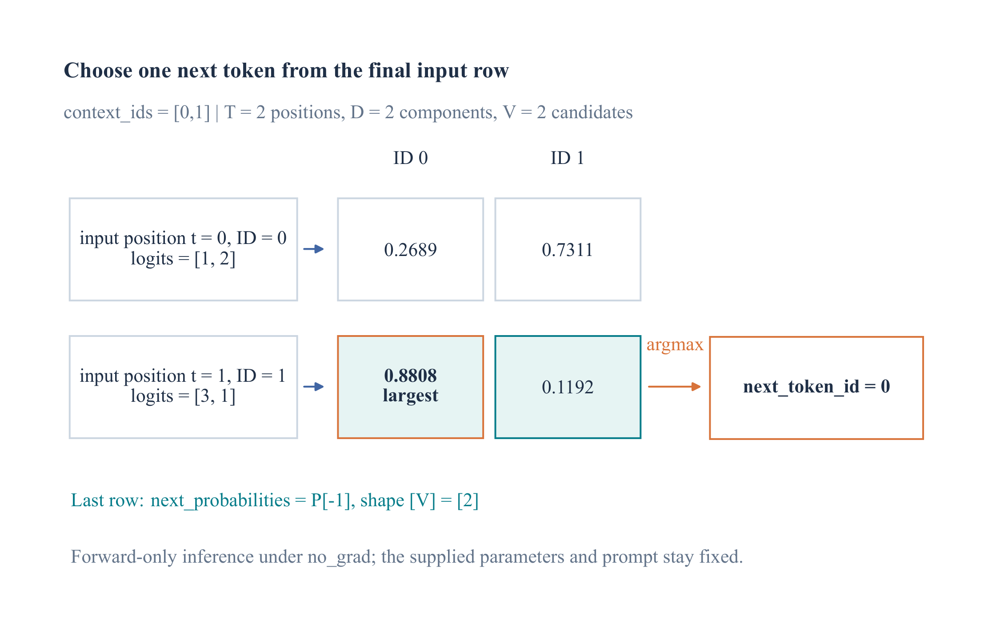{width=100%}

**Figure 03.13-1 — Read columns as candidate IDs and rows as input positions.** The first row belongs to the first prompt token. Both teal cells form the final row's `[V]` distribution. The orange border marks its largest entry at candidate zero; the returned ID is `0`, and the whole last row is returned alongside it. Labels are rounded from the calculation above.

### Training and inference use different scopes

| Operation | Training step, 03.11 | This inference helper |
| --- | --- | --- |
| Input | Input IDs and observed target IDs | Prompt IDs |
| Forward tracking | Needed for backward | Entire forward under no-grad |
| Backward | Computes all parameter gradients | None |
| Parameter update | Applied after backward | Parameters stay fixed |
| Stored gradients | Cleared and replaced by the new step | Preserved |
| Result | Pre-update loss and gradient snapshots | Greedy ID and next distribution |

`with torch.no_grad():` stops recording gradients for operations in its block. It leaves the original parameters' `requires_grad` flags and stored gradients unchanged. Put lookup, projection, softmax, and selection inside the block. Return after the block, when the caller's previous gradient mode has been restored. See the [no-grad documentation](https://docs.pytorch.org/docs/2.0/generated/torch.no_grad.html).

The returned probability vector is untracked, so no extra detach is needed. Parameters can still be used for a later training call; that training helper controls its own gradient clearing. Inference uses model scores to make a choice. Observed target IDs remain the source of supervision during training, rather than replacing training targets with greedy predictions.

### A verified bridge from training to byte prediction

The supplied driver also trains a small current-byte model after implementing the training loop, then calls this inference helper. This is a separate example from the two-ID hand calculation.

| Item | Portable specification |
| --- | --- |
| Training helper code | Section 03.12 companion interface, after implementation |
| Synthetic data version | `synthetic-byte-aba-v1`: UTF-8 bytes of `aba` |
| Tokenizer version | `utf8-byte-256-v1`: token ID equals byte value |
| Training inputs / targets | `[97,98]` / `[98,97]`, giving $\texttt{a}\to\texttt{b}$ and $\texttt{b}\to\texttt{a}$ |
| Shapes | $V=256$, $D=2$, $T=2$ |
| Initialization | Table zeros except row 97 `[1,2]` and row 98 `[3,1]`; output weights and bias zero |
| Update budget | Plain gradient descent, `learning_rate=0.1`, `num_steps=100`; 200 supervised-position uses |
| Evaluation | Fixed same two pairs; mean cross-entropy and greedy next-ID queries without updates |

Zero initial output weights/bias imply probability $\frac{1}{256}$ for each candidate and initial mean loss $\ln256\approx5.5451774445$. After the 100 updates, the separate final mean loss is approximately `0.0188148725`. The last pre-update history entry is approximately `0.0190794658`, preserving the distinction from 03.12.

| Prompt/query | Greedy next ID after training | Probability assigned to that target |
| --- | --- | --- |
| `a`, IDs `[97]` | `98`, byte `b` | `0.9789934959` |
| `ab`, IDs `[97,98]` | `97`, byte `a` | `0.9837342743` |

The full distributions contain 256 candidates. The measured values show learning of these reused synthetic pairs, not held-out text performance. The lookup-plus-head architecture still uses only the current byte. The checks and figures preserve the data, initialization, budget, evaluation, and code provenance; no model-weight file or raw execution log is stored.

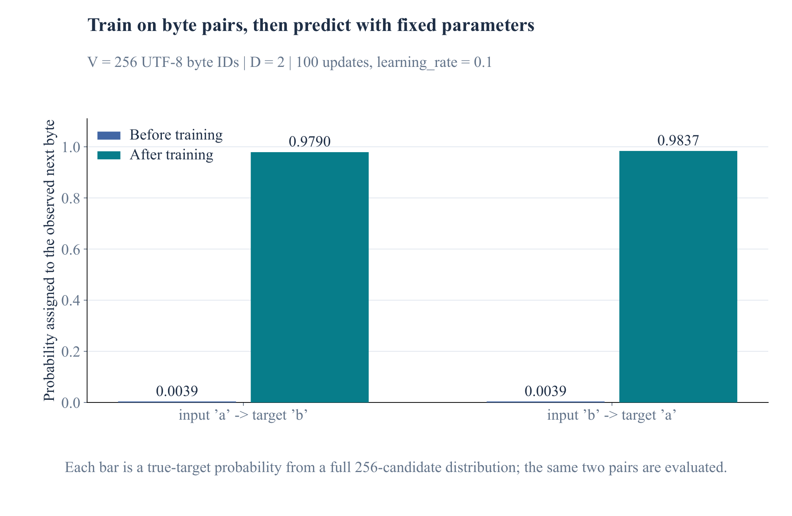{width=100%}

**Figure 03.13-2 — Inspect the trained prediction on each supplied pair.** Each bar is one target's probability from a full 256-candidate distribution, not a two-candidate normalization. Before training it is $\frac{1}{256}$; after training the fixed-parameter query assigns approximately `0.9790` or `0.9837`. Both queries evaluate the training pairs. An independent NumPy calculation reproduced these values.

### What autoregressive generation adds next

The current helper returns one ID and leaves the prompt unchanged. A generation caller can append that ID, ask again using the extended prompt, and repeat while keeping parameters fixed. In the hand-picked example:

| Prediction call | Prompt before the call | Last-row distribution, approximately | Chosen ID | Extended prompt |
| --- | --- | --- | --- | --- |
| `1` | `[0,1]` | `[0.8808,0.1192]` | `0` | `[0,1,0]` |
| `2` | `[0,1,0]` | `[0.2689,0.7311]` | `1` | `[0,1,0,1]` |
| `3` | `[0,1,0,1]` | `[0.8808,0.1192]` | `0` | `[0,1,0,1,0]` |

This is the autoregressive idea: generated output becomes part of the next input. It changes the token sequence; training changes parameter values. The generation loop and stopping budget are the completed separate assignment in [03.14](#section-03-14).

This model looks up and processes each row independently. Prompts ending in the same ID therefore give the same next distribution, even if their earlier tokens differ. To use earlier context, a model must combine the allowed prefix into the final hidden vector. Attention and Transformer layers will provide that processing later.

Greedy selection chooses the most likely next token at each step. It may miss the most likely complete sequence. Suppose first choices have probabilities $A=0.6$ and $B=0.4$. Their best continuation probabilities are `0.51` after A and `0.99` after B. Greedy chooses A, whose path probability is `0.306`; the B path has probability `0.396`. This example shows why the best immediate choice need not give the best sequence.

### Seven numbered implementation steps

Open `03_13_predict_next_token.py` and find `predict_next_token(embedding_table, context_ids, output_weights, output_bias)`. Replace only the learner placeholder after studying this trace.

1. **Enter inference scope.** At four spaces, write `with torch.no_grad():`. Its colon starts the eight-space body. Steps 2–6 go inside. Original parameter flags and gradients stay unchanged.
2. **Look up the prompt.** At eight spaces, index `embedding_table[context_ids]`, saving `selected_vectors`. Shape `[T,D]`; the example yields `[[1,2],[3,1]]`.
3. **Calculate scores.** At eight spaces, call `compute_logits(selected_vectors, output_weights, output_bias)`, saving `logits`. Shape `[T,V]`; the example yields `[[1,2],[3,1]]`.
4. **Calculate distributions.** At eight spaces, call `softmax_probabilities(logits)`, saving `probabilities`. Reuse the stable completed helper. Each row sums to one.
5. **Select the final row.** At eight spaces, save `probabilities[-1]` as `next_probabilities`. Shape becomes `[V]`; the example vector is approximately `[0.8807970780,0.1192029220]`.
6. **Choose the candidate ID.** At eight spaces, apply `.argmax()` to that vector and `.item()` to its scalar integer result, saving `next_token_id`. The example yields Python int `0`; ties choose the first candidate index.
7. **Return after the context.** At four spaces, return `next_token_id`, then `next_probabilities`. The prompt and parameters remain unchanged. A later generation caller will append chosen IDs.

All tensor construction and helper loading are supplied. Preserve the setup, driver, and earlier implementations. The new core performs inference rather than training or prompt growth.

Run from the repository root in the existing PyTorch environment:

```bash
python exercises/03_13_predict_next_token.py
```

Expected output after the learner implements the helper:

```text
PASS: worked example, last-position distribution, and Python integer selection
PASS: single/multiple positions, repeated IDs, varied shapes, and merged vocabulary IDs
PASS: stable extreme logits and deterministic first-index tie handling
PASS: unchanged parameters, prompts, gradient buffers, trainability, and caller mode
PASS: completed helpers reused under no-grad without retaining a forward graph
PASS: repeatable predictions, independent outputs, and current-token model scope
PASS: completed training loop connects to byte-level next-token inference
Lesson 03.13 checks passed.
```

### Reader questions

**Why does inference have no target IDs?** The next token is the requested prediction. A known target can be used separately to evaluate that prediction, but selecting an output does not require it.

**Why preserve existing gradients?** Prediction does not need a new gradient or parameter update. Keeping stored buffers lets the caller inspect the preceding training step; the next training call handles clearing them.

**Does an ID always decode as one character?** A vocabulary entry may contain a byte, a byte fragment, or several bytes. Accumulate entries and use the completed [BPE decoder](#section-02-06); one selected token need not be a complete UTF-8 character. The byte example's `a` and `b` are complete ASCII bytes. Merged-token IDs may exceed 255 and must not be clamped to the byte-value range.

**Does greedy selection change the learned model?** It reads the distribution and selects an ID. The supplied parameters stay fixed, and repeating the same prompt produces the same choice under this deterministic helper.

## 03.14 Autoregressive Generation {#section-03-14}

### Method sources

For autoregressive language modeling through repeated next-token prediction, see [Radford et al., 2019; R25](https://cdn.openai.com/better-language-models/language_models_are_unsupervised_multitask_learners.pdf).

To generate a sequence, append each predicted token to the input and predict again. The sequence grows, while the parameters stay fixed. We will follow each iteration and collect the IDs before decoding them together, because a token may contain only part of a character.

Work through the example before editing 03_14_autoregressive_generation.py. The numbered steps below explain the interface and guide the core implementation; the supplied setup and check driver remain separate.

### Inputs and return contract

| Exact name | Type/shape | Meaning |
| --- | --- | --- |
| `embedding_table` | Floating tensor `[V,D]` | Fixed token vectors, $E$ |
| `context_ids` | `torch.long` tensor `[T]` | Original nonempty prompt |
| `output_weights` | Floating tensor `[D,V]` | Fixed vocabulary projection, $W$ |
| `output_bias` | Floating tensor `[V]` | Fixed candidate biases, $b$ |
| `num_new_tokens` | Python integer $N\ge0$ | Exact number of newly appended IDs |
| `generated_ids` | Returned `torch.long` tensor `[T+N]` | Original prompt plus continuation |

$T$ is the original prompt length, $V$ the vocabulary size, and $D$ the vector dimension. Assume valid IDs, positive dimensions, compatible shapes/dtypes/devices, and finite forward scores; learner input validation is not assigned. The output uses the prompt's dtype/device and independent storage. Preserve the original prompt, parameter values/storage/trainability/stored gradients, and caller gradient mode.

Return one full ID tensor, not a probability vector, Python list, or tuple. Even $N=0$ returns an independent copy of the original prompt and makes zero model calls. This lesson stops after exactly $N$ new tokens. End-of-sequence (EOS) stopping, context truncation, and sampling are later topics.

### The sequence changes, parameters stay fixed

Let $x$ denote the original `context_ids` prompt, $\theta=(E,W,b)$ the parameters, and $s^{(k)}$ the complete sequence after $k$ new tokens:

$$
s^{(0)}=x,\qquad |s^{(k)}|=T+k
$$

The completed helper computes $H^{(k)}=E[s^{(k)}]$, $Z^{(k)}=H^{(k)}W+b$, and $P^{(k)}=\operatorname{softmax}(Z^{(k)})$ row by row. Select its final row and greedily choose:

$$
p^{(k)}=P^{(k)}[T+k-1,:],\qquad
v_k=\underset{0\le v<V}{\operatorname{argmax}}\;p^{(k)}_v
$$

Append this single ID, for $k=0,\ldots,N-1$:

$$
s^{(k+1)}=\operatorname{concat}(s^{(k)},[v_k]),\qquad
|s^{(k+1)}|=T+k+1,\qquad \theta\text{ stays fixed}
$$

Return $s^{(N)}$, whose length is $T+N$. Each newly selected ID becomes input to the next prediction. Pass the growing sequence to the helper each time. Passing the unchanged original prompt would repeat the same query instead of extending its output.

In this lookup-plus-head model, $p^{(k)}=\operatorname{softmax}(E_{s^{(k)}[-1]}W+b)$: only the final ID affects it. Passing the full prefix establishes the generation interface; attention will later combine information from earlier positions. This tiny model can repeat token transitions but does not yet implement contextual language understanding.

### Complete small worked trace

Use the same hand-picked arithmetic parameters as 03.13; these are not claimed to be a training result:

$$
E=\begin{bmatrix}1&2\\3&1\end{bmatrix},\quad
W=\begin{bmatrix}1&0\\0&1\end{bmatrix},\quad b=[0,0],\quad
x=[0,1],\quad T=2,\quad N=3
$$

The final row after ID `1` has scores `[3,1]`; stable softmax subtracts `3`, giving `[0,-2]`, then divides $[1,e^{-2}]$ by $1+e^{-2}$. Its probabilities are approximately `[0.8807970780,0.1192029220]`, so select ID `0`.

After ID `0`, scores are `[1,2]`; subtract `2`, giving `[-1,0]`, then divide $[e^{-1},1]$ by $e^{-1}+1$. Its probabilities are approximately `[0.2689414214,0.7310585786]`, so select ID `1`.

| Iteration $k$ / call | Current `generated_ids` | Last ID | Final-row probabilities, rounded | Selected ID | After concatenation |
| --- | --- | --- | --- | --- | --- |
| `0` / `1` | `[0,1]` | `1` | `[0.8808,0.1192]` | `0` | `[0,1,0]` |
| `1` / `2` | `[0,1,0]` | `0` | `[0.2689,0.7311]` | `1` | `[0,1,0,1]` |
| `2` / `3` | `[0,1,0,1]` | `1` | `[0.8808,0.1192]` | `0` | `[0,1,0,1,0]` |

Return `tensor([0,1,0,1,0])`, shape `[5]`. The original `context_ids` stays `[0,1]`. Three predictions produced three new IDs `[0,1,0]`, while the complete returned sequence has five IDs. For $N=1$, return `[0,1,0]`; for $N=0$, return a fresh `[0,1]` without calling prediction.

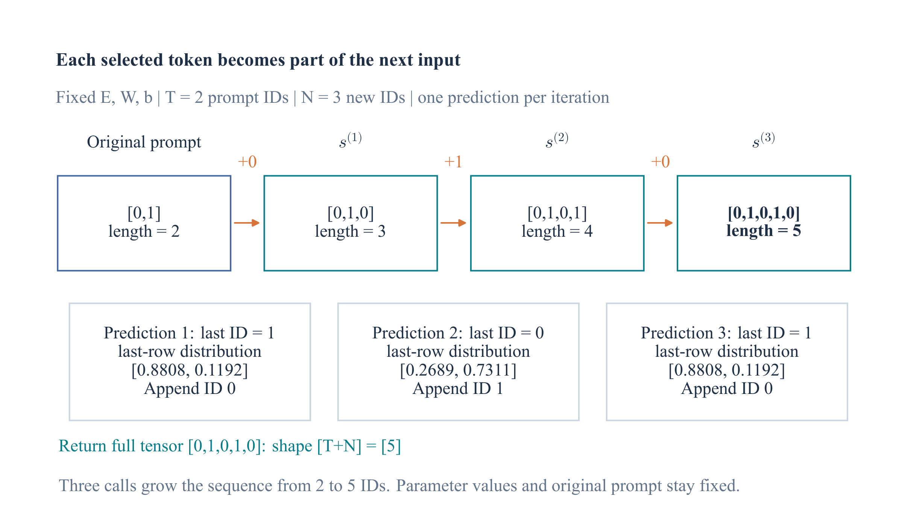{width=100%}

**Figure 03.14-1 — Read the upper boxes from left to right.** Each arrow appends one selected ID; `+0` means append ID zero, not add numeric zero to existing entries. The lower cards give the corresponding final-row distribution. Three calls increase the length from two to five, and all use the same parameter values.

### New syntax: copying and concatenating ID tensors

`generated_ids = context_ids.clone()` creates a separate tensor copy. In contrast, `generated_ids = context_ids` gives the same tensor another name. Later concatenation creates new storage, but copying first also makes the zero-budget return independent. These integer IDs do not have a gradient graph; this copy is about storage, not detaching gradients. See the [clone documentation](https://docs.pytorch.org/docs/2.0/generated/torch.clone.html).

The helper's first tuple entry is a Python integer. To join it to a one-dimensional ID sequence, make a one-dimensional tensor of length one:

```python
torch.tensor([next_token_id], dtype=generated_ids.dtype,
             device=generated_ids.device)
```

`[next_token_id]` matters: it gives shape `[1]`. A bare integer would produce a scalar tensor with shape `[]`. `dtype` is the tensor's numeric type, here `torch.long`; `device` describes where the tensor is stored. Matching both keeps the new ID compatible with the current sequence.

`torch.cat((generated_ids, next_id_tensor), dim=0)` joins the tensors along the sequence axis. The tuple supplies the two inputs, and `dim=0` is their only axis. In the first iteration, `[0,1]` followed by `[0]` becomes `[0,1,0]`. Assign the returned tensor back to `generated_ids`. The call `cat` creates a result; it does not lengthen the source in place. Addition would change values, and stacking would add an axis. See the [concatenation documentation](https://docs.pytorch.org/docs/2.0/generated/torch.cat.html).

The completed `predict_next_token` already puts the full forward under no-grad. This wrapper only handles integer sequences and calls that helper. Do not clear stored gradients, call backward, or update parameters during generation. A later training call still controls its own gradient clearing.

### Seven numbered implementation steps

After the formula and trace, open `03_14_autoregressive_generation.py`; replace only the placeholder in `generate_token_ids`.

1. **Copy the prompt.** At four spaces, use `context_ids.clone()` to initialize `generated_ids`. Expected `[0,1]`, shape `[2]`; this also defines the zero-budget result.
2. **Count new tokens.** At four spaces, write a `for` loop over `range(num_new_tokens)`. The colon starts an eight-space body for steps 3–6. `range(3)` supplies counters `0,1,2`; `range(0)` runs no iterations.
3. **Predict from the current sequence.** At eight spaces, call `predict_next_token` with `embedding_table`, `generated_ids`, `output_weights`, and `output_bias` in that order; save `prediction_result`. The second argument changes after each iteration.
4. **Take the selected ID.** At eight spaces, save `prediction_result[0]` as `next_token_id`. The helper returns `(ID, probabilities)`; index `0` selects its Python integer, first `0`, then `1`, then `0` in the example.
5. **Wrap one ID.** At eight spaces, create `next_id_tensor` using `torch.tensor` on `[next_token_id]`, with `dtype=generated_ids.dtype` and `device=generated_ids.device`. Expected shape `[1]`, first value `[0]`.
6. **Append and retain the result.** At eight spaces, concatenate `generated_ids` and `next_id_tensor` with `torch.cat((generated_ids, next_id_tensor), dim=0)`; assign its result back to `generated_ids`. The first new shape is `[3]`.
7. **Return after the loop.** Back at four spaces, return `generated_ids`. Three iterations give five total IDs; zero iterations return the copied prompt. A return inside the body would stop after the first generated token.

Keep the setup and driver unchanged. You write this loop; decoder loading and text checks are supplied. Run from the project root in the existing environment:

```bash
python exercises/03_14_autoregressive_generation.py
```

Expected output after implementation:

```text
PASS: worked trace, full prompt-plus-continuation tensor, and original prompt preservation
PASS: zero/one/multiple-token budgets, varied shapes, repeated IDs, and noncontiguous prompts
PASS: exactly one completed-helper call per new token with the full growing prefix
PASS: fixed parameters, stored gradient objects/values, trainability, and caller mode
PASS: vocabulary IDs above 255 remain IDs and decode through the matching byte vocabulary
PASS: repeatable independent outputs, continued calls, and accumulated UTF-8 decoding
PASS: completed training -> fixed-parameter generation -> matching decoder: abababa
Lesson 03.14 checks passed.
```

### Connecting accumulated IDs to the completed decoder

Generation returns IDs. The caller uses `generated_ids.tolist()` to supply the Python list expected by [02.06's decoder](#section-02-06), together with the vocabulary matching the model's IDs. Look up each token's byte contents, join them in order, then decode the combined bytes. Do not assume every token is one byte or convert every ID directly with `bytes([ID])`.

The supplied merged-ID example uses an illustrative vocabulary with `vocab[256]=b"ab"`. IDs `[97,256,256]` decode to `aabab`: three tokens, five ASCII characters. This separately tests ID preservation above 255; it is not the trained raw-byte example below.

For a raw-byte vocabulary, `中` is bytes `[228,184,173]`, hexadecimal `E4 B8 AD`. `[228,184]` is an incomplete prefix and strict decoding raises `UnicodeDecodeError`; after adding `173`, the full sequence decodes to one character. A budget counts tokens and can stop within a character. Keep the accumulated IDs; byte-safe streaming and policies for unfinished output follow later. Do not silently change the completed strict decoder or claim all generated byte sequences are valid UTF-8.

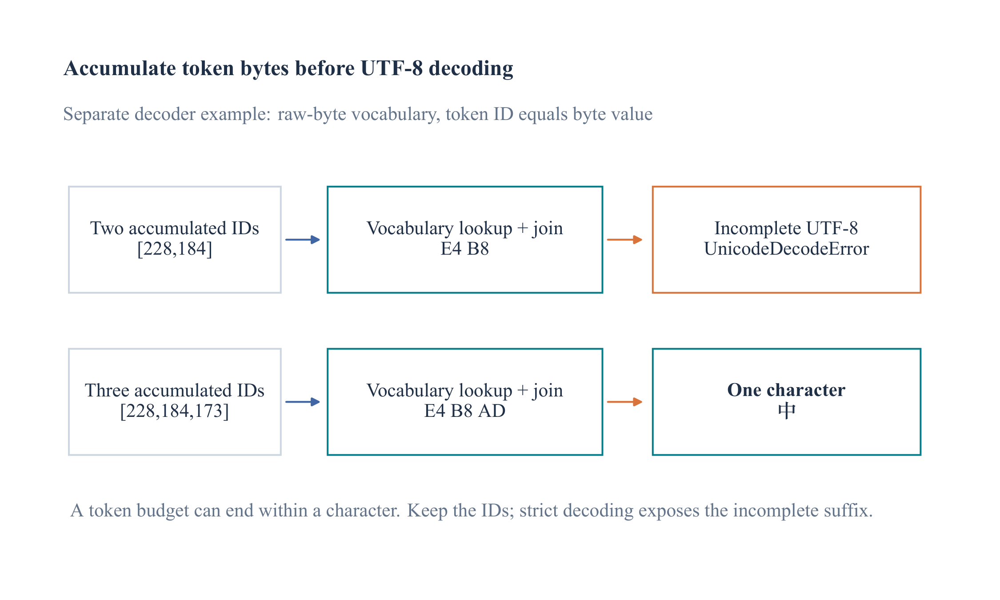{width=100%}

**Figure 03.14-2 — Follow each row from IDs to joined bytes to text.** This is a separate decoder illustration, not generated Chinese capability. The upper row exposes the incomplete suffix; the lower row supplies the full encoding of `中`. Decimal ID labels and hexadecimal byte labels describe the same values.

### Verified training-to-generation bridge and its scope

| Item | Portable specification |
| --- | --- |
| Completed training/inference helper code | 03.12–03.14 companion interfaces |
| Data / tokenizer versions | `synthetic-byte-aba-v1` / `utf8-byte-256-v1` |
| Training pairs | Inputs `[97,98]`, targets `[98,97]`: $\texttt{a}\to\texttt{b}$, $\texttt{b}\to\texttt{a}$ |
| Shapes / initialization | $V=256,D=2,T=2$; table zeros except rows 97 `[1,2]`, 98 `[3,1]`; weights and bias zero |
| Training budget | Plain gradient descent, learning rate `0.1`, 100 updates, 200 supervised-position uses |
| Evaluation protocol | Same-pair synthetic verification; prompt `[97]`, six greedy predictions, parameters fixed |
| Returned IDs / decoded text | `[97,98,97,98,97,98,97]` / `abababa` |

The [03.13 record](#section-03-13) retains the mean-loss and target-probability measurements for this initialization/budget. This continuation verifies the training → prediction → generation → decoder connection. It demonstrates two learned byte transitions on reused synthetic data; it is not held-out language capability evidence. No weights or raw execution logs are stored.

### Reader questions, evidence, and next topics

**Does one call predict three tokens?** Each helper call selects one. Three loop iterations make three calls, with prompt lengths two, three, and four before prediction in the worked example.

**Does repeating generation teach the model?** It grows the input sequence. The parameters, stored gradients, and trainability stay fixed; training changes parameters using observed targets and losses.

**Why return the prompt too?** The full sequence is convenient for continued calls and decoding. If only new IDs are needed, the caller can take `generated_ids[context_ids.numel():]`; the exercise still returns the full tensor.

**Why is the sample repetitive?** This toy learns current-token transitions and uses deterministic greedy choices. It lacks attention over earlier context; varying selection or improving the model/data changes different parts of this pipeline.

**Why does a local tensor name match the function name without breaking calls?** Assignment binds that name locally inside the function; the module-level name still refers to the function, so outside callers can invoke it normally. This loop does not need a recursive call. A distinct local name such as `generated_ids` makes the tensor's role clearer, but the valid implementation is preserved.

[03.15](#section-03-15) introduces another way to select a token: adjust the distribution with temperature, then sample from it. [03.16](#section-03-16) puts that choice into this generation loop. EOS stopping in 03.17 and continuation decoding in 03.18 then complete the output path. [03.19](#section-03-19) returns to training with several windows per batch, and [03.20](#section-03-20) carries those batch axes through scores and loss.

## 03.15 Temperature and Sampling {#section-03-15}

Greedy selection always chooses a token with the highest probability. Sampling instead draws a token according to the whole distribution. Before sampling, temperature can make that distribution more concentrated or more even. We will treat changing probabilities and drawing an ID as separate operations, then track the random stream used for the draws.

Work through the example before editing 03_15_temperature_and_sampling.py. The numbered steps below explain the interface and guide the core implementation; the supplied setup and check driver remain separate.

### Stage A inputs, symbols, and output

| Name/symbol | Type/shape | Meaning |
| --- | --- | --- |
| `logits`, $Z$ | Floating tensor `[T,V]` | Scores for each position and candidate |
| `temperature`, $\tau$ | Positive finite Python float | Scale applied before softmax |
| `scaled_logits` | Floating tensor `[T,V]` | Scores divided by temperature |
| `probabilities`, $P^{(\tau)}$ | Returned floating tensor `[T,V]` | Normalized candidate distribution per row |

$T$ still counts positions and $V$ counts vocabulary candidates. Use $\tau$ for temperature to avoid confusing it with $T$. Assume $T,V>0$, finite logits, and finite scaled logits; learner input validation is not assigned. Preserve input values, dtype/device, stored gradients, and the autograd connection, as in the completed 03.09 mathematical helper. The later inference caller controls no-grad scope.

### Temperature scales logits before normalization

$$
P^{(\tau)}_{t,v}=
\frac{\exp(Z_{t,v}/\tau)}{\sum_{j=0}^{V-1}\exp(Z_{t,j}/\tau)},\qquad \tau>0
$$

Compute `scaled_logits = logits / temperature`, then reuse `softmax_probabilities`. The helper already subtracts each scaled row's maximum before exponentiating. Divide the **logits before softmax**, rather than dividing probabilities afterward: the denominator must normalize the adjusted exponential scores.

The relative probabilities of two candidates explain the effect:

$$
\frac{P^{(\tau)}_{t,a}}{P^{(\tau)}_{t,b}}
=\exp\!\left(\frac{Z_{t,a}-Z_{t,b}}{\tau}\right)
$$

For a positive score gap, a smaller $\tau$ enlarges the scaled gap and gives the higher score more probability. A larger $\tau$ narrows it and makes the probabilities more even. At $\tau=1$, softmax is unchanged. Dividing by a positive number preserves ordering in exact arithmetic, so greedy argmax still picks the same winner with the same ties. Temperature changes how often candidates are sampled; it does not make argmax random.

As $\tau$ approaches zero from above, probability concentrates on the maximum scores. A unique maximum approaches probability one; tied maxima share the probability. As $\tau$ grows without bound, finite-score candidates approach equal probability $1/V$. These limits do not permit division by zero. This exercise requires positive temperature. A later caller may handle zero temperature with a separate greedy branch. Extreme scaling can still produce numerical zeros or ties through rounding.

### Complete temperature calculation

Use the hand-picked two-position tensor `logits=[[3,1],[1,3]]`, with $T=2,V=2$. These are arithmetic inputs, not a training result. For `temperature=0.5`:

```text
scaled_logits = [[6,2],[2,6]]
row_max = [[6],[6]]
shifted_logits = [[0,-4],[-4,0]]
exp_scores = [[1,0.0183156389],[0.0183156389,1]]
row_sums = [[1.0183156389],[1.0183156389]]
probabilities = [[0.9820137900,0.0179862100],
                 [0.0179862100,0.9820137900]]
```

The first row's candidate-zero probability is:

$$
p_0^{(\tau)}=\frac{e^{3/\tau}}{e^{3/\tau}+e^{1/\tau}}
=\frac{1}{1+e^{-2/\tau}}
$$

| Temperature | First scaled row | ID 0 probability | ID 1 probability | Greedy ID |
| --- | --- | --- | --- | --- |
| `0.5` | `[6,2]` | `0.9820137900` | `0.0179862100` | `0` |
| `1` | `[3,1]` | `0.8807970780` | `0.1192029220` | `0` |
| `2` | `[1.5,0.5]` | `0.7310585786` | `0.2689414214` | `0` |

The second row reverses those probabilities and favors ID `1` at all three settings. Return all position rows, shape `[2,2]`; the later inference caller chooses the final row. Lower temperature does not train different parameter values, and higher temperature does not guarantee better text quality.

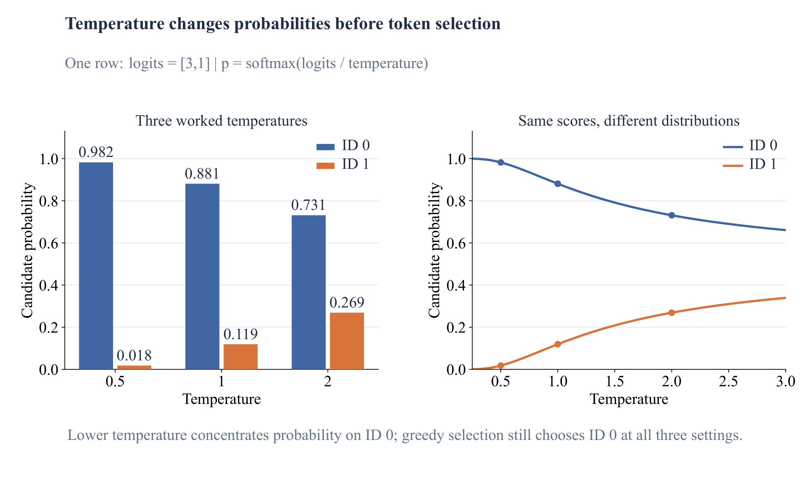{width=100%}

**Figure 03.15-1 — Read the horizontal axis as temperature and the vertical axis as probability.** Blue is candidate ID zero, orange ID one. Bars show the three table settings; curve points mark the same values. The scores `[3,1]` stay fixed. Blue stays higher, explaining why argmax alone selects ID zero throughout.

Optional autograd review: temperature is fixed during differentiation. The chain rule gives $\partial P_{t,a}/\partial Z_{t,b}=(1/\tau)P_{t,a}(\delta_{ab}-P_{t,b})$, where $\delta_{ab}$ is one for equal indices and zero otherwise. The supplied check uses this analytic derivative to verify that Stage A remains connected. A mathematical probability helper preserves the graph; an inference wrapper places the full forward under no-grad, as in 03.13.

### Stage B: sample one ID from one probability row

`sample_token_id(probabilities, generator)` accepts a floating tensor `[V]`, a single normalized candidate distribution, and a caller-supplied `torch.Generator`. Assume finite nonnegative entries with positive sum, and a compatible generator device on a supported backend. Return one Python integer in `[0,V)`. Preserve probability values/storage/trainability/stored gradients and caller gradient mode. The supplied generator's state advances for this draw; the global random stream remains unchanged.

Let $X$ denote the sampled token ID. The symbol $\sim$ means “is drawn from”; $\operatorname{Categorical}(p)$ is the discrete distribution over IDs with probabilities $p_v$:

$$
X\sim\operatorname{Categorical}(p),\qquad
\Pr(X=v)=p_v
$$

Compare greedy and sampling on the separate three-candidate example `probabilities=[0.6,0.3,0.1]`. Greedy chooses ID `0` every time. Sampling chooses ID `0`, `1`, or `2` with probabilities `0.6`, `0.3`, and `0.1`. Larger probability means a higher chance, not certainty. Adjacent samples may repeat; a single sample does not estimate the frequency.

A complete probability illustration divides a unit interval:

| Region for a hypothetical uniform draw $u$ | Selected ID | Region length |
| --- | --- | --- |
| $0\le u<0.6$ | `0` | `0.6` |
| $0.6\le u<0.9$ | `1` | `0.3` |
| $0.9\le u<1$ | `2` | `0.1` |

Thus $u=0.2$ illustrates ID `0`, $u=0.75$ ID `1`, and $u=0.95$ ID `2`. The ID-one example shows a valid sample that is not argmax. These numbers explain the distribution; they do not claim that PyTorch implements this diagram literally or that a particular seed produces those draws.

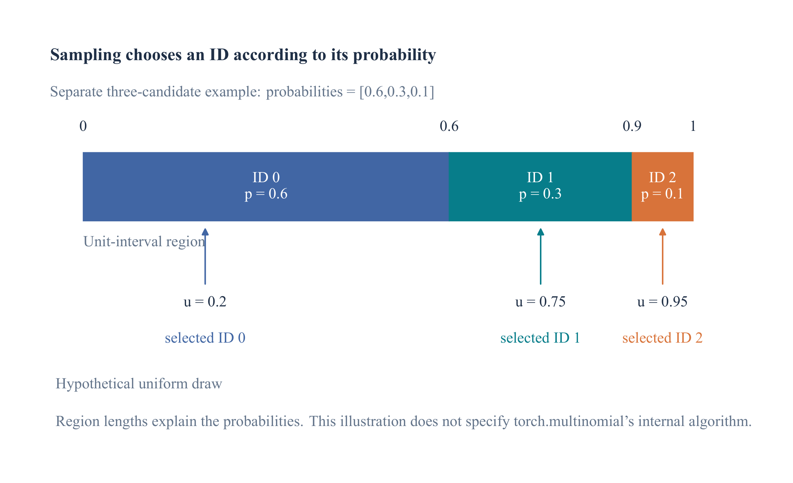{width=100%}

**Figure 03.15-2 — Region widths equal candidate probabilities.** Arrows mark three hypothetical draws in the three regions. This is a separate `[3]` probability example, not the two-candidate temperature calculation.

Call `torch.multinomial(probabilities, num_samples=1, generator=generator)` to draw one ID. With input `[V]`, the result is a `[1]` integer tensor holding the sampled index. Read that index with `.item()`. This exercise supplies normalized probabilities, although the API also accepts unnormalized nonnegative weights. Repeated calls may select the same ID. The default `replacement=False` only controls multiple draws within one call. See the [multinomial documentation](https://docs.pytorch.org/docs/2.0/generated/torch.multinomial.html).

### Seed once, then reuse the random stream

A generator stores pseudorandom state. The supplied setup creates it and calls `.manual_seed(seed)` once; each sampling call consumes the continuing stream. Passing `generator=generator` selects that stream. Do not reseed inside `sample_token_id`, create a replacement generator, or change global randomness. [Generator documentation](https://docs.pytorch.org/docs/2.0/generated/torch.Generator.html).

Two generators can reproduce the same stream when they start from the same state and receive the same inputs and calls in a compatible runtime. Continuing a stream can still produce repeated IDs. Reseeding each call would restart it. Exact sequences can differ across library versions or backends. The checks compare draws with a reference in the same runtime, then separately check many-draw frequencies with allowance for sampling variation.

### Implementation plan: two small stages

All core statements use four spaces. Neither helper needs a loop; repetition belongs to generation. Keep the supplied loader and driver intact.

1. **A1 — Scale the scores.** In `temperature_probabilities`, divide `logits` by `temperature`, saving `scaled_logits`. Shape remains `[T,V]`; at `0.5`, the example becomes `[[6,2],[2,6]]`. Use a new result and preserve the original input.
2. **A2 — Reuse normalization.** Call `softmax_probabilities(scaled_logits)` and save `probabilities`. The loaded completed function handles stable row-wise normalization; first row becomes approximately `[0.9820,0.0180]`.
3. **A3 — Return the tensor.** Return `probabilities`, keeping its graph, dtype/device, and `[T,V]` shape. Do not use `.item()` or no-grad in this mathematical helper. Check Stage A before continuing.
4. **B1 — Draw one candidate.** In `sample_token_id`, call `torch.multinomial` with `probabilities`, `num_samples=1`, and `generator=generator`; save `sampled_ids`. Its shape is `[1]`. Select by probability, not argmax.
5. **B2 — Extract the ID.** Use `sampled_ids.item()` to obtain `next_token_id`, a Python integer. It is an index, not the chosen probability value.
6. **B3 — Return the integer.** Return `next_token_id`. Probability inputs stay fixed and the supplied stream advances. Do not seed inside the function.

Run from the project root in the existing environment, in this order:

```bash
python exercises/03_15_temperature_and_sampling.py --check temperature
python exercises/03_15_temperature_and_sampling.py --check sample
python exercises/03_15_temperature_and_sampling.py --check all
```

The individual commands end with `Lesson 03.15 temperature checks passed.` and `Lesson 03.15 sample checks passed.`. With both stages implemented, the full output is:

```text
PASS: temperature worked example, row-wise normalization, and unchanged greedy ordering
PASS: positive temperatures, extreme/tied scores, varied shapes/dtypes, and shift invariance
PASS: completed stable helper reused with connected analytic gradients and preserved inputs/buffers
PASS: Python ID return, zero-probability exclusion, merged IDs, and input/gradient/mode preservation
PASS: supplied random stream matches one categorical draw per call without global RNG changes
PASS: reproducible caller-seeded streams and many-draw frequencies consistent with probabilities
PASS: fixed-parameter logits -> temperature -> last row -> sampling -> growing-prefix pipeline
Lesson 03.15 checks passed.
```

### Connection, reader questions, and evidence

The supplied final check uses hand-picked `E=[[1,2],[3,1]]`, the two-by-two identity matrix $W$ (ones on the main diagonal and zeros elsewhere), zero `b`, prompt `[0,1]`, temperature `2`, six new IDs, and generator seed `137`. A caller places lookup/projection/temperature under no-grad, selects the final probability row, samples one ID, and appends it. It matches a reference stream, produces eight total IDs, and preserves parameters. The original greedy predictor and generation loop stay intact; the completed [03.16](#section-03-16) connects sampled generation, followed by EOS stopping in 03.17 and continuation decoding in 03.18.

**Why not divide probabilities by temperature?** That does not implement the exponential score scaling or, by itself, preserve a sum of one. Temperature acts before softmax.

**Can sampling choose a zero-probability token?** No. A smaller positive probability can be selected; zero probability cannot. Merged token IDs above 255 remain vocabulary indices.

**Is random selection uniform?** Uniform sampling gives equal chances. Here chances follow the supplied distribution. Higher temperature makes the distribution flatter, but finite-temperature sampling is not generally uniform.

**Does this improve what the model knows?** Parameters stay fixed. Selection changes how a distribution is used; contextual architecture, data, and training determine different parts of model behavior.

## 03.16 Sampled Autoregressive Generation {#section-03-16}

We can now sample the next ID instead of taking the greedy choice. Keep the same loop: predict from the current sequence, select one ID, and append it. Reuse the same random generator across steps. Each new ID tensor must match the sequence's type and device.

Work through the example before editing 03_16_sampled_generation.py. The numbered steps below explain the interface and guide the core implementation; the supplied setup and check driver remain separate.

### Exact inputs and returned values

| Name | Type/shape | Meaning |
| --- | --- | --- |
| `embedding_table`, $E$ | Floating tensor `[V,D]` | Fixed token vectors |
| `context_ids`, $x$ | `torch.long` tensor `[T]` | Original nonempty prompt |
| `output_weights`, $W$ | Floating tensor `[D,V]` | Fixed vocabulary projection |
| `output_bias`, $b$ | Floating tensor `[V]` | Fixed candidate biases |
| `num_new_tokens`, $N$ | Python integer $N\ge0$ | Exact number of newly appended IDs |
| `temperature`, $\tau$ | Positive finite Python float | Logit scaling before softmax |
| `generator` | Caller-owned `torch.Generator` | Already seeded pseudorandom stream |
| `generated_ids` | Returned `torch.long` tensor `[T+N]` | Prompt plus sampled continuation |

$T$ is prompt length, $V$ vocabulary size, and $D$ vector dimension. Assume valid IDs, compatible shapes, dtypes and devices and supported generator, and finite logits/scaled logits; input validation is not assigned. Return a fresh full ID tensor on the prompt's device, including the original prompt. Preserve original prompt values and parameter values/storage/trainability/stored gradients, caller gradient mode, and global random stream. The supplied generator advances through one completed sampler call per new ID.

For $N=0$, return an independent prompt copy without any projection, temperature, or sampling calls and without consuming the generator state. The positive-temperature formula applies here; no zero-temperature branch, EOS stop, or context truncation is added. The caller still decodes IDs through the matching tokenizer vocabulary.

### Sampling inside the recurrence

Let $s^{(k)}$ be the full sequence after $k$ generated IDs, with $s^{(0)}=x$ and $|s^{(k)}|=T+k$. For each $k=0,\ldots,N-1$:

$$
H^{(k)}=E[s^{(k)}],\qquad Z^{(k)}=H^{(k)}W+b
$$

The temperature helper normalizes vocabulary columns independently per position:

$$
P^{(k)}_{t,v}=\frac{\exp(Z^{(k)}_{t,v}/\tau)}
{\sum_{j=0}^{V-1}\exp(Z^{(k)}_{t,j}/\tau)},\qquad
p^{(k)}=P^{(k)}[T+k-1,:]
$$

Sample one ID, then feed that output back into the next input:

$$
v_k\sim\operatorname{Categorical}(p^{(k)}),\qquad
s^{(k+1)}=\operatorname{concat}(s^{(k)},[v_k])
$$

Return $s^{(N)}$, length $T+N$. The ID sequence and random-stream state change; $E,W,b$ and the temperature remain fixed. The same supplied generator is passed onward instead of being reset each iteration.

`compute_logits` returns scores with shape `[T+k,V]`. The helper `temperature_probabilities` keeps that shape. Selecting `probabilities[-1]` gives one distribution `[V]`, and `sample_token_id` draws a Python integer from it. Wrap the ID in a `[1]` tensor and append it to the sequence. Each cycle adds one token; three new tokens require three cycles.

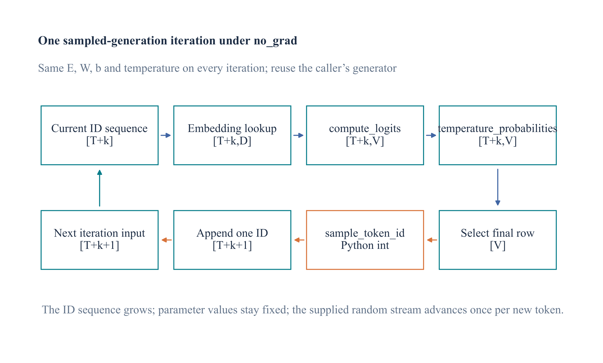{width=100%}

**Figure 03.16-1 — Follow the upper row rightward, then the lower row leftward.** The left upward arrow enters the next iteration, whose index is now $k+1$; its length is the previous $T+k+1$. Only the final distribution is sampled. Orange marks the ID selection; parameter values stay fixed throughout.

The current lookup-plus-head model still uses only the last input ID for its next distribution. Passing the growing full prefix establishes the interface; contextual attention follows later. Stochastic output does not itself add contextual understanding or train new knowledge.

### Complete worked example with hypothetical choices

Reuse the hand-picked arithmetic model from Lesson 03.13:

$$
E=\begin{bmatrix}1&2\\3&1\end{bmatrix},\quad
W=\begin{bmatrix}1&0\\0&1\end{bmatrix},\quad b=[0,0],\quad
x=[0,1],\quad T=2,\quad \tau=2,\quad N=3
$$

The first forward has `selected_vectors=[[1,2],[3,1]]`; the logits have those same values because $W$ is identity and `b` is zero. Temperature scaling gives `[[0.5,1],[1.5,0.5]]`. Its final row subtracts `1.5`, yielding `[0,-1]`; exponentials $[1,e^{-1}]$ normalize to:

$$
p^{(0)}\approx[0.7310585786,0.2689414214]
$$

For an illustrative unit-interval draw $u=0.2$, choose ID `0` and append it, producing `[0,1,0]`. The next final ID is zero, so its scores are `[1,2]`; after scaling and stable subtraction they become `[-0.5,0]`, with exponentials $[e^{-0.5},1]$:

$$
p^{(1)}\approx[0.3775406688,0.6224593312]
$$

An illustrative $u=0.3$ lies below the first cumulative boundary `0.3775`, so choose ID `0` again, even though ID `1` has larger probability. This produces `[0,1,0,0]`. With the same final ID, the next distribution is unchanged; illustrative $u=0.8$ selects ID `1`.

| Call | Current sequence | Final-row probabilities, rounded | Illustrative $u$ | Sampled ID | Extended sequence |
| --- | --- | --- | --- | --- | --- |
| `1` | `[0,1]` | `[0.7311,0.2689]` | `0.2` | `0` | `[0,1,0]` |
| `2` | `[0,1,0]` | `[0.3775,0.6225]` | `0.3` | `0` | `[0,1,0,0]` |
| `3` | `[0,1,0,0]` | `[0.3775,0.6225]` | `0.8` | `1` | `[0,1,0,0,1]` |

Return `tensor([0,1,0,0,1])`, shape `[5]`, **for these hypothetical choices**. They explain recurrence and valid non-greedy selection, not a promised PyTorch seed trace or its internal algorithm. The real sampler consumes the caller's generator. The supplied checks separately compare actual draws and final generator state with a same-runtime reference.

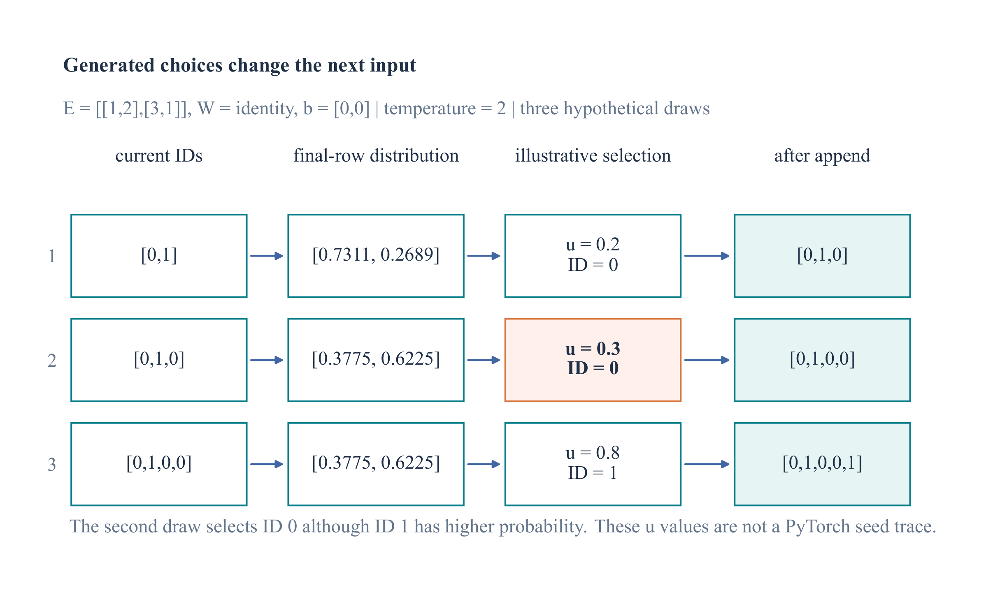{width=100%}

**Figure 03.16-2 — Each rightmost sequence becomes the next row's input.** The orange second choice is valid because ID zero has positive probability. It changes the next input, and thus which scores the next call uses. A greedy trajectory for this model would instead return `[0,1,0,1,0]`; the third-call inputs of those two trajectories differ.

### Full no-grad scope and nested indentation

The temperature helper from 03.15 normally preserves the gradient graph. Here, put lookup, projection, and temperature calculation inside `torch.no_grad()` because generation needs no backward pass. The block leaves parameter flags, stored gradients, and weights unchanged. On exit, it restores the caller's previous gradient mode. See the [no-grad documentation](https://docs.pytorch.org/docs/2.0/generated/torch.no_grad.html).

There are two nested blocks: the no-grad context contains the loop, and the loop contains its operations. Each block adds four spaces:

| Indentation | Location | Statements |
| --- | --- | --- |
| Four spaces | Function body | Copy prompt; enter no-grad; final return |
| Eight spaces | Inside no-grad | `for step in range(num_new_tokens):` |
| Twelve spaces | Inside context and loop | Lookup, scores, probabilities, final row, sample, tensor creation, append |

The colon after `with` opens the temporary gradient context. The colon after `for` opens the repeated loop body. Return at four spaces after both blocks. Returning inside the loop would stop after the first token. Detaching only at the end would still record unnecessary graphs during the forward calculations.

### Ten guided implementation steps for review

Do these after finishing 03.15 and reviewing the formula and complete trace. Replace only the core placeholder in `generate_sampled_ids`; preserve setup, driver, and earlier implementations.

1. **Copy the prompt.** Four spaces: initialize `generated_ids` using `context_ids.clone()`. First shape `[2]`, values `[0,1]`; it also handles the zero-budget result.
2. **Enter inference scope.** Four spaces: write `with torch.no_grad():`. All iterations go inside this context.
3. **Count newly generated IDs.** Eight spaces: loop over `range(num_new_tokens)`. Steps 4–9 are at twelve spaces, inside both blocks. For three new tokens, the counter visits `0,1,2`.
4. **Lookup the current sequence.** Twelve spaces: obtain `selected_vectors` from `embedding_table[generated_ids]`. First shape `[2,2]`, then `[3,2]`, then `[4,2]` in the example.
5. **Compute scores.** Twelve spaces: call `compute_logits(selected_vectors, output_weights, output_bias)`, saving `logits`. Shape `[T+k,V]`; first final row `[3,1]`.
6. **Apply the supplied temperature.** Twelve spaces: call `temperature_probabilities(logits, temperature)`, saving `probabilities`. Reuse the completed helper; first final row approximately `[0.7311,0.2689]`.
7. **Select the next distribution.** Twelve spaces: save `probabilities[-1]` as `next_probabilities`, shape `[V]`.
8. **Sample one ID.** Twelve spaces: call `sample_token_id(next_probabilities, generator)`, saving `next_token_id`. Pass the same generator each time, without reseeding or replacing it.
9. **Wrap and append the ID.** Twelve spaces: create `next_id_tensor` using `torch.tensor([next_token_id], dtype=generated_ids.dtype, device=generated_ids.device)`. Then concatenate with `torch.cat((generated_ids, next_id_tensor), dim=0)` and assign its new tensor back to `generated_ids`. First extended shape `[3]`.
10. **Return after both blocks.** Four spaces: return `generated_ids`, shape `[T+N]`. For the illustrative choices it is `[0,1,0,0,1]`; for zero budget it is a fresh `[0,1]` with no helper calls or random draws.

The caller supplies a generator and seeds it before generation. Successive draws may repeat. To continue, pass the returned sequence and the same continuing generator to another call. With the same initial state, inputs, policy, and compatible runtime, this should match one longer call. Reseeding each iteration would restart the stream. See the [generator documentation](https://docs.pytorch.org/docs/2.0/generated/torch.Generator.html).

After the current formula/example walkthrough and implementation, run from the project root:

```bash
python exercises/03_16_sampled_generation.py
```

Expected output after implementation:

```text
PASS: worked recurrence with scripted valid choices, including a non-greedy selection
PASS: positive temperatures, exact budgets, varied shapes/prompts, and reference random streams
PASS: completed helpers reused once per token in order under full no-grad with growing prefixes
PASS: fixed parameters, stored gradients, original prompts, global RNG, and caller-mode preservation
PASS: zero budget returns an independent prompt without forward calls or random-state consumption
PASS: same-state replay and continued calls agree with one longer call while outputs stay independent
PASS: single-candidate generation and merged IDs decoded through the matching vocabulary
Lesson 03.16 checks passed.
```

### Reader questions

**Why not call the completed greedy predictor?** Its selection rule is argmax. This wrapper needs the completed score and temperature helpers followed by the sampling helper; keep the earlier greedy path intact.

**Does one sampler call return all future tokens?** It selects one ID. The generation loop makes exactly $N$ calls, growing the prefix once per call.

**Does the caller's seed specify the hypothetical u values above?** No. Those numbers explain valid choices. Real sample traces depend on the generator state, inputs, call order, and runtime; the tests use a matching reference rather than a cross-version promised list.

**How is the result displayed as text?** Use the matching byte vocabulary and [02.06 decoder](#section-02-06) on accumulated IDs. The supplied illustrative merged vocabulary maps ID `256` to `b"ab"`; IDs `[97,256,256]` decode to `aabab`. Tokens can span multiple bytes, and a token budget can stop inside a UTF-8 character; strict decoding behavior remains unchanged.

This loop always uses the full requested token budget. [03.17](#section-03-17) changes that rule: a newly sampled EOS may stop generation early, while a maximum new-token limit still bounds the work if EOS never appears.


## 03.17 EOS and Generation Stopping {#section-03-17}

Generation needs a stopping rule. A maximum token count bounds the work. A newly generated end-of-sequence marker, EOS, can stop it sooner. We will check both conditions and keep the EOS in the returned IDs so the caller can inspect what ended generation.

Work through the example before editing 03_17_generation_stopping.py. The numbered steps below explain the interface and guide the core implementation; the supplied setup and check driver remain separate.

### Inputs, outputs, and the chosen policy

| Exact name | Type/shape | Meaning |
| --- | --- | --- |
| `embedding_table` | Floating tensor `[V,D]` | Fixed token vectors |
| `context_ids` | `torch.long` tensor `[T]` | Original nonempty prompt |
| `output_weights` | Floating tensor `[D,V]` | Fixed vocabulary projection |
| `output_bias` | Floating tensor `[V]` | Fixed candidate biases |
| `max_new_tokens` | Python integer $M\ge0$ | Maximum number of newly appended IDs |
| `temperature` | Positive finite Python float | Sampling temperature passed to 03.16 |
| `generator` | Caller-owned `torch.Generator` | Continuing random stream |
| `eos_token_id` | Python `int` in `[0,V)`, or `None` | Configured stop marker, or disabled stopping |

Assume valid IDs, compatible shapes/dtypes/devices/generator, and finite scores/scaled scores. Input validation is not assigned. Return `(generated_ids, stop_reason)`:

- `generated_ids`: fresh `torch.long` tensor `[T+L]`, including the original prompt and any generated EOS, where $0\le L\le M$.
- `stop_reason`: Python string `"eos"` when a newly generated EOS ends the loop; otherwise `"length"` when the maximum budget is exhausted.

Preserve original prompt values, parameter values/storage/trainability/stored gradients, caller gradient mode, and global randomness. Pass the same supplied generator through each one-token helper call. Stop without another draw once EOS has been appended. With zero budget, return an independent prompt copy and `"length"`, with zero helper calls and unchanged generator state.

Only **newly generated** IDs trigger EOS stopping here. An EOS already in the prompt does not stop the continuation, even if it is the final prompt ID. If a new EOS appears on the last allowed draw, return reason `"eos"`. That event takes priority over reaching the length limit.

### Actual length is bounded by two stopping events

Let $v_0,v_1,\ldots$ denote the new IDs that would be sampled using the same continuing policy. Let $e$ be the configured EOS. Define the first new EOS position, counted from one:

$$
K=\inf\{k+1\mid k\ge0,\;v_k=e\}
$$

The $\inf$ notation selects the smallest matching positive position here. Take $K=\infty$ if EOS is disabled (`None`) or there is no new EOS. With maximum budget $M$:

$$
L=\min(M,K),\qquad |\mathrm{generated\_ids}|=T+L
$$

The stopping reason is:

$$
r=\begin{cases}
\text{eos},&K\le M\\
\text{length},&K>M
\end{cases}
$$

Here $T$ is original prompt length, $M$ is the maximum number of new tokens, and $L$ is the actual number generated, including EOS if it ends the output. The maximum does not count existing prompt tokens. For zero budget, no new ID is drawn, so $L=0$ and reason is `"length"`.

The recurrence still appends before checking:

$$
s^{(k+1)}=\operatorname{concat}(s^{(k)},[v_k])
$$

This retains the selected EOS in the returned IDs and makes the stop event inspectable. Text-display policy can then handle the control marker separately.

### What an EOS ID means

EOS is a special control token whose meaning is defined by the tokenizer/model protocol. It is not a universal numeric ID or a UTF-8 end byte. The small example below defines `0 -> a`, `1 -> b`, `2 -> EOS`; this differs from the raw-byte vocabulary where ID `2` represents byte value `2`.

For a contiguous vocabulary $0,\ldots,V_{\mathrm{old}}-1$, one way to add EOS is to reserve the unused ID $V_{\mathrm{old}}$. The candidate count then becomes $V_{\mathrm{old}}+1$. Add a row to the embedding table, a column to the output weights, and a bias entry. Training examples must make EOS the target at the intended sequence boundary. Do not reuse an existing merged-token ID. A stopping rule alone does not teach the model when to emit EOS.

The existing educational BPE byte dictionaries do not yet implement a complete special-token serialization/segmentation policy. This assignment supplies an explicit illustrative EOS configuration; general tokenizer integration remains later work. The decoder stays strict and receives ordinary token byte mappings after the caller handles the special marker.

### Complete small worked example

Use a hand-picked, three-candidate model with vocabulary `illustrative-ab-eos-v1`:

$$
E=\begin{bmatrix}1&0\\0&1\\0&0\end{bmatrix},\quad
W=\begin{bmatrix}0&1000&0\\0&0&1000\end{bmatrix},\quad
b=[0,0,0],\quad x=[0],\quad M=5,\quad\tau=1,\quad e=2
$$

Input ID zero selects vector `[1,0]`. Its scores are `[0,1000,0]`; stable subtraction gives `[-1000,0,-1000]`. In the supplied `float64` computation, the small exponentials underflow to zero, producing `[0,1,0]`, so the first draw selects ID `1`.

Input ID one selects vector `[0,1]`. Scores are `[0,0,1000]`, with shifted values `[-1000,-1000,0]`. Computed probabilities become `[0,0,1]`, selecting EOS ID `2`. These exact computed one-hot rows force a test path; mathematically the tiny exponentials are positive. The parameters are not reported as a training outcome.

| Helper call | Prompt before call | Requested new IDs | Newly appended ID | Full sequence | Action |
| --- | --- | --- | --- | --- | --- |
| `1` | `[0]` | `1` | `1` | `[0,1]` | Continue: new ID is not EOS |
| `2` | `[0,1]` | `1` | `2` | `[0,1,2]` | Set reason to `"eos"`, then break |
| `3–5` | — | — | — | — | Never called |

Return `(tensor([0,1,2]), "eos")`. Here $T=1$, $K=2$, $L=\min(5,2)=2$, and total length is `3`. The EOS ID is included. Ordinary display IDs `[0,1]` decode to `ab` through `{0:b"a",1:b"b"}` after the caller separates the final marker.

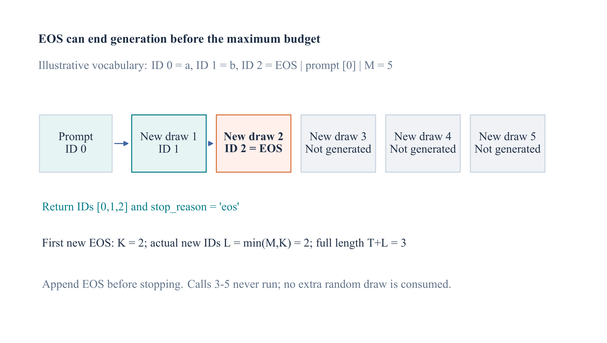{width=100%}

**Figure 03.17-1 — Count the generated boxes, not the maximum slots.** Orange is the newly appended EOS. Gray slots are unused budget and do not consume helper calls or randomness. The original prompt contributes one more returned ID.

| Setting on the same forced path | Actual result | Reason |
| --- | --- | --- |
| `max_new_tokens=0` | `[0]`, no draw | `"length"` |
| `max_new_tokens=1` | `[0,1]` | `"length"` |
| `max_new_tokens=2` | `[0,1,2]` | `"eos"`, even on the last allowed draw |
| `max_new_tokens=5` | `[0,1,2]` | `"eos"`, before budget exhaustion |

With `eos_token_id=None`, EOS stopping is disabled and the full budget is used. If the configured marker is never newly sampled, the length limit also ends generation. The sequence after a disabled EOS need not follow the forced two-step prefix indefinitely; further draws still use the model's distributions.

### New control-flow syntax before implementation

`None` means EOS stopping is disabled by this function's contract. `eos_token_id is not None` tests whether an ID was configured. Do not substitute truthiness: integer EOS ID `0` is valid, but `bool(0)` is false.

`next_token_id == eos_token_id` compares the two values; `=` assigns a value. The operator `and` requires both conditions to be true. If its left condition is false, Python skips the right one. An `if condition:` runs its indented body only for a true condition. Here, stop only when EOS is configured **and** the newly sampled ID equals it.

`break` exits the nearest loop immediately. Execution continues after that loop, where the final return belongs; `break` does not itself return from the function. [Python break reference](https://docs.python.org/3/reference/simple_stmts.html#the-break-statement).

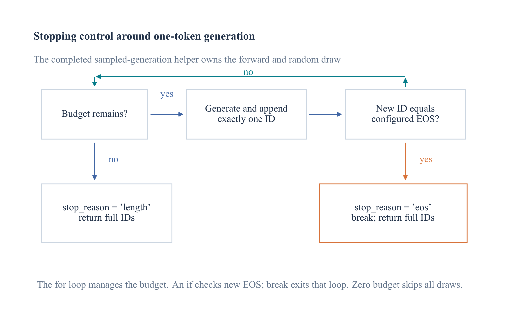{width=100%}

**Figure 03.17-2 — Budget and EOS control different points.** The `for` loop already handles the maximum count; the diagram is conceptual and does not ask for an additional while loop. Generate and append one ID, then test the new EOS. A positive test sets `"eos"` and breaks; otherwise the next loop iteration proceeds if budget remains.

### Eight implementation steps for generate_until_eos

Implement `generate_until_eos` in `03_17_generation_stopping.py` using the inputs listed above. All forward and sampling work remains in the completed `generate_sampled_ids`. This wrapper performs integer and control operations; no separate parameter update, backward, or gradient clearing is needed. It can reuse the helper's no-grad scope without adding a new outer context.

1. **Copy the prompt.** Four spaces: initialize `generated_ids` with `context_ids.clone()`. Example `[0]`, shape `[1]`; this also defines a fresh zero-budget return.
2. **Initialize the default reason.** Four spaces: set `stop_reason` to `"length"`. EOS detection will replace it only when that event occurs.
3. **Loop within the maximum.** Four spaces: use `for step in range(max_new_tokens):`. Its body uses eight spaces. `range(5)` permits five iterations, while `break` may end it after two.
4. **Generate one new ID.** Eight spaces: call `generate_sampled_ids` with `embedding_table`, `generated_ids`, `output_weights`, `output_bias`, literal `1`, `temperature`, `generator` in that order. Save the full returned tensor back into `generated_ids`; first result `[0,1]`. The literal `1` is the per-call new-token count.
5. **Extract the newly appended ID.** Eight spaces: save `generated_ids[-1].item()` as `next_token_id`. First `1`, then `2`; this is a Python integer.
6. **Test the stop condition.** Eight spaces: write an `if` combining `eos_token_id is not None` and `next_token_id == eos_token_id`, joined with `and`. The colon opens a twelve-space body.
7. **Record EOS and exit the loop.** Twelve spaces: set `stop_reason` to `"eos"`, then put `break` at the same indentation. EOS has already been appended; do not make another generation call.
8. **Return after the loop.** Back at four spaces: return `generated_ids, stop_reason`. Example `(tensor([0,1,2]), "eos")`; zero budget returns the copied prompt and `"length"`.

Complete and review 03.16 first, because this wrapper calls its sampled-generation helper once per new ID. Preserve the supplied setup and driver. From the project root:

```bash
python exercises/03_17_generation_stopping.py
```

Expected output after implementation:

```text
PASS: worked EOS path, appended stop marker, two new IDs, and eos reason
PASS: zero/short/full budgets, disabled or absent EOS, and eos priority on the final allowed draw
PASS: completed generation helper reused for one new ID per growing-prefix call with no call after EOS
PASS: stochastic EOS-or-budget stopping matches a same-runtime reference and generator state
PASS: EOS ID zero is valid and only newly generated IDs trigger stopping
PASS: fresh returns, fixed parameters/gradients, caller/global RNG preservation, and zero-budget independence
PASS: caller separates the illustrative EOS control marker before matching-vocabulary byte decoding
Lesson 03.17 checks passed.
```

### Reader questions

**Why keep EOS in the returned IDs?** It records which sampled event ended the request. The caller can remove the special marker for display while retaining the original IDs and reason for inspection.

**Does a maximum guarantee a complete UTF-8 character?** No. The maximum counts tokens. Ordinary token byte contents still need accumulated strict decoding; output handling and byte-safe streaming remain separate from these stop controls.

**Why not generate all M IDs and cut at the first EOS afterward?** That consumes extra inference and random draws after the stop event. This exercise stops immediately, preserving the stream position after the actual L draws.

**Does adding the if teach EOS behavior?** No. The stopping wrapper responds to a configured ID. The model needs appropriate training targets and a matching special-token protocol to learn when that ID should have high probability.

Stopping tells us which IDs were produced and why the loop ended. To display only the new text, [03.18](#section-03-18) will exclude the prompt, separate a trailing EOS, and pass the remaining IDs to the matching byte decoder. The decoder can still report incomplete or invalid UTF-8.

## 03.18 Decode the Generated Continuation {#section-03-18}

Generation returns the prompt followed by new IDs, and the final new ID may be an EOS marker. To display only the continuation, first exclude the prompt IDs and remove a permitted trailing marker. Then decode the remaining bytes. Prompt length is measured in tokens; it is not a byte or character count.

Work through the example before editing 03_18_decode_continuation.py. The numbered steps below explain the interface and guide the core implementation; the supplied setup and check driver remain separate.

### Exact inputs and returned value

| Name | Type | Meaning |
| --- | --- | --- |
| `generated_ids`, $g$ | One-dimensional `torch.long` tensor `[T+L]` | Full IDs returned by generation, including the prompt |
| `prompt_length`, $T$ | Python integer, $0\le T\le |g|$ | Number of prompt **tokens**, not bytes or characters |
| `vocab` | `dict[int, bytes]` | Matching ordinary token ID to original byte contents |
| `eos_token_id`, $e$ | Python integer or `None` | Separate EOS control ID; `None` disables marker removal |
| Returned `text` | Python `str` | New ordinary-token text, excluding the prompt and trailing EOS |

Assume the tensor shape and prompt length are valid. Keep the configured EOS separate from ordinary `vocab` entries. Under the 03.17 protocol, a newly generated EOS can appear only at the end. Remove that one trailing marker. Do not discard unknown IDs or scan away interior control IDs. Use the marker and byte vocabulary from the same tokenizer/model protocol.

Preserve `generated_ids`, `vocab`, caller gradient mode, and random streams. Empty ordinary output returns `""`. Unknown ordinary IDs raise `KeyError` through the decoder; invalid or incomplete UTF-8 raises `UnicodeDecodeError`. These errors remain visible and are part of the exercise contract.

### Select IDs, then interpret their bytes

Let $g$ contain $T$ prompt tokens and $L$ new IDs. Its new suffix is:

$$
c=g[T:],\qquad |c|=L
$$

Let $\delta=1$ exactly when $L>0$, EOS is configured, and $c_{L-1}=e$; otherwise $\delta=0$. Remove only that final control marker:

$$
q=\begin{cases}c[:-1]&\delta=1\\c&\delta=0\end{cases},
\qquad m=|q|=L-\delta
$$

For the remaining ordinary IDs, look up and concatenate their bytes in order:

$$
B=\operatorname{concat}_{i=0}^{m-1}\operatorname{vocab}[q_i],\qquad
\text{text}=\operatorname{UTF8Decode}_{\mathrm{strict}}(B)
$$

If $m=0$, the empty concatenation is `b""`, which decodes to `""`. The existing `decode_bpe` already performs the last two operations. `decode_continuation` handles token selection and control-marker separation before calling it.

Do not convert IDs directly with `bytes(ids)`. A merged ID such as 256 may name several bytes and cannot itself fit in one raw byte. Look up its bytes in the vocabulary. Handle EOS separately as a control marker. Token count and byte count do not determine the number of decoded characters.

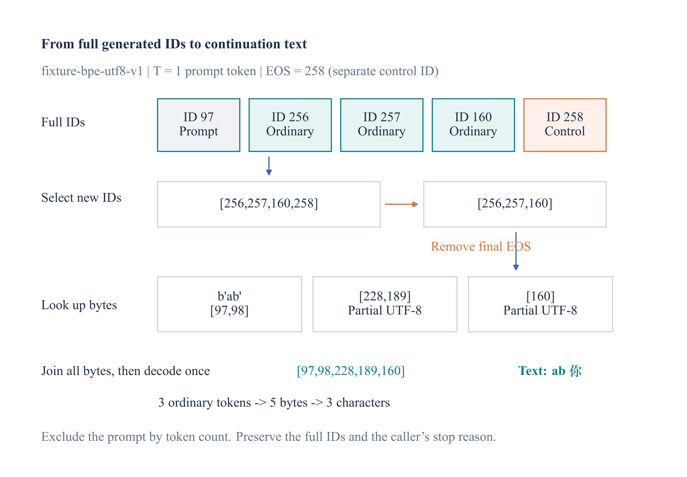{width=100%}

**Figure 03.18-1 — Read downward from the full IDs.** Gray excludes the prompt; orange identifies EOS; teal retains ordinary byte contents. The two partial Chinese byte chunks become valid only after joining. Three ordinary tokens produce five bytes and three Unicode code points in this example.

### Complete worked example

Use the hand-built artifact `fixture-bpe-utf8-v1`, supplied for arithmetic and decoder practice, not produced by a claimed training run. All base IDs `0..255` map to `bytes([id])`. Its extra ordinary entries and separate control ID are:

```text
vocab[256] = b"ab"
vocab[257] = bytes([228,189])
eos_token_id = 258
generated_ids = tensor([97,256,257,160,258])
prompt_length = 1
```

The prompt is one token, ID 97, whose ordinary content is `b"a"`. First, `.tolist()` gives `[97,256,257,160,258]`. The slice starting at index one gives `[256,257,160,258]`. The list is nonempty, EOS is configured, and its last ID is 258, so remove that one item to obtain `[256,257,160]`.

| Ordinary ID | `vocab` byte content | Interpretation before joining |
| --- | --- | --- |
| `256` | `b"ab"`, byte values `[97,98]` | Two ASCII letters |
| `257` | `bytes([228,189])` | First two bytes of 你; incomplete by itself |
| `160` | `bytes([160])` | Last byte of 你; invalid by itself |

Join the chunks to get byte values `[97,98,228,189,160]`. Strict UTF-8 decoding yields **`"ab你"`**. The return excludes the prompt's `"a"`; including it would instead display `"aab你"`. The two Chinese chunks must not be decoded independently.

Three ordinary tokens, five bytes, and three Unicode code points are distinct counts here. More generally, a visually perceived character can contain multiple code points, so Python string length is not a universal count of visible symbols.

### A concrete special-token protocol

This fixture has 258 ordinary IDs, `0..257`. Reserve the unused ID 258 for EOS; the model candidate count becomes $V=259$. An integrated model needs embedding shape `[259,D]`, head shape `[D,259]`, and bias shape `[259]`, while the ordinary byte vocabulary excludes EOS. Adding the candidate does not train its meaning: appropriate sequence-boundary training targets are still needed.

Do not overwrite a learned merged ID or assume every model uses ID 258 for EOS. Ordinary merged IDs above 255 stay ordinary. This adapter consumes an explicit supplied mapping; it does not extend the existing BPE training rules or JSON format. Persistence of special-token metadata and production training integration remain later work.

The caller can retain `generated_ids` and `stop_reason` and separately request display text using `prompt.numel()` as `prompt_length`. The stop reason explains why generation ended; it does not say that the returned bytes are valid text.

### Stopping and UTF-8 validity are separate

A maximum budget counts tokens. It can end after bytes `[228,189]`, before the final byte 160 of 你. Even a generated EOS after those two bytes cannot repair them. After removing EOS, strict decoding still raises `UnicodeDecodeError`. A complete but invalid byte sequence, such as `[255]`, also fails. The required strict policy is inherited from 02.06. [Python `bytes.decode` documentation](https://docs.python.org/3/library/stdtypes.html#bytes.decode).

There is also a **prompt boundary** case. The full ordinary IDs `[228,189,160]` decode to 你. If `prompt_length=1`, the new suffix is only `[189,160]`, starting inside that character; it cannot be decoded independently. With `prompt_length=0`, the same full input decodes successfully.

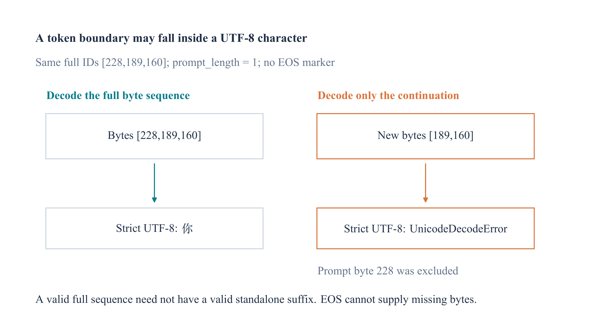{width=100%}

**Figure 03.18-2 — Compare the two byte streams.** The left retains all three bytes. The right excludes prompt byte 228, so its suffix is not standalone UTF-8. This adapter deliberately reports that error. Rendering the combined full text, carrying an incremental decoder across the boundary, or using replacement characters are separate display policies; no such policy is implemented here.

### Syntax before implementation

`.tolist()` converts the integer tensor to a Python list. `all_ids[prompt_length:]` selects from that token index to the end; `continuation_ids[:-1]` excludes the final item. These list slices produce new lists. `len(continuation_ids)>0` checks for an item before accessing `[-1]`.

The operator `and` checks conditions from left to right and stops at the first false condition. Check that the list is nonempty before reading its last ID. Then use `eos_token_id is not None` to check whether EOS is configured. Testing its truthiness would wrongly reject valid ID zero. Use `==` to compare values and `=` to assign. An `if` header ends in a colon; its body has one extra level of indentation. See [Python sequence and Boolean operations](https://docs.python.org/3/library/stdtypes.html#common-sequence-operations).

### Five guided implementation steps

After the 03.17 implementation and this formula/example walkthrough, write only the marked learner region in `decode_continuation`. The supplied decoder performs the byte operations; reuse it.

1. **Convert full IDs.** Four spaces: call `generated_ids.tolist()` and store `all_ids`. Example `[97,256,257,160,258]`. Keep the original tensor unchanged.
2. **Select new IDs.** Four spaces: store `all_ids[prompt_length:]` as `continuation_ids`. Example `[256,257,160,258]`. Slice by prompt tokens rather than text length.
3. **Check the trailing marker safely.** Four spaces: start one `if` with three checks joined by `and`: nonempty list, configured EOS, and equality of its final ID to `eos_token_id`. Check nonemptiness before `[-1]` and use explicit presence rather than EOS truthiness.
4. **Remove that one marker.** Eight spaces inside the `if`: replace `continuation_ids` with its `[:-1]` slice. Example `[256,257,160]`. Do not drop all unknown IDs or alter the full tensor.
5. **Reuse the decoder and return.** Four spaces after the `if`: call `decode_bpe(continuation_ids, vocab)` and return its `str`. The example yields `"ab你"`; an empty list yields `""`. Do not catch required errors or add a second implementation of joining and decoding.

| Boundary case | Required result |
| --- | --- |
| Only prompt, or immediate new EOS | `""` |
| Length stopping with complete ordinary bytes | Decode all new ordinary IDs |
| `eos_token_id=None` | Remove no ID; decode the suffix as ordinary data |
| Configured EOS ID `0`, absent from ordinary vocabulary | Remove it when it is the new final ID |
| Unknown ordinary ID, or unexpected interior control marker | `KeyError` through lookup |
| Invalid/incomplete new bytes, including a split prompt boundary | `UnicodeDecodeError` |

From the project root, after implementing the learner core and the preceding prerequisite:

```bash
python exercises/03_18_decode_continuation.py
```

Expected supplied output:

```text
PASS: prompt exclusion, trailing EOS removal, merged IDs, and cross-token UTF-8
PASS: empty output, immediate EOS, length stopping, zero prompt, and ordered repeats
PASS: explicit EOS ID zero, disabled removal, prompt control IDs, and unhidden interior markers
PASS: completed decoder reused with a Python list, preserved inputs/mode/RNG, and strided IDs
PASS: unknown IDs and incomplete/invalid UTF-8 propagate required decoder errors
PASS: valid full text can have an invalid independently decoded continuation at a byte boundary
PASS: EOS and length returns from generation both display only the matching-vocabulary continuation
Lesson 03.18 checks passed.
```

### Reader questions

**Why not decode everything and remove the prompt string afterward?** Token count specifies the exact ID boundary. Removing a repeated text substring can erase the wrong occurrence, and independently decoding the prefix can fail if it ends inside a character. Select IDs first under this exercise's continuation-only policy.

**Why not turn EOS into `b""` inside the ordinary vocabulary?** That silently changes the ordinary-token mapping and loses an explicit control distinction. This protocol keeps the control ID separate; the display adapter removes only the permitted final marker.

**Does successful EOS stopping guarantee a readable answer?** It establishes a stop event. Byte validity, contextual modeling, and answer quality are separate properties.

So far, each training call has received one sequence of input positions. [03.19](#section-03-19) returns to data preparation and groups several windows into a batch, giving each row its own shifted next-token targets. Generation and decoding keep the single-sequence interfaces developed here.

## 03.19 Batched Next-Token Training Windows {#section-03-19}

We will now build several shifted training windows using the method from Chapter 01. Each chosen start supplies one input row and its target row. Stack the rows to form a batch. The new batch dimension groups examples; each position still predicts the next source token.

Work through the example before editing 03_19_next_token_batch.py. The numbered steps below explain the interface and guide the core implementation; the supplied setup and check driver remain separate.

### Exact inputs and returned values

| Exact name | Type/shape | Meaning |
| --- | --- | --- |
| `token_ids`, $s$ | One-dimensional `torch.long` tensor `[N]` | An already encoded source token stream |
| `start_positions`, $i$ | Nonempty `list[int]`, length $B$ | One chosen source start per batch row, in supplied order |
| `context_length`, $T$ | Positive Python integer | Input positions in each row, also target positions per row |
| `input_ids`, $X$ | Returned `torch.long` tensor `[B,T]` | Input windows |
| `target_ids`, $Y$ | Returned `torch.long` tensor `[B,T]` | Corresponding next-token answers |

$N$ counts source tokens; $B$ counts samples; $T$ counts positions per sample. $V$ is vocabulary size and is separate from all three. Each output stays on the source tensor's device. Preserve the source, start list, caller gradient mode, and random stream. Return two fresh tensors independent of the source, each other, and later calls.

Assume valid inputs: $B\ge1$, $T\ge1$, and every start satisfies $0\le i_b$ and $i_b+T<N$. Validation is not assigned. Duplicate, overlapping, or out-of-order starts are allowed and must retain their supplied order. Token IDs can exceed 255. This exercise has no empty-batch branch, padding, shuffle, document-boundary policy, or new special-token mapping.

### One next-token answer per input position

For batch row $b=0,\ldots,B-1$ and position $t=0,\ldots,T-1$:

$$
X_{b,t}=s_{i_b+t},\qquad Y_{b,t}=s_{i_b+t+1}
$$

Both rows contain $T$ IDs. Their combined source span needs $T+1$ consecutive IDs, because the final input also needs a next-token answer:

$$
X_b=s[i_b:i_b+T],\qquad
Y_b=s[i_b+1:i_b+T+1]
$$

The latest required source index is $i_b+T$, so it must be smaller than $N$. The largest valid start is $N-T-1$. A slice end is excluded: `s[0:3]` contains indices `0,1,2`, not index 3.

Stack the $B$ rows along a new batch dimension:

$$
X=\operatorname{stack}(X_0,\ldots,X_{B-1}),\qquad
Y=\operatorname{stack}(Y_0,\ldots,Y_{B-1}),\qquad
\operatorname{shape}(X)=\operatorname{shape}(Y)=[B,T]
$$

There are $BT$ supervised positions in this fixed-length, unmasked batch. This is a count of target comparisons, not a promise of improved model quality or a measured training throughput.

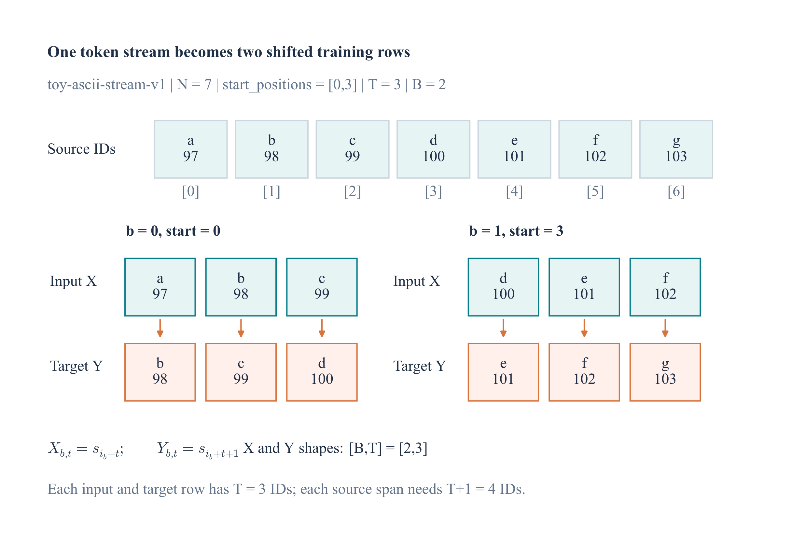{width=100%}

**Figure 03.19-1 — Each downward arrow is one prediction/answer pair.** The upper source labels show actual token indices. Each lower input row has three IDs, and its target row also has three. The final target comes from the extra fourth source token. The two samples form `[2,3]` tensors.

### Complete worked example

Use the illustrative byte-token stream `toy-ascii-stream-v1`, the UTF-8 bytes of `"abcdefg"`:

```text
token_ids = tensor([97,98,99,100,101,102,103])
start_positions = [0,3]
context_length = 3
N = 7, B = 2, T = 3
```

Before the loop, `input_rows=[]` and `target_rows=[]`. For the first supplied start, `start=0`, take input indices `0:3` and target indices `1:4`:

```text
x_row = [97,98,99]   # abc
y_row = [98,99,100]  # bcd
```

Append these two tensors to their respective lists. Each list now contains one `[3]` tensor. For the next start, `start=3`, input indices are `3:6`, and target indices are `4:7`:

```text
x_row = [100,101,102]  # def
y_row = [101,102,103]  # efg
```

The two source spans are `abcd` and `defg`. They share $d$: it is the first sample's final answer and the second sample's first input. Two four-token spans therefore need only seven distinct source positions here; valid windows may overlap.

After appending, each list holds two `[3]` tensors. Stack each list on dimension zero to obtain:

$$
X=\begin{bmatrix}97&98&99\\100&101&102\end{bmatrix},\qquad
Y=\begin{bmatrix}98&99&100\\101&102&103\end{bmatrix}
$$

Return `(input_ids, target_ids)`, each shape `[2,3]`. For example, `input_ids[0,1]` is 98 (`b`) and its answer `target_ids[0,1]` is 99 (`c`). The final input `c` in row zero predicts $d$, which is outside that row's input window.

| Row | Inputs | Targets | Three aligned comparisons |
| --- | --- | --- | --- |
| `0` | `abc` | `bcd` | `a→b`, `b→c`, `c→d` |
| `1` | `def` | `efg` | `d→e`, `e→f`, `f→g` |

The arrows label input/target alignment. A future contextual model can also use each position's preceding visible tokens; an arrow does not require it to use only one input ID. Our earlier lookup-plus-head baseline does use only the current ID and is still unchanged.

### Why targets shift, and why training can use multiple positions

Copying the input as its own target would teach the model to predict the current ID. Next-token modeling instead assigns the observed next ID to every position. The last input position therefore still has a target. Repeating only the final target across the row would discard the other intended comparisons.

For a future causal contextual model, the intended distribution at position $t$ is:

$$
p_\theta(Y_{b,t}\mid X_{b,0},\ldots,X_{b,t})
$$

Training supplies the observed earlier tokens as input. This is called teacher forcing. Because the input row is known, the model can calculate predictions for several positions together. A causal model must still prevent future input positions from affecting earlier predictions. Use the target tensor to calculate loss, rather than passing it into the model's forward calculation.

In row `abc`, the position predicting `b` may see `a`; the position predicting `c` may see `ab`; the position predicting $d$ may see `abc`. Although `b` and `c` are stored in the input row, the first prediction must not see them. Merely constructing shifted targets does not implement that restriction; causal attention/masking follows later.

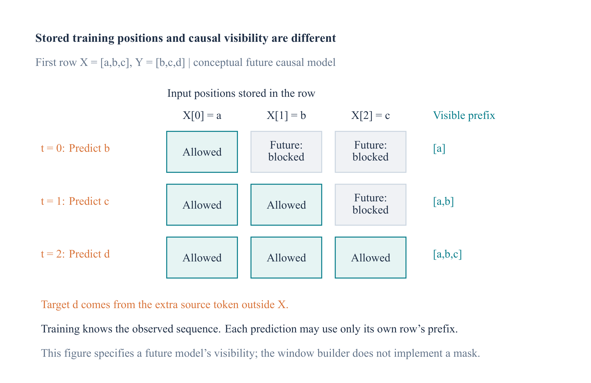{width=100%}

**Figure 03.19-2 — Teal marks a conceptual causal model's permitted input cells.** Gray marks future cells that must be blocked. Orange identifies the true next ID. This window builder supplies data; it does not implement the mask or make the earlier model contextual. During free generation, future IDs are unknown and still must be selected sequentially.

For later fixed-length batched training, the mean token loss would be:

$$
\mathcal L=-\frac{1}{BT}\sum_{b=0}^{B-1}\sum_{t=0}^{T-1}
\log p_\theta(Y_{b,t}\mid X_{b,0:t})
$$

Here $X_{b,0:t}$ denotes the inclusive mathematical prefix through position $t$; its Python slice is `input_ids[b, :t+1]`. The batch builder calculates none of these probabilities or losses. Padding masks and weighted losses would require a different normalization protocol.

### New syntax and storage

`[]` creates a Python list. `input_rows.append(x_row)` adds one tensor to it, preserving that row as an item. `for start in start_positions:` visits the caller's starts in order, including repeats. The loop body uses eight spaces; setup and the final return use four. No new conditional or error handling is required under the valid-input contract.

Tensor slices can share source storage, so do not modify the collected row views. `torch.stack(rows, dim=0)` adds a new dimension to same-shaped tensors and produces `[B,T]`; with two `[3]` rows, the result is `[2,3]`. The provided runtime also verifies this behavior. [PyTorch stack documentation](https://docs.pytorch.org/docs/2.0/generated/torch.stack.html).

By comparison, `torch.cat(rows, dim=0)` joins two one-dimensional rows into `[6]`. Generation uses `cat` to extend a single sequence. Here, `stack` adds an axis so the samples stay in separate rows. Using `stack(..., dim=1)` would put that new axis after the position axis and produce `[T,B]`.

### Seven guided implementation steps

After the verified 03.18 completion and this chapter's walkthrough, replace only the placeholder in `make_next_token_batch`; preserve the supplied driver and previous implementations.

1. **Prepare row lists.** Four spaces: create separate fresh `input_rows` and `target_rows` lists. Each will hold $B$ tensors of shape `[T]`.
2. **Visit chosen starts.** Four spaces: start `for start in start_positions:`. Its eight-space body handles one sample. In the example, `start` is first 0, then 3; use the values, not their list indices.
3. **Take shifted slices.** Eight spaces: obtain `x_row` with `token_ids[start:start+context_length]`; obtain `y_row` beginning at `start+1` and ending at `start+context_length+1`. Ends are excluded. First rows are `[97,98,99]` and `[98,99,100]`.
4. **Collect both rows.** Eight spaces: append `x_row` to `input_rows` and `y_row` to `target_rows`. After two iterations, each list contains two `[3]` tensors. Do not alter the slice views.
5. **Stack input rows.** Four spaces after the loop: call `torch.stack(input_rows, dim=0)`, saving `input_ids`. Example shape `[2,3]`.
6. **Stack target rows.** Four spaces: stack `target_rows` on dimension zero as `target_ids`. Example rows are `bcd` and `efg`, also `[2,3]`.
7. **Return both tensors.** Four spaces after both stack operations: return `input_ids, target_ids`, in that order. Returning inside the loop would omit later samples.

From the project root, after the walkthrough and implementation:

```bash
python exercises/03_19_next_token_batch.py
```

Expected supplied output:

```text
PASS: complete worked batch, shifted final targets, and two [2,3] tensors
PASS: one sample, one position, maximal span, and the last valid start
PASS: supplied order, repeated/overlapping starts, and vocabulary IDs above 255
PASS: strided source, dtype/device propagation, caller mode, and unchanged random stream
PASS: fresh outputs independent of the source, each other, and later calls
PASS: varied batch/window sizes agree with completed single-window references
PASS: six aligned supervised positions feed completed projection/loss with connected gradients
Lesson 03.19 checks passed.
```

### Bridge to model shapes and reader questions

Embedding lookup on IDs `[B,T]` produces vectors `[B,T,D]`. A contextual model should preserve the sample and position axes while computing context, then produce scores `[B,T,V]`. $V$ is the number of candidate IDs for each position, not a third sample dimension.

The last check uses a separate small example: IDs `[0,1,2,0,1,2,0]`, starts `[0,3]`, length 3, and fixed parameters with $V=3,D=2$. It arranges the **independent lookup baseline's** six vectors as `[6,2]`, calls the projection and loss helpers, and checks gradients. It makes no parameter update or training-quality claim. Flattening works because this baseline scores each position independently. Before attention, keep sample and position axes separate so a token can only use its own sequence and allowed prefix. After context processing, logits may be flattened for loss.

**Must start positions be contiguous or random?** No. This function accepts already chosen valid starts. `[2,0,2]` means three samples in that order, with the same source window repeated in rows zero and two. Choosing a sampling strategy is separate work.

**Does T+1 mean the model receives an extra token?** No. The data builder needs an extra source token to supply the last answer. Each returned model input row still has only T tokens.

**Does batching train different models?** The future batch shares one model's parameters across all rows. $B$ organizes data; it does not allocate one separate model per row.

**Does the second row see the first row?** Each row is a separate sample. The second row's prefixes are $d$, `de`, and `def`; it does not attend to the first row's `abc`. Cropping a window also omits earlier source context before its chosen start. Sharing model parameters does not merge sample contexts.

**Can windows cross documents?** This exercise assumes one supplied stream with permitted spans. Real data preparation must specify document boundaries, EOS insertion, splits, and masking. No such policy is silently imposed here. Overlapping training windows are allowed; train/validation splitting must be designed separately to prevent shared-data leakage.

[03.20](#section-03-20) takes these input and target batches through two operations: compute one vocabulary score vector per position, then average the losses for the aligned observed targets. Both operations preserve the gradient path needed for a later parameter update.

## 03.20 Batched Logits and Mean Token Loss {#section-03-20}

Each position in a batch still needs its own vocabulary scores and observed next-token target. Keep the batch and position axes through lookup and projection. Then combine those axes into rows for the existing two-dimensional loss helper. Flatten targets in exactly the same order as scores, so each row keeps its answer.

Work through the example before editing 03_20_batched_logits_and_loss.py. The numbered steps below explain the interface and guide the core implementation; the supplied setup and check driver remain separate.

### Exact inputs, outputs, and state

| Exact name | Type/shape | Meaning |
| --- | --- | --- |
| `embedding_table`, $E$ | Floating tensor `[V,D]` | Shared token-vector table |
| `input_ids`, $X$ | `torch.long` tensor `[B,T]` | Observed input ID at each sample/position |
| `output_weights`, $W$ | Floating tensor `[D,V]` | Shared vocabulary projection |
| `output_bias`, $\beta$ | Floating tensor `[V]` | Shared candidate biases |
| `logits`, $Z$ | Floating tensor `[B,T,V]` | Stage A return; Stage B score input |
| `target_ids`, $Y$ | `torch.long` tensor `[B,T]` | Already shifted observed next-token answers |
| Returned `loss`, $\mathcal L$ | Scalar floating tensor, shape `[]` | Mean true-target negative log-probability |

$B$ counts samples, $T$ positions per sample, $D$ embedding features, and $V$ candidate IDs per position. In formulas the bias is written $\beta$ to distinguish it from row index $b$. For example, `logits[1,0]` is one `[V]` score vector; `logits[1,0,2]` is the score for candidate ID 2 at sample one, position zero.

Assume positive dimensions, valid IDs, compatible dtypes/devices, and finite scores in the numerical range used by the checks. Validation is not assigned. Preserve all input values, parameter storage/trainability/stored gradients, caller gradient mode, and global random state. Keep the graph when gradients are enabled. Do not detach, enter no-grad, call backward, clear gradients, extract a Python float, or update parameters inside either exercise function.

No positions are ignored, and there are no padding weights, class weights, or label smoothing. Every one of the $BT$ targets contributes equally. Targets are already shifted by the data builder; this lesson does not shift them again.

### One vocabulary score vector per position

For $b=0,\ldots,B-1$, $t=0,\ldots,T-1$, and $v=0,\ldots,V-1$:

$$
H_{b,t,:}=E[X_{b,t}],\qquad \operatorname{shape}(H)=[B,T,D]
$$

$$
Z_{b,t,v}=\sum_{d=0}^{D-1}H_{b,t,d}W_{d,v}+\beta_v,
\qquad \operatorname{shape}(Z)=[B,T,V]
$$

Every position uses the same table and head parameters. Scores are raw logits. For each position, the mathematical candidate distribution is:

$$
P_{b,t,v}=\frac{\exp(Z_{b,t,v})}{\sum_{j=0}^{V-1}\exp(Z_{b,t,j})}
$$

Normalize over the candidate axis $V$, separately for every `(b,t)`. One true target ID selects one probability per position. The desired mean loss is:

$$
\mathcal L=-\frac{1}{BT}\sum_{b=0}^{B-1}\sum_{t=0}^{T-1}
\log P_{b,t,Y_{b,t}}
$$

The denominator counts supervised positions. Each position has $V$ scores but only one observed target. The stable 03.10 helper calculates the target's log-probability directly from raw scores. This avoids taking a log after a tiny probability has already underflowed to zero.

### Flatten positions while preserving candidates and answer alignment

Map a batch position to flat row index:

$$
q=bT+t,\qquad \widetilde Z_{q,v}=Z_{b,t,v},\qquad
\widetilde Y_q=Y_{b,t}
$$

The shape conversion is `[B,T,V] → [B*T,V]`, accompanied by `[B,T] → [B*T]`. Candidate columns remain together. For $B=2,T=2$, the position order is `(0,0),(0,1),(1,0),(1,1)`.

Stage A first converts vectors `[B,T,D] → [B*T,D]` in this order, then calls the two-dimensional projection. It restores the resulting `[B*T,V]` scores to `[B,T,V]`. Stage B combines the score positions and target positions in the same order before calling the two-dimensional loss helper.

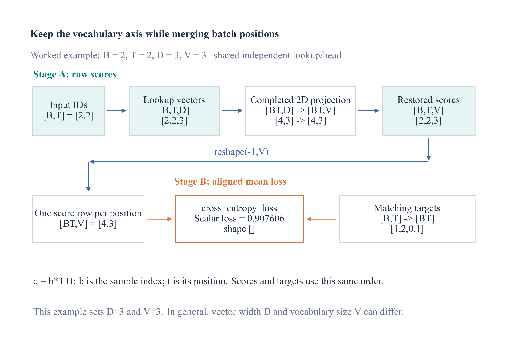{width=100%}

**Figure 03.20-1 — Follow Stage A left to right, then follow the score route to Stage B.** Stage A returns restored raw scores. Stage B receives targets separately and computes one scalar. $D$ and $V$ both equal three only in this example; their meanings and possible sizes differ.

### Complete worked example

Use the hand-picked artifact `batch-three-id-v1`, not a trained capability result. Source IDs `[0,1,2,0,1]`, starts `[0,2]`, and row length two give:

$$
X=\begin{bmatrix}0&1\\2&0\end{bmatrix},\qquad
Y=\begin{bmatrix}1&2\\0&1\end{bmatrix},\qquad B=2,\ T=2
$$

Choose shared parameters. Here $I_3$ is the three-by-three identity matrix: ones on its main diagonal and zeros elsewhere.

$$
E=\begin{bmatrix}1&2&3\\2&1&3\\3&2&1\end{bmatrix},\qquad
W=I_3,\qquad \beta=[0,0,0],\qquad D=3,\ V=3
$$

Lookup gives `hidden_vectors` shape `[2,2,3]`. Identity weights and zero bias make its values equal to the scores:

```text
logits = [
    [[1,2,3], [2,1,3]],
    [[3,2,1], [1,2,3]],
]
flat_logits = [[1,2,3], [2,1,3], [3,2,1], [1,2,3]]
flat_targets = [1,2,0,1]
```

For the first position, scores `[1,2,3]` have maximum 3. Subtract it to get `[-2,-1,0]`; exponentials are approximately `[0.1353352832,0.3678794412,1]`. Their sum and its logarithm are:

$$
S=1+e^{-1}+e^{-2}\approx1.5032147244,\qquad
\log S\approx0.4076059644
$$

The supplied target is ID 1, so its probability is $\frac{0.3678794412}{S}\approx0.2447284711$. Its stable negative log-probability is $1+\ln(S)\approx1.4076059644$. The largest-score candidate is ID 2, but loss selects the observed answer ID 1.

All four rows are permutations of `[1,2,3]`, so they share $S$. Their complete true-target trace is:

| Flat q | Position `(b,t)` | Raw scores | Target ID | Selected probability | Negative log-probability |
| --- | --- | --- | --- | --- | --- |
| `0` | `(0,0)` | `[1,2,3]` | `1` | `0.2447284711` | `1.4076059644` |
| `1` | `(0,1)` | `[2,1,3]` | `2` | `0.6652409558` | `0.4076059644` |
| `2` | `(1,0)` | `[3,2,1]` | `0` | `0.6652409558` | `0.4076059644` |
| `3` | `(1,1)` | `[1,2,3]` | `1` | `0.2447284711` | `1.4076059644` |

Thus:

$$
\mathcal L=\frac{1.4076059644+0.4076059644+0.4076059644+1.4076059644}{4}
\approx0.9076059644
$$

Return a scalar tensor with that value, keeping its gradient path. The completed helper already takes this mean; the outer adapter performs no additional division.

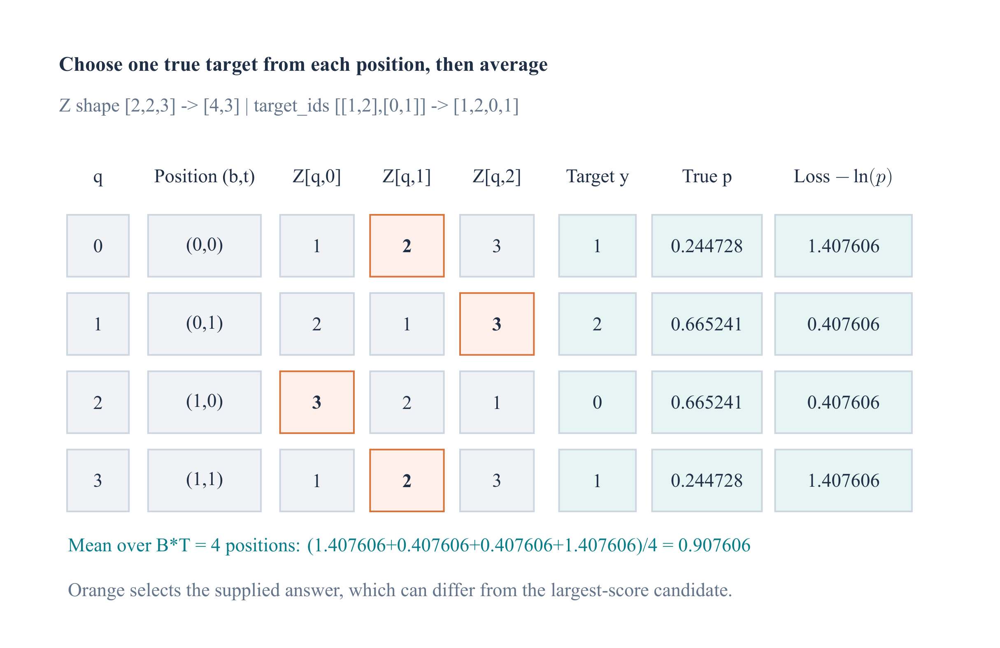{width=100%}

**Figure 03.20-2 — Orange identifies the true-target score column in each row.** The probability and loss columns refer to that selected candidate. Four losses are averaged, including both occurrences of input ID zero.

### Gradients remain connected through reshape

Under normal gradient mode, the mean-loss score derivative is:

$$
\frac{\partial\mathcal L}{\partial Z_{b,t,v}}
=\frac{P_{b,t,v}-\mathbf1\{v=Y_{b,t}\}}{BT}
$$

For the first worked position, this is approximately `[0.0225076433,-0.1888178822,0.1663102389]`. The target component is negative: increasing that score locally reduces loss. Non-target components are positive. The $\frac{1}{BT}$ factor comes from the mean across four positions.

The caller can later run `loss.backward()` and obtain gradients for the shared table, weights, and bias. Repeated ID zero sends contributions from both its positions to the same embedding row. Because $W$ is identity, their combined table-row gradient is approximately `[0.0450152866,-0.3776357645,0.3326204779]`. Backward computes gradients; an optimizer/update is still a separate operation.

### Reshape syntax before implementation

`batch_size, context_length = input_ids.shape` unpacks the two dimensions. `embedding_table[input_ids]` keeps `[B,T]` and appends the vector dimension $D$. `.reshape(-1, embedding_dim)` groups the first two axes and lets PyTorch infer the missing size from the element count. Here $2\times 2\times 3=12$ values become four rows of three.

Only one reshape dimension may be `-1`. A later `.reshape(batch_size, context_length, -1)` restores the sample/position axes and infers $V$. For loss, `.reshape(-1, vocab_size)` retains each position's candidate vector; `.reshape(-1)` on targets produces one ID per flat position.

Reshape keeps the logical order of elements. Depending on storage layout, it may return a view or make a copy, so do not assume separate storage or modify the result in place. Either form keeps the autograd connection. A copy needed for a strided layout does not detach the result. See the [PyTorch reshape documentation](https://docs.pytorch.org/docs/2.0/generated/torch.reshape.html).

### Stage A: six guided implementation steps

After verified 03.19 completion and this formula/example walkthrough, write only `compute_batch_logits`'s marked learner region. Every statement uses four spaces; no loop or context block is required.

1. **Read batch shape.** Unpack `input_ids.shape` into `batch_size` and `context_length`, both two in the worked example.
2. **Lookup vectors.** Save `embedding_table[input_ids]` as `hidden_vectors`, shape `[2,2,3]`.
3. **Prepare the helper's vector rows.** Read `embedding_dim` from `embedding_table.shape[1]`. Reshape `hidden_vectors` to `(-1, embedding_dim)` as `flat_hidden`, shape `[4,3]`, preserving the four-position order.
4. **Reuse projection once.** Call `compute_logits(flat_hidden, output_weights, output_bias)`, saving `flat_logits`, shape `[B*T,V]`. Keep its graph.
5. **Restore batch axes.** Reshape `flat_logits` to `(batch_size, context_length, -1)` as `logits`, shape `[2,2,3]`.
6. **Return raw scores.** Return `logits` as a tensor. Keep probability conversion and sampling outside this function.

Run Stage A alone after implementing it:

```bash
python exercises/03_20_batched_logits_and_loss.py --check logits
```

Its final line should be `Lesson 03.20 logits checks passed.`

### Stage B: five guided implementation steps

Write only `batch_cross_entropy`'s marked learner region. Every statement again uses four spaces.

1. **Read the candidate count.** Save `logits.shape[-1]` as `vocab_size`, three in the example.
2. **Flatten score positions.** Save `logits.reshape(-1, vocab_size)` as `flat_logits`, shape `[4,3]`. Preserve candidate columns.
3. **Flatten answers in the same order.** Save `target_ids.reshape(-1)` as `flat_targets`, `[1,2,0,1]`. Keep the already shifted IDs in their original order.
4. **Reuse the stable loss once.** Call `cross_entropy_loss(flat_logits, flat_targets)` and save `loss`. It already averages the four true-target rows.
5. **Return the connected scalar.** Return `loss` as a tensor. Backward, clearing gradients, and updates belong to a later training caller.

Run Stage B alone using its supplied score fixtures:

```bash
python exercises/03_20_batched_logits_and_loss.py --check loss
```

Its final line should be `Lesson 03.20 loss checks passed.` Stage B's isolated checks do not require Stage A to be complete.

Once both cores are complete, run:

```bash
python exercises/03_20_batched_logits_and_loss.py --check all
```

Expected combined output:

```text
PASS: worked [B,T] lookup and restored [2,2,3] raw scores
PASS: nonsquare batch shapes, D different from V, bias, singleton axes, and merged IDs
PASS: 2D helper reuse, logical position order, strided IDs, fixed state, and caller mode
PASS: four true targets selected in matching order and averaged to one scalar
PASS: varied shapes/dtypes, row shifts, single candidate, large IDs, and stable extreme loss
PASS: 2D stable helper reuse, aligned flattening of strided tensors, and preserved mode
PASS: connected analytic gradients scaled by B*T, finite differences, and existing buffers
PASS: full batch forward/loss reaches all parameters with repeated-ID accumulation and no update
Lesson 03.20 checks passed.
```

### Reader questions

**Does flattening turn several samples into one context?** Here, lookup and scoring treat each position independently. Combining positions into rows only adapts the old helper. A contextual model must keep samples and sequence positions separate while computing attention. After that computation, its logits can be flattened for the token loss. Do not combine samples into one sequence before attention.

**Why not shift targets again or choose argmax answers?** Data construction already provides the observed next IDs. Shifting again misaligns labels; using argmax would score the model's own choice instead of the observed answer.

**Why not feed probabilities into the old loss?** That helper expects raw logits and computes stable log-probabilities internally. Applying softmax first changes its input interpretation. [Cross-entropy documentation](https://docs.pytorch.org/docs/2.0/generated/torch.nn.CrossEntropyLoss.html).

**Can a library cross-entropy accept `[B,T,V]` directly?** The usual class-index interface uses scores `[N,C,...]`, with candidate classes on the second axis. Our layout keeps $V$ last. This adapter uses unambiguous `[B*T,V]` scores with `[B*T]` targets and the completed 2D helper; other layouts require a deliberate compatible conversion.

**Why return a scalar tensor rather than `.item()`?** The training caller needs the graph for backward. `.item()` is suitable for display/logging after retaining the connected loss, not as this function's return.

### A closer look at example dimensions and flat indices

**Does D=V=3 require D and V always to be equal?** No. D counts embedding features, while V counts candidate IDs. For B=2, T=3, D=2, V=5, the table is [5,2], weights [2,5], lookup vectors [2,3,2], flat vectors [6,2], flat scores [6,5], and restored scores [2,3,5]. The matrix product [6,2] @ [2,5] changes feature width two to candidate count five. Loss retains [6,5] scores with six targets.

**Does $q=bT+t$ use the batch size $B$?** Lowercase $b$ is a zero-based sample index, distinct from uppercase $B$, the sample count. For $B=2, T=2$, positions $(0,0),(0,1),(1,0),(1,1)$ map to $q=0,1,2,3$. The second row's first position is $1\times 2+0=2$. In general, $0\le b<B$, $0\le t<T$, and $0\le q<BT$. Scores and targets follow the same mapping, with all $V$ candidate columns retained.

## 03.21 One Joint Update from a Next-Token Batch {#section-03-21}

Several samples can contribute to one parameter update. Average their position losses into a scalar, then calculate gradients for the shared parameters. Complete this calculation before changing any parameter. We will extend the earlier joint step to a batch, using the same parameter objects and reporting the loss before the update.

Work through the example before editing 03_21_batch_train_step.py. The numbered steps below explain the interface and guide the core implementation; the supplied setup and check driver remain separate.

### Exact inputs, returns, and effects

| Exact name | Type and shape | Meaning |
| --- | --- | --- |
| `embedding_table`, $E$ | Trainable floating leaf tensor `[V,D]` | Shared token-vector table |
| `input_ids`, $X$ | Fixed `torch.long` tensor `[B,T]` | Input IDs at each sample/position |
| `output_weights`, $W$ | Trainable floating leaf tensor `[D,V]` | Shared vocabulary projection |
| `output_bias`, $\beta$ | Trainable floating leaf tensor `[V]` | One bias per candidate |
| `target_ids`, $Y$ | Fixed `torch.long` tensor `[B,T]` | Already shifted next-token answers |
| `learning_rate`, $\eta$ | Nonnegative Python float | Common update multiplier |

$B$ counts sample rows, $T$ positions per row, $D$ vector features, and $V$ candidate IDs. $D$ and $V$ can differ: this chapter deliberately uses $D=1,V=2$. Assume positive dimensions, valid IDs, compatible floating dtypes/devices, finite values, normal gradient mode, and separately stored untied parameters. Input validation is not assigned.

Return `(loss_value, gradient_table, gradient_weights, gradient_bias)`:

- `loss_value` is a Python float for the loss **before** updating.
- The three gradients are independent tensor snapshots with shapes `[V,D]`, `[D,V]`, and `[V]`, all from the same pre-update state.
- The original three parameter tensors contain their updated values. Preserve their storage, dtype/device, and trainable-leaf identity. Both ID tensors and random state stay unchanged.
- Leave the current gradients in `.grad`; clear all three at the start of the next call. Returned snapshots must survive subsequent calls or edits to these live buffers.

A leaf parameter is the original trainable tensor supplied by setup, rather than an intermediate tensor produced by forward computation. Its `.grad` stores derivatives after backward. IDs select table rows; they are fixed observations, not trainable floating parameters.

### Forward, mean loss, gradient, update

Let $b=0,\ldots,B-1$, $t=0,\ldots,T-1$, $d=0,\ldots,D-1$, and $v=0,\ldots,V-1$. With the current parameters held at one state:

$$
H_{b,t,:}=E[X_{b,t}],\qquad
Z_{b,t,v}=\sum_d H_{b,t,d}W_{d,v}+\beta_v
$$

$$
P_{b,t,v}=\frac{e^{Z_{b,t,v}}}{\sum_j e^{Z_{b,t,j}}},\qquad
\mathcal L(E,W,\beta;X,Y)
=-\frac1{BT}\sum_{b,t}\log P_{b,t,Y_{b,t}}
$$

`X` and $Y$ are fixed for differentiation. The loss depends on all three parameters through this connected computation. Call the completed `compute_batch_logits` and `batch_cross_entropy`; the stable loss helper computes log-probabilities directly. The mathematical probabilities below explain the derivatives, rather than requiring an extra softmax call in your core.

For one candidate score, the derivative is:

$$
(G_Z)_{b,t,v}=\frac{\partial\mathcal L}{\partial Z_{b,t,v}}
=\frac{P_{b,t,v}-\mathbf1\{v=Y_{b,t}\}}{BT}
$$

The indicator is one for the supplied target and zero otherwise. The denominator comes from averaging supervised positions. The helper already applies it: do not divide loss or gradients by $B$, $T$, or $V$ again.

Flatten positions in the same order $q=bT+t$: $\widetilde H$ has shape `[B*T,D]` and $\widetilde G_Z$ has shape `[B*T,V]`. Applying the chain rule to the linear head gives:

$$
G_W=\widetilde H^\mathsf T\widetilde G_Z,\qquad
(G_\beta)_v=\sum_{b,t}(G_Z)_{b,t,v},\qquad
(G_H)_{b,t,:}=(G_Z)_{b,t,:}W^\mathsf T
$$

The embedding table is shared, so every occurrence of an input ID contributes to the same table row:

$$
(G_E)_{i,:}=\sum_{(b,t):X_{b,t}=i}(G_H)_{b,t,:}
$$

An unselected row has zero gradient for this lookup-only objective. These formulas explain what autograd computes. Your implementation calls **one** `loss.backward()` instead of manually coding these derivatives.

Once all three gradients have been computed at that same old state:

$$
E_{\mathrm{new}}=E-\eta G_E,\qquad
W_{\mathrm{new}}=W-\eta G_W,\qquad
\beta_{\mathrm{new}}=\beta-\eta G_\beta
$$

Why subtract the gradient? A small parameter change $\Delta\theta$ gives the loss-change estimate $\Delta\mathcal L\approx G_\theta^\mathsf T\Delta\theta$. If we choose $\Delta\theta=-\eta G_\theta$, this term becomes $-\eta\lVert G_\theta\rVert^2\le0$. The negative sign therefore chooses a direction that can lower the loss nearby. It remains an approximation: a large step can raise the actual loss.

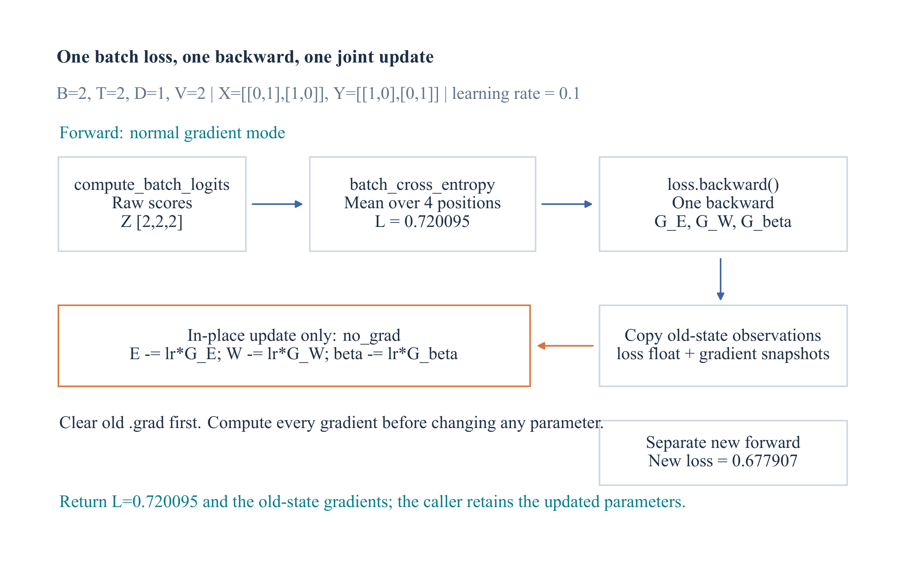{width=100%}

**Figure 03.21-1 — Follow the top row rightward, then the lower row leftward.** Forward and backward use normal gradient mode. Only the final in-place update uses `torch.no_grad()`. Save pre-update observations before that update.

### Complete worked example: four positions, D different from V

Use the hand-picked correctness fixture `batch-two-id-sgd-v1`. Source IDs `[0,1,0,1]`, starts `[0,1]`, and $T=2$ yield:

$$
X=\begin{bmatrix}0&1\\1&0\end{bmatrix},\quad
Y=\begin{bmatrix}1&0\\0&1\end{bmatrix},\quad
E=\begin{bmatrix}1\\2\end{bmatrix},\quad
W=\begin{bmatrix}1&0\end{bmatrix},\quad\beta=[0,0],\quad\eta=0.1
$$

Here $B=2,T=2,D=1,V=2$. The tensor shapes are `E: [2,1]`, `H: [2,2,1]`, `W: [1,2]`, and `Z: [2,2,2]`. The projection changes vector width one to candidate count two. In flat position order `(0,0),(0,1),(1,0),(1,1)`:

| q | Input ID | Vector | Scores | Target ID | Target probability | Position loss |
| --- | --- | --- | --- | --- | --- | --- |
| 0 | 0 | `[1]` | `[1,0]` | 1 | `0.2689414214` | `1.3132616875` |
| 1 | 1 | `[2]` | `[2,0]` | 0 | `0.8807970780` | `0.1269280110` |
| 2 | 1 | `[2]` | `[2,0]` | 0 | `0.8807970780` | `0.1269280110` |
| 3 | 0 | `[1]` | `[1,0]` | 1 | `0.2689414214` | `1.3132616875` |

For `[1,0]`, subtract the maximum one: `[0,-1]`. The target is candidate one, so $p_1=e^{-1}/(1+e^{-1})\approx0.2689414214$ and $-\log p_1=1+\log(1+e^{-1})\approx1.3132616875$. For `[2,0]`, the target is candidate zero, so $p_0=1/(1+e^{-2})\approx0.8807970780$ and loss $\log(1+e^{-2})\approx0.1269280110$.

$$
\mathcal L=\frac{1.3132616875+0.1269280110+0.1269280110+1.3132616875}{4}
\approx0.7200948493
$$

Define $a=0.7310585786/4\approx0.1827646447$ and $c=(0.8807970780-1)/4\approx-0.0298007305$. The full score gradient is:

$$
\widetilde G_Z=\begin{bmatrix}a&-a\\c&-c\\c&-c\\a&-a\end{bmatrix}
$$

Since $W^\mathsf T=[1,0]^\mathsf T$, each vector gradient equals the first component of its score-gradient row. Add the two input-zero contributions to get $2a$, and the two input-one contributions to get $2c$. For the weight gradient, multiply each score-gradient row by its input vector; those vectors are `[1,2,2,1]`. For the bias gradient, sum the four score-gradient rows. Therefore:

$$
G_E=\begin{bmatrix}2a\\2c\end{bmatrix}
\approx\begin{bmatrix}0.3655292893\\-0.0596014610\end{bmatrix}
$$

$$
G_W=[2a+4c,\;-(2a+4c)]
\approx[0.2463263673,-0.2463263673]
$$

$$
G_\beta=[2a+2c,\;-(2a+2c)]
\approx[0.3059278283,-0.3059278283]
$$

Subtract `0.1` times each matching gradient:

$$
\begin{aligned}
E_{\mathrm{new}}&\approx\begin{bmatrix}0.9634470711\\2.0059601461\end{bmatrix},\\
W_{\mathrm{new}}&\approx[0.9753673633,0.0246326367],\\
\beta_{\mathrm{new}}&\approx[-0.0305927828,0.0305927828].
\end{aligned}
$$

For example, $E_{0,0}=1-0.1\times0.3655292893=0.9634470711$. The second row increases because its gradient is negative: $2 - 0.1\times (-0.0596014610) = 2.0059601461$.

The function returns `0.7200948493` and the three **old-state** gradient snapshots. Recomputing forward separately at the new state gives input-zero scores `[0.9091220465,0.0543250245]`, input-one scores `[1.9259552757,0.0800048704]`, selected probabilities `[0.2984275419,0.8636509327,0.8636509327,0.2984275419]`, and new mean loss `0.6779073607`. The supplied driver checks this separate observation; it is not the returned loss.

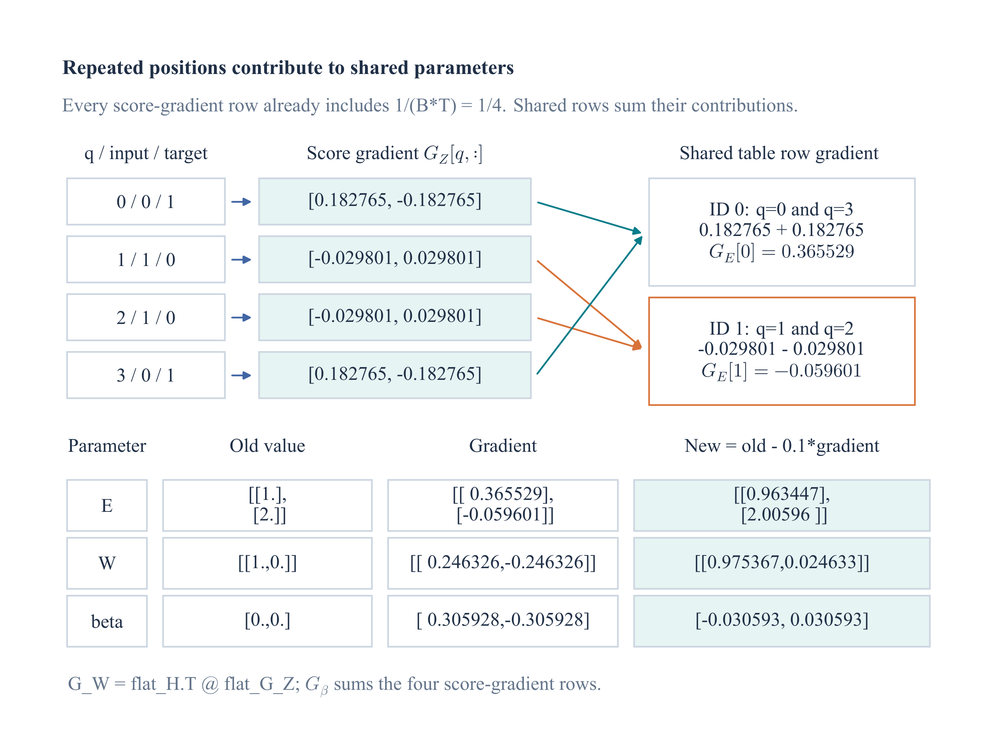{width=100%}

**Figure 03.21-2 — Four position contributions form three shared parameter gradients.** Each contribution already contains the mean factor $\frac{1}{4}$. The lower table shows the original values, gradients, and updated values; every column uses the same fixture.

### Syntax and state before coding

`parameters = (embedding_table, output_weights, output_bias)` creates a tuple of three references. It does not copy the tensors. `for parameter in parameters:` visits each original tensor. Inside that loop, `parameter.grad = None` clears the previous derivative buffer while leaving parameter values unchanged.

Backward adds into gradients already stored on parameters. Add the repeated-ID contributions **within this batch** because they belong to the same loss. Clear gradients **from the previous update** because this step needs the current loss's derivative. Later, we will deliberately accumulate gradients across batches with a separate training rule.

`loss` must remain a connected scalar tensor until `loss.backward()`. Saving `loss_value = loss.item()` separately creates a Python float for reporting. A float has no `.backward()` method. Ordinary backward produces untracked gradient buffers; `.clone()` on each `.grad` gives an independent snapshot without requiring another detach.

`with torch.no_grad():` disables gradient recording inside its indented block. Put only the three updates there. The operation `embedding_table -= learning_rate * embedding_table.grad` changes the original parameter in place. Using `=` to assign a newly computed tensor would only change the local name, leaving the caller's parameter unchanged.

### Eight guided implementation steps

Edit only the marked learner region of `batch_train_step`. The supplied loader already exposes both completed 03.20 helpers. Do not implement softmax or manual gradients here.

1. **Clear previous gradients.** At four spaces, group the three parameters into `parameters`, then start `for parameter in parameters:`. Its body uses eight spaces: set `.grad` to `None`. Exclude IDs; all numerical parameter values remain unchanged.
2. **Compute batch scores.** Return to four spaces. Call `compute_batch_logits(embedding_table, input_ids, output_weights, output_bias)` once and save `logits`, shape `[2,2,2]` in the example. Forward must be outside no-grad.
3. **Compute connected mean loss.** At four spaces, call `batch_cross_entropy(logits, target_ids)` once and save `loss`. It is a scalar tensor near `0.7200948493`. Keep targets unchanged and use the helper's existing mean.
4. **Differentiate once.** At four spaces, call `loss.backward()`. Now `embedding_table.grad`, `output_weights.grad`, and `output_bias.grad` describe the same old parameter state. Finish this before any update.
5. **Save the reporting value.** At four spaces, save `loss_value` with `loss.item()`. Keep the tensor variable distinct from the reporting float.
6. **Copy all gradients.** At four spaces, obtain `gradient_table`, `gradient_weights`, and `gradient_bias` by `.clone()` on each corresponding `.grad`. Their example values are the three matrices/vectors above.
7. **Update originals.** At four spaces, start `with torch.no_grad():`. Its body uses eight spaces: write three explicit `-=` updates using each parameter's own gradient. No nested loop is needed. The example first table entry becomes `0.9634470711`.
8. **Return old-state observations.** Return to four spaces outside the context. Return `loss_value, gradient_table, gradient_weights, gradient_bias` in that order. Do not perform a second forward in this function.

### Supplied checks and expected output

Run from the repository root in the existing environment:

```bash
python exercises/03_21_batch_train_step.py
```

After you implement the core, expected output is:

```text
PASS: four-position mean, all three gradients, in-place update, and pre-update return
PASS: varied B/T/D/V, distinct targets, singleton axes, and one-candidate zero gradients
PASS: completed batch helpers called once with unchanged old parameters before backward
PASS: stale gradients cleared, repeated calls use current parameters, and snapshots stay independent
PASS: zero learning rate still computes gradients; a large step can increase loss
PASS: strided ID tensors, IDs above 255, dtype preservation, and fixed input/random state
PASS: actual window builder and batch helpers connect across three toy updates
Lesson 03.21 checks passed.
```

Before implementation, the deliberate `NotImplementedError` means the learner region is still open. The checks independently compare loss and gradients with a library reference, verify updates and storage continuity, and connect actual completed prerequisites. They are setup supplied for this exercise, rather than code you must write.

### Questions, limitations, and understanding checkpoints

**Is this four separate updates?** Four supervised positions contribute to one mean loss, one backward, and one joint parameter update. A parameter's gradient includes all applicable contributions before it changes.

**Why can two identical positions add yet the average stay unchanged when duplicated?** Each additional contribution increases the sum, while the mean denominator increases proportionally when the whole batch is duplicated. Here each contribution contains $\frac{1}{4}$; the shared-row gradient adds its two contributions. Arbitrary changed batches need not give the same mean or gradient.

**Does clearing `.grad` erase learned values?** No. It resets derivative buffers only. The next forward uses the already updated parameter values.

**Does no-grad stop training?** It prevents the update operation itself from becoming part of a new tracked graph. Forward and backward already computed this step's gradients outside that context.

**Why return a float here when 03.20 returns a tensor?** 03.20 is a differentiable loss component for its caller. This training step has already called backward and returns a reporting value plus copied derivatives.

**Must loss decrease on every update?** No. The worked small step decreases this batch loss. Large steps may increase it, and lower training loss on this tiny fixed fixture does not establish generalization or language-model capability.

**Can I reconstruct the reasoning independently?** Optional checkpoints: explain the four-position denominator; derive `2a` and `2c`; explain why all gradients must use the old state; distinguish previous-step accumulation from repeated IDs; explain snapshots and return timing.

## 03.22 Persistent Training over Ordered Batches {#section-03-22}

Training often uses different batches in successive updates. We will follow an explicit ordered schedule and keep the same parameters throughout. Because both data and parameters change, consecutive losses may rise even when the update works correctly.

Work through the example before editing 03_22_batch_training_loop.py. The numbered steps below explain the interface and guide the core implementation; the supplied setup and check driver remain separate.

### Exact inputs, returns, and state

| Exact name | Type and shape | Meaning |
| --- | --- | --- |
| `embedding_table`, $E$ | Trainable floating leaf tensor `[V,D]` | Existing token-vector table |
| `token_ids` | Fixed `torch.long` tensor `[N]` | Source sequence from which batches are built |
| `output_weights`, $W$ | Trainable floating leaf tensor `[D,V]` | Existing vocabulary projection |
| `output_bias`, $\beta$ | Trainable floating leaf tensor `[V]` | Existing candidate biases |
| `batch_starts` | `list[list[int]]` | Ordered schedule; one inner list supplies the starts for one batch/update |
| `context_length`, $T$ | Positive Python integer | Positions in each input/target row |
| `learning_rate`, $\eta$ | Nonnegative Python float | Multiplier passed unchanged to each step |

$N$ is the source length, $D$ the vector width, and $V$ the candidate count. Let $K=$ `len(batch_starts)`. For update index $k$, $B_k=$ `len(batch_starts[k])`. Batches may have different sample counts. For example, `[[0,1],[3,4]]` means two updates, each with two samples. `[[0],[3,4]]` means two updates with one and two samples respectively. $K$ counts updates; each $B_k$ counts samples within that update.

Assume $N\ge T+1$, every inner list is nonempty, starts satisfy $0\le\texttt{start}\le N-T-1$, IDs are valid, floating dtypes/devices match, parameters have separate storage, and gradient mode is normal. Repeated starts are permitted. The **outer** schedule may be empty. Input validation is not assigned.

Return a fresh `losses: list[float]`, length $K$, preserving update order. Original parameters retain their final values; do not return replacement tensors. Source IDs, the nested schedule, caller gradient mode, and random state stay unchanged. The last step's gradients remain stored. An empty schedule returns `[]`, calls neither helper, and preserves existing parameter values and gradient buffers.

### Changing batches and persistent parameters

For update $k$, let its start list be $S_k$, sample count $B_k$, and sample index $b$. For $k=0,\ldots,K-1$, $b=0,\ldots,B_k-1$, and $t=0,\ldots,T-1$:

$$
(X_k)_{b,t}=\texttt{token\_ids}[S_k[b]+t],\qquad
(Y_k)_{b,t}=\texttt{token\_ids}[S_k[b]+t+1]
$$

Both tensors have shape $[B_k,T]$. Targets are already shifted by one. Reuse `make_next_token_batch(token_ids, start_positions, context_length)` rather than writing the slicing logic again.

Let $\theta_k=(E_k,W_k,\beta_k)$ be the parameters after $k$ updates, before the next update. For the mathematical candidate distribution from those parameters:

$$
\mathcal L_k=\mathcal L(\theta_k;X_k,Y_k)
=-\frac{1}{B_kT}\sum_{b,t}\log P_{\theta_k}(Y_{k,b,t}\mid X_{k,b,t})
$$

This conditional notation refers to the current-ID lookup baseline. It does not yet claim an attention model conditions on the full prefix. For each step, IDs and targets are fixed during differentiation, and the derivative is with respect to the current parameters.

$$
\theta_{k+1}=\theta_k-\eta\nabla_\theta\mathcal L(\theta_k;X_k,Y_k),\qquad
\texttt{losses}[k]=\mathcal L_k
$$

The second step uses the parameter values produced by the first. Keep those same parameter objects throughout the loop; recreating them or restoring initial values would restart training. The helper `batch_train_step` already clears gradients, performs forward and backward, copies observations, and updates the three tensors. This wrapper only builds batches and records the returned loss.

The number of updates and supervised-position budget are:

$$
K=\operatorname{len}(\texttt{batch\_starts}),\qquad
M=T\sum_{k=0}^{K-1} B_k
$$

$M$ counts processed supervision positions, including repeated windows and overlaps. It is not a count of unique source IDs, new generated tokens, or the number of vocabulary entries.

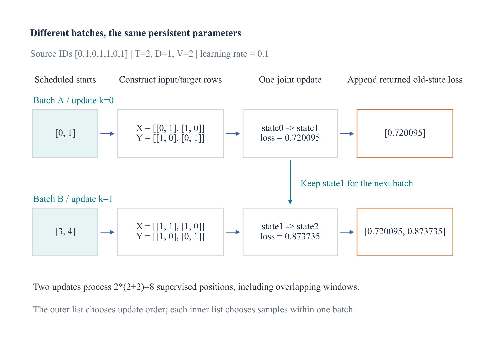{width=100%}

**Figure 03.22-1 — Read the two update rows from top to bottom.** Each row lists its source starts, constructed inputs and targets, old/new parameter state, and one returned loss. The first row produces the state used by the second.

### Complete worked example: two distinct batches

Use the hand-picked correctness fixture `ordered-two-batch-v1`:

```text
token_ids = [0,1,0,1,1,0,1]
batch_starts = [[0,1],[3,4]]
context_length = 2
learning_rate = 0.1
```

Initial parameters are `E=[[1],[2]]`, `W=[[1,0]]`, and `beta=[0,0]`, so $D=1,V=2$. There are $K=2$ updates, $B_0=B_1=2$ samples per update, and $M=2(2+2)=8$ processed supervision positions. The source has seven IDs; overlapping windows legitimately give eight processed positions.

#### First batch: starts [0,1], state $\theta_{0}$

Start zero gives input `[0,1]`, target `[1,0]`. Start one gives input `[1,0]`, target `[0,1]`:

$$
X_0=\begin{bmatrix}0&1\\1&0\end{bmatrix},\qquad
Y_0=\begin{bmatrix}1&0\\0&1\end{bmatrix}
$$

This matches 03.21's full example. Flat score rows are `[1,0],[2,0],[2,0],[1,0]`. Targets `[1,0,0,1]` select probabilities `[0.2689414214,0.8807970780,0.8807970780,0.2689414214]`. Four position losses are:

```text
[1.3132616875, 0.1269280110, 0.1269280110, 1.3132616875]
```

Their mean is $L_0=0.7200948493$. The old-state gradients are:

```text
G_E    = [[ 0.3655292893],[-0.0596014610]]
G_W    = [[ 0.2463263673, -0.2463263673]]
G_beta = [ 0.3059278283, -0.3059278283]
```

The first step changes the original parameters to state $\theta_1$:

```text
E_1    = [[0.9634470711],[2.0059601461]]
W_1    = [[0.9753673633,0.0246326367]]
beta_1 = [-0.0305927828,0.0305927828]
losses = [0.7200948493]
```

The append happens after the helper returns, but the number describes the state **before** its update. Do not recompute it with the new parameters.

#### Second batch: starts [3,4], state $\theta_{1}$

Start three gives input `[1,1]`, target `[1,0]`. Start four gives input `[1,0]`, target `[0,1]`:

$$
X_1=\begin{bmatrix}1&1\\1&0\end{bmatrix},\qquad
Y_1=\begin{bmatrix}1&0\\0&1\end{bmatrix}
$$

The source includes a $1\to 1$ pair; these targets are correct. Use $\theta_1$ from the preceding update. Input one now gives scores `[1.9259552757,0.0800048704]`; input zero gives `[0.9091220465,0.0543250245]`. For example, candidate zero for input one is $2.0059601461\times 0.9753673633 - 0.0305927828 \approx  1.9259552757$.

| q | Input ID | Target ID | Selected probability | Position loss |
| --- | --- | --- | --- | --- |
| 0 | 1 | 1 | `0.1363490673` | `1.9925370102` |
| 1 | 1 | 0 | `0.8636509327` | `0.1465866049` |
| 2 | 1 | 0 | `0.8636509327` | `0.1465866049` |
| 3 | 0 | 1 | `0.2984275419` | `1.2092281165` |

Thus:

$$
\mathcal L_1=\frac{1.9925370102+0.1465866049+0.1465866049+1.2092281165}{4}
\approx0.8737345841
$$

The second old-state gradients are:

```text
G_E    = [[0.1667523248],[0.1404598367]]
G_W    = [[0.4653389228,-0.4653389228]]
G_beta = [0.3231313141,-0.3231313141]
```

For instance, the last position's score gradient is approximately `[0.1753931145,-0.1753931145]`. Multiplying by $W_1^{\mathsf T}$ gives its input-zero table gradient $0.1753931145\times (0.9753673633-0.0246326367) \approx  0.1667523248$. Three input-one positions contribute to their shared row. The complete chain-rule derivation is retained in 03.21; this wrapper delegates it to the step helper.

After the second update, the same original tensors hold $\theta_2$:

```text
E_2    = [[0.9467718386],[1.9919141624]]
W_2    = [[0.9288334710,0.0711665290]]
beta_2 = [-0.0629059142,0.0629059142]
losses = [0.7200948493,0.8737345841]
```

Return this two-item history. For example, $(E_2)_{0,0}=0.9634470711-0.1\times0.1667523248\approx0.9467718386$. The caller already holds the final parameter tensors. A separate final evaluation is not a third update or an extra history item.

### Why the returned loss history can rise

The two history entries measure different data at different parameter states:

$$
\texttt{losses}[0]=\mathcal L(\theta_0;X_0,Y_0),\qquad
\texttt{losses}[1]=\mathcal L(\theta_1;X_1,Y_1)
$$

Batch B contains a harder $1\to 1$ target for the current model. Comparing `0.720095` with `0.873735` alone cannot isolate the effect of the parameter update. For this illustration, recompute each fixed batch separately at the same successive states:

| Parameter state | Fixed batch A | Fixed batch B |
| --- | --- | --- |
| $\theta_0$ | `0.7200948493` | `0.9235114302` |
| $\theta_1$ | `0.6779073607` | `0.8737345841` |
| $\theta_2$ | `0.6404176541` | `0.8092791313` |

Both fixed-batch columns decrease **in this example**. The history instead switches from batch A at $\theta_0$ to batch B at $\theta_1$, so its two numbers need not fall. These repeated evaluations explain the example; they do not use held-out validation data. In general, a small step need not lower every batch's loss. Later, we will define a fixed evaluation protocol and a separate validation split.

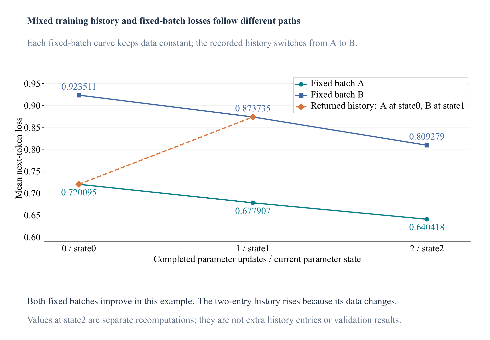{width=100%}

**Figure 03.22-2 — The horizontal axis counts completed updates.** The two solid curves each keep their data fixed while parameters change. The orange dashed history joins A at update count zero to B at count one. It has two entries; the final state at count two has no automatic history entry.

### Syntax and control flow before implementation

`batch_starts` is a list of lists. The loop `for start_positions in batch_starts:` receives each inner list. For `[[0,1],[3,4]]`, it receives `[0,1]`, then `[3,4]`. These are batch start lists, not update indices `0,1` or single start values.

`make_next_token_batch(...)` returns two tensors; tuple unpacking saves them as `input_ids, target_ids`. `batch_train_step(...)` returns a four-item tuple. Save it as `step_result`; `[0]` selects the pre-update Python float. `losses.append(loss_value)` adds one float to the fresh list.

Function-level setup, the `for` header, and the final `return` use four spaces. Everything inside the loop uses eight. When the outer list is empty, the loop body runs zero times and execution still reaches `return losses`. Returning inside the loop would stop after its first batch and would not handle an empty schedule correctly.

The builder aligns inputs with targets. The step helper clears gradients, runs forward and backward, saves snapshots, and updates parameters. Keep the coordinating loop in normal gradient mode so the step can record its forward operations. Do not add another update or recreate parameters.

### Seven guided implementation steps

Write only `train_batches`'s marked learner region after completing 03.21.

1. **Create history.** At four spaces, create `losses` with `[]`. Expected initial state: a new empty list; parameter tensors already exist.
2. **Visit scheduled batches.** At four spaces, start `for start_positions in batch_starts:`. Its eight-space body first receives `[0,1]`, then `[3,4]` in the example.
3. **Construct this batch.** At eight spaces, call `make_next_token_batch(token_ids, start_positions, context_length)` once and unpack `input_ids, target_ids`. First shapes `[2,2]`; use the builder's existing target shift.
4. **Train once.** At eight spaces, call `batch_train_step(embedding_table, input_ids, output_weights, output_bias, target_ids, learning_rate)` once, saving `step_result`. It changes the original parameters to the next state.
5. **Select its old-state loss.** At eight spaces, save `step_result[0]` as `loss_value`. First value `0.7200948493`; second value `0.8737345841`.
6. **Append once.** At eight spaces, use `losses.append(loss_value)`. Store neither the whole tuple nor gradients. After two updates, the list has two floats.
7. **Return after the loop.** At four spaces, return `losses`. An empty schedule gives `[]`. The caller's original parameters retain their final state; do not append a final recomputed loss.

### Supplied checks and expected output

After completing both the prerequisite 03.21 and this core, run from the repository root:

```bash
python exercises/03_22_batch_training_loop.py
```

Expected output:

```text
PASS: two different batches, pre-update history, and persistent final parameters
PASS: empty schedule returns a fresh list and preserves values and existing gradient buffers
PASS: supplied batch order, varying batch sizes, repeated starts, and aligned targets
PASS: one builder and one step call per batch, same parameter objects, and normal gradient mode
PASS: separate calls continue from current parameters and keep independent loss histories
PASS: zero learning rate still visits every scheduled batch and records one loss each
PASS: strided source, IDs above 255, dtype preservation, and unchanged source/schedule/random state
Lesson 03.22 checks passed.
```

Before implementation, `NotImplementedError` marks an open learner core. A completed 03.22 loop also needs the completed 03.21 helper to run nonempty schedules. Check-driver initialization and library references are supplied, not additional learner assignments.

### Reader questions and understanding checkpoints

**Is a batch the whole source sequence?** No. The source is `[N]`; an inner start list selects several length-$T$ windows to form $[B_k,T]$. The outer schedule specifies which batch is used at each update.

**Does a repeated input ID with different targets mean bad alignment?** Not necessarily. Our source includes both $1\to 0$ and $1\to 1$. The current-ID baseline must share one distribution for input one across those occurrences. A contextual model can later distinguish occurrences using prior context, while data targets remain the observed next IDs.

**Should I initialize parameters inside the loop?** No. Preserve the recurrence: the next batch uses what the preceding update learned. A separate call also continues from the current values supplied by its caller.

**Is an empty schedule the same as zero learning rate?** No. Empty means no batch or step call and no gradient changes. Zero learning rate with a nonempty schedule still builds every batch, computes each loss/gradient, and records the results; parameter values stay unchanged.

**Is this an epoch or random sampling?** The schedule is simply a supplied ordered list. It does not guarantee covering a dataset once and introduces no randomness. Epoch definitions, shuffling, and random-stream ownership will be introduced explicitly later.

**Can I compare a mixed history as validation?** These entries use changing training data and changing parameter states. A fixed evaluation set at a given state is a different measurement. If batch sizes vary, averaging batch means also needs deliberate weighting; full evaluation is later work.

Optional independent checkpoints: distinguish $N$, $K$, $B_k$, and $T$; construct both batches by hand; trace old-state loss timing and shared parameter continuity; explain the mixed-history rise, empty schedule, and zero rate. Try an explanation first, then check it against a small trace.

## 03.23 Fixed-Parameter Batch Loss Evaluation {#section-03-23}

To compare parameter states, measure their losses without training during the measurement. Keep one parameter state fixed across all evaluation batches. Add the loss from every selected position and divide by the total position count. If batches differ in size, weight each batch mean by its number of positions.

Work through the example before editing 03_23_evaluate_batches.py. The numbered steps below explain the interface and guide the core implementation; the supplied setup and check driver remain separate.

### Exact inputs, return, and state

| Exact name | Type/shape | Meaning |
| --- | --- | --- |
| `embedding_table`, $E$ | Floating tensor `[V,D]` | Supplied token vectors |
| `token_ids` | Fixed `torch.long` tensor `[N]` | Supplied evaluation source |
| `output_weights`, $W$ | Floating tensor `[D,V]` | Supplied vocabulary projection |
| `output_bias`, $\beta$ | Floating tensor `[V]` | Supplied candidate biases |
| `batch_starts` | Nonempty `list[list[int]]` | One nonempty start list per evaluation batch |
| `context_length`, $T$ | Positive integer | Supervised positions per sample |

There is no `learning_rate`: the evaluator reads the supplied parameter state. Parameters may have `requires_grad=True` or `False`; preserve those flags. Assume valid IDs, compatible floating dtypes/devices, $N\ge T+1$, valid starts $0\le\texttt{start}\le N-T-1$, and finite scores in the checks' supported numerical range. No input validation is assigned.

Return one Python float: total position loss divided by total position count. Preserve parameter values/storage/dtype/device/trainability, existing gradient-buffer objects and values, source IDs, nested schedule, caller gradient mode, and random state. Do not backward, clear gradients, update parameters, or call `batch_train_step`/`train_batches`.

Different batches may have different $B_k$. Every scheduled occurrence counts, including repeated starts and overlapping windows. Evaluation grouping can change without changing the result when it covers the same position occurrences at the same parameter state. Changing or duplicating only some occurrences changes their weighting and can change the metric.

### A single fixed parameter state

Let $\theta=(E,W,\beta)$ stay fixed across all $K$ evaluation batches. Batch $k$ has $B_k$ rows, $T$ positions per row, and $n_k=B_kT$ supervised positions. The builder supplies aligned inputs $X_k$ and targets $Y_k$.

Indices are $k=0,\ldots,K-1$, $b=0,\ldots,B_k-1$, $t=0,\ldots,T-1$, $d=0,\ldots,D-1$, and candidate $v,j=0,\ldots,V-1$. For each position, the score distribution and target loss are:

$$
Z_{k,b,t,v}=\sum_d E[X_{k,b,t},d]W_{d,v}+\beta_v,\qquad
P_{k,b,t,v}=\frac{e^{Z_{k,b,t,v}}}{\sum_j e^{Z_{k,b,t,j}}}
$$

$$
\ell_{k,b,t}=-\log P_{k,b,t,Y_{k,b,t}},\qquad
\overline{\mathcal L}_k=\frac1{n_k}\sum_{b,t}\ell_{k,b,t}
$$

The stable completed loss helper returns $\overline{\mathcal L}_k$, the **mean within this batch**. Our requested overall objective assigns equal weight to every scheduled position:

$$
M=\sum_{k=0}^{K-1} n_k,\qquad
\mathcal L_{\mathrm{eval}}=\frac1M\sum_{k,b,t}\ell_{k,b,t}
=\frac{\sum_k n_k\overline{\mathcal L}_k}{\sum_k n_k}
$$

To recover a batch's total loss, multiply its mean by its position count: $n_k\overline{\mathcal L}_k=\sum_{b,t}\ell_{k,b,t}$. Add these totals, then divide by the total number of positions. Every position receives the same weight. This exercise uses no padding, ignored IDs, class weights, or label smoothing.

In code, `target_ids.numel()` supplies $n_k$, `loss.item()*batch_positions` reconstructs the batch's loss sum, and two Python accumulators hold the total sum and count.

For comparison, equal weighting of batch means gives:

$$
\mathcal L_{\mathrm{batches}}=\frac1K\sum_k\overline{\mathcal L}_k
$$

Under equal batch weighting, a position in batch $k$ has weight $1/(Kn_k)$. Our objective instead gives every position weight $1/M$. The formulas agree when batch sizes match. With unequal sizes they generally differ, even if particular loss values happen to give the same answer.

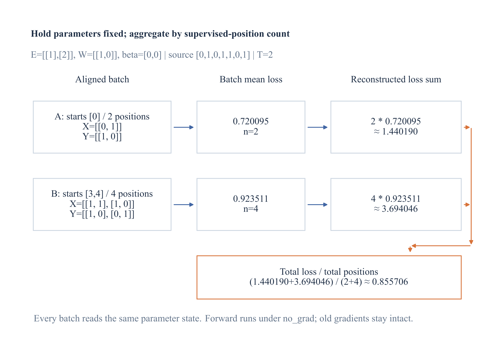{width=100%}

**Figure 03.23-1 — Follow the two batch rows into the final aggregation.** Both rows read the same parameters. Their counts multiply the returned means before summation. The final denominator is six positions.

### Complete worked example: two and four positions

Use the hand-picked correctness fixture `fixed-eval-six-pairs-v1`:

```text
token_ids = [0,1,0,1,1,0,1]
batch_starts = [[0],[3,4]]
context_length = 2
E = [[1],[2]]
W = [[1,0]]
beta = [0,0]
```

Here $N=7,T=2,D=1,V=2$. The first batch has one sample; the second has two. Parameters stay at this initial state throughout. In particular, the second batch does **not** use the updated parameters from 03.22's example.

#### Batch A: start [0], B=1, n=2

```text
input_ids  = [[0,1]]
target_ids = [[1,0]]
logits     = [[[1,0],[2,0]]]
```

For input zero, target one has probability $e^{-1}/(1+e^{-1})\approx0.2689414214$, giving loss $1+\log(1+e^{-1})\approx1.3132616875$. For input one, target zero has probability $1/(1+e^{-2})\approx0.8807970780$, giving loss $\log(1+e^{-2})\approx0.1269280110$.

$$
\overline{\mathcal L}_A=\frac{1.3132616875+0.1269280110}{2}
\approx0.7200948493
$$

Multiplying by two positions reconstructs `1.4401896986`. Running totals become `loss_sum=1.4401896986`, `total_positions=2`.

#### Batch B: starts [3,4], B=2, n=4

```text
input_ids  = [[1,1],[1,0]]
target_ids = [[1,0],[0,1]]
logits     = [[[2,0],[2,0]],[[2,0],[1,0]]]
```

These four positions still use the initial `E,W,beta`:

| Flat position | Input ID | Target ID | Target probability | Position loss |
| --- | --- | --- | --- | --- |
| 0 | 1 | 1 | `0.1192029220` | `2.1269280110` |
| 1 | 1 | 0 | `0.8807970780` | `0.1269280110` |
| 2 | 1 | 0 | `0.8807970780` | `0.1269280110` |
| 3 | 0 | 1 | `0.2689414214` | `1.3132616875` |

The first row is harder: for scores `[2,0]`, target one gives loss $2+\log(1+e^{-2})\approx2.1269280110$. The four losses sum to `3.6940457206`; their mean is `0.9235114302`.

Running totals now become:

```text
loss_sum = 1.4401896986 + 3.6940457206 = 5.1342354192
total_positions = 2 + 4 = 6
```

Thus return:

$$
\mathcal L_{\mathrm{eval}}
=\frac{2(0.7200948493)+4(0.9235114302)}6
\approx0.8557059032
$$

Writing the two batch means as $L_A$ and $L_B$, the same weighted result is:

$$
L_{eval}=\frac{2L_A+4L_B}{6}\approx0.8557059032.
$$

Directly averaging the two batch means instead gives:

$$
\mathcal L_{\mathrm{batches}}
=\frac{0.7200948493+0.9235114302}{2}
\approx0.8218031397
$$

It overweights each position in the smaller batch relative to a position in the larger batch. Under equal batch weights, the two A positions each receive $\frac{1}{4}$ and the four B positions each receive $\frac{1}{8}$. Under the requested position mean, all six receive $\frac{1}{6}$. Using rounded display values may slightly change final digits; checks and figures calculate with full precision.

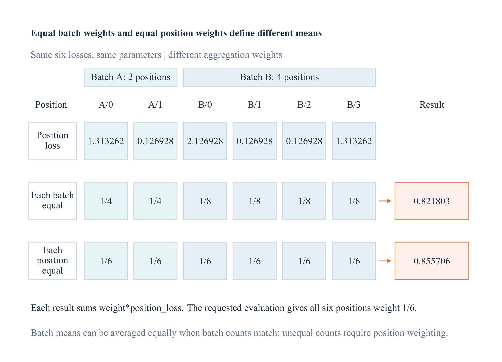{width=100%}

**Figure 03.23-2 — Read down each position column.** Its loss is unchanged; the weight differs between the two aggregation rows. Each displayed result is the sum of $\mathrm{weight}\times\mathrm{position\_loss}$. Only the position-equal row implements this assignment's objective.

### Evaluation state and no-grad scope

Use `with torch.no_grad():` around the evaluation loop. It disables recording ordinary reverse-mode gradient computations for the lookup, projection, and loss operations, while retaining parameter trainability. Its context restores the caller's previous gradient mode when it exits. [PyTorch no-grad documentation](https://docs.pytorch.org/docs/2.0/generated/torch.no_grad.html).

No-grad does not prevent parameter changes; 03.21 uses it to apply updates. This evaluator preserves parameters by only reading them and computing scores and losses. It also leaves existing `.grad` buffers unchanged, including any derivatives from the last training step. The new evaluation scores and losses have no autograd graph.

Later, an `nn.Module` model may also require `model.eval()` to change how its layers behave. For example, Dropout randomly suppresses activations during training but stops doing so in evaluation mode. This setting is separate from gradient tracking. No-grad does not switch layer behavior. This exercise uses plain parameter tensors, so do not call `.eval()` on them. See the [module evaluation documentation](https://docs.pytorch.org/docs/2.0/generated/torch.nn.Module.html#torch.nn.Module.eval).

Evaluation here needs a reporting value, so `.item()` is appropriate after computing the mean tensor. In 03.20, returning `.item()` would have removed the graph needed by a training caller; this evaluator has no backward operation to perform.

### Syntax and indentation before coding

`loss_sum = 0.0` initializes a Python float. `total_positions = 0` initializes a Python integer. Both are created fresh for each call. `target_ids.numel()` returns an element count: a tensor with shape `[1,2]` has two elements, and one with shape `[2,2]` has four. It does not sum ID numbers or count vocabulary candidates.

Use four spaces for the initial totals and `with torch.no_grad():`. The `for start_positions in batch_starts:` header sits inside that context at eight spaces. Its batch-building/score/loss/aggregation body uses twelve spaces. Return to four spaces for the final division/return, outside both loop and context.

The nesting applies gradient settings while iterating. `+=` increases each total; multiplication by the batch count first reverses the helper's within-batch mean, so it is not a second averaging operation. A final positive denominator is guaranteed by the nonempty-input assumptions.

### Eight guided implementation steps

Write only `evaluate_batches`'s marked learner region.

1. **Create totals.** At four spaces, initialize `loss_sum` to `0.0` and `total_positions` to `0`. Parameters are supplied; keep their values and flags.
2. **Enter evaluation gradient scope.** At four spaces, start `with torch.no_grad():`. Keep this setting local to the context.
3. **Visit batches.** At eight spaces, start `for start_positions in batch_starts:`. The loop body is twelve spaces. In the example, starts are `[0]` then `[3,4]`.
4. **Build aligned IDs.** At twelve spaces, call `make_next_token_batch(token_ids, start_positions, context_length)` once and unpack `input_ids, target_ids`. Shapes are `[1,2]` then `[2,2]`.
5. **Compute raw scores.** At twelve spaces, call `compute_batch_logits(embedding_table, input_ids, output_weights, output_bias)` once, saving `logits`. Shapes are `[1,2,2]` then `[2,2,2]`, using identical parameter values.
6. **Compute this batch's mean.** At twelve spaces, call `batch_cross_entropy(logits, target_ids)` once, saving `loss`. Means are approximately `0.7200948493` and `0.9235114302`.
7. **Add sum and count.** At twelve spaces, obtain `batch_positions = target_ids.numel()`. Increase `loss_sum` by `loss.item()*batch_positions` and `total_positions` by `batch_positions`. Totals progress from `(1.4401896986,2)` to `(5.1342354192,6)`.
8. **Return the overall position mean.** Back at four spaces, return `loss_sum / total_positions`. The result is a Python float near `0.8557059032`. The original parameter state and stored gradients remain unchanged.

### Supplied checks and expected output

Run from the repository root in the existing environment after implementing this core:

```bash
python exercises/03_23_evaluate_batches.py
```

Expected output:

```text
PASS: six-position mean weights unequal batch sizes and returns one Python float
PASS: grouping/order invariance for the same positions and deliberate duplicate-start counting
PASS: each completed helper reused once per batch under no-grad without score/loss graphs
PASS: fixed parameter values/storage/trainability and existing gradient objects/values preserved
PASS: repeated fixed-state results agree and changed supplied parameters are reevaluated
PASS: one-candidate zero loss and stable finite loss for extreme raw scores
PASS: strided source, merged IDs, floating dtypes, untrainable tensors, and caller-mode restoration
Lesson 03.23 checks passed.
```

`NotImplementedError` before coding indicates the deliberately open learner region. The supplied reference concatenates scheduled position occurrences and calculates one library mean independently of this batch-weight aggregation. The numeric prerequisite helpers are completed; unfinished training exercises are not imported by this driver.

### Training, validation, and reader questions

**Is calling this function enough to create a validation set?** No. It measures the sequence and windows supplied by its caller. Training loss uses data involved in updates; validation loss uses data held out from those updates. Our familiar six-pair fixture demonstrates arithmetic only. A later lesson will implement a reproducible split and evaluation schedule.

**Where should a split happen?** Separate source texts/documents before constructing overlapping windows, then build windows separately within each chosen partition. Splitting already overlapping windows can place the same token spans in both sets. A future corpus protocol also records tokenizer/data versions and document boundaries.

**What should stay fixed for a before/after comparison?** Use the same evaluation source, start schedule, target alignment, tokenizer interpretation, weighting, and model behavior. Compare parameter states by running the evaluator separately; each call itself holds one state fixed.

**Can I shuffle or regroup these batches?** For this deterministic model, the result stays the same up to rounding if every selected position occurs the same number of times. Duplicating or dropping only some occurrences changes their weights. Later contextual models also need each sample's context and masks preserved when samples are regrouped.

**Why assume a nonempty evaluation?** A mean over zero positions has no positive denominator. Reporting zero would falsely resemble a perfect score. This exercise assumes valid nonempty schedules rather than assigning an empty-policy implementation; 03.22's empty training history is a different contract.

**Does lower evaluation loss prove a useful language model?** It shows better target probabilities on this specified protocol. Generalization, generation quality, factual accuracy, and other capabilities need separate datasets and evaluations. The tiny lookup fixture establishes arithmetic and state behavior.

Optional independent checkpoints: derive the count-weighted mean; explain `numel()` and mean-to-sum conversion; distinguish no-grad, trainability, existing gradients, and later module mode; explain fixed-data comparisons and held-out sources. Try an explanation first, then check it against a small trace.

### Placement in the course

[Lesson 03.24](#section-03-24) now connects encoding, the ordered training schedule, this fixed-parameter evaluator, and generation in one byte-baseline run. The evaluator continues to measure the caller-supplied windows; the combined fixture does not introduce a held-out split.

## 03.24 Connect the small baseline {#section-03-24}

We can now connect the baseline's components in one run: encode text, train on a specified batch schedule, evaluate the final parameters, generate IDs, and decode the continuation. Following the full calculation will show what this baseline does and why the next chapter adds earlier context.

Work through the example before editing 03_24_baseline_pipeline.py. The numbered steps below explain the interface and guide the core implementation; the supplied setup and check driver remain separate.

### Formulas and principles first

Write the parameter state as

$$
\theta=(E,W,\beta),\qquad E\in\mathbb R^{256\times1},\quad W\in\mathbb R^{1\times256},\quad\beta\in\mathbb R^{256}.
$$

$E$ is the embedding table, $W$ the vocabulary projection, $\beta$ the bias. $V=256$
comes from byte IDs 0–255; $D=1$ is a teaching choice. Supplied initialization uses
ones for $E$ and zeros for $W$/$\beta$; all three tensors are trainable.

Every input position independently looks up and scores its current ID:

$$
h_{b,t}=E[X_{b,t}],\qquad z_{b,t}=h_{b,t}W+\beta,\qquad p_{b,t}=\operatorname{softmax}(z_{b,t}).
$$

$b$ indexes batch samples, $t$ window positions and $v$ vocabulary candidates.
Targets $Y$ are already shifted by one from $X$; do not shift them again.

For training batch $k$, $B_k$ is its number of windows and $T$ is the number of input/target positions per window. Let $K$ count all parameter updates in the run, including every repetition of the schedule. Each batch computes a mean next-token loss and one update:

$$
L_k=-\frac1{B_kT}\sum_{b=0}^{B_k-1}\sum_{t=0}^{T-1}\log p_{\theta_k}(Y_{k,b,t}\mid X_{k,b,t}),
\qquad\theta_{k+1}=\theta_k-\eta\nabla_\theta L_k.
$$

$\eta$ is `learning_rate`, $T$ is `context_length`. 03.21/03.22 already implement
these operations. `history[k]` records pre-update $L_{k}$; the final parameters are
at $\theta_{K}$.

Evaluation keeps $\theta_{K}$ fixed and aggregates all selected positions:

$$
L_{eval}=\frac{\sum_j n_j\overline L_j(\theta_K)}{\sum_j n_j},\qquad n_j=B_jT.
$$

$j$ indexes evaluation batches. The `evaluate_batches` helper from 03.23 weights each batch mean by its number of targets and runs the forward calculation under no-grad. It neither updates parameters nor clears existing gradients.

Generation also keeps $\theta_{K}$ fixed and selects one new ID at a time:

$$
x_{new}=\arg\max_{v\in\{0,\ldots,255\}}p_{\theta_K}(v\mid x_{last}).
$$

The lookup baseline uses only the final input ID to predict the next token. Passing a longer prefix does not make it use earlier tokens. Chapter 04 adds that context processing with attention.

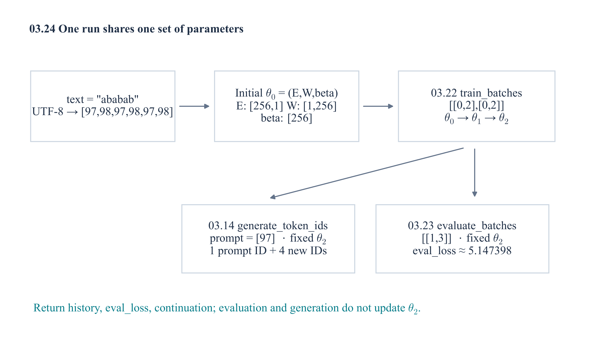{width=100%}

Read the top row in execution order, then follow final $\theta_{2}$ into both lower
stages. Arrows show data/state transfer, not evaluation-driven updates.

### Function contract

```python
def run_baseline(
    text: str,
    train_starts: list[list[int]],
    eval_starts: list[list[int]],
    context_length: int,
    learning_rate: float,
    updates: int,
) -> dict:
```

| Input | Type and meaning | Fixture |
| --- | --- | --- |
| text | Nonempty ASCII str, encoded into $N$ byte IDs; $N\ge T+1$ | `"ababab"` |
| train_starts | Nonempty list of nonempty start lists; one inner list per batch | `[[0,2]]` |
| eval_starts | Nonempty nested evaluation start schedule | `[[1,3]]` |
| context_length | Positive $T$, input and shifted-target positions per window | `2` |
| learning_rate | Nonnegative $\eta$, passed only to training | `0.2` |
| updates | Nonnegative integer **repeat count for the entire train_starts schedule**, retaining the existing parameter name | `2` |

Every start satisfies $0\le\texttt{start}\le N-T-1$. Assume valid inputs; validation is
not a separate learner task.

If `train_starts` has $M$ batches, actual parameter-update count is

$$
K=\texttt{updates}\times M,
\qquad C_{positions}=\texttt{updates}\times T\sum_{m=0}^{M-1}|\texttt{train\_starts}[m]|.
$$

`[[0],[1,3]] * 2` gives four batches. List multiplication repeats the items; it does not multiply the start values. The repeated inner lists refer to the same objects. This is suitable here because 03.22 reads the schedule without changing it.

The result dictionary has three fields:

| Key | Type | Meaning |
| --- | --- | --- |
| `history` | `list[float]` | One pre-update mean per actual training update |
| `eval_loss` | `float` | Mean under final fixed parameters |
| `continuation` | `str` | Generated text excluding the prompt |

This interface returns reports, not parameter tensors or a checkpoint.
Later lessons introduce saved training state.

### Complete worked trace

Use the input table above. Encoding gives:

```text
text       = "ababab"
position   =  0   1   2   3   4   5
token_ids  = [97, 98, 97, 98, 97, 98]
```

`text.encode("utf-8")` produces bytes, and `list(...)` reads their integer values. Store those values in a long tensor of shape `[6]`. Long is the integer storage type used for indices; the IDs still have their original byte meanings.

**Build the training schedule.** `[[0,2]] * 2` gives `[[0,2],[0,2]]`.
Both batches visit the same source windows:

```text
start0: X=[97,98], Y=[98,97]
start2: X=[97,98], Y=[98,97]
X=[[97,98],[97,98]], Y=[[98,97],[98,97]]
B=2, T=2; both shapes [2,2]
```

Initially $E$ rows are `[1]` and $W$/$\beta$ zero, so all 256 logits at each position
are zero. Every candidate probability is $1/256$; every target loss is

$$
-\log(1/256)=\log256\approx5.5451774445.
$$

The mean of four identical losses is still 5.5451774445; neither multiply nor
divide it by four again. 03.22 records this loss and updates to $\theta_{1}$.
The second batch uses $\theta_{1}$ and records 5.3469056593 before updating to $\theta_{2}$.
Two batches × two windows × two targets process eight position occurrences,
including repeated data.

**Evaluate final $\theta_{2}$.** `eval_starts=[[1,3]]` gives:

```text
start1: X=[98,97], Y=[97,98]
start3: X=[98,97], Y=[97,98]
```

These four targets under the final state yield `eval_loss≈5.1473975533`.
This is not a third history entry; it occurs after all training updates.

{width=100%}

$\theta_{0}$/$\theta_{1}$ feed training updates and their losses enter history. $\theta_{2}$
feeds separate fixed evaluation. Different starts still use the same short
text, not independent validation.

**Generate four new IDs.** `token_ids[:1]` is the one-dimensional prompt
`tensor([97])`. The generator returns the full prompt plus new IDs, length 1+4=5.
The verified run produced:

```text
full generated_ids  = [97,98,98,98,98]
remove one prompt ID= [98,98,98,98]
.tolist()           = [98,98,98,98]   # Python integers
bytes(...)          = b"bbbb"
decode(...)         = "bbbb"         # Python string
```

This is an observed run, not an exact output requirement on every platform.
The mathematical a/b probabilities are symmetric; tiny rounding or tie choices
can select a or b. Checks require the interfaces and four generated byte positions.

The report for this run is approximately:

```text
history      = [5.5451774445, 5.3469056593]
eval_loss    = 5.1473975533
continuation = "bbbb"
```

Why does this run not automatically continue abab? All embedding values start at the same 1. Balanced a/b targets preserve that symmetry. Both probabilities rise from 0.00390625 to about 0.005814517, so loss falls, but greedy generation may still repeat one ID. If parameter values break the symmetry, a current-token model can learn a→b and b→a. Its inability to distinguish prefixes ending in the same ID is a separate limit. This example checks that the components work together, not language ability.

### Eight implementation steps: learner writes the core

Open 03_24_baseline_pipeline.py,
edit only the learner region, and keep **four spaces** for all these function-body
steps. Helpers already contain their loops; do not add another training loop.

1. **Encode IDs.** Use `text.encode("utf-8")` to obtain bytes, turn them into a list with `list(text.encode("utf-8"))`, then pass that list to `torch.tensor` with `dtype=torch.long` for `token_ids`, shape `[6]`, values `[97,98,97,98,97,98]`.
2. **Initialize once.** Call supplied `initial_parameters()` and unpack `embedding_table,output_weights,output_bias`, shapes `[256,1],[1,256],[256]`. Keep these objects through the run.
3. **Repeat the schedule.** Save `train_starts * updates` as `training_schedule`; fixture `[[0,2],[0,2]]`. Zero repeats gives `[]` without a special branch.
4. **Train.** Call `train_batches` with `embedding_table,token_ids,output_weights,output_bias,training_schedule,context_length,learning_rate`, storing `history`. Do not wrap the pipeline in no-grad; training needs a graph.
5. **Evaluate.** Call `evaluate_batches` with `embedding_table,token_ids,output_weights,output_bias,eval_starts,context_length`, storing `eval_loss`. No learning-rate argument, reinitialization or gradient clearing.
6. **Prompt and generate.** Take `context_ids=token_ids[:1]`, shape `[1]`; indexing with `[0]` gives a scalar and a Python list is not the required tensor. Call `generate_token_ids` with `embedding_table,context_ids,output_weights,output_bias,4`, storing complete `generated_ids`, shape `[5]`.
7. **Decode only new IDs.** Slice past `context_ids.numel()` prompt IDs. Convert the tensor to a Python list with `continuation_ids.tolist()`, construct `continuation_bytes = bytes(continuation_ids.tolist())` from that list, then use `continuation_bytes.decode("utf-8", errors="replace")` to obtain `continuation`. Join bytes before decoding, not individually.
8. **Return a dictionary.** Use dictionary syntax `{"name": value}` for the three named fields `history,eval_loss,continuation`, mapped to the saved results. Return at four spaces.

Remove the placeholder `raise NotImplementedError(...)`; retain supplied imports,
initialization and check driver.

### Boundaries and misconceptions

- Zero repeats returns `history=[]` but still evaluates and generates. Initial evaluation is ln 256; the function still executes.
- a/b tie behavior is not a reason to hardcode the example continuation.
- 03.14 returns prompt+continuation; this wrapper reports continuation only.
- `errors="replace"` is a display policy, not a change to targets, generated IDs or parameters.
- Training/evaluation windows overlap in this fixture. Real held-out evaluation requires document splits and a frozen tokenizer.
- Byte IDs can be converted directly to bytes; merged BPE IDs need vocabulary lookup first.
- Initializing per run is different from initializing per batch, which discards learned updates.

### Run and check

From the repository root in the existing PyTorch environment:

```bash
python exercises/03_24_baseline_pipeline.py
```

Final success line:

```text
Lesson 03.24 checks passed.
```

Checks cover the fixture's old-state history/final evaluation, zero repeats,
and passing the same parameters through real helpers in the correct order.
Passing and independent reasoning remain separate records.

### Reader questions: list repetition, BPE and the prompt contract

#### What the list multiplication means

Python chooses the operation from operand types. Here `train_starts` is a
Python list. Multiplying a list by a nonnegative integer repeats its sequence;
it does not multiply the integers stored inside the list.

```python
[1, 2] * 3
# [1, 2, 1, 2, 1, 2]

[[0, 2]] * 3
# [[0, 2], [0, 2], [0, 2]]
```

An inner list such as `[0,2]` means two source-window starts combined into one
batch, not two batches. With a two-batch schedule:

```text
train_starts = [[0,2], [1,3]]
updates = 2
training_schedule = [[0,2], [1,3], [0,2], [1,3]]

update1: one batch built from starts [0,2]
update2: one batch built from starts [1,3]
update3: one batch built from starts [0,2]
update4: one batch built from starts [1,3]
```

For this two-repeat example, list multiplication is equivalent to
`train_starts + train_starts`. The model is initialized once before the entire
schedule; repeating the list does not reset the parameters.

Here `updates` counts **repetitions of the batch schedule**. One pass through
`train_starts` can contain several batch updates. The total number of SGD steps
is `len(train_starts)*updates`, rather than `updates` alone.


#### Why this fixture does not call BPE

This 03.24 exercise uses a byte tokenizer so we can follow each stage directly: `text.encode('utf-8')` produces bytes, which become integer IDs. BPE adds learned merges to those bytes. The model can use IDs from either tokenizer. To extend this example to BPE, reuse the Chapter 02 training, encoding, and vocabulary-saving helpers. Adjust the model dimensions, windows, and decoding together, as shown below.

For a concrete connection, freeze just the learned rule $(97,98)\to 256$:

```text
text "ababab"
byte IDs:       [97,98,97,98,97,98]   N=6, vocabulary size 256
BPE IDs:        [256,256,256]         N=3, vocabulary size 257
vocab[256]:     b"ab"
rejoined bytes: b"ababab"
```

A BPE version must adapt all of these together:

1. **Encoding:** call the frozen `encode_bpe`; train rules on training data only,
   then reuse identical rules for evaluation and generation prompts.
2. **Model dimensions:** use $V=$ `len(vocab)` for this contiguous vocabulary;
   $E$ is `[V,D]`, $W$ `[D,V]`, bias `[V]`. The current hardcoded 256 rows cannot
   represent ID 256.
3. **Windows and accounting:** starts and $T$ refer to token positions after BPE.
   Here $N$=3, $T$=2 allows only start 0, whereas byte $N$=6, $T$=2 permits starts 0..3.
   The original byte schedules cannot simply be reused. Uniform initial loss
   changes from ln 256 to ln 257.
4. **Decoding:** map each generated ID through `vocab`, join the resulting bytes,
   then decode. `bytes([256])` is invalid because 256 is an ID, not one byte value.
   The strict `decode_bpe` serves valid UTF-8 round trips; generated text still
   needs an explicit invalid-UTF-8 display policy when arbitrary bytes are emitted.
5. **Checks:** four new tokens need not mean four characters. If all four new
   IDs are 256, they represent `"abababab"`, eight ASCII characters. A BPE lab must
   replace the byte fixture's exact losses and four-character assumptions.

This explains where the completed BPE work fits without silently changing the
current byte assignment's interface or grading contract.

#### Why this exercise uses a one-ID prompt

Compare these two choices. The first uses the training window length as the prompt length:

```python
context_ids = token_ids[:context_length]
```

With `token_ids=[97,98,97,98,97,98]` and `context_length=2`, this selects `[97,98]`.
The exercise explicitly chooses one prompt ID `[97]`, obtained by the slice:

```python
context_ids = token_ids[:1]
```

`context_length` sets the training and evaluation window width. Prompt length is a separate choice. A two-token prompt is valid for a general generator, but this exercise specifies a one-token prompt. The assertion checks that specific contract; it does not reject two-token prompts in general.

### A closer look at IDs, counts, and batch starts

**Question:** “Does token ID mean the total number of tokens,
or all the token IDs? Is `training_schedule` the training batch-start table?”

A token ID is an **identifier**, not a count. The sequence `token_ids` lists the IDs at each position in this text. It is not a list of every vocabulary entry. Follow the same byte-tokenized example:

```text
text:       "ababab"
position:    0   1   2   3   4   5
token ID:   97  98  97  98  97  98
```

Read the two rows vertically: at position 0 the ID is 97; at position 1 the ID
is 98. Here 97 identifies the byte token for `a`, and 98 identifies the one for
`b`. Neither ID says how many tokens exist. The sequence contains six tokens:

\[
N = \operatorname{len}(\texttt{token\_ids}) = 6.
\]

For the actual one-dimensional tensor, `token_ids.numel()` also gives 6.
“All IDs in this text” describes the sequence `[97,98,97,98,97,98]`;
“the number of tokens in this text” describes the scalar 6.

The training schedule specifies
which window starts form each batch and the order in which batches are used.
The exact helper parameter name is `batch_starts`, not “start batches.”

```python
train_starts = [[0, 2]]
updates = 2
training_schedule = train_starts * updates
# [[0, 2], [0, 2]]
```

Here 0 and 2 are **positions in the sequence**, not token IDs. With
`context_length=2`, one inner list `[0,2]` describes two input windows:

| Start position | Input positions | Input IDs | Target positions | Target IDs |
| --- | --- | --- | --- | --- |
| 0 | 0, 1 | 97, 98 | 1, 2 | 98, 97 |
| 2 | 2, 3 | 97, 98 | 3, 4 | 98, 97 |

Both rows together form **one batch**. The two inner lists in
`training_schedule` request two successive training updates using these starts;
the second update continues from the first update's parameters.

The names belong to different places in the call:

| Name | Meaning in the actual exercise |
| --- | --- |
| `train_starts` | Original ordered table of training batch starts in `run_baseline`. |
| `training_schedule` | That table repeated `updates` times. |
| `batch_starts` | Parameter in `train_batches` that receives `training_schedule`. |

The caller passes `training_schedule` to the helper, which names that same table `batch_starts`. These names do not refer to separately built training datasets.

### A closer look at one batch versus batch size B

**Question:** “Is the batch size 2, or is B=1 and $T$=2?
I am getting the counts mixed up.”

For the preceding example, **B=2 and $T$=2**. The outer list in
`train_starts=[[0,2]]` contains one batch description; that does not make B=1.
“One batch” counts groups. “Batch size B” counts samples within one group.
In this exercise, each sample is one input window with its shifted target window.

Keep `token_ids=[97,98,97,98,97,98]` and `context_length=2`:

1. Start 0 selects input positions 0 and 1, giving `[97,98]`.
2. Start 2 selects input positions 2 and 3, also giving `[97,98]`.
3. Stack these two windows as two rows in one input batch.

```text
                         T=2 token positions per row
                         t=0     t=1
sample 0, start 0          97      98
sample 1, start 2          97      98
          two rows: B=2
```

Read vertically to count samples B; read horizontally to count input token
positions $T$ within a sample. The equal row contents come from the repeated text;
the rows still originate at different source positions.

\[
B=\operatorname{len}([0,2])=2,\qquad
T=\texttt{context\_length}=2,\qquad
\operatorname{shape}(\texttt{input\_ids})=[B,T]=[2,2].
\]

The nested schedule can now be read without conflating these counts:

| Schedule | Scheduled batch updates | B within each batch | $T$ within each sample |
| --- | --- | --- | --- |
| `train_starts=[[0,2]]` | 1 | 2 | 2 |
| `training_schedule=[[0,2],[0,2]]` | 2 | 2 | 2 |

Repeating the schedule makes the model process two batches in succession; it
does not stack their rows into a single B=4 batch. To obtain **B=1, $T$=2**, one
batch would instead have a single start, for example `[0]`, and its input matrix
would be `[[97,98]]`, shape `[1,2]`. The corresponding one-batch schedule is
`[[0]]`.

#### Follow-up: identifying $T$ and B

**A useful restatement:** “`context_length` determines $T$, and B is the
length of this list.” The $T$ correspondence is correct. For B, specify that
“this list” means the **inner list of starts for one batch**.

```python
context_length = 2
train_starts = [[0, 2]]
```

Here $T=2$ (`context_length`) and $B=2$ (`len(train_starts[0])`), giving the two-row,
two-column input matrix illustrated above. The outer `len(train_starts)=1`
counts scheduled batches, not samples within a batch.

## Looking back

We can now update model parameters and generate text. We have also seen how little context the first model uses. The next chapter adds attention so the model can use earlier positions without reading future tokens.

# 04 Build a causal Transformer {#chapter-04}

Attention lets one position use information from other positions. Queries and keys produce scores. Softmax turns the scores into weights, which combine the value vectors. Tensor shapes show which positions and features take part. A causal mask prevents a position from reading a future answer during training.

We build a decoder step by step: register parameters, form Q/K/V, compute scaled attention, apply masks, and add heads and position information. We then add residual connections, normalization, and feed-forward layers. Figures show shapes separately from values so we can check each transpose. Finally, we connect these parts to training and generation.

## 04.01 Why context matters {#section-04-01}

Chapter 03 connected training, evaluation, and generation. This lesson begins to exchange information between positions within a sequence.

### From supplying positions to using earlier inputs

Connect this to [03.08: trainable embeddings](#section-03-08): **$E$ is the embedding matrix, and $E$[0] is the embedding vector for token ID 0.** The example's `[0,0]` is a hand-chosen vector value with dimension $D=2$.

We want each position to use information from earlier positions. To do this, we will combine their embedding vectors. First recall Chapter 03: look up a vector for each token ID, then transform that vector into logits. For one sample at position $t$, the calculation is:

$$
u_t = E[x_t],\qquad z_t = u_tW + b.
$$

Here $x_t$ is the current token ID, $E$ is the shared embedding table, $u_t$ is the retrieved vector, and $z_t$ contains scores for the next token. With fixed parameters, the same current ID produces the same scores. Earlier inputs do not participate in this position's computation.

For example, `[0, 1]` and `[2, 1]` both end in ID `1`, so the old model reads `E[1]` at both final positions. Putting two positions in a tensor does not automatically make the final position read the earlier one.

**The window length $T$ controls how many input positions are supplied; the computation controls which of them each output can use.** Increasing `context_length` alone does not add contextual interaction to a position-wise lookup model.

Start with a method we can calculate by hand. At each position, average its own embedding with all earlier embeddings in the window. The result is the contextual state $h_t$: a vector that includes information from the visible inputs. A later output layer could turn $h_t$ into logits. This assignment only computes the states.

The two vectors have different roles. $u_t=E[x_t]$ represents the current token. $h_t$ combines embeddings from the visible positions. Both have $D$ coordinates. With $E$ fixed, equal IDs retrieve equal embeddings. However, $h_t$ can change when the earlier inputs change.

### Read the formula first

A **prefix** starts at the beginning of the sequence and ends at a selected position, including that position. Here the sequence is the supplied input window, with positions starting at 0 within that window. The first position's prefix contains only itself; the second position's prefix contains the first two inputs.

$$
\boxed{h_t = \frac{1}{t+1}\sum_{j=0}^{t}E[x_j]}
$$

| Symbol | Meaning |
| --- | --- |
| $t$ | Current output-position index, starting at 0 |
| $j$ | Input-position index traversed by the sum, from 0 through $t$ |
| $x_j$ | Token ID stored at input position $j$ |
| $E[x_j]$ | $D$-dimensional vector retrieved for that ID |
| $t+1$ | Number of visible positions from 0 through $t$ |
| $h_t$ | $D$-dimensional vector formed by averaging corresponding coordinates |

The summation symbol adds a sequence of vectors. Expand the first three positions:

$$
h_0=E[x_0],\qquad
h_1=\frac{E[x_0]+E[x_1]}{2},\qquad
h_2=\frac{E[x_0]+E[x_1]+E[x_2]}{3}.
$$

The divisor counts **positions contributing to the mean**, not coordinates within a vector. Even with $D=8$, position $t=1$ divides by 2. Every coordinate uses the same position count, so $D$ is preserved.

“Causal” means that a computation depends only on its own and earlier inputs: $h_0$ cannot use $x_1$. This restriction still applies when the entire training window is already in memory; otherwise a next-token prediction could read its target directly.

{width=100%}

Read the figure by output row $t$ and input column $j$. The first row, `[1, 0]`, uses only the first input; the second, `[1/2, 1/2]`, averages the first two inputs. The orange zero blocks a future position. The right-hand panels apply the same embedding table to two sequences. Both end in ID 1, but their averaged states differ. Each coefficient multiplies a whole vector.

These coefficients are fixed rules, not newly trained parameters. They provide a starting point for learning content-dependent aggregation later.

### Function contract and dimensions

Use the function and parameter names from the exercise:

```python
def prefix_mean(embedding_table: torch.Tensor, input_ids: torch.Tensor) -> torch.Tensor:
```

| Variable | Type and shape | Meaning |
| --- | --- | --- |
| `embedding_table` | Floating tensor `[V, D]` | Shared lookup table for $V$ tokens, with $D$ coordinates per row |
| `input_ids` | `torch.long` tensor `[B, T]` | $B$ samples, each with $T$ input positions |
| Return value | Floating tensor `[B, T, D]` | One prefix-mean vector for each position of each sample |

Assume $T$>0, IDs in `0` through `V-1`, and inputs on compatible devices. Keep the embedding's floating-point data type and device. Leave both inputs unchanged. Use operations that allow automatic differentiation to pass gradients back to `embedding_table`.

IDs can come from a byte tokenizer, BPE, or another fixed tokenizer. This function only looks up and aggregates vectors; 0, 1, and 2 are three toy IDs chosen for hand calculation.

The complete coordinate-level formula is:

$$
H_{b,t,d}=\frac{1}{t+1}\sum_{j=0}^{t}E_{X_{b,j},d}.
$$

Here $b$ selects a sample, $t$ selects an output position, and $d$ selects a vector coordinate. The sum changes only $j$, which visits the prefix positions in that sample. Calculate each sample and each coordinate separately.

Our fixture is deliberately small, with $B=T=D=2$, but these axes have different meanings. A tensor `[B,T,D]=[2,3,4]` would represent two samples, three positions per sample, and four coordinates per position; its divisors would be `[1,2,3]`.

### Classroom question: what do the two numbers in `E[0] = [0, 0]` mean?

`E` is the embedding lookup table. `E[0]` retrieves **the row for token ID 0**.
The whole vector on the right, `[0, 0]`, contains two coordinates, so its
dimension is $D=2$. It represents one token, not two tokens.

| Token ID (row to select) | First coordinate | Second coordinate | Retrieved vector |
| --- | --- | --- | --- |
| 0 | 0 | 0 | `[0, 0]` |
| 1 | 2 | 0 | `[2, 0]` |
| 2 | 0 | 4 | `[0, 4]` |

The 0 in the left-hand brackets is a **lookup ID**. The two zeros on the right are **coordinate values** in a vector. They happen to have the same value, but do different jobs. For example, `E[1]=[2,0]` uses ID 1 to select the whole row `[2,0]`. It does not retrieve two tokens or mean that the token occurs twice.

To picture two coordinates, think of each vector as a point in a plane. The three example tokens are at `(0,0)`, `(2,0)`, and `(0,4)`. This illustrates coordinates, not physical locations. With $D=3$, each token would have three coordinates. Changing the vector width does not change the token count.

**We chose these coordinates by hand to make the arithmetic easy. Individual dimensions have no assigned human-readable meaning.** A zero does not mean “no meaning.” We cannot assume the first coordinate represents grammar and the second represents another fixed property. When $E$ is trainable, loss gradients adjust the coordinates to make the whole vector useful for prediction. Individual coordinates usually have no fixed semantic names.

The relationship to understand first is **one token ID → one retrieved vector
→ $D$ trainable numerical coordinates**. $D=2$ is a fixture choice; it does not
limit vocabulary size $V$ or the number of input positions $T$.

### Classroom question: how do the shapes in `embedding_table[input_ids]` fit?

Consider why `embdded = embedding_table[input_ids]` works when
the two input shapes differ so much. This is integer-tensor indexing: each
integer in `input_ids` specifies a row of the embedding table and is replaced
by that entire $D$-dimensional row vector. Looking up rows by ID does not require
the two input shapes to match.

First retrieve one row: `embedding_table[1]` gives `[2,0]`, shape `[D]=[2]`.
Then retrieve a sequence: `embedding_table[[0,1]]` selects rows 0 and 1 in
that order, giving `[[0,0],[2,0]]`, shape `[T,D]=[2,2]`. With a batch, each
row of `input_ids` is looked up the same way:

```text
embedding_table [V,D] = [3,2]
ID 0 → [0,0]
ID 1 → [2,0]
ID 2 → [0,4]

input_ids [B,T] = [2,2]          embedded [B,T,D] = [2,2,2]
[
    [0, 1],                    → [[0,0], [2,0]],
    [2, 1],                    → [[0,4], [2,0]],
]
```

In symbols, `embedded[b,t,:] = embedding_table[input_ids[b,t],:]`. For example, `input_ids[1,0]=2`, so `embedded[1,0,:]=embedding_table[2,:]=[0,4]`. The lookup keeps the $B$ samples and $T$ positions. It adds $D$ coordinates to each position. The result shape is **the index tensor's shape followed by the selected row's shape**: `[B,T] + [D] → [B,T,D]`.

$V=3$ counts the rows available in the table; it does not add an axis to the output. This input selects IDs 0, 1, and 2, with ID 1 selected twice. We therefore get four vectors, not one copy of the three-row table. A table `[100,8]` and ID tensor `[2,3]` give `[2,3,8]`: two samples with three positions each and eight coordinates per position. Every ID must be in 0 through 99.

The small indexing examples use Python integer lists to show selection order;
the actual `input_ids` parameter is a `torch.long` tensor. The local name
`embdded` also works if used consistently; the lesson uses the conventional
spelling `embedded`. The worked trace below uses `embedded` for these retrieved vectors.

### Complete worked trace: the same ID with different history

Use exactly the fixture from the supplied check driver:

```text
embedding_table = [
    [0, 0],   # ID 0
    [2, 0],   # ID 1
    [0, 4],   # ID 2
]

input_ids = [
    [0, 1],   # sample 0
    [2, 1],   # sample 1
]
```

$V=3$, $D=2$, $B=2$, $T=2$. The value **2 in `input_ids[1,0]` is a token ID**, not a count of two tokens.

Lookup produces shape `[B,T,D]=[2,2,2]`:

```text
sample 0: [[0, 0], [2, 0]]
sample 1: [[0, 4], [2, 0]]
```

For sample 0, the first position sees only itself, giving $h_0=[0,0]$. The second position sees two vectors:

$$
h_1=\frac{[0,0]+[2,0]}{2}=\frac{[2,0]}{2}=[1,0].
$$

For sample 1, the first state is $h_0=[0,4]$. Again, the second position divides by two visible positions:

$$
h_1=\frac{[0,4]+[2,0]}{2}=\frac{[2,4]}{2}=[1,2].
$$

The function should therefore return:

```text
[
    [[0, 0], [1, 0]],
    [[0, 4], [1, 2]],
]
```

The two final states change from the same `[2,0]` into different `[1,0]` and `[1,2]`. Earlier inputs now participate in the computation. This allows a subsequent output layer to make different predictions; whether its logits actually differ also depends on its parameters.

### Turn the sum into tensor operations

Call the lookup result $U$, compute prefix sums $S$, and divide by counts $C$:

$$
U_{b,t,:}=E[X_{b,t}],\qquad
S_{b,t,:}=\sum_{j=0}^{t}U_{b,j,:},\qquad
C_{0,t,0}=t+1,\qquad
H=S/C.
$$

`cumsum` means cumulative sum. For example, `[2,5,1]` becomes `[2,7,8]`: every output retains the sum from the start through its position. An ordinary `sum` would usually produce only the total, 8.

For `[B,T,D]`, `cumsum(dim=1)` accumulates positions separately for each sample and coordinate, keeping shape `[B,T,D]`. The fixture gives:

```text
sample 0: [[0, 0], [2, 0]]
sample 1: [[0, 4], [2, 4]]
```

Next prepare divisors `[1,2]`: divide the whole vector at position 0 by 1 and the whole vector at position 1 by 2.

{width=100%}

Each row in the lookup, prefix-sum, and mean boxes is a vector with $D$ coordinates. These boxes keep the same samples and positions. The central box holds one count for each position, and every sample uses these same counts. Compute `prefix sums / counts = prefix means`. Build the counts from the number of positions $T$; the values of the prefix sums do not determine them.

#### Why reshape counts to `[1,T,1]`?

The intended alignment is:

```text
prefix_sums: [B, T, D]
divisors:    [1, T, 1]
result:      [B, T, D]
```

Broadcasting lets a tensor use the same value along an axis of size one. The first 1 makes all samples use the same counts. The last 1 makes all coordinates at a position use the same divisor. The $T$ axes line up so each position receives its own count.

Dividing directly by `[T]` aligns from the right. Because $T=D=2$ in this fixture, the computation may run without an error while applying `[1,2]` to **feature coordinates** instead. The second sample's prefix sum `[2,4]` would incorrectly become `[2/1,4/2]=[2,2]`; the correct result is `[2/2,4/2]=[1,2]`. A runnable shape does not establish correct semantics.

### Guided implementation

Open exercises/04_01_context_baseline.py. Edit only the region between `START LEARNER CODE` and `END LEARNER CODE` in `prefix_mean`, removing the placeholder `raise NotImplementedError(...)`. Preserve the signature and supplied check driver.

Each statement in this function uses four spaces of indentation. This tensor route needs no `for` or `if` and creates no model parameters. The operations and expected results below guide you; assemble the function yourself.

1. **Look up vectors as `embedded`.** Use the indexing expression `embedding_table[input_ids]`. The ID shape `[B,T]` becomes `[B,T,D]`, with the values shown above. Average vectors rather than integer IDs.
2. **Compute `prefix_sums`.** Call `.cumsum(dim=1)` on the lookup tensor. Axis 1 is the middle position axis; the result still has shape `[B,T,D]`. The fixture's second sample ends in `[2,4]`. Axis 0 would mix samples; axis 2 would mix features. Neither implements the formula.
3. **Read $T$ and construct `counts`.** `input_ids.shape[1]` gives the number of positions. `torch.arange(start, end)` includes its start and excludes its end, so use start 1 and end `T+1` to obtain 1 through $T$. Supply `device=embedded.device` and `dtype=embedded.dtype` to match the vectors. Here counts should be floating `[1,2]`, not `[0,1]`, which would divide the first position by zero.
4. **Arrange the divisors.** Call `.reshape(1, T, 1)` on `counts`, optionally naming the result `divisors`. Reshaping reorganizes the same two values; it does not create more visible positions. In `[1,2,1]`, the middle 2 is $T$, not a separate count for each of two samples.
5. **Divide and return.** Use `/` for element-wise division of `prefix_sums` by `divisors`; broadcasting produces `[B,T,D]`. Use `return` to hand the result to the caller, still indented by four spaces. Printing does not replace returning.

Keep the graph through lookup, accumulation, and division. Do not call `.detach()`, convert through NumPy, or wrap a result with `torch.tensor(existing_tensor)`. The averaging rule introduces no new trainable parameters, but the embedding table can still receive gradients from a subsequent loss.

### What the checks actually establish

Use the existing PyTorch environment and run from the repository root:

```bash
python exercises/04_01_context_baseline.py
```

A correct implementation should finish with:

```text
Lesson 04.01 checks passed.
```

The supplied driver checks the complete numerical fixture above; whether backpropagation through its sum leaves a gradient on $E$; whether changing the second input preserves the first output; and whether a one-position input returns its own embedding.

These check numerical behavior, causal dependence, and basic gradient connectivity, not model quality. `E.grad is not None` does not establish every exact gradient value.

Optional hand calculation: for a loss $L$ on one $h_t$, the direct gradient coefficient for a visible input vector is $1/(t+1)$; a future position has coefficient 0. If several positions retrieve the same embedding row, its gradient accumulates contributions from several paths. For this fixture's `H.sum()`, every coordinate of $E$'s three rows has gradient 1.5, 1, and 1.5 respectively.

### What averaging preserves and loses

It removes the earlier limitation of ignoring all earlier inputs. However, different orders within the same prefix can still give an identical final state:

$$
\frac{E[a]+E[b]+E[c]}{3}
=
\frac{E[b]+E[a]+E[c]}{3}.
$$

Thus `[a,b,c]` and `[b,a,c]` have the same **final state**. Their intermediate states need not match; do not generalize this into all outputs being identical.

Fixed averaging gives every visible position the same weight, whatever its content. Later, attention will learn to choose weights from the input content. We will also add position representations so the model can use order. Attention alone does not provide all of this position information.

After implementation, independently explain why `dim=1` is correct, why counts use `[1,T,1]`, and why changing the second token leaves the first output unchanged. Record your explanation separately from code-check results.

Next, [04.02: registered parameters and model modules](#section-04-02) organizes `nn.Module`; $Q$/$K$/$V$ projections and attention follow.

### API references and classroom record

See official [cumsum](https://docs.pytorch.org/docs/stable/generated/torch.cumsum.html), [arange](https://docs.pytorch.org/docs/stable/generated/torch.arange.html), and [PyTorch 2.0 broadcasting rules](https://docs.pytorch.org/docs/2.0/notes/broadcasting.html). The first two are rolling API references; the calls used here were also checked in the existing PyTorch 2.0 runtime. Next lesson: [04.02](#section-04-02).

## 04.02 Registered parameters and modules {#section-04-02}

This lesson uses familiar calculations to introduce organizing parameters and computation with `nn.Module`.

### Why learn Module now?

Chapter 03 passed the embedding table, output weight, and bias separately. A larger model is easier to use when one object holds these parameters. The optimizer can find them through that object, which also provides methods to save and load them. `nn.Module` is PyTorch's model base class. Registration tells the model which submodules and parameters belong to it.

Lesson 04.01 combined information across positions. Here we use a familiar calculation to learn how to organize a module: turn each position's embedding into logits. This `TokenModel` does not calculate prefix means. Later $Q$/$K$/$V$ and attention lessons will add computation that uses context inside modules.

### Formulas, symbols, and shapes

$$
U=E[X],\qquad Z=UW^\top+\beta.
$$

| Symbol or variable | Shape | Meaning |
| --- | --- | --- |
| $X$ / `input_ids` | Long `[B,T]` | $B$ samples with $T$ token IDs each |
| $E$ / `self.embedding.weight` | Floating `[V,D]` | Embedding table for $V$ tokens |
| U | Floating `[B,T,D]` | Retrieved embedding at each position |
| $W$ / `self.head.weight` | Floating `[V,D]` | One output-weight row for each candidate token |
| $\beta$ / `self.head.bias` | Floating `[V]` | One bias per candidate token |
| $Z$ / return value | Floating `[B,T,V]` | Raw scores for all $V$ candidates at every position |

`nn.Linear(D,V)` transforms the last dimension $D$ into $V$ while preserving $B$ and $T$. It stores weights as `[out_features,in_features]=[V,D]`, opposite to Chapter 03's handwritten `[D,V]` weight. Hence the transpose in the formula; calling `self.head(U)` performs the corresponding computation.

{width=100%}

Read the figure as one sample with two input positions. Embedding stores six numbers; Linear stores six weights and three biases; the output has three scores per position. $P=15$ counts trainable scalars, not output positions or parameter tensors.

### Read the supplied class

```python
class TokenModel(nn.Module):
    def __init__(self, vocab_size: int, width: int):
        super().__init__()
        self.embedding = nn.Embedding(vocab_size, width)
        self.head = nn.Linear(width, vocab_size)

    def forward(self, input_ids: torch.Tensor) -> torch.Tensor:
```

- `class TokenModel(nn.Module)` defines a class inheriting PyTorch's model base class.
- `__init__` runs when constructing an instance. `vocab_size` is positive integer $V$; `width` is positive integer $D$.
- `self` is the current model instance. `self.embedding` and `self.head` are its two submodules.
- `super().__init__()` initializes the parent, establishing internal parameter/submodule management.
- `nn.Embedding(V,D)` creates the table; `self.embedding(input_ids)` retrieves rows of its `.weight`.
- `nn.Linear(D,V)` creates the output weight and bias; `self.head(vectors)` maps each $D$-vector to $V$ logits.
- `forward` describes how existing submodules transform inputs. Normally call `model(input_ids)`; PyTorch's module-call mechanism executes `forward`.

Initialization creates the model's parameters. Later calls reuse those parameters so training can keep improving them. If each forward call creates fresh layers, the model cannot keep training the same set of parameters.

### Complete worked trace: lookup to three scores

This lesson uses a different hand-picked fixture from 04.01. The supplied driver sets the values of $E$ and $W$ separately to:

```text
E = [[1,0],       W = [[1,0],       β = [0,0,0]
     [0,1],            [0,1],
     [1,1]]            [1,1]]

X = [[0,2]]       B=1, T=2, V=3, D=2
```

The two input IDs are 0 and 2. Lookup retrieves `[1,0]` and `[1,1]`, giving U shape `[1,2,2]`.

For the first position, dot `[1,0]` with each of $W$'s three rows and add the zero biases:

$$
z_0=[1\times1+0\times0,\;1\times0+0\times1,\;1\times1+0\times1]
=[1,0,1].
$$

For the second position, use `[1,1]`:

$$
z_1=[1\times1+1\times0,\;1\times0+1\times1,\;1\times1+1\times1]
=[1,1,2].
$$

Return `[[[1,0,1],[1,1,2]]]`, shape `[1,2,3]`. These are logits; later loss or generation steps process them as needed.

$E$ and $W$ merely have equal fixture values. The driver's `copy_` copies values; the tensors remain independent parameters rather than tied instances of one parameter.

### Discovering registered parameters

This model contains three parameter tensors:

| Parameter name | Shape | Trainable scalars |
| --- | --- | --- |
| `embedding.weight` | `[3,2]` | 6 |
| `head.weight` | `[3,2]` | 6 |
| `head.bias` | `[3]` | 3 |

$$
P=VD+VD+V=3\times2+3\times2+3=15.
$$

`model.parameters()` iterates over these three Parameter objects, making them discoverable by an optimizer. It does not return fifteen separate tensors. Construct the model before constructing its optimizer. A plain tensor attribute does not automatically become a registered Parameter merely because it tracks gradients; the supplied Embedding and Linear modules already handle registration.

Training requires three separate actions. `forward` computes outputs. Calling `backward()` on the loss computes gradients. The optimizer's `step()` updates parameters. Placing layers in a module does not run these training steps for you.

`model.state_dict()` gives the model's parameters and persistent buffers by name. A persistent buffer is a registered tensor that is saved with a module, such as a running statistic. It need not be trainable. This model has only the three parameter entries in the table. Another model with the same structure can use `load_state_dict(...)` to copy the values and reproduce the outputs. By default, the returned dictionary shares storage with the model. To keep an unchanged copy for later, copy the values or save them before they change. Resuming training also requires the optimizer and other state, as we will see later.

### Guided implementation

Open 04_02_registered_model.py. Preserve the supplied constructor and driver. Fill only the learner region in `forward`, removing the placeholder `raise`.

1. **Retrieve embeddings.** Inside the method, indent by eight spaces and call `self.embedding(input_ids)`. A local name such as `embedded` holds shape `[B,T,D]`, from input shape `[B,T]`. The fixture yields `[[[1,0],[1,1]]]`.
2. **Compute logits.** At the same indentation, pass the vectors to `self.head`. Its final-axis projection preserves $B$ and $T$. The fixture yields `[[[1,0,1],[1,1,2]]]`, shape `[B,T,V]`.
3. **Return the result.** Use `return` with eight-space indentation to hand back raw logits. Keep the tensor and its graph connected so the caller can compute a loss and gradients.

The dot after `self` accesses an attribute of this model; parentheses after a module name call that module on its input. No explicit $B$/$T$ loops, softmax, parameter updates, or `backward()` calls are needed in this method.

### Run and understanding checks

From the repository root in the existing environment:

```bash
python exercises/04_02_registered_model.py
```

A correct implementation should print:

```text
Lesson 04.02 checks passed.
```

The driver checks exact fixture logits, the scalar parameter count 15, gradient connectivity to all three parameters, and matching outputs after loading state into another model. Its `with torch.no_grad():` block sets fixture parameters manually; graph recording resumes on leaving the block. `eval()` changes training/evaluation layer mode and has a different purpose.

After implementation, explain why both parameter matrices have shape `[V,D]` while outputs have shape `[B,T,V]`, and why a forward call alone does not change weights.

Next is [04.03: $Q$/$K$/$V$ projections](#section-04-03). Official [Module](https://docs.pytorch.org/docs/stable/generated/torch.nn.Module.html) and [Linear](https://docs.pytorch.org/docs/main/generated/torch.nn.Linear.html) links are rolling references; the basic behavior here was checked in the existing PyTorch 2.0 runtime.

## 04.03 Query, key and value projections {#section-04-03}

### Method sources

The query, key and value projections are described in [Vaswani et al., 2017; R04](https://arxiv.org/abs/1706.03762), Section 3.2.

### Begin with the linear transformation you know

$Q$, $K$, and $V$ use familiar vector transformations: **multiply the same input x by three separate weight matrices to obtain three representations.** Here “projection” means a linear transformation; it need not be an orthogonal geometric projection.

Lesson 04.01 gave every visible position the same fixed weight. Attention chooses weights from the input content. To do this, it needs vectors for comparing positions and vectors that hold the information to combine.

| Name | Role here |
| --- | --- |
| Query, $Q$ | The representation an output position uses to seek related inputs |
| Key, $K$ | The representation an input position presents for query matching |
| Value, values | The content later aggregated using attention weights |

“Seeking” and “matching” explain how the calculation uses each vector. The vectors contain numbers, with no fixed grammar labels for their coordinates. A query is not a written natural-language question. The value tensor $V$ differs from the earlier vocabulary-size symbol $V$. The code calls the tensor `values` to keep them distinct.

### Formulas and shapes first

$X$ in the formulas corresponds to argument `x`:

$$
Q=XW_Q,\qquad K=XW_K,\qquad V_{\mathrm{values}}=XW_V.
$$

| Argument or result | Type and shape | Meaning |
| --- | --- | --- |
| `x` | Floating `[B,T,D]` | Existing vector at each position, from embeddings or a preceding layer |
| `wq` | Floating `[D,d]` | Query projection weight |
| `wk` | Floating `[D,d]` | Key projection weight |
| `wv` | Floating `[D,dv]` | Value projection weight |
| First return q | Floating `[B,T,d]` | Query vectors |
| Second return k | Floating `[B,T,d]` | Key vectors |
| Third return values | Floating `[B,T,dv]` | Value vectors |

$B$ counts samples, $T$ positions, $D$ input coordinates, d query/key coordinates, and $d_v$ value coordinates. Queries and keys will be dotted together, requiring equal width; values can have another width $d_v$. Each weight is shared across all samples and positions. Inputs and weights have matching floating dtype and device.

**x already contains vectors, not token IDs.** Apply matrix multiplication directly rather than looking up embeddings again. The caller supplies these weights, with no bias in this exercise; a complete model can register them using the mechanisms from 04.02.

{width=100%}

**Figure 1 shows shapes (sizes) only.** Every card explicitly says `shape = ...`; parenthesized numbers specify axis sizes. For example, q's `shape = (1,2,1)` means one sample, two positions, and one coordinate per query vector. These are not three numbers stored inside q.

All three arrows begin at the same x. The middle cards show wq/wk/wv shapes; the right cards show the corresponding output shapes. $B$ and $T$ remain, while the final width changes from $D$ to d or $d_v$. Actual tensor entries appear in the separate numerical figure below.

### Which axis does matrix multiplication contract?

The first branch follows:

$$
[B,T,D]\;@\;[D,d]\;\longrightarrow\;[B,T,d].
$$

The matching $D$ axes participate in a sum; $B$ and $T$ are preserved. For one output coordinate:

$$
Q_{b,t,r}=\sum_{f=0}^{D-1}X_{b,t,f}(W_Q)_{f,r}.
$$

b selects the sample, t selects the position, and r selects the output coordinate. The sum runs over f, the $D$ input coordinates at that position. It does not visit other positions, so **projection does not combine information from different positions**. If x already contains context, the projection transforms that information without reading any new positions.

The preceding lesson's `nn.Linear` stores `[out_features,in_features]` weights; this function receives matrices laid out for direct right multiplication, `[in_features,out_features]`. An equivalent `nn.Linear(D,d,bias=False)` would store the transpose of this exercise's wq.

### Complete worked trace: one sample, two positions

Use the supplied driver's fixture:

```text
x = [[[1,2], [3,4]]]       shape [1,2,2]
wq = [[1], [0]]            shape [2,1]
wk = [[0], [1]]            shape [2,1]
wv = [[1,0], [0,1]]        shape [2,2]

B=1, T=2, D=2, d=1, dv=2
```

`[1,2]` and `[3,4]` are floating vectors at two positions; their elements are coordinate values.

{width=100%}

**Figure 2 shows numerical entries only.** Square brackets contain the numbers used by the computation. Its three rows are `x @ wq`, `x @ wk`, and `x @ wv`. To make the matrix products readable, it expands only the single sample $b=0$, omitting the outer batch wrapper. Figure 1 still specifies the full tensors' three-dimensional shapes.

For example, q's complete contents are `[[[1],[3]]]`, while Figure 2 displays the two rows of sample $b=0$: entry 1 in the first row and entry 3 in the second. Its full `shape` remains `(1,2,1)`. **Shape describes organization; entries describe what is stored.**

The first projection gives:

$$
q_0=[1\times1+2\times0]=[1],\qquad
q_1=[3\times1+4\times0]=[3].
$$

Thus q is `[[[1],[3]]]`, shape `[1,2,1]`.

The second projection also begins from x:

$$
k_0=[1\times0+2\times1]=[2],\qquad
k_1=[3\times0+4\times1]=[4].
$$

Thus k is `[[[2],[4]]]`, shape `[1,2,1]`.

wv is the identity matrix:

$$
v_0=[1\times1+2\times0,\;1\times0+2\times1]=[1,2],\qquad
v_1=[3\times1+4\times0,\;3\times0+4\times1]=[3,4].
$$

Thus values is `[[[1,2],[3,4]]]`, shape `[1,2,2]`. We chose this wv to leave the numbers unchanged. A trainable wv can change them. We also chose wq to select the first coordinate and wk to select the second. These choices make the example easy to calculate; learned projections can combine all input coordinates.

### How do $Q$/$K$ determine matching, and why project $V$ separately?

The next lesson dots query position $i$ with key position $j$:

$$
s_{ij}=q_i\cdot k_j.
$$

The fixture's unscaled scores are:

$$
QK^\top=\begin{bmatrix}1\times2&1\times4\\3\times2&3\times4\end{bmatrix}
=\begin{bmatrix}2&4\\6&12\end{bmatrix}.
$$

This table shows the scores for one sample. The full tensor, including the batch axis, has shape `[1,2,2]`. Row i selects the query position; column $j$ selects the position to compare with it. Later, we turn each row of scores into weights and use those weights to combine values. Using separate vectors for matching and content lets the model learn different coordinate combinations for these two tasks.

These are unmasked scores, not probabilities. Lesson 04.04 covers scaling, softmax, and weighted values; 04.05 enforces causal masking. This assignment returns only the three projections.

### Guided implementation

Open 04_03_qkv_projection.py. Its interface is:

```python
def project_qkv(
    x: torch.Tensor,
    wq: torch.Tensor,
    wk: torch.Tensor,
    wv: torch.Tensor,
) -> tuple[torch.Tensor, torch.Tensor, torch.Tensor]:
```

Edit only the learner region and remove the placeholder `raise`. Statements in this ordinary function use four-space indentation. The caller has supplied the weights; do not recreate them in the function.

1. **Project queries.** Use `@` for matrix multiplication of `x` and `wq`, optionally naming the result `q`. The fixture gives `[[[1],[3]]]`, shape `[B,T,d]`. Here `@` computes the coordinate-product sums above; `*` instead performs element-wise multiplication.
2. **Project keys and values.** Independently multiply that same `x` by `wk` and `wv`, optionally naming the outputs `k` and `values`. The fixture gives `[[[2],[4]]]` and `[[[1,2],[3,4]]]`. Both statements have the same indentation as step 1, and all three branches read x.
3. **Return in order.** Return the query, key, and value tensors. Comma-separated expressions form a tuple. The caller receives `q, k, v = project_qkv(...)`, so the query/key/value order matters.

Keep tensor operations and their gradient paths; do not convert through lists/NumPy, detach, or recreate output tensors. Preserve x and all three weights.

### Run and check

From the repository root in the existing environment:

```bash
python exercises/04_03_qkv_projection.py
```

A correct implementation should print:

```text
Lesson 04.03 checks passed.
```

The supplied driver checks the three fixture values, verifies that `q.sum()+k.sum()+v.sum()` gives gradient 2 at every x coordinate, and changes to $B=2$, $T=3$, $D=5$, $d=2$, $d_v=4$ to check query/value shapes.

After implementation, explain why $Q$/$K$ have the same width while values may differ, and why every branch starts from x.

The [original paper, §3.2](https://arxiv.org/html/1706.03762v7#S3.SS2) describes queries, keys, values, and learned projections. See the verification appendix. Next: [04.04, scaled dot-product attention](#section-04-04).


## 04.04 Scaled dot-product attention {#section-04-04}

### Method sources

Scaled dot-product attention and its square-root key-dimension factor are described in [Vaswani et al., 2017; R04](https://arxiv.org/abs/1706.03762), Section 3.2.1.

Keep the original check fixture fixed: **$B=1$, $T_q=1$, $T_k=2$, $d=2$, $d_v=1$**. Count vectors separately from numbers per vector, then follow the same inputs through the calculation.

### From three projections to information aggregation

The preceding lesson computed $Q$, $K$, and values separately at each position. Now we will connect positions: compare each query with every supplied key, then use those comparisons to combine the corresponding values:

$$
\boxed{O=\operatorname{softmax}_{\text{keys}}\!\left(\frac{QK^\top}{\sqrt d}\right)V_{\mathrm{values}}}
$$

Separate the raw matches $R$, scaled scores $S$, normalized weights A, and output O:

$$
R=QK^\top,\qquad S=R/\sqrt d,\qquad
A=\operatorname{softmax}_{\text{keys}}(S),\qquad O=AV_{\mathrm{values}}.
$$

$Q$/$K$/values contain floating-point vectors. d counts the coordinates in a query or key; $d_v$ counts the coordinates in a value. Each row of A gives one query a weight for each input position. These weights choose how to combine positions. They do not predict a token from the vocabulary.

This lesson implements **attention without a mask**: each query can read every supplied key. To predict the next token from a prefix, we must first block later input positions so they cannot reveal the answer. Lesson 04.05 adds the causal mask that does this.

### Interface, axes, and return order

```python
def attention(q: torch.Tensor, k: torch.Tensor, values: torch.Tensor) -> tuple[torch.Tensor, torch.Tensor]:
```

| Argument or result | Type and full shape | Meaning |
| --- | --- | --- |
| `q` | Floating `(...,Tq,d)` | $T_q$ queries, d coordinates each |
| `k` | Floating `(...,Tk,d)` | $T_k$ keys, d coordinates each |
| `values` | Floating `(...,Tk,dv)` | $T_k$ value vectors, aligned with keys |
| `weights` / A | Floating `(...,Tq,Tk)` | Weights over keys for each query |
| `output` / O | Floating `(...,Tq,dv)` | One aggregated $d_v$-vector per query |

Return **`output, weights`** in that order. The `...` denotes matching leading batch-like axes; initially read it as $B$. Queries/keys share width $d$, keys/values share position count $T_k$, and floating dtypes/devices are compatible. Preserve input values and autograd paths.

#### How the shape contract determines whether to transpose $K$

A bare `torch.Tensor` annotation does not specify axis sizes or meanings. Read the shape contract in `attention`'s docstring: q `(...,Tq,d)`, k `(...,Tk,d)`, values `(...,Tk,dv)`, including intermediate and return shapes.

For a matrix product `(m,n) @ (n,p)`, the inner axes match. Storing each key as a row gives `(Tq,d) @ (Tk,d)`, while scoring each query against each key requires `(Tq,d) @ (d,Tk)`. For example, q `(3,4)` and k `(5,4)` require $K$ to become `(4,5)`, producing `(3,5)`. If $T_k=d=2$ happens to allow both numeric sizes, their row/column meanings still distinguish the correct computation.

Self-attention forms queries, keys and values from representations of the same sequence. In the aligned full-sequence calculation, $T_q=T_k=T$; this general function also supports different counts. The hand calculation uses one query and two keys to expose what the weights mean.

### Count first: one sample, one query, two key/value pairs

Keep the original check fixture fixed, with $d=2$ and $d_v=1$. Count the actual entries in each horizontal vector:

| Object | How many vectors | Contents of each vector | Numbers per vector |
| --- | --- | --- | --- |
| $Q$ | 1 query | [1,0] | 2, so $d=2$ |
| $K$ | 2 keys | [0,0] and [1.5537…,0] | 2 each, so $d=2$ |
| $V$ | 2 value vectors | [2] and [6] | 1 each, so $d_v=1$ |

Here 1.5537… denotes the full value $\sqrt2\ln3$. Only its displayed decimal is shortened; the actual input is not replaced by four decimal places.

{width=100%}

The whole outer frame is one input sample, so $B=1$. Purple contains one query; blue and orange each identify a paired $K$ and $V$ row. Horizontal rulers count numbers per vector; headings count vectors. **Two $V$ rows do not imply $d_v=2$. Each $V$ row contains one number, so $d_v=1$.**

The same query compares with two keys: two comparisons, not two queries. These produce two positional weights, then combine two value vectors into one output for this query.

Read each full-shape entry by counting: q `(1,1,2)` means 1 sample, 1 query, 2 numbers per query; k `(1,2,2)` means 1 sample, 2 keys, 2 numbers per key; values `(1,2,1)` means 1 sample, 2 value vectors, 1 number per vector.

Keep this input throughout the main lesson. A separate multi-query, $d_v=4$ visual extension follows at the end, after this example.

### Step 1: match each query with each key

Suppress the batch axis to read the matrix dimensions:

$$
(T_q,d)\;@\;(d,T_k)\longrightarrow(T_q,T_k).
$$

Keys are stored as `(Tk,d)`, so exchange their final two axes to obtain `(d,Tk)`. In `transpose(-2,-1)`, -1 is the final axis and -2 the next-to-last; batch axes remain untouched.

Element by element:

$$
R_{b,i,j}=\sum_{r=0}^{d-1}Q_{b,i,r}K_{b,j,r}.
$$

i selects a query, j a key, and r the matching coordinate. Each entry is one query/key dot product; each row contains one query's matches with all $T_k$ keys.

In the original assignment fixture below, $T_k=d=2$, so numeric shapes remain `(1,2,2)` after transposition, but axis roles and tensor entries still change. Follow symbolic axes rather than only whether size numbers change.

### Step 2: why divide by a square root?

$$
S=R/\sqrt d.
$$

A wider query or key has more coordinates to multiply and add. As d grows, the dot products can therefore become larger. Large score differences can push softmax weights close to zero or one and make gradients small. To see why the square root helps, assume the coordinates are independent, with mean zero and variance one:

$$
\operatorname{Var}(q\cdot k)=d,\qquad
\operatorname{Std}(q\cdot k)=\sqrt d.
$$

Dividing by the square root controls the typical size of the scores under these assumptions. Learned coordinates may not satisfy them, so the division does not guarantee a particular variance for all vectors. It also does not turn scores into probabilities; softmax does that next, one row at a time. Read d from `q.shape[-1]` rather than fixing it at 2.

### Step 3: softmax across key positions

$$
A_{b,i,j}=\frac{\exp(S_{b,i,j})}
{\sum_{\ell=0}^{T_k-1}\exp(S_{b,i,\ell})}.
$$

For fixed b and i, the denominator spans all key positions. The result remains `(...,Tq,Tk)`, with nonnegative entries and row sums of 1. Normalizing across an axis does not remove it. The final axis here is $T_k$, hence `dim=-1`.

Normalizing across queries would make different queries compete and change the intended meaning. Equal scores within a row correctly produce uniform weights.

### Step 4: aggregate the corresponding values

$$
(T_q,T_k)\;@\;(T_k,d_v)\longrightarrow(T_q,d_v),\qquad
O_{b,i,c}=\sum_{j=0}^{T_k-1}A_{b,i,j}(V_{\mathrm{values}})_{b,j,c}.
$$

c selects a coordinate in a value vector. The sum runs over j, the key/value positions. Multiply each whole value vector by its position's weight, then add the vectors. Each query produces one output, so $T_q$ stays unchanged. Each output has $d_v$ coordinates because it combines value vectors. This step combines information from different positions.

### Complete worked trace: one query, two candidate positions

Use exactly the supplied driver's fixture:

```text
q = [[[1,0]]]                       shape = (1,1,2)
k = [[[0,0], [sqrt(2)*ln(3),0]]]    shape = (1,2,2)
values = [[[2], [6]]]               shape = (1,2,1)

B=1, Tq=1, Tk=2, d=2, dv=1
```

These numbers are chosen for easy arithmetic, not training results. ln denotes the natural logarithm. Define the numerical constant $a=\sqrt2\ln3\approx1.5537$; it abbreviates a matrix entry, not an axis size.

Transpose the keys first:

$$
Q=\begin{bmatrix}1&0\end{bmatrix},\qquad
K=\begin{bmatrix}0&0\\a&0\end{bmatrix},\qquad
K^\top=\begin{bmatrix}0&a\\0&0\end{bmatrix}.
$$

Raw matches and scaling give:

$$
R=[1\times0+0\times0,\;1\times a+0\times0]=[0,a],\qquad
S=[0,a]/\sqrt2=[0,\ln3].
$$

Softmax uses these exponentials and their sum:

$$
\exp(S)=[1,3],\qquad
A=\left[\frac1{1+3},\frac3{1+3}\right]=[0.25,0.75].
$$

{width=100%}

Both branches start from the same q0. Blue produces 0 and orange ln(3); their exponentials are 1 and 3, summing to 4. The positional weights are therefore 25% and 75%. Branch count represents comparisons, leaving the number of queries unchanged.

The weights correspond to values 2 and 6:

$$
O=[0.25,0.75]\begin{bmatrix}2\\6\end{bmatrix}
=[0.25\times2+0.75\times6]=[5].
$$

With the full tensor structure, `output = [[[5]]]`, shape `(1,1,1)`, and `weights = [[[0.25,0.75]]]`, shape `(1,1,2)`. Giving 75% to the second value puts the output closer to 6. These matching weights do not select a token from the vocabulary.

{width=100%}

Blue 0.25 multiplies blue v0=[2]; orange 0.75 multiplies orange v1=[6]. Summing both contributions gives [5]. Each $V$ row has one coordinate and the output retains one coordinate. One query produces one output; the full output.shape is `(1,1,1)`.

### Guided implementation

Open 04_04_scaled_attention.py. Edit only the learner region of `attention`, removing its placeholder `raise`. This ordinary function uses four-space indentation. `math` and `torch` are already imported.

1. **Transpose the keys.** Call `.transpose(-2,-1)` on `k`, optionally naming the result `k_transposed`. Shape changes from `(...,Tk,d)` to `(...,d,Tk)`. The fixture matrix changes from `[[0,0],[a,0]]` to `[[0,a],[0,0]]`.
2. **Compute and scale scores.** Use `@` to multiply q by transposed keys, then divide by `math.sqrt(q.shape[-1])`. A local name such as `scores` holds shape `(...,Tq,Tk)`; the fixture gives `[[[0,ln(3)]]]`.
3. **Obtain weights.** Apply `torch.softmax(..., dim=-1)` to the scores, optionally naming the result `weights`. Normalize across $T_k$ while preserving shape; the fixture gives `[[[0.25,0.75]]]`. Use the supplied softmax operation.
4. **Aggregate values.** Multiply weights by `values` with `@`, optionally naming the result `output`. Contract $T_k$; the fixture gives `[[[5]]]`, shape `(...,Tq,dv)`.
5. **Return as specified.** Return output followed by weights, separated by a comma to form a tuple. The caller uses `output, weights = attention(...)`; preserve this order.

Keep the tensor graph intact: do not detach, convert through NumPy, or recreate output tensors. Preserve q/k/values. This function creates no projection weights and performs no parameter update.

### Run, check, and continue

From the repository root in the existing PyTorch environment:

```bash
python exercises/04_04_scaled_attention.py
```

Expected success output:

```text
Lesson 04.04 checks passed.
```

The driver checks the fixture output and weights, confirms a finite gradient on q, and uses an equal-score case $B=2$, $T_q=3$, $T_k=5$, $d=4$, $d_v=7$ to check output shape, row weight sums, and output values.

Review prompts: why does softmax preserve shape? Why does the first product contract d and the second $T_k$? Explanations or hand calculations remain separate from code-check evidence.

Source: [Attention Is All You Need, §3.2.1](https://arxiv.org/html/1706.03762v7#S3.SS2.SSS1).

### Visual extension: more queries and a value width different from d

This separate extension does not change the original main-lesson inputs. It uses three queries and four-coordinate value vectors to show the same transposition, normalization and aggregation with different axis sizes.

#### Draw d and $d_v$ as the number of columns in each row

The query/key width is **the number of entries in each $Q$ or $K$ row**; the value width is **the number of entries in each $V$ row**. Use an additional fixture chosen to expose matrix transformations: $B=1$, $T=3$, $d=2$, $d_v=4$. Display sample $b=0$ only. This does not replace the original assignment fixture in the main lesson.

```text
a = sqrt(2)*ln(2), c = sqrt(2)*ln(3)
Q = [[1,0], [0,1], [1,1]]                  shape = (3,2)
K = [[0,0], [a,0], [0,c]]                  shape = (3,2)
V = [[0,0,6,12], [6,12,0,0], [12,6,12,6]] shape = (3,4)
```

{width=100%}

Metadata bands label shapes; horizontal rulers explicitly identify $d=2$ or $d_v=4$. Cells contain entries, while small numbers above them are column indices. Each horizontal row is one vector: q2=[1,1] has two entries; v2=[12,6,12,6] has four. Numerical constants a and c are approximately 0.9803 and 1.5537, chosen to give simple weights later.

Rows with the same color belong to the same sequence position: k0 pairs with v0, k1 with v1, and k2 with v2. To compare $Q$ and $K$, multiply corresponding coordinates and add the products. Their rows must therefore have the same width. To combine $V$, multiply each whole vector by its weight. Its positions must match $K$, but the value-vector width can differ from the query/key width.

Projection output columns determine these widths. With the right-multiplication convention from 04.03 and input width $D$:

$$
\begin{aligned}
Q&=XW_q,&\quad W_q&\in\mathbb R^{D\times d};\\
K&=XW_k,&\quad W_k&\in\mathbb R^{D\times d};\\
V_{\mathrm{values}}&=XW_v,&\quad W_v&\in\mathbb R^{D\times d_v}.
\end{aligned}
$$

Here $Q$/$K$ can project to width 2 and $V$ to width 4. These are learned coordinates; do not assign fixed hand-written semantic meanings to individual columns. Full q/k shapes are `(1,3,2)` and values is `(1,3,4)`.

The [original assignment's full-shape diagram](#section-04-04) remains paired with its one-query/two-key example in the main lesson. The additional fixture explains matrix geometry; the original fixture matches the supplied checks.

#### Transpose a $K$ row, then calculate one score

{width=100%}

In the upper panel, orange k1=[a,0] moves from row 1 of $K$ to column 1 of its transpose, preserving the coordinate order. Shape changes from `(3,2)` to `(2,3)`. The lower panel follows purple q2=[1,1] and the orange key column to orange R[2,1]. Comparing q2 with all three keys gives:

$$
R_{2,:}=[1\times0+1\times0,\;1\times a+1\times0,\;1\times0+1\times c]=[0,a,c].
$$

A query/key dot product contracts two coordinates into one score. Comparing three keys produces three scores. $R$ therefore has $T=3$ key-position columns, rather than the original $d=2$ coordinate columns.

#### Follow the same query into a four-coordinate output

Continue following q2. Scaled scores and normalized weights are:

$$
S_{2,:}=[0,a,c]/\sqrt2=[0,\ln2,\ln3],\qquad
A_{2,:}=\frac{[1,2,3]}{1+2+3}=[1/6,2/6,3/6].
$$

{width=100%}

The upper panel displays every matrix from $S$ through exp($S$) to A. In the lower panel, the purple weight row covers three positions, multiplying the blue, orange and green whole $V$ rows. The four result columns retain $V$'s four coordinates.

$$
\begin{aligned}
o_2&=\frac16[0,0,6,12]+\frac26[6,12,0,0]+\frac36[12,6,12,6]\\
&=[0,0,1,2]+[2,4,0,0]+[6,3,6,3]\\
&=[8,7,7,5].
\end{aligned}
$$

Each position has one weight, which multiplies all four coordinates of its value vector. We do not calculate separate attention weights for each column. The matching step already summed over the $d=2$ coordinates. Each output row keeps the $d_v=4$ value coordinates. The matrix sizes are `(3,3) @ (3,4) → (3,4)`. Adding the batch axis back gives output.shape `(1,3,4)`.

## 04.05 Causal visibility and isolation {#section-04-05}

### Method sources

The decoder mask that blocks attention to later positions is described in [Vaswani et al., 2017; R04](https://arxiv.org/abs/1706.03762), Section 3.1.

### Why restrict visibility?

Assume the already-tokenized sequence A, $B$, C, $D$. Training inputs and targets are shifted by one position:

| Query position $i$ | Current input | Target for this row | Input positions this row may read |
| --- | --- | --- | --- |
| 0 | A | $B$ | 0: A |
| 1 | $B$ | C | 0, 1: A, $B$ |
| 2 | C | $D$ | 0, 1, 2: A, $B$, C |

Position i should predict the next item from its known prefix. Although training supplies the entire input, row 0 cannot read $B$ at input position 1: that would put its answer into the computation. **Position i itself remains visible because this row predicts position $i$+1.** Visibility concerns input positions; the target tensor is used to calculate the loss.

Lesson 04.04 compares each query with every supplied key. Here q, k, and values come from the same sequence and start at the same position. There are $T$ queries and $T$ keys. A query at i may read only keys at j≤i, giving a square table of allowed reads. Later, cached generation will reuse keys and values saved by earlier calls. Queries and keys can then start at different absolute positions, so the rule must account for the difference between their starting positions.

### Formula first: mask before normalization

Start with the same scaled scores as 04.04:

$$
S_{b,i,j}=\frac{\sum_{r=0}^{d-1}Q_{b,i,r}K_{b,j,r}}{\sqrt d}.
$$

Define boolean mask $M$: **True means blocked**, False means retained.

$$
M_{i,j}=(j>i),\qquad
\widetilde S_{b,i,j}=\begin{cases}
S_{b,i,j},&j\le i,\\
-\infty,&j>i.
\end{cases}
$$

Then normalize over key positions in each row and combine values:

$$
A_{b,i,j}=\frac{\exp(\widetilde S_{b,i,j})}
{\sum_{\ell=0}^{T-1}\exp(\widetilde S_{b,i,\ell})},\qquad
O_{b,i,c}=\sum_{j=0}^{T-1}A_{b,i,j}(V_{\mathrm{values}})_{b,j,c}.
$$

b selects a sample, i selects a query, and j selects a key. r runs over query/key coordinates; c selects a value coordinate. In the code, `scores_masked` holds $\widetilde S$, `weights` holds A, and `output` holds O.

Negative infinity works because:

$$
\exp(-\infty)=0.
$$

Future positions contribute zero to numerator and denominator; allowed positions renormalize automatically. Masking and softmax preserve the score shape. This order follows the original Transformer's decoder self-attention. [Original paper, §3.2.3](https://arxiv.org/html/1706.03762v7#S3.SS2.SSS3)

{width=100%}

Metadata bands identify each **two-dimensional matrix shape**; cells contain **actual boolean entries, scores, or weights**. Row i selects the query and column $j$ the key. Orange marks future positions, green allowed positions; text and entries also identify the meaning without relying on color. Scores and weights display sample $b=0$, retaining $B$ in their full tensors. $M$ itself is a two-dimensional table.

### Interface and dimensions

```python
def causal_attention(q: torch.Tensor, k: torch.Tensor, values: torch.Tensor) -> tuple[torch.Tensor, torch.Tensor]:
```

| Argument or result | Type and shape | Meaning |
| --- | --- | --- |
| `q` | Floating `(...,T,d)` | $T$ queries with d coordinates each |
| `k` | Floating `(...,T,d)` | $T$ keys from the same sequence |
| `values` | Floating `(...,T,dv)` | $T$ value vectors aligned with keys |
| `scores` / `scores_masked` | Floating `(...,T,T)` | Scores for every query/key pair |
| `future_mask` | Boolean `(T,T)` | True identifies a future key to block |
| `weights` | Floating `(...,T,T)` | Weights over keys for each query |
| `output` | Floating `(...,T,dv)` | An aggregated vector per query |

Return **`output, weights`** in that order. $T$ is positive; inputs have equal lengths and aligned starting positions. d and $d_v$ may differ. The `...` denotes matching leading axes: initially $B$, later possibly including head axis $H$. Inputs use compatible floating types/devices and finite values. Preserve inputs and autograd paths.

Suppress leading axes to read the two matrix products:

$$
(T,d)\;@\;(d,T)\longrightarrow(T,T),\qquad
(T,T)\;@\;(T,d_v)\longrightarrow(T,d_v).
$$

The first product sums over the d coordinates. The second sums over the $T$ key positions and keeps the $T$ query positions on its left. These axes can have the same size while still playing different roles.

### Classroom debugging: why does masked_fill report 3 versus 2?

**Debugging example:** the first driver case fails at `scores.masked_fill(feature_mask, float("-inf"))`. Inspect the operation that created `scores`, not only the line raising the exception. The incorrect expression puts `k.transpose(-2,-1)` to the left of `q`.

The actual fixture has `q` and `k` shaped `(1,3,2)`: one sample, three positions, and two coordinates per query/key. Transposed `k` has shape `(1,2,3)`. Suppress only the leading sample axis to compare the products:

```text
submitted: K^T @ Q : (2,3) @ (3,2) -> (2,2)
required:  Q @ K^T : (3,2) @ (2,3) -> (3,3)
```

Matrix multiplication sums over the adjacent inner axes and keeps the two outer axes. The first product is valid matrix multiplication, but it sums over positions and leaves coordinate axes. Attention needs one score for each query/key position pair. At row $i$ and column $j$, take the dot product of q[i] and k[j], summing over their two coordinates. The second product does this and keeps both position axes. We need both the transpose of $K$ and the correct multiplication order.

The submitted full `scores` shape is `(1,2,2)`, while `feature_mask` is `(1,3,3)`. In the final axis, 2 and 3 are neither equal nor singleton dimensions, so broadcasting fails. **Keep $T=3$ and $d=2$; repair the score product.** Changing `length` to 2 would mask coordinate pairs rather than positions and break aggregation over three value rows.

Follow this repair sequence inside `causal_attention`, retaining four-space indentation:

1. **Correct the multiplication order.** Put `q` before `@` and `k.transpose(-2,-1)` after it. Keep division by `math.sqrt(q.shape[-1])`. In the first driver case, `scores.shape` must become `(1,3,3)`.
2. **Use a two-dimensional visibility mask.** In `torch.ones`, change `(1,length,length)` to `(length,length)`, preserving the boolean dtype, device, and `.triu(1)`. The local name `feature_mask` can remain unchanged. Its submitted leading singleton axis can broadcast in this batched fixture and is not the immediate cause of the error; a plain `(T,T)` mask also supports unbatched inputs without adding an output axis.
3. **Inspect stages, then rerun the original driver.** Temporary `.shape` prints should match the following ledger. Remove the prints after diagnosis; leave the supplied driver unchanged.

```text
q, k                 (1,3,2)
k.transpose(-2,-1)   (1,2,3)
scores               (1,3,3)
feature_mask         (3,3)
scores_masked        (1,3,3)
weights              (1,3,3)
values               (1,3,1)
output               (1,3,1)
```

For this same fixture, q and k contain only zeros, so all nine correct score entries are zero. The [blocking-mask figure](#section-04-05) shows the three-by-three tables: masking and softmax give rows `[1,0,0]`, `[1/2,1/2,0]`, and `[1/3,1/3,1/3]`. Applying them to values `[2,4,8]` gives `2`, $\frac{2+4}{2}=3$, and $\frac{2+4+8}{3}=\frac{14}{3}$. These are contents; the output shape is `(1,3,1)`.


### Mask the same $Q$/$K$/$V$ and see multi-coordinate values

To expose d and $d_v$, reuse the additional visual fixture from 04.04: $B=1$, $T=3$, $d=2$, $d_v=4$, showing sample $b=0$. Keep this separate from the original zero-q/k check fixture in the next section; assignment inputs are unchanged.

```text
a = sqrt(2)*ln(2), c = sqrt(2)*ln(3)
Q = [[1,0], [0,1], [1,1]]                  shape = (3,2)
K = [[0,0], [a,0], [0,c]]                  shape = (3,2)
V = [[0,0,6,12], [6,12,0,0], [12,6,12,6]] shape = (3,4)
```

{width=100%}

Horizontal rulers show two entries per $Q$/$K$ row and four per $V$ row. k0 aligns with v0, k1 with v1, and k2 with v2. Query/key dot products require matching coordinate counts; mixing whole $V$ rows only requires aligned positions, so $d_v$ may differ from d. The preceding lesson's [full transpose and two-product walkthrough](#section-04-04) shows the transformations.

Scaled scores, causal weights, and output are:

$$
S=\begin{bmatrix}0&\ln2&0\\0&0&\ln3\\0&\ln2&\ln3\end{bmatrix},\qquad
A_{\mathrm{causal}}=\begin{bmatrix}1&0&0\\1/2&1/2&0\\1/6&2/6&3/6\end{bmatrix}.
$$

{width=100%}

The upper panel moves from the boolean True-as-blocked table to filled scores and weights. The lower panel multiplies these weights by the entire $V$ matrix. Metadata labels sizes; cells contain entries. Row 0 reads only v0, row 1 reads the first two vectors, and row 2 still reads all three.

$$
O_{\mathrm{causal}}=A_{\mathrm{causal}}V_{\mathrm{values}}
=\begin{bmatrix}0&0&6&12\\3&6&3&6\\8&7&7&5\end{bmatrix}.
$$

For example, row 1 is $\frac{v_0+v_1}{2}=[3,6,3,6]$. Each positional weight applies across all four coordinates of its value vector. Masking does not change $d_v=4$ into $d=2$; the full output shape remains `(1,3,4)`. Causal restrictions change readable positions while $V$'s coordinate width survives into the output.

### Complete worked trace: $T=3$ and values 2, 4, 8

Use the actual driver's inputs:

```text
q = k = [[[0,0], [0,0], [0,0]]]   shape = (1,3,2)
values = [[[2], [4], [8]]]          shape = (1,3,1)

B=1, T=3, d=2, dv=1
```

These are chosen explanatory inputs, not training results. Zero queries and keys give zero dot products and scaled scores. Displaying sample $b=0$:

$$
S=\begin{bmatrix}0&0&0\\0&0&0\\0&0&0\end{bmatrix},\qquad
M=\begin{bmatrix}
\mathrm{False}&\mathrm{True}&\mathrm{True}\\
\mathrm{False}&\mathrm{False}&\mathrm{True}\\
\mathrm{False}&\mathrm{False}&\mathrm{False}
\end{bmatrix}.
$$

Fill, then exponentiate:

$$
\widetilde S=\begin{bmatrix}
0&-\infty&-\infty\\0&0&-\infty\\0&0&0
\end{bmatrix},\qquad
\exp(\widetilde S)=\begin{bmatrix}1&0&0\\1&1&0\\1&1&1\end{bmatrix}.
$$

Row denominators are 1, 2, and 3, producing:

$$
A=\begin{bmatrix}
1&0&0\\\frac12&\frac12&0\\\frac13&\frac13&\frac13
\end{bmatrix}.
$$

Row 0 reads one value, row 1 the first two, and row 2 all three. Allowed weights are uniform here because all allowed scores are zero; learned attention need not be uniform.

{width=100%}

Separate metadata bands show both operand dimensions and the result dimension; brackets contain entries. The lower comparison changes only position 2 while the first two output rows stay fixed. Full output tensors remain three-dimensional.

Row by row:

$$
O_0=1\times2=2,\qquad
O_1=\frac12\times2+\frac12\times4=3,\qquad
O_2=\frac13(2+4+8)=\frac{14}{3}.
$$

Full return contents and shapes are:

```text
output  = [[[2], [3], [14/3]]]                  shape = (1,3,1)
weights = [[[1,0,0], [0.5,0.5,0], [1/3,1/3,1/3]]]  shape = (1,3,3)
```

Without masking, all three rows average all values and output 14/3. Causal masking changes the allowed aggregation range for each row.

### Understand isolation by changing the future

Keep q and k fixed and replace the last value 8 with 800:

$$
O'_0=2,\qquad O'_1=3,\qquad
O'_2=\frac{2+4+800}{3}=\frac{806}{3}\approx268.6667.
$$

Rows 0 and 1 cannot read position 2, so changing that value leaves their outputs unchanged. This checks that a future value cannot affect an earlier output. With q and k fixed, the same restriction appears in the gradient:

$$
\frac{\partial O_{b,i,c}}{\partial(V_{\mathrm{values}})_{b,j,c}}=A_{b,i,j}=0
\quad\text{when }j>i.
$$

The original driver starts backpropagation at row 0 and checks that later values receive zero gradient. This tests whether this attention calculation blocks future values. The complete model must also prevent every other layer and data path from reading future inputs. Later lessons check this when we assemble the model.

### Classroom $Q$&A: does a deeper feature map still have causal positions?

**Question:** The first attention calculation can use a causal mask. After features have mixed, have the original sequence order and receptive-field anchors disappeared? How can later layers use the same triangle?

**Position and content are different.** For hidden states `H` with shape `(B,T,D)`, $T$ selects sequence positions and $D$ selects coordinates within each vector. Combining coordinates or collecting context changes a vector's contents; it does not move the vector to another output row. For one sample, $h_i^{(\ell)}$ is the vector at position $i$ after layer ell. It can describe several tokens and still belong to that position.

The attention operation makes this explicit, with the batch axis suppressed:

$$
Q^{(\ell)}=H^{(\ell)}W_q^{(\ell)},\quad
K^{(\ell)}=H^{(\ell)}W_k^{(\ell)},\quad
V^{(\ell)}=H^{(\ell)}W_v^{(\ell)},\qquad
O_i^{(\ell)}=\sum_{j=0}^{i} A_{i,j}^{(\ell)}V_j^{(\ell)}.
$$

Projection transforms the feature coordinates and keeps all $T$ rows. The weighted sum adds over key position $j$ and keeps query position $i$ as the output row. Thus `(T,T) @ (T,dv) -> (T,dv)` gives one output per query. Row 1 can contain information from inputs 0 and 1 while staying in place; it neither creates a new row nor swaps with row 0. Position encoding supplies signals that the calculations can use. The tensor operations themselves preserve which output row belongs to each position.

{width=100%}

Read each column as one unchanged sequence position. Each box is a $D$-coordinate vector, with tensor shape in the separate metadata line. Box labels list **possible input dependencies, not numerical vector entries**. Gray/teal arrows run from an earlier layer's position $j$ to the next layer's position $i$, only when j≤i. The orange strip shows what removing the second layer's mask would permit: future input x2 reaches the earlier output through an already contextualized state at position 2.

For three inputs A, $B$, C, possible dependencies are:

| Position | Input state | After one causal layer | After two causal layers |
| --- | --- | --- | --- |
| 0 | A | A | A |
| 1 | $B$ | A, $B$ | A, $B$ |
| 2 | C | A, $B$, C | A, $B$, C |

The table lists which inputs each row may use. It does not mean the vector stores those tokens literally or that every listed input must affect it. Later layers build new features from features that already contain context. Full-prefix attention can read its whole prefix in the first layer, so adding depth need not increase the maximum range. Each representation still belongs to i and must never read beyond i.

**Why mask every layer?** If layer 2 has no mask, row 0 can read row 1 from layer 1. That row may contain $B$. The path $B\to h_1^{(1)}\to h_0^{(2)}$ then gives position 0 information about $B$ while it is meant to predict $B$ from A. A representation of a future token can reveal the answer just as the token itself can. Masking the first layer does not make all its rows safe for every earlier query.

We can prove the restriction one layer at a time. Let $\mathcal D(h)$ be the set of input positions a representation may use. Initially, row $i$ uses only input i. Fixed position signals add no information from future input tokens. Suppose each row $j$ in the previous layer uses only its prefix. If row $i$ in the next layer reads only rows j≤i, then:

$$
\mathcal D(h_i^{(0)})\subseteq\{i\},\qquad
\mathcal D(h_i^{(\ell+1)})
\subseteq\bigcup_{j=0}^{i}\mathcal D(h_j^{(\ell)})
\subseteq\{0,\ldots,i\}.
$$

Queries, keys, values, and their weights use only the allowed states from the previous layer. Feature projections, position-wise feed-forward layers, per-position feature normalization, and residual addition at the same position all keep this restriction. If another operation has already put future-input information in an earlier row, adding a mask afterward cannot remove that information.

#### A complete two-layer numerical counterexample

Reuse the original values `[2,4,8]`. At **both** attention calculations choose $q=k=0$, shape `(1,3,2)`, and use scalar values, shape `(1,3,1)`. Feed the first output into the second calculation as its `values`. This is a handpicked attention-only example without residual connections or normalization, not a complete trained Transformer.

All allowed scores are equal, so each masked calculation has the same weights A. Removing the second mask instead produces uniform full-sequence weights U. Display sample $b=0$, with each matrix's shape stated separately:

$$
A=\begin{bmatrix}1&0&0\\1/2&1/2&0\\1/3&1/3&1/3\end{bmatrix},\qquad
U=\begin{bmatrix}1/3&1/3&1/3\\1/3&1/3&1/3\\1/3&1/3&1/3\end{bmatrix},
\qquad \operatorname{shape}(A)=\operatorname{shape}(U)=(3,3).
$$

$$
x=\begin{bmatrix}2\\4\\8\end{bmatrix},\qquad
y^{(1)}=Ax=\begin{bmatrix}2\\3\\14/3\end{bmatrix},\qquad
\operatorname{shape}(x)=\operatorname{shape}(y^{(1)})=(3,1).
$$

With the second mask, row 0 reads only 2; row 1 averages 2 and 3; row 2 averages all three contextualized values:

$$
y^{(2)}=Ay^{(1)}
=\begin{bmatrix}2\\(2+3)/2\\(2+3+14/3)/3\end{bmatrix}
=\begin{bmatrix}2\\5/2\\29/9\end{bmatrix}.
$$

Without the second mask, **even row 0** reads all three first-layer rows:

$$
z^{(2)}=Uy^{(1)}
=\begin{bmatrix}29/9\\29/9\\29/9\end{bmatrix}.
$$

Both full outputs have shape `(1,3,1)`; shapes alone cannot detect this causal failure. Change only the future input 8 to 800: the first output becomes `[2,3,806/3]`. With both masks the second output is `[2,5/2,821/9]`, retaining its first two entries. Without the second mask, all three outputs become `821/9`, including row 0: a direct numerical demonstration of future leakage.

**What is reused?** The visibility rule j≤i repeats in each aligned, length-preserving self-attention layer. The actual $Q$/$K$/$V$, scores, weights and features are recomputed per layer, not reused. The equal weight matrices in this toy example come only from its chosen zero queries/keys.

**Where does this explanation apply?** Ordinary decoder self-attention preserves the aligned position axis; it does not introduce a time stride or reorder rows. If an architecture pools, permutes, or offsets positions, visibility must follow actual position correspondence rather than blindly reusing a same-sized triangle. During cached single-token inference, all supplied keys may already be in the permitted prefix, so an explicit square mask may be unnecessary; the causal restriction still applies. This exercise covers square, aligned training inputs. Within one such matrix the last query row has no later key to block, while earlier rows do.

The decoder stack's masked self-attention and its position-wise feed-forward transformations are described in the [original Transformer paper, §§3.1–3.3](https://arxiv.org/html/1706.03762v7#S3.SS2.SSS3). The dependency proof and numerical counterexample above are the lesson's worked explanation.

### Classroom $Q$&A: can the number of channels shrink?

**Question:** Can an intermediate layer reduce its channel count? Wouldn't that leave fewer elements?

Yes: reducing feature width $D$ leaves fewer feature coordinates per position. For a tensor `(B,T,D)`, it does not by itself reduce the $T$ positions. The preceding depth diagram chose equal $D$ across its illustrated layers for convenience; its causal argument does not require equal feature widths at every layer.

Take $B=1$, $T=3$, input width 4 and output width 2. Apply the same right-multiplied projection to each position, with batch axis suppressed in the displayed matrices:

$$
Z=XW,\qquad
(3,4)\;@\;(4,2)\longrightarrow(3,2).
$$

{width=100%}

The metadata bands state matrix shapes. Cells contain handpicked feature values, not token IDs. Matching row colors track the same position before and after projection; $W$'s rows index input features rather than positions. The full batched shape changes from `(1,3,4)` to `(1,3,2)`.

```text
X = [[1, 2, 3, 4],       W = [[1,0],       Z = [[ 4, 6],
     [5, 6, 7, 8],            [0,1],            [12,14],
     [9,10,11,12]]            [1,0],            [20,22]]
                              [0,1]]
```

Each row uses the same rule: `[a,b,c,d] -> [a+c,b+d]`. Row 0 becomes `[1+3,2+4]=[4,6]`; row 1 becomes `[5+7,6+8]=[12,14]`; row 2 becomes `[9+11,10+12]=[20,22]`. The number of scalar entries falls from 12 to 6, while all three position rows survive. Each new row depends only on its corresponding old row, so this projection adds no new cross-position dependency.

Reducing width generally loses some information. Under this $W$, both `[1,2,3,4]` and `[2,2,2,4]` give `[4,6]`. We therefore cannot recover a unique input from the output. A learned narrow projection can still keep information useful for the task. Losing feature detail does not remove sequence positions.

If queries and keys then both have shape `(1,3,2)`, their score product is still:

$$
\operatorname{shape}(QK^\top)=(1,3,3),\qquad
(3,2)\;@\;(2,3)\longrightarrow(3,3).
$$

The product sums over the coordinate axes, keeping all three query positions and three key positions. Scale using the square root of the query/key width $d=2$, and keep a `(3,3)` causal mask. $Q$ and $K$ need equal matching widths, but values can have a different width. A narrower future-position vector can still contain future information, so later layers must still block it from earlier queries.

Reducing **$T$**, such as `(1,3,4) -> (1,2,4)`, instead changes the position count. If positions are pooled or merged, their source ranges and allowed reads need an explicit definition; merely resizing an old triangle is insufficient. This course's current attention exercises preserve aligned positions.

### Learn two operations before implementing the core

`triu(diagonal=1)` retains the first diagonal above the main diagonal and everything above it, zeroing other entries. Starting with an all-True boolean `(T,T)` table, `.triu(1)` produces $M$. The 1 is a diagonal offset, not an element count. `.triu(0)` also marks the main diagonal True; because True means blocked here, use 1.

`tensor.masked_fill(mask, value)` returns a tensor with True positions replaced by value and other entries retained. Use `masked_fill` without a trailing underscore to avoid an in-place modification. Here `float("-inf")` supplies floating negative infinity. The boolean mask belongs on the same device as the scores.

The two-dimensional `(T,T)` mask lines up with the final two axes of the scores, `(...,T,T)`. Broadcasting reuses it along the earlier axes, so every sample follows the same rule for allowed reads. No loop over samples is needed. Later, scores with shape `(B,H,T,T)` can use the same two-dimensional mask.

Here True means “replace this entry” because that is how **masked_fill uses its mask**. Other functions with an argument named mask may give True a different meaning.

### Guided implementation

After 04.04, open 04_05_causal_mask.py. Edit only the learner region of `causal_attention`, removing its placeholder `raise`. `torch` and `math` are already imported. Each statement uses four-space indentation inside this function; no new loop or conditional is needed.

1. **Compute scaled scores.** As in 04.04, multiply q by `k.transpose(-2,-1)` and divide by `math.sqrt(q.shape[-1])`, saving `scores`. Shape is `(...,T,T)`; all fixture entries are zero.
2. **Read the position count.** Read $T$ from `q.shape[-2]`, using a local name such as `length`. The final axis is d; the next-to-last is $T$. Here length is 3; do not hard-code it.
3. **Construct the future mask.** Create a `(length,length)` table with `torch.ones`, specifying `dtype=torch.bool` and `device=q.device`, then call `.triu(1)` and save `future_mask`. The fixture should match $M$ above, True only strictly above the main diagonal.
4. **Fill the scores.** Call `.masked_fill(future_mask, float("-inf"))` on `scores`, saving `scores_masked`. Shape remains `(...,T,T)`; only future cells become negative infinity.
5. **Compute weights.** Apply `torch.softmax(..., dim=-1)` to `scores_masked`, saving `weights`. Fixture rows are `[1,0,0]`, `[0.5,0.5,0]`, and `[1/3,1/3,1/3]`.
6. **Aggregate and return.** Compute `output` with `weights @ values`, shape `(...,T,dv)`, then return `output, weights` in that order. Both statements retain four-space indentation. Fixture output is `[[[2],[3],[14/3]]]`.

Do not recompute projections, create parameters, or update weights inside this function. Keep the tensor operations and autograd paths intact.

### Why common mistakes fail

- **Multiplying future scores by zero.** For ordinary finite scores this gives 0, but exp(0)=1, so future positions still receive weight. When future scores already equal zero, nothing changes at all.
- **Zeroing future weights only after softmax.** Fixture row 0 changes from `[1/3,1/3,1/3]` to `[1/3,0,0]`, summing to 1/3 and producing 2/3. Additional correct renormalization can recover the same distribution in exact arithmetic, but this lesson uses the direct mask-before-softmax approach.
- **Blocking the diagonal.** Row 0 may become entirely negative infinity and standard softmax produces NaNs. Keeping the diagonal ensures at least one allowed position per row for finite inputs.
- **Treating True as allowed.** Here True marks a replacement position. The wrong triangle blocks the readable prefix.
- **Forgetting the device.** Place the mask on the input device; its boolean dtype stays distinct from q's floating dtype.

### Parallel training and sequential generation

During training, the whole observed input sequence is available, so we can calculate all query rows together. The mask still limits each row to its own prefix when it predicts the next token. Calculating rows in parallel does not let them read future inputs.

In autoregressive generation, the next actual token has not yet been selected. Choose one token using the current prefix, append it, and only then take the next step. This is compatible with parallel training rows. Later inference lessons cover generation optimizations.

### Run and check

From the repository root in the existing PyTorch environment:

```bash
python exercises/04_05_causal_mask.py
```

Expected success output:

```text
Lesson 04.05 checks passed.
```

The original driver checks `[2,3,14/3]`, exactly zero future weights, unit row sums, unchanged first two rows after changing a future value, and zero gradients from row 0 to future values. Instructor preparation additionally checks $T=1$, different leading axes, and unequal feature widths; these do not complete the learner core.

Review prompts: why keep the diagonal? Why `.triu(1)` rather than `.triu(0)`? Why is replacing scores with zero insufficient? Explain or calculate after implementation, keeping understanding separate from code results.

Source: [Original paper, §3.2.3](https://arxiv.org/html/1706.03762v7#S3.SS2.SSS3).

## 04.06 Multiple attention heads {#section-04-06}

### Method sources

Multi-head attention is defined in [Vaswani et al., 2017; R04](https://arxiv.org/abs/1706.03762), Section 3.2.2.

### From one attention calculation to multiple heads

Lesson 04.05 uses one set of queries, keys, and values to calculate a row of position weights for each query. Multi-head attention learns several sets of projected features. Each set, called a head, runs its own attention calculation. We then join the results for each position.

This exercise projects to total width $D$ and divides it into $H$ groups, each with width:

$$
d_h=D/H,\qquad D=H d_h.
$$

$H$ is a positive integer passed as `heads`, and it must divide $D$. Split the projected coordinates among the heads, keeping all $T$ positions in every head. Heads can learn different weights, although their weights may match for some inputs or positions. We do not give any head a fixed meaning or task.

The preceding lessons allow query/key width $d$ and value width $d_v$ to differ. This exercise chooses an equal-width design: **$Q$, $K$ and $V$ each have per-head width $d_h=D/H$**. The earlier general interfaces remain valid.

Project independently, then select the corresponding columns for each head:

$$
Q=XW_q,\quad K=XW_k,\quad V_{\mathrm{values}}=XW_v,
\qquad W_q,W_k,W_v\in\mathbb R^{D\times D}.
$$

For each head $h$:

$$
S^{(h)}=\frac{Q^{(h)}(K^{(h)})^\top}{\sqrt{d_h}},\qquad
\widetilde S^{(h)}_{i,j}=\begin{cases}S^{(h)}_{i,j},&j\le i\\-\infty,&j>i,\end{cases}
$$

$$
A^{(h)}=\operatorname{softmax}_{\text{keys}}(\widetilde S^{(h)}),\qquad
O^{(h)}=A^{(h)}V^{(h)},\qquad
Y=\operatorname{Concat}_{\text{features}}(O^{(0)},\ldots,O^{(H-1)})W_o.
$$

Joining the head outputs gives $D$ coordinates again. `wo` then applies a linear transformation that combines information from those coordinates. This exercise leaves out biases, dropout, and the residual modules taught later. [Original paper, §3.2.2](https://arxiv.org/html/1706.03762v7#S3.SS2.SSS2)

### Read the shape contract before choosing operations

```python
def multihead(x: torch.Tensor, wq: torch.Tensor, wk: torch.Tensor, wv: torch.Tensor, wo: torch.Tensor, heads: int) -> torch.Tensor:
```

`torch.Tensor` tells us the input type, but not its shape. The table below states the shapes that the caller must supply and the function must return. The function docstring gives the same shapes.

| Argument/result | Type and shape | Meaning of the axes |
| --- | --- | --- |
| `x` | Floating `(B,T,D)` | $B$ samples, $T$ positions per sample, $D$ numbers per position |
| `wq` | Floating `(D,D)` | Input width $D$ → total query width $D$ |
| `wk` | Floating `(D,D)` | Input width $D$ → total key width $D$ |
| `wv` | Floating `(D,D)` | Input width $D$ → total value width $D$ |
| `wo` | Floating `(D,D)` | Merged width $D$ → output width $D$ |
| `heads` | Positive Python integer $H$ | Number of groups; $H$ divides $D$ |
| Return | One floating `(B,T,D)` tensor | One output per position; not a weights tuple |

Use the preceding right-multiplication convention: `x @ wq` and the other projections are `(B,T,D) @ (D,D)` and do not transpose their weights. All floating inputs use compatible dtypes/devices; preserve inputs and autograd paths. Here x contains vectors, not token IDs.

### Keep one worked fixture throughout

All explanations and three figures use this chosen input:

```text
B=1, T=3, D=4, H=2, dh=2
x = [[[1,0,0,1],
      [0,1,0,1],
      [1,1,1,0]]]                  shape = (1,3,4)
wq, wk, wv, wo: each equals I4     shape = (4,4)
```

I4 is the four-dimensional identity matrix, with ones on the diagonal and zeros elsewhere. `torch.eye(4)` constructs it:

$$
I_4=\begin{bmatrix}1&0&0&0\\0&1&0&0\\0&0&1&0\\0&0&0&1\end{bmatrix}.
$$

Thus $Q=K=V$=x in this fixture. A trainable model learns separate projections; equal fixture values do not identify their definitions. $T=3$ and $H=2$ make the numerical shapes visibly different after swapping these axes.

### Step 1: group each position's coordinates

Independently project x to `q_flat`, `k_flat` and `v_flat`, each `(B,T,D)`. Every projection reads x directly; k is not projected from q.

Split each position's $D=4$ entries into $H=2$ groups of $d_h=2$ entries. At t0:

```text
[1,0,0,1] → head 0: [1,0] ; head 1: [0,1]
```

This is `reshape(B,T,H,dh)`, with the element correspondence:

$$
q_{\mathrm{split}}[b,t,h,r]=q_{\mathrm{flat}}[b,t,h d_h+r].
$$

It adds grouping to the $D$ coordinates without removing entries or adding samples/positions. Group $K$ and $V$ the same way.

{width=100%}

Blue consistently identifies head 0, orange head 1. Each left-hand row contains four coordinates of one position. The middle displays two head vectors separately at each position. On the right each head has a complete three-position matrix. Metadata labels shapes; cells contain entries. Left/middle show the sample $b=0$ layout, while right-hand matrices select `[b,h]`.

### Step 2: why transpose(1,2)?

After reshaping to `(B,T,H,dh)`, select position $t$ first, then head $h$. We want `causal_attention` to calculate each head separately. Change the shape to `(B,H,T,dh)` so selecting a head gives all its positions together.

$$
q_{\mathrm{heads}}[b,h,t,r]=q_{\mathrm{split}}[b,t,h,r].
$$

`.transpose(1,2)` swaps $T$ and $H$. It has a different purpose from the attention helper's `k.transpose(-2,-1)`:

| Operation | Axes exchanged | Purpose |
| --- | --- | --- |
| `.transpose(1,2)` after splitting | $T$ and $H$ | Group all positions of one head together |
| $K$'s `.transpose(-2,-1)` inside helper | $T$ and $d_h$ | Turn key rows into columns for query/key dot products |

Each head therefore receives:

$$
Q^{(0)}=K^{(0)}=V^{(0)}=\begin{bmatrix}1&0\\0&1\\1&1\end{bmatrix},\qquad
Q^{(1)}=K^{(1)}=V^{(1)}=\begin{bmatrix}0&1\\0&1\\1&0\end{bmatrix}.
$$

Both heads retain all three positions, using different projected coordinate slices. Identity projections make these original input columns in the fixture; learned projections can already mix input coordinates before splitting.

### Step 3: independent causal attention per head

The helper receives q/k/values shaped `(B,H,T,dh)`, treating $B$ and $H$ as leading axes. Transposing $K$'s final axes produces `(B,H,dh,T)`:

$$
(B,H,T,d_h)\;@\;(B,H,d_h,T)\longrightarrow(B,H,T,T),
$$

$$
(B,H,T,T)\;@\;(B,H,T,d_h)\longrightarrow(B,H,T,d_h).
$$

The first product sums over the $d_h$ coordinates. The second sums over the $T$ key positions. Neither adds results from different heads. The helper reads $d_h=2$ from `q.shape[-1]`, so it divides by $\sqrt2$, rather than $\sqrt D=2$. The caller should not scale or mask the results again.

Define:

$$
r=1/\sqrt2,\qquad
p=\frac1{1+e^r},\qquad
\alpha=\frac1{2+e^r},\qquad
\beta=\frac{e^r}{2+e^r}.
$$

Approximately $p=0.330238$, $\alpha$=0.248255, $\beta$=0.503490. These abbreviate numerical weights, not shapes.

The scaled, masked score matrices are:

$$
\widetilde S^{(0)}=\begin{bmatrix}r&-\infty&-\infty\\0&r&-\infty\\r&r&2r\end{bmatrix},\qquad
\widetilde S^{(1)}=\begin{bmatrix}r&-\infty&-\infty\\r&r&-\infty\\0&0&r\end{bmatrix}.
$$

Row-wise softmax gives:

$$
A^{(0)}=\begin{bmatrix}1&0&0\\p&1-p&0\\\alpha&\alpha&\beta\end{bmatrix},\qquad
A^{(1)}=\begin{bmatrix}1&0&0\\1/2&1/2&0\\\alpha&\alpha&\beta\end{bmatrix}.
$$

{width=100%}

Each horizontal lane is one complete head. Read its $Q$/$K$/$V$, scaled masked scores, softmax weights and output from left to right. Every matrix has a shape label; t0/t1/t2 remain sequence positions. Borders track the same position t1. Displayed decimals have four places; computation retains full precision.

At t1, head 0's query [0,1] has dot products 0 and 1 with the first two keys. Scaled scores [0, r] give weights [p,1-p] and output:

$$
O^{(0)}_1=p[1,0]+(1-p)[0,1]=[p,1-p].
$$

Head 1's query is [0,1] and both allowed keys are [0,1]. Equal scores receive half the weight each:

$$
O^{(1)}_1=\tfrac12[0,1]+\tfrac12[0,1]=[0,1].
$$

The same position can thus use different positional weights in different heads. Equal weights between the two heads at t2 are also valid. Full head outputs are:

$$
O^{(0)}=\begin{bmatrix}1&0\\p&1-p\\\alpha+\beta&\alpha+\beta\end{bmatrix},\qquad
O^{(1)}=\begin{bmatrix}0&1\\0&1\\\beta&2\alpha\end{bmatrix}.
$$

### Step 4: merge each position's heads, then multiply by wo

The helper returns `head_output`, shape `(B,H,T,dh)`. First `.transpose(1,2)` back to `(B,T,H,dh)`, placing all $H$ results for one position together. Then reshape to `(B,T,D)`.

$$
\operatorname{merged}_{b,t,:}=\operatorname{Concat}
\left(O_{b,0,t,:},\ldots,O_{b,H-1,t,:}\right).
$$

For example, concatenate t0's `[1,0]` and `[0,1]` into `[1,0,0,1]`. Concatenate features; do not turn three positions into six or average the heads.

{width=100%}

The two left matrices each contain three rows and two columns. The right retains three rows and joins the blue/orange feature slices into four columns. The top labels reverse transposition/reshape shapes; the bottom states output-projection dimensions.

Complete merged and final outputs are:

$$
\operatorname{merged}=\begin{bmatrix}
1&0&0&1\\p&1-p&0&1\\\alpha+\beta&\alpha+\beta&\beta&2\alpha
\end{bmatrix},\qquad Y=\operatorname{merged}W_o.
$$

Here wo=I4, giving the approximate full return tensor:

```text
output = [[[1,        0,        0,        1       ],
           [0.330238, 0.669762, 0,        1       ],
           [0.751745, 0.751745, 0.503490, 0.496510]]]
shape = (1,3,4)
```

### A shape ledger for every stage

| Variable/stage | General shape | Fixture shape |
| --- | --- | --- |
| x | `(B,T,D)` | `(1,3,4)` |
| wq, wk, wv, wo | `(D,D)` | `(4,4)` |
| q_flat, k_flat, v_flat | `(B,T,D)` | `(1,3,4)` |
| q_split, k_split, v_split | `(B,T,H,dh)` | `(1,3,2,2)` |
| q_heads, k_heads, v_heads | `(B,H,T,dh)` | `(1,2,3,2)` |
| $K$ transposed inside helper | `(B,H,dh,T)` | `(1,2,2,3)` |
| scores/head_weights inside helper | `(B,H,T,T)` | `(1,2,3,3)` |
| head_output | `(B,H,T,dh)` | `(1,2,3,2)` |
| by_position | `(B,T,H,dh)` | `(1,3,2,2)` |
| merged/final output | `(B,T,D)` | `(1,3,4)` |

### Eight implementation steps: predict each shape first

After completing 04.05, open 04_06_multihead_attention.py. Edit only the learner region of `multihead`, removing its placeholder `raise`. Imports and the helper are supplied. Each statement uses four-space indentation in this ordinary function; no explicit head loop is required.

1. **Read dimensions.** Unpack the three entries of `x.shape` into `batch,length,width`, then calculate `head_width` using `width // heads`. `//` is integer division; the fixture gives 1, 3, 4 and 2.
2. **Project independently.** Right-multiply x by `wq,wk,wv`, saving `q_flat,k_flat,v_flat`. Each shape is `(batch,length,width)`; identity fixture weights leave x unchanged.
3. **Split the final width.** Call `.reshape(batch,length,heads,head_width)` on each, saving `q_split,k_split,v_split`. Shape becomes `(1,3,2,2)`, with two vectors of length 2 at each position.
4. **Group positions by head.** Apply `.transpose(1,2)` to each split tensor, saving `q_heads,k_heads,v_heads`, shape `(1,2,3,2)`. This swaps $T$/$H$, not $K$'s final axes.
5. **Call the existing attention.** Pass the three head tensors to `causal_attention`. Unpack `head_output` and `head_weights`; receive or ignore the latter locally. Fixture shapes are `(1,2,3,2)` and `(1,2,3,3)`. Do not scale, softmax or mask again.
6. **Group heads by position again.** Apply `.transpose(1,2)` to `head_output`, saving `by_position`, shape `(1,3,2,2)`.
7. **Merge head coordinates.** Use `.reshape(batch,length,width)` on `by_position`, saving `merged`, shape `(1,3,4)`. Each row concatenates heads in order. Do not skip the preceding transpose and reshape head-major data directly into the final output.
8. **Project and return.** Compute and return `merged @ wo`, shape `(B,T,D)`. Return one tensor, not the helper's two-result tuple. Perform no parameter updates; preserve inputs and gradient paths.

Transposition can change how a tensor uses its stored values, making it non-contiguous. For that layout, `.view(...)` may fail. `.reshape(...)` can copy the values when needed and still keep their gradient connections. It cannot fix an incorrect axis order. See the [official reshape reference](https://docs.pytorch.org/docs/stable/generated/torch.reshape.html); the lesson also checks these layouts in the existing PyTorch 2.0 runtime.

### Checks and remaining work

From the repository root in the existing PyTorch environment:

```bash
python exercises/04_06_multihead_attention.py
```

After implementing this lesson and its prerequisite, expect:

```text
Lesson 04.06 checks passed.
```

The original driver uses random $B=2$, $T=3$, $D=4$ inputs. It checks $H=2$ output shape, first-position equality to input under identity projections and causality, $H=1$ equality to single-head causal attention, gradient connectivity, and unchanged earlier outputs after changing a future position. The fixed visual fixture serves hand calculation; the driver is unchanged.


Review prompts: with fixed $D$, what happens to per-head width if $H$ doubles? Why not reshape directly to `(B,H,T,dh)`? Why swap $T$/$H$ back before merging?

Source: [Original paper, §3.2.2](https://arxiv.org/html/1706.03762v7#S3.SS2.SSS2).

## 04.07 Learned absolute position vectors {#section-04-07}

### Method sources

Sinusoidal and learned positional representations are discussed in [Vaswani et al., 2017; R04](https://arxiv.org/abs/1706.03762), Section 3.5. For a study of length generalization, see [Kazemnejad et al., 2023; R29](https://arxiv.org/abs/2305.19466).

**Which positional encoding are we learning?** Positional encoding describes a purpose; the familiar sine/cosine formula is one particular construction. This assignment uses a **learned absolute position table**. The section “Two ways to produce a position vector” below compares them, works through the sinusoidal formula and explains length limits. Both supply a $D$-coordinate vector for a position, but obtain its coordinates differently. The exercise does not require writing the sinusoidal generator.

### Start with the missing capability, before writing code

**Why does attention need a position signal?**

Order can change the prediction even when the tokens stay the same. For example, “dog bites person” and “person bites dog” use the same words but give them different roles. A model may need the earlier item, the immediately preceding item, or an item at a particular relative position. A token embedding identifies the token. Repeated occurrences initially retrieve the same vector. Placing those vectors in ordered rows does not automatically give a shared dot-product calculation the numeric index of each row.

For the first attention layer on token embeddings alone:

$$
q_i=e_iW_q,\qquad k_j=e_jW_k,\qquad v_j=e_jW_v,\qquad
s_{ij}=\frac{q_i k_j^\top}{\sqrt d}.
$$

Here $e_i$ is the embedding of the token at position $i$, not an embedding of the integer i. The $Q$/$K$/$V$ projections share weights across positions. In the score calculation, **the key index $j$ is not an input feature**. Moving a token to another row moves its key and value there, but does not change their coordinates.

#### A fixed query cannot distinguish a paired reordering of its visible keys and values

Compare two symbolic three-token inputs, `A B C` and `B A C`, and inspect only the **first layer's last query C**. The causal mask allows that row to read all three positions in either input. C has the same query in both cases. A and $B$ exchange their keys and values together; C's pair is unchanged.

| Visible token | Its key | Its value | Score and weight for the fixed query C |
| --- | --- | --- | --- |
| A | $k_A$ | $v_A$ | $s_A$, $a_A$ |
| $B$ | $k_B$ | $v_B$ | $s_B$, $a_B$ |
| C | $k_C$ | $v_C$ | $s_C$, $a_C$ |

After the swap, the score vector and its softmax weights swap their A/$B$ entries. Their token-associated weights are unchanged because the softmax denominator contains the same three exponentials. The output is therefore:

$$
o_C=a_Av_A+a_Bv_B+a_Cv_C
=a_Bv_B+a_Av_A+a_Cv_C.
$$

The numbers multiplying A's value still multiply A's value after it moves. Summation does not retain which of those two items occupied the earlier slot. Thus this **one layer's fixed final-query output** cannot distinguish the two orders, even though the input tensors have different row order. This is a statement about a specific computation, not a claim that the whole output tensor is unchanged under every permutation.

This example needs its causal limits. Earlier query rows see different prefixes. A causal network with several layers can use these different paths to learn order. The fixed-query example therefore does not show that every decoder without explicit position embeddings is blind to order. Research on NoPE (no positional embedding) decoders also shows that explicit embeddings are one of several ways to represent position. [Kazemnejad et al., NeurIPS 2023](https://arxiv.org/abs/2305.19466)

### Give the computations an explicit position-dependent input

This lesson chooses learned absolute position vectors. For a token at position $i$, form:

$$
h_i=e_i+p_i.
$$

The caller selects $p_i$ for position $i$. This row has $D$ floating-point coordinates that training can change. It is not a vector filled with the integer i. Each position has its own stored row, so different positions can learn different vectors. The next calculations receive information about both the token and its position:

$$
q_i=(e_i+p_i)W_q=e_iW_q+p_iW_q,\qquad
k_j=(e_j+p_j)W_k=e_jW_k+p_jW_k.
$$

The expansion uses the distributive law. Adding $P$ changes the numbers used to calculate $Q$ and $K$, so it can change their comparison scores. The position vector enters the calculation directly; it is not just a row label. The same added input can also change the values through $V=HW_v$.

For completeness, the unscaled score can be expanded into four interactions:

$$
q_i k_j^\top
=(e_iW_q)(e_jW_k)^\top+(e_iW_q)(p_jW_k)^\top
+(p_iW_q)(e_jW_k)^\top+(p_iW_q)(p_jW_k)^\top.
$$

The four terms compare content with content, content with position, position with content, and position with position. This lets the learned weights use relationships involving position. It does not prescribe a distance measure or guarantee that an untrained head uses position correctly.

#### Mechanism example: two equal tokens, followed all the way to attention weights

This small mechanism illustration is deliberately separate from the assignment's row-selection fixture. Use $B=1$, $T=2$, $D=d=2$, one head, identity $Q$/$K$ projections, and inspect the final query $i=1$. Both keys are visible under the same causal mask in both calculations.

Without explicit positions, the two occurrences of token A have the same embedding:

```text
e_A = [1,0]
H = Q = K = [[1,0], [1,0]]       shape = (2,2), sample b=0
q1 = [[1,0]]                     shape = (1,2)
```

Its two scaled scores and resulting weights are:

$$
s_{1,:}=\frac{[1,1]}{\sqrt2},\qquad a_{1,:}=[0.5,0.5].
$$

Now choose illustrative position rows `p0=[0,0]` and `p1=[0,1]`, keeping the token embedding and projection weights unchanged:

```text
h0 = [1,0] + [0,0] = [1,0]
h1 = [1,0] + [0,1] = [1,1]
H = Q = K = [[1,0], [1,1]]       shape = (2,2), sample b=0
q1 = [[1,1]]                     shape = (1,2)
```

The final query now makes different comparisons:

$$
s_{1,0}=\frac{1\cdot1+1\cdot0}{\sqrt2}=\frac1{\sqrt2},\qquad
s_{1,1}=\frac{1\cdot1+1\cdot1}{\sqrt2}=\frac2{\sqrt2}.
$$

$$
a_{1,0}=\frac{\exp(1/\sqrt2)}{\exp(1/\sqrt2)+\exp(2/\sqrt2)}\approx0.330238,\qquad
a_{1,1}\approx0.669762.
$$

{width=100%}

The figure shows sample $b=0$ and only the last score/weight row; shape labels are separate from entries. The two position rows use the same token embedding but now lead to different keys. The query changes as well. If $V=H$ too, this query's output changes from `[1,0]` to approximately `[1,0.669762]`. No new token, position, or mask has been added; the comparisons changed because position-dependent values entered the computation.

These numbers are chosen to expose the mechanism, not trained results. The larger self-position weight is a consequence of this toy choice, not a rule that every head must prefer itself. The original Transformer describes adding position vectors before the attention stack and discusses both fixed and learned choices. [Original paper, §3.5](https://arxiv.org/html/1706.03762v7#S3.SS5)

### Why addition, and where does a position vector get its meaning?

Addition keeps the input width $D$ unchanged, so the existing projections can use the result directly. The expansion above shows how both added vectors can affect attention. We could instead join the vectors by concatenation, but that would increase the width or require another projection. Addition is a model design choice, not the only valid operation.

A sum does not generally let us recover both original vectors. For example, `[1,0]+[0,1]` and `[0,0]+[1,1]` both produce `[1,1]`. Addition therefore cannot guarantee perfect separation of content and position or a unique vector for every token/position pair. The model learns token vectors, position vectors, and later weights together to predict tokens. It does not need to reconstruct the two added vectors from their sum.

Position rows are parameters initialized once and reused. They are not sampled afresh at each forward pass. The number stored in each coordinate is not a preassigned linguistic rule. The row has a consistent role because input position $i$ always selects $p_i$ in the chosen coordinate system. A position-index vector filled with the scalar i could supply a signal too, but is a different, more constrained design; a learned $D$-vector supplies independently trainable coordinates.

The training target is still the next token. Gradients pass backward from the loss through attention and addition. In $h=e+p$, each added vector receives the gradient arriving at the sum. The selected position row therefore receives contributions from the examples that used it, and the same optimizer can update it. We do not need a separate label specifying the correct position vector. Different rows can receive different gradients and become useful through training.

Absolute position means an index relative to the origin used for this input sequence, selected by `offset+t`. It does not necessarily mean a token's index in a whole original document. A learned absolute table does not itself ensure that neighboring vectors are close or that distance j-i is recovered exactly; later structured position schemes impose other relationships.

### Keep positional signals and causal visibility distinct

A position vector answers which slot the input occupies; a causal mask restricts which key slots a query may read. $P$ contains parameters, not the actual content of future tokens. Adding $P$ does not enforce a no-future-read rule, and masking does not explicitly perform the $P$ lookup. Our decoder uses both mechanisms for these different functions. The mask does carry structural ordering information, which is why the earlier single-layer example must be stated with its boundary.

The assignment trace below, `[1,2]+[10,20]=[11,22]`, checks only that the selected vectors were added correctly. It is an implementation check, not by itself a reason for the architecture. Return to that original assignment fixture below only after following the content → position addition → $Q$/$K$ → scores → weights chain above.

### Two ways to produce a position vector

**Classroom question, edited:** Why does this assignment learn position vectors when the positional-encoding formula I remember contains sine, cosine and $2\pi$? Does the same group of vectors apply regardless of input length, and what is the upper limit?

First separate the position index from the vector it selects or generates. Position p is an integer such as 0, 1 or 2. Its representation PE(p) is a vector of $D$ floating coordinates. Neither is a token ID. The same token at two positions can therefore receive different position vectors.

| Construction | Where do the coordinates come from? | Does training update those coordinates directly? |
| --- | --- | --- |
| Learned absolute position table, our exercise | Initialize a table $P$ of shape `(M,D)` once; position $p$ selects row $P$[p] | Yes, when $P$ is registered as a trainable parameter and included in optimization |
| Fixed sinusoidal absolute encoding | Evaluate a prescribed sine/cosine function at position $p$ | No; downstream learned weights still learn how to use the fixed signal |

Both methods form `h = token_vector + position_vector` and keep width $D$. We can also calculate a fixed encoding in advance and store it in a table. A lookup alone therefore does not tell us whether training changes the table. Authors sometimes use “positional encoding” and “positional embedding” differently. Check how the values are made and updated, rather than relying on the name.

The original Transformer paper explicitly discusses learned and fixed alternatives and uses the sinusoidal construction below. Our choice of a learned table builds directly on the trainable embedding operations already studied; it is a modeling choice, not an approximation to the sine formula. [Attention Is All You Need, Section 3.5](https://arxiv.org/html/1706.03762v7#S3.SS5)

#### Read the sinusoidal formula one coordinate pair at a time

For an even feature width $D$, let i run from 0 to $D$/2−1:

$$
PE(p,2i)=\sin\!\left(\frac{p}{10000^{2i/D}}\right),\qquad
PE(p,2i+1)=\cos\!\left(\frac{p}{10000^{2i/D}}\right).
$$

- p is the absolute position, typically `offset+t`, starting at 0.
- $D$ is the feature width, called $d_{\mathrm{model}}$ in the paper; it is not the current input length $T$.
- i indexes a **pair of coordinates**. For $D=4$, $i=0$ fills coordinates 0 and 1, while $i=1$ fills coordinates 2 and 3. These are not different token positions.
- Both coordinates in a pair use the same angle. The pair contributes two numbers to **one position vector**, not two token vectors.
- 10000 is a chosen base controlling the spread of wave frequencies. It is neither vocabulary size nor maximum context length.

To remove the nested exponent from the first reading, name the denominator $a_i$ and the angle $\theta_i$:

$$
a_i=10000^{2i/D},\qquad \theta_i(p)=p/a_i,\qquad
\big[PE(p,2i),PE(p,2i+1)\big]=[\sin\theta_i(p),\cos\theta_i(p)].
$$

Advancing p by one changes this pair's angle by $1/a_i$ radians. A larger $a_i$ therefore makes its coordinates change more slowly. All positions use the same chosen set of speeds; each position inserts its own p.

#### Where $2\pi$ enters, and what a period means

An angle of $2\pi$ radians is one complete turn, equivalent to 360 degrees. A quarter turn is $\pi/2$ radians. Following $[\sin\theta,\cos\theta]$ gives `[0,1]` at $\theta=0$, `[1,0]` at $\theta=\pi/2$, `[0,−1]` at $\theta=\pi$, and `[0,1]` again at $\theta=2\pi$. This explains the wave's cycle; a token position itself is still an integer index.

For the scaled angle $p/a_i$ to advance by one full turn, p must advance by $\lambda_i=2\pi a_i$. Consequently, the formula can equivalently be written using a positional period $\lambda_i$:

$$
\lambda_i=2\pi\,10000^{2i/D},\qquad
\sin\!\left(\frac{p}{a_i}\right)=\sin\!\left(\frac{2\pi p}{\lambda_i}\right),\qquad
\cos\!\left(\frac{p}{a_i}\right)=\cos\!\left(\frac{2\pi p}{\lambda_i}\right).
$$

These are the same functions with different notation. The original paper's formula leaves $2\pi$ implicit inside the period. A tutorial that defines the period explicitly may display $2\pi$ in the argument. Do not interpret it as a maximum token count, or as an instruction to multiply every position by $2\pi$ without the matching period denominator.

#### Complete fixed-function example: $D=4$, positions 0, 1 and 2

For $i=0$, $10000^{0/4}=1$; coordinates 0 and 1 are $\sin p,\cos p$. For $i=1$, $10000^{2/4}=100$; coordinates 2 and 3 are $\sin(p/100),\cos(p/100)$. Thus:

$$
PE(p)=[\sin(p),\cos(p),\sin(p/100),\cos(p/100)].
$$

At $p=1$, the first angle is 1 radian, about 57.30 degrees; the second is 0.01 radians, about 0.573 degrees. Evaluating the functions gives:

$$
PE(0)=[0,1,0,1],
$$

$$
PE(1)\approx[0.8415,0.5403,0.0100,0.99995],\qquad
PE(2)\approx[0.9093,-0.4161,0.0200,0.99980].
$$

A three-position sequence therefore has a selected position matrix of shape `(T,D)=(3,4)`. The matrix contains three rows; each row has four coordinates. Increasing $T$ adds rows rather than adding coordinates to each row.

{width=100%}

**How to read the figure:** The left plot follows coordinates 0 and 1 through one full cycle over about 6.28 positions. The right follows coordinates 2 and 3 through one cycle over about 628.32 positions: its horizontal scale is 100 times longer. Both mark $p=1$. The curves are continuous guides; the table evaluates integer token positions only. The cells below show rounded coordinate values, with matrix shape stated separately. In particular, position 6 is not a full $2\pi$ turn and does not equal position 0. One pair's periodicity is not an instruction to wrap the entire position vector or the model's context.

#### Why use sine and cosine at several speeds?

Using only $\sin p$ can give two positions the same value even within one cycle: $\sin(\pi/6)=\sin(5\pi/6)$. Adding $\cos p$ distinguishes these two angles. Together, the pair describes an angle around a circle, but still repeats. Pairs with different speeds give several scales of position change instead of one repeating number. This does not prove that finite-precision vectors can be distinct forever or that predictions remain accurate at any distance.

There is also an algebraic reason for the paired functions. For a fixed displacement $\Delta$, define $\delta_i=\Delta/a_i$ and $\theta=p/a_i$. The addition identities give:

$$
\begin{bmatrix}\sin(\theta+\delta_i)\\\cos(\theta+\delta_i)\end{bmatrix}
=\begin{bmatrix}\cos\delta_i&\sin\delta_i\\-\sin\delta_i&\cos\delta_i\end{bmatrix}
\begin{bmatrix}\sin\theta\\\cos\theta\end{bmatrix}.
$$

The same displacement produces the same two-coordinate linear transformation at every starting p for this pair. For two unprojected position vectors, the sine/cosine identity also yields:

$$
PE(p)\cdot PE(q)=\sum_{i=0}^{D/2-1}\cos\!\left(\frac{p-q}{a_i}\right).
$$

This dot product depends on the displacement p−q. These identities explain useful properties of the chosen structure. Actual attention also uses token content and learned $Q$/$K$ projections, so its scores need not equal this function of relative distance. The identities follow from the displayed formula; they do not show that a trained model has learned any particular position behavior.

#### Does a different input length use the same vectors?

**Yes: with model parameters held fixed, reuse the same position-to-vector mapping. Each position takes its own row.** A length change does not rescale the coordinate system to fit the new input. Both the learned table and the fixed function follow this rule:

| Current input | Position rows used | Selected shape for $D=4$ |
| --- | --- | --- |
| $T=3$, offset=0 | P0, P1, P2 | `(3,4)` |
| $T=5$, offset=0 | P0, P1, P2, P3, P4 | `(5,4)` |
| $T=2$, offset=3 | P3, P4 | `(2,4)` |

P1 names the same vector in the first two inputs; P3 in a continuation is the same vector as P3 in the longer full input. P0 and P1 name whole vectors, not their numerical contents. For fixed sinusoids, computing the same p again returns the same function value. For a learned table, an optimizer update can change P1 during training; the length comparison above holds for one unchanged parameter state. “Same mapping” does not mean all token positions use one identical vector, or that the contextualized output stays unchanged when additional tokens become visible.

{width=100%}

**How to read the figure:** Each labeled cell names an entire $D=4$ vector, whose coordinates are not drawn. Green cells are selected. The top two rows reuse P1 even though $T$ differs; the last row starts at P3 because offset=3. Table capacity $M$, selected row count $T$, and vector width $D$ are separate quantities.

#### What actually limits length?

1. **Learned table capacity.** Our `position_table` has $M$ rows, with valid indices 0 through $M$−1. The contract requires `offset + T <= M`. With M=8 and offset=0, T=8 is valid, but T=9 requests nonexistent P8. With offset=6, T=2 is valid; offset=7, T=2 is not. Selection does not automatically wrap back to P0. Adding untrained rows changes the model's parameters and does not by itself supply useful longer-context behavior.
2. **Sinusoidal function versus stored buffer.** The mathematical formula can be evaluated at positions beyond any particular training length; neither 2π nor 10000 is a positional-index ceiling. An implementation may nevertheless precompute only M rows and enforce that buffer's bounds. Generating additional rows extends the available fixed values; it does not require learning new positional parameters.
3. **Usable model context.** Available vectors alone do not establish reliable language modeling at that length. Training coverage, position generalization, configured attention/mask/cache limits and memory/computation still matter. At very large positions, finite numerical precision also matters. Even a table row that exists may not have been trained adequately. Processing continuation chunks with T=1 does not remove the total-position bound `offset + T <= M` or the model's history limits.

For either construction, holding D fixed makes each position vector the same width regardless of T. A long input uses more position vectors. It does not stretch one vector, automatically repeat an eight-row table, or gain unlimited reliable context merely because a formula returns numbers.

**Classroom clarification:** The phrase “always use that same group” is correct when it means a fixed table or set of wave frequencies, selected/evaluated at the required positions. It is incorrect when it means the same single vector for every position.

#### Why choose a learned table when a sinusoid can continue indefinitely?

**Classroom question, edited:** If sinusoidal positions can always be calculated farther out, why are we using a learned position table? What are the advantages and disadvantages of each?

Producing a vector at a new position and making a useful prediction there are separate tasks. The fixed function can produce the vector without adding position parameters, but this does not guarantee a useful prediction. A learned table makes another choice: let training adjust its coordinates directly for the task, within the positions covered by the table and data.

| Property | Learned absolute table | Fixed sinusoidal absolute encoding |
| --- | --- | --- |
| Position parameters | M×D trainable values, plus training gradients/optimizer state | No trainable parameters in the position function itself |
| Adaptation | Selected rows move freely under task gradients | Coordinates/frequencies stay fixed; embeddings and downstream weights learn to use them |
| Built-in structure | No imposed relationship between adjacent rows or displacement | Multi-scale paired waves have the shift identities derived above |
| Available length | Needs allocated rows; adding untrained rows is not automatic extrapolation | New values can be generated beyond the stored prefix or training length |
| Generalization | Rare/unseen rows may be poorly trained; position-specific patterns may overfit | Formula availability does not ensure model generalization to unseen lengths |
| Storage/runtime | Store M×D values; select rows and add | Precompute a buffer for the same selection/addition, or evaluate dynamically |
| Prediction quality | Evaluate for the task, data and training budget | Evaluate under matching conditions; the formula alone establishes no universal winner |

A fixed position function has no position parameters to train, but the attention layers still learn how to use its features. A saved sinusoidal table can also hold M×D values. It does not need gradients or optimizer moments for position parameters. We can calculate sin/cos once and store them; recalculating them on every forward call is an implementation choice.

Write task loss as J(θ, P), where θ denotes the other weights. Selected learned rows can be updated:

$$
P_{p,:}\leftarrow P_{p,:}-\eta\frac{\partial J}{\partial P_{p,:}}.
$$

For fixed sinusoids, PE(p) is prescribed and this positional update is absent; gradients still update θ through addition and the downstream network. With M=8, D=4, the learned design has 32 positional parameters; the fixed generator has zero trainable positional parameters. Both can feed same-width vectors to the same downstream attention architecture.

Our current objective is to understand a complete trainable model within a controlled context length. The learned table reuses the embedding/parameter/gradient concepts already introduced and makes capacity explicit. This is a teaching and baseline choice, not a claim of better prediction quality. A later comparison should hold data, tokenizer, width, depth, training/evaluation protocol and budget fixed, change the positional construction, and report in-range and longer-length behavior separately. Replacing positions in an already trained model changes its inputs; compatibility and quality cannot be assumed without adaptation or retraining.

The original paper reported nearly identical learned/sinusoidal results on its evaluated translation tasks. This is limited to those experiments, not a universal result or evidence of unlimited context. [Attention Is All You Need, Section 3.5](https://arxiv.org/html/1706.03762v7#S3.SS5)

Later [05.02](#section-05-02) introduces rotary Q/K positions. Although it uses trigonometric functions, rotating queries and keys is a different mechanism from adding sinusoidal vectors. No switch is required to finish this assignment.

### Formula before implementation

Let X be the supplied input vectors, P the position table, and o the nonnegative offset:

$$
H_{b,t,c}=X_{b,t,c}+P_{o+t,c}.
$$

- b indexes one of B samples.
- t indexes one of T local input positions, starting at 0.
- c indexes one of D feature coordinates.
- o+t is the absolute position whose vector is selected from P.

This is **elementwise addition**, not concatenation or matrix multiplication. P's feature width must equal X's D. Addition keeps both T and D unchanged:

$$
(B,T,D)+(1,T,D)\longrightarrow(B,T,D).
$$

The leading 1 denotes a shared position addend that broadcasts across B samples. P is a table of floating vectors, not a list of integer position IDs, a token vocabulary, or a parameter-count symbol.

### Exact function and shape contract

```python
def add_positions(x: torch.Tensor, position_table: torch.Tensor, offset: int = 0) -> torch.Tensor:
```

| Argument or result | Type and shape | Meaning |
| --- | --- | --- |
| `x` | Floating `(B,T,D)` | Already embedded input vectors; not token IDs |
| `position_table` | Floating `(M,D)` | M available absolute positions, each with D coordinates |
| `offset` | Nonnegative Python integer o | Absolute position of local row t=0; default 0 |
| `selected` | Floating `(T,D)` | Rows o through o+T-1 of the position table |
| `position_batched` | Floating `(1,T,D)` | The same rows with a singleton batch axis |
| Return | One floating `(B,T,D)` tensor | Input plus the corresponding position vectors |

Require `offset+T <= M` and compatible floating dtypes/devices. All batch samples use the same offset in this exercise. A separate offset per sample would require a different interface. Preserve input values and gradients for both floating inputs; return one new connected tensor.

The caller supplies P. In a complete model, a learned position table is initialized once and registered as a trainable parameter, then reused across forward passes. This function selects and adds its rows; it neither creates a fresh table nor performs an optimizer update. The fixture below uses chosen values for arithmetic, not a trained table.

### Return to the original assignment fixture

The mechanism illustration above is not a replacement for the supplied check. For the following implementation trace, return to the original driver inputs:

```text
B=1, T=2, D=2, M=3, offset=1

x = [[[1,2], [1,2]]]             shape = (1,2,2)
position_table = [[ 0, 0],
                  [10,20],
                  [30,40]]      shape = (3,2)
```

Each input row has two coordinates. They happen to be identical. T and D both equal 2 here by coincidence; row labels and coordinate labels in the figure distinguish their meanings.

Local position 0 uses P[1], and local position 1 uses P[2]:

| Local t | Absolute position offset+t | Input vector | Selected position vector | Output vector |
| --- | --- | --- | --- | --- |
| 0 | 1 | `[1,2]` | `[10,20]` | `[11,22]` |
| 1 | 2 | `[1,2]` | `[30,40]` | `[31,42]` |

{width=100%}

Read the upper panel from P to the selected rows. Gray P[0] is unused; teal and orange identify the rows for t=0 and t=1. The lower panel displays sample b=0: all three numerical matrices have shape `(T,D)=(2,2)`. Metadata states sizes; colored cells contain values. The full input and output shapes remain `(1,2,2)`.

Coordinate by coordinate:

$$
H_{0,0,:}=[1,2]+[10,20]=[11,22],\qquad
H_{0,1,:}=[1,2]+[30,40]=[31,42].
$$

So the full result is:

```text
[[[11,22], [31,42]]]             shape = (1,2,2)
```

The example vectors `[10,20]` and `[30,40]` are manually chosen. There is no rule that position 1 must contain 10 or 20. A trained table learns useful coordinates from the language-model loss. Different positions are allowed to learn different vectors; uniqueness is not mathematically enforced.

### Understand slicing before selecting rows

Python's `table[start:stop]` includes start and excludes stop. Read length T from `x.shape[1]`. For offset=1 and length=2, stop is 3, so `position_table[1:3]` selects rows 1 and 2, not row 3.

The selected tensor is `(T,D)=(2,2)`. Do not select just `position_table[offset]`: that gives one `(D,)` vector which can accidentally broadcast to every position, losing the intended distinction. Do not slice using D; even though T=D in the main fixture, they count different axes.

The caller must keep the slice within the table. Python may silently shorten a slice that extends beyond the end. That shorter result may even broadcast successfully and produce the wrong answer without an error. Keep `offset >= 0` and `offset+T <= M`. This exercise does not require a separate input-checking routine.

### What unsqueeze and broadcasting do

`tensor.unsqueeze(0)` inserts a new axis of length 1 at the front. It retains all values and their order:

```text
selected             (T,D)   = (2,2)
position_batched     (1,T,D) = (1,2,2)
x                    (B,T,D)
output               (B,T,D)
```

The 0 specifies the new axis location, not a value to insert. The new 1 is a dimension size, not an extra token. Unsqueezing does not copy the table into a new trainable parameter or remove the gradient connection.

{width=100%}

The top shows the actual selected entries before and after inserting the batch axis. The bottom illustrates the same addend applied to $B=3$ samples. These are three batch slices, not three sequence positions; each slice still has $T=2$ rows. Broadcasting does not require explicitly repeating the tensor. Every sample uses $P$[1] at $t=0$ and $P$[2] at $t=1$ because the interface supplies one shared offset.

PyTorch also permits `(B,T,D)+(T,D)` by implicit leading-axis alignment. The explicit unsqueeze in this lesson makes the intended batch sharing visible; do not interpret it as the only mathematically valid addition syntax.

### Why gradients reach the position table

Write `G` for the upstream gradient with the same shape as $H$. Since addition has derivative 1:

$$
\frac{\partial L}{\partial X_{b,t,c}}=G_{b,t,c},\qquad
\frac{\partial L}{\partial P_{o+t,c}}=\sum_{b=0}^{B-1}G_{b,t,c}.
$$

Only selected $P$ rows receive contributions from this operation. With the fixture and scalar loss `L=output.sum()`, all entries of G are 1. For $B=1$:

```text
x.grad = [[[1,1], [1,1]]]        shape = (1,2,2)
position_table.grad = [[0,0],
                       [1,1],
                       [1,1]]   shape = (3,2)
```

$P$[0] was unused, so its gradient is zero. With $B=3$ and the same summed loss, the selected row gradients become `[3,3]` because three samples contribute; if the loss were averaged instead, its upstream gradients would be scaled accordingly. This is how trainable position vectors can receive learning signals. The addition itself does not update parameters.

Avoid `.detach()`, conversion to Python lists, or rebuilding a tensor with `torch.tensor(...)` from existing values inside this function. Those can sever the needed graph. Use ordinary slicing, unsqueeze and addition; do not wrap the calculation in no-grad mode.

### What offset means during continuation

Offset selects the absolute position of the first input row **in this call**. It does not shift token IDs, move entries in memory, or specify batch size.

If five prefix inputs at absolute positions 0–4 have already been processed, the next newly supplied token occupies position 5. A one-token call then uses offset=5 and selects $P$[5]; two newly supplied consecutive tokens use $P$[5] and $P$[6]. The prediction produced at position 4 chooses a token for position 5; once that token is fed back as an input, it receives position 5. Do not confuse the target being predicted with the current input's position.

A fresh full prompt normally starts at offset=0. In this lesson's original fixture, offset=1 is chosen to exercise nonzero row selection. Cache implementation comes later; `add_positions` does not create or read a cache.

### Three numbered implementation steps

Open 04_07_position_embeddings.py. Edit only `add_positions` between the learner markers, replacing the placeholder `raise`. Its function body uses four-space indentation. No loop, conditional, new import, projection, or optimizer is needed.

1. **Read length and select position rows.** Read `x.shape[1]` into `length`. Use a slice starting at `offset` and stopping at `offset+length`, saving `selected`. This selects $T$ whole rows, keeping every feature coordinate. Fixture: `(2,2)` containing `[[10,20],[30,40]]`.
2. **Expose the shared batch axis.** Apply `.unsqueeze(0)` to `selected`, saving `position_batched`. Fixture shape becomes `(1,2,2)`; contents are `[[[10,20],[30,40]]]`. No values change and no manual repetition is needed.
3. **Add and return.** Use elementwise `+` to combine `x` with `position_batched`, and return the resulting tensor at the same four-space indentation. Fixture: `[[[11,22],[31,42]]]`, shape `(1,2,2)`. Use ordinary addition rather than in-place `+=`; preserve both inputs and gradient paths.

The function docstring and nearby hints describe the same inputs, outputs, and intermediate results. Use them with the explanation above; you write the operations and return statement.

### Boundaries and links to earlier concepts

- Token ID and absolute position are separate indexes. Token embeddings select by vocabulary ID; this table selects by offset+t.
- Addition preserves $T$ and $D$. It does not shrink channels, merge positions, concatenate heads, or change the causal mask.
- Adding a position vector at row $t$ is a local operation. $P$ is a learned parameter, not a vector calculated from future tokens, so this addition does not introduce future-input leakage.
- In the simple model being assembled, add these vectors at the input before the attention stack. Do not add the same table at every layer merely because causal visibility is enforced at every layer.
- A learned table only supplies its allocated $M$ rows; trained behavior at longer unseen positions is not guaranteed. Untrained allocated rows also do not imply successful length generalization.
- Later rotary-position lessons modify queries and keys by a different mechanism. Do not assume they are the same as this addition or combine schemes without an explicit design.

### Run and check

Run from the repository root using the existing PyTorch environment:

```bash
python exercises/04_07_position_embeddings.py
```

After implementation, expect:

```text
Lesson 04.07 checks passed.
```

The unchanged supplied driver checks the exact offset=1 output, gradient connectivity to x, zero gradient for unused $P$[0], and broadcasting to $B=3$. No invalid-input exception contract or model-quality result is claimed.

Optional understanding prompts: which table row serves local $t=1$ when offset=5? Why does `(1,T,D)` broadcast over $B$ without adding positions? Why do selected $P$-row gradients sum across samples? An explanation or reconstruction is recorded separately from code passing.

 Earlier classroom clarifications about position anchors, feature widths and causal visibility are linked from [04.05](#section-04-05). Next: [04.08, residuals, normalization and feed-forward layers](#section-04-08).

## 04.08 Residuals, LayerNorm and a position-wise FFN {#section-04-08}

### Method sources

For residual learning, LayerNorm and GELU, see [He et al., 2016; R23](https://arxiv.org/abs/1512.03385), [Ba et al., 2016; R05](https://arxiv.org/abs/1607.06450) and [Hendrycks and Gimpel, 2016; R22](https://arxiv.org/abs/1606.08415), respectively. The pre-normalization layout used below is analyzed in [Xiong et al., 2020; R21](https://proceedings.mlr.press/v119/xiong20b.html).

### The role of this sublayer

Attention combines information from the positions a query may read. A feed-forward network, or FFN, changes the feature coordinates separately at each position. It can process context that attention has already collected. It does not read another position itself.

This exercise combines three operations. First, LayerNorm subtracts each position's feature mean and adjusts its scale. Next, the FFN applies a learned linear map with a bias, then GELU, then another learned linear map with a bias. Finally, a residual connection adds this branch's result to the original input.

In **pre-norm**, normalize the branch input before calculating the branch. A separate path carries the original x straight to the final addition. This exercise implements the FFN residual sublayer. Lesson 04.09 will join it with an attention residual sublayer to form a decoder block.

### Overall formula and exact interface

Use row-vector notation matching PyTorch's `nn.Linear`:

$$
N=\operatorname{LN}(X),\quad
U=NW_{\mathrm{up}}^{\top}+b_{\mathrm{up}},\quad
A=\operatorname{GELU}(U),\quad
R=AW_{\mathrm{down}}^{\top}+b_{\mathrm{down}},\quad
Y=X+R.
$$

$N$ is `normalized`, U is `expanded`, A is `activated`, $R$ is `branch`, and $Y$ is the returned output. No attention scores or softmax occur here.

```python
def pre_norm_ffn(x: torch.Tensor, norm: nn.Module, up: nn.Module, down: nn.Module) -> torch.Tensor:
```

| Argument or result | Type and shape | Meaning |
| --- | --- | --- |
| `x` | Floating tensor `(B,T,D)` | Existing hidden features, one $D$-vector per position |
| `norm` | Supplied `nn.LayerNorm(D)` | Normalize only the last feature axis; preserve `(B,T,D)` |
| `up` | Supplied `nn.Linear(D,Dff)` | Map each $D$-vector to Dff coordinates |
| `down` | Supplied `nn.Linear(Dff,D)` | Restore $D$ coordinates before residual addition |
| Return | One floating tensor `(B,T,D)` | Original x plus the computed branch |

$D$ and Dff are positive widths. $B$ counts samples and $T$ positions. Dff is often wider than $D$, but the interface also permits a narrower intermediate width. In the file, **`F` is the imported `torch.nn.functional` module**, not an integer width; `F.gelu` names its activation function. We write Dff to avoid confusing these meanings.

The module objects are already created and contain their parameters. For example, `norm(x)` calls that existing module on x; it does not construct a new LayerNorm. Use the supplied objects with compatible dtypes/devices, preserve x and all parameter values, and keep their autograd paths. No initialization, parameter replacement or optimizer step belongs in this function.

### LayerNorm: statistics inside each position

For each sample $b$ and position $t$, calculate over its $D$ feature coordinates:

$$
\mu_{b,t}=\frac1D\sum_{c=0}^{D-1}X_{b,t,c},\qquad
\sigma^2_{b,t}=\frac1D\sum_{c=0}^{D-1}(X_{b,t,c}-\mu_{b,t})^2.
$$

Then apply learned feature-wise gain and bias:

$$
N_{b,t,c}=\gamma_c\frac{X_{b,t,c}-\mu_{b,t}}{\sqrt{\sigma^2_{b,t}+\epsilon}}+\beta_c.
$$

Use **population variance**: divide by $D$, rather than $D$-1. In manual PyTorch 2.0 calculations, `var(..., unbiased=False)` or `correction=0` selects this definition. The assignment calls the supplied LayerNorm, so you do not calculate these statistics yourself. Gamma and $\beta$ each have shape `(D,)`. Every position uses these same parameters, but calculates its own mean and variance. [Official LayerNorm contract](https://docs.pytorch.org/docs/stable/generated/torch.nn.LayerNorm.html)

Epsilon is a small positive number in the normal model, added inside the square root to avoid a zero denominator. LayerNorm's default is `1e-5`. The worked check deliberately sets eps=0 for exact arithmetic on the nonconstant vector `[1,3]`; retain the module supplied by the caller rather than changing its $\epsilon$.

The normalized values before gain/bias have variance $\sigma^2/(\sigma^2+\epsilon)$. Thus neither positive $\epsilon$ nor arbitrary learned gain/bias implies that the final output must have exactly variance 1. Normalization also keeps the input's shape; it does not remove positions or channels.

#### Hand calculation with the original input

The first driver case uses $B=1$, $T=1$, $D=2$, Dff=5:

```text
x = [[[1,3]]]                   shape = (1,1,2)
norm = LayerNorm(2, eps=0)
gamma = [1,1], beta = [0,0]
```

The two numbers belong to **one vector at one position**, not two tokens.

$$
\mu=(1+3)/2=2,\qquad
\sigma^2=((1-2)^2+(3-2)^2)/2=1.
$$

Subtract the mean, divide by the standard deviation, and apply unit gain/zero bias:

$$
[1,3]-2=[-1,1],\qquad
N=[-1,1]/\sqrt{1+0}=[-1,1].
$$

{width=100%}

Cells contain the two coordinate values at $b=0$, $t=0$; shape metadata remains separate. The statistics box shows exactly which two values contribute. A later sequence with many rows applies this calculation separately to each row. Combining statistics over $T$ would read other positions and could leak future inputs; `LayerNorm(D)` avoids that.

### The FFN changes feature width and applies a nonlinearity

The two affine maps act on the last axis:

```text
x / normalized       (B,T,D)
expanded             (B,T,Dff)
activated            (B,T,Dff)
branch / output      (B,T,D)
```

The position count $T$ stays fixed. The original fixture goes from width 2 to 5 and back to 2. Down must restore $D$ so its result can be added coordinate by coordinate to the original input. There is no token pooling, head splitting or token-to-token attention in this branch.

`nn.Linear(in_features,out_features)` stores its weight as `(out_features,in_features)` and applies `input @ weight.T + bias`. Therefore:

$$
(B,T,D)\;@\;(D,D_{\mathrm{ff}})\longrightarrow(B,T,D_{\mathrm{ff}}),\qquad
(B,T,D_{\mathrm{ff}})\;@\;(D_{\mathrm{ff}},D)\longrightarrow(B,T,D).
$$

The actual stored `up.weight` is `(Dff,D)`, its bias is `(Dff,)`; `down.weight` is `(D,Dff)`, its bias is `(D,)`. The modules perform these transposes and bias additions internally. Call `up(...)` and `down(...)` directly in the assignment. Earlier $Q$/$K$/$V$ exercises supplied already-oriented matrices for right multiplication; this is the storage convention of an `nn.Linear` object. [Official Linear contract](https://docs.pytorch.org/docs/stable/generated/torch.nn.Linear.html)

#### GELU is elementwise, with unchanged shape

For each scalar z independently:

$$
\operatorname{GELU}(z)=z\Phi(z)
=\frac z2\left(1+\operatorname{erf}\left(\frac z{\sqrt2}\right)\right).
$$

Phi is the standard normal cumulative distribution function. $\Phi(z)$ gives the probability that a normal random variable with mean 0 and variance 1 is at most $z$. The error function, $\operatorname{erf}$, expresses that probability through the identity above. GELU returns a changed feature value, not a token probability. It smoothly scales positive and negative inputs; a negative input can still give a negative output. Use the imported `F.gelu` instead of implementing Phi or erf. Keep the default `approximate="none"` to match the checks; the tanh approximation is a different calculation. [Official GELU contract](https://docs.pytorch.org/docs/stable/generated/torch.nn.GELU.html)

$$
\operatorname{GELU}(-1)\approx-0.158655,\qquad
\operatorname{GELU}(0)=0,\qquad
\operatorname{GELU}(1)\approx0.841345.
$$

{width=100%}

The main zero-branch check uses only the point at 0. Points at -1 and 1 explain the function and are used in the explicitly marked supplementary example below. GELU preserves every tensor axis and shape. Without a nonlinearity between the two affine maps, those two maps could be combined into a single affine map; that observation concerns the affine pair, not the whole block including LayerNorm.

### Residual addition: keep x and learn a correction

Write the entire FFN branch as $R$($X$):

$$
Y=X+R(X),\qquad
R(X)=\operatorname{down}(\operatorname{GELU}(\operatorname{up}(\operatorname{norm}(X)))).
$$

The original input travels along an identity path. The branch can learn a correction without having to reproduce the full input representation. For one position's vector, its Jacobian is:

$$
\frac{\partial y}{\partial x}=I+J_R(x),\qquad
\nabla_x L=\nabla_y L+J_R(x)^\top\nabla_y L.
$$

For a scalar residual, the same idea is simply:

$$
y=x+r(x),\qquad \frac{dy}{dx}=1+r'(x).
$$

For vectors, the Jacobian entry `(c,r)` is the derivative of branch output coordinate c with respect to input coordinate $r$. The identity matrix has 1 on its diagonal and 0 elsewhere; for $D=2$ it is `[[1,0],[0,1]]`. This is the vector version of the scalar derivative's direct 1 contribution.

I is the $D$-by-$D$ identity matrix. $J_R$ is the branch Jacobian: the matrix of derivatives of branch outputs with respect to inputs. The identity path contributes directly to the gradient. Other contributions can still cancel it, and gradients elsewhere in a complete model can still become large.

In the original first check, **all up/down weights and biases are zero**. Wherever the shown LayerNorm is defined, this makes the branch identically zero with zero derivative. The complete trace is:

```text
x           [[[1,3]]]             (1,1,2)
normalized  [[[-1,1]]]            (1,1,2)
expanded    [[[0,0,0,0,0]]]       (1,1,5)
activated   [[[0,0,0,0,0]]]       (1,1,5)
branch      [[[0,0]]]             (1,1,2)
output      [[[1,3]]]             (1,1,2)
```

The five zeros are five features at one position. Here the whole branch has zero derivative, so the residual Jacobian is I. Thus `output.sum().backward()` gives `x.grad=[[[1,1]]]`. A branch that happens to equal zero at one input can still have a nonzero derivative there. The zero weights in this check are what make its derivative zero.

{width=100%}

Read the branch across the top, then down through GELU and back through down. Its shapes and entries occupy separate areas. The orange path carries the original x directly to the plus node; it bypasses normalization. All entries show the original $b=0$, $t=0$ fixture.

Pre-norm means `x + FFN(LN(x))`. Post-norm would instead apply normalization after the sum; they are different computations. This assignment uses the former. The placement of LayerNorm and its optimization implications are studied in [Xiong et al., ICML 2020](https://arxiv.org/abs/2002.04745). Do not normalize the final sum or add `normalized` in place of the original x.

### Supplement: the same input with a nonzero branch

The zero branch is a useful residual check but does not display a nonzero GELU result. For this **separate arithmetic example**, retain x, norm, $B$, $T$, $D$ and Dff from above. Change only the projection weights; keep both biases zero:

```text
up.weight = [[1,0],          shape = (5,2)
             [0,1],
             [0,0],
             [0,0],
             [0,0]]

down.weight = [[1,0,0,0,0],  shape = (2,5)
               [0,1,0,0,0]]
```

The first two expanded coordinates copy the normalized vector. After GELU, down selects those first two coordinates:

```text
normalized = [-1,1]
expanded   = [-1,1,0,0,0]
activated  ≈ [-0.158655,0.841345,0,0,0]
branch     ≈ [-0.158655,0.841345]
output     ≈ [0.841345,3.841345]
```

{width=100%}

The figure displays the row-vector products `(1,2) @ (2,5) -> (1,5)` and `(1,5) @ (5,2) -> (1,2)`. Displayed decimals are rounded; calculations retain full precision. Full tensor shapes retain $B=1$ and $T=1$ throughout. This fixture does not replace or change the original supplied driver.

### Five numbered implementation steps

Open 04_08_residual_norm_ffn.py. When ready after 04.07, replace only the learner placeholder inside `pre_norm_ffn`. Every statement uses four-space function indentation. No loop, conditional, new module or parameter initialization is needed.

1. **Normalize the branch input.** Call the supplied `norm` on `x`, saving `normalized`. Shape `(B,T,D)`; primary fixture `[[[-1,1]]]`. Keep the original x for the residual.
2. **Apply the first affine map.** Pass `normalized` to `up`, saving `expanded`. Shape `(B,T,Dff)`; primary fixture has five zero coordinates. The module handles its weights and bias.
3. **Apply GELU.** Pass `expanded` to the already-imported `F.gelu`, saving `activated`. Shape is unchanged. The primary zeros stay zero; do not insert softmax or change the approximation option.
4. **Restore feature width.** Pass `activated` to `down`, saving `branch`. Shape returns to `(B,T,D)`; primary fixture `[[[0,0]]]`.
5. **Add the original input and return.** Use ordinary `+` to combine `x` and `branch`, returning one tensor at the same four-space indentation. Primary fixture output `[[[1,3]]]`. Avoid in-place `+=` or replacing x with its normalized version.

The function docstring and numbered comments beside the learner region give the same inputs, outputs, and intermediate sizes. Use them to guide your implementation. Keep automatic differentiation enabled for all module calls. The training loop handles parameter updates and gradient clearing; this forward function only calculates outputs.

### Position isolation and common pitfalls

Each output row in this sublayer uses only the matching input row. All positions use the same module parameters, but their input values are processed separately. Changing a later row therefore leaves earlier outputs unchanged. If a row already contains context, the FFN can transform that context without reading any other row.

- Normalize only $D$ with the supplied `LayerNorm(D)`. Normalizing over `(T,D)` changes the computation and can expose future inputs.
- Preserve $T$ when widths change. Dff is not a token count, a head count, or the functional-module alias `F`.
- Keep GELU between up and down. Up/down are affine maps including their supplied biases.
- Do not create new `Linear` or `LayerNorm` objects inside the function; that would discard the supplied learned state.
- Add branch to the original x. Adding it to normalized is a different residual path.
- Keep gradients connected. Do not detach, rebuild tensors from lists, put the calculation in no-grad, or modify inputs/parameters in place.
- Retain the caller's $\epsilon$. eps=0 in the first hand-check is chosen for its nonconstant input; the normal default handles constant vectors and $D=1$ without division by zero.

### Run and check

Run when ready in the existing PyTorch environment:

```bash
python exercises/04_08_residual_norm_ffn.py
```

Expected after implementation:

```text
Lesson 04.08 checks passed.
```

The unchanged original driver checks the exact LayerNorm example, zero-branch identity output and identity-path gradient, then compares a nonzero random $B=2$, $T=4$, $D=3$, Dff=7 case against the specified composition.


Optional understanding prompts: why must down restore $D$? Which values contribute to one position's variance? Why is the residual added to x rather than normalized? How can a position-wise FFN process contextual information without newly reading another token?

## 04.09 Assemble a causal decoder {#section-04-09}

### Method sources

For Transformer decoder attention, see [Vaswani et al., 2017; R04](https://arxiv.org/abs/1706.03762); for decoder-only language modeling, see [Radford et al., 2019; R25](https://cdn.openai.com/better-language-models/language_models_are_unsupervised_multitask_learners.pdf).

### What we are assembling, and why

We now have the parts needed to predict a token from its prefix. Embedding lookup gives token features. Position addition adds information about where each token occurs. Causal multi-head attention combines information from visible positions, and the pre-norm FFN changes each position's features. We will connect these parts and produce vocabulary scores at every input position.

A decoder block updates the sequence features and keeps shape `(B,T,D)`. The next block uses those updated features, including their context. Adding blocks makes the model deeper. It does not add a batch, head, generated token, or position to $T$. In this exercise, blocks have the same structure but their own trainable weights.

This is a **decoder-only** model: there is no separate encoder or encoder-to-decoder cross-attention. In an encoder–decoder design, an encoder first represents a separate input sequence, and cross-attention lets the decoder read those representations. `TinyDecoder.forward` receives token IDs and returns raw logits. Loss calculation, optimizer updates and autoregressive sampling belong to the caller, introduced together in [04.10](#section-04-10).

Prerequisites: [04.06 multi-head attention](#section-04-06), [04.07 position addition](#section-04-07), and [04.08 residual/normalization/FFN](#section-04-08). Their actual files are `04_06_multihead_attention.py`, `04_07_position_embeddings.py` and `04_08_residual_norm_ffn.py`. Finish 04.08 before running the assembled implementation.

### Formulas before code: one sequence through $L$ blocks

Let $X$ be integer input IDs, $E$ the token embedding table, $P$ the learned position table, and $L$ the block count. For this interface, every call starts at offset=0:

$$
H_0=E[X]+P_{0:T},\qquad H_0\in\mathbb R^{B\times T\times D}.
$$

The position slice is broadcast across $B$ samples. It is added once before the block stack. For each block index ℓ=0,…, $L$−1:

$$
N_\ell=\operatorname{LN}_{1,\ell}(H_\ell),\qquad
U_\ell=H_\ell+\operatorname{MHA}_{\ell,\mathrm{causal}}(N_\ell),
$$

$$
R_\ell=\operatorname{LN}_{2,\ell}(U_\ell),\qquad
H_{\ell+1}=U_\ell+\operatorname{FFN}_\ell(R_\ell).
$$

Every tensor above has shape `(B,T,D)`. Each LayerNorm uses the last $D$ coordinates independently at each position. The attention branch mixes visible positions; the FFN branch changes features position by position. This supplied FFN has an internal width of 4D:

$$
\operatorname{FFN}_\ell(R)=
\operatorname{GELU}(RW_{up,\ell}^{\top}+b_{up,\ell})W_{down,\ell}^{\top}+b_{down,\ell},
$$

$$
(B,T,D)\ @\ (D,4D)\longrightarrow(B,T,4D),\qquad
(B,T,4D)\ @\ (4D,D)\longrightarrow(B,T,D).
$$

Each matrix product sums over the last input-feature axis and the first axis of the displayed transposed weight. Keep the original H_ℓ and U_ℓ for the two residual additions. The normalized tensors are branch inputs, and must not replace the original residual inputs. Each block has its own two LayerNorm modules and its own $Q$/$K$/$V$/output/FFN parameters.

After all blocks, the model uses a separate final LayerNorm and a vocabulary head:

$$
F=\operatorname{LN}_f(H_L),\qquad Z=FW_{head}^{\top},\qquad
(B,T,D)\ @\ (D,V)\longrightarrow(B,T,V).
$$

Here $F$ names a mathematical tensor; `F` in the exercise imports is PyTorch's functional module. `self.head` stores its weight as `(V,D)` and applies the transpose internally; `bias=False` means no final head bias. There is no final softmax inside this forward method.

{width=100%}

**Read the figure:** Follow the top row from IDs through embedding/positions and two distinct blocks to logits. The middle expands one block; both residual additions preserve `(B,T,D)`, and every attention layer retains its causal mask. The bottom labels both operands and the result of the head multiplication. Shape bands describe dimensions; `[[0,1,2]]` is the actual input content. H0/H1/H2 are names of whole tensors, not their numerical entries.

This is a pre-norm teaching architecture. The original Transformer paper illustrates a post-norm encoder-decoder architecture; its diagram is not an exact blueprint for this supplied class. [Original Transformer](https://arxiv.org/abs/1706.03762), [Pre-LN analysis](https://arxiv.org/abs/2002.04745).

### Exact constructor, input and return contract

```python
class TinyDecoder(nn.Module):
    def __init__(self, vocab_size: int, width: int, heads: int, layers: int, max_length: int):
        super().__init__()
        self.embedding=nn.Embedding(vocab_size,width)
        self.positions=nn.Parameter(torch.zeros(max_length,width))
        self.blocks=nn.ModuleList([DecoderBlock(width,heads) for _ in range(layers)])
        self.norm=nn.LayerNorm(width)
        self.head=nn.Linear(width,vocab_size,bias=False)

    def forward(self, input_ids: torch.Tensor) -> torch.Tensor:
```

| Name | Type / dimensions | Meaning and example |
| --- | --- | --- |
| `vocab_size` | Positive integer $V$ | Number of candidate token IDs; $V=5$ means IDs 0…4 |
| `width` | Positive integer $D$ | Hidden-feature width; $D=4$ |
| `heads` | Positive integer | Heads per attention layer; 2, so each head has width 2 |
| `layers` | Integer $L$≥1 | Number of independent decoder blocks; $L=2$ |
| `max_length` | Positive integer $M$ | Learned position-table capacity; $M=8$ |
| `input_ids` | `torch.long`, `(B,T)` | $B$≥1, 1≤$T$≤$M$, each ID in `[0,V)`; parameters and inputs use compatible devices |
| Return `logits` | Floating `(B,T,V)` | Unnormalized next-token scores, one $V$-vector per input position |

Require `width % heads == 0`. $T$ can change between calls as long as it fits the position table. The constructor fixes $D$ and $V$. This interface accepts sequences without padding and provides no padding mask, KV cache, or offset argument. Each call starts positions at zero and reads only the input passed to it. Passing just a continuation chunk therefore does not reuse the earlier context.

`self.embedding.weight` and `self.head.weight` both have shape `(V,D)` but are separate parameters with different roles. The first looks up a token's features; the second scores vocabulary candidates from contextual features. No weight tying is performed here. The learned positions start at zero in the supplied constructor; separate rows may acquire different values through their gradients during training. Before that training, the all-zero table adds no explicit distinction between positions.

The network accepts token IDs, regardless of whether a preceding tokenizer used bytes or BPE. $V$ must agree with that tokenizer and the output head. The toy IDs here are supplied directly; forward does not encode text or change the tokenizer vocabulary.

### What is already supplied, and what you write

`DecoderBlock.forward` already calls checked multi-head attention on `self.norm1(x)`, adds the original x, then calls `pre_norm_ffn` with `self.norm2`, `self.up` and `self.down`. Do not duplicate those branches or add another block-level residual around `block(hidden)`; the block already includes both residuals.

`nn.ModuleList` registers the child modules. The parent model can then find their parameters, move them between devices or data types, and include them in `state_dict()`. It does **not** run them in order; you write that loop in forward. The list comprehension creates a new `DecoderBlock` for each layer. Repeating a reference to one block would instead share its parameters, giving a different model. [Official ModuleList documentation](https://docs.pytorch.org/docs/stable/generated/torch.nn.ModuleList.html)

Creating modules in `__init__` gives the model persistent parameters. Recreating blocks or the head inside forward would change which weights the optimizer and checkpoint manage. Calling a module uses `module(argument)`; calling `model(input_ids)` invokes its forward machinery and supplies `self` automatically.

### Complete small example: two blocks with nonzero causal attention

Retain the original dimensions $V=5$, $D=4$, heads=2, $L=2$, $M=8$ and input `[[0,1,2]]`, $B=1$, $T=3$. The original supplied checks use random initialization and $B=2$; their exact random outputs are not the hand values below. **For this separate deterministic illustration only**, choose these existing parameter values:

```text
embedding.weight, shape (V,D)=(5,4):
ID0 [ 1,-1, 1,-1]
ID1 [ 1, 1,-1,-1]
ID2 [ 1,-1,-1, 1]
ID3 [-1, 1,-1, 1]
ID4 [ 0, 0, 0, 0]

positions: all zero, shape (M,D)=(8,4)
Every LayerNorm: gamma=1, beta=0, eps=1e-5
Both blocks: q=k=zero (4,4); v=o=identity (4,4)
Both blocks: all up/down weights and biases zero
head.weight, shape (V,D)=(5,4):
[1,0,0,0]
[0,1,0,0]
[0,0,1,0]
[0,0,0,1]
[1,1,1,1]
```

Use these values to follow the calculation; do not paste them into the constructor or learner region. The zero FFN branch lets us see the two attention residual updates separately. The $V$ and output projections stay nonzero. The general model and supplied driver keep their trainable, randomly initialized branches.

#### Step A: lookup and position addition

The three IDs select three rows. $P$[0:3] is zero, so the `(B,T,D)=(1,3,4)` tensor H0 has sample $b=0$:

```text
H0[0] = [[1,-1, 1,-1],
         [1, 1,-1,-1],
         [1,-1,-1, 1]]
```

Each row has mean zero and population variance one. Its normalized value is its original row divided by `sqrt(1+1e-5)`.

#### Step $B$: why the two-head attention is uniform here

With $Q$/$K$ projection matrices zero, every allowed scaled score is zero. A causal row with n visible keys therefore gives each weight `exp(0)/(n*exp(0))=1/n`. For both heads and both blocks:

$$
A=\begin{bmatrix}1&0&0\\1/2&1/2&0\\1/3&1/3&1/3\end{bmatrix},\qquad A\in\mathbb R^{3\times3}.
$$

$V$'s identity projection preserves the normalized features. Each head averages its two feature coordinates using the same A; concatenation restores all four coordinates, and the identity output projection leaves them unchanged. Thus, for this fixture only, full multi-head attention reduces to `A @ LN(H)` for each sample. It is not zero despite zero $Q$/$K$.

#### Step C: the first residual block

Because the FFN branch is zero:

$$
H_1=H_0+A\operatorname{LN}(H_0).
$$

For local $t=1$, the attention branch is the average of normalized rows 0 and 1. Before the small $\epsilon$ scaling, that average is `[1,0,0,-1]`; adding the original `[1,1,-1,-1]` gives approximately `[2,1,-1,-2]`. Tracking all rows, rounded to four decimals:

```text
H1[0] ≈ [[2.0000,-2.0000, 2.0000,-2.0000],
         [2.0000, 1.0000,-1.0000,-2.0000],
         [2.0000,-1.3333,-1.3333, 0.6667]]
```

The FFN's normalization still executes, but its zero down/up branch returns zero and leaves this residual state unchanged. In the ordinary model, the FFN generally contributes nonzero values.

#### Step $D$: the second block consumes H1, not H0

The same illustrated A now averages normalized **H1** rows. Normalization must be recomputed from each new row; the second block is not a copy of the first block's output and does not restart with embeddings:

$$
H_2=H_1+A\operatorname{LN}(H_1).
$$

```text
H2[0] ≈ [[3.0000,-3.0000, 3.0000,-3.0000],
         [3.1324, 0.8162,-0.8162,-3.1324],
         [3.2264,-1.7701,-1.5251, 0.0688]]
```

Both blocks retain three position rows and four features per row. The uniform attention fixture happens to choose equal projection settings across layers; the actual constructor stores separate parameters for them.

#### Step $E$: final normalization and the vocabulary head

The final LayerNorm gives:

```text
F[0] ≈ [[1.0000,-1.0000, 1.0000,-1.0000],
        [1.3685, 0.3566,-0.3566,-1.3685],
        [1.6196,-0.8886,-0.7656, 0.0346]]
```

The displayed head's first four rows select the four features; its last row sums them. Each final normalized row has mean zero here, so that fifth score is zero, up to floating-point rounding:

```text
Z[0] ≈ [[1.0000,-1.0000, 1.0000,-1.0000,0.0000],
        [1.3685, 0.3566,-0.3566,-1.3685,0.0000],
        [1.6196,-0.8886,-0.7656, 0.0346,0.0000]]
```

The product is `(3,4) @ (4,5) -> (3,5)` for displayed sample $b=0$, or `(1,3,4) @ (4,5) -> (1,3,5)` for the full tensor. The dot product for $t=2$, candidate ID 0 is approximately `[1.6196,-0.8886,-0.7656,0.0346] · [1,0,0,0] = 1.6196`. These five scores are not probabilities and need not sum to one.

{width=100%}

**Read the figure:** First follow H0→H1, then H2→$Z$; the equations specify that H2 consumes H1. Cells contain rounded numerical entries; shape metadata above each matrix includes the omitted $B=1$ axis and identifies sample $b=0$. In hidden states c indexes features; in $Z$ it indexes candidate IDs 0…4. The fifth score is zero because of the chosen head weights and zero-mean final normalization, not a general property of token ID 4.

The generic shape ledger is unchanged by these special weights:

| Stage | Generic shape | Worked example |
| --- | --- | --- |
| `input_ids` | `(B,T)` | `(1,3)` |
| `self.embedding` result | `(B,T,D)` | `(1,3,4)` |
| Selected `self.positions` | `(T,D)`, broadcast as `(1,T,D)` | `(3,4)`, then `(1,3,4)` |
| After `add_positions` | `(B,T,D)` | `(1,3,4)` |
| Every decoder block | `(B,T,D)` | `(1,3,4)` |
| `self.norm` result | `(B,T,D)` | `(1,3,4)` |
| `self.head` result, returned | `(B,T,V)` | `(1,3,5)` |

### What one output row predicts

For input IDs `[[0,1,2]]`, row Z[0,0] predicts the token after input position 0 using the prefix `[0]`; row Z[0,1] uses `[0,1]`; row Z[0,2] uses `[0,1,2]`. If the training stream is `[0,1,2,3]`, the aligned targets for those three rows are `[1,2,3]`. The forward method receives the input IDs, not these targets.

Returning all $T$ rows lets one training call score every shifted target. During generation, the caller can select `logits[:,-1,:]` to choose the next token. If forward applies argmax or sampling, it loses scores needed for cross-entropy and no longer returns the required output.

Cross-entropy accepts unnormalized logits and carries out its stable log-probability calculation internally. With $B=2$, $T=3$, $V=5$, the supplied driver reshapes `(2,3,5)` into `(6,5)` and uses six targets; the five candidate scores for each position stay together. [Official CrossEntropyLoss documentation](https://docs.pytorch.org/docs/stable/generated/torch.nn.CrossEntropyLoss.html)

### Why causal isolation and context sensitivity are different checks

Change `[[0,1,2]]` to `[[0,1,4]]`. The earlier outputs at $t=0$, 1 must stay unchanged because their allowed inputs have not changed. This holds through the blocks: each row entering the next block uses only its prefix, and per-position LayerNorm/FFN do not read future rows. Keep the causal mask in every attention layer to preserve this restriction. Compare outputs with unchanged weights and deterministic calculations; this exercise has no dropout.

Now change `[[0,1,2]]` to `[[3,1,2]]`. The last output may change because it can read position 0. A model that ignores context would also leave earlier outputs unchanged when a future input changes. That test alone is therefore not enough. The supplied random example also requires this earlier-token change to affect the final row. This tests that the example uses context; it does not require every possible parameter setting or earlier-token change to alter the final logits.

Positions are added once in this model; the causal mask is applied in each attention layer. The loop processes depth, while each block still processes all $T$ positions together. More detailed causal dependency reasoning remains in [04.05](#section-04-05).

### One visible key: follow a one-position prefix

Use the deterministic weights above, but take only its first prefix `input_ids=[[0]]`, shape `(B,T)=(1,1)`. Keep $D=4$, $V=5$, heads=2, $L=2$, $M=8$. This is a smaller view of the same fixture, not a change to the supplied check or constructor.

Lookup and zero position addition give `H0=[[[1,-1,1,-1]]]`. Each head has one visible key, so its attention weight is 1. With identity $V$/output projections, attention returns LN($H$). The zero FFN branch adds nothing. Keeping the actual epsilon 1e-5 and rounding:

$$
H_1\approx[[[2,-2,2,-2]]],\qquad
H_2\approx[[[3,-3,3,-3]]].
$$

The second block consumes H1 and recomputes normalization. Final LayerNorm brings this row approximately back to `[1,-1,1,-1]`. The specified `(5,4)` head maps four coordinates to five candidate scores:

$$
Z\approx[[[1,-1,1,-1,0]]],\qquad
(1,1,4)\ @\ (4,5)\longrightarrow(1,1,5).
$$

Scores belong to token IDs 0…4, predicting after the single supplied input; this is not an appended token or feature. Return all positions even though this smaller example has one; the original three-position trace and driver require three output rows. The six steps below use the actual function names and method/loop indentation.

### Six guided implementation steps

Open 04_09_decoder_model.py. Edit only `TinyDecoder.forward` between the learner markers. Leave `DecoderBlock`, the constructor, imports and supplied driver unchanged. The following plan specifies operations without replacing your implementation.

1. **Look up input features.** Call the existing `self.embedding` module on `input_ids`, using the syntax `module(argument)`, and save the tensor as `hidden`. The method body uses eight spaces of indentation. Expect `(B,T,D)`; the example is `(1,3,4)`. Calling the module is different from constructing another `nn.Embedding`.
2. **Add positions.** Pass `hidden` and `self.positions` to the existing `add_positions` helper, leaving its default offset at zero, and replace `hidden` with its return. Keep eight-space indentation. Expect H0 with the same shape; do not add integer IDs, all $M$ rows, or a second position signal inside the block loop.
3. **Run every block in order.** `for block in self.blocks:` takes the next module from the ModuleList at each iteration. Put that loop header at eight spaces. Its body has twelve spaces: call the current block on the current `hidden` and assign the returned tensor back to `hidden`. With $L=2$, the first iteration produces H1 and the next consumes H1 to produce H2. Do not keep feeding H0, ignore the return, add another residual, or return inside the loop.
4. **Normalize the final hidden state.** After the loop, return to eight-space indentation. Apply the existing `self.norm` to the latest `hidden`, saving the normalized tensor. Shape remains `(B,T,D)`. This is the final normalization, in addition to the separate norms already inside each block.
5. **Compute vocabulary scores.** Apply the existing `self.head` to that normalized tensor and save `logits`. It handles its stored weight transpose and preserves $B$/$T$ automatically: expect `(B,T,V)`. Do not flatten for this call, manually transpose the hidden state, apply softmax, or choose token IDs.
6. **Return all logits.** At eight-space indentation after the loop, return the one `logits` tensor. For the worked input, its shape is `(1,3,5)`; the original two-sample driver expects `(2,3,5)`.

`for` repeats only its indented body. Returning to eight spaces ends that loop body; `return` then ends the whole forward call. No new conditional, break, continue, optimizer, mask construction or nested batch/position loop is needed.

### Parameters and checkpoint check

Registration makes `embedding.weight`, `positions`, names such as `blocks.0.q`, both blocks' norms/FFN modules, final norm and head visible in `named_parameters()` and `state_dict()`. A checkpoint stores weights; it does not make a second model share live parameter objects with the first. Construct the same dimensions, then load the saved state to reproduce its output under the same computation settings.

Optional arithmetic audit for this exact architecture: a block has four bias-free $D$×$D$ projection matrices, two LayerNorms with gain/bias, and `Linear(D,4D)` / `Linear(4D,D)` including biases. Its parameter count is $12D^2+9D$; the whole untied model has:

$$
N=2VD+MD+L(12D^2+9D)+2D.
$$

For $V=5$, $D=4$, $L=2$, $M=8$, $N=536$. Heads split existing coordinates and do not multiply the number of these projection matrices. This is a source-derived audit, not an experiment result or a universal Transformer parameter formula.

### Run and check

Run after completing 04.08 and this learner region:

```bash
python exercises/04_09_decoder_model.py
```

Expected success output:

```text
Lesson 04.09 checks passed.
```

An unfinished 04.08 can produce `learner TODO or an unfinished prerequisite`; that identifies missing exercise code, not an environment installation problem. Reuse the existing environment.

The unchanged supplied driver checks $B=2$, $T=3$, $V=5$ output shape, unchanged earlier outputs when the final input changes, a changed final output for its earlier-token perturbation, gradient connectivity for all registered parameters, and state-dictionary round-trip output equality. `grad is not None` does not prove every gradient is nonzero or that the model has learned language.


## 04.10 Train and generate with the tiny Transformer {#section-04-10}

### Method sources

Adam, the adaptive optimizer used in this section, was introduced by [Kingma and Ba, 2015; R09](https://arxiv.org/abs/1412.6980).

### What this lesson connects

04.09 assembles token IDs → hidden features → causal blocks → logits. This lesson adds shifted targets, a loss, automatic gradients and an optimizer, then uses the trained model to generate one token at a time. The model already exists when `fit_tiny` is called; update that same object rather than constructing another decoder.

Train repeatedly on one small, consistent batch first. This checks whether the connected model and training loop can learn that batch's mapping. If they cannot, inspect target alignment, masks, parameter registration, gradients, and the optimizer. Data consistency, model capacity, and learning rate can also affect the result; failure does not identify a single bug. Success only shows fit to the reused batch, not performance on held-out data or a useful language model.

### Formula first: logits, targets and mean cross-entropy

Let $X$ and $Y$ have shape `(B,T)`, with $Y$ already containing the next-token target for each input position. One forward call produces $Z=f_\theta(X)$, shape `(B,T,V)`. For target y=Y[b, t]:

$$
p_{b,t,v}=\frac{e^{Z_{b,t,v}}}{\sum_{j=0}^{V-1}e^{Z_{b,t,j}}},\qquad
\ell_{b,t}=-\log p_{b,t,y}
=-Z_{b,t,y}+\log\sum_{v=0}^{V-1}e^{Z_{b,t,v}}.
$$

There are $B$×$T$ target positions, so the mean objective is:

$$
L=\frac1{BT}\sum_{b=0}^{B-1}\sum_{t=0}^{T-1}\ell_{b,t}.
$$

The implementation sends **raw logits**, not softmax probabilities, to `F.cross_entropy`; it performs the stable log-probability calculation internally. Reshape logits into `(B*T,V)` and targets into `(B*T,)`, retaining all $V$ candidates together for each position. The row correspondence is $q=bT+t$. `reshape(-1,V)` infers $BT$; `-1` does not mean an extra dimension or a negative size. Do not flatten logits into a single candidate-free vector. [Official cross-entropy documentation](https://docs.pytorch.org/docs/stable/generated/torch.nn.CrossEntropyLoss.html)

#### Classroom follow-up: where is softmax if it is never called

How can `loss = F.cross_entropy(logits_flat, target_flat)` compute a probability-based loss without an explicit softmax? This interface takes raw scores and includes the mathematics of softmax normalization. For this lesson's integer targets, no weighting/ignored positions, default mean reduction and no label smoothing, it is mathematically equivalent to:

```python
loss = F.cross_entropy(logits_flat, target_flat)

# Equivalent expanded calculation for understanding:
log_probs = F.log_softmax(logits_flat, dim=-1)
loss_expanded = F.nll_loss(log_probs, target_flat)
```

$N=BT$, and `log_probs` keeps shape `(N,V)`. NLL means negative log-likelihood. `F.nll_loss` takes the true target's log-probability from each row, changes its sign, and averages the results by default. The two expressions are mathematically equivalent. The library need not store ordinary probabilities or execute this exact sequence of Python calls. [Official explanation](https://docs.pytorch.org/docs/stable/generated/torch.nn.CrossEntropyLoss.html).

For one row of raw scores z and true target y:

$$
p_v=\frac{e^{z_v}}{\sum_j e^{z_j}},\qquad
\log p_v=z_v-\operatorname{logsumexp}(z),\qquad
\ell=-\log p_y=-z_y+\operatorname{logsumexp}(z).
$$

**Complete small example, separate from the original binary batch:** logits=`[[2,1,0]]` with shape `(1,3)`, target=`[0]` with shape `(1,)`. Columns represent candidate IDs 0,1,2. Target 0 selects a candidate; it does not request a numeric model output of zero.

```text
softmax probabilities: [[0.66524096, 0.24472847, 0.09003057]]  shape (1,3)
log probabilities:     [[-0.40760596,-1.40760596,-2.40760596]] shape (1,3)
select true ID0:        -0.40760596                         shape (1,)
negative and mean:      0.40760596                          scalar, shape ()
```

With one row the mean is that row's loss; the original batch averages eight target losses. `cross_entropy(softmax(logits), target)` treats probabilities as new logits and normalizes again, changing the objective and gradients. This example's correct loss is approximately 0.407606; passing softmax first gives approximately 0.797190.

{width=100%}

**Read the figure:** This reuses 03.10's separate extreme example: logits=`[1000,0,-1000]`, target ID 2. The left path rounds ordinary probabilities to `[1,0,0]`, making `-log(0)` infinite. Stable log-probabilities on the right are `[0,-1000,-2000]`, giving finite target loss 2000. Keep this example separate from the preceding `[2,1,0]` arithmetic. Both paths define the same mathematical loss; rounding changes the computed results. This explains the greater numerical stability of computing log-softmax directly.

`loss.backward()` propagates gradients through internal normalization into the model; the softmax mathematics is still present. Attention softmax normalizes over key positions; this normalization is over $V$ vocabulary candidates and has a different role. Compute softmax when sampling or inspecting probabilities; greedy argmax preserves the ordering of finite scores and can select directly from logits.

### Complete batch example and teacher forcing

The supplied driver constructs `TinyDecoder(2,8,2,1,16)`: $V=2$, $D=8$, heads=2, $L=1$, $M=16$. Its $B=2$, $T=4$ batch is:

```text
input_ids  X = [[0,1,0,1], [1,0,1,0]]    shape (2,4)
target_ids Y = [[1,0,1,0], [0,1,0,1]]    shape (2,4)
```

The first row can be read from the five-ID stream `[0,1,0,1,0]`: take its first four IDs as $X$ and its last four as $Y$. The second row uses `[1,0,1,0,1]`. $Y=1-X$ is a convenient property of this alternating binary fixture, not a general target-construction rule for text.

Only $X$ enters the decoder. Training uses the true preceding input tokens; this is teacher forcing. At $t=0$ the causal model sees `[0]` and predicts target 1, at $t=1$ it sees `[0,1]` and predicts target 0, and so on. Although all true input positions are supplied at once, the causal mask prevents a row from reading later inputs. The labels enter the loss, not the attention computation. $Y$ is already aligned; shifting it again would change the task.

The model's logits are `(2,4,2)`, reshaped to `(8,2)`. Targets become:

```text
[1,0,1,0,0,1,0,1]                       shape (8,)
```

For an **illustrative uniform prediction**, every row gives its true target probability 0.5. Each row contributes `-ln(0.5)=ln(2)≈0.693147`; averaging eight equal contributions gives the same 0.693147. If all true-target probabilities were 0.75, the mean would instead be `-ln(0.75)≈0.287682`. These are arithmetic examples, not the actual random initialization's measured loss or a promised training trajectory.

{width=100%}

**Read the figure:** The upper cells contain actual token IDs, with $B$ as rows and $T$ as columns. The lower table changes meaning: each row is one flattened `(b,t)` position, and its two columns are hypothetical candidate probabilities. Green selects the true target; the adjacent loss box averages all eight terms. Shape metadata and cell contents are labeled separately.

### Why Adam, and what it remembers

#### Start with the purpose: smoother directions and coordinate-wise scaling

Plain gradient descent updates parameters directly from this iteration's gradient:

$$
g_s=\nabla_\theta L_s(\theta_{s-1}),\qquad
\theta_s=\theta_{s-1}-\eta g_s.
$$

Theta denotes model parameters and $\eta$ the learning rate. Gradients can fluctuate between batches, and their scales can differ substantially across parameters. Adam adds two memories to this update: **an exponential moving average m of gradients to smooth direction, and an exponential moving average v of squared gradients to estimate recent scale.** It divides the former by the square root of the latter, then applies the learning rate. It still needs gradients from backward; it does not replace differentiation.

Each parameter coordinate has its own m, v, and scaling factor. For a weight of shape `(8,8)`, m and v also have shape `(8,8)`. Adam updates their entries separately, rather than averaging the whole weight table. LayerNorm has a different purpose: it normalizes activation values along a feature axis.

#### Define every symbol, including the $\beta$ superscripts

| Symbol | Meaning | Setting or example here |
| --- | --- | --- |
| $s$ | Update number, starting at 1; not sequence position $T$ or the total update budget | s=1 for update 1, s=2 for update 2 |
| $g_s$ | Current loss gradient evaluated at the pre-update parameters $\theta_{s-1}$ | Illustrative $g_1$=0.2 |
| $\beta_1$ | Fraction of the previous m retained; the new gradient receives 1-$\beta_1$ | 0.9:90% previous statistic+10% new gradient |
| $\beta_2$ | Fraction of the previous v retained; the new squared gradient receives 1-$\beta_2$ | 0.999:99.9% previous statistic+0.1% new square |
| $\beta_1^s$, $\beta_2^s$ | $\beta_1$ and $\beta_2$ each raised to power s, for startup bias correction | At s=2:0.81 and 0.998001 |
| $m_s$, $v_s$ | The two accumulated statistics through update s for that coordinate | $m_0$=$v_0$=0 |
| $\widehat m_s$, $\widehat v_s$ | Statistics corrected for zero initialization, written with hats | Not new model parameters |
| $\eta$, $\epsilon$ | Base learning rate and small positive denominator stabilizer | 0.03 and 1e-8 |

Subscripts 1 and 2 distinguish the two betas; superscript s means **exponentiation**, not $\beta_1$ multiplied by s or another trainable parameter. Betas remain fixed here while s increases:

$$
\beta_1^s=(0.9)^s,\qquad \beta_2^s=(0.999)^s.
$$

| Update number s | $\beta_1^s$ | $\beta_2^s$ |
| --- | --- | --- |
| 1 | 0.9 | 0.999 |
| 2 | 0.81 | 0.998001 |
| 3 | 0.729 | 0.997002999 |

Python exponentiation is `beta_1 ** s`; `^` is bitwise XOR in Python, so `beta_1 ^ s` does not implement the mathematical power. Betas closer to 1 generally retain longer history and respond more slowly to new gradients. They are optimizer hyperparameters, not learned by backward. This explanation assumes every parameter participates each iteration; PyTorch actually maintains update counters per parameter.

#### First memory m: smooth the direction

$$
m_s=\beta_1m_{s-1}+(1-\beta_1)g_s
=0.9m_{s-1}+0.1g_s.
$$

For example, if the previous m is 0.2 and the current gradient suddenly becomes -0.2, the new m is 0.9×0.2+0.1×(-0.2)=0.16. The current gradient has changed sign, but the historical direction has not flipped immediately. This can soften a fluctuation, but it also creates lag when direction changes. Adam does not necessarily follow the current negative gradient or decrease the loss at every step.

#### Second memory v: track magnitude without sign cancellation

$$
v_s=\beta_2v_{s-1}+(1-\beta_2)g_s^2.
$$

Here $g_s^2$ squares each gradient coordinate. Both +0.2 and -0.2 become 0.04, so opposite signs do not cancel. v is a second raw moment estimate, meaning **a smoothed average of squared gradients**. It is not a second derivative or a variance calculated after subtracting the mean. Taking its square root gives the same units as the gradient and a scale similar to recent RMS.

#### Why divide by $1-\beta^s$

Adam starts at $m_0$=$v_0$=0. That zero means no gradients have been observed yet. Temporarily prescribe a constant gradient 0.2 at every update to isolate the startup effect; this is not a measured network trajectory.

At update 1, $m_1$=0.9×0+0.1×0.2=0.02. Although the observed gradient is 0.2, the raw statistic is only 0.02 because 90% of the weight still belongs to the initial zero. At update 2, $m_2$=0.9×0.02+0.1×0.2=0.038, still well below 0.2.

Expanding the recurrence reveals the correction denominator:

$$
\begin{aligned}
m_1&=0.1g_1,\\
m_2&=0.09g_1+0.1g_2,\\
m_3&=0.081g_1+0.09g_2+0.1g_3.
\end{aligned}
$$

The observed gradients have total weights 0.1, 0.19, and 0.271: $1-0.9^{1}$, $1-0.9^{2}$, and $1-0.9^{3}$. To see the general rule, expand the recurrence before substituting zero for the initial value. The initial term is $\beta_1^s$ $m_0$, before setting $m_0$ to zero. The remaining terms, which contain the observed gradients, have total weight:

$$
m_s=\beta_1^s m_0+(1-\beta_1)\sum_{k=1}^{s}\beta_1^{s-k}g_k,
\qquad
(1-\beta_1)\sum_{k=1}^{s}\beta_1^{s-k}=1-\beta_1^s.
$$

With $m_0$=0, dividing by the total observed-gradient weight produces a weighted average whose weights sum to 1. The same derivation applied to squared gradients gives v's correction:

$$
\widehat m_s=\frac{m_s}{1-\beta_1^s},\qquad
\widehat v_s=\frac{v_s}{1-\beta_2^s}.
$$

The first two constant-gradient updates can be checked completely:

| Quantity | Update 1, s=1 | Update 2, s=2 |
| --- | --- | --- |
| Prescribed gradient $g_s$ | 0.2 | 0.2 |
| Uncorrected $m_s$ | 0.02 | 0.038 |
| $1-\beta_1^s$ | 0.1 | 0.19 |
| Corrected $\widehat m_s$ | 0.2 | 0.2 |
| Uncorrected $v_s$ | 0.00004 | 0.00007996 |
| $1-\beta_2^s$ | 0.001 | 0.001999 |
| Corrected $\widehat v_s$ | 0.04 | 0.04 |

For example, $v_2$=0.999×0.00004+0.001×0.04=0.00007996. Dividing by 0.001999 gives 0.04. This removes the **statistical bias caused by starting at zero**. It does not correct a model bias parameter, a dataset bias, or a prediction error. With constant gradients, the corrected average equals that constant. With changing gradients, it remains a weighted average of recent values, not a known optimal gradient. As s grows, both $\beta^s$ terms approach 0 and the denominators approach 1.

{width=100%}

**Read the figure:** The upper flow splits g into signed-gradient memory m and squared-gradient memory v, then combines them into an update. The lower panel uses $\beta_1$=0.9 to show the first three sets of raw weights. Gray belongs to the initial zero; colors belong to observed gradients. Divide by the colored total 1-$\beta_1^s$. Gray does not represent zero-gradient samples or parameter values. The v branch independently applies the same correction with $\beta_2$=0.999.

#### Combine direction and scale into a parameter update

$$
\theta_{s,i}=\theta_{s-1,i}
-\underbrace{\frac{\eta}{\sqrt{\widehat v_{s,i}}+\epsilon}}_{\text{coordinate scaling factor}}
\underbrace{\widehat m_{s,i}}_{\text{smoothed gradient}}.
$$

Each coordinate has its own denominator. **If $\widehat m_s$ stays fixed**, increasing $\widehat v_s$ makes the update smaller. But both averages depend on gradients, so a larger current gradient need not produce a smaller Adam update. If the whole gradient history is multiplied by a positive constant, the numerator and the main denominator term scale together. They approximately cancel when $\epsilon$ is negligible. Eta still sets the overall step size; we must still choose a learning rate.

For the first scalar update, prescribe $\theta_0$=1, $g_1$=0.2 and $\eta$=0.03. The table gives $\widehat m_s$=0.2 and $\widehat v_s$=0.04, hence:

$$
\theta_1=1-0.03\frac{0.2}{\sqrt{0.04}+10^{-8}}
=1-0.03\frac{0.2}{0.2+10^{-8}}\approx0.97.
$$

Plain SGD gives 1-0.03×0.2=0.994. If update 2 is also **prescribed** gradient 0.2, corrected statistics remain 0.2 and 0.04, and the parameter becomes approximately 0.94. A real model must recompute gradients at its new parameters; the gradient need not remain constant. A first gradient -0.2 gives negative $\widehat m_s$ with a positive denominator, so subtracting the negative update increases the parameter. Later direction follows smoothed m. Epsilon is outside the root here, unlike the LayerNorm variance expression.

This exercise uses Adam defaults $\beta_1$=0.9, $\beta_2$=0.999 and $\epsilon$=1e-8, with no weight decay. These formulas describe standard Adam from the original paper; students do not implement the optimizer itself. [Adam paper](https://arxiv.org/abs/1412.6980), [official optimizer documentation](https://docs.pytorch.org/docs/stable/generated/torch.optim.Adam.html).

Create **one optimizer before the training loop** so m/v persist across its updates. Recreating Adam each iteration loses its history. This simple helper does create a new optimizer on each separate `fit_tiny` call; it is not a resume-training interface that preserves optimizer state across calls.

Each call does a different job. `loss.backward()` calculates g. `optimizer.step()` updates m, v, and the counter s, then changes the parameters. `optimizer.zero_grad(...)` clears parameter `.grad` values but keeps the optimizer statistics. You use these methods in the eight-step plan below.

{width=100%}

**Read the figure:** The upper flow is a chosen scalar gradient, not measured decoder weights. The lower flow shows the real loop order: compute loss, record a Python float, backpropagate, then update parameters. A history of length 80 contains losses before updates 1…80; it does not include a new forward evaluation after update 80.

### Exact function contract and side effects

```python
def fit_tiny(model: nn.Module, input_ids: torch.Tensor, target_ids: torch.Tensor, steps: int, learning_rate: float) -> list[float]:
```

| Name | Type / shape | Meaning |
| --- | --- | --- |
| `model` | Existing compatible `nn.Module` | Registered trainable parameters; forward returns raw `(B,T,V)` logits |
| `input_ids` | `torch.long`, `(B,T)` | Already prepared token IDs; $B$≥1, $T$≥1, IDs valid for the model |
| `target_ids` | `torch.long`, same `(B,T)` | Already shifted labels, each in `[0,V)`; not one-hot vectors |
| `steps` | Nonnegative Python integer | Number of optimizer updates over the same batch |
| `learning_rate` | Positive float | Adam step size; original fixture uses 0.03 |
| Return `history` | Python `list[float]` | One scalar mean loss before each update; length exactly `steps` |

Inputs and model use compatible devices. $T$ must respect the decoder's position capacity. Reuse the passed model and parameter objects; do not change input or target tensors. The function calls `model.train()` and leaves it in training mode. It updates model parameters in place through the optimizer. A zero-step call returns `[]` and does not update parameter values, although setting the training-mode flag is still a side effect.

Do not create a new model, return a replacement model, construct labels, sample inputs or implement a tokenizer in this helper. $V$ comes from the returned logits' last axis; `input_ids.max()+1` need not equal vocabulary size.

### Training mode, gradients and parameter updates

`model.train()` switches the module's training-mode flag; it does not itself calculate a loss, run backward, or update parameters. The actual update requires the forward → loss → backward → optimizer-step sequence. In this exercise there is no dropout, but retaining the mode call makes the helper's intent explicit.

`loss.backward()` calculates parameter gradients. `optimizer.step()` reads those gradients and changes the parameters. `optimizer.zero_grad(set_to_none=True)` clears old gradients while preserving Adam's running moments. Each operation has a separate job.

`loss.item()` gives a Python float to record. The original `loss` tensor remains connected to its graph unless you overwrite it. Add the float to history, then call backward on the tensor. A Python float has no `.backward()` method.

### Eight guided implementation steps

Edit only `fit_tiny` between the learner markers in 04_10_train_tiny_transformer.py. Keep the imports and supplied driver unchanged.

1. **Prepare persistent state at four-space indentation.** Construct `torch.optim.Adam` from `model.parameters()` and the supplied `learning_rate`; save it as `optimizer`. Use its default zero weight decay. Call `model.train()` and create an empty `history` list. Do this once per function call, outside the update loop.
2. **Start the loop.** Use `for _ in range(steps):` at four spaces. The body has eight spaces. `range(0)` has no iterations, so the later return can still return the empty list. `_` is an unused loop-counter name.
3. **Clear old gradients.** Inside the loop, call `optimizer.zero_grad(set_to_none=True)`. PyTorch normally accumulates gradients; clearing them makes this iteration differentiate its own loss. Resetting `.grad` is different from deleting Adam's moment state. Do not rebuild the optimizer.
4. **Run the current model.** Call `model(input_ids)` and save `logits`, shape `(B,T,V)`. Read $V$ from `logits.shape[-1]`; reshape scores to `(-1,V)` and labels to `(-1)`. In the fixture, expect `(8,2)` and `(8,)`. Forward must run again after each update to use the current weights.
5. **Compute and record the loss.** Pass the reshaped raw logits and labels to `F.cross_entropy`, saving the scalar `loss`. Append `loss.item()` to history before the update; `.item()` produces a Python float without retaining that computation graph in the list. Keep the tensor `loss` for backpropagation.
6. **Backpropagate once.** Call `.backward()` on the loss tensor. This fills gradients for the registered model parameters; it does not itself change their values. Do not backpropagate through the extracted Python float or run the training forward under `no_grad`.
7. **Update once.** Call `optimizer.step()` after backward. It reads the current gradients, updates moments and modifies the same model parameters. The next iteration returns to gradient clearing and a fresh forward. Both operations in steps 6/7 stay at eight spaces.
8. **Return after the loop.** At four spaces, return the complete `history`. For steps 0 expect `[]`; steps 80 must produce 80 Python floats. Returning inside the loop would stop training after one update.

Loss can rise on an individual step. The original example requires the last recorded loss to be below the first and below a threshold; it does not require every step to decrease. Its learning rate is chosen for this small diagnostic, not for larger training runs.

### Generation: use the last row and grow the prefix

After fitting, the supplied driver switches to evaluation mode and wraps generation in `torch.no_grad()`. `.eval()` controls mode-dependent module behavior; `no_grad()` disables graph recording. They serve different purposes, even though this tiny decoder has no dropout. During fitting, gradients must remain enabled.

For a current prefix of k IDs, forward returns `(1,k,V)`. Select `[0,-1]`: sample 0, its final input position, all $V$ candidates. Greedy generation chooses:

$$
x_{k}=\underset{v\in\{0,\ldots,V-1\}}{\operatorname{argmax}}\ Z_{0,k-1,v}.
$$

Append that integer to the Python prefix and run forward again on the entire longer prefix. Argmax needs no softmax because softmax preserves score ordering. This exercise has no KV cache; each iteration recomputes the whole prefix and uses positions starting at 0 consistently.

For the fitted alternating fixture, the supplied expectation is:

```text
prefix [0]         -> logits (1,1,2) -> last row t=0 -> ID1
prefix [0,1]       -> logits (1,2,2) -> last row t=1 -> ID0
prefix [0,1,0]     -> logits (1,3,2) -> last row t=2 -> ID1
prefix [0,1,0,1]   -> logits (1,4,2) -> last row t=3 -> ID0
prefix [0,1,0,1,0] -> logits (1,5,2) -> last row t=4 -> ID1
returned prefix: [0,1,0,1,0,1]
```

{width=100%}

**Read the figure:** Each line is a new forward call. The first column is actual prefix content; the next is shape metadata, followed by the selected position index and appended ID. The initial token plus five generated tokens yields six IDs. Here the longest actual forward input has five IDs and $M=16$. Before another call, check that its supplied prefix fits capacity; there is no automatic truncation, wraparound or cache. This small success beyond the four training positions is not a general long-context claim.

The supplied check already includes the generation loop, so this lesson does not ask you to implement it. Teacher forcing uses true preceding tokens during training. Generation uses the IDs chosen so far, so one error can affect later choices. This two-ID toy example does not decode general text. A real tokenizer will need its matching decode function.

### Run and interpret the supplied checks

After completing 04.09 and this helper, run in the existing environment:

```bash
python exercises/04_10_train_tiny_transformer.py
```

Expected success output:

```text
Lesson 04.10 checks passed.
```

The unchanged driver uses seed 10, a zero-step call with unchanged parameter values, then 80 Adam updates on the same batch at lr 0.03. It requires 80 losses, the final recorded loss below 0.15 and below the first, and greedy output `[0,1,0,1,0,1]`. With 80 updates there are 640 supervised token positions counted with repetition. The threshold is an acceptance criterion for this fixture; it is not a validation or language-quality score.

### Later lab and classroom record

Once the wiring diagnostic passes, a separate real-text experiment can use licensed data, a fixed train/validation split, tokenizer/data versions, a portable configuration, a training budget and fixed evaluation prompts. Record the full code commit, validation loss, generated samples and conclusions; keep large weights/data outside Git. Do not rename the repeated-batch training loss “validation loss.”

## Looking back

The decoder now combines the parts we have studied. The next chapter changes some of these parts. We will check the inputs, outputs, and numerical effects of each change.

# 05 Choose reliable model components {#chapter-05}

A model diagram shows the parts, but we still need to check their calculations. Normalization rescales features. Position rotations change pairs of coordinates. A gated feed-forward layer multiplies two branches element by element. An optimizer also keeps values that change over time.

We add RMSNorm, rotary position embeddings, and SwiGLU to the decoder. Then we study initialization, AdamW, learning-rate schedules, gradient clipping, and checkpoint recovery. For each change, we ask what stays the same and what changes. To resume training, we need to save the training state, not only the model weights.

## 05.01 RMS normalization {#section-05-01}

### Method sources

Root mean square normalization (RMSNorm) was introduced by [Zhang and Sennrich, 2019; R06](https://arxiv.org/abs/1910.07467).

### From the first decoder to a different normalization choice

The first decoder applies LayerNorm inside its pre-norm branches and before the vocabulary head. Chapter 05 studies other components that can use the same causal residual structure. We start with RMSNorm; 05.04 will combine the checked components into another baseline. Here we ask what changes when we stop subtracting the mean, while still scaling each row by one shared number.

Normalization controls the magnitude of features sent to later projections. RMSNorm calculates one scale for each feature row, then multiplies each coordinate by a learned gain. Unlike LayerNorm, it does not subtract the row mean. This removes a calculation, but actual speed and model quality still need to be measured for the chosen implementation and task. [Original RMSNorm paper](https://arxiv.org/abs/1910.07467), [authors' explanation and formula](https://github.com/bzhangGo/rmsnorm).

Prerequisites are last-axis reductions/broadcasting, gradients, and [04.08 LayerNorm](#section-04-08). This is a standalone tensor function with no dependency on 04.10's implementation. Use the existing environment; this assignment does not depend on a newer built-in RMSNorm module.

RMSNorm now operates on hidden **features**: each `(b,t)` row has $D$ coordinates and receives its own magnitude adjustment. Softmax instead converts $V$ candidate scores into probabilities summing to 1. RMSNorm's coordinates are not candidate probabilities; normalization here controls feature magnitude. Keep the axes and purposes distinct while reading the formulas.

### Formula first: root mean square, then learned gain

For one feature row x containing $D$ coordinates, define its mean square and stabilized denominator:

$$
a=\frac1D\sum_{j=0}^{D-1}x_j^2,\qquad
r=\frac1{\sqrt{a+\epsilon}},\qquad
y_i=g_i x_i r.
$$

- $x_i$ is feature coordinate $i$, not a token ID or a probability.
- $D$ counts features in a row; it is not $B$, $T$, vocabulary size or layer count.
- a is one scalar shared by the $D$ coordinates of that row.
- $\epsilon$ is the positive `eps`, inside the square root; default 1e-6.
- r is the reciprocal stabilized RMS, called `inverse_rms` in the hints.
- $g_i$ is `gain[i]`, a supplied trainable-capable feature multiplier. This function has no additive bias.

“Root mean square” describes square → mean → square root. The exact RMS is sqrt(a); this implementation uses sqrt(a+$\epsilon$) to avoid a zero denominator. `torch.rsqrt(z)` computes 1/sqrt(z), so it combines the root and reciprocal operations. [Official rsqrt documentation](https://docs.pytorch.org/docs/stable/generated/torch.rsqrt.html)

Let u=x*r be the vector before gain. Every coordinate is multiplied by the same positive scalar, so a nonzero row keeps its direction. Gains that differ across coordinates, or are negative, can change the final direction or signs. For positive $\epsilon$:

$$
\frac1D\sum_i u_i^2=\frac{a}{a+\epsilon}.
$$

This value is near 1 when a is much larger than $\epsilon$. RMSNorm does not generally give zero mean, make every coordinate equal 1, keep all outputs in [-1,1], or produce probabilities. Arbitrary gain can also move the mean square away from 1. Without gain, the Euclidean length is approximately sqrt($D$), which is usually not 1.

### Complete original fixture, with every intermediate value

The supplied driver's first input is `x=[[3,4]]`, shape `(1,2)`, using float64. `gain=[1,2]`, shape `(2,)`; eps=0.000001. $D=2$:

```text
square:          [[9,16]]                  shape (1,2)
mean_square:     [[12.5]]                  shape (1,1)
mean_square+eps: [[12.500001]]              shape (1,1)
denominator:    [[3.53553405...]]           shape (1,1)
inverse_rms:    [[0.28284270...]]           shape (1,1)
normalized:     [[0.84852810,1.13137080]]   shape (1,2)
output:         [[0.84852810,2.26274161]]   shape (1,2)
```

In particular, the final second coordinate is `4/sqrt(12.500001)*2`, not `4/sqrt(12.500001)`. Gain multiplies features individually; it is not a second normalization statistic.

{width=100%}

**Read the figure:** The first row computes one scalar statistic from two features; the next multiplies both features by its reciprocal denominator and then by the two gains. Metadata bands give shapes; values occupy their own area. The bottom is a **separate comparison using gain=[1,1] on both sides**, not the primary output with gain=[1,2].

### Compare LayerNorm under matched settings

For a row mean mu and population variance sigma²:

$$
\mu=\frac1D\sum_j x_j,\qquad
\sigma^2=\frac1D\sum_j(x_j-\mu)^2,\qquad
\frac1D\sum_jx_j^2=\sigma^2+\mu^2.
$$

The normalization cores, before gains or bias, are:

$$
u_i^{\mathrm{LN}}=\frac{x_i-\mu}{\sqrt{\sigma^2+\epsilon}},\qquad
u_i^{\mathrm{RMS}}=\frac{x_i}{\sqrt{\sigma^2+\mu^2+\epsilon}}.
$$

For x=[3,4], mu=3.5 and sigma²=0.25. With unit gain, no LayerNorm bias and the same eps 1e-6:

| Stage | LayerNorm | RMSNorm |
| --- | --- | --- |
| Numerator | `[-0.5,0.5]` | `[3,4]` |
| Denominator | `sqrt(0.250001)` | `sqrt(12.500001)` |
| Output | approximately `[-0.999998,0.999998]` | approximately `[0.848528,1.131371]` |

LayerNorm subtracts the mean, so adding the same constant to every coordinate cancels out. RMSNorm generally changes under this addition. For mean-zero inputs and matching $\epsilon$, their normalization calculations agree. Matching the full outputs also requires equal gains and zero LayerNorm bias. These properties alone do not tell us which method trains better.

Positive rescaling has a different property. For a positive scalar c, fixed gains and a=mean($x^2$):

$$
\frac{cx}{\sqrt{c^2a+\epsilon}}=
\frac{x}{\sqrt{a+\epsilon/c^2}}.
$$

With epsilon 0 this is exact positive scale invariance; with our positive $\epsilon$ it is approximate when the mean square dominates $\epsilon$. Near zero that approximation can fail. A negative c also reverses the normalized direction before gain; do not call arbitrary signed scaling invariant.

### Which axes are reduced, and what keepdim preserves

For an input `(B,T,D)`, compute statistics over the final $D$ coordinates independently for each `(b,t)` row:

$$
(B,T,D)\xrightarrow{\mathrm{square}}(B,T,D)
\xrightarrow{\mathrm{mean}(-1,\mathrm{keepdim=True})}(B,T,1).
$$

Multiplication then broadcasts `(B,T,1)` across $D$ features, and `gain` of shape `(D,)` across all $B$/$T$ rows. No position is mixed with another, so this normalization preserves prefix-only dependencies in a causal network.

Apply the same rule to any `(...,D)` input. For `(D,)`, keep a statistic of shape `(1,)`; for `(N,D)`, keep `(N,1)`. Without `keepdim=True`, a statistic of shape `(B,T)` can fail to broadcast. If some sizes happen to match, it can instead line up with the wrong axes and silently give an incorrect result. A successful shape calculation does not prove that we averaged the intended coordinates.

For the figure's sample $b=0$, take three position rows `[3,4]`, `[0,0]`, `[-3,4]`. Their mean squares are 12.5,0, 12.5 separately; with gain=[1,2], the outputs are approximately `[0.8485,2.2627]`, `[0,0]`, `[-0.8485,2.2627]`. The complete input/output shape is `(1,3,2)`; statistics are `(1,3,1)`.

{width=100%}

**Read the figure:** The upper panel displays only sample $b=0$; each t row keeps its own statistic. The zero row has denominator sqrt(eps) and remains zero. The lower panel is a separate float16 example with every feature 1000, explaining dtype changes rather than changing the upper example's values.

### Why widen before the square

Float16 can represent 1000, but 1000²=1,000,000 exceeds its largest finite value 65504. A float16 square can overflow before the subsequent mean. Casting an already overflowed value to float32 does not restore it. The sequence must be:

```text
float16/bfloat16 x -> float32 working tensor
-> square -> mean over D -> add eps -> reciprocal square root
-> multiply working x -> cast normalized tensor back to x.dtype
-> multiply matching-dtype gain
```

For x filled with 1000 and gain all 1, the float32 mean square is 1,000,000; inverse RMS is approximately 0.001, giving output approximately 1 in the original dtype. For bfloat16, the conversion also improves statistic precision; its range differs from float16. Do not claim that 1000² overflows bfloat16 too.

Keep float32 inputs in float32 and float64 inputs in float64. Calling `.float()` for every input would lose precision for float64. Floating `.to(...)` conversions keep gradient connections, so do not detach them. Wider working precision protects the illustrated calculation, not every possible value or the whole network. The final low-precision output or extreme gains can still exceed the available range.

### Function contract and dtype contract

```python
def rmsnorm(x: torch.Tensor, gain: torch.Tensor, eps: float = 1e-6) -> torch.Tensor:
```

| Name | Type / shape | Meaning |
| --- | --- | --- |
| `x` | Floating tensor `(...,D)`, $D$≥1 | Feature rows; float16, bfloat16, float32 or float64 |
| `gain` | Floating `(D,)`, same dtype/device as x | One multiplier per feature, broadcast across leading axes |
| `eps` | Positive Python float | Added to mean square inside the square root; default 1e-6 |
| Return | Same shape/dtype/device as x | Normalized and gain-scaled tensor with gradients preserved |

This exercise requires gain to have the same data type as the input so the output can keep that type. A float32 gain can turn a half-precision normalized tensor into a result of that wider type. Mixed gain types are therefore outside this interface. Leave input and gain values unchanged. The caller supplies gain and can register it as a parameter; this function creates neither parameters nor an optimizer. The original driver uses `requires_grad=True` to test whether gradients reach the inputs.

At x=0, $\epsilon$ makes the denominator positive: sqrt(1e-6)=0.001. The output is zero for finite gain, but zero output does not mean zero input gradient. For $D=1$, RMSNorm still approximately preserves a nonzero input's sign before gain; the centering core of LayerNorm instead gives zero.

### Six guided implementation steps

Open 05_01_rmsnorm.py. Follow the worked example first, then edit only the learner region in `rmsnorm`, retaining the supplied driver.

1. **Choose a working dtype.** At four-space indentation, test membership of `x.dtype` in `(torch.float16, torch.bfloat16)` using `if ... in ...:`. `in` tests membership of that tuple; an if-body uses eight spaces. Choose `torch.float32` for those two input types. An `else:` at four spaces handles the remaining types, choosing `x.dtype` in its eight-space body. Save the choice as `work_dtype`.
2. **Make the working tensor.** Return to four spaces and call `x.to(work_dtype)`, saving `work`. Shape stays `(...,D)`; only working precision changes. Do this before squaring. Preserve the original x and its dtype for the final cast.
3. **Compute mean square.** Use `.square()` and `.mean(dim=-1,keepdim=True)` on `work`, saving `mean_square`. For x shape `(1,2)` with[3,4], expect shape `(1,1)` and 12.5. No mean subtraction or reduction over $T$ is needed.
4. **Form inverse RMS.** Add the supplied `eps` to `mean_square`, then apply `torch.rsqrt`, saving `inverse_rms`. Same statistic shape; the fixture is approximately 0.28284270. Adding $\epsilon$ after rsqrt would change the function.
5. **Normalize and restore dtype.** Multiply `work` by `inverse_rms`, letting broadcasting recover `(...,D)`. Save `normalized`, then cast that tensor back to the original `x.dtype`. The fixture before gain is approximately[0.84852810,1.13137080]. Do not cast the large squared statistic back to float16.
6. **Apply gain and return.** At four spaces, multiply the normalized tensor by the supplied `gain` and return one tensor. Original fixture: approximately[[0.84852810,2.26274161]], shape `(1,2)`, dtype float64. Use ordinary multiplication; no in-place modification, manual loops over rows, detach, item conversion or parameter update is needed.

### Optional gradient derivation

For one row with $r=(a+\epsilon)^{-1/2}$, the chain rule gives:

$$
\frac{\partial r}{\partial x_j}=-\frac{x_j}{D}r^3,\qquad
\frac{\partial y_i}{\partial x_j}=g_i\left(\delta_{ij}r-\frac{x_ix_j}{D}r^3\right),\qquad
\frac{\partial y_i}{\partial g_i}=x_ir.
$$

$\delta_{ij}$ is 1 when $i=j$ and 0 otherwise. Every coordinate affects the shared scale, so the input gradient is more than gain divided by RMS. For the original fixture with loss=sum(output), input gradients are approximately[-0.0905,0.0679] and gain gradients are approximately[0.8485,1.1314]. Because gain is shared, its gradient adds contributions from all leading rows. At a zero row, the input derivative is diagonal gain/sqrt(eps), while the gain derivative is zero. Autograd calculates these derivatives. This optional derivation checks why they take this form; it does not add manual differentiation to the function.

### Run and check

In the existing environment:

```bash
python exercises/05_01_rmsnorm.py
```

Expected after implementation:

```text
Lesson 05.01 checks passed.
```

The unchanged driver checks the exact float64 gain-scaled example, input/gain gradient connectivity, zero rows and finite float16 outputs with preserved dtype for 1000-valued inputs. Additional checks compared independent row arithmetic, rank 1/2/3 inputs, non-contiguous float64 tensors, analytic gradients, finite-difference gradcheck, four supported dtypes, zero/large rows and preserved inputs/gain. The four localized figure previews, source arithmetic, bilingual formulas and manuscript links were checked.

## 05.02 RoPE, rotary query and key positions {#section-05-02}

### Method sources

Rotary position embedding (RoPE) was introduced in RoFormer by [Su et al., 2021; R07](https://arxiv.org/abs/2104.09864). Sections 3.2 and 3.4.2 describe the pairwise rotations and their relative-position property.

RoPE applies a position-dependent rotation to projected query and key vectors before attention compares them. We first follow one vector’s coordinate pairs; the relative-position derivation later in this lesson explains why these rotations are useful.

### Follow-up: pair four concrete numbers before introducing symbols

**Question:** What is a feature pair, which coordinates belong together, and how do base and the negative exponent determine $\omega_i$ and the angle $p\omega_i$? Follow one concrete vector through pairing, rotation speed and rotation angle.

#### One vector, four coordinates, two pairs

Inspect one position and one head's vector `[1,2,3,4]`, shape `(4,)`. Entries are four floating feature values, not four tokens. Coordinate indices start at 0:

```text
coordinate index: 0   1   2   3
actual value:     1   2   3   4
pairs:           [1, 2] [3, 4]
pair index:        i=0    i=1
```

A feature pair is two feature coordinates used together. It is not a new tensor type. A two-dimensional rotation needs two coordinates, so we split the longer vector into pairs. The pairing is a calculation choice; it does not assign shared meanings to the features. Pair 0 uses coordinates 0,1; pair 1 uses 2,3. Rotate each pair separately, then put the results back in the original coordinate order.

Selecting alternate entries describes the implementation's auxiliary slices:

```text
even = [1,3]  # values from coordinates 0,2
odd  = [2,4]  # values from coordinates 1,3

same column 0: even[0], odd[0] -> [1,2]
same column 1: even[1], odd[1] -> [3,4]
```

Even and odd describe coordinate indices, not feature values. Coordinate 0 is even-indexed, and coordinate 1 is odd-indexed. The even and odd slices each hold one coordinate from every pair. Match their columns to recover the pairs; values 1, 3 in even do not form a pair. The code calculates all first coordinates together and all second coordinates together, then interleaves the results. Each original pair still rotates separately.

{width=100%}

**Read the figure:** The upper indices and values are separate; colors identify the original pairs. Each middle column is one pair, with even on the first row and odd on the second. Only the bottom introduces pair speeds and angles at position 3. Read the upper half first.

#### How to read $\omega_i$, and what base controls

The symbol resembling “Wi” is the Greek letter $\omega$ with subscript i, written $\omega_i$. It is not a newly introduced $W$ weight matrix. Name the quantities one at a time:

| Notation | Meaning | Value in this example |
| --- | --- | --- |
| $d$ | Number of coordinates in this per-head vector | 4 |
| $i$ | Pair index, starting at 0 | 0 or 1 |
| base | Fixed hyperparameter selecting rotation speeds | Default 10000 |
| $\omega_i$ | Radians turned per position step by pair $i$ | 1 or 0.01 |
| $p$ | Absolute position of the current vector | 3 in this complete example |
| $p\omega_i$ | Position times speed, giving the rotation angle | 3 or 0.03 radians |

Read $\omega$ as angular speed before reading the formula:

$$
\omega_i=\mathrm{base}^{-2i/d},\qquad \theta_{p,i}=p\times\omega_i.
$$

The base 10000 is a common setting, not a vocabulary limit or a mathematical maximum. Choosing base and d fixes the speeds; training does not update them here. With the default base>1, later pairs turn more slowly. This gives position changes at several distance scales. Multiple speeds serve that design goal; a single speed could still rotate a vector.

#### Work through the negative exponent without skipping steps

For this example $d=4$ and base 10000:

$$
\omega_0=10000^{-2\times0/4}=10000^0=1,
$$

$$
\omega_1=10000^{-2\times1/4}=10000^{-1/2}
=\frac1{\sqrt{10000}}=\frac1{100}=0.01.
$$

We have assigned speed 1 to pair 0 and speed 0.01 to pair 1. Both pairs share position $p=3$, the fourth position when counting from 0:

$$
\theta_{3,0}=3\times1=3,\qquad
\theta_{3,1}=3\times0.01=0.03.
$$

The expression $p\omega_i$ is simply multiplication, not another mysterious variable. These angles are radians, without an extra factor of $2\pi$.

#### Finish rotating the same four-dimensional vector

Keep input `[1,2,3,4]` at position 3. Rotate pair 0 `[1,2]` by 3 radians and pair 1 `[3,4]` by 0.03 radians:

```text
pair 0:
  first  = 1*cos(3) - 2*sin(3) = -1.27223251
  second = 1*sin(3) + 2*cos(3) = -1.83886499
pair 1:
  first  = 3*cos(.03) - 4*sin(.03) = 2.87866810
  second = 3*sin(.03) + 4*cos(.03) = 4.08818664
output = [-1.27223251,-1.83886499,2.87866810,4.08818664]
```

The output still has four coordinates and squared length 30. In the sliced implementation, rotated even is `[-1.27223251,2.87866810]` and rotated odd is `[-1.83886499,4.08818664]`; interleaving produces the final vector.

This follow-up uses vector `[1,2,3,4]`; the original $d=2$ fixture and the wider $d=4$ vector `[1,0,2,0]` appear in separately labeled examples later in this lesson. This section follows only `[1,2,3,4]` to completion. Establish pairs, speeds, position-times-speed and independent rotations before the later matrix/relative-position derivation.

### Follow-up: trace an implementation line by line

Follow `inv_freq = base**(-pair_coords/d)` line by line to see how each adjacent coordinate pair receives a rotation speed, then how position determines its rotation angle. Use one input throughout and distinguish dimensions, indices and values.

#### Fix the input and the purpose first

The complete example input is:

```python
x = torch.tensor([[[[1., 2., 3., 4.]]]])
positions = torch.tensor([3])
base = 10000.
```

The **shape of x is `(1,1,1,4)`**: $B=1$ sample, $H=1$ head, $T=1$ row and $d=4$ feature coordinates. The nested brackets place one four-coordinate vector in the four-axis interface. Its actual values are `x[0,0,0]=[1,2,3,4]`, a $Q$ or $K$ feature vector, not four token IDs.

$T=1$ means one supplied row. `positions=[3]` says its absolute position is 3, the fourth position when counting from 0. Row count and position value are different quantities. Rotate `[1,2]` and `[3,4]` separately using their position-dependent angles, then restore the original coordinate order.

#### Lines 1–5: prepare working precision and compute each pair's speed

The numbered trace starts after choosing `work_dtype`: use float64 for a float64 input and float32 for the other supported floating dtypes. This choice sets the precision of the rotation arithmetic; it does not change the input shape.

**Line 1: `x = x.to(work_dtype)`.** `.to(...)` converts the data type, for example from float16 to float32. It does not turn x into tokens or move positions. The shape and meaning stay the same, although precision and range can change. Floating conversions keep gradient connections. Here the local name x now points to the converted tensor; the caller's original tensor keeps its type. Later `x.dtype` reads the working type, which matters when returning the result.

**Line 2: `d = x.shape[-1]`.** `.shape` reads axis lengths. Index `-1` means the last axis, so d is the integer 4. This does not read the last feature value 4: that equality is incidental. With values `[9,8,7,6]`, d would still be 4.

**Line 3: create pair_coords.**

```python
pair_coords = torch.arange(start=0, end=d, step=2,
                           dtype=work_dtype, device=x.device)
```

`arange` generates a stepped sequence. Start at 0, stop before end=4, increment by 2: `[0.,2.]`, shape `(2,)`. These are the **starting coordinate indices** of the two pairs, not feature values selected from x and not pair indices `[0,1]`. dtype prepares floating arithmetic; device keeps the new tensor on the same computational device as x.

**Line 4: `inv_freq = base**(-pair_coords/d)`.** Evaluate the parentheses, then exponentiate; this is not multiplication by base.

```text
pair_coords         = [0, 2]        shape (2,)
-pair_coords / d     = [0, -0.5]     shape (2,)
10000 ** [0, -0.5]  = [1, 0.01]     shape (2,)
```

{width=100%}

**Read the figure:** Indices sit outside the upper cells; x feature values sit inside. The three middle cards process indices only. Their columns retain pair 0/pair 1 throughout. The lower cards expand both calculations. Position multiplication at the bottom belongs to the next operation, not to inv_freq itself.

Python `**` means exponentiation and acts elementwise on this tensor. Pair 0 starts at coordinate 0, pair 1 at coordinate 2:

$$
\omega_0=10000^{-0/4}=10000^0=1,\qquad
\omega_1=10000^{-2/4}=10000^{-1/2}
=\frac{1}{\sqrt{10000}}=\frac1{100}=0.01.
$$

A negative exponent means take a reciprocal, and exponent 1/2 means take a square root. pair_coords already contains 2i, so `-pair_coords/d` includes the factor of 2. Read inv_freq as the radians turned per position step. Its name is conventional. The period is `period=2*pi/inv_freq`; this line does not require taking another reciprocal.

This exponential schedule decreases successive speeds by a fixed ratio, providing different scales of positional variation. It is a design choice, not the only possible speed schedule.

This computation uses only base, d and coordinate indices, not x's feature values or positions. Changing the feature values while keeping width and base fixed leaves these speeds unchanged. Different positions reuse the speeds but multiply them by their own position values to obtain different angles.

**Line 5: `positions = positions.to(work_dtype)`.** Convert integer positions `[3]` to floating `[3.]` for angle arithmetic; shape stays `(1,)` and absolute position stays 3.

#### Lines 6–8: position times speed gives angles, then sine and cosine

**Line 6: `position_angles = positions[:,None] * inv_freq[None,:]`.** In indexing, `:` selects all entries and `None` inserts an axis of length 1; it does not insert an empty data value.

```text
positions                 [3.]             shape (1,)
positions[:,None]         [[3.]]           shape (1,1)
inv_freq                  [1.,0.01]        shape (2,)
inv_freq[None,:]           [[1.,0.01]]      shape (1,2)
product                   [[3.,0.03]]      shape (1,2)
```

Here `*` is elementwise multiplication with broadcasting, allowing position 3 to multiply both speeds. The complete angle rule is:

$$
\theta_{p,i}=p\omega_i,\qquad [3\times1,\ 3\times0.01]=[3,\ 0.03].
$$

Multiplying `(T,1)` by `(1,d/2)` gives `(T,d/2)`: one row per position and one column per pair. This is element-wise multiplication, rather than matrix multiplication `@`. Broadcasting uses the same entry along an axis of size 1 to match the other tensor. It adds no tokens. Angles are in radians: 3 radians is about 171.9 degrees, not 3 degrees.

**Line 7: `cos_angles = position_angles.cos()`.** Apply cosine to every angle; no hand calculation of trigonometric functions is required. The approximate values are `[[-0.98999250,0.99955003]]`, still shape `(1,2)`.

**Line 8: `sin_angles = position_angles.sin()`.** Apply sine to the same angles, giving approximately `[[0.14112001,0.02999550]]`, also `(1,2)`. Together these tables supply the two coefficients needed by each rotation.

#### Lines 9–12: select coordinates and rotate each original pair

**Line 9: `even = x[...,0::2]`.** `...` keeps preceding $B$, $H$, $T$ axes. On the last axis, `0::2` starts at 0 and takes every second entry to the end. Coordinates 0, 2 have values `[1,3]`; the complete slice shape is `(1,1,1,2)`.

**Line 10: `odd = x[...,1::2]`.** Starting at 1 selects coordinates 1, 3 with values `[2,4]`, also `(1,1,1,2)`. Even/odd describes **index** parity. The values 1, 3 inside even are not rotated together; match the columns:

```text
                   pair 0      pair 1
even value            1           3
odd value             2           4
angle                 3           0.03
```

**Line 11: `rotated_even = even*cos_angles - odd*sin_angles`.** A pair `[a,b]` rotates to a first coordinate $a\cos\theta-b\sin\theta$. Compute both pairs' first output coordinates together:

$$
\begin{aligned}
a'_0&=1\cos3-2\sin3\approx-1.27223251,\\
a'_1&=3\cos0.03-4\sin0.03\approx2.87866810.
\end{aligned}
$$

rotated_even contains `[-1.27223251,2.87866810]` and has full shape `(1,1,1,2)`. Broadcasting lines up the axes from the right, treating the angle table `(T,d/2)` as `(1,1,T,d/2)`. Each position's angles are shared across $B$ and $H$. The last $T$ and d/2 axes must match the positions and pairs.

**Line 12: `rotated_odd = even*sin_angles + odd*cos_angles`.** The second output coordinate is $a\sin\theta+b\cos\theta$:

$$
\begin{aligned}
b'_0&=1\sin3+2\cos3\approx-1.83886499,\\
b'_1&=3\sin0.03+4\cos0.03\approx4.08818664.
\end{aligned}
$$

rotated_odd displays `[-1.83886499,4.08818664]`, with the same shape. Both lines read the original even/odd slices; line 12 does not read rotated_even. Neither line mixes pair 0 with pair 1. `*` still means corresponding-element products, not a dot product.

Picture `[a,b]` as an arrow in a plane. Rotation sends the horizontal part a to `[a*cos(theta),a*sin(theta)]` and the vertical part b to `[-b*sin(theta),b*cos(theta)]`. Adding these two contributions gives the coordinate formulas. The diagram in “Complete original fixture: $d=2$” shows this rule. The signs follow from rotation geometry, rather than from the tensor shapes.

#### Lines 13–14: restore coordinate order and the original dtype

**First half of line 13: `torch.stack([rotated_even,rotated_odd],dim=-1)`.** stack inserts an axis; dim=-1 puts the new axis last. It places the matching first/second outputs together. Displaying only the values after omitting $B$, $H$, $T$:

```text
[[-1.27223251, -1.83886499],   # pair 0: [new first, new second]
 [ 2.87866810,  4.08818664]]   # pair 1: [new first, new second]
```

The full shape changes from `(1,1,1,2)` to `(1,1,1,2,2)`. The last axes now count pairs and coordinates within each pair. The operation places the matching first and second coordinates next to each other. Joining the entire rotated_even slice before rotated_odd would put coordinates in a different order.

**Second half of line 13: `.flatten(start_dim=-2)`.** -2 means the second-to-last axis, and the default end is the final axis. Merge only `(two pairs,two coordinates per pair)=(2,2)` into 4. $B$, $H$, $T$ remain unchanged; this does not flatten the entire tensor into one long list.

```text
x_rope[0,0,0] = [-1.27223251,-1.83886499,2.87866810,4.08818664]
x_rope.shape  = (1,1,1,4)
```

Rotation changes values, not token order, row count, head count or width. The squared output length remains approximately 30, matching 1²+$2^{2}$+$3^{2}$+$4^{2}$.

**Line 14: `return x_rope.to(x.dtype)` has a dtype-restoration issue.** Line 1 already rebound local x, so x.dtype now reads the working dtype instead of the original input dtype. Float16/bfloat16 input therefore returns float32, violating this lesson's original-dtype contract. Float32/float64 fixtures hide the issue. The rotation formula itself is not the cause.

To preserve the original dtype, make two small edits at four-space function indentation, retaining the intermediate rotation:

1. **Before** `x = x.to(work_dtype)`, save `original_dtype = x.dtype`. This records a type label without converting numbers.
2. Change the last line to `return x_rope.to(original_dtype)`, restoring the saved type after arithmetic.

The plan below calls the working tensor work, leaving the original x.dtype available for the return. The traced implementation uses the name x for the converted tensor, so it must save the original type separately. Either approach works as long as the final conversion uses that original type.


### Why study another position representation

Lesson 04.07 adds a position vector to the input features: $h_p=e_p+P_p$. RoPE puts position into the calculation another way. Project $Q$ and $K$ first, then rotate their features using their positions. Their attention comparisons can then depend on both content and the signed difference between their positions. RoPE means Rotary Position Embedding. [Original RoFormer paper](https://arxiv.org/abs/2104.09864)

Fix two content vectors $q=k$=[1,0]. Without a position transformation their dot product is always 1, regardless of where they are placed. We want the comparison of these fixed contents to change with displacement: the immediately previous position and a position three steps earlier can receive different scores. RoPE writes position into the comparison through deterministic rotation angles.

A causal mask determines which keys are visible; position representations supply positional signals for comparing visible contents. Neither replaces the other. This fixed-vector example does not imply that a multilayer causal network cannot obtain ordering information through other paths.

### What each of the four input axes counts

The exact function is:

```python
def apply_rope(x: torch.Tensor, positions: torch.Tensor, base: float = 10000.) -> torch.Tensor:
```

| Name | Type / shape | Meaning |
| --- | --- | --- |
| x | Floating `(B,H,T,d)` | One projected, head-split $Q$ or $K$ tensor, not token IDs |
| $B$ | Positive dimension | Samples |
| $H$ | Positive dimension | Attention heads |
| $T$ | Positive dimension | Number of position rows in this call |
| $d$ | Positive even dimension | Width per head; usually $d=D/H$ after splitting |
| positions | Integer `(T,)`, same device as x | Absolute positions shared across $B$ and $H$ in this interface |
| base | Positive Python float, default 10000 | Determines pair frequencies; fixed, not learned here |
| Return | Same shape/dtype/device as x | Rotated features at each position, with gradients preserved |

d denotes per-head width, not total hidden width $D$ or vocabulary size $V$. $T=2$ means two supplied rows: positions may be `[0,1]` or `[10,11]`. A tensor row index and its absolute position value are distinct.

Supported x dtypes are float16, bfloat16, float32 and float64; torch.long is recommended for positions. Positions are normally nonnegative token indices; the rotation formula is also defined for negative integers. This interface does not implement a different two-dimensional position table for every sample or add an input-validation assignment.

### Two-dimensional rotation changes features, not token rows

Treat two adjacent feature coordinates a, b as an arrow in a plane. Counterclockwise rotation by $\theta$ gives:

$$
a'=a\cos\theta-b\sin\theta,\qquad
b'=a\sin\theta+b\cos\theta.
$$

Equivalently, as matrix multiplication:

$$
\underbrace{\begin{bmatrix}a'\\b'\end{bmatrix}}_{(2,1)}
=
\underbrace{\begin{bmatrix}\cos\theta&-\sin\theta\\\sin\theta&\cos\theta\end{bmatrix}}_{R(\theta),\ (2,2)}
\underbrace{\begin{bmatrix}a\\b\end{bmatrix}}_{(2,1)}.
$$

Column vectors explain the geometry here; code evaluates the two coordinate equations without constructing a large rotation matrix or exchanging $B$/$H$/$T$ axes. Rows remain at their original positions. Floating feature coordinates within each row change.

Angles are in **radians**:1 radian is approximately 57.3 degrees, and one full turn is $2\pi$ radians. `torch.sin` and `torch.cos` take radians. Our angle formula already specifies radians; do not add a factor of $2\pi$.

Why is length preserved? Expand the squares, cancel the cross terms and use $\cos^2\theta+\sin^2\theta=1$:

$$
(a')^2+(b')^2
=(a^2+b^2)(\cos^2\theta+\sin^2\theta)
=a^2+b^2.
$$

Preserving each pair's length preserves the full d-dimensional norm. Rotation does not normalize length to 1. Floating arithmetic preserves it within tolerance.

### Complete original fixture: $d=2$

The supplied driver uses $B=H=1$, $T=2$, $d=2$:

```text
x[0,0] = [[1,0],
          [1,0]]      full x shape (1,1,2,2)
positions = [0,1]     shape (2,)
```

There is one feature pair with angular frequency $\omega$=1. Positions 0 and 1 therefore have angles 0 and 1:

$$
R(0)\begin{bmatrix}1\\0\end{bmatrix}=\begin{bmatrix}1\\0\end{bmatrix},\qquad
R(1)\begin{bmatrix}1\\0\end{bmatrix}=\begin{bmatrix}\cos1\\\sin1\end{bmatrix}
\approx\begin{bmatrix}0.54030231\\0.84147098\end{bmatrix}.
$$

The two returned rows are `[1,0]` and `[0.54030231,0.84147098]`; full shape remains `(1,1,2,2)`. Both squared lengths are 1. Equal content obtains different directions at different positions.

{width=100%}

**Read the figure:** The left panel uses actual geometric coordinates: orange for position 0, teal for position 1. Dashed projections show cos 1 and sin 1. The matrix size is labeled separately from vector values on the right. Position 1 does not mean one degree or moving row 0 into row 1.

### Wider vectors: pairs, frequencies and position angles

For pair index $i=0$,..., d/2-1, fix adjacent coordinate pairs `(0,1),(2,3),...`. Pair i uses:

$$
\omega_i=\mathrm{base}^{-2i/d},\qquad
\theta_{p,i}=p\omega_i.
$$

$\omega_i$ is radians gained per position step. Position p comes from positions, not necessarily the local row index. Frequency depends on the pair, not token content or head number. For default base 10000 and $d=4$:

| Pair index $i$ | Feature coordinates | Exponent -2i/d | $\omega_i$ | Angle at $p=1$ |
| --- | --- | --- | --- | --- |
| 0 | (0,1) | 0 | 1 | 1 radian |
| 1 | (2,3) | -1/2 | 0.01 | 0.01 radian |

The second frequency is 0.01, not 0.0001. `torch.arange(0,d,2)` produces each pair's first coordinate 2i, namely `[0,2]` for $d=4$. The code exponent is therefore `-pair_coords/d`; do not multiply by 2 again.

Different frequencies change direction at different distance scales. The period is $\lambda_i=2\pi/\omega_i$: approximately 6.283 and 628.319 positions for these pairs. With the default `base > 1`, later pairs turn more slowly. A pair does not identify arbitrary distant positions without ambiguity, and distance does not make every score decrease monotonically.

#### A numeric example showing both frequencies

This example is separate from the original $d=2$ fixture. Let $B=H=1$, $T=3$, $d=4$, each row initially `[1,0,2,0]`, and positions=`[0,1,2]`:

```text
inv_freq = [1,0.01]                    shape (2,)
angles   = [[0,0],                     shape (3,2)
            [1,0.01],
            [2,0.02]]
output[0,0] = [[ 1,          0,          2,          0         ],
               [ 0.54030231, 0.84147098, 1.99990000, 0.01999967],
               [-0.41614684, 0.90929743, 1.99960001, 0.03999733]]
full output shape (1,1,3,4)
```

At position 1, the first pair `[1,0]` turns 1 radian; the second `[2,0]` turns only 0.01 radians. Each row still has squared length 1²+$2^{2}=5.$ The second pair retains length 2; rotation is not RMSNorm.

{width=100%}

**Read the figure:** The upper tables show only `b=0,h=0`; full shapes are labeled separately. Angle columns represent feature pairs, while output columns represent individual feature coordinates. The lower flow starts from the rotated even/odd slices, inserts the stack axis and flattens the last two axes. Shape metadata is outside value cells.

### Why absolute rotations introduce relative position

Fix content vectors q, k at positions $p$, r. Each feature pair has angles $p\omega$ and $r\omega$. Their transformed dot product is:

$$
\widetilde q_p=R(p\omega)q,\qquad
\widetilde k_r=R(r\omega)k,
$$

$$
\widetilde q_p^{\mathsf T}\widetilde k_r
=q^{\mathsf T}R(p\omega)^{\mathsf T}R(r\omega)k
=q^{\mathsf T}R((r-p)\omega)k.
$$

The first equality transposes a product. The second uses a rotation property: transposing a rotation reverses it. Undo the turn $p\omega$, then apply $r\omega$; the remaining turn is (r-p)*$\omega$. With several feature pairs, add their dot-product contributions. Each contribution still depends on relative displacement. [Original two-dimensional and general construction](https://arxiv.org/html/2104.09864v5#S3.SS2)

The driver again uses $q=k$=[1,0], $d=2$. At $p=1$, $r=3$ the dot is cos(3-1)=cos 2≈-0.41614684. Adding 5 to both gives positions 6,8; the angle difference and dot remain the same.

{width=100%}

**Read the figure:** Absolute arrow directions differ between the two circles, but their angular separation and dot product match. This holds for fixed original q, k and frequencies. It does not prove arbitrary whole models are invariant to absolute position shifts; other position mechanisms or changed contents can affect results.

Negative dot products are valid. The original attention pipeline still divides by sqrt(d), applies the causal mask and takes softmax over keys. RoPE itself produces neither probabilities nor a mask and does not mix values.

### Where it belongs in the model, and how it differs from a position table

```text
hidden (B,T,D)
  -> Q/K/V projections and head split
  -> Q,K: (B,H,T,d) -> apply_rope separately
  -> rotated Q @ rotated K.transpose(-2,-1) / sqrt(d)
  -> causal mask -> softmax over keys -> multiply unrotated V
```

This design rotates $Q$ and $K$, not $V$; $V$ may still have a different feature width. $Q$ and $K$ must use consistent pairing, d and frequencies. Lesson 05.04 later assembles these pieces; the completed 04.09 decoder is not changed here.

| Position method | Injection mechanism | Trainable position table |
| --- | --- | --- |
| Learned absolute positions in 04.07 | Add $P_p$ to input features | Yes |
| Fixed sine/cosine position vectors | Generate a vector and add it to features | No |
| RoPE here | Rotate projected $Q$/$K$ feature pairs by position | No |

Both fixed methods use sine and cosine, but adding a vector and rotating a vector are different operations. We can calculate RoPE angles beyond the rows of a finite position table. This does not guarantee useful predictions beyond the lengths seen in training. Attention cost, numeric precision, training data, and application settings still limit usable context.

### Working precision, broadcasting and reinterleaving

Keep float64 inputs in float64 work; use float32 work for float16/bfloat16/float32 inputs. Convert positions before computing angles and x before multiply/add arithmetic; restore the saved original input dtype only at the end. Floating conversions preserve gradients; do not detach. Fixed base and integer positions are not learned parameters here.

This avoids first losing angle information in low precision, but does not ensure accuracy at arbitrary positions: sufficiently large consecutive integers are not all distinguishable in float32, and trigonometric rounding affects phase. Being able to evaluate a formula does not provide infinite context.

The full shape ledger is:

```text
x/work                    (B,H,T,d)
pair_coords/inv_freq       (d/2,)
positions[:,None]          (T,1)
inv_freq[None,:]           (1,d/2)
angles/cos/sin             (T,d/2)
even/odd                   (B,H,T,d/2)
rotated_even/rotated_odd   (B,H,T,d/2)
stack(...,dim=-1)          (B,H,T,d/2,2)
flatten(start_dim=-2)      (B,H,T,d)
```

In indexing, `None` inserts a singleton axis, `...` retains all preceding axes, and `0::2` selects every second coordinate starting at 0. Broadcasting `(T,d/2)` conceptually adds two leading singleton axes, sharing angles across samples and heads. No hand-written loops are needed.

Stack adds an axis that places $[\mathrm{even}_i,\mathrm{odd}_i]$ together for each pair. Flatten only the last two axes to recover `[even_0,odd_0,even_1,odd_1]`. Direct concatenation gives `[even_0,even_1,odd_0,odd_1]`. That result has the right shape but the wrong coordinate order for this implementation. Adjacent-pair and half-split designs can be related if weights and conventions change consistently. Do not swap them within a model without making those changes.

### Eight guided implementation steps

Open the shared exercise and edit only the learner region in `apply_rope`, preserving its driver. Compare each step with the shapes and values above:

1. **Read width and choose work dtype.** At four spaces read d from `x.shape[-1]`. Use a four-space `if x.dtype == torch.float64:` with an eight-space body selecting float64; a four-space `else:` has an eight-space body selecting float32. Save work_dtype. Remaining steps return to four spaces; no for-loop is needed.
2. **Prepare work and coordinates.** If rebinding x, first save original_dtype=x.dtype. Save work with `.to(work_dtype)`. Use `torch.arange(0,d,2,device=x.device,dtype=work_dtype)` for pair_coords. At $d=4$ values are `[0,2]`, shape `(2,)`.
3. **Compute frequencies.** Python power `**` expresses `base**(-pair_coords/d)`; save inv_freq. At $d=4$ expect `[1,0.01]`.
4. **Build angles for all rows and pairs.** Convert positions to work dtype, use `[:,None]` for `(T,1)`, and multiply by `inv_freq[None,:]` of shape `(1,d/2)`. Save angles. The original fixture gives `[[0],[1]]`.
5. **Compute trigonometry and split coordinates.** `.cos()` and `.sin()` keep shape. Take even and odd with `work[...,0::2]` and `work[...,1::2]`, each `(B,H,T,d/2)`.
6. **Create both rotated tensors.** even*cos minus odd*sin gives rotated_even; even*sin plus odd*cos gives rotated_odd. Both equations use the original slices; do not overwrite even before computing odd. The original $p=1$ fixture gives cos 1 and sin 1.
7. **Restore interleaving.** With even result first, use `torch.stack((...),dim=-1)` to obtain `(B,H,T,d/2,2)`. Then `.flatten(start_dim=-2)` merges only the last two axes and restores the original shape.
8. **Restore dtype and return.** Return one tensor in the original x.dtype. Preserve device, input values and gradients; no in-place writes, detach, item conversion or parameter update.

### Run and check

```bash
python exercises/05_02_rotary_positions.py
```

Expected after implementation:

```text
Lesson 05.02 checks passed.
```

The original driver checks exact $d=2$ rotation, norm preservation and gradient connectivity; float64 norms with shape `(2,3,4,6)`; and dot products at positions(1,3)/(6,8). Since $d=2$ has only one frequency, it cannot alone test frequency variation; the manuscript therefore adds the $d=4$ example.

Additional checks can cover explicit block rotation matrices, non-default bases, varied dimensions, non-contiguous inputs, four dtypes, position offsets, norm/dot identities, input gradients against explicit matrices and finite differences.

### Cache-position preview and classroom record

Later, store each key after rotating it once at its original absolute position. If the retained keys are at 10,11,12, the next query is at 13. It is not at 3 just because three keys remain. Do not rotate a stored key again or reset only the new query to 0. Keep base and frequencies consistent. A window that drops earlier keys needs a separate absolute-position offset. The helper in 07.03 keeps the full prefix from position 0, so its cache length equals the next absolute position.

## 05.03 SwiGLU, gated feed-forward networks {#section-05-03}

### Method sources

The Swish-gated linear-unit variant, SwiGLU, is described in [Shazeer, 2020; R08](https://arxiv.org/abs/2002.05202).

### From an ordinary FFN to two input branches

Lesson 04.08 increases the feature width, applies GELU, then projects back. SwiGLU adds a second projection of the same input. One branch produces content; the other produces a multiplier for each content coordinate. Multiply the two branches element by element, then project back. This lets the model learn how the current input should scale its own features. [GLU Variants Improve Transformer](https://arxiv.org/abs/2002.05202)

Gating means multiplying each content coordinate by its own input-dependent value. It is not a Python if-statement or one scalar for a whole token. Every input row gets a row of multipliers. Attention connects positions; this function processes each position separately using shared weights. It keeps leading axes such as $B$ and $T$.

This lesson implements one bias-free tensor function. Later composition handles RMSNorm, residuals and causal attention; the completed 04.09 model is not rewritten here.

### Function contract: three names denote weight matrices

```python
def swiglu(x: torch.Tensor, gate: torch.Tensor, up: torch.Tensor, down: torch.Tensor) -> torch.Tensor:
```

| Name | Type / shape | Meaning |
| --- | --- | --- |
| x | Floating `(...,D)` | Input features, with last-axis width $D$ |
| gate | Floating `(D,F)` | Weight matrix producing gate preactivations |
| up | Floating `(D,F)` | Separate weight matrix producing content |
| down | Floating `(F,D)` | Weight matrix mapping gated features back to $D$ |
| Return | Floating `(...,D)` | Original leading axes and feature width, with gradients |

$D$, $F$ are positive dimensions; $F$ is intermediate width and need not equal $D$ or 4D. Inputs share dtype/device on a backend supporting these operations. The numerical examples use float32/float64. The caller supplies/registers weights; this function creates no parameters and preserves input/weight values.

**Distinguish the two uses of $F$:** $F$ in shape notation denotes intermediate width. In code, `F.silu` uses the namespace imported by `from torch.nn import functional as F`. Do not overwrite that Python namespace with an integer `F`.

### First learn SiLU: sigmoid times its input

For a real scalar a:

$$
\sigma(a)=\frac1{1+e^{-a}},\qquad
\operatorname{SiLU}(a)=a\sigma(a).
$$

Sigma denotes sigmoid. It maps each real input to a value between 0 and 1. Unlike softmax, it does not normalize a group of candidate scores together. SiLU multiplies the sigmoid value by the original input a, so its output can have a different range. [Official SiLU documentation](https://docs.pytorch.org/docs/stable/generated/torch.nn.functional.silu.html)

| Input a | sigmoid(a) | SiLU(a)=a*sigmoid(a) |
| --- | --- | --- |
| -2 | 0.11920292 | -0.23840584 |
| -1 | 0.26894142 | -0.26894142 |
| 0 | 0.5 | 0 |
| 1 | 0.73105858 | 0.73105858 |
| 2 | 0.88079708 | 1.76159416 |

SiLU can be negative or greater than 1, so these gate values are not probabilities. They can reduce content, make it larger, or reverse its sign. A smooth function need not increase everywhere: SiLU decreases slightly as the input goes from -2 to -1. `F.silu` calculates a*sigmoid(a), not sigmoid alone.

{width=100%}

**Read the figure:** Each curve has its own labeled vertical axis: sigmoid on the left, SiLU on the right. At a=2 the values are approximately 0.880797 and 1.761594, respectively. The lower table retains negative values and the zero point; these are different functions.

### Compose SwiGLU: each formula step maps to a variable

Compute two matrix projections, apply coordinate-wise gating and project back:

$$
\operatorname{SwiGLU}(x)
=\left[\operatorname{SiLU}(x\,\mathrm{gate})\odot(x\,\mathrm{up})\right]\mathrm{down}.
$$

Juxtaposition with a matrix denotes matrix multiplication, written `@` in code. The circled dot denotes element-wise multiplication, written `*`.

| Intermediate | Calculation | Shape |
| --- | --- | --- |
| gate_pre | x projected through gate | `(...,F)` |
| content | The same original x projected through up | `(...,F)` |
| gate_values | Element-wise SiLU of gate_pre | `(...,F)` |
| gated | Element-wise gate_values times content | `(...,F)` |
| output | gated projected through down | `(...,D)` |

For intermediate coordinate $f$ in one row, first mix the $D$ input features, then gate:

$$
a_f=\sum_{j=0}^{D-1}x_j\,\mathrm{gate}_{j,f},\quad
c_f=\sum_{j=0}^{D-1}x_j\,\mathrm{up}_{j,f},\quad
z_f=\operatorname{SiLU}(a_f)c_f,\quad
y_k=\sum_{f=0}^{F-1}z_f\,\mathrm{down}_{f,k}.
$$

a, c, and z are the rows called gate_pre, content, and gated in the table. j selects an input coordinate, f an intermediate coordinate, and k an output coordinate. The matrix projections sum products across coordinates. The middle element-wise product does not sum. Both gate and up use the original x separately.

### Complete original scalar fixture

All tensors have shape `(1,1)`: x=`[[1]]`, gate=`[[2]]`, up=`[[3]]`, down=`[[4]]`, with $D=F=1$.

```text
1. gate_pre   = 1*2 = 2
2. content    = 1*3 = 3
3. sigmoid(2) = 1/(1+exp(-2)) ≈ 0.88079708
   gate_values= 2*sigmoid(2) ≈ 1.76159416
4. gated      ≈ 1.76159416*3 ≈ 5.28478247
5. output     ≈ 5.28478247*4 ≈ 21.13912987
```

Matrix and element-wise multiplication look numerically identical in this special one-dimensional example. The next example uses unequal $D$, $F$ to distinguish them. The driver's expected 24/(1+exp(-2)) matches this trace.

{width=100%}

**Read the figure:** The same x branches into gate and up. The upper path produces 2, then applies SiLU; the lower path produces content 3 directly. They merge by multiplication before down. Shapes and values are separate; all shapes happen to match in this fixture.

### $D=2$, $F=3$: distinguish full matrices, sizes and values

This example is separate from the scalar fixture. Use one row with $B=T=1$ and full x shape `(1,1,2)`; the displayed row is `[1,2]`:

```text
gate = [[1,0, 1],     shape (2,3)
        [0,1,-1]]
up   = [[2, 1,0],     shape (2,3)
        [0,-1,2]]
down = [[1, 0],       shape (3,2)
        [0, 1],
        [1,-1]]
```

Follow this row through the computation:

```text
gate_pre   = [1,2] @ gate = [1,2,-1]
content    = [1,2] @ up   = [2,-1,4]
gate_values= [0.73105858,1.76159416,-0.26894142]
gated      = [1.46211716,-1.76159416,-1.07576569]
output     = [0.38635147,-0.68582847]
```

Gate preactivation 0 is $1\times1+2\times0=1$; preactivation 2 is $1\times1+2\times(-1)=-1$. Output 0 is $1.46211716+(-1.07576569)=0.38635147$; output 1 is $-1.76159416-(-1.07576569)=-0.68582847$.

The four intermediates all have full shape `(1,1,3)`; output restores `(1,1,2)`. A negative third gate value times positive content 4 produces a negative intermediate. These are not probabilities.

{width=100%}

**Read the figure:** Upper tables contain actual weight values, with size outside their cells. Middle rows align three intermediate coordinates. The last row uses down to restore two outputs. The 3 in `(1,1,3)` is a width, not a value inside a cell.

Adding a second row `[0,1]` gives approximately `[-0.53788284,-0.19317574]` for that row without changing the first row's output. Weights are shared, but forward computation does not mix positions.

### Five guided implementation steps

Open the shared exercise and edit only the learner region in `swiglu`. Every statement uses four-space function indentation. No loop, branch, no_grad scope or new parameter is needed.

1. **Project the gate branch.** Apply matrix multiplication `@` between original x and supplied gate; save gate_pre. `(...,D)@(D,F)` gives `(...,F)`; the scalar fixture gives `[[2]]`.
2. **Project the content branch.** Separately multiply the same original x by up; save content. Same shape; scalar value `[[3]]`. Do not feed gate_pre into the content projection.
3. **Apply SiLU.** Pass gate_pre to the existing `F.silu`, saving gate_values. Shape stays fixed; scalar value approximately `[[1.76159416]]`. The namespace `F` is already imported.
4. **Multiply element-wise.** Use `*` between gate_values and content, saving gated. Shape remains `(...,F)`; scalar value approximately `[[5.28478247]]`. Do not use matrix multiplication `@` here.
5. **Project back and return.** Multiply gated by down using `@`, then return that result. `(...,F)@(F,D)` gives `(...,D)`; scalar value approximately `[[21.13912987]]`. Return the tensor with gradients preserved.

To check a matrix product, match the inner dimensions that will be summed. The supplied weights already have shapes `(D,F)` and `(F,D)`, so no transpose is needed. Implement only the FFN calculation. Do not add residuals, normalization, softmax, parameter updates, or `.item()` conversion.

### Optional: learning through both branches and zero outputs

SiLU has derivative:

$$
\operatorname{SiLU}'(a)=\sigma(a)+a\sigma(a)(1-\sigma(a)).
$$

Multiplication passes gradients to both branches. Their matrix projections then pass gradients to the weights and x. Autograd does this; you do not write backward here. If the gate matrix is zero, gate_pre=0 and SiLU(0)=0, giving zero output. However, SiLU'(0)=1/2, so gate weights can still receive nonzero gradients. A zero output does not mean that every weight stops learning.

### Optional: parameter budgets and intermediate width

Without biases, the three matrices contain DF+DF+$FD=3DF$ parameters. A conventional two-matrix FFN with the same intermediate width uses 2DF; same-width SwiGLU therefore uses 1.5 times as many weight parameters. Matching budgets suggests:

$$
3D F_{\mathrm{SwiGLU}}\approx2D F_{\mathrm{plain}},\qquad
F_{\mathrm{SwiGLU}}\approx\frac23F_{\mathrm{plain}}.
$$

For a plain FFN of width 4D, the matching SwiGLU width is about 8D/3, rounded to a suitable integer. This choice matches a budget; it is not fixed inside the function. The original paper also adjusts width for its comparisons. Keeping $F$ unchanged while switching to SwiGLU changes both the gating calculation and parameter count. State the parameter budget when comparing them. [Original paper](https://arxiv.org/abs/2002.05202)

### Run and check

```bash
python exercises/05_03_swiglu.py
```

Expected after implementation:

```text
Lesson 05.03 checks passed.
```

The driver checks the scalar fixture, a positive input gradient and zero output for a zero gate matrix. Additional checks can cover independent coordinate sums, unequal $D$/$F$, varied leading axes, non-contiguous float64, analytic and finite-difference gradients for all four tensors, row independence, zero-gate gradients and preserved inputs.

## 05.04 Compose the modern baseline {#section-05-04}

### Method sources

The model combines RMSNorm [Zhang and Sennrich, 2019; R06](https://arxiv.org/abs/1910.07467), RoPE [Su et al., 2021; R07](https://arxiv.org/abs/2104.09864) and SwiGLU [Shazeer, 2020; R08](https://arxiv.org/abs/2002.05202). For input/output embedding weight tying, see [Press and Wolf, 2017; R26](https://aclanthology.org/E17-2025/).

### What this lesson builds and why the pieces belong together

Now combine the components into one trainable causal block. Attention reads the visible prefix. RMSNorm adjusts the scale of the input to each branch. SwiGLU changes features separately at each position. Each residual addition carries the current representation straight through and adds the change learned by its branch.

Compare the chosen 04.09 design with this chosen baseline:

| Component | Earlier decoder | Modern baseline here |
| --- | --- | --- |
| Position mechanism | Add a learned position table | Rotate projected $Q$, $K$ using RoPE |
| Branch normalization | LayerNorm | RMSNorm with learned feature gains |
| Position-wise FFN | Linear → GELU → Linear | Parallel gate/up → SiLU gating → down |
| Residual structure | Two pre-norm residual branches | Same two-branch structure |
| Vocabulary head | Separate bias-free Linear | Separate or tied to token embeddings |

The table shows which parts inside the branches change. The residual structure stays the same: the block accepts and returns `(B,T,D)`. The outer model can still take token IDs and return logits, while the blocks use different normalization, position comparisons, and feature gates.

Prerequisites: [05.01 RMSNorm](#section-05-01), [05.02 RoPE](#section-05-02), [05.03 SwiGLU](#section-05-03), [04.05 causal attention](#section-04-05), and [04.06 split/merge heads](#section-04-06).

### The exact learner interface and every registered weight

You implement only `ModernBlock.forward(self, x)` in `05_04_modern_model.py`. The constructor and `ModernLM` are supplied. The constructor arguments are `width`, `heads`, `hidden`, written $D$, $H$, $F$ in formulas. $F$ is a size symbol here; the imported Python namespace `F` still denotes torch.nn.functional.

| Object | Type / shape | Meaning |
| --- | --- | --- |
| x | Floating tensor `(B,T,D)` | Features entering this block; not token IDs |
| $B$, $T$ | Positive axis lengths | Samples and positions supplied in this call |
| self.heads | Python integer $H$ | Number of attention heads |
| $d=D/H$ | Positive even integer | $Q$/$K$ width within one head; $D$ must be divisible by $H$ |
| self.gain1, self.gain2 | Separate nn.Parameter tensors `(D,)` | RMSNorm gains for the two branches |
| self.q, self.k, self.v, self.o | Separate nn.Parameter tensors `(D,D)` | Raw matrices in the row-vector x @ weight convention |
| self.gate, self.up | Separate nn.Parameter tensors `(D,F)` | SwiGLU gate/content projections |
| self.down | nn.Parameter tensor `(F,D)` | SwiGLU projection back to $D$ |
| Return | Floating tensor `(B,T,D)` | Updated features, preserving input values and the gradient graph |

$F$ need not equal $D$ or 4D. Use compatible floating input/parameter dtype and device; the lesson verifies float32/float64. Low-precision training requires later dedicated validation. There is no padding mask, position offset or KV cache in this interface. $T$ must be positive, and all supplied rows are treated as actual tokens. No optimizer step occurs in forward.

`nn.Parameter` registers a tensor for training. The supplied constructor uses `setattr(self,name,value)` to create attributes such as self.q from names stored as strings. self.q is a weight; the local q you calculate later is a feature tensor. Apply this raw weight as `normalized @ self.q`, without a transpose. It is not an nn.Linear module. The supplied vocabulary head is an nn.Linear module: it stores `(V,D)` weights and handles their transpose internally.

### First understand the two pre-norm residual equations

For one feature row z and a learned gain g, default eps=1e-6:

$$
\operatorname{RMS}(z;g)_j=\frac{z_j}{\sqrt{\frac1D\sum_{k=0}^{D-1}z_k^2+\epsilon}}\,g_j.
$$

Now name every block state:

$$
Z=\operatorname{RMS}(X;g_1),\quad
U=X+\operatorname{MHA}_{\mathrm{RoPE}}(Z),\quad
R=\operatorname{RMS}(U;g_2),\quad
Y=U+\operatorname{SwiGLU}(R).
$$

$X$ is the original input, U is the state after attention, and $Y$ is the state after the FFN. Normalize only branch inputs. The first residual adds $X$, rather than $Z$. The second adds the updated U, rather than old $X$ or normalized $R$. gain1 and gain2 start at ones but train separately. Each direct residual path contributes an identity derivative alongside the branch derivative. This adds a gradient path but does not guarantee stable training for every configuration.

{width=100%}

**Read the figure:** Orange carries the original $X$ around the attention branch. Blue carries U around the FFN branch. Main-flow boxes show shapes, not matrix entries. $T$ and $D$ stay unchanged across both additions; only internal attention heads and FFN widths change layout.

### Project, split, rotate and attend: track all four axes

Project $Z$ independently through the three raw matrices. Each projection keeps `(B,T,D)`. Split each row's $D$ features into $H$ groups of d and move heads ahead of positions:

```text
Z @ self.q / self.k / self.v     (B,T,D)
reshape(B,T,H,d)                (B,T,H,d)
transpose(1,2)                 (B,H,T,d)
```

Here slash-separated names denote three separate projections, not division. reshape groups adjacent features; transpose swaps the head and position axes. Their sizes may coincidentally match, but their meanings differ. No token order is shuffled. Do not directly reshape `(B,T,D)` into `(B,H,T,d)` without the intermediate layout change.

Create `positions=torch.arange(T,device=x.device)`, shape `(T,)`, values 0 through $T$-1. For each $Q$/$K$ pair $i$, RoPE uses the per-head width $d$:

$$
\omega_i=10000^{-2i/d},\qquad \theta_{t,i}=t\omega_i.
$$

Pass each of q, k to apply_rope with the same positions, keeping `(B,H,T,d)`. Do not rotate v in this design. Each head has d/2 frequency pairs; heads do not receive just one scalar frequency each unless $d=2$. Do not add the old learned absolute position table as well in this baseline.

For each sample and head, query row $t$ compares with key row $r$:

$$
S_{t,r}=\frac{\widetilde q_t\cdot\widetilde k_r}{\sqrt d},\qquad
\bar S_{t,r}=\begin{cases}S_{t,r}&r\le t,\\-\infty&r>t,\end{cases}\qquad
A_{t,r}=\frac{\exp(\bar S_{t,r})}{\sum_j\exp(\bar S_{t,j})},\qquad
C_t=\sum_r A_{t,r}v_r.
$$

The supplied causal_attention calculates scaling, masking, softmax, and the weighted sum of values. It returns **two tensors**: context `(B,H,T,d)` and weights `(B,H,T,T)`. Unpack them and merge the context. Do not apply softmax or divide by sqrt(d) again, and do not use the weights as feature vectors. RoPE makes comparisons depend on position; the mask blocks future tokens.

### Merge heads, add attention, then run the second branch

Immediately after causal_attention, context is (B, H, T, dv), where this implementation uses $d_v=D/H$ for $Q$/$K$/$V$ alike, with $H$ equal to the number of heads (`self.heads`). After transpose(1,2) it is (B, T, H, dv), then reshape yields (B, T, D). This order places every head’s result for one position together before the feature coordinates are merged.

Merge is the reverse layout change:

```text
context                        (B,H,T,d)
transpose(1,2)                 (B,T,H,d)
reshape(B,T,D)                 (B,T,D)
merged @ self.o                (B,T,D)
U = original X + branch        (B,T,D)
```

After transposing, use reshape. If you choose view, use contiguous().view so the stored layout supports it. A direct view on a non-contiguous tensor can fail. Even if sizes look correct, merging axes in the wrong order can give incorrect values. self.o combines the merged head coordinates separately at each position.

Normalize U with gain2 and call swiglu with $R$, self.gate, self.up, self.down:

$$
\operatorname{SwiGLU}(R)=\left[\operatorname{SiLU}(R\,\mathrm{gate})\odot(R\,\mathrm{up})\right]\mathrm{down}.
$$

Both projections read the same $R$. `@` is matrix multiplication, `*` is coordinate-wise multiplication. The branch expands `(B,T,D)` to two `(B,T,F)` tensors, gates them, then returns `(B,T,D)`. Add this returned change to U, yielding $Y$. swiglu itself adds no residual, so add exactly one here.

### A complete numeric example with specified weights

The supplied original driver uses random $D=8$, $H=2$, $F=16$. To make every entry readable, this **separate arithmetic example** uses $B=1$, $T=2$, $D=4$, $H=2$, $d=2$, $F=3$. Set gain1=gain2=ones, $q=k=v$=I4 and o=0.5*I4; positions=[0,1], base 10000, eps 1e-6. I4 denotes the 4×4 identity matrix. Each head now has one pair with $\omega$=1; [05.02’s wider-vector example](#section-05-02) covers multiple frequencies.

Choose these FFN weights, all separate tensors:

```text
gate  shape=(4,3)
[ 1.00000000, 0.00000000, 0.00000000 ]
[ 0.00000000, 1.00000000, 0.00000000 ]
[ 0.00000000, 0.00000000, 1.00000000 ]
[ 0.00000000, 0.00000000, 0.00000000 ]
```

```text
up  shape=(4,3)
[ 1.00000000, 0.00000000, 0.00000000 ]
[ 0.00000000, 1.00000000, 0.00000000 ]
[ 0.00000000, 0.00000000, 1.00000000 ]
[ 1.00000000, 0.00000000, 0.00000000 ]
```

```text
down  shape=(3,4)
[ 0.10000000, 0.00000000, 0.00000000, 0.10000000 ]
[ 0.00000000, 0.10000000, 0.00000000, -0.10000000 ]
[ 0.00000000, 0.00000000, 0.10000000, 0.10000000 ]
```

#### Input, first RMSNorm and head coordinates

```text
X[0]  full shape=(1,2,4)
[ 1.00000000, 0.00000000, 0.00000000, 1.00000000 ]
[ 0.00000000, 1.00000000, 1.00000000, 0.00000000 ]
```

```text
Z[0]  full shape=(1,2,4)
[ 1.41421215, 0.00000000, 0.00000000, 1.41421215 ]
[ 0.00000000, 1.41421215, 1.41421215, 0.00000000 ]
```

Each $X$ row has mean square 0.5. Divide by sqrt(0.500001), giving c≈1.41421215. Because projection weights are identity, the full $Q$, $K$, $V$ equal $Z$ before splitting. Head 0 receives coordinates 0,1, while head 1 receives 2,3. At position 0 there is no rotation; at position 1 each pair rotates by 1 radian. $V$ remains unrotated:

```text
rotated Q = rotated K, head 0  slice shape=(2,2)
[ 1.41421215, 0.00000000 ]
[ -1.19001849, 0.76410208 ]
```

```text
rotated Q = rotated K, head 1  slice shape=(2,2)
[ 0.00000000, 1.41421215 ]
[ 0.76410208, 1.19001849 ]
```

For head 0 at position 1, `[0,c]` becomes `[-c*sin(1),c*cos(1)]`. Head 1's `[c,0]` becomes `[c*cos(1),c*sin(1)]`. These are different input pairs, explaining their different matching scores.

#### Scores, causal weights and each head's output

```text
masked scaled scores, head 0  slice shape=(2,2)
[ 1.41421073, -inf ]
[ -1.19001730, 1.41421073 ]
```

```text
weights, head 0  slice shape=(2,2)
[ 1.00000000, 0.00000000 ]
[ 0.06886681, 0.93113319 ]
```

```text
context, head 0  slice shape=(2,2)
[ 1.41421215, 0.00000000 ]
[ 0.09739227, 1.31681987 ]
```

```text
masked scaled scores, head 1  slice shape=(2,2)
[ 1.41421073, -inf ]
[ 1.19001730, 1.41421073 ]
```

```text
weights, head 1  slice shape=(2,2)
[ 1.00000000, 0.00000000 ]
[ 0.44418523, 0.55581477 ]
```

```text
context, head 1  slice shape=(2,2)
[ 0.00000000, 1.41421215 ]
[ 0.78604000, 0.62817215 ]
```

In the score and weight tables, rows are query positions and columns are key positions. In each context table, rows are query positions and columns are that head’s value-feature coordinates. The first row can see only key 0, so its weights are exactly[1,0]. For head 0 row 1, scores are about[-1.19001730,1.41421073], and the first weight is 1/(1+exp(2.60422804))≈0.06886681. Its output is 0.06886681*[c,0]+0.93113319*[0, c]. Head 1 uses a different score pair and therefore a different weighted sum.

{width=100%}

**Read the figure:** All small head tables display `(T,d)` or `(T,T)` slices, explicitly labeled. The full tensors still include $B$, $H$. Bottom rows concatenate head 0's two outputs followed by head 1's two outputs. Here $H=T=d=2$ numerically; the axis meanings remain distinct.

#### Merge, first residual and the second RMSNorm

```text
merged[0]  full shape=(1,2,4)
[ 1.41421215, 0.00000000, 0.00000000, 1.41421215 ]
[ 0.09739227, 1.31681987, 0.78604000, 0.62817215 ]
```

```text
U[0]  full shape=(1,2,4)
[ 1.70710607, 0.00000000, 0.00000000, 1.70710607 ]
[ 0.04869614, 1.65840994, 1.39302000, 0.31408607 ]
```

```text
R[0]  full shape=(1,2,4)
[ 1.41421308, 0.00000000, 0.00000000, 1.41421308 ]
[ 0.04449106, 1.51520054, 1.27272793, 0.28696366 ]
```

For example, U at position 1 is $[0,1,1,0] + 0.5[0.09739227,1.31681987,0.78604000,0.62817215]$. $R$ is a new normalization of this U, not a reused $Z$. Keep U available for the next addition.

#### Parallel projections, gating and the final residual

```text
gate_pre[0]  full shape=(1,2,3)
[ 1.41421308, 0.00000000, 0.00000000 ]
[ 0.04449106, 1.51520054, 1.27272793 ]
```

```text
content[0]  full shape=(1,2,3)
[ 2.82842615, 0.00000000, 0.00000000 ]
[ 0.33145472, 1.51520054, 1.27272793 ]
```

```text
gate_values[0]  full shape=(1,2,3)
[ 1.13763487, 0.00000000, 0.00000000 ]
[ 0.02274031, 1.24220784, 0.99426698 ]
```

```text
gated[0]  full shape=(1,2,3)
[ 3.21771622, 0.00000000, 0.00000000 ]
[ 0.00753738, 1.88219398, 1.26543137 ]
```

```text
ffn_branch[0]  full shape=(1,2,4)
[ 0.32177162, 0.00000000, 0.00000000, 0.32177162 ]
[ 0.00075374, 0.18821940, 0.12654314, -0.06092252 ]
```

```text
Y[0]  full shape=(1,2,4)
[ 2.02887770, 0.00000000, 0.00000000, 2.02887770 ]
[ 0.04944988, 1.84662934, 1.51956314, 0.25316355 ]
```

At position 0, gate_pre's first coordinate is c2≈1.41421308 and content's first coordinate is 2*c2. Thus gated is `[SiLU(c2)*(2*c2),0,0]≈[3.21771622,0,0]`. Multiplying by down gives `[0.32177162,0,0,0.32177162]`. Adding U gives the displayed $Y$. At position 1, all three intermediate coordinates contribute; down's negative entry makes the fourth branch coordinate negative. Negative feature updates are valid.

{width=100%}

**Read the figure:** Each table contains the same two token rows, never dimension labels inside the value cells. Full shape is printed separately. $F=3$ differs from $D=4$, so the expansion/projection is visible. The final addition uses U. Figures round to six decimals; text rounds to eight; calculations retain full precision and eps throughout.

### From one block to ModernLM and raw vocabulary logits

The supplied ModernLM turns integer input_ids `(B,T)` into embeddings, runs the registered blocks in order, applies final rmsnorm with self.gain, then calls the nn.Linear vocabulary head. It returns `(B,T,V)` raw next-token scores for every input row. Constructor arguments are vocab_size, width, heads, hidden, layers, tied=False. For the intended decoder stack, require layers>=1. IDs are torch.long in[0, $V$), on the model's device; $B$ and $T$ are positive. This exercise does not ask you to add input checks.

`nn.ModuleList` registers blocks, but the supplied for-loop actually runs them. Each block owns different parameters; depth is not a loop over token positions. No extra residual surrounds an entire block call. The final self.gain is separate from each block's gain1/gain2.

With `tied=True`, the supplied line `self.head.weight=self.embedding.weight` makes both layers use **the same Parameter object**. Copying equal initial numbers would not do this. $E$ has shape `(V,D)`. Input IDs select rows of $E$; the output head calculates final_normalized @ E.T. Both uses add gradients to the same $E$. nn.Linear handles the transpose. Do not transpose its registered weight yourself or create a second embedding.

Continue the same numeric example with one block, $V=3$, final gain ones and tied weights:

```text
E  shape=(3,4)
[ 1.00000000, 0.00000000, 0.00000000, 1.00000000 ]
[ 0.00000000, 1.00000000, 1.00000000, 0.00000000 ]
[ 1.00000000, -1.00000000, 0.00000000, 0.00000000 ]
```

```text
final_normalized[0]  full shape=(1,2,4)
[ 1.41421322, 0.00000000, 0.00000000, 1.41421322 ]
[ 0.04111677, 1.53544241, 1.26349216, 0.21050139 ]
```

```text
logits[0]  full shape=(1,2,3)
[ 2.82842644, 0.00000000, 1.41421322 ]
[ 0.25161817, 2.79893456, -1.49432563 ]
```

`input_ids=[[0,1]]` selects $E$'s first two rows, reproducing $X$ above. The first logit at position 1 is $0.04111677+0.21050139\approx0.25161817$. The second is $1.53544241+1.26349216\approx2.79893456$. The third is $0.04111677-1.53544241\approx-1.49432563$. These three columns are candidate vocabulary scores, not three new input positions. Do not apply softmax before the later F.cross_entropy training call.

{width=100%}

**Read the figure:** The upper $E$ table is one parameter used in two places. The lower product displays sample 0's normalized rows times E.T, keeping $T=2$ and changing $D=4$ into $V=3$. There is no learned position table here. Real tokenizer outputs can enter through IDs after matching $V$; the block does not train BPE, decode bytes or sample tokens.

### Parameter budget: what weight tying saves

A block has four $D$×$D$ attention matrices, three DF-sized FFN matrices, and two $D$-sized gains:

$$
P_{\mathrm{block}}=4D^2+3DF+2D,\qquad
P_{\mathrm{tied}}=L P_{\mathrm{block}}+D+VD,\qquad
P_{\mathrm{untied}}=L P_{\mathrm{block}}+D+2VD.
$$

No bias or position-table parameters are present in this supplied design. In our numeric example: 108 per block, 4 final gain, 12 embedding, totaling 124 tied or 136 untied. In the supplied ModernLM(7,8,2,16,2, tied=True) driver: 656 per block, 8 final gain, 56 embedding, totaling 1376 tied versus 1432 untied. Tying saves VD parameters and constrains input/output representations; it does not guarantee lower loss. The constructor already implements this choice.

### Eight guided steps for the learner region

Open the real exercise and edit only ModernBlock.forward between its markers. Ordinary method statements use **eight spaces**; it is inside a class. No new for-loop or parameter initialization is required. Keep x as the original residual state. The following names $Z$/U/$R$ are suggested local names, not extra attributes.

1. **Read sizes and normalize.** Unpack `B,T,D=x.shape`; read $H$ from self.heads and d via integer division `D//H`. Call rmsnorm with x, self.gain1 and save $Z$, `(B,T,D)`. Fixture row 0 becomes [c,0,0, c]. `//` gives an integer width suitable for reshape.
2. **Project and split three times.** Use `@ self.q`, `@ self.k`, `@ self.v` on the same $Z$. For each result use `.reshape(B,T,H,d).transpose(1,2)`, saving local q, k, v. Fixture full shape `(1,2,2,2)`; head 0 row 0 is [c,0], head 1 row 0[0, c]. Do not use nn.Linear call syntax on a raw Parameter.
3. **Make positions and rotate only q, k.** Use torch.arange($T$, device=x.device), obtaining[0,1]. Pass q and positions to apply_rope, then independently k and positions. Reassign the local projected tensors, preserving v. Keep the default base consistent.
4. **Call the supplied attention and unpack.** Assign its two outputs to context and weights, or use `_` for unused weights. `_` is an ordinary name signaling deliberate non-use. Context is `(B,H,T,d)`; weights is `(B,H,T,T)`. No additional mask/softmax/scale is needed.
5. **Merge and project.** Transpose context's axes 1,2, then reshape to `(B,T,D)`. Multiply that result by self.o using `@`. In the fixture the branch is 0.5 times the displayed merged values.
6. **Make the first residual state.** Add original x to the attention branch; save U, still `(B,T,D)`. Fixture row 0 is `[1.70710607,0,0,1.70710607]`. Do not add normalized $Z$ instead.
7. **Make the second branch.** Call rmsnorm on U, self.gain2 and save $R$. Call swiglu with $R$, self.gate, self.up, self.down. Its return is an FFN change `(B,T,D)`, not the final residual state. Fixture row 0 change is `[0.32177162,0,0,0.32177162]`.
8. **Return the second residual.** At eight spaces return U plus the FFN change. Fixture row 0 is `[2.02887770,0,0,2.02887770]`. Preserve all $T$ rows and the gradient graph. Do not detach, overwrite input values, update weights, return attention weights or produce token IDs.

Hints guide your own implementation; the lesson does not insert a completed forward method. Leave the supplied ModernLM and check driver intact.

### Run and check

```bash
python exercises/05_04_modern_model.py
```

After implementation and functional prerequisites, expect:

```text
Lesson 05.04 checks passed.
```

An unfinished dependency raises learner TODO; it is not evidence of an environment problem. The original driver checks block shape at $B=2$, $T=3$, $D=8$, future isolation after perturbing the final input row, graph connectivity for all registered block parameters, identity when attention/FFN matrices are zero, tied parameter identity, and full-model logit shape. Zero branch weights leave both residual routes intact, so output equals x even though RMSNorm gains need not be zero.

Additional checks can compare the original float32 driver with an independent float64 NumPy calculation, and cover unequal axes and widths, non-contiguous inputs, zero branches, causal isolation and context sensitivity, input and parameter preservation, gradient connectivity, parameter counts and tied-parameter identity.

### Why the causal mask still works after multiple blocks

At row $t$, RMSNorm, feature projections, RoPE, SwiGLU, and residual addition use only that row. Causal attention reads rows at r<=t. Suppose each incoming row $r$ uses only its own prefix. Row $t$ then still uses only its own prefix after this block. The same reasoning applies to every following block. Changing feature values or widths does not change the token axis.

Each forward call recalculates the supplied sequence and numbers its positions 0..T-1. It provides no offset or cached decoding. A later cache must keep absolute positions; a newly supplied token must not restart at 0. Removing a finite learned position table does not give unlimited usable context. Attention work and storage still grow quadratically with length, and precision and training lengths still matter.

## 05.05 AdamW, initialization and weight decay {#section-05-05}

### Method sources

Adam moment estimates and bias correction are described in [Kingma and Ba, 2015; R09](https://arxiv.org/abs/1412.6980); decoupled weight decay is introduced in [Loshchilov and Hutter, 2019; R10](https://arxiv.org/abs/1711.05101). For an analysis of how fan counts affect initialization, see [Glorot and Bengio, 2010; R38](https://proceedings.mlr.press/v9/glorot10a.html).

### What you implement, and where it belongs in training

The model's forward pass produces predictions. A loss measures error, and backward computes gradients. An optimizer then decides how to use those gradients to change parameters. Lesson 04.10 called PyTorch Adam; here you implement one simplified, dense AdamW update yourself. Review [the earlier Adam explanation](#section-04-10) if moments or powers are unfamiliar.

There are two different timescales in the title:

| Operation | When | Purpose |
| --- | --- | --- |
| Initialize model weights | Once when building a new run | Choose starting scales and break unwanted symmetry |
| Update with AdamW | After each chosen gradient computation | Change existing parameters and retain optimizer memories |

This assignment implements only the second row. Initialization is explained later using the actual 05.04 constructor; do not reinitialize the model every step or edit its constructor for this exercise. The supplied gradient already exists: this function neither calls backward nor constructs a model, computes a loss, clips gradients or selects a learning-rate schedule.

### Function contract: inputs, persistent state and return value

```python
def adamw_update(parameter: torch.Tensor, gradient: torch.Tensor,
                 first: torch.Tensor, second: torch.Tensor, step: int,
                 learning_rate: float, beta1: float, beta2: float,
                 eps: float, decay: float) -> None:
```

| Parameter | Type / meaning | Changed by this call? |
| --- | --- | --- |
| parameter | Dense floating tensor of trainable values, any nonempty shape | Yes, in place |
| gradient | Same-shape/dtype/device tensor of the supplied loss gradient | No |
| first | Same-shape/dtype/device buffer for the previous signed-gradient average | Yes, in place |
| second | Same-shape/dtype/device buffer for the previous squared-gradient average | Yes, in place |
| step | Positive Python integer: this parameter's update count, starting at 1 | No |
| learning_rate | Nonnegative Python scalar, written $\eta$ | No |
| beta1, beta2 | Fixed averaging coefficients in [0,1) | No |
| eps | Positive scalar added after the square root | No |
| decay | Nonnegative weight-decay coefficient, written $\lambda$ | No |
| Return | None; the caller observes mutated tensors | No new parameter returned |

Use finite real float32/float64 tensors. parameter, gradient, first, and second must have separate storage that does not overlap. The two buffers are optimizer state and do not track gradients; second must be nonnegative. Start a new run with zero buffers. At later calls, reuse the previous buffers and pass the correct update count. Each parameter coordinate has its own moment values. Do not average across rows, tokens, or weights.

step counts updates to this parameter, rather than tokens $T$ or epochs. With gradient accumulation, add gradients from several small batches, called microbatches, before one optimizer update. Increase step only when this parameter is updated. This function accepts a gradient tensor and has no gradient=None skip case. A supplied zero gradient still counts as an update.

### Name the symbols before reading the formulas

| Formula | Actual argument / interpretation |
| --- | --- |
| $\theta_{t-1}$, $\theta_t$ | parameter before / after the call |
| $g_t$ | gradient supplied for update t |
| $m_{t-1}$, $m_t$ | first before / after updating its buffer |
| $v_{t-1}$, $v_t$ | second before / after updating its buffer |
| $\beta_1$, $\beta_2$ | beta1, beta2: fractions of the previous memories retained |
| $t$ | step: 1,2,3,... for this parameter |
| $\eta$, $\lambda$, $\epsilon$ | learning_rate, decay, eps |
| $\widehat m_t$, $\widehat v_t$ | Temporarily bias-corrected values, not replacement buffer states |

In $\beta_1^t$, the subscript 1 selects beta1 and the superscript t means exponentiation. At $t=2$, beta1=0.9 gives $0.9^{2}=0.81$; beta2=0.99 gives $0.99^{2}=0.9801.$ In Python write `beta1 ** step`, not `beta1 * step` and not `beta1 ^ step`; `^` is not Python exponentiation. The $\beta$ values stay fixed while their powers change with t.

### Two gradient memories: direction and squared scale

Compute a weighted average of signed gradients and a separate weighted average of their elementwise squares:

$$
m_t=\beta_1m_{t-1}+(1-\beta_1)g_t,\qquad
v_t=\beta_2v_{t-1}+(1-\beta_2)g_t^2.
$$

For beta1=0.9, first keeps 90% of its old value and adds 10% of the current gradient. It can be positive or negative; it smooths direction rather than obeying only the newest sign. With beta2=0.99, second keeps 99% of its old value and adds 1% of the squared gradient. Squaring makes negative gradients contribute positively to scale.

v estimates the raw second moment: an average of squared gradients. It is not a second derivative or an exact variance, which would also subtract the squared mean. The denominator $\sqrt{\widehat v_t}+\epsilon$ scales each coordinate according to its own history. It does not produce probabilities or make values sum to one. It also does not guarantee equal parameter movements or a loss decrease at every update.

### Why startup correction divides by 1 minus a power

Both buffers start at zero. For a constant gradient g, unrolling the first recurrence gives a geometric sum:

$$
m_t=(1-\beta_1)(1+\beta_1+\cdots+\beta_1^{t-1})g
=(1-\beta_1^t)g.
$$

At $t=1$ with beta1=0.9, the uncorrected memory is only 0.1g. The missing weight came from the zero initial state. Divide by the observed-gradient weight to remove this startup attenuation; apply the same reasoning to squares:

$$
\widehat m_t=\frac{m_t}{1-\beta_1^t},\qquad
\widehat v_t=\frac{v_t}{1-\beta_2^t}.
$$

| step | 1-beta1**step, beta1=0.9 | 1-beta2**step, beta2=0.99 |
| --- | --- | --- |
| 1 | 0.1 | 0.01 |
| 2 | 0.19 | 0.0199 |
| 3 | 0.271 | 0.029701 |

For changing gradients, correction still makes their accumulated weights sum to one. It does not predict the current gradient or guarantee an unbiased estimate of a changing mean. Save **uncorrected** $m_t$ and $v_t$ in first and second for the next update. Calculate $\widehat m_t$ and $\widehat v_t$ in temporary tensors. If you divide first or second in place by the correction denominator, the next recurrence uses the wrong memory. step=0 gives zero denominators, so valid counts start at 1.

### AdamW: shrink the old parameter separately, then subtract an adaptive change

Separate the two contributions:

$$
\theta_{\mathrm{decayed}}=(1-\eta\lambda)\theta_{t-1},\qquad
\Delta_t=\eta\frac{\widehat m_t}{\sqrt{\widehat v_t}+\epsilon},\qquad
\theta_t=\theta_{\mathrm{decayed}}-\Delta_t.
$$

The adaptive term uses the gradient memories. Weight decay multiplies the old parameter and does not enter those memories. Keeping these two operations separate is the decoupled AdamW rule used here. Add eps outside the square root. [Official AdamW algorithm](https://docs.pytorch.org/docs/stable/generated/torch.optim.AdamW.html)

For $\eta$=0.1, $\lambda$=0.1, multiply old parameters by 0.99: 1 becomes 0.99 and -2 becomes -1.98. Both move toward zero before the adaptive contribution. This shrink interpretation assumes a usual factor between 0 and 1; arbitrary nonnegative hyperparameters do not guarantee shrinkage. Decoupled means separate from gradient moments, not independent of learning rate: $\eta\lambda$ still determines this step's decay.

Subtract the signed adaptive term. If it is negative, subtraction increases the parameter. The direction memory can have a different sign from the newest gradient, as the two-step example shows. Apply decay to the old parameter first. Subtracting the adaptive change and then multiplying the whole result by 0.99 would also shrink that change, giving a different update.

### Full scalar calculation before writing code

Take coordinate 0 of the original driver, represented as a one-entry tensor of shape (1,): old $p=1$, $g=2$, first=second=0, step=1, learning_rate=0.1, beta1=0.9, beta2=0.99, eps=1e-8, decay=0.1.

```text
1. first       = 0.9*0 + 0.1*2       = 0.2
2. second      = 0.99*0 + 0.01*(2*2) = 0.04
3. first_hat   = 0.2/(1-0.9**1)      = 2
4. second_hat  = 0.04/(1-0.99**1)     = 4
5. denominator = sqrt(4) + 1e-8      = 2.00000001
6. adaptive    = 0.1*2/2.00000001    = 0.0999999995
7. decayed     = (1-0.1*0.1)*1       = 0.99
8. new p       = 0.99-adaptive       = 0.8900000005
```

Persist first=0.2, second=0.04 and the new p. The supplied gradient stays 2; the function returns None. Numbers are shown rounded, while calculations retain eps. Plain SGD without decay would give $1-0.1\times2=0.8$; AdamW's history-based scaling defines a different update.

{width=100%}

**Read the figure:** The upper input is a gradient and feeds both memory buffers. The lower input is the old parameter and feeds decay. Only at the final subtraction do the paths meet. Shape labels are outside numeric entries; every box in this slice describes one parameter coordinate. Persistent buffers and temporary corrected values have different roles.

### Both coordinates and both steps of the original driver

Every vector has shape (2,), representing two parameter coordinates, not two token positions. Start p=[1,-2], first=[0,0], second=[0,0]. Supply g1=[2,-1], then g2=[-0.5,3], retaining all three updated tensors between calls. Hyperparameters stay unchanged.

#### Step 1: update both coordinates independently

| Quantity | Coordinate 0 | Coordinate 1 |
| --- | --- | --- |
| Parameter before | 1.00000000000 | -2.00000000000 |
| Current gradient | 2.00000000000 | -1.00000000000 |
| First moment buffer | 0.20000000000 | -0.10000000000 |
| Second moment buffer | 0.04000000000 | 0.01000000000 |
| Temporary first_hat | 2.00000000000 | -1.00000000000 |
| Temporary second_hat | 4.00000000000 | 1.00000000000 |
| Decayed parameter | 0.99000000000 | -1.98000000000 |
| Adaptive change | 0.09999999950 | -0.09999999900 |
| Parameter after | 0.89000000050 | -1.88000000100 |

Coordinate 1's adaptive term is negative, so subtracting it raises its parameter from the decayed -1.98 to about -1.88. Both moment coordinates persist. No averaging across the two coordinates occurs.

#### Step 2: reuse the first step's actual moments

Now $1-0.9^{2}=0.19$ and $1-0.99^{2}=0.0199.$ For coordinate 0, `first=0.9*0.2+0.1*(-0.5)=0.13` and `second=0.99*0.04+0.01*0.25=0.0421`. For coordinate 1, `first=0.9*(-0.1)+0.1*3=0.21` and `second=0.99*0.01+0.01*9=0.0999`.

| Quantity | Coordinate 0 | Coordinate 1 |
| --- | --- | --- |
| Parameter before | 0.89000000050 | -1.88000000100 |
| Current gradient | -0.50000000000 | 3.00000000000 |
| First moment buffer | 0.13000000000 | 0.21000000000 |
| Second moment buffer | 0.04210000000 | 0.09990000000 |
| Temporary first_hat | 0.68421052632 | 1.10526315789 |
| Temporary second_hat | 2.11557788945 | 5.02010050251 |
| Decayed parameter | 0.88110000049 | -1.86120000099 |
| Adaptive change | 0.04704085846 | 0.04932981491 |
| Parameter after | 0.83405914204 | -1.91052981590 |

Although coordinate 0's current gradient is -0.5, its first_hat remains positive. AdamW still subtracts a positive adaptive change this step. This is the effect of direction memory, not a sign error. The trace would differ if buffers were reset or corrected buffers were saved as persistent state.

{width=100%}

**Read the figure:** Left is step 1, right step 2. Each table has two coordinate columns and the same row meanings. Green rows identify stored states; temporary corrected states remain separate. The original driver compares both parameter trajectories and final memories with PyTorch AdamW, not just the final scalar.

### Why adding L2 to Adam's gradient changes the algorithm

An L2 penalty adds a cost for large parameter values: $\|\theta\|_2^2$ is the sum of all squared parameter coordinates. With $L(\theta)$ as the task loss and $J(\theta)$ as the penalized objective:

$$
J(\theta)=L(\theta)+\frac{\lambda}{2}\|\theta\|_2^2,\qquad
\nabla J=g+\lambda\theta.
$$

For plain SGD without momentum, subtracting $\eta(g+\lambda\theta)$ has the same effect as shrinking $\theta$ and then subtracting $\eta g$. Adam first transforms gradients using each coordinate's history. Passing $g+\lambda\theta$ into Adam changes both memories. That generally differs from AdamW, which applies parameter decay separately. [Decoupled Weight Decay Regularization](https://arxiv.org/abs/1711.05101)

Use a separate fresh example $p=1$, $g=0$, $m=v=0$, step 1, with the same coefficients. Adam plus this L2 penalty uses effective gradient 0.1, so $m=0.01$, $v=0.0001$, $\widehat m_t$=0.1, $\widehat v_t$=0.01. Its adaptive decrement is about 0.1 and new p≈0.90000001. AdamW keeps $m=v=0$, has no adaptive decrement, and gives $p=0.99$ through decay alone.

{width=100%}

**Read the figure:** This is explicitly a new comparison fixture, not step 3 of the prior trace. Both sides start from the same zero memories. A zero gradient with nonzero previous first can still move a parameter; gradient=None is a separate optimizer case not implemented by this function.

### Initialization: why the previous constructor divides by sqrt(fan-in)

For the row-vector convention in 05.04, x is(1, n), $W$ is(n, m), y=x@W is(1, m). fan-in n counts terms contributing to one output feature, not the output width $m$:

$$
y_j=\sum_{i=0}^{n-1}x_iW_{ij},\qquad
\operatorname{Var}(y_j)=n\,\operatorname{Var}(x_i)\operatorname{Var}(W_{ij}).
$$

Assume input coordinates are independent, have zero mean, and share variance q. Assume weights are also independent, have zero mean, and share variance $\sigma_W^2$. We also need weights and inputs to be independent. Each product then contributes variance $q\sigma_W^2$, and the cross-covariance terms vanish. With $q=1$ and weight standard deviation 1, output variance is n. Weight variance 1/n, or **standard deviation 1/sqrt(n)**, makes this simplified output variance 1.

Variance and standard deviation are different. With $n=4$, standard deviation 0.5 gives variance 0.25. Dividing randn by sqrt(n) scales the distribution's standard deviation. It does not force one sampled matrix to have an exact sample variance. Individual entries can be positive or negative, and measured statistics vary between samples.

| Actual 05.04 raw matrix | Shape | fan-in | Supplied standard-deviation scale |
| --- | --- | --- | --- |
| q, k, v, o | (D, D) | $D$ | $1/\sqrt D$ |
| gate, up | (D, F) | $D$ | $1/\sqrt D$ |
| down | (F, D) | $F$ | $1/\sqrt F$ |

This explains the supplied randn/sqrt(width) and randn/sqrt(hidden). It does not prove that these scales are best for all gated, normalized attention networks. nn.Linear stores its matrix in the opposite orientation to raw x@$W$. Initialization functions that use fan counts assume the Linear convention. Check the orientation before applying them to raw Parameters. [Official initialization notes](https://docs.pytorch.org/docs/stable/nn.init.html)

#### Depth scaling is a separate optional approximation

If 2L residual branch changes were independent, zero-mean and each had variance $s^2$, multiplying each by $\alpha$ would give:

$$
\operatorname{Var}\left(\sum_{r=1}^{2L}\alpha\Delta h_r\right)=2L\alpha^2s^2.
$$

$\alpha=1/\sqrt{2L}$ keeps this simplified summed-change variance at $s^2$. Real branches are correlated and include nonlinear gates, normalization and input-dependent attention, so this is a motivation for possible scaling, not a guarantee or a prescription added to 05.04. Variance of the entire hidden state also includes its input and covariance terms. Record and inspect actual activation/gradient statistics when running later experiments; this lesson makes no measurements of those statistics.

{width=100%}

**Read the figure:** Top boxes show shapes. Left chart varies input width $n$; right chart varies depth $L$. Both axes use logarithmic scales and depict analytical values under the stated assumptions. Green curves stay at 1 because of the respective scaling choice, not because every real model activation is exactly 1. Bottom table lists weight standard deviation, not variance.

#### Which parameters to decay is a configuration choice

One common choice applies decay to matrix weights and leaves normalization gains and biases unchanged by decay. Test and record this choice; it is not always best, and embeddings can be treated differently. A tied embedding/head from 05.04 is one Parameter, so do not update it twice. This function simply uses the caller's decay value. It does not ask you to implement parameter groups.

Initializing every hidden weight identically can preserve unwanted symmetry, so the all-zero branch identity check in 05.04 is not a general training recipe. Some selected biases, position tables or residual projections can deliberately start at zero in specific designs; this does not justify resetting all model weights or optimizer moments each step.

### In-place updates, no_grad and the eight implementation steps

The caller keeps references to parameter, first, and second. `buffer = expression` only makes a local name point to a result; it leaves the caller's tensor contents unchanged. Methods ending in `_`, such as mul_ and add_, change that tensor directly. This update function requires those changes, while the earlier forward functions required inputs to stay unchanged.

Use `with torch.no_grad():` so automatic differentiation does not record the optimizer's changes. It does not erase computed gradients or permanently set requires_grad=False. Do not substitute .data or detach for the required update. Leave parameter.grad and gradient unchanged; the outer training loop clears gradients. Keep the buffers for later calls and checkpoints.

Open the actual exercise and edit only adamw_update between its markers. Remove the placeholder after reading the trace. Ordinary function statements use four spaces; the body of with uses eight. The function itself needs no loop over coordinates.

1. **Enter the update context.** At four spaces write `with torch.no_grad():`. Put mutations/calculations inside at eight spaces. with limits this mode to the indented region and restores the previous mode afterward.
2. **Update first in place.** Use mul_ to keep beta1 times its old contents, then add_ a scaled gradient. Generic syntax is `buffer.add_(other, alpha=coefficient)`. Match beta1*old_first+(1-beta1)*gradient. Scalar fixture ends with 0.2.
3. **Update second in place.** First keep beta2 times its old contents using mul_. Then add the scaled elementwise gradient square. Generic `buffer.addcmul_(a,b,value=c)` means buffer += c*a*b. Here both input factors are the same gradient; use coefficient 1-beta2. Fixture ends with 0.04. Do not square first instead.
4. **Make corrected temporary values.** Use `** step` in each scalar denominator and ordinary `/` to save new first_hat, second_hat. Do not use div_ on persistent buffers. Fixture values 2 and 4; the next call must still receive 0.2 and 0.04.
5. **Build the denominator.** Use `.sqrt()` on second_hat, then add eps. Shape stays the same as parameter. Fixture value 2.00000001. Do not put eps inside sqrt or use sqrt(first_hat).
6. **Apply decoupled decay in place.** Multiply parameter by 1-learning_rate*decay with mul_. Fixture p becomes 0.99. This multiplication uses the old parameter before its adaptive subtraction, and never modifies gradient.
7. **Subtract the adaptive contribution in place.** Generic `buffer.addcdiv_(a,b,value=c)` means buffer += c*a/b. Use corrected first as numerator, the prepared denominator, and a negative learning-rate coefficient. Alternatively subtract a separately formed adaptive tensor in place. Fixture result 0.8900000005.
8. **Return None.** After the context return to four spaces and use `return None`, or allow the function to finish implicitly. Do not return parameter or moments. The driver observes their changed contents directly. It calls you again with step 2, retained buffers and a new gradient.

### Run and check

```bash
python exercises/05_05_adamw_initialization.py
```

After implementation, expect:

```text
Lesson 05.05 checks passed.
```

This function has no unfinished model dependencies. The original driver performs both updates in float64 against torch.optim.AdamW, checks the return is None, checks gradient is unchanged and compares final first/second buffers with exp_avg/exp_avg_sq. It does not prove every boundary or initialization choice is correct.

Additional checks can cover scalar and vector arithmetic, the unchanged driver, float32/float64 and non-contiguous matrix updates, preserved object/storage identity and gradients, zero gradients, zero decay, zero learning rate and $\beta$ endpoints 0 against independent arithmetic and the installed PyTorch optimizer. With learning_rate=0, parameters do not move but moments still update on a supplied gradient.

This exercise covers dense real-valued, non-differentiable optimizer steps, not sparse gradients, mixed-precision master weights, AMSGrad, maximize, capturable/fused execution or complete parameter-group policies. Initialization charts are analytic illustrations, not empirical quality/performance claims. In a real run, save model parameters, both moments and update counts; recovering only parameters restarts a different optimizer trajectory. Lesson 05.07 develops full resume state.

## 05.06 Learning-rate schedules and global gradient clipping {#section-05-06}

### Method sources

For the cosine-annealing curve used below, see the SGDR schedule in [Loshchilov and Hutter, 2017; R27](https://arxiv.org/abs/1608.03983). Gradient-norm clipping is described in [Pascanu et al., 2013; R28](https://proceedings.mlr.press/v28/pascanu13.html).

### Two controls around the optimizer, with different jobs

Lesson 05.05 explains how AdamW changes parameters using gradients, memories and weight decay. This lesson prepares that update: choose the learning rate for the current update index and limit the global gradient length. The helper returns a rate and changes existing gradient buffers, while leaving all parameter values untouched.

| Control | Input | Output / effect |
| --- | --- | --- |
| Learning-rate schedule | Update index and chosen horizon | One Python floating learning rate |
| Global norm clipping | Existing parameter gradients and max_norm | Scale all gradients together only if their joint norm is too large |
| Optimizer update, outside this function | Prepared gradients and assigned learning rate | Change parameters and optimizer state |

When warmup>1, warmup starts with smaller learning rates so early features and optimizer memories can develop gradually. Reducing the rate later can reduce later changes. These choices aim to help training, but do not guarantee stability or lower loss. Clipping shortens an unusually large gradient while keeping its direction. It cannot fix every cause of unstable updates.

### Function contract and side effects

```python
def scheduled_clip(parameters: list[torch.Tensor], step: int,
                   warmup: int, total: int, peak: float,
                   minimum: float, max_norm: float) -> tuple[float, float]:
```

| Argument | Meaning / requirement |
| --- | --- |
| parameters | A list of distinct floating parameter tensors, each with .grad as a matching dense real tensor or None |
| step | Python integer s, a zero-based update index; 0<=step<=total |
| warmup | Integer w, number of warmup indices; 1<=warmup<total |
| total | Integer S, the final allowed schedule index, not automatically a count of calls |
| peak | Maximum nonnegative learning rate |
| minimum | Minimum rate of the cosine phase, with 0<=minimum<=peak |
| max_norm | Positive scalar c, the maximum combined gradient L2 norm |
| Return | `(lr, original_global_grad_norm)`, both Python floats |

Change only the contents of existing .grad tensors. Keep parameter values and gradient objects, shapes, data types, and devices unchanged. Leave None gradients absent. The caller, rather than this function, creates gradients, computes backward, updates Adam memories, and assigns optimizer learning rates. Gradient tensors can have different shapes. Include each parameter once and avoid overlapping gradient storage; tied weights must appear only once.

This lesson uses finite gradients whose accumulated squares are representable in float64, and a backend supporting those statistics. The examples use native float32/float64 updates. It does not implement sparse gradients, NaN/Inf policy or distributed norm reduction. No extra input-validation task is added.

### Define the counters before the schedule formula

Write step=$s$, warmup=$w$, total=$S$, peak=$\eta_{\max}$, and minimum=$\eta_{\min}$. s counts optimizer updates, not tokens T, batch size B, or model depth. AdamW in 05.05 starts its count t at 1, while this schedule starts at 0. With one update per round, t=s+1. With accumulation or skipped updates, track completed updates explicitly. Reading another microbatch alone should not advance the schedule.

The exact assignment schedule is:

$$
\eta_s=\begin{cases}
\eta_{\max}\dfrac{s+1}{w},&0\le s<w,\\
\eta_{\min}+\dfrac{\eta_{\max}-\eta_{\min}}{2}
\left[1+\cos\left(\pi\dfrac{s-w}{S-w}\right)\right],&w\le s\le S.
\end{cases}
$$

There are two branches, not two learning rates multiplied together. Python's `if step < warmup:` selects the first; `else:` selects the second. Use Python math.cos and math.pi for these scalar calculations. The function does not create a tensor of learning rates or sample a token.

### Warmup: why s+1, and why the peak appears twice

During warmup, s=0 gives peak/w. s=w-1 gives peak. The +1 makes the first rate positive when peak>0, rather than starting at 0. For w=2 and peak=0.1, the two warmup calls produce 0.05 and 0.1. If w=1, the sole warmup call already uses peak.

At s=w the cosine branch begins at its own progress 0 and also gives peak. Thus this exercise intentionally has consecutive peak values at w-1 and w. Preserve the supplied definition instead of silently changing one index to produce a different schedule.

**Endpoint versus update count:** With total=6, valid samples are 0..6, seven points. A loop over range(total) would use 0..5; the endpoint sample 6 may be inspected without performing another optimizer update. Do not add a seventh training update simply to reach a plotted endpoint. To apply minimum on the final actual update, align $S$ with that update's index in the chosen training loop. The name total is retained to match the real exercise.

### Cosine decay: derive the three transformations

First normalize remaining progress, then map it to half a circle:

$$
u=\frac{s-w}{S-w}\in[0,1],\qquad
\phi=\pi u,\qquad
a(u)=\frac{1+\cos\phi}{2}.
$$

At $u=0$, $\cos0=1$ and a=1. At $u=0.5$, $\cos(\pi/2)=0$ and a=0.5. At $u=1$, $\cos\pi=-1$ and a=0. Scaling and shifting this coefficient gives $\eta_{\min}+(\eta_{\max}-\eta_{\min})a$. It starts at peak and finishes at minimum; between them it follows a smooth half-cosine rather than a constant decrement. Angles are in radians. [Official cosine-schedule formula](https://docs.pytorch.org/docs/stable/generated/torch.optim.lr_scheduler.CosineAnnealingLR.html)

This function stores no schedule state. The caller passes the index, and the function selects warmup or cosine decay using the formula above. It is not a direct call to a stateful PyTorch scheduler. Stop at $S$; later the cosine would rise again, beyond the allowed range. Equal peak and minimum give a constant cosine phase. If both are zero, the learning rate is zero throughout.

### Complete schedule example, including the original call

Choose warmup=2, total=6, peak=0.1, minimum=0.01:

| step s | Phase | Cosine progress u | Learning rate |
| --- | --- | --- | --- |
| 0 | Warmup | — | 0.05000000000 |
| 1 | Warmup | — | 0.10000000000 |
| 2 | Cosine | 0 | 0.10000000000 |
| 3 | Cosine | 0.25 | 0.08681980515 |
| 4 | Cosine | 0.5 | 0.05500000000 |
| 5 | Cosine | 0.75 | 0.02318019485 |
| 6 | Cosine | 1 | 0.01000000000 |

The original check calls step=4. It lies in the cosine phase:

```text
progress = (4-2)/(6-2) = 0.5
angle    = pi*0.5     = pi/2
cosine   = cos(pi/2)  = 0
lr       = 0.01 + 0.5*(0.1-0.01)*(1+0)
         = 0.055
```

Displayed decimal values are rounded; floating cosine(pi/2) can be extremely close to, rather than exactly, zero.

{width=100%}

**Read the figure:** Horizontal axis is optimizer-update index, vertical axis is a scalar learning rate. Orange background marks warmup; the dashed boundary at 2 starts cosine progress. Dots at 1 and 2 both equal peak. The table explicitly includes the endpoint 6 without claiming seven training updates occurred.

### Global gradient norm: combine entries, not parameter values

Suppose parameter i has gradient tensor $g^{(i)}$. Conceptually flatten and concatenate all existing gradients into a vector G. Its length is:

$$
n=\|G\|_2=\sqrt{\sum_{i:\,g^{(i)}\ne\mathrm{None}}\sum_j\left(g_j^{(i)}\right)^2}.
$$

j visits every entry in each gradient tensor, whatever its shape. Add squared entries, rather than signed entries or the norms of separate tensors. Do not divide by parameter count or token count. This is the length we would get by joining all gradients into one vector, but we do not need to allocate that vector. [PyTorch global norm clipping](https://docs.pytorch.org/docs/stable/generated/torch.nn.utils.clip_grad_norm_.html) uses this same interpretation.

None means there is no gradient tensor, so skip it. A zero tensor exists and adds zero to the sum. An empty list or all None gradients give $n=0$. Convert each gradient to float64 **before** squaring and summing. Otherwise, a narrow data type could overflow first. For example, float16 can hold 1000, but its square exceeds the float16 range. Converting an overflowed square afterward cannot recover the value. This protects the statistic, rather than every mixed-precision operation.

### One common factor preserves the joint direction

For c=max_norm, define:

$$
\alpha=\begin{cases}c/n,&n>c,\\1,&0\le n\le c,\end{cases}
\qquad \widetilde g^{(i)}=\alpha g^{(i)}.
$$

Scale only when n>c. Then n>0, so division is safe without eps. Leave shorter gradients as they are; do not enlarge them to reach c. Every coordinate gets the same positive factor, keeping the direction of the combined nonzero gradient. Its new norm is $\alpha$*n<=c, within rounding error. Return the saved **original** n so the caller can inspect the incoming gradient size.

The installed PyTorch clipping utility uses a small denominator stabilizer, giving tiny differences near thresholds. This exercise uses the exact piecewise factor above, with the zero case handled by its branch; comparisons with the utility allow its small numerical difference.

### The original function call, all the way to its return

The original driver supplies:

```text
parameter p values: [1,1]       shape (2,)
p.grad:            [3,4]       shape (2,)
parameter q values:[1]         shape (1,)
q.grad:            None
step=4, warmup=2, total=6, peak=.1, minimum=.01, max_norm=2
```

The schedule gives lr=0.055 as derived above. For clipping:

```text
squared norm = 3**2 + 4**2 = 25
original norm = sqrt(25)  = 5
5 > 2, so factor         = 2/5 = 0.4
new p.grad               = [3*0.4,4*0.4] = [1.2,1.6]
new gradient norm        = sqrt(1.2**2+1.6**2) = 2
return                   = (0.055,5.0)
```

p remains [1,1], q remains [1], q.grad remains None. The returned 5 is not a failure to clip; it is deliberately the norm before clipping. The caller can use it to tell how large the incoming gradient was. Both returned objects are Python floats, not parameter tensors or losses.

{width=100%}

**Read the figure:** Parameter values are shown separately from .grad values. Only the latter enter squares and are scaled. q.grad=None is skipped without allocating zeros. Bottom rows distinguish changed gradient entries, unchanged parameters and the pre-clipping diagnostic.

### Why clipping each parameter separately changes the result

Use a separate geometric example with two scalar parameters, gradients 3 and 4, c=2. Global clipping produces [1.2,1.6], length 2, preserving the ratio 4/3. Clipping each scalar independently to magnitude 2 produces [2,2], length sqrt(8)>2, and changes the ratio to 1. Coordinate-wise truncation to [-2,2] also gives a different result from global norm clipping.

{width=100%}

**Read the figure:** The circle has radius 2. The correct clipped vector lies on the original ray and on the circle. Separately clipped[2,2] lies outside the circle and points elsewhere. The axes here are two parameter-gradient coordinates, not token positions or tensor sizes.

For plain SGD without momentum or decay:

$$
\|\Delta\theta_{\mathrm{SGD}}\|_2=\eta\|\widetilde G\|_2\le\eta c.
$$

AdamW also uses old moments, adaptive division and independent decay, so the same displacement bound does not follow. For one fresh Adam coordinate with $g=0.01$, $c=0.1$, no clipping occurs; its first adaptive change is $\eta$*0.01/(0.01+eps), approximately $\eta$, which exceeds $\eta$*c. Clipping limits the gradient input, not every optimizer's eventual parameter movement or future loss.

### Put the helper in the training loop correctly

After backward produces gradients, call scheduled_clip, assign its returned rate to the optimizer, then execute the optimizer update. Returning a number alone does not change an optimizer's configuration. Given an existing model and optimizer, the integration pattern is:

```python
lr, original_norm = scheduled_clip(
    list(model.parameters()), step, warmup, total, peak, minimum, max_norm
)
for group in optimizer.param_groups:
    group["lr"] = lr
optimizer.step()
```

An optimizer parameter group holds parameters that share update settings. Each group is a dictionary in `optimizer.param_groups`. Before the update, the loop sets each group's learning-rate field. This example gives all groups the same rate. Different rates need a separate design in the caller. Clear gradients before starting the next accumulation window, after the current gradients have been clipped and used.

With gradient accumulation, add all microbatch contributions before clipping once. Clipping each microbatch and then adding usually gives a different result. Automatic mixed precision (AMP) runs selected operations at lower precision. Optional loss scaling multiplies the loss so small gradients remain representable; unscaling divides the gradients by that same factor. When using it later, first unscale accumulated gradients, then clip, then follow the scaled optimizer-step procedure. Otherwise, the threshold for original gradients would be applied to scaled gradients. The [official AMP clipping example](https://docs.pytorch.org/docs/stable/notes/amp_examples.html#gradient-clipping) gives this order. This exercise does not require AMP setup.

{width=100%}

**Read the figure:** The optional AMP stage is skipped without scaled gradients. The highlighted helper changes .grad only. The following optimizer step changes parameter values. Keep zero-based schedule s separate from one-based Adam t. No model training or optimizer state mutation happens inside this helper.

### Eight guided implementation steps with exact indentation

Open the actual exercise and edit only scheduled_clip between the learner markers. It is a top-level function: ordinary statements use four spaces. Each if/else/for/with block adds four spaces. The final return belongs outside every loop and condition.

1. **Warmup branch.** At four spaces use `if step < warmup:`. Its eight-space body computes peak*(step+1)/warmup and saves lr. Example step 0 gives 0.05, step 1 gives 0.1. Python `/` returns a floating result.
2. **Cosine branch.** At four spaces add `else:`. At eight spaces compute `progress=(step-warmup)/(total-warmup)`, then use `math.cos(math.pi*progress)` in the stated formula. Example step 4 gives 0.055. Do not change the boundary to <=.
3. **Collect existing gradients.** Back at four spaces create an empty list. Use `for parameter in parameters:`; its body has eight spaces. At eight spaces test `if parameter.grad is None:` and at twelve spaces use `continue` to skip that parameter. Back at eight spaces append its .grad tensor. `is None` tests absence, not whether entries equal 0; continue starts the next iteration.
4. **Accumulate squared entries.** At four spaces initialize a Python float squared_norm=0.0, then loop over the collected gradients. At eight spaces detach a read-only statistics view, convert to torch.float64, square, sum all entries, and use .item() to read the scalar into the accumulator. sum() without an axis reduces all entries of that tensor. Original fixture gives 9+16=25. The .item() here is a diagnostic reduction, not a model feature or differentiable loss.
5. **Save the original norm.** At four spaces apply math.sqrt to the sum. Keep this Python float as original_norm. An empty list or all zeros gives 0 naturally. Do not overwrite it after scaling.
6. **Decide whether clipping is needed.** At four spaces use `if original_norm > max_norm:`. At eight spaces compute factor=max_norm/original_norm. It is below 1; the original fixture gives 0.4. No division occurs for a zero or already-small norm.
7. **Scale existing gradient buffers in place.** Inside that if, write `with torch.no_grad():` at eight spaces, then a gradient loop at twelve spaces and each `gradient.mul_(factor)` at sixteen spaces. The underscore changes the original .grad entries; `gradient = gradient*factor` would only rebind a local name. Keep gradient objects, shapes and parameter values intact.
8. **Return both Python floats.** At four spaces return lr, original_norm as a tuple after all loops/conditions. Original result(0.055,5.0), not(0.055,2.0). Returning inside a loop would miss later gradients or return nothing for an empty list.

### Run and check

```bash
python exercises/05_06_schedule_clipping.py
```

Expected after implementing this standalone function:

```text
Lesson 05.06 checks passed.
```

The original driver checks the full step 4 call, lr 0.055, original norm 5, clipped gradient[1.2,1.6], unchanged parameter values, preserved None, and empty-list schedule endpoints 0 and 6. It does not test every possible shape, schedule boundary or integration policy.

Additional independent calculations can check all seven sample rates and other warmup/horizon boundaries, flat/zero schedules, global multi-tensor/matrix arithmetic, None/zero/equal/below-threshold cases, original-norm returns, preserved gradient identities and parameters, non-contiguous float32/float64, float64-before-square behavior and approximate agreement with the installed clipping utility. The exercise driver remains unchanged. These are arithmetic checks, not corpus training or a claim of improved model quality.

## 05.07 Exact checkpoint and resume {#section-05-07}

### What should happen when training stops?

Suppose you finish update 1, stop the program, and later continue with update 2. Loading weights recovers the model's current predictions. To continue the same training path, also recover optimizer memories, progress, and the state that determines future random choices. A checkpoint saves the state needed to continue.

Lessons 05.05–05.06 explain AdamW memories and update-indexed learning rates. Here we preserve state rather than compute another gradient or parameter update. Start with a tiny linear model so every saved value can be inspected; a language model has many more tensors but the same question: what determines its next update?

This lesson constructs an **independent in-memory dictionary**. Saving that dictionary to disk is a separate operation explained later on this page.

### Define the state before writing a formula

Let s be the number of completed optimizer updates. Write:

$$
\mathcal C_s=(\Theta_s,O_s,s,R_s^{\mathrm{cpu}},R_s^{\mathrm{sampler}}).
$$

| Symbol | Meaning | Returned key |
| --- | --- | --- |
| $\Theta_s$ | Model parameters and persistent buffers at capture | model |
| $O_s$ | Optimizer state and parameter-group settings | optimizer |
| $s$ | Completed update count, supplied by the caller | step |
| $R_s^{\mathrm{cpu}}$ | Current default CPU random-generator state | torch_rng |
| $R_s^{\mathrm{sampler}}$ | Current state of the separately supplied CPU Generator | sampler_rng |

A buffer is a tensor registered with a module for storage. It need not be trainable; a running statistic is one example. Model state_dict includes persistent buffers as well as parameters. The nn.Linear example has weight and bias but no persistent buffers. [Module state_dict reference](https://docs.pytorch.org/docs/stable/generated/torch.nn.Module.html#torch.nn.Module.state_dict)

For this fixture, with the same next input, update code and execution settings, the target is:

$$
\operatorname{next}(\operatorname{restore}(\mathcal C_s))
=\operatorname{next}(\text{original state after }s\text{ updates}).
$$

This is a condition to verify, not a promise that these five fields cover every possible training program. The next-input position, additional generators and other state must be added when the program uses them.

{width=100%}

Read the five cards as dictionary entries, not as five tensors with a common shape. step is an integer. RNG means random number generator. Its checkpoint entries are byte tensors encoding internal generator state; their lengths are implementation details, not vocabulary sizes or hidden dimensions. Shape metadata appears outside numerical values.

### Why model weights alone do not recover AdamW

For each parameter coordinate, AdamW uses the gradient's moving memories:

$$
m_{s+1}=\beta_1m_s+(1-\beta_1)g_{s+1},\qquad
v_{s+1}=\beta_2v_s+(1-\beta_2)g_{s+1}^2.
$$

The next parameter value also uses bias correction and decay:

$$
\widehat m_{s+1}=\frac{m_{s+1}}{1-\beta_1^{s+1}},\quad
\widehat v_{s+1}=\frac{v_{s+1}}{1-\beta_2^{s+1}},\quad
\theta_{s+1}=(1-\eta\lambda)\theta_s-
\eta\frac{\widehat m_{s+1}}{\sqrt{\widehat v_{s+1}}+\epsilon}.
$$

Here every fixture parameter receives one gradient per update, so its optimizer counter equals s. In a more general model, a parameter with no gradient may have a different internal counter. Preserve the optimizer's own counters instead of recreating them from the outer step.

The same $\theta$ and next gradient can produce different next $\theta$ if m, v, or the internal count differs. PyTorch AdamW stores m as exp_avg, v as exp_avg_sq, and the per-parameter count as step. optimizer.state_dict also stores param_groups: learning rate, betas, eps, weight_decay, and parameter identifiers. These identifiers are neither token IDs nor tensor names that can be used unchanged in any program. [Optimizer state_dict reference](https://docs.pytorch.org/docs/stable/generated/torch.optim.Optimizer.state_dict.html)

The numerical continuation diagram below accompanies these formulas. Reading that comparison before the implementation makes the reason for saving $O_s$ concrete.

### Exact function, inputs, output and side effects

```python
def checkpoint_state(model: nn.Module, optimizer: torch.optim.Optimizer,
                     step: int, sampler: torch.Generator) -> dict:
```

| Input | Type and meaning |
| --- | --- |
| model | Existing nn.Module; read its state_dict, do not replace or train it |
| optimizer | Existing optimizer attached to model parameters; read its current state_dict |
| step | Nonnegative Python int; number of completed updates, not the index of a token |
| sampler | Caller-owned CPU torch.Generator; capture its current state without drawing samples |
| Return | A dictionary with exactly model, optimizer, step, torch_rng and sampler_rng |

Each model tensor keeps its own shape and data type. AdamW moment tensors have the shape of their parameter; the installed example stores internal step counts as scalar tensors. Recursively copy the returned dictionary so its mutable tensors do not share storage with the model or optimizer still being used. Copy their state dictionaries, rather than the live Module and Optimizer objects.

Capture at an optimizer-update boundary with no pending gradient accumulation. The helper must not call forward, backward, optimizer.step, zero_grad, manual_seed or a random drawing function. It must not change parameter values, existing gradients, optimizer memories or either generator position. No loop, if branch or input-validation exercise is needed for this fixed contract.

### Complete original example: follow both parameters

The supplied driver uses torch.manual_seed(17), nn.Linear(1,1), AdamW with lr=.02 and an independent Generator seeded 7. The optimizer defaults here are betas=(.9,.999), eps=1e-8 and weight_decay=.01. All arithmetic below records the existing PyTorch 2.0 CPU float32 fixture; printed values are rounded, and should not be hard-coded into your implementation.

A Linear(1,1) still has **two parameters**:

| Item | Shape | Initial contents |
| --- | --- | --- |
| weight | (1,1) | [[-0.1315175295]] |
| bias | (1,) | [0.0702191591] |
| Input x | (1,1) | [[1.0]] |
| Target | Scalar 2, broadcast to prediction | 2.0 |
| Prediction wx+b | (1,1) | [[-0.0612983704]] |
| Loss | Scalar tensor, shape=() | 4.2489509583 |

For this one-entry mean squared loss:

$$
\widehat y=w\cdot1+b,\quad L=(w+b-2)^2,\quad
\frac{\partial L}{\partial w}=2(w+b-2)\cdot1,\quad
\frac{\partial L}{\partial b}=2(w+b-2).
$$

The two gradients coincide because x=1, not because weight and bias are the same parameter. The first gradient is approximately -4.12259674. Both AdamW memories start at zero; update 1 gives m1≈-0.41225967 and v1≈0.01699581 **for each parameter**, and each optimizer counter becomes 1.

| Moment in the run | w | b | Per-parameter m | Per-parameter v | Internal count |
| --- | --- | --- | --- | --- | --- |
| Before training | -0.13151753 | 0.07021916 | 0, conceptually | 0, conceptually | 0, conceptually |
| After update 1, save C1 | -0.11149123 | 0.09020511 | -0.41225967 | 0.01699581 | 1 |
| After update 2 | -0.09148012 | 0.11017589 | -0.77529091 | 0.03332120 | 2 |

Before the first step PyTorch's AdamW state dictionary is empty: it creates the memory entries lazily. Saving step=0 is valid; do not assume that state already contains moment keys.

Now freeze C1 with step=1. Recompute the next gradient from the updated w and b:

$$
L_1\approx4.08559704,\qquad g_2\approx-4.04257202,
$$

$$
m_2=.9(-.41225967)+.1(-4.04257202)\approx-.77529091,
$$

$$
v_2=.999(.01699581)+.001(-4.04257202)^2\approx.03332120.
$$

Bias correction uses powers $\beta_1^2$ and $\beta_2^2$. With the saved weight decay and learning rate, update 2 reaches the third table row. The driver always zeroes gradients before its next backward call, so no old gradient is accidentally accumulated.

{width=100%}

Read from the shared C1 card into two routes. A updates the original objects. $B$ creates new objects, restores C1, then performs the same update. Both recover w2≈-0.09148012 and b2≈0.11017589. m and v are listed once to save space; each parameter owns its own entries.

**Counterexample:** Reload w1, b1 into a fresh AdamW but omit the saved optimizer state. Its first memories become m≈-0.40425721, v≈0.01634239 and its internal count is 1. The same next gradient now produces w≈-0.09146895, b≈0.11018707. This difference is small in the fixture, but the trajectory has changed. Compare optimizer state as well as weights; a loose numerical tolerance could conceal a small error.

### Why state_dict alone is not a frozen in-memory snapshot

state_dict returns a dictionary whose tensor entries refer to live parameter/buffer storage; the usual default detaches them from autograd. Two separate properties matter:

| Operation | What it separates | What may remain shared |
| --- | --- | --- |
| Assignment, saved = model.state_dict() | Gives a named mapping | Tensor storage with the live model |
| dict(saved) or saved.copy() | Copies the outer dictionary | Nested tensors and containers |
| tensor.detach() | Disconnects autograd history | Original tensor storage |
| copy.deepcopy(state_bundle) | Recursively copies this state-dictionary bundle | No mutable tensor storage with the original live state |

For a state_dict containing tensors and numbers, deepcopy copies nested dictionaries, lists, and tensors. We are copying stored state, not an arbitrary live computation graph. Cloning one weight protects only that weight. Copy the entire state bundle to protect the optimizer memories and every other model entry too.

{width=100%}

At capture both routes display weight=-0.11149123. After original update 2, a shallow saved reference displays -0.09148012; the deep snapshot still displays -0.11149123. The shape is (1,1) throughout. This figure concerns storage identity, not a reshape or matrix multiplication. The same argument applies to nested exp_avg and exp_avg_sq. [Official saving tutorial: best-state snapshot](https://docs.pytorch.org/tutorials/beginner/saving_loading_models.html)

### A random seed does not record how far a stream has advanced

A pseudorandom generator follows fixed rules, and each draw changes its internal state. A seed chooses the starting state. get_state records the current state; set_state lets later draws continue from that state.

$$
(u_t,R_{t+1})=\operatorname{draw}(R_t).
$$

$R_t$ is the state before a draw, and $u_t$ is the returned random value or tensor. Here t represents random operations, rather than optimizer updates. Different operations can use different amounts of generator state. Counting calls alone therefore cannot reconstruct the current state.

In a **separate illustration**, initialize a CPU Generator with seed 7, draw three numbers, and then capture its state $S$:

```text
First three:                [0.53492254, 0.19880319, 0.65921170]
Capture S before next draw.
Next three:                 [0.65689027, 0.23276156, 0.42506140]
Restore S, then draw again: [0.65689027, 0.23276156, 0.42506140]
Reset seed7, draw again:    [0.53492254, 0.19880319, 0.65921170]
```

Resetting the seed goes back to the start instead of continuing after the first three numbers. In the original driver the sampler has not drawn anything before C1; there its saved sampler state happens to be the seed's initial state. The separate illustration shows why that coincidence cannot be assumed in training.

{width=100%}

Read rows 2–3 as matching **next** draws. Below them, recreate objects before restoring the two RNG states. nn.Linear initialization consumes the default CPU RNG. Restoring RNG first and then constructing nn.Linear would advance the restored stream again.

The exercise has two independent streams:

| How numbers are requested | Capture | Restore |
| --- | --- | --- |
| torch.rand(3), default CPU stream | torch.get_rng_state() | torch.set_rng_state(...) |
| torch.rand(3, generator=sampler) | sampler.get_state() | sampler.set_state(...) |

get_rng_state covers the default **CPU** generator, not every accelerator and not the separate sampler. Both results are uint8 state tensors; retain them intact. [CPU RNG state](https://docs.pytorch.org/docs/stable/generated/torch.get_rng_state.html), [Generator state API](https://docs.pytorch.org/docs/stable/generated/torch.Generator.html)

In the original driver after update 2, sampler draws≈`[.53492254,.19880319,.65921170]`, while the default stream draws≈`[.83020872,.12386358,.02932107]`. Restored draws must match within each stream; the two different streams do not need matching values. The regression updates themselves consume no randomness. This driver separately checks generator continuity; it does not exercise dropout or randomized data loading.

### Read the supplied restore_state before implementing capture

The helper above the learner region already loads state; leave it unchanged. It performs these actions in order:

1. model.load_state_dict restores model tensor values into an already constructed matching module.
2. optimizer.load_state_dict restores memories, counters and group settings into an optimizer attached to that new model's parameters.
3. torch.set_rng_state restores the default CPU stream; sampler.set_state restores the separate stream.
4. return state['step'] gives the caller the completed-update count.

Build the new optimizer from the **new** model's parameters. Its groups and parameter order must match the saved setup. Passing old model parameters would make it update the wrong objects. A state_dict saves values, not the model architecture, so keep model configuration and code separately. The supplied model.load_state_dict copies values by default. This exercise does not need a newer assign-based loading method.

After loading step=1, the next overall update is update 2. With one update per iteration, the next zero-based schedule index in 05.06 is 1. Copy the completed count unchanged during capture and restore. The optimizer's own step tensors come from its state_dict. Save a stateful scheduler's state separately. For a stateless schedule, save its index and original configuration.

### Guided implementation: build one package, then copy it

Edit only checkpoint_state in the actual assignment, between START LEARNER CODE and END LEARNER CODE. The function body uses four spaces. A multiline dictionary is an expression inside braces, not a new control-flow block; indent entries another four spaces for readability, then return to four spaces for return.

1. **Start a temporary dictionary.** Choose a local name such as state. Syntax is `state = { ... }`; a key/value entry has the form `'name': expression,`. Do not write the literal ellipsis as your implementation.
2. **Add the model entry.** Its exact key is 'model'; call model.state_dict() with parentheses. At capture this includes weight shape (1,1) and bias shape (1,), not one stacked tensor. A method reference without () is not the saved state.
3. **Add the optimizer entry.** Key 'optimizer', value from optimizer.state_dict(). Retain both state and param_groups; do not manually list only m and v or rebuild defaults.
4. **Record progress.** Key 'step' receives the provided Python integer step unchanged. For the driver that value is 1; for a fresh run it can be 0. Use the argument rather than a hard-coded 1, step+1 or optimizer.step().
5. **Capture the default stream.** Key 'torch_rng' receives torch.get_rng_state(). This reads the current generator state without drawing random numbers. Do not use torch.rand or manual_seed.
6. **Capture the separate stream.** Key 'sampler_rng' receives sampler.get_state(). This is a method on the supplied object, distinct from the default generator call. Close the dictionary brace at the function-body indentation.
7. **Make the deep snapshot.** Use copy.deepcopy on the entire temporary dictionary and return that copied object. copy is already imported. Copying only the outer dict or only the model entry leaves other live state exposed.
8. **Remove the placeholder raise and read the driver.** Leave restore_state and run_checks untouched. Confirm your helper only reads state and returns an independent package; all training and random draws belong to the driver.

There is no need to reproduce AdamW's formulas inside this helper. They explain why optimizer memories must be saved; the optimizer already knows how to export them.

### Run and interpret the checks

```bash
python exercises/05_07_checkpoint_resume.py
```

After your implementation is complete, expect:

```text
Lesson 05.07 checks passed.
```

The supplied driver trains once, captures C1, trains again, records model values and both random draws, creates new objects, restores, and replays. It checks step=1, matching next parameters, unchanged saved model values after original continuation, and matching draws from both generators. Its close helper uses numerical tolerance, not a general proof of bitwise equality. It does not explicitly assert every saved optimizer memory's storage independence; the recursive-copy contract still requires it.

### What a real training checkpoint must add

The five keys are sufficient for this CPU regression fixture with its fixed input and supplied update function. Expand the checkpoint schema with actual program state when needed:

| Additional responsibility | What must remain consistent |
| --- | --- |
| Model definition and configuration | Architecture, dimensions, weight sharing, module code and train/eval mode; mode is not in ordinary state_dict |
| Learning-rate schedule | Original configuration/index or stateful scheduler state; loading order must follow that scheduler's API |
| Mixed precision / gradient scaling | Scaler state and matching precision/execution policy |
| Randomness | Used accelerator generators, Python/NumPy generators, explicit generators and per-rank states |
| Data stream | Data/tokenizer versions, split/order, sampler permutation and cursor; a Generator alone does not describe an already created permutation |
| Accumulation | Save at a completed update boundary; mid-accumulation recovery additionally needs pending gradients and microbatch position |
| Provenance | Full code commit, portable configuration, budget, checkpoint artifact ID/checksum and evaluation protocol |

After optimizer.step, .grad may still exist. The fixture's next update calls zero_grad, so stale gradient tensors are not needed in C1. state_dict does not preserve the live autograd graph or ordinary .grad fields. Reconstruct training mode explicitly when the model uses dropout or mode-dependent layers.

To replay training, also decide how to restore prefetched data and randomness used by data-loader workers. Exact continuation across devices needs matching execution settings and deterministic operations. Restored seeds alone do not guarantee the same results across software versions or devices. Compare an actual resumed update under the intended conditions. This lesson does not claim exact replay across devices. [PyTorch reproducibility notes](https://docs.pytorch.org/docs/stable/notes/randomness.html)

### From in-memory snapshot to an optional file

Once checkpoint_state is implemented, torch.save can serialize its returned dictionary; torch.load restores that dictionary, after which the supplied restore_state installs it into new objects. The file extension does not decide which fields were saved. Keep checkpoint files in the ignored checkpoints/ directory and keep weights outside Git. This optional step is not required by the original driver.

Write the snapshot to a temporary file in the destination directory. After serialization succeeds, replace the final file with it. Under usual same-filesystem replacement rules, readers then avoid seeing a partially written final file. This alone does not guarantee the file survives a power loss. Load your own artifacts with options supported by the installed version; newer tutorial defaults may differ from PyTorch 2.0. Save a small portable manifest beside the artifact. Chapter 06 explains which data and tokenizer identifiers to include.

### Review questions
Before moving on, try explaining: why do equal weights permit different next AdamW updates; why does detach not freeze storage; why must model creation precede RNG restoration; and what does step=1 tell the caller to do next? A useful later reconstruction test is to write the five-key contract from memory, then compare uninterrupted and resumed updates without changing the supplied driver.

## Looking back

We have a model and can save enough state to resume its updates. The next chapter shows which text supplies the training targets and how it reaches the model.

# 06 Turn documents into pretraining {#chapter-06}

A document record contains text and information about its source. It may also include language and license fields. Before packing tokens, extract the text, choose its data split, and encode it with the fixed tokenizer. A record dictionary, a text string, and a token-ID list are three different forms of the same document.

We follow these forms through data lists, document splits, cleaning, deduplication, tokenizer freezing, EOS insertion, padding, and pretraining. We count the next-token targets used in training. Data set size, tensor memory, and repeated uses of the same target measure different things.

## 06.01 Data provenance and fingerprints {#section-06-01}

### Method sources

SHA-256 is specified in the Secure Hash Standard [NIST, 2015; R41](https://csrc.nist.gov/pubs/fips/180-4/upd1/final).

### From preserving training state to identifying training data

A checkpoint tells us where training stopped. To continue or compare an experiment, we also need to know exactly which data it used. A file called training.txt may change while keeping its name. If its contents change, the same model code and seed no longer describe the same experiment.

We will build a manifest: a small list of document IDs, content fingerprints and byte counts, with information about the source. Keep the actual text collection, or corpus, separately. The manifest lets a later reader check which data version the experiment used. This function does not train a model or download data.

This lesson reconnects with Chapter 01's UTF-8 bytes. No new tensor operation, attention formula or tokenizer implementation is needed. The assignment uses Python dictionaries, lists, a for loop and the standard-library hashlib module; the supplied common course imports still use the existing environment.

### Define the three transformations before coding

For document d, let $\mathrm{text}_d$ be its Python string. Define:

$$
b_d=\operatorname{UTF8}(text_d),\qquad
n_d=\operatorname{len}(b_d),\qquad
h_d=\operatorname{hex}(\operatorname{SHA256}(b_d)).
$$

| Symbol | Meaning | Python type |
| --- | --- | --- |
| $d$ | Document position, not a feature dimension | Conceptual index |
| $\mathrm{text}_d$ | Original document text | str |
| $b_d$ | Text encoded as an ordered byte sequence | bytes |
| $n_d$ | Number of encoded bytes, not their numeric sum | int |
| $h_d$ | SHA-256 fingerprint displayed in hexadecimal | str, length 64 |

The pipeline is **text → UTF-8 bytes → byte count and fingerprint**. Count and fingerprint both use the same encoded bytes. Encode once, then reuse that bytes object. Do not count the text characters for $n_d$, and do not hash a printed dictionary representation.

{width=100%}

Read each row from left to right. Decimal numbers inside cells are byte values; lengths are outside the cells. For these examples len('a')=len('你')=1, while UTF-8 lengths are 1 and 3. Python str length counts code points, which need not equal the number of visible characters for every Unicode string. This is a byte sequence, not an embedding matrix, so there is no tensor shape to infer.

### What SHA-256 contributes

SHA-256 turns input bytes into a fixed-size result called a digest. The same bytes always give the same digest. Different digests prove that the input bytes differ. Equal digests give strong practical evidence that the bytes match, but do not prove it. There are only finitely many 256-bit outputs and more possible inputs, so different inputs can in principle share a digest. This is called a collision.

The digest is not a reversible encoding of the document. UTF-8 decoding recovers text from its bytes; a SHA-256 digest does not provide the original bytes for decoding. A short fingerprint cannot hold the complete contents of every arbitrarily long document.

Two output representations are useful:

$$
256\text{ bits}/8=32\text{ bytes},\qquad
32\text{ bytes}\times2=64\text{ hexadecimal characters}.
$$

One hexadecimal character represents 4 bits; two represent one byte. hashlib.sha256(raw) constructs a hash object. Its digest() returns 32 bytes; hexdigest() returns 64 lowercase hexadecimal characters, which this exercise records. [Python hashlib documentation](https://docs.python.org/3/library/hashlib.html)

The 256 here is the digest's **bit length**. Chapter 01's 256 possible byte values comes from $2^8$ and is a different quantity. Neither determines a BPE vocabulary size. A document's $n_d$ can be 0, 1, 3 or much larger while $h_d$ always has 64 hexadecimal characters.

### Required inputs and the new output objects

```python
def data_manifest(documents: list[dict], source_id: str,
                  license_id: str) -> dict:
```

| Argument | Meaning and contract |
| --- | --- |
| documents | Ordered list of dictionaries, each containing id:str and text:str; IDs are unique portable labels |
| source_id | Nonempty neutral identifier for the data source or source revision; example toy-v1 |
| license_id | Nonempty metadata label supplied by the caller; example self-authored for this original toy text |
| Return | New dict containing source_id, license_id and documents |

Each returned documents entry contains exactly id, sha256 and bytes. id is copied from the input; sha256 is the full fingerprint string, and bytes is a Python integer. The outer source_id and license_id are preserved unchanged. The key 'bytes' is a field name, not a call to Python's bytes constructor.

Do not modify, sort or remove input documents. Do not add fields to their dictionaries. Build a fresh output list and a fresh entry for each document. The output contains no raw text, input dictionaries, paths, connection settings or private infrastructure mappings. No validation branch is added: unique IDs and the stated input types are supplied conditions.

A source label says where data came from. A content hash identifies its bytes. A license label records what the caller supplied. Calculating a hash does not check those labels, give permission to use the data or judge its quality. Someone can guess a short text and hash it to check the guess. A hash therefore does not make that text private.

{width=100%}

Read the upper list in order, then the new lower list. Only hash prefixes are shown in this diagram to keep the table readable; the actual function must return all 64 characters. The input text field is used to compute the fingerprint and is omitted from the output.

### Complete original example: a and 你

The supplied driver uses:

```python
documents = [
    {'id': 'd1', 'text': 'a'},
    {'id': 'd2', 'text': '你'},
]
source_id = 'toy-v1'
license_id = 'self-authored'
```

For d1, read document['text'] as 'a'. Encoding produces b'a', whose sole byte has decimal value 97. Therefore len(raw)=1. Do not use sum(raw), which would give 97 instead of 1. Its full hash is:

```text
ca978112ca1bbdcafac231b39a23dc4da786eff8147c4e72b9807785afee48bb
```

For d2, encoding produces b'\xe4\xbd\xa0'. That display uses hexadecimal escapes for three byte values:

```text
Hexadecimal:  E4          BD          A0
Decimal:      228         189         160
Bits:         11100100    10111101    10100000
```

Thus len(raw)=3, representing 24 bits. The three bytes jointly encode this one Chinese character. Its full hash is:

```text
a0c7716669b5ded0d8051abfc232b828d489f7d889b2928eefcf43f0b8f495d6
```

After processing d1, the output list has one entry. After d2, it has two entries in the same order. The complete returned value is:

```python
{
    'source_id': 'toy-v1',
    'license_id': 'self-authored',
    'documents': [
        {
            'id': 'd1',
            'sha256': 'ca978112ca1bbdcafac231b39a23dc4da786eff8147c4e72b9807785afee48bb',
            'bytes': 1,
        },
        {
            'id': 'd2',
            'sha256': 'a0c7716669b5ded0d8051abfc232b828d489f7d889b2928eefcf43f0b8f495d6',
            'bytes': 3,
        },
    ],
}
```

This is the expected data structure, not a filled implementation. The function takes arbitrary supplied documents; do not hard-code the example strings, IDs, lengths or hashes.

### Byte-exact changes: newlines, empty text and normalization

A newline is data. The string 'a\n' contains a plus one newline; it is not the literal two-character sequence backslash+n. UTF-8 bytes are [97,10], giving byte count 2 and this fingerprint:

```text
87428fc522803d31065e7bce3cf03fe475096631e5e07bbd7a0fde60c4cf25c7
```

{width=100%}

The rows compare 'a', 'a\n', 'a\r\n' and empty text. These four byte sequences have distinct fingerprints. The bottom formula concerns output representation length, not input length. An empty document still gets a hash; an empty list of documents produces an empty documents list with the supplied outer metadata.

Do not call strip(), replace newlines or normalize Unicode inside this helper. For example, '\u00e9' and 'e\u0301' can look alike but encode to [195,169] and[101,204,129]. Their fingerprints differ. If a later cleaning step makes them the same, record that change and state whether you hash the text before or after cleaning. This function hashes the exact UTF-8 bytes of the Python text it receives. It cannot recover file bytes that earlier decoding, newline changes or cleaning removed.

Changing a document's id without changing its text leaves its content hash unchanged. Two different IDs with identical text have identical hashes and remain two output entries. Reordering input documents reorders the output entries; each individual content hash is unchanged. This assignment does not produce a single aggregate hash for the entire corpus or its ordering. A later experiment record must preserve the ordered manifest/version as well.

### Read the two Python operations before the loop

`document['text']` retrieves a value by its dictionary key; it does not remove it. `text.encode('utf-8')` returns bytes. Method parentheses execute the operation. New syntax used for hashing is a chain of two operations:

```text
hashlib.sha256(raw)      → a hash object
that_object.hexdigest() → its hexadecimal fingerprint string
```

The full expression hashlib.sha256(raw).hexdigest() is the corresponding API call, not the whole assignment. hashlib is already imported. [String encoding reference](https://docs.python.org/3/library/stdtypes.html#str.encode)

A for loop visits one dictionary at a time. Its body is indented one level. For an output list named `entries`, `entries.append(entry)` adds one entry in place and returns `None`: do not assign that return value back to the list. The final return belongs after the loop, so an empty input still returns the correct outer dictionary.

### Guided implementation in eight steps

Edit only data_manifest in the actual assignment, inside START LEARNER CODE and END LEARNER CODE. Function-body statements use four spaces; the for body uses eight. Multiline dictionary fields can use another four spaces for readability without creating a control-flow block.

1. **Create an empty result list.** A name such as entries can hold []. Place it before the loop at four spaces. Its initial length is 0.
2. **Visit each input document.** The syntax is `for document in documents:`. The colon starts the repeated body; indent that body to eight spaces. The first document has id='d1', the second id='d2'.
3. **Encode that document once.** Retrieve document['text'], then call .encode('utf-8'). Store the returned bytes in a local name such as raw. The example first produces [97], then [228,189,160] when inspected as a list.
4. **Count the encoded bytes.** Use len(raw) and store a Python integer, for example byte_count. The intermediate results should be 1 and 3; len(document['text']) would give 1 for both.
5. **Compute the full fingerprint.** Feed raw to hashlib.sha256, then call hexdigest(). Keep the entire 64-character string. Do not hash the ID, the dictionary's printed representation or a concatenation with source metadata.
6. **Build and append one fresh entry.** Its exact keys are 'id', 'sha256' and 'bytes'. Use the original document ID, computed hash and byte_count. Create this dictionary inside the loop and call entries.append(entry) as a statement. List lengths become 1, then 2.
7. **Return the outer dictionary after the loop.** Dedent to four spaces. Its keys are 'source_id', 'license_id' and 'documents'; values are the two unchanged arguments and the completed entries list. With documents=[], the loop body runs zero times but this return still runs.
8. **Remove the placeholder raise and keep the driver unchanged.** Confirm no text was stripped, no input dictionary modified, no documents sorted and no private path inserted. The driver owns test setup; you own only this transformation.

### Run and interpret the checks

```bash
python exercises/06_01_data_manifest.py
```

Expected after implementation:

```text
Lesson 06.01 checks passed.
```

The original driver checks input preservation, byte lengths 1/3, the exact hash for 'a', source_id, empty document lists and a changed newline hash. It does not explicitly assert every output key, license_id, every complete hash, ordering or fresh-object independence; those remain part of the stated contract. This lesson has no unfinished model-function dependency.

### How the manifest joins the training experiment

Keep corpus data outside Git and commit a portable manifest only after its metadata is reviewed. A source ID is a neutral reference, not a hostname, account or local path. Keep any required private storage mappings in ignored configuration. Hashes can still reveal guessed short content, so omitting text is not by itself an anonymity guarantee.

For the eventual experiment, record the ordered data manifest/version, cleaning code revision, tokenizer version/checksum, model/training configuration, full code commit, budget, checkpoint artifact and evaluation protocol. The small return value here is one component of that record; it does not add all those fields automatically. It also does not replace storing the dataset itself in an appropriate data store.

Lesson 06.02 next splits by document before forming windows. Lesson 06.03 handles cleaning and deduplication; 06.04 freezes the tokenizer, 06.05 prepares packing/masks, and 06.06 connects a pretraining experiment. BPE still enters at tokenization: fingerprinting the source text happens earlier and does not require token IDs.

### Review questions
Try explaining why len('你') and len('你'.encode('utf-8')) differ; why a 64-character digest does not mean the document has 64 bytes; why a newline matters; and why identical content under two IDs should keep two records here. A later independent reconstruction should produce the schema without copying the completed example into code.

## 06.02 Split by document before windows {#section-06-02}

### Decide what counts as held-out data

A validation set measures how the model behaves on data it did not use for gradient updates. Training data supplies those updates. Validation results can help us choose model settings. Use a separate final test set to assess the chosen model, and avoid repeatedly using it to choose settings. This helper creates only train and validation. It does not create a test set or define the whole evaluation procedure.

Lesson 06.01 identified exact document bytes. Now we assign each complete document to one side before creating training windows. Randomly dividing overlapping windows can place almost the same passage in both sets. Different window IDs do not make those passages independent. This is one form of data leakage, where the evaluation setup exposes information that should have been held out. [Official guidance on splitting before learned preprocessing](https://scikit-learn.org/stable/common_pitfalls.html#data-leakage)

This lesson first shows how windows can overlap. It then splits documents by their text, so the same text and seed always give the same result. We do not train a model, download a corpus, install a package or use a random generator.

### Start with the next-token windows you already know

For a token sequence z of length $L$, context length $T$ and start s:

$$
X_s=z[s:s+T],\qquad Y_s=z[s+1:s+T+1],\qquad
0\le s<L-T.
$$

Here s is a source-window start, not the optimizer update index from 05.06. A single window has $T$ inputs and $T$ next-token targets. Display them as one-dimensional arrays with shape (T,); batching would later produce(B, T). Do not interpret token values as shape lengths.

Take one document with token IDs[10,11,12,13,14,15], $T=3$:

| Window | Start | Input $X$, shape (3,) | Target $Y$, shape (3,) |
| --- | --- | --- | --- |
| A | 0 | [10,11,12] | [11,12,13] |
| $B$ | 1 | [11,12,13] | [12,13,14] |

If A enters training and $B$ enters validation, two source transitions occur in both: 11→12 and 12→13. The complete visible prefixes can differ because the windows start at different places; that does not remove the shared passage and target positions. This example establishes overlap, not a measured amount of model-loss improvement.

{width=100%}

Read the source-index row separately from token contents. The bottom two rows highlight the same two transitions on both sides. Keep the entire document on one side to prevent this particular within-document overlap. Common tokens can still occur in both splits; that is expected. The objective is to separate data units, not vocabularies.

### Specify the content-based partition mathematically

Let f=validation_fraction and q=seed. For each document d:

$$
p_d=\operatorname{UTF8}(q)\;\Vert\;[0]\;\Vert\;\operatorname{UTF8}(text_d),
$$

$$
H_d=\operatorname{SHA256}(p_d).\operatorname{hexdigest}(),\quad
n_d=\operatorname{int}(H_d,16),\quad u_d=\frac{n_d}{2^{256}}.
$$

The symbol || denotes byte concatenation, not multiplication or a logical operator. [0] denotes one zero-valued byte. $H$ is a 64-character hexadecimal string; n is the same digest interpreted as a nonnegative integer. Since $0\le n\le 2^{256}-1$, the mathematical score satisfies $0\le u<1$. Python's `**` means exponentiation; `^` does not.

For the mathematical rule:

$$
d\in\mathcal V\iff u_d<f,\qquad
d\in\mathcal T\iff u_d\ge f.
$$

$T$ and $V$ here name the training and validation sets, not sequence length or vocabulary size. In code, use the list names train and validation to avoid that notation collision. A comparison exactly on the interior threshold belongs to training because the rule uses strict <.

{width=100%}

Read seed bytes, separator and text bytes as three pieces of one payload. For seed='v1' and text='a', they concatenate to [118,49,0,97]. The figure gives the full digest and integer before the normalized score. This seeded digest differs from 06.01's unseeded content fingerprint; do not substitute one for the other.

### Why divide the hash integer by $2^{256}$?

A common question is what principle lies behind \(u=\operatorname{int}(h,16)/2^{256}\). The division changes the scale of a deterministic hash number; it does not learn a model parameter or measure document quality.

Start with the representations. SHA-256 produces a digest of 256 bits, or 32 bytes. hexdigest displays those bits as 64 hexadecimal digits: each hex digit encodes 4 bits, so 64×4=256. `int(h,16)` interprets that same bit pattern as a nonnegative integer; 16 means the input numeral is written in base 16. This conversion is not another hash and does not encode the original text again. [Python hash representations](https://docs.python.org/3/library/hashlib.html#hash-objects)

A bit has two possible values. With $k$ bits there are $2^k$ patterns. Their unsigned integer values start at 0 and end at $2^k-1$, because 0 is also one of the patterns. For a small **separate four-bit example**, the range is 0…15, containing 16 values. Suppose its hexadecimal representation is 'c':

```text
hex 'c' = binary 1100 = integer 12
int('c',16) = 12
2**4 = 16
u = 12/16 = 0.75
```

{width=100%}

Read the bits 1,1,0, 0 separately from their positional weights 8,4,2,1. They represent 8+4=12. Divide those weights by 16 and they become 1/2,1/4,1/8,1/16; the same bits now represent 1/2+1/4=.75. You can think of moving a binary point to the left of all four digits: binary 1100 becomes binary 0.1100. This explains scaling without needing to memorize a huge decimal integer.

For every four-bit pattern, division by 16 gives one of:

$$
0,\ \frac1{16},\ \frac2{16},\ \ldots,\ \frac{15}{16}.
$$

There are still 16 possible scores, equally spaced, with the last below 1. At validation_fraction=.5, integers 0…7 give u<.5 and enter validation; 8…15 enter train. Our separate example $n=12$ gives .75, so it enters train. This is an arithmetic analogy, not a replacement four-bit tokenizer/hash implementation.

Now replace 4 with 256:

$$
0\le n\le 2^{256}-1
\quad\Longrightarrow\quad
0\le \frac{n}{2^{256}}\le 1-2^{-256}<1.
$$

Thus the original formula is simply **integer divided by the number of representable digest values**. The number 256 here is the digest width in bits. It is not the number of documents, a byte's maximum value, a token count or a vocabulary limit. Do not divide by 256 or by the 64 displayed hex digits.

For the real seed='v1', text='a' fixture, the full hash integer already shown above gives u≈.6780945009; since that is at least.5 it enters train. Identical seed/text reproduces the same score. Across varied content groups we use hash scores as approximately spread across the interval; this is a split-design assumption, not a promise that every dataset or small sample has equal counts. A given document's score is a deterministic number, not its probability of being correct, text quality, a model confidence or a fresh random draw.

Why not divide by $2^{256}-1$? That would map the largest integer to exactly 1 and define a different normalization. This protocol uses $2^{256}$ so the mathematical range is half-open[0,1), making a threshold $f=1$ conceptually include all scores. Python's finite-precision float division adds a separate implementation concern: distinct exact ratios may round to the same float, and the maximum ratio rounds to 1.0. [Python floating-point explanation](https://docs.python.org/3/tutorial/floatingpoint.html)

A controlled test supplied an all-ones 256-bit digest, represented by 64 'f' digits. This tests a possible digest value without searching for a document that hashes to it. In the existing environment:

```python
(2**256 - 1) / 2**256 == 1.0  # True: rounding of a ratio mathematically below1
```

If routing uses only `u < validation_fraction`, then validation_fraction=1.0 makes this comparison 1.0<1.0. It is False, so that test document enters train. The fraction 1 contract requires validation. Handle that endpoint explicitly: use `validation_fraction == 1.0 or u < validation_fraction` as the branch condition. `or` makes the condition true when either part is true. Keep the existing append branches and the loop-external return; change neither the normalization nor strict< for interior fractions.

### Why content, a seed and a separator each matter

**Content chooses the group.** The ID is excluded from the hash. Identical text under different IDs therefore stays on one side. Hashing an arbitrary document ID would separate exact duplicates if their IDs differ. Distinct input IDs do not imply distinct content.

**The seed names a reproducible partition choice.** Use a fixed public string such as'v1'. It becomes part of the hashed bytes; do not call random.seed, torch.manual_seed or random.shuffle. Repeating the same seed/content/protocol repeats the same score without advancing a generator. Changing the seed may change membership; do not search seeds for a preferred validation result.

**The separator fixes the boundary.** Without it, seed='ab', text='c' and seed='a', text='bc' both produce b'abc'. With a zero byte they produce b'ab\x00c' and b'a\x00bc'. b'\x00' is one byte with value 0; b'0' has value 48. The payload must match exactly. In this teaching protocol choose seeds without embedded NUL characters; the text may contain NUL. This is a framing condition, not a request to build an escaping/validation subsystem.

Hash bytes directly using hashlib, as in 06.01. A 64-digit hexadecimal digest is interpreted using int(hex_digest,16), where 16 is the numeric base. For a tiny syntax example, int('10',16)=16 and int('ff',16)=255. The real digest is longer but follows the same rule. [Python hash API](https://docs.python.org/3/library/hashlib.html), [Integer conversion](https://docs.python.org/3/library/functions.html#int)

### Required inputs and which objects the outputs contain

```python
def split_documents(documents: list[dict], validation_fraction: float,
                    seed: str) -> tuple[list[dict], list[dict]]:
```

| Argument / return | Contract |
| --- | --- |
| documents | Ordered list of dictionaries with unique id:str and text:str; exact duplicate text is allowed |
| validation_fraction | Python float f in[0,1]; a threshold, not a promised realized count |
| seed | Fixed public string, with no embedded NUL under the framing convention above |
| Return | Tuple(train, validation), in that order; both are fresh lists |

Append each original document dictionary to its chosen output list. Return the dictionaries themselves, rather than only IDs, token arrays or manifest entries. The lists are new, but their entries are the original objects. This is called a shallow partition. The helper only reads the dictionaries. If the caller later edits one through an output list, that edit also changes the original dictionary.

Preserve relative input order inside each output. Each input occurrence appears exactly once in one of the two lists; do not sort, remove duplicates, edit IDs/text or modify the input list. With no documents, return two distinct empty lists. The function does not create windows, fit BPE, check source licenses or remove near duplicates.

### Complete original worked example

The unchanged supplied driver uses:

```python
documents = [
    {'id': 'd1', 'text': 'a'},
    {'id': 'd2', 'text': 'b'},
    {'id': 'd9', 'text': 'a'},
]
validation_fraction = 0.5
seed = 'v1'
```

For the first document, seed UTF-8 bytes are [118,49], separator[0], and text bytes[97]. The payload b'v1\x00a' has this full digest:

```text
ad9799e8f62da609cdf1fe8e7dfaead172cf5825aefbbc1fabb4343ab6cd2db7
```

Its integer value is:

```text
78517978959510909447554025451496255252185340594206639161624781576130937040311
```

Divide by `2**256` to obtain u≈0.6780945008996954. Since 0.6780945<0.5 is False, append d1 to train. Now train IDs=[d1], validation IDs=[].

For d2, b'v1\x00b' hashes to:

```text
cfba2d1e3b52d4e9527539e1837c762a6a5f54a4e85ca4c7f93777eced22ed6f
```

Its score is≈0.8114345740135137, so append d2 to train. Now train IDs=[d1, d2]. Finally d9 has the same text as d1, so its payload/hash/score are exactly the same; append it to train too.

| Input position | ID | Text | Score u, rounded | u<0.5 | Destination |
| --- | --- | --- | --- | --- | --- |
| 0 | d1 | a | 0.6780945009 | False | train |
| 1 | d2 | b | 0.8114345740 | False | train |
| 2 | d9 | a | 0.6780945009 | False | train |

The complete return value is:

```python
(
    [
        {'id': 'd1', 'text': 'a'},
        {'id': 'd2', 'text': 'b'},
        {'id': 'd9', 'text': 'a'},
    ],
    [],
)
```

This original example gives **no validation documents**, despite f=.5. That is the correct result, not an implementation failure. Choosing a fixed threshold does not force half of three documents into validation. For $f=0$ the result is(all documents,[]); for $f=1$ it is([], all documents). Do not train a real experiment with an empty validation set merely because this toy checker permits one.

### An extended example with both outputs nonempty

To show both branches, add d3 with text 'e' and d4 with text 'f' after d9. This is an explicitly extended illustration, not a silent change to the supplied driver:

| ID | Text | Score u, rounded | Destination at f=.5 |
| --- | --- | --- | --- |
| d1 | a | 0.6780945009 | train |
| d2 | b | 0.8114345740 | train |
| d9 | a | 0.6780945009 | train |
| d3 | e | 0.2701366487 | validation |
| d4 | f | 0.0854167698 | validation |

The output IDs are train=[d1, d2, d9], validation=[d3, d4]. Entries still contain the original dictionaries. Reverse or reorder the input, and membership stays the same; the order within each returned list follows the new input order.

{width=100%}

Read the horizontal axis as the content-derived score, not a token position. Points left of .5 validate. One point for 'a' represents both d1 and d9. The tables show membership stability and changed relative ordering as two separate properties.

For $N$ documents, the realized count is:

$$
N_{\mathrm{val}}=\sum_{i=1}^{N}\mathbf 1[u_i<f].
$$

The indicator contributes 1 when its condition is true and 0 otherwise. There is no rounding-to-fN step in this algorithm. Hash scores can be viewed as approximately uniform across varied content groups for split planning, but exact duplicates share a score and move together. Counts, token budgets and source composition must be measured after partitioning. Increasing f with seed/content fixed can only add validation members. Adding a new document does not move existing documents unless the seed, text or protocol changes.

### Handle fraction endpoints without teaching a floating-point accident

Mathematically u<1, so $f=1$ must send every document to validation. Python floating division can round an extremely large hash ratio up to 1.0: `(2**256-1)/2**256` evaluates to 1.0 in the existing environment. Preserve the $f=1$ contract explicitly rather than relying on a rounded score to remain below 1.

An understandable routing condition is: **if f is exactly 1, or u<f, choose validation; otherwise choose train**. Python's or is true when either condition is true and evaluates the second only if needed. At $f=0$, a nonnegative score never satisfies u<0, so all documents train. No input-validation task is added.

For interior fractions the lesson uses ordinary floating scores and strict comparison. An advanced implementation can compare integers using the fraction's as_integer_ratio rather than rounding u, but that is not required here. Record realized membership and the partition protocol rather than promising bit-exact mathematical thresholds for every floating edge. The figure's printed rounded scores are explanatory; never classify by those displayed decimal strings.

### Guided implementation in eight steps

Edit only split_documents in the real assignment, between START LEARNER CODE and END LEARNER CODE. Use four spaces inside the function, eight inside the for loop and twelve inside each routing branch. A return after the loop goes back to four spaces.

1. **Create two separate empty lists.** Name them train and validation. Do not bind both to the same list. Encode seed once as UTF-8 outside the loop because it is unchanged for every document.
2. **Visit documents in their original order.** Syntax:`for document in documents:`. The colon starts the loop body. The first iteration sees d1, then d2, then d9 in the original fixture.
3. **Assemble the payload bytes.** Encode document['text'] as UTF-8, then concatenate the encoded seed, b'\x00' and encoded text using+. All three operands must be bytes. For d1, inspecting list(payload) gives [118,49,0,97].
4. **Compute the hexadecimal digest.** Use hashlib.sha256(payload).hexdigest(), retaining all 64 digits. No random draw, document ID or list position is included.
5. **Convert the digest to an integer.** Use int(hex_digest,16). This means parse in base 16; do not use int(hex_digest) or the integer value of a short prefix.
6. **Compute the normalized score.** Divide that integer by `2**256`. For'a', u≈0.6780945009. Do not divide by 256, 64 or the number of input documents; do not use `2^256`.
7. **Route the whole document.** Choose validation when `validation_fraction == 1.0` or `u < validation_fraction`; otherwise train. Use `if`/`else` at eight spaces. At twelve spaces, use `validation.append(document)` in the validation branch and `train.append(document)` in the other branch. For the original fixture all three go to train. For the extension, `'e'` enters validation. `append` mutates its list and returns `None`, so do not assign the return value back to the list.
8. **Return the two lists after the loop.** Dedent to four spaces and return train, validation in that order. Empty input still reaches this return. Remove the placeholder raise and leave the supplied driver unchanged.

These hints explain the implementation without placing a completed function in the learner region. Do not add BPE fitting, cleaning, shuffling or tensor batches to this helper.

### Run and interpret the checks

```bash
python exercises/06_02_document_splits.py
```

Expected after implementation:

```text
Lesson 06.02 checks passed.
```

The original driver checks fractions 0/1, total document count, same-side assignment for the two 'a' documents and validation-membership stability after reversing input. It does not check the exact seeded protocol, every output order, non-mutation or both nonempty branches. An incorrect always-train implementation for interior f can pass those original assertions, because their original example is all train. The complete contract and extended worked example therefore matter.


### Put BPE and deduplication in the right part of the pipeline

{width=100%}

Keep whole documents separated, then learn tokenizer rules only from training text and apply that same frozen tokenizer to both sides. BPE training learns frequencies and merges; encoding with fixed rules applies an already learned transformation. Fitting separate train and validation tokenizers would produce different token spaces, while fitting on the combined corpus exposes validation information to a learned preprocessing step.

This helper keeps exact duplicates on one side but does not delete them. Lesson 06.03 handles cleaning and deduplication. Cleaning may turn different strings into the same text. If that happens, check their groups again and keep the equal texts on one side. Cleaning each split separately after splitting raw text does not ensure this. Also check for nearly repeated passages, related documents and benchmark text in training data. If evaluation should hold out a person, source or time period, split by that unit. Hashing raw text alone does not enforce those separations.

Windowing and packing must remain within each final split. Do not concatenate train and validation before making windows. A tokenizer trained elsewhere can be frozen, but that alone does not establish that its original training corpus was uncontaminated. Chapter 07 later specifies evaluation protocols.

For experiment provenance, record the full code commit, split algorithm/version, seed, threshold, ordered document IDs/content fingerprints, data-processing revision, tokenizer version, realized counts/token budgets and evaluation protocol. Keep real corpus data and private storage mappings outside committed teaching material. No dataset is fetched or language model trained in this lesson.

### Review questions
Try explaining why two different windows may still leak a passage, why IDs are excluded from this hash, why f=.5 gives no validation examples in the original fixture, and why order-independent membership does not mean sorted outputs. A useful later reconstruction is to predict the extended fixture's two lists before executing your own code.

## 06.03 Cleaning and deduplication {#section-06-03}

### Method sources

The Unicode and UTF-8 rules used in text processing are specified in [Unicode Consortium, 2024; R01](https://www.unicode.org/versions/Unicode16.0.0/) and [Yergeau, 2003; R02](https://www.rfc-editor.org/rfc/rfc3629).

### Decide which differences the data policy should preserve

Two documents can display the same word while using different Unicode code points. Another pair may differ only in repeated spaces or line breaks. A cleaning policy specifies which of those differences to remove. Deduplication then checks equality under that policy and keeps one representative.

The policy in this assignment is explicit: normalize Unicode to NFC, collapse whitespace to single spaces, remove leading/trailing whitespace, reject short results, then retain the first occurrence of each remaining exact string. It is designed for the small prose fixture. It does not judge truth, usefulness, language, toxicity, licensing or overall document quality. A different corpus may require preserving indentation, layout or other distinctions.

Lessons 06.01–06.02 identify exact bytes and split documents. This lesson changes text, so the raw and cleaned text can have different fingerprints. Record the cleaning version. Before using validation results, check that texts made equal by cleaning stay on the same side of the split.

### Formulas before implementation

For input document i with text $t_i$, define:

$$
n_i=\operatorname{NFC}(t_i),\qquad
c_i=\operatorname{join}_{\mathrm{space}}(\operatorname{split}_{\mathrm{whitespace}}(n_i)).
$$

Here $n_i$ and $c_i$ are strings, not tensors or byte counts. Let m=min_characters, and let $S_i$ contain cleaned strings already retained before document i:

$$
k_i=\bigl[\operatorname{len}(c_i)\ge m\bigr]\land\bigl[c_i\notin S_i\bigr],
$$

$$
S_0=\varnothing,\qquad
S_{i+1}=\begin{cases}
S_i\cup\{c_i\},&k_i\text{ is true},\\
S_i,&k_i\text{ is false}.
\end{cases}
$$

If $k_i$ is true, append a fresh dictionary containing the original id and cleaned text. Otherwise skip this document and continue scanning. Outputs follow the order of first qualifying appearances. The comparison is >=m; a cleaned length exactly equal to the minimum passes.

The next three figures expand the normalization, whitespace and state-update parts of these formulas separately. There is no matrix multiplication or tensor shape hidden in this helper.

### NFC: canonical equivalence before exact comparison

Unicode can represent the accented word café as either:

```text
"cafe\u0301": c, a, f, e, COMBINING ACUTE ACCENT
Code points: U+0063 U+0061 U+0066 U+0065 U+0301
Length: 5 code points; UTF-8: 6 bytes

"caf\u00e9": c, a, f, LATIN SMALL LETTER E WITH ACUTE
Code points: U+0063 U+0061 U+0066 U+00E9
Length: 4 code points; UTF-8: 5 bytes
```

Unicode treats these strings as two ways to write the same text. They are canonically equivalent. NFC, Normalization Form C, puts such forms into a shared form and combines code points where its rules allow. Here it combines e and the acute accent into é. Use unicodedata.normalize('NFC', text). It returns a string and leaves the input object unchanged. Some combining sequences still need several code points after NFC. [Python normalization API](https://docs.python.org/3/library/unicodedata.html#unicodedata.normalize), [Unicode normalization specification](https://www.unicode.org/reports/tr15/)

{width=100%}

Read cell contents as code points and the labels beneath as their U+ identifiers. The dotted circle only makes the isolated accent visible; it is not an extra character in the input. The figure isolates the core word; outer spaces in the actual first document remain after NFC and are handled by the next operation.

NFC preserves case and accents here: café, cafe and CAFÉ remain distinct strings. It also differs from compatibility normalization, NFKC. For example, fullwidth Ａ stays distinct from ASCII A under NFC. Choosing NFC is a policy choice, not a request to lowercase, transliterate or remove accents.

### Whitespace collapse: understand split and join independently

The assignment uses the no-argument string method split(). It treats runs of recognized whitespace as separators and discards empty edge chunks. Those chunks are ordinary strings, not BPE tokens. Then ' '.join(chunks) places one ASCII space between adjacent chunks.

For the original third document:

```text
Input:             "a\n\tb"
NFC result:        "a\n\tb"
split() result:    ['a', 'b']
' '.join(...) :    'a b'
Cleaned length:   3
```

The newline has code point U+000A, the tab U+0009. The result contains one U+0020 space. A whitespace-only string splits to []; joining that empty list produces ''. No extra strip() is needed after this exact split/join operation. [Python split/join semantics](https://docs.python.org/3/library/stdtypes.html#str.split)

{width=100%}

The top row shows actual characters with escaped displays for newline and tab. The middle box contains a list of chunks. The bottom row is the resulting string, with count metadata underneath. These are three different kinds of object; do not return the middle list as the cleaned text.

split(' ') is a different operation: it uses a literal-space separator and can retain empty chunks. It also does not split a newline/tab sequence the way split() does. Replacing only double spaces misses other whitespace and long runs. Use the specified no-argument operation.

This removes paragraph boundaries, indentation and repeated spaces. It can damage code, tables and poetry. The toy policy makes those losses visible; it does not recommend applying this transformation blindly to every training domain. Zero-width characters are not automatically all whitespace, and this helper is not a general invisible-character sanitizer.

### Required inputs and new output dictionaries

```python
def clean_deduplicate(documents: list[dict],
                      min_characters: int = 1) -> list[dict]:
```

| Input / output | Contract |
| --- | --- |
| documents | Ordered list of dictionaries containing id:str and text:str; IDs are stable document labels |
| min_characters | Positive Python int m; compare with len of the cleaned string |
| Return | New list of new dictionaries, each containing exactly id and text |
| id field | Preserve the first retained occurrence's original ID |
| text field | Store the cleaned canonical string, not the original spelling |

The driver uses unique IDs, including the strings'0','1','2','3'. Duplicate detection uses cleaned text, not ID. The input list and all input dictionaries/content must remain unchanged. Output dictionaries must be fresh, unlike 06.02's shallow partition of original dictionaries. Strings are immutable; no deep copy of each string is required. Extra input metadata is not copied into this assignment's two-field output.

The name min_characters needs care. Python len(str) counts Unicode code points. It does not count UTF-8 bytes, BPE tokens or groups of code points that a reader sees as one character, called grapheme clusters. For cleaned café, len=4 and UTF-8 length=5. For'a b', len=3 includes the internal space. Measure after cleaning so outer whitespace cannot make short text pass. You do not need to add input checks.

### Complete original trace, one document at a time

The unchanged supplied driver creates:

```python
documents = [
    {'id': '0', 'text': '  cafe\u0301  '},
    {'id': '1', 'text': 'café'},
    {'id': '2', 'text': 'a\n\tb'},
    {'id': '3', 'text': ' '},
]
```

Use the default min_characters=1. At the start seen=set() and result=[].

**Document 0:** NFC changes '  cafe\u0301  ' into '  café  ', retaining the four edge spaces. split() produces ['café']; joining gives 'café'. Its cleaned length 4 passes 1 and it is not in seen. Add 'café' to seen; append a new dictionary with id '0'.

**Document 1:** NFC and whitespace collapse leave 'café'. Length 4 passes, but seen already contains that cleaned text. Skip this occurrence. The first ID remains '0'; do not replace it with '1'.

**Document 2:** NFC leaves 'a\n\tb'; split/join gives 'a b'. Length 3 passes and the text is new. Add it to seen and append a fresh dictionary with id '2'.

**Document 3:** A space splits to [], then joins to ''. Length 0 fails the positive minimum, so skip it without adding it to seen. Processing ends after the loop.

{width=100%}

Read seen before each row's decision. It contains only previously retained canonical text. In Python the empty set is set(); {} creates an empty dictionary. Nonempty set displays here illustrate membership, not output order.

The complete return value is:

```python
[
    {'id': '0', 'text': 'café'},
    {'id': '2', 'text': 'a b'},
]
```

With min_characters=4, document 0 still passes at equality, document 1 remains a duplicate, document 2 now fails because 3<4 and document 3 fails because 0<4. The complete result is:

```python
[{'id': '0', 'text': 'café'}]
```

Empty input gives []. An all-whitespace corpus also gives [] for any positive minimum. Do not hard-code these strings or IDs; they explain the supplied fixture.

### Track retained strings with a set, preserve order with a list

seen answers whether cleaned content was retained earlier; result records which representatives were retained and in what order. A set keeps unique members and supports membership tests; it is not the ordered output.

Use seen=set() outside the loop, cleaned in seen to test, and seen.add(cleaned) after both rejection checks pass. Do not reset seen on every iteration, add the raw text instead, or track only document IDs. Applying exact deduplication before normalization would miss the original pair's equivalence.

continue skips the rest of the current for iteration and resumes at the next document. It does not exit the whole function or loop. break would end the scan and lose later valid documents; return inside the loop would return too early. A row can be rejected with one condition combining shortness or prior membership, or two separate if checks. The plan below separates them for readability.

The first-occurrence rule depends on input order. Swapping two equivalent inputs can change the retained ID while preserving the cleaned content set. It does not select the best licensed/highest-quality/source-priority representative. In production that choice needs its own policy and audit trail.

### Why deduplication changes training weight

For an illustrative objective averaging one loss per document, let $N$ be the number of length-qualified documents before deduplication and $\ell_i$ the loss for document $i$. Group identical canonical text under index $g$; $n_g$ is the number of documents in that group and $\bar\ell_g$ their mean loss. Repeated groups then receive weight proportional to multiplicity:

$$
L=\frac{1}{N}\sum_{i=1}^{N}\ell_i
=\sum_g\frac{n_g}{N}\bar\ell_g.
$$

If the same canonical text appears twice and another once, their document weights are 2/3 and 1/3; after keeping one each they become 1/2 and 1/2. This explains how repetition changes sampling emphasis without claiming all repetition is undesirable. Real language-model training often averages token losses and uses a sampling/packing policy, so document length and sampling decisions also affect the effective weights. Deduplication alone does not guarantee a better model or remove every form of memorization.

The three length-qualified rows in the preceding state trace give this concrete illustration:

| Canonical text | Before deduplication | After deduplication |
| --- | --- | --- |
| café | 2 of 3 documents: weight 2/3 | 1 of 2 documents: weight 1/2 |
| a b | 1 of 3 documents: weight 1/3 | 1 of 2 documents: weight 1/2 |

For this small exact-string set, membership compares actual cleaned strings. Python may hash strings internally, but set membership still resolves equality; it is not an unchecked digest-only identity rule. Finding near duplicates requires a similarity rule. For sets of text fragments, Jaccard similarity is the size of their intersection divided by the size of their union. MinHash estimates this ratio from compact signatures so candidate comparisons can scale to a large corpus. This helper instead compares complete cleaned strings for exact equality.

### Keep canonical groups separated across train and validation

For a new experiment, apply the fixed cleaning rules before splitting by content. Group texts that become equal. Keep one copy from each group, or put every copy on the same side. Then learn tokenizer rules from training text only. These fixed rules process each document without learning from validation data. If a later filter or transformation learns statistics from data, fit it on training data only.

A concrete counterexample uses 06.02's seed='v1', fraction=.5:

| Original text | Raw-text score | Original side | Cleaned text |
| --- | --- | --- | --- |
| 'café ' | 0.5363690129 | train | café |
| 'café' | 0.0129355996 | validation | café |

Cleaning each split separately leaves the same canonical text on both sides, because their local seen sets never see each other. For a fresh canonical-content split, both become café, the first representative is retained, and its canonical score 0.0129355996 puts it in validation. Only one toy document remains; this is a conflict illustration, not a viable training corpus.

{width=100%}

If splits are already frozen, apply a documented conflict policy instead of silently changing held-out membership. For example, a policy can preserve the held-out set and remove matching training copies, while recording that change. Combining existing splits and blindly keeping the first row may delete held-out examples or alter the evaluation population. Any repartition produces a new dataset/evaluation version. The core function has no split labels and cannot enforce these cross-split decisions by itself.

Exact canonical equality does not catch all near duplicates, paraphrases, related source documents or benchmark contamination. Keep raw text artifacts separately and record raw/cleaned fingerprints, original-to-representative ID mappings, transformation order/version, Unicode database/runtime version, minimum length, ordering rule, input/output counts and removal reasons. The current function returns only the requested cleaned records; it does not create that audit manifest automatically.

### Guided implementation in eight steps

Edit only clean_deduplicate in the actual assignment, between START LEARNER CODE and END LEARNER CODE. Function-body statements use four spaces, the for body eight and conditional bodies twelve.

1. **Create persistent containers.** At four spaces initialize seen with set() and result with[]. They must be outside the loop so earlier retained content remains remembered.
2. **Visit each document in order.** Write `for document in documents:` at four spaces. Its repeated body starts at eight. The original IDs arrive as'0','1','2','3'.
3. **Normalize Unicode.** Read document['text'] and call unicodedata.normalize('NFC', text), storing a local normalized string. For the first row the result is'  café  ', with spaces still present. unicodedata is already imported.
4. **Collapse whitespace.** Call normalized.split() with no separator; then ' '.join(...) to form a cleaned string. The first row becomes'café'; the third'a b'; the last''. Preserve this string for every later check and output.
5. **Reject short cleaned content.** At eight spaces test len(cleaned)<min_characters. At twelve spaces continue to the next document. Use strict< so length exactly m passes. Do not count encoded bytes or raw text.
6. **Reject already retained cleaned content.** Back at eight spaces, test cleaned in seen. A twelve-space continue skips the duplicate. In the original trace row 1 is skipped while row 2 remains reachable.
7. **Record an accepted representative.** Back at eight spaces, add cleaned to seen, then append a new dictionary with exactly 'id ' from document['id'] and 'text ' as cleaned. Do not append the original dictionary or update its text in place. add and append change their containers and return None; do not reassign containers to those return values.
8. **Return after the loop.** Dedent to four spaces and return result. Remove the placeholder raise, preserve the supplied driver, and confirm empty input still reaches this return.

The hints explain the API calls and flow without filling the learner core. This function does not need a tensor, RNG, SHA-256 digest, sorting, lowercasing or extra normalization form.

### Run and interpret the checks

```bash
python exercises/06_03_clean_deduplicate.py
```

Expected after implementation:

```text
Lesson 06.03 checks passed.
```

The original driver checks the complete default output, unchanged input, the minimum 4 result and empty input. It does not explicitly cover all Unicode forms, case preservation, fresh dictionary identity, input-order representative changes or cross-split reconciliation. Those requirements and boundaries remain part of the documented contract.


### Review questions
Try explaining why the original first two texts become equal, why café passes minimum 4 but 'a b' does not, why an empty set is written set(), why continue cannot be replaced by break, and why two independent per-split seen sets miss the cross-split example. A useful later reconstruction is to trace seen and result before running your own implementation.

## 06.04 Frozen tokenizer and special IDs {#section-06-04}

### Method sources

For learned subword vocabularies, see [Sennrich et al., 2016; R03](https://aclanthology.org/P16-1162/). The byte-level tokenizer used with GPT-2 is described in [Radford et al., 2019; R25](https://cdn.openai.com/better-language-models/language_models_are_unsupervised_multitask_learners.pdf).

### Give every model input a stable meaning

Chapter 02 built a byte-level BPE tokenizer. Its training phase learned merge rules and allocated IDs. Its encoding phase applied those existing rules to new text. This lesson puts that encoder into a document pipeline and adds an explicit end-of-sequence token, **EOS**.

Why freeze the tokenizer? The model learns the meaning of each ID. If ID 256 meant b'ab' during training but b'ac' during validation, the same embedding row would now stand for different text. Keep the tokenizer version fixed: vocabulary, merge order, text preparation rules and special-ID mapping. Learn tokenization rules on training data, then use the saved tokenizer for validation and inference.

Here **frozen tokenizer** means its rules and ID assignments stay fixed. The model's embedding vectors and prediction weights can still train. Freezing this mapping is different from disabling gradients for an embedding parameter.

Prerequisites are the actual completed [02.05 encoder](#section-02-05), [02.06 decoder](#section-02-06), Python lists and for loops. The supplied encode_bpe helper is already loaded in the exercise. No new environment, download, tokenizer training or tensor implementation is needed. Lessons 06.01–06.03 identify, partition and clean documents; this helper receives their text strings.

### Define ordinary IDs and the appended structural ID

Let $M$ denote the fixed learned BPE merge rules. For document index $d$, define:

$$
u_d=\operatorname{encode\_bpe}(text_d,M),\qquad
z_d=u_d\Vert[e],\qquad |z_d|=|u_d|+1.
$$

| Symbol | Meaning | Actual Python object |
| --- | --- | --- |
| $\mathrm{text}_d$ | One document's ordinary text | str, one element of texts |
| $M$ | Fixed pair-to-new-ID rules, with earlier allocated IDs having earlier merge priority | merges: dict[tuple[int, int], int] |
| $u_d$ | Ordinary BPE IDs, before any structural marker | A fresh list[int] from encode_bpe |
| $e$ | Reserved EOS ID, outside the ordinary vocabulary | eos_id: int |
| $z_d$ | The complete document IDs, with one EOS appended | list[int] |
| $d$ | Document index; unrelated to embedding width $D$ | Conceptual index |

The symbol \(\Vert\) means sequence concatenation: keep the ordinary IDs in order, then add one integer e at the end. It is not arithmetic addition. For example, [256,256] concatenated with [257] gives [256,256,257], not [513,513].

**Required input:** e must differ from every byte-token and learned-merge ID. The ordinary encoder therefore never produces e. Appending it adds exactly one EOS marker to each document. This course's encode_bpe does not search text for special tokens. External libraries may recognize special spellings, depending on their settings. Check those settings before assuming they behave like this exercise.

EOS means **end of sequence**; here it marks a document ending. PAD means **padding**, used to fill otherwise unused tensor positions later. BOS means **beginning of sequence**. Conversation role markers can identify roles such as user or assistant. These are possible structural conventions; this assignment inserts only EOS and does not add PAD, BOS or role tokens.

### Follow the complete original example

Use exactly the original fixture:

```python
texts = ['abab', 'ac', '']
merges = {(97, 98): 256}
eos_id = 257
```

This tokenizer has **one learned rule**: (97,98) becomes 256, whose bytes are b'ab'. The base byte IDs 0 through 255 remain ordinary tokens. In some Chapter 02 training examples a second rule also allocated 257; that is a different tokenizer version. If 257 were a learned token, we could not also reserve it as EOS. Do not import that second rule into this fixture.

{width=100%}

Read each row left to right. Gray cells are byte IDs before merging; teal cells are ordinary BPE IDs; orange cells are appended EOS. The numbers in cells are contents. Length labels sit outside the cells. The output is a nested list with lengths 3,3,1, not a tensor with shape (3,3).

For document 0, text is 'abab'.

1. UTF-8 produces bytes with values [97,98,97,98].
2. Apply the learned (97,98) rule at both non-overlapping occurrences: [256,256]. There is no rule for (256,256), so encoding stops. It cannot invent another token.
3. Append the single reserved integer 257: [256,256,257]. The outer result becomes [[256,256,257]].

For document 1, 'ac' produces [97,99]. There is no learned (97,99) rule, so the body stays [97,99]. Appending 257 gives [97,99,257]. The outer result now has two document lists.

For document 2, the empty string produces no bytes and no ordinary IDs: []. It is still a document, so appending 257 gives [257]. The final return is:

```python
[[256, 256, 257], [97, 99, 257], [257]]
```

The original texts and merges stay unchanged. Each inner list is fresh. Repeated documents can have equal list contents while remaining different list objects.

An empty corpus is different from an empty document:

```text
texts=[]    → []       # zero documents, no loop iterations
texts=['']  → [[257]]  # one document, one EOS
```

### Literal text and structural EOS take different paths

Suppose the document literally contains the five characters '<eos>'. Its visible spelling does not instruct our byte encoder to insert a control ID.

$$
\operatorname{UTF8}(\texttt{"<eos>"})=[60,101,111,115,62],\qquad
z=[60,101,111,115,62,257].
$$

{width=100%}

Read downward: five characters become five ordinary byte IDs because the single ab rule does not match. The formatter then appends 257. There are six output IDs: five body IDs and one EOS. Decoding only the body returns the literal text '<eos>'. The final 257 carries document structure; it was not produced from those five characters.

Similarly, '你' produces ordinary IDs [228,189,160] under this fixture, followed by 257. Byte-level BPE supports this text using its base byte vocabulary without inventing a learned merge. The three ordinary bytes must be joined before UTF-8 decoding.

Special-token insertion should be an explicit formatting policy. External tokenizers often express structural insertion as post-processing; the configured spelling-to-ID mapping must agree with the vocabulary. The course's append step is our small explicit version of that policy. [Official Tokenizers template-processing explanation](https://www.huggingface.co/docs/tokenizers/python/latest/quicktour.html#post-processing)

### Calculate model vocabulary capacity before lookup

Let \(\mathcal I\) contain all allocated ordinary and reserved IDs. Since a table with $V$ rows has indices 0 through $V$−1, every allocated ID must satisfy:

$$
0\le i<V_{\mathrm{model}}\quad(i\in\mathcal I),\qquad
V_{\mathrm{model}}\ge 1+\max\mathcal I.
$$

For this fixture, ordinary IDs are 0…256 and EOS is 257. The smallest sufficient capacity is 258. This is a capacity calculation, not an upper limit of 256 or 258 for language models. If IDs have gaps, counting mapping entries is insufficient: the table must still cover the largest allocated ID.

{width=100%}

Read the left panel as ID meanings. On the right, an illustrative embedding table has shape (258,4); only selected rows are drawn. The dots omit rows, not features. Cell symbols such as $e_{257,0}$ stand for parameter values, not measured weights. Shape is printed above the table.

| Quantity | This example | Meaning |
| --- | --- | --- |
| Largest allocated ID | 257 | An integer used to select a row or target class |
| Minimum $V_{\mathrm{model}}$ | 258 | Number of available ID rows/classes |
| Embedding width $D$ | 4, chosen only for the diagram | Number of coordinates per embedding vector |
| Sequence length for 'abab' with EOS | 3 | Number of positions in this document |

With \(E\in\mathbb R^{258\times D}\), looking up [256,256,257] gives a tensor with shape (3, D). The repeated 256 selects the same embedding row twice. For batches later, IDs have shape (B, T), embeddings(B, T, D), and logits (B, T, V_model). Do not confuse any of these axes just because two numerical sizes happen to match. PyTorch names the embedding row count num_embeddings and the width embedding_dim. [Official Embedding reference](https://docs.pytorch.org/docs/stable/generated/torch.nn.Embedding.html)

If we additionally reserve PAD=258 in a future configuration, minimum capacity becomes 259 while $D$ may stay the same. That extension is not in the current fixture or function. Updating an existing trained model's vocabulary requires a coordinated artifact/table change; this assignment performs none of that resizing.

### Connect EOS to the next-token objective

EOS is represented by its own prediction class. For a document sequence z with length $L$, form the familiar shifted pairs:

$$
X=z[:-1],\qquad Y=z[1:],\qquad |X|=|Y|=L-1.
$$

For z=[256,256,257], $X$=[256,256] and $Y$=[256,257]. The second position sees the prefix [256,256] and is trained to predict EOS:

$$
\ell_{\mathrm{last}}=-\log p_\theta(257\mid256,256).
$$

{width=100%}

The arrows align each input position with its next-token target. Orange marks the final EOS target. This is a document-local illustration: an empty document z=[257] has zero such local pairs. Later packing defines transitions in a concatenated stream and may differ at document boundaries.

An EOS ID alone does not stop a Python generation loop, clear a KV cache or prevent attention across documents. The generation code must check eos_id to stop, as in 03.17. Lesson 06.05 allows later documents to use earlier documents as context; it uses a different toy set of IDs. To keep documents separate, also define attention masks, positions and cache resets. This function only returns one ID list per document.

### Define the exact assignment interface

```python
def encode_documents(
    texts: list[str],
    merges: dict[tuple[int, int], int],
    eos_id: int,
) -> list[list[int]]:
```

texts is an ordered list of ordinary Unicode strings, including possibly ''. merges contains fixed learned ordinary pair-to-ID rules. eos_id is a Python integer reserved outside the ordinary vocabulary. The stated valid-input assumptions do not require new validation branches.

Return a new outer list with one fresh list[int] per input document, in the same order. Each list contains encode_bpe(text, merges)'s ordinary IDs followed by one eos_id. Lengths can differ. Preserve texts and merges; do not clean, sort, deduplicate, split, concatenate documents, pad, train new rules or convert the result to tensors here.

The supplied line encode_bpe=load('02_05_bpe_encode.py','encode_bpe') loads the actual previous encoder. Use that function and these parameter names. You are connecting an existing encoder to document formatting, not rewriting Chapter 02.

### Guided implementation beside the learner region

Edit only the learner region in the shared exercise. Its detailed English comments repeat these steps. Write the implementation yourself; the supplied run_checks stays intact.

1. **Create the outer result list.** At four spaces inside encode_documents, initialize a new empty list, for example result. It initially holds zero documents. It must not be the input texts list.
2. **Start the document loop.** At four spaces use for text in texts: . The colon starts a repeated body; indent that body to eight spaces. text is a string such as 'abab', not a document dictionary or token ID. for runs once per element; with texts=[], it runs zero times.
3. **Encode one body with fixed rules.** Inside the loop call encode_bpe(text, merges) and save its returned fresh list, for example ids. For the first document the intermediate value is [256,256]. Do not call train_bpe or modify merges.
4. **Append the structural ID to that inner list.** Still at eight spaces, use the inner list's .append method with eos_id, an integer. The first ids becomes [256,256,257]; for empty text [] becomes [257]. No string comparison to '<eos>' is needed.
5. **Append the whole inner list to the outer list.** Still inside the loop, add ids as one element of result. After the first iteration result is [[256,256,257]], not [256,256,257]. Append preserves the document grouping; extending result with ids would flatten it.
6. **Return after all documents.** Dedent to four spaces and return result outside the loop. The final value is the three-list example above. The return must also execute for zero iterations; placing it inside the loop returns only the first document and fails empty input.
7. **Keep mutations local.** .append changes its list in place and returns None. Use the two append calls as separate statements. Do not assign their return values or write result.append(ids.append(eos_id)), which would append None to the outer list. Only fresh output lists change; texts and merges do not.
8. **Remove the placeholder raise and run the unchanged driver.** Preserve the supplied helper import, START/END markers and driver. No new if, continue, break, special-token detector or tensor dimension is needed for this wrapper.

### Decode ordinary bytes after interpreting structure

The existing 02.06 decode_bpe expects ordinary token IDs present in its byte vocabulary. Its entry 256 maps to b'ab'; it has no ordinary byte entry for the reserved 257 in this fixture. Feeding the full [256,256,257] directly to that decoder therefore raises KeyError.

For a known single document produced by this wrapper, identify and remove its final EOS as structure, decode the remaining ordinary [256,256], and recover 'abab'. For a stream containing several structural markers, interpret those markers according to its format and decode the ordinary spans; do not blindly discard arbitrary integers. Join the vocabulary's byte chunks before UTF-8 decoding, particularly for multi-byte text such as '你'.

Do not call bytes([256,256,257]): bytes accepts raw byte values 0…255, whereas these are vocabulary IDs. Token 256 maps to two bytes through the vocabulary; EOS 257 represents structure. Literal body bytes for '<eos>' should remain and decode back to those characters.

### Run, inspect and record evidence

```bash
python exercises/06_04_frozen_tokenizer.py
```

After implementation and completed BPE prerequisites:

```text
Lesson 06.04 checks passed.
```

The unchanged original driver checks the three-document output, unchanged merges, a non-special literal '<eos>' body and empty texts. It does not explicitly check Unicode round trips, all fresh-list identities, training/validation reuse, embedding capacity or decoding. Those are explained contracts and targeted preparation checks, not claims that the driver alone proves them. An unfinished prior BPE helper is a learner prerequisite, not a reason to install a new environment.

Before running your own extra examples, predict outputs for ['','abab'], ['你'] and two copies of '<eos>'. Explain which list changes at each append, why 257 cannot also mean b'abab', and why freezing the tokenizer does not freeze $E$.

For future experiments, version the vocabulary/merges, special-ID mapping, preprocessing policy, implementation commit and tokenizer artifact checksum together. Pair that record with the data version, model vocabulary capacity and checkpoint. The fixture here is toy-frozen-bpe-eos-v1: UTF-8 bytes, one (97,98)→256 rule, EOS 257, and no normalization in this helper. This fixture makes every emitted ID’s meaning explicit before 06.05 packs those lists into training inputs and targets.

## 06.05 Packing and supervision masks {#section-06-05}

### Turn document lists into rectangular next-token batches

Lesson 06.04 returns one token list per document, including its EOS. The lengths can differ. A model batch needs a rectangular input tensor, a matching target tensor and a clear statement of which targets are real. Packing groups token transitions into fixed-width rows, reducing space wasted at document ends; padding fills any unused slots in the final row.

This first policy is intentionally explicit: concatenate the documents within one split, preserve their existing EOS tokens, then divide adjacent input/target pairs into rows. Context across a document boundary is permitted inside a row. EOS marks an ending but does not itself block attention. Training and validation must be packed separately. This helper never combines their streams, learns BPE rules, adds EOS again, trains a model or downloads data.

Prerequisites are Python lists/slices/loops, the shifted next-token pairs from 03.19, tensor shape/dtype, causal attention and the structural-ID concepts in 06.04. No unfinished model function is called. The assignment creates data tensors only; the next lesson consumes the supervision mask in the loss.

### First check the input: what does documents contain here?

Earlier lessons use **document** for a piece of source text. Each function stores it in a different form. 06.03 returns dictionaries. The caller takes their text strings and gives them to 06.04 to encode. pack_tokens then receives lists of token IDs. Check the actual object at each step; the name document alone does not tell you its type.

| Stage | Exact interface | One element actually contains |
| --- | --- | --- |
| 06.03 cleaning | clean_deduplicate(documents, ...) | A dict such as {"id":"A","text":"abab"} |
| Caller extracts text | [record["text"] for record in records] | A str such as "abab" |
| 06.04 encoding | encode_documents(texts, merges, eos_id) | Input str; output one list[int] per document |
| 06.05 packing | pack_tokens(documents, context_length, pad_id) | A list[int], such as [256,256,257] |
| 06.06 training | pretrain(model, x, y, mask, updates, learning_rate) | Already packed tensors, not document dictionaries |

{width=100%}

Read the three numbered boxes from top to bottom as source records, extracted text strings and encoded token-ID lists. The arrows name the operations that connect them. Python does not change a dictionary into token IDs because a variable is named document. The caller must perform the extraction and encoding explicitly.

To see how the two functions connect, start with these cleaned records from one split:

```python
records = [{"id": "A", "text": "abab"},
           {"id": "B", "text": "ac"}]
texts = [record["text"] for record in records]
merges = {(97, 98): 256}
token_documents = encode_documents(texts, merges, eos_id=257)
x, y, mask = pack_tokens(token_documents, context_length=3, pad_id=258)
```

The **caller** runs encode_documents and passes its output to pack_tokens. You implement the functions in separate exercises. Read the list comprehension as: visit each record dictionary, look up its "text" value, and collect those strings into a new list. texts becomes ["abab","ac"]. The 06.04 helper returns token_documents=[[256,256,257],[97,99,257]]. The id fields stay in records. pack_tokens does not receive them or return a map from token positions to source document IDs. Save that map separately if an experiment needs it.

Inside your existing function, the first loop iteration assigns `document=[256,256,257]`. `stream.extend(document)` adds those three integers. The second iteration assigns `document=[97,99,257]` and appends those three integers to the same fresh stream. The final value is `[256,256,257,97,99,257]`. The name `document` could locally be `token_ids_for_one_document`; the object would still be the same `list[int]`. The public signature stays unchanged so existing calls and checks remain aligned.

What if a dictionary were passed directly? Python iterates its keys:

```python
wrong_stream = []
wrong_stream.extend({"id": "A", "text": "abab"})
# wrong_stream is ["id", "text"], not text bytes or token IDs.
```

That is outside pack_tokens' input contract and would fail later when these strings are converted to long tensors. The annotation list[list[int]] describes the required input; it does not automatically extract text or encode it. Changing the packing loop to document["text"] would instead break the current valid token-list input and still leave text unencoded. [Official Python list/dictionary behavior](https://docs.python.org/3/tutorial/datastructures.html)

The original packing driver uses [[1,2,4],[3,4]], a separate hand-written ID fixture. It does not call a tokenizer and therefore does not demonstrate this handoff. Its EOS 4/PAD 0 must not be mixed with the continuous BPE example's EOS 257/PAD 258. Keep the simple driver for checking packing, and use the continuous example to understand how the real components connect. The next [06.06 lesson](#section-06-06) carries exactly these BPE IDs into the loss.

### Count source pairs before choosing a batch shape

Write the concatenated stream as s with $N$ token IDs. A target requires the next source token, so there are $P=N$−1 valid adjacent pairs:

$$
s=\operatorname{concat}(documents),\quad N=|s|,\quad P=N-1,\qquad
(s_j,s_{j+1})\quad\text{for }0\le j<P.
$$

| Symbol | Meaning | Example |
| --- | --- | --- |
| $s$ | Flat Python list of token IDs | [1,2,4,3,4] |
| $N$ | Number of source tokens, including existing EOS | 5 |
| $P$ | Number of valid adjacent pairs | 4 |
| $T$ | context_length, the output row width | 3 |
| $B$ | Number of output rows, calculated from $P$ and $T$ | 2 |
| b, t | Zero-based output row/column indices | $b=0$,1; $t=0$,1,2 |
| $p$ | pad_id, the fill value | 0 |

**An ID value is not a size.** In this fixture, 4 means EOS. Separately, $P$ happens to equal 4. Those numbers have different roles. The toy vocabulary is also different from 06.04's byte/BPE IDs; do not interpret 4 as EOS 257 or add another marker.

{width=100%}

Read the source positions s[0]…s[4] separately from their token contents. The lower table lists transitions by source index $j$. Even if two pairs have equal values in another example, their source positions still count separately. The final token s[4] can be a target but has no next token, so it cannot create another valid pair.

Each row holds at most $T$ pairs. To retain a partial final row, round the row count upward:

$$
B=\left\lceil\frac{P}{T}\right\rceil
=\left\lfloor\frac{P+T-1}{T}\right\rfloor.
$$

For positive integers, Python `(P + T - 1) // T` computes this without floating division; `//` is floor division. Here `(4+3-1)//3=2`. Using `P//T=1` would drop the last pair. $B$ is not the number of documents: the same two documents with $T=1$ require four rows.

### Define the three outputs without indexing beyond the stream

Let j=bT+t. Define the supervision mask and padded contents piecewise:

$$
m_{b,t}=\mathbf1[j<P],\qquad
X_{b,t}=\begin{cases}s_j&j<P\\p&j\ge P,\end{cases}\qquad
Y_{b,t}=\begin{cases}s_{j+1}&j<P\\p&j\ge P.\end{cases}
$$

The indicator is 1/True when that source pair exists and 0/False otherwise. The formula deliberately does not read s[j] or s[j+1] at padded positions. $X$, $Y$ are torch.long tensors; mask is torch.bool. All three shapes are(B, T). Their cell contents are IDs or booleans, not dimensions or embedding vectors.

For row $b$, its start and number of real pairs are:

$$
a_b=bT,\qquad n_b=\min(T,P-a_b).
$$

Fill only its first $n_b$ slots. In Python's end-exclusive slices, those bodies are:

```text
X row prefix ← stream[start : start+n]
Y row prefix ← stream[start+1 : start+n+1]
mask prefix  ← True
```

The shifted slices have exactly the same length n. There is no need to pad the stream first or invent a final EOS→PAD target.

### Complete original worked example

Use the exact supplied inputs:

```python
documents = [[1, 2, 4], [3, 4]]
context_length = 3
pad_id = 0
```

Concatenation preserves existing markers: stream=[1,2,4,3,4]. Therefore $N=5$, $P=4$, $T=3$, $B=2$. Initialize $X$ and $Y$ to zero-filled long tensors with shape (2,3), and mask to a false bool tensor of the same shape. These must be separate tensors.

| $j$ | Source transition | Row b | Column t | Real target? |
| --- | --- | --- | --- | --- |
| 0 | 1→2 | 0 | 0 | True |
| 1 | 2→4 | 0 | 1 | True |
| 2 | 4→3 | 0 | 2 | True |
| 3 | 3→4 | 1 | 0 | True |

Row 0 starts at 0. There are min(3,4−0)=3 pairs left to place. The input slice stream[0:3] is [1,2,4], and target slice stream[1:4] is [2,4,3]. Mark all three mask cells True.

Row 1 starts at 3. There are min(3,4−3)=1 pair to place. The input slice stream[3:4] is [3], and target slice stream[4:5] is [4]. Write only column 0 and mark it True. Leave columns 1 and 2 padded and False.

```python
X = [[1, 2, 4],
     [3, 0, 0]]
Y = [[2, 4, 3],
     [4, 0, 0]]
mask = [[True, True,  True],
        [True, False, False]]
```

These are printed contents; the returned objects are tensors. The return order is($X$, $Y$, mask).

{width=100%}

The two upper tables contain integer IDs; the bottom table contains booleans. Teal cells hold real pairs; gray cells are padding. Shape and dtype appear above the tables. There are four valid target slots out of six allocated slots. A valid source transition appears once, even though a token can naturally occur as one pair's target and the next pair's input. Do not deduplicate repeated IDs or pairs.

With the same stream, $T=2$ gives $B=2$ with no padding; $T=4$ gives $B=1$; $T=8$ gives $B=1$ with four padded slots. These are changes to row layout, not to the four underlying source pairs.

### Explain what cross-document context does and does not mean

The pair 4→3 crosses from document A's EOS to document $B$'s first token. This policy intentionally includes that target. In row 0, predicting 3 can use the prefix[1,2,4]. EOS does not reset the causal attention calculation or stop training.

The ordinary batched decoder processes each row with its own context. Row 1 starts with 3, so predicting the next 4 uses only its prefix[3]. It does not reuse a cache from row 0. Every adjacent pair is kept, but context stops at each row boundary. This helper does not create a KV cache, segment IDs, position resets or attention masks that separate documents into blocks.

If documents must stay separate, define and test which targets and attention links are allowed at their boundaries. Removing the EOS→next-document loss alone is not enough: later positions can still attend to the earlier document in the same row. A loss mask chooses which predictions contribute to training. An attention mask chooses which inputs each prediction can use.

### Derive validity from source positions, not token values

An output pad cell is recognizable from its construction history: no source pair was written there. Its numeric value alone is insufficient. The original second check deliberately includes a real 0 token despite pad_id=0. Here is a separate example that exposes both input and target confusion:

```text
documents=[[2,0,3]], T=3, pad_id=0
X    = [[2,0,0]]
Y    = [[0,3,0]]
mask = [[True,True,False]]
```

{width=100%}

Read each variable as a separate tensor of shape (1,3). Green columns represent the real pairs 2→0 and 0→3. The last gray column has no pair. Y[0,0]=0 is a valid target, and X[0,1]=0 is a valid input. Consequently neither `X != pad_id` nor `Y != pad_id` expresses this helper's contract. A production vocabulary usually reserves PAD outside ordinary text; the synthetic collision tests whether validity truly comes from lengths.

The mask here means **True: include this target's loss**. In 04.05 the future-position mask used True to mark scores to overwrite with negative infinity. Boolean conventions belong to each operation; the word mask alone does not establish what True means.

### Normalize the loss by valid targets

For model logits with shape (B, T, V), let each unreduced cross-entropy be:

$$
\ell_{b,t}=-\log\operatorname{softmax}(logits_{b,t})_{Y_{b,t}},\qquad
L=\frac{\sum_{b,t:m_{b,t}=1}\ell_{b,t}}{\sum_{b,t}m_{b,t}}.
$$

The denominator counts valid targets, not all allocated positions or documents. In the next lesson, cross-entropy with reduction='none' supplies per-position losses; selecting `losses[mask].mean()` computes this objective. Flattening the logits/targets for cross-entropy must preserve their matching row/column order, then restore losses to shape (B, T). [Official cross-entropy API](https://docs.pytorch.org/docs/stable/generated/torch.nn.functional.cross_entropy)

{width=100%}

The diagram uses chosen losses[[.2,.4,.6],[.8,9,9]], not actual model measurements. The valid four values sum to 2, so $L=2$/4=.5. Averaging all six gives 20/6. Even replacing padded losses with zero then averaging all six gives 2/6=1/3, which still scales the loss incorrectly. Select valid positions before averaging; do not try to remove padding after reduction. Boolean selection also avoids relying on zero times a potentially nonfinite padded loss.

If cross-entropy is evaluated on all cells before selection, padded $Y$ must still be a valid class ID, as PAD 0 is here, or be handled by an explicit ignore-index policy. A negative ignore label is not a valid input embedding index. Ignoring every target equal to 0 would also discard the legitimate target 0 in the synthetic counterexample. This assignment creates the data/mask only; 06.06 wires the masked training objective.

### Exact assignment interface

```python
def pack_tokens(
    documents: list[list[int]],
    context_length: int,
    pad_id: int,
) -> tuple[torch.Tensor, torch.Tensor, torch.Tensor]:
```

Documents are ordered token-ID lists with EOS already included. Their total length $N$ is at least 2. context_length is a positive Python integer $T$. pad_id is an integer fill value; a real tokenizer normally reserves it, but the supplied synthetic check permits a real token with the same number. Preserve the input lists and every input occurrence.

Return three fresh independent tensors, $X$, $Y$, mask, with shapes(B, T), dtypes long, long, bool. This course constructs them on CPU from Python lists; no device argument or new environment is added. Only the first n valid slots in each row are written. Under $N$≥2 there is at least one valid pair. Behavior for total length 0/1 or nonpositive $T$ is outside this assignment's valid-input contract; no new validation task is required.

### Guided implementation in ten steps

Edit only the learner region in the real assignment. The function body uses four spaces; a loop body adds four more. Keep the supplied driver unchanged and write the core yourself.

1. **Flatten into a fresh list.** At four spaces create `stream=[]`. Loop over `documents` and use `stream.extend(document)` at eight spaces. extend adds each document's integers; append would leave a list of lists. The original example becomes [1,2,4,3,4]. This changes stream, not documents.
2. **Name the sizes after flattening.** Back at four spaces compute $N$=len(stream), $P=N$−1 and $T$=context_length. Expect 5,4,3. Count all tokens, including existing EOS; do not append another EOS or use len(documents) as $N$.
3. **Compute the row count.** At four spaces calculate $B$ using integer ceiling division `(P+T-1)//T`. Expect 2. `//` rounds downward after the numerator adjustment; `P//T` alone would lose the final pair.
4. **Allocate separate input and target tensors.** At four spaces use torch.full with shape tuple(B, T), fill value pad_id and dtype=torch.long for each tensor. Both start as two rows of three zeros. Do not bind $X$ and $Y$ to the same tensor object. [Official torch.full reference](https://docs.pytorch.org/docs/stable/generated/torch.full)
5. **Allocate the bool mask.** At four spaces use torch.zeros with the same shape and dtype=torch.bool. All cells start False; these are target-validity flags, not token IDs.
6. **Enumerate row starts.** At four spaces loop over `enumerate(range(0,P,T))`, receiving row index $b$ and source start. range includes 0, excludes $P$, and advances by $T$. enumerate pairs each start with its row counter. The example visits($b=0$, start=0), then($b=1$, start=3); inside this loop use eight spaces.
7. **Count this row's real pairs.** Inside the loop compute n=min($T$, $P$−start). Expect 3, then 1. This prevents reading a nonexistent final next token.
8. **Fill the two row prefixes.** Still at eight spaces convert each stream slice to a long tensor and assign to row prefix `[b,:n]`. Inputs use `[start:start+n]`; targets use `[start+1:start+n+1]`. For row 1, the two assigned lists are [3] and[4]. Leave the remaining cells padded.
9. **Mark those same slots valid.** Still inside the loop assign True to mask[b,:n]. Row 0 becomes [True, True, True]; row 1 becomes [True, False, False]. Do not calculate validity from equality to pad_id.
10. **Return after the loop.** Dedent to four spaces and return $X$, $Y$, mask in that order. Remove the placeholder raise, preserve START/END markers and driver, and confirm inputs have not changed. The operation builds examples; it does not run the model or average losses yet.

### Run, explain and record evidence

```bash
python exercises/06_05_packing_masks.py
```

After implementation:

```text
Lesson 06.05 checks passed.
```

The original driver verifies the exact padded example, a divisible-length example with a real 0 input, mask count/all, shapes there and long/bool dtypes. It does not check every $T$, all input ownership, a real 0 target, every source-pair mapping or downstream loss/attention behavior.

Before implementing, predict the $T=8$ result and explain why the final source EOS has no valid input/target pair of its own. After passing, reconstruct the position-to-slot mapping and distinguish the supervision mask (B, T) from query/key visibility(T, T), which may have broadcast batch/head axes.

Fixture toy-packed-pairs-eos4-v1 uses the exact two document lists, EOS 4, PAD 0, T 3, full retention of $N$−1 source pairs and cross-document context allowed inside each row. The zero-collision and chosen-loss examples are explicitly separate. Valid-pair counts and allocated slots measure this layout’s token utilization; they do not measure a model’s runtime or memory use. A real run must version its tokenizer, packing/boundary policy, data, code commit, budget and evaluation protocol, and measure token utilization rather than claiming a speed gain from this toy calculation.

#### Dictionaries and token lists

**Question:** Earlier documents were dictionaries. Why does the new function directly run for document in documents and stream.extend(document)?

**Answer:** The representation changed at the caller: a record dictionary supplies its text string to 06.04, which returns one token-ID list per document . 06.05 receives those lists. At this handoff, follow the value’s type rather than inferring it from the shared variable name.

## 06.06 A complete pretraining experiment {#section-06-06}

### Connect data preparation to a training objective

Pretraining learns to predict the next token from observed text prefixes. The targets come from shifting the token stream, rather than human-written class annotations. This is self-supervised learning: the data supplies its own prediction targets. During teacher forcing the model receives the observed preceding tokens, not tokens sampled from its own predictions.

Lessons 06.01–06.05 identify the data, split and clean it, freeze the tokenizer, and build input/target tensors with a supervision mask. This lesson gives those tensors to a model, calculates a loss and uses its gradients to update the weights. The optimizer keeps its memory between updates. The exercise repeats one fixed batch. A full corpus experiment also needs saved data versions, model files and evaluation results, as described later.

Reuse 04.10's forward/backward loop, 05.05's AdamW concepts and 06.05's valid-target mean. The supplied driver loads the actual 04.09 TinyDecoder; your function accepts the passed model and does not construct another one. Its test does not call the 06.04/06.05 data helpers because x, y, mask are provided directly. Use the existing environment; no new package or data download is needed.

### Keep one example continuous from source records to training tensors

Before using the small two-class check driver, connect the functions you have already written. The [06.05 handoff](#section-06-05) starts with records A="abab" and $B$="ac", extracts texts, and runs the frozen one-rule BPE encoder. Its result is:

```text
token_documents = [[256,256,257], [97,99,257]]
stream          = [256,256,257,97,99,257]
```

IDs 0…255 represent ordinary bytes, 256 represents b"ab", and 257 is EOS. We now explicitly reserve a new PAD ID 258. The model needs capacity for indices 0…258, so choose $V=259$ or larger. This is a vocabulary-capacity change relative to an EOS-only example, not an embedding-width change. The model is constructed by the caller; pretrain receives that existing model.

For $T=3$, there are $N=6$ source IDs and $P=N$−1=5 adjacent targets. Your completed pack_tokens computes $B$=ceil(5/3)=2 and returns:

```text
x    = [[256,256,257],
        [ 97, 99,258]]
y    = [[256,257, 97],
        [ 99,257,258]]
mask = [[True,True, True],
        [True,True,False]]
```

The five real pairs are 256→256,256→257,257→97,97→99,99→257. The EOS 257→97 pair crosses the document boundary under the explicitly chosen packing policy. The final padded slot is 258/258/False; it is not a sixth source pair. Inputs, targets and mask already align, so pretrain must not shift them again. The shape of each input tensor is(2,3); the five valid targets are a count, not another tensor axis.

{width=100%}

Read the upper tables as actual ID/boolean contents; shapes and dtypes appear above them. Orange is EOS, gray is padding. Then follow the shape line through cross-entropy into five selected losses. The figure's zero logits are an **analytic baseline**, not an assertion that the actual decoder initially produces zero scores.

For that baseline, take $Z=0$ with shape (2,3,259). At every position, all 259 classes have equal probability 1/259, including the correct class. Each unreduced loss is −ln(1/259)=ln 259. We must retain six position losses long enough to apply the matching mask, then average only five:

$$
K=5,\qquad \ell_{b,t}=\ln259,\qquad
L=\frac{5\ln259}{5}=\ln259\approx5.556828062.
$$

If excluded losses were zeroed and all six cells averaged, the result would be 5 ln 259/6≈4.630690051: smaller only because of a wrong denominator. Ordinary averaging of all six happens to give the right numeric baseline here because every loss equals ln 259; changing excluded logits exposes that accidental agreement. This is why one passing symmetric example cannot establish the mask contract.

The original driver is a **different fixture**: $V=2$, $K=3$, x/y alternate 0 and 1, and its entire second row is deliberately excluded. Here $V=259$, $K=5$, and only one slot is padding. pretrain must support both by reading the actual logits and mask; do not hard-code V 2, K 3 or a whole-row selection. The continuous fixture's legal PAD 258 target can be evaluated before selection, but its own position loss is excluded. At selected positions, the PAD output class still participates in the ordinary 259-way softmax denominator; excluding padding positions does not remove a vocabulary column.

For the continuous baseline, one selected output position has gradient −258/1295≈−.199227799 at its correct class, and 1/1295≈.000772201 at every other class. All 259 direct logit gradients at the excluded position are 0. The gradient denominator is $K=5$; it is neither the vocabulary size 259 nor allocated position count 6. The general gradient formula below explains these numbers.

### What one update changes, and what it leaves as training data

At update s, parameters $\theta_s$ produce current logits. The observed x, aligned y and bool mask are the same supplied tensors on every repetition of this exercise. The loss changes because the parameters change, not because the function replaces the correct labels with its predictions:

$$
Z_s=f_{\theta_s}(x),\qquad L_s=L(\theta_s;x,y,m),\qquad
\theta_{s+1}=\operatorname{AdamWStep}(\theta_s,\nabla_\theta L_s;\text{optimizer state}).
$$

Read this in order. The forward pass computes scores. Cross-entropy compares them with the fixed targets. The backward pass computes how each trainable parameter affects the mean selected loss. optimizer.step then changes those parameters and updates the optimizer's stored gradient statistics. The tensor loss retains the operations needed for gradients to reach the model weights. loss.item() creates a separate float for logging; use the tensor loss for backward.

This is teacher-forced next-token training, so there is no argmax, random sampling or UTF-8 decoding inside the update. The model can process all causally masked positions in a row together; it does not need a Python generation loop to train each target. Sampling belongs to inference. The exercise repeats one fixed batch as a small diagnostic; a corpus trainer would additionally supply a defined batch schedule and held-out evaluation.

### Define predictions, target selection and the mean loss

Let $\theta$ denote the model parameters, $Z$ its raw logits and $K$ the number of selected targets:

$$
Z=f_\theta(x)\in\mathbb R^{B\times T\times V},\qquad
K=\sum_{b,t}m_{b,t}>0.
$$

| Symbol | Meaning | Supplied fixture |
| --- | --- | --- |
| x | Input token IDs, torch.long(B, T) | [[0,1,0],[1,0,1]] |
| y | Already aligned next-token targets, torch.long(B, T) | [[1,0,1],[0,1,0]] |
| m / mask | Target-selection flags, torch.bool(B, T) | First row True, second row False |
| $B$, $T$, $V$ | Batch rows, input positions, vocabulary classes | 2,3,2; equal $B$/$V$ values do not identify their axes |
| $Z$ | Floating logits for every position/class | Shape(2,3,2), not sampled IDs |
| $K$ | Number of valid/selected target positions | 3, not $B$×$T=6$ |

For each position, softmax defines the model distribution and cross-entropy reads the probability of its target:

$$
p_{b,t,c}=\frac{\exp Z_{b,t,c}}{\sum_{j=0}^{V-1}\exp Z_{b,t,j}},\qquad
\ell_{b,t}=-\log p_{b,t,y_{b,t}},\qquad
L(\theta)=\frac1K\sum_{b,t:m_{b,t}=1}\ell_{b,t}.
$$

Here c/j index output classes; b/t index input positions. The sum selects target losses, not embedding features. Use natural logarithms. PyTorch cross_entropy takes raw logits and computes the stable log-softmax/cross-entropy calculation internally; do not apply softmax first. reduction='none' preserves individual losses. [Official cross-entropy definition](https://docs.pytorch.org/docs/stable/generated/torch.nn.CrossEntropyLoss.html)

{width=100%}

Read the three tables as separate tensors. Shape and dtype sit above their contents. The mask cells show their actual True/False values. The second row contains real 0/1 tokens; it is deliberately excluded from supervision, not padded. A mask can select targets for reasons beyond padding. In the first row, y[0,1]=0 is still a valid target; ignoring every class 0 would change the objective.

### Preserve position alignment when calling cross-entropy

For this interface, flatten only the batch and position axes:

$$
q=bT+t:\qquad (B,T,V)\to(BT,V),\quad
(B,T)\to(BT),\quad (BT)\to(B,T).
$$

The final vocabulary axis stays together. `.reshape(-1,V)` infers BT while retaining $V$ candidates per position; `y.reshape(-1)` gives matching target order. With reduction='none', cross-entropy returns BT losses. `.reshape_as(y)` restores the(B, T) target layout before mask selection. reshape supports non-contiguous inputs; do not assume view is always valid.

{width=100%}

Read each row as one original(b, t) position, one vector of $V$ class scores, one target and its mask flag. $q=0$,1, 2 are selected; $q=3$,4, 5 are not. A direct cross_entropy call on unpermuted(B, T, V) does not express this layout: that API normally interprets its second axis as classes. Preserve the documented flattening instead of hoping equal dimensions make an incorrect call work.

For an explicitly uniform-logit example, every position has scores [0,0]. Its probabilities are [.5,.5], so every position loss is ln 2≈.693147. The selected three losses sum to 3 ln 2, giving $L$=ln 2. Zeroing the excluded three and averaging all six gives ln 2/2, the wrong denominator. The randomly initialized TinyDecoder is not guaranteed to output zeros; this is an analytic baseline, not its measured first loss.

### See the gradient that makes prediction improve

For finite logits, the direct gradient at an output score is:

$$
\frac{\partial L}{\partial Z_{b,t,c}}=
\begin{cases}
\bigl(p_{b,t,c}-\mathbf1[c=y_{b,t}]\bigr)/K,&m_{b,t}=1,\\
0,&m_{b,t}=0.
\end{cases}
$$

Before dividing by the selected-target count, the correct class gets p−1 and other classes get p. At uniform probabilities with $K=3$, each selected position contributes±1/6. Hold the other scores fixed: increasing the correct-class score lowers the loss, while increasing another score raises it. These are local effects of changing one score. A model-weight update combines gradients from many positions, so each score need not move in that direction.

An excluded output has zero direct loss gradient, but its input can still be used by attention and shared weights can still change. An earlier input can affect a later selected prediction even if its own target is excluded. The tiny driver processes batch rows independently. Changing only targets in its excluded second row therefore leaves both training runs the same. Changing the input context could change the result. When a model uses randomness, also match its random draws before comparing training runs.

### Work through a complete separate one-update diagnostic

To make one update calculable, use a separate two-class lookup model: $W$ has shape (2,2), rows are input IDs and columns are output-class scores. It directly returns $Z=W[x]$. This diagnostic is not TinyDecoder's embedding and does not replace the assignment model. Initially $W_{0}$ is all zeros. Use the same x, y, mask as the original fixture.

Only the first row contributes. Its three supervised mappings are 0→1,1→0,0→1. Therefore:

$$
L(W_0)=\ln2,\qquad
\nabla_W L=\begin{bmatrix}1/3&-1/3\\-1/6&1/6\end{bmatrix}.
$$

Input 0's row accumulates two contributions; input 1's row accumulates one. Both are still divided by the common selected-target count 3. The negative entries belong to correct target classes. This is a gradient matrix, not a probability table.

AdamW uses the current gradient and its persistent first/second-moment memories. Reusing 05.05's notation, one optimizer step is schematically:

$$
\theta_s=(1-\eta\lambda)\theta_{s-1}
-\eta\frac{\hat m_s}{\sqrt{\hat v_s}+\epsilon}.
$$

$\eta$ is learning_rate; $\lambda$=.01 is decoupled weight decay; the corrected moments summarize gradients and squared gradients. Use torch.optim.AdamW rather than implementing this formula again. This exercise uses its ordinary defaults $\beta_{1}$=.9,$\beta_{2}$=.999,$\epsilon$=1e−8, with explicit weight_decay=.01 for the passed parameter iterable. Production parameter-group decay policies are a separate choice. [Official AdamW reference](https://docs.pytorch.org/docs/stable/generated/torch.optim.AdamW)

{width=100%}

At the first step, the corrected first moment is g and corrected second moment is $g^2$. Since $W_{0}$=0, this first decay term is zero. With learning_rate=.03, each coordinate becomes−.03g/(|g|+1e−8), giving approximately:

```text
W₁ = [[−.03,+.03],
      [+.03,−.03]]
```

The tiny differences from the displayed values come from $\epsilon$. Both correct-class probabilities are about .514996. The recomputed masked loss is about .663597114, lower than ln 2. `history[0]` should still contain the pre-update loss .693147181. This is a checked float64 arithmetic example, not a trained language-model quality claim, and one successful update does not imply every future update decreases loss.

### Keep one optimizer alive through all updates in a call

Construct AdamW once before the loop. Recreating it inside the loop would reset its moment estimates every update. Clearing `.grad` is different: zero_grad removes accumulated parameter gradients while retaining optimizer memory.

The update order is: clear previous gradients, run a new forward pass, calculate selected mean loss, record its numerical value, backpropagate that tensor loss, then step the optimizer. backward calculates gradients; step changes parameter values. Do not use no_grad for training forward/loss/backward, detach the training loss or replace model parameter objects.

`model.train()` sets training mode for relevant modules such as dropout; it does not enable autograd by itself or run optimization. `model.eval()` also does not disable autograd by itself. This function expects ordinary gradient-enabled execution. [PyTorch autograd/mode distinction](https://docs.pytorch.org/docs/stable/notes/autograd.html#evaluation-mode-nn-module-eval)

{width=100%}

Read the flow from left to right on the upper row, then right to left on the lower row. Repeat the cycle updates times. `loss.item()` extracts a Python float for history; keep the original scalar tensor named loss for backward. Appending the tensor instead would retain graph-connected objects unnecessarily. After 80 updates, the model holds $\theta_{80}$ but history[79] describes $L$($\theta_{79}$), before update 80. A final loss at $\theta_{80}$ requires a separate evaluation.

Every call creates a fresh optimizer. Calling pretrain twice on the same model preserves its weights but resets optimizer memory between calls; this is not an exact-resume interface. The return value contains no optimizer state. Use 05.07's fuller checkpoint concepts for later real continuation.

### Exact assignment interface and boundaries

```python
def pretrain(model: nn.Module, x: torch.Tensor, y: torch.Tensor,
             mask: torch.Tensor, updates: int,
             learning_rate: float) -> list[float]:
```

model is the existing registered causal module, returning floating logits (B, T, V). x and y are long (B, T), already aligned, and mask is bool (B, T) selecting at least one target. Input/target IDs are legal for the model vocabulary, including any excluded entries evaluated before selection. $T$ fits model capacity and devices are compatible. updates is a nonnegative integer; learning_rate is positive. No new validation task is required.

Return a new list of exactly updates Python float pre-update losses, modifying the same passed model with AdamW(weight_decay=.01). Preserve input tensors and parameter identities. Set training mode and leave it set. For updates=0 return [] without forward, backward or optimizer steps; mode can change, while weights remain unchanged. The function does not promise to restore initial mode, return checkpoints, sample tokens, validate, add learning-rate schedules, gradient clipping or mixed-precision execution, or load data.

### Check each intermediate object before writing the loop

The function body has two indentation levels: four spaces for setup/return, eight for each update. Inside the update, the model produces tensors; the final history stores Python floats. Keep those roles distinct:

| Local role | General shape/type | Original driver | Continuous BPE example |
| --- | --- | --- | --- |
| x, y | long (B, T) | (2,3) | (2,3) |
| mask | bool (B, T) | (2,3), $K=3$ | (2,3), $K=5$ |
| logits | Floating(B, T, V) | (2,3,2) | (2,3,259) |
| logits flattened for CE | Floating(B*T, V) | (6,2) | (6,259) |
| y flattened for CE | long (B*T,) | (6,) | (6,) |
| CE with reduction='none' | Floating(B*T,) | Six individual losses | Six individual losses |
| Losses restored to y layout | Floating(B, T) | (2,3) | (2,3) |
| Losses selected with mask | Floating(K,) | (3,) | (5,) |
| Their mean loss | Floating scalar tensor, shape () | ln 2 for zero logits | ln 259 for zero logits |
| loss.item() for history | Python float, no tensor shape | Approximately .693147 | Approximately 5.556828 |

The numbers in the last two columns are analytic zero-logit cases. In your actual run the model predicts its own logits; do not replace them with zeros. No embedding-width axis $D$ appears at the function boundary: the model handles embeddings and attention internally, then returns $V$ output scores per position.

For flattening, read `.reshape(-1,V)` as: infer the number of position rows, but keep exactly $V$ class columns. `.reshape(-1)` on y preserves the same order. `.reshape_as(y)` means use y's shape, not its values. Finally boolean indexing selects only positions where mask is True. You cannot select from the already-reduced scalar returned by the default cross-entropy reduction; individual losses must still exist at selection time.

`loss.backward()` applies the chain rule through the actual model. For any parameter coordinate $\theta_r$:

$$
\frac{\partial L}{\partial\theta_r}
=\sum_{b,t,c}\frac{\partial L}{\partial Z_{b,t,c}}
\frac{\partial Z_{b,t,c}}{\partial\theta_r}.
$$

Thus the model's attention/FFN/embedding parameters receive gradients through their effects on logits. In the separate lookup diagnostic $W$ itself stores logits; in TinyDecoder, a logit is a computed output rather than a parameter you manually overwrite. AdamW updates model.parameters(), not the observed token IDs or target tensor. The detailed first-step lookup calculation above makes the arithmetic visible without pretending to expose every decoder parameter.

### Guided implementation in ten steps

Edit only the learner region in the real exercise. Keep the supplied model loader and run_checks intact. Ordinary function statements use four spaces; the update loop body uses eight.

1. **Create one optimizer at four spaces.** Use torch.optim.AdamW on model.parameters(), lr=learning_rate and weight_decay=.01. Do this before the loop, so optimizer memories persist. Do not create another model or call the earlier 04.10 trainer, which has a different optimizer/objective.
2. **Set mode and initialize history at four spaces.** Call model.train() and create an empty list. model.train acts on the existing module; history will contain floats, not logits or loss tensors.
3. **Start the loop at four spaces.** `for _ in range(updates):` repeats exactly updates times. `_` is an intentionally unused loop counter. range(0) runs zero times. All per-update work below uses eight spaces.
4. **Clear gradients inside the loop.** Call optimizer.zero_grad(set_to_none=True). This removes old `.grad` values, including stale gradients from before this function call, without resetting moments or parameters.
5. **Compute current raw logits.** Call model(x); expect(B, T, V), or(2,3,2) in the driver. Read $V$ from logits.shape[-1]. y is already shifted; do not shift, generate or sample again.
6. **Compute individual position losses.** Reshape logits to(-1, V) and y to(-1); call F.cross_entropy with reduction='none', then reshape its returned vector with reshape_as(y). Expect(6,2),(6,) and then(2,3). Keep the tensor operations so gradients can reach model weights. Keep all class columns for each position together.
7. **Select and average.** Use the bool mask to select per-position losses, then .mean(). In the uniform example, three selected values each equal ln 2, so the scalar loss is ln 2. Do not multiply by mask then mean all slots or ignore every target 0.
8. **Record the numerical loss before updating.** Append loss.item() to history, still at eight spaces. The list length increases by one; preserve the original scalar loss tensor for the next step. append returns None, so do not reassign history to that return.
9. **Backpropagate, then update.** Call loss.backward(), then optimizer.step(), in this order inside the loop. Do not wrap the forward/backward path in no_grad or recreate optimizer state each iteration.
10. **Return after the loop.** Dedent to four spaces and return history. With updates=80 it has 80 floats; with 0 it is []. Remove the placeholder raise, preserve START/END and driver, and do not add an automatic final loss to the returned history.

### Run and interpret the actual supplied driver

```bash
python exercises/06_06_pretrain_run.py
```

After implementation and completed 04.09 dependencies:

```text
Lesson 06.06 checks passed.
```

The driver fixes seed 26, creates TinyDecoder(V 2, width 8, heads 2, layers 1, max_length 8), and clones its initial model. On the original alternation x/y/mask it runs 80 updates at learning_rate=.03 and requires the last recorded loss below .15. Its second clone receives different legal y values only at mask-False positions; histories and final parameters must match within the supplied tolerance. It also checks updates 0 returns []. The test does not modify masked x or prove held-out language ability.


### From this primitive to a recorded experiment

The numbered exercise trains the supplied TinyDecoder on fixed tensors. A separate character-bigram example in the companion package provides a complete run from a small dataset through training and evaluation.

#### Run the supplied baseline

From the release-package root, run:

```bash
python examples/train_bigram.py --check --report outputs/teaching-bigram.json
```

This example trains a table that predicts one character from the preceding character; it is a different model from the TinyDecoder used above. The JSON report records its data and code identities, seed, training budget, and training and validation losses. The example's README explains the supplied data and the checks performed by `--check`.

#### Build a decoder experiment

After completing the tokenizer and model components in Chapters 02, 05 and 06, combine them with the fixed evaluation and inference interfaces from 07.02 and 07.04. Start by canonicalizing and grouping content, freezing document splits, fitting BPE on training text only, and reserving EOS/PAD consistently. Encode both splits with the same frozen tokenizer and pack each split separately. The model vocabulary must accommodate every reserved ID.

Measure the same held-out loss before and after a budgeted training run, then inspect samples from fixed prompts. Low loss on one repeated batch measures fit to that batch; held-out behavior answers a different question. Chapter 08 will add message formatting and assistant-target objectives to this continuation-prediction setup.

The `pretrain` function returns loss history, so model and training state must be saved separately. Exact resumption also needs the optimizer, random-generator and sampler state explained in 05.07. Retain the following information when recording the experiment:

| Experiment record | What to retain |
| --- | --- |
| Code and data | Full clean code commit, data/cleaning/split versions, portable document identities and fingerprints |
| Tokenizer and packing | Artifact checksum, merge/special mapping, model capacity, boundary/target-mask policy |
| Configuration and budget | Model/optimizer/seed settings, updates and selected-target exposures |
| Evaluation | Frozen held-out documents/tokenizer/mask, valid-target-weighted loss before/after, fixed prompts |
| Artifacts and conclusion | Checkpoint/checksums, training history, measurements, limits and what the result supports |

In the original TinyDecoder diagnostic, 80 updates on three selected targets give 240 target exposures. They reuse the same three targets, rather than providing 240 distinct training tokens. In a corpus experiment, record repeated exposures, distinct data size and generated tokens separately. Keep large data and weights outside Git, with private storage mappings in ignored configuration.

## Looking back

We can now record the data used in a training run and explain how its updates were calculated. Chapter 07 defines how to compare results and use the saved model to generate text.

# 07 Measure and use the model {#chapter-07}

A low loss and a fluent answer tell us different things. Loss measures the probabilities of known targets. A generated answer shows what happens under a chosen sampling rule. To compare runs, keep the tokenizer, target masks, averaging rules, and data splits consistent.

We first calculate evaluation metrics and define how to measure them. We then save attention keys and values so generation can reuse the prefix. This cache needs correct absolute positions and causal masks. The generation interface states who manages sampling, EOS, and the saved state.

## 07.01 Token-aware language metrics {#section-07-01}

### Method sources

Paloma [Magnusson et al., 2024; R30](https://arxiv.org/abs/2312.10523) discusses cross-corpus language-model evaluation and normalized metrics. For the distinction between token-path scores and byte-string probabilities, see [Phan et al., 2024; R31](https://arxiv.org/abs/2410.09303).

### Reading route for this guided session

The central question is: **given the probabilities assigned to the observed text, how do we report a score with a meaningful denominator?** The code is short; this lesson is about the meaning of the numbers.

Follow the continuous two-token example first, then read the formal sections beside their illustrations. The route is **correct-target probability → summed negative log-likelihood → mean token loss → perplexity → bits per byte → fair aggregation and comparison → implementation**. The final classroom reference traces the document representation from a record dictionary to a token-ID list.

Three distinctions organize the lesson: a loss **sum** versus a **mean**; the number of scored token **occurrences** versus vocabulary size; and original UTF-8 **bytes** versus token-ID storage.

### One continuous walkthrough: from your training loss to all three metrics

**Purpose:**06.06 trains the model; 07.01 describes probability scores with three scalar metrics. The model's forward pass and cross-entropy computation have already happened. This helper receives their totals and returns a new dictionary. It does not receive the document records or build another model.

The masked loss calculation in 06.06 contains:

```python
valid_loss = loss[mask]
loss_val = valid_loss.mean()
```

valid_loss holds one loss per selected target position. If an ID appears at several positions, count each position. loss_val is their mean. For 07.01, keep the **sum and count before averaging**. Pass the sum to nll_sum, rather than loss_val. For the selected-loss tensor, .sum().item() gives the total as a number and .numel() counts the elements. Before using this total for BPB, select only ordinary-text targets, as explained below.

Use one separate, constructed scoring example throughout the following metric calculations. The scored ordinary text is "abcd": four UTF-8 bytes, split by an illustrative fixed tokenizer into b"ab" and b"cd". This tokenizer example is **independent of the one-rule BPE handoff in the classroom reference below**, which learns only "ab". The byte chunks name contents, not numeric token IDs. Assume fixed preceding context allows both text tokens to be scored; no structural EOS or PAD is a scored target in this example.

| Scored target | Model probability of the correct target | Cross-entropy contribution |
| --- | --- | --- |
| First text chunk b"ab" | $1/2$ | $-\ln(1/2)=\ln 2\approx0.693147$ |
| Second text chunk b"cd", given its prefix | $1/8$ | $-\ln(1/8)=3\ln 2\approx2.079442$ |

The probabilities are supplied for arithmetic practice, not measured model outputs. The familiar selected-loss tensor would therefore contain approximately [0.693147,2.079442]. This gives all three inputs:

```text
nll_sum    = ln2 + 3ln2 = 4ln2 ≈ 2.772588722
tokens     = 2 scored target occurrences
utf8_bytes = 4 original scored text bytes
```

#### First output: loss is the mean you already know

Divide total loss by scored-target count: $(4\ln 2)/2=2\ln 2\approx1.386294361$. This is precisely the operation valid_loss.mean() performed. tokens=2 means **two scored targets**, not ID 2, vocabulary size 2, document count or embedding width. The byte denominator is not needed for this output.

#### Second output: ppl puts the mean loss on another scale

Perplexity (PPL) is $\exp(L)$. Here $\exp(2\ln 2)=4$. To understand the scale, imagine a reference situation in which every correct target gets probability 1/4. Every loss is then $-\ln(1/4)=\ln 4$, and $\exp(\ln 4)=4$. Our two unequal probabilities produce that same mean loss, so they produce PPL 4 too.

For the actual two probabilities, their product is $(1/2)(1/8)=1/16$. The equal probability that gives this same product across two targets is $1/4$, since $(1/4)(1/4)=1/16$. This equal-per-target probability is the geometric mean; its reciprocal is 4. PPL 4 therefore does not claim that there were literally four candidates or that accuracy was 25%. Average the losses first, then exponentiate; do not exponentiate the total, which would give 16.

#### Third output: bits_per_byte uses source bytes as its denominator

Cross-entropy above used $\ln$, so its unit is a nat. Binary information uses log base 2, whose unit is a bit. For a probability $1/2$ event, $-\ln(1/2)=\ln 2$ nats and $-\log_2(1/2)=1$ bit. Thus **$\ln 2\ \mathrm{nats}$ equals 1 bit**. Convert the whole accumulated loss by dividing by $\ln 2$:

```text
4ln2 nats / ln2 = 4 ideal bits
4 ideal bits / 4 original source bytes = 1 bit per byte
```

The source "abcd" still occupies $4\times8=32$ raw bits. The 4 ideal bits describe the model's probability score in coding units; this function does not create a compressed file. utf8_bytes counts matching source text bytes, not the storage occupied by the token-ID tensor. For a whole scored text "你a", for example, len(text.encode("utf-8")) is 4, whereas len(text) is 2.

All three calculations from the **same inputs** are now:

| Output key | Calculation | Result |
| --- | --- | --- |
| loss | nll_sum / tokens | $2\ln 2\approx1.386294361$ |
| ppl | $\exp(L)$ | 4 |
| bits_per_byte | $S/(M\ln 2)$ | 1 |

There are two kinds of denominator because token counts depend on tokenization while source-byte counts describe the covered text. If a deliberately constructed second setup holds nll_sum=$4\ln 2$ and utf8_bytes=4 fixed but has tokens=4, loss becomes $\ln 2$ and PPL 2, while BPB stays 1. This is the second original check; it does not mean that retokenizing real text automatically preserves its score or improves the model. Compare PPL with the same tokenizer and scoring conditions.

**Why keep totals?** A separate batch example has one target with loss 1 in batch A and three targets with loss 3 each in batch B. The complete target list is [1,3,3,3], so its mean is $10/4=2.5$. Averaging the two batch means gives $(1+3)/2=2$, incorrectly giving the small batch the same weight as the large one. Keep each batch's sum and count, add them, then divide once; compute PPL only after this final mean. 07.02 prepares such totals.

**Connect the scoring policy too.** Your 06.06 training mask can include EOS targets. This 07.01 BPB example scores ordinary text only, excluding structural EOS and PAD from both the loss sum and target count. Do not combine an EOS-inclusive sum with ordinary-text bytes and assume it is this text-only metric. The full protocol discussion below explains alignment; this does not ask you to rewrite your accepted training code.

You now have the purpose, each input, a complete example and all outputs. The later sections retain illustrations, formal derivations and boundary cases for reference; the final implementation plan follows the same calculations.

### Why another number after cross-entropy?

A language model assigns a probability to each possible next token. Cross-entropy asks how much probability it assigned to the **observed correct target**. An evaluation report must also say how many targets were scored and what unit was used. A total loss of 10 over two targets is different from 10 over a thousand targets.

This lesson turns three accumulated quantities into three reportable metrics. **Mean token loss** uses tokens as its denominator. **Perplexity (PPL)** exponentiates that mean. **Bits per byte (BPB)** converts the total to bits and divides by the corresponding original UTF-8 bytes. Their units explain when comparisons are meaningful.

Prerequisites: target probabilities, natural logarithms and cross-entropy from 03.09–03.11, plus UTF-8 bytes and frozen tokenization from Chapters 02/06. Read the book in order, but this small scalar helper can be implemented without any unfinished model, evaluator or data pipeline. math is already imported. No tensor shape, training loop, download or new environment is involved.

### Connect cross-entropy, NLL and the correct-target probability

For position $i$, the model produces a vector of $V$ logits $z_i$. Softmax turns it into probabilities, and the observed target ID $t_i$ selects one component:

$$
p_{i,v}=\frac{e^{z_{i,v}}}{\sum_{u=0}^{V-1}e^{z_{i,u}}},\qquad
q_{i,v}=\begin{cases}1&v=t_i\\0&v\ne t_i,\end{cases}\qquad
\ell_i=-\sum_vq_{i,v}\ln p_{i,v}=-\ln p_{i,t_i}.
$$

Here $v$ selects a vocabulary column and $i$ selects a scored target position. $q$ puts all target probability on the correct ID: that column is one and the others are zero. This is a one-hot target distribution. In code, pass integer target IDs; you do not need to build $q$. With these targets, cross-entropy equals the negative log-likelihood of the correct ID. `F.cross_entropy` uses log-softmax to calculate it stably from logits. This assignment starts after that calculation and receives the total loss as a number.

```text
logits: [B,T,V] -> select correct-target log-probabilities: [B,T]
               -> mask scored positions -> sum into scalar S, count into N
original byte spans for exactly those selected text targets -> scalar M
```

Bracketed entries above are tensor shapes, not token contents. With the main constructed example, selected losses have shape `[2]` and numerical values approximately `[0.693147,2.079442]`. The resulting $S$, $N$ and $M$ are scalars. The existing probability-to-metric figure below traces those same values.

The model is evaluated on the observed prefix. In the two-token example, it scores `ab` after a fixed preceding context and then scores `cd` after that context plus the observed `ab`. It does not need to generate or guess a replacement first token to calculate this score. The probability of that specified two-token continuation is $(1/2)(1/8)=1/16$; the identity $-\ln\!\left(\prod_i p_i\right)=\sum_i-\ln p_i$ explains why per-target NLLs add.

At a single position, probabilities 1, $1/2$, $1/4$ and $1/8$ yield losses 0, $\ln 2$, $2\ln 2$ and $3\ln 2$. Increasing probability of the correct target lowers its loss. A confident incorrect prediction can still give the true target very low probability and a large loss. Argmax accuracy keeps only the winning ID, while NLL retains how much probability the correct ID received.

### Start with the probability of each correct target

Let $t_i$ be an observed target token and let $p_i$ be the model's probability of that token given its allowed prefix/context. The subscript $i$ indexes **scored targets**, not vocabulary entries. We accumulate:

$$
p_i=p_\theta(t_i\mid\text{allowed context}),\qquad
\ell_i=-\ln p_i,\qquad S=\sum_{i=1}^{N}\ell_i.
$$

For positive probabilities at most 1, each loss is nonnegative. Probability 1 gives loss 0; a smaller correct-target probability gives a larger loss. Natural logarithms measure this information in **nats**. The helper receives the accumulated $S$; it does not compute probabilities or take their logarithms itself.

| Symbol | Actual parameter | Type and meaning | Unit |
| --- | --- | --- | --- |
| $S$ | nll_sum | float: finite, nonnegative **sum** of scored negative log-likelihoods | nats |
| $N$ | tokens | int: positive count of those scored text-token targets | tokens |
| $M$ | utf8_bytes | int: positive count of the original UTF-8 bytes covered by those targets | bytes |
| $L$ | returned loss | float: $S/N$ | nats/token |
| PPL | returned ppl | float: $\exp(L)$ | Dimensionless, dependent on the token unit |
| BPB | returned bits_per_byte | float: $S/(M\ln 2)$ | bits/byte |

All six quantities are scalars. $N$ is not vocabulary size; $M$ is not an embedding dimension, character count or tensor-memory allocation. Inputs satisfy the stated contract; new validation branches are not part of this assignment.

### Derive mean loss and perplexity before coding

First normalize the total by the number of scored targets:

$$
L=\frac{S}{N}=\frac1N\sum_i-\ln p_i.
$$

Then exponentiate. Using log-product identities gives an interpretation, not just a rule to memorize:

$$
\mathrm{PPL}=e^L
=\exp\left(\frac1N\sum_i\ln\frac1{p_i}\right)
=\left(\prod_i\frac1{p_i}\right)^{1/N}
=\frac1{\left(\prod_i p_i\right)^{1/N}}.
$$

The denominator on the right is the **geometric mean** correct-target probability. Thus PPL 4 means that geometric mean is 1/4. It does not literally mean the model kept exactly four candidates or got one quarter of the targets correct. For a uniform distribution over $V$ classes, $p_i=1/V$ gives $L=\ln V$ and $\mathrm{PPL}=V$; that is one special distribution, not a general upper bound.

{width=100%}

Read the figure from its probability rows down through the sum and the two boxes for mean loss and perplexity. The row contents b"ab" and b"cd" are illustrative **token byte chunks**, not numeric IDs or tensor sizes. Count and unit labels sit outside them. The orange alternatives show two tempting but incorrect averages.

### Walk through the complete original fixture

Use the self-authored scored text "abcd", whose UTF-8 byte values are [97,98,99,100]. Assume its entire four-byte span is scored with a suitable fixed context, as two chunks b"ab" and b"cd". These are constructed conditional probabilities, not observations from a trained model:

1. The correct first chunk has probability 1/2. Its loss is $-\ln(1/2)=\ln 2\approx0.693147$.
2. The correct second chunk, conditioned on the prefix, has probability 1/8. Its loss is $-\ln(1/8)=3\ln 2\approx2.079442$.
3. The product of the conditional probabilities is 1/16. The total is $S=4\ln 2\approx2.772588722$, with $N=2$ and $M=4$.
4. Mean token loss is $L=(4\ln 2)/2=2\ln 2\approx1.386294361$.
5. Perplexity is $\exp(2\ln 2)=4$. Equivalently, the geometric mean probability is $\sqrt{(1/2)(1/8)}=1/4$, then take its reciprocal.

Taking the inverse of the arithmetic mean probability gives $1/((0.5+0.125)/2)=3.2$, which is wrong. Averaging the inverse probabilities gives $(2+8)/2=5$, also wrong. The logs are averaged **before** exponentiation.

### Why divide by $\ln 2$ for bits per byte?

A bit uses a base 2 logarithm, whereas our cross-entropy uses the natural logarithm. The change-of-base identity is:

$$
-\log_2 p=\frac{-\ln p}{\ln2},\qquad
C_{\mathrm{bits}}=\frac{S}{\ln2},\qquad
\mathrm{BPB}=\frac{C_{\mathrm{bits}}}{M}=\frac{S}{M\ln2}.
$$

An event with probability $1/2$ costs $-\ln(1/2)=\ln 2$ nats, or exactly 1 bit. Therefore 1 nat is $1/\ln 2\approx1.442695$ bits. We divide by $\ln 2$; multiplying by it would convert in the opposite direction.

{width=100%}

Read the top row left to right. For the original fixture, $4\ln 2\ \mathrm{nats}$ becomes 4 ideal bits. Divide by the four **source bytes** to obtain BPB 1. The source still occupies $4\times8=32$ raw bits before compression. BPB is an ideal model code-length statistic; the helper does not produce a compressed file, include coding overhead or promise a four-bit file.

The lower row is a **separate byte-count illustration**: "你a" has two Unicode code points but four UTF-8 bytes, [228,189,160,97]. Use len(text.encode("utf-8")), not len(text), **when the entire text is scored**. This does not assign "你a" the probabilities or NLL of the ASCII fixture. BPE can split a character's bytes among tokens; do not try to decode each token separately just to count bytes.

The first original driver call therefore returns, approximately:

```text
language_metrics(4*math.log(2), 2, 4)
→ {'loss': 1.3862943611198906, 'ppl': 4.0, 'bits_per_byte': 1.0}
```

Floating-point results may have tiny rounding differences; use math.isclose in comparisons.

### Classroom Q&A: what does BPB actually mean?


**Clarification:** $M$ counts scored source UTF-8 bytes, not embedding width $D$, vocabulary size $V$, target count $N$ or tensor memory. With unscored prefix b and scored target你a, a defined tokenizer can yield two targets covering $3+1=4$ bytes, so $M=4$ even if an embedding lookup stores 16 float32 values/64 bytes. See the [complete source-byte/embedding Q&A](#section-07-02) for the tokenizer, mask and coverage trace.

Think of BPB as **average model-based surprise, in bits, per original byte of scored text**. A model that predicts the actual text well assigns it higher probability. Higher probability means fewer ideal coding bits. Dividing by the source-byte count tells us how much information is needed for the same amount of original text.

First connect a probability to bits. One fair yes/no choice has two equally likely outcomes: selecting the observed outcome costs 1 bit, because $-\log_2(1/2)=1$. Selecting one of eight equally likely outcomes costs 3 bits, because $-\log_2(1/8)=3$. These are coding interpretations of probability; the model need not literally have two or eight candidate tokens.

Use the **same** abcd fixture from the figure, with its fixed preceding context:

| Scored token contents | Original bytes | Model probability of this target | Ideal contribution $-\log_2(p)$ |
| --- | --- | --- | --- |
| b"ab" | 2 | $1/2$ | 1 bit |
| b"cd" | 2 | $1/8$ | 3 bits |
| Whole scored text | 4 | Product $1/16$ along this token path | 4 bits |

The source occupies 32 raw bits. Its model-based ideal score is 4 bits, so:

$$
\mathrm{BPB}=\frac{(1+3)\ \text{ideal bits}}{(2+2)\ \text{source bytes}}=1\ \text{bit/byte},\qquad
\text{ideal size / raw size}=\frac{4}{32}=\frac{\mathrm{BPB}}{8}=12.5\%.
$$

“1 bit per byte” is an **average coding cost given the context**. Each original byte still contains 8 physical bits. Token IDs and embeddings keep their usual storage sizes. Imagine that the encoder and decoder already share the model, tokenizer, context and coding rules. They can use predictable patterns to send less information. This ratio leaves out the cost of sharing those resources, file headers and practical coding overhead. Each $-\log_2(p)$ term can be fractional because the ideal cost is measured over sequences; a real code need not give each token that exact number of whole bits. Calculating BPB does not create a compressed file.

**What improves when BPB falls?** Keep the same text, tokenization, coverage and allowed context. A hypothetical second predictor assigns $1/4$ and $1/16$ to these same two targets, costing $2+4=6$ ideal bits, or BPB 1.5. The original predictor costs 4 bits, or BPB 1. Its probability product $1/16$ is higher than the second predictor's $1/64$: it predicts this observed token path better overall. It need not give every individual target a higher probability to achieve a lower total score. On a fixed held-out corpus, lower BPB similarly means a better aggregate probability score under that protocol; it does not directly measure answer accuracy or reasoning ability.

**Why divide by bytes rather than tokens?** Two tokenizers can split the same text into different numbers of targets. Dividing by source bytes keeps the reporting unit the same even when token sizes differ. You must still compare the same text, allowed context, special-token rules and text preparation. These choices can change the total probability score. Different languages and text collections can also differ in UTF-8 patterns and difficulty. BPB values from different conditions therefore cannot by themselves rank the models fairly.

For a separate scale example, 1000 scored source bytes costing 2000 ideal bits give BPB 2; 1500 ideal bits give BPB 1.5. The latter saves 500 ideal bits, a 25% reduction for that same text. Raw storage would be 8000 bits in either case. BPB can also exceed 8 if the model assigns sufficiently low probabilities; the raw 8-bit representation is a separate coding option, not an upper bound on this model's score.

### Hold bytes and total score fixed, then change token count

Construct another hypothetical scoring setup for the **same** bytes "abcd": four chunks b"a", b"b", b"c", b"d", each with correct-target conditional probability 1/2. Their product is also $1/16$ and their total loss is also $4\ln 2$, but now $N=4$.

$$
L_B=\frac{4\ln2}{4}=\ln2,\quad \mathrm{PPL}_B=2,\quad
\mathrm{BPB}_B=\frac{4\ln2}{4\ln2}=1.
$$

{width=100%}

Read the two segmentations against the same four byte cells. A reports PPL 4; B reports PPL 2. Both assign the chosen target path a probability product $1/16$ and both report BPB 1. The smaller PPL here follows from the different token denominator, not a better total score for those bytes. The second original call is language_metrics(4*math.log(2),4,4), returning loss≈0.693147181, ppl≈2 and bits_per_byte≈1.

**Equal $S$ is a deliberate assumption in this counterexample.** Retokenizing real text does not guarantee the same NLL. At fixed $S$, increasing $N$ lowers PPL; using fewer, longer tokens would raise PPL. Vocabulary size alone does not determine whether perplexity rises or falls.

Compare perplexity under the same tokenizer and scoring protocol. BPB can help across tokenizers because bytes supply a common denominator, but the text, scored coverage, preprocessing, context policy and boundary treatment must still match. [Official Transformers perplexity guide](https://huggingface.co/docs/transformers/en/perplexity) explains tokenization and context-window sensitivity. The BPB definition using UTF-8 byte counts also appears in the primary [Paloma evaluation paper, Appendix B](https://arxiv.org/html/2312.10523v2#A2).

One detail matters for later study. $S$ scores the particular token sequence that the tokenizer chose. Several different token sequences may decode to the same bytes. To find the probability of those bytes across all such sequences, add the probabilities of all of them. This is called marginalizing over token sequences. Dividing one sequence's score by its byte count does not do that addition. The toy example compares only its stated token sequences. Further primary reading: [Exact Byte-Level Probabilities](https://arxiv.org/abs/2410.09303).

### Add totals before computing a corpus metric

Suppose two batches cover disjoint scored text spans:

| Batch | NLL sum $S$ | Scored tokens $N$ | Source bytes $M$ | Mean loss | PPL | BPB |
| --- | --- | --- | --- | --- | --- | --- |
| A | $\ln 2$ | 1 | 1 | $\ln 2$ | 2 | 1 |
| B | $9\ln 2$ | 3 | 3 | $3\ln 2=\ln 8$ | 8 | 3 |
| Combined | $10\ln 2$ | 4 | 4 | $2.5\ln 2$ | $\sqrt{32}\approx5.656854$ | 2.5 |

{width=100%}

The combined PPL is $\exp((\ln 2+9\ln 2)/(1+3))=2^{2.5}\approx5.656854$. The plain mean of batch perplexities is 5; even a token-weighted **linear** mean gives 6.5. Neither is correct. An unweighted mean of batch losses would give $2\ln 2$ and PPL 4, also wrong because the batches have different target counts.

For batches $j$, the correct identities are:

$$
L=\frac{\sum_j S_j}{\sum_j N_j}
=\frac{\sum_jN_j L_j}{\sum_jN_j},\qquad
\mathrm{PPL}=\exp\left(\frac{\sum_jN_j\ln \mathrm{PPL}_j}{\sum_jN_j}\right),\qquad
\mathrm{BPB}=\frac{\sum_jS_j}{(\sum_jM_j)\ln2}.
$$

The formulas weight loss by target count, PPL by target count through a **geometric** mean, and BPB by byte count. In code, keep the three totals $S$, $N$, $M$ and call this helper once at the end. These totals also let you combine workers that scored different numbers of valid targets. The assignment receives the totals; the caller writes the loop that collects them.

If F.cross_entropy returned a mean $L$ over $N$ selected targets, recover $S=LN$ using the **same selection**. Do not pass that mean directly as nll_sum, and do not multiply by the number of padded slots. Lesson 07.02's evaluator will provide accumulated NLL and selected-target count, but the caller must also preserve matching byte coverage and special-target policy.

### Keep the numerator and denominator about the same text

This lesson uses a **text-only target protocol**. Exclude structural EOS/BOS/role targets and PAD from $S$ and $N$ consistently; count only the corresponding ordinary-text bytes in $M$. Literal text "<eos>" is ordinary text, unlike 06.04's appended structural EOS. A structural token can still be conditioning context without being a scored target.

This convention does not retroactively change 06.06's training objective or 06.05's mask. A later evaluator sums whatever targets its mask selects; if its mask includes EOS, its totals are not automatically this text-only metric. Specify a different protocol explicitly or align the mask before supplying totals. There is no universal special-token policy implicit in the three numbers.

Check these alignment cases before calling the helper:

- A prompt used only as context contributes no scored targets or bytes. If next-token shifting omits the first token, omit its byte coverage too; use the whole-string byte count only if the whole string is scored.
- Overlapping windows can supply repeated context. Count each intended target once for this protocol; do not score a target several times while dividing by unique bytes once. Repeated document occurrences are separate scored occurrences when the evaluation includes them.
- For partially scored strings, retain token-byte lengths or byte-span metadata from the fixed tokenizer. Summing the byte lengths of selected ordinary token chunks works when those chunks exactly cover the intended spans. Guessing $M$ from character count or token count does not.
- Match normalization, document boundaries, allowed context, resets, window length and stride across compared runs. The same bytes with different conditioning contexts can have different NLLs.

The function trusts its inputs; a mathematically correct division cannot detect a mismatched scoring protocol. Report the tokenizer/data version, coverage policy and counts alongside the metrics. Keep actual infrastructure mappings in ignored local configuration.

### Connect these metrics to an actual training report

A reported mean loss of approximately 3.27 nats per selected target corresponds to perplexity $\exp(3.27)$, approximately 26.31, for that same selection and context protocol. This transforms the probability score; it does not turn it into an accuracy percentage. A uniform reference distribution over $V$ classes has PPL $V$, but a nonuniform model's PPL can exceed $V$ if it assigns very small probability to the observed targets.

A report can keep EOS-inclusive loss and text-only loss/BPB as separate measurements: the first also scores document endings, while the second scores only ordinary text. Exponentiate each mean only for its own selected targets. This exercise's text-only `nll_sum`, `tokens` and `utf8_bytes` must all describe the same scored ordinary text. For BPB, compute total bits from total NLL; dividing an already token-averaged loss by bytes would normalize twice.

When tokenizers differ, a constructed same-text, same-total-NLL case can have different token PPLs solely because $N$ differs. BPB supplies a common byte denominator, but comparable reports still need matching text, normalization, scored coverage and context policy. A lower score on the same held-out protocol means improved probability prediction there. Instruction following, factual accuracy and other capabilities require their own evaluations.

### Translate the exact interface into your implementation

```python
def language_metrics(nll_sum: float, tokens: int, utf8_bytes: int) -> dict:
```

Return a **new dictionary** with exactly the string keys 'loss', 'ppl' and 'bits_per_byte', each mapped to a float. Do not return a tuple, tensors, per-batch arrays or different key names. Python / is true division, so dividing a float by an int returns a float. math.log(2) is $\ln 2$, not log base 2; math.exp(value) computes e to that value. [Python math reference](https://docs.python.org/3/library/math.html#math.exp)

Edit only between the START/END LEARNER CODE markers in the shared exercise. These steps are also saved beside that region. Keep run_checks unchanged.

1. **Read the inputs as totals.** $S$=nll_sum, $N$=tokens and $M$=utf8_bytes are already scalars. For the original call they are $4\ln 2$, 2, 4. No encoding, tensor reshape or loop is needed.
2. **Compute loss.** At four spaces inside the function, use / to divide the total nll_sum by tokens and store the float in a local variable such as loss. Expected intermediate value:$2\ln 2\approx1.386294361$.
3. **Compute ppl from that mean.** At the same four-space indentation, call math.exp on loss and store the result. Expected value: 4. Exponentiating nll_sum would instead give 16, the inverse probability product before taking the Nth root.
4. **Convert total nats to total bits.** Use math.log(2) as the conversion divisor. You may name a temporary total_bits; its original value is 4. This is still a total, not a per-token average.
5. **Normalize those bits by utf8_bytes.** Store bits_per_byte; the original value is $4/4=1$. Equivalently use one fraction with the parenthesized denominator utf8_bytes*math.log(2). Do not use loss here, which has already been divided by $N$.
6. **Build and return the named dictionary.** Use a dictionary literal, whose fields use the syntax 'key': value separated by commas. The keys match the three names above; values come from your local results. return exits the function with that dictionary. It belongs at four spaces, after the calculations; continuation lines inside braces may be indented further for readability.
7. **Remove only the placeholder raise.** raise NotImplementedError currently stops execution. Replace it with your own calculations; preserve imports, function signature, region markers and the supplied check driver. No new for, if, try or tensor operation is required.
8. **Trace all three original calls before running.** First predicts loss $2\ln 2$/PPL 4/BPB 1. Second keeps $S$, $M$ but doubles $N$: loss $\ln 2$ / PPL 2 / BPB 1. Zero NLL predicts loss 0/PPL 1/BPB 0 even though its positive counts are 3 and 8. Then run the unchanged driver.

### Boundaries worth understanding, without expanding the assignment

For valid nonnegative $S$, $L\ge0$, $\mathrm{PPL}\ge1$ and $\mathrm{BPB}\ge0$. At $S=0$, $\exp(0)=1$; perplexity is not 0. tokens=0 or utf8_bytes=0 violates the precondition and has no defined result in this exercise; an outer evaluator must handle an empty scored set explicitly.

PPL is not generally bounded by vocabulary size. In a two-class model, a true target assigned probability $1/1024$ has loss $\ln 1024$ and PPL 1024. If that target covers one byte, its ideal length is 10 bits and BPB 10, greater than 8. An inaccurate model can assign much less probability than a uniform byte model; raw byte width does not cap surprise.

math.exp can overflow even for a finite mean loss: $\exp(1000)$ cannot fit an ordinary Python float. $\exp(700)$ is still representable. Retain log-perplexity, which equals loss, in real reports; do not clip the loss or silently substitute a finite PPL. The supplied exercise fixtures avoid overflow, and adding an exception handler is not part of the learner task. Stable accumulation and evaluator mode/no-gradient handling belong to 07.02.

Lower held-out NLL under a fixed protocol means a better probability score on those targets. It does not prove truthfulness, instruction following or general reasoning. Those need separate task evaluations. No training-quality claim follows from these arithmetic examples.

### Run and distinguish check evidence from understanding

From the repository root:

```bash
python exercises/07_01_language_metrics.py
```

After your implementation, expect:

```text
Lesson 07.01 checks passed.
```

The unchanged supplied driver checks PPL/BPB for both equal-score tokenizations and the complete zero-NLL dictionary. It does not explicitly check nonzero 'loss', exact keys/types on those calls, Unicode coverage, aggregation or overflow. These scalar checks do not validate a caller's real-corpus byte coverage or overflow handling.

Before moving on, explain these in your own words: why convert nats by dividing by $\ln 2$; why PPL uses a geometric mean; why its value changes when only $N$ changes; why len("你a") is the wrong byte denominator; and why mean batch PPL is wrong. For a short prediction drill, double $S$, $N$, $M$ together: all three metrics should stay unchanged. Keeping $S$, $N$ fixed and doubling $M$ halves only BPB.

### Classroom reference: the document-type handoff

A common question is why document used to be a dictionary but now appears directly in stream.extend(document).

The **caller converts the data before passing it to the next function**. A variable name does not set an object's type. A type annotation describes the required type but does not convert the data.

Use this complete handoff, with the same frozen BPE rule and special IDs as the continuous Chapter 06 example:

```python
records = [
    {"id": "A", "text": "abab"},
    {"id": "B", "text": "ac"},
]
texts = [record["text"] for record in records]
# texts == ["abab", "ac"]

merges = {(97, 98): 256}
token_documents = encode_documents(texts, merges, eos_id=257)
# token_documents == [[256, 256, 257], [97, 99, 257]]

x, y, mask = pack_tokens(token_documents, context_length=3, pad_id=258)
```

The caller uses the existing functions in this order. The list comprehension visits each record, reads its "text" field and collects the strings. encode_documents then turns each string into BPE IDs and appends EOS 257. The rule merges bytes 97,98 ("ab") into ID 256; "ac" remains 97,99. The original dictionaries stay in records. token_documents is a new object. You still write each exercise's core function yourself.

| Stage | One item | Type |
| --- | --- | --- |
| Original record | {"id": "A", "text": "abab"} | dict |
| Extracted text | "abab" | str |
| Encoded document, including EOS | [256, 256, 257] | list[int] |
| Input to pack_tokens | [[256,256,257], [97,99,257]] | list[list[int]] |

Inside pack_tokens, documents refers to that last outer list. In for document in documents, the first document is [256,256,257] and the second is [97,99,257]. stream.extend(document) adds each integer to one flat stream:

```text
start:        []
iteration 1:  [256, 256, 257]
iteration 2:  [256, 256, 257, 97, 99, 257]
```

extend adds the contents; append would instead add the entire list as one nested element. If a record dictionary were passed directly, extend would iterate its keys, producing ["id","text"], not tokens. Do not change this valid packing loop to document["text"]: its input has already been encoded. Read the [06.05 representation diagram and full handoff](#section-06-05) alongside this trace. The original packing check's IDs 1,2,3, 4 are a separate hand-written fixture, not the BPE IDs above.

## 07.02 Fixed evaluation protocols {#section-07-02}

### Method sources

For fixed-corpus language-model evaluation, see Paloma [Magnusson et al., 2024; R30](https://arxiv.org/abs/2312.10523). The distinction between token-path scores and exact byte probabilities is discussed in [Phan et al., 2024; R31](https://arxiv.org/abs/2410.09303).

### Ask a different question of the same model

In 06.06, you changed parameters to improve next-token prediction. Evaluation asks: **with these parameters held fixed, how much probability does the model assign to a specified set of observed targets?** The forward calculation and selected cross-entropy look familiar; the purpose and state handling change.

Training loss on one repeated batch tells you about that batch. To test other documents, evaluate data that did not supply the model's training updates. Lower training loss alone does not show better prediction on those documents. When comparing checkpoints, keep the data, tokenizer, contexts, scored targets and averaging rule fixed. You can then interpret a changed score as a change in model predictions under those conditions.

This lesson implements evaluate_fixed, a masked next-token **loss evaluator**, not a text generator or complete capability benchmark. It does not select a checkpoint, load data, fit tokenization, update parameters or decide which split to use. The caller supplies the model and already prepared batches. Existing Python/PyTorch is sufficient; no new environment or download is required.

### Connect the exact interfaces from Chapters 06 and 07

| Earlier work | Its output or role | What this lesson reuses |
| --- | --- | --- |
| 06.01–06.03 | Records, fingerprints, document groups and cleaned splits | Caller fixes the evaluation documents and preprocessing |
| 06.04 | Extracted text strings become list[list[int]] with fixed BPE/EOS IDs | Same tokenizer artifact for training and held-out text |
| 06.05 | pack_tokens returns x, y, mask tensors | Same aligned target layout and mask semantics |
| 06.06 | pretrain modifies the passed model; history contains pre-update training losses | Evaluate that existing model without another training update |
| 07.01 | Convert NLL totals and counts to loss/PPL/BPB under a stated protocol | Supply trustworthy summed NLL and selected-target count |

A batch is a **tuple of three tensors**, not a source dictionary and not one token list. The batches parameter is a list of such tuples. Once encode_documents and pack_tokens are implemented, caller code can prepare a batch for evaluate_fixed:

```python
val_texts = [record["text"] for record in validation_records]
val_token_documents = encode_documents(val_texts, merges, eos_id)
vx, vy, vm = pack_tokens(val_token_documents, context_length, pad_id)
validation_batches = [(vx, vy, vm)]
report = evaluate_fixed(model, validation_batches)
```

The caller runs these steps before evaluate_fixed. validation_records contains cleaned held-out document dictionaries. The caller extracts and encodes their text, then passes the tensors to evaluation. This assignment implements only evaluate_fixed. Its driver supplies tensors directly, so it can run without language_metrics or a real corpus. Do not call pretrain inside evaluation.

The continuous BPE example from 06.06 also fits: x/y/mask have shape (2,3), EOS 257/PAD 258, and a compatible model has $V\ge259$. It selects five targets and gives $\ln 259$ under an explicitly zero-logit diagnostic. That fixture demonstrates interface continuity, not a held-out quality measurement. The original 07.02 driver below deliberately uses a different, smaller vocabulary.

### Guided session: collect the numbers that 07.01 received

In 07.01, language_metrics received nll_sum, tokens and utf8_bytes as already known scalars. This lesson moves one step upstream: **run the existing model on evaluation batches to obtain the first two totals**. The $K$ used below is the same target-occurrence count called $N$ in 07.01. It is not vocabulary size. The byte count $M$ still comes from matching source-text coverage outside this function.

```text
07.02: model + [(x, y, mask), ...] → {'nll_sum': S, 'tokens': K, 'loss': S/K}
07.01: S + K + matching source bytes M → mean loss, PPL, BPB
```

06.06 uses forward → loss → backward → optimizer update. Here the path ends at forward → selected losses → report. Parameters stay fixed. The caller supplies held-out batches if the goal is held-out evaluation; the function cannot decide whether a tensor came from training or validation data. The list contains tuples of tensors, not the earlier source-record dictionaries. If batches=[(x, y, mask)], there is one batch containing $B=2$ rows; its list length 1 does not mean $B=1$.

#### Formula and exact inputs before the trace

Let Z=model(x) be raw logits of shape ($B$, $T$, $V$), with b indexing rows, $t$ positions and $c$ vocabulary classes. The aligned target y[b, $t$] selects one class. Softmax gives its probability; categorical cross-entropy gives its negative log:

$$
p_{b,t,c}=\frac{e^{Z_{b,t,c}}}{\sum_{j=0}^{V-1}e^{Z_{b,t,j}}},\qquad
\ell_{b,t}=-\ln p_{b,t,y_{b,t}}
=\log\!\left(\sum_j e^{Z_{b,t,j}}\right)-Z_{b,t,y_{b,t}}.
$$

F.cross_entropy performs this log-softmax/target-selection calculation from raw logits. Do not call softmax first. reduction='none' retains one loss per target so that the bool mask can choose which losses enter the sum. This loss mask does not remove inputs or replace the causal attention mask inside a decoder.

#### One complete nonuniform example using the actual driver layout

Use the original x=[[0,1],[1,2]], y=[[1,2],[2,0]], mask=[[True, False],[True, True]], all with shape (2,2). x and y have dtype torch.long; mask has dtype torch.bool. $B=2$, $T=2$ and $V=3$. y is already shifted/aligned, so evaluation does not shift it again.

For calculable probabilities, use a **separate constructed predictor**: input 0 gives class probabilities [1/4,1/2,1/4]; inputs 1 and 2 give [1/2,1/4,1/4]. Each vector sums to 1. Raw logits equal to the elementwise natural logs of those vectors realize these probabilities exactly, because their exponentials sum to 1. This is a fixed lookup fixture, not a numerical prediction about the driver's randomly initialized embedding/dropout/linear model. Its per-position result is:

| Flattened q | Original $(b,t)$ | Input ID | Target ID | Correct-target probability | Loss | Selected? |
| --- | --- | --- | --- | --- | --- | --- |
| 0 | (0,0) | 0 | 1 | $1/2$ | $\ln 2$ | True |
| 1 | (0,1) | 1 | 2 | $1/4$ | $2\ln 2$ | False |
| 2 | (1,0) | 1 | 2 | $1/4$ | $2\ln 2$ | True |
| 3 | (1,1) | 2 | 0 | $1/2$ | $\ln 2$ | True |

{width=100%}

Read the top matrices as contents, with shape/dtype labels outside their cells. In the middle, each probability-vector coordinate is an output class, not a sequence position. The target ID picks one coordinate. Green entries count toward $S$ and $K$; the gray entry still has a legal computed loss but contributes to neither total. Target ID 0 is valid and selected in the final row.

Flatten only the position axes for the cross-entropy interface: logits (2,2,3)→(4,3), y(2,2)→(4,). The four resulting losses reshape back to (2,2), preserving $q=bT+t$:

```text
losses contents = [[ln2, 2ln2],      shape=(2,2)
                  [2ln2, ln2]]
losses[mask]   = [ln2, 2ln2, ln2]   shape=(3,)
```

Therefore $S=4\ln 2\approx2.772588722$ nats, $K=3$, and loss=$S/K\approx0.924196241$ nats/target. The exact return keys are 'nll_sum', 'tokens', 'loss'; their values are a Python float, int and float respectively. torch.sum() produces a scalar tensor of shape (); .item() extracts its Python number. mask.sum().item() counts 3 True entries, not 4 allocated positions.

Now evaluate the same rows as two batches. Row 0 contributes $(S_0,K_0)=(\ln 2,1)$; row 1 contributes $(S_1,K_1)=(3\ln 2,2)$. Running totals progress $(0,0)\to(\ln 2,1)\to(4\ln 2,3)$. Their mean losses are $\ln 2$ and $(3/2)\ln 2$. Equally averaging them gives $(5/4)\ln 2\approx0.866433976$, whereas the correct target-weighted result is $(4/3)\ln 2\approx0.924196241$. Keep sums/counts and divide only after every batch. A zero-selected batch contributes sum 0/count 0 to the totals; taking its own mean would be undefined.

#### Send the result back to 07.01

07.01 uses the returned `nll_sum` and `tokens`: loss remains $(4/3)\ln 2$ and $\mathrm{PPL}=\exp(L)=2^{4/3}\approx2.519842100$. For text-only targets with matching source-byte coverage $M$, BPB would be $S/(M\ln 2)=4/M$. These synthetic ID tensors have no source-byte mapping, so **no numeric $M$ or BPB is inferred here**. Do not substitute `x.numel()`, tensor memory size or vocabulary size for $M$. An actual text-only caller can connect the completed helpers as follows:

```python
evaluation = evaluate_fixed(model, batches)
metrics = language_metrics(
    evaluation["nll_sum"], evaluation["tokens"], utf8_bytes
)
```

The caller must already have aligned mask selection and utf8_bytes, excluding structural targets consistently with 07.01. That wiring is outside the exercise function; evaluate_fixed itself returns only its specified three keys. Its returned loss intentionally repeats the same mean that 07.01 can compute.

The implementation plan below supplies the control-flow syntax and indentation. Save the old module mode, enter temporary eval/no_grad controls, accumulate per-target sums/counts, restore the saved mode in finally, then return after successful evaluation. No optimizer, backward or clearing of existing gradients belongs in this helper.

### Define the quantity before choosing code

Let $k$ index batches. A batch may have its own $B_k$ rows and $T_k$ positions; the model's output vocabulary size is $V$. For each legal target y, define:

$$
Z^{(k)}=f_\theta(x^{(k)}),\qquad
p^{(k)}_{b,t,c}=\operatorname{softmax}(Z^{(k)}_{b,t,:})_c,\qquad
\ell^{(k)}_{b,t}=-\ln p^{(k)}_{b,t,y^{(k)}_{b,t}}.
$$

The observed targets are already aligned with input positions, as in 06.05/06.06. Teacher forcing still uses the observed prefix; evaluation does not sample predictions and substitute them into x. The mask selects target losses, not input visibility or vocabulary columns.

For each batch, retain its selected **sum and count**:

$$
S_k=\sum_{b,t:m^{(k)}_{b,t}=1}\ell^{(k)}_{b,t},\qquad
K_k=\sum_{b,t}m^{(k)}_{b,t}.
$$

Across all batches, report:

$$
S=\sum_k S_k,\qquad K=\sum_k K_k>0,\qquad
\boxed{\widehat L=\frac{S}{K}}.
$$

| Quantity | Meaning | Python result |
| --- | --- | --- |
| $S$ | Total selected negative log-likelihood, natural-log units/nats | 'nll_sum': float |
| $K$ | Number of selected target occurrences | 'tokens': int |
| $\widehat L$ | Mean selected loss, nats per target | 'loss': float |

$K$ is not vocabulary size, number of documents, number of batches or allocated tensor slots. Count repeated scored occurrences when the protocol includes them. The evaluator implements the supplied selection; the caller must prevent unintended overlapping-window double counting.

### Trace the exact original driver

The driver constructs nn. Sequential(Embedding(3,4), Dropout(.8), Linear(4,3)) and starts it in training mode. It supplies:

```text
x    = [[0,1], [1,2]]
y    = [[1,2], [2,0]]
mask = [[True,False], [True,True]]
```

Here $B=2$, $T=2$, $V=3$. The embedding width 4 is internal to the model; it is neither $T$ nor $V$. The embedding produces(2,2,4), dropout preserves that shape, and the linear head produces raw logits (2,2,3).

| Flattened $q=bT+t$ | Original $(b,t)$ | Input ID | Target ID | Selected? |
| --- | --- | --- | --- | --- |
| 0 | (0,0) | 0 | 1 | True |
| 1 | (0,1) | 1 | 2 | False |
| 2 | (1,0) | 1 | 2 | True |
| 3 | (1,1) | 2 | 0 | True |

The final target 0 is valid. The excluded target at (0,1) has the same ID 2 as the selected target at (1,0); selection depends on the mask, not on the ID value. These are hand-written synthetic IDs, not outputs of the BPE fixture. Do not give them EOS 257/PAD 258 meanings.

{width=100%}

Read the three upper tables as contents, with shapes/dtypes outside the cells. For a fully calculable **analytic baseline**, suppose all three logits at every position equal 0. Each correct-target probability is $1/3$ and each loss is $\ln 3$. Select three values:

$$
S=3\ln3\approx3.295836866,\qquad K=3,\qquad
\widehat L=\ln3\approx1.098612289.
$$

The conceptual return is {'nll_sum':$3\ln 3$,'tokens':3,'loss':$\ln 3$}. Actual random model weights are not zero and the original driver does not prescribe a numeric score. Its main comparison evaluates the same rows once as a full batch and once as two one-row batches. In eval mode this particular model is independent across rows, so both ways must agree within floating-point tolerance.

### Show why unequal batches require sums and counts

The uniform example cannot expose every aggregation error: averaging equal batch means gives the same answer accidentally. Use a separate two-class lookup diagnostic with deliberately different losses.

A fixed table $W$ maps input IDs to raw logits; its columns are output classes 0 and 1:

$$
W=\begin{bmatrix}
-1&\ln(1-e^{-1})\\
\ln(1-e^{-2})&-2
\end{bmatrix},\qquad Z=W[x].
$$

Each row's exponentials sum to 1. Therefore input 0 gives target 0 probability $e^{-1}$, with loss 1; input 1 gives target 1 probability $e^{-2}$, with loss 2. This table is an arithmetic fixture, not the original embedding/dropout model and not a trained checkpoint.

Use these synthetic batches, with all targets legal:

```text
A: x=[[0,0,0]], y=[[0,0,1]], mask=[[True,True,False]]
B: x=[[1,1,1],[1,0,0]], y=[[1,1,1],[1,1,1]],
   mask=[[True,True,True],[True,False,False]]
```

The deliberately excluded labels need not have a particular ID. Their losses are computed before selection and then omitted. For input 0/target 1 those excluded losses are $-\ln(1-e^{-1})\approx0.458675$; their values do not affect $S$ or $K$.

| Batch | Selected losses | Selected sum | Count | Batch mean |
| --- | --- | --- | --- | --- |
| A | [1,1] | 2 | 2 | 1 |
| $B$ | [2,2,2,2] | 8 | 4 | 2 |
| Combined | Six values above | 10 | 6 | $10/6=5/3\approx1.666667$ |

{width=100%}

The green cells contribute; gray cells do not. After A, running totals are $S=2$, $K=2$. After $B$, $S=10$, $K=6$. Divide once after all batches. The unweighted mean of batch means,$(1+2)/2=1.5$, gives the smaller batch too much weight. The equivalent weighted mean is:

$$
\widehat L=\frac{\sum_kK_k L_k}{\sum_kK_k}
=\frac{2\cdot1+4\cdot2}{6}=\frac53.
$$

An individual batch may select zero targets even though the complete list selects at least one. Its empty selection has sum 0 and count 0, so accumulation still works. Taking that batch's empty mean would give NaN. The exercise does not require a new special-case branch or a defined result for total $K=0$.

You can regroup batches without changing their meaning if the model processes rows independently and each row keeps the same inputs, prefix, positions and target mask. Splitting along $B$, as the driver does, keeps each row's context. Cutting a sequence along $T$ or packing text again can change context or positions and therefore change predictions. Adding losses in a different order can also change rounding. Compare results within a tolerance.

### Understand two independent controls

`model.eval()` sets the module and its children to evaluation mode, equivalent to train(False). It changes behavior of relevant modules such as ordinary dropout, which stops dropping/scaling activations. It does **not** disable autograd, clear gradients or update weights. [Official Module.eval definition](https://docs.pytorch.org/docs/stable/generated/torch.nn.Module.html#torch.nn.Module.eval)

`with torch.no_grad():` tells PyTorch not to record the backward steps for ordinary new operations inside the block. Evaluation does not need those steps, so this saves recording them. It does **not** switch off dropout, clear existing .grad tensors or change parameter requires_grad flags. Leaving the block restores whether gradient recording was enabled before it. [Official no_grad definition](https://docs.pytorch.org/docs/stable/generated/torch.no_grad.html)

{width=100%}

Read rows as module mode and columns as grad mode. The numerical dropout example uses h=[1,2,3,4], p=.5 and an illustrative keep-mask[1,0,1,0]. In training, retained entries are divided by $1-p$, giving [2,0,6,0]. In evaluation, dropout is the identity, giving [1,2,3,4]. The training keep-mask is an explicit illustration, not a promised random sample. The graph labels describe whether recording is permitted, not whether an identity operation necessarily creates a new graph.

Use both controls here. They do not guarantee that every model repeats the same result. A custom forward pass may draw random numbers even in eval mode. Its output may also depend on other rows in the batch or on operations whose results can vary between runs. This helper does not restore random-generator states or force every operation to repeat exactly. The supplied ordinary dropout model does repeat in evaluation under the checked conditions.

### Preserve state so evaluation can sit between training updates

06.06 leaves the model in training mode and may leave gradient tensors from its last backward call. This evaluator must leave those parameter values, parameter identities, gradient objects and gradient contents unchanged. Do not construct an optimizer, call backward/step/zero_grad, detach/replace parameters or set requires_grad=False. There is nothing to optimize here.

Save the Boolean model.training **before** changing it. At the end, model.train(old_mode) restores that root mode: True returns to training and False stays in evaluation. Calling model.train() unconditionally would incorrectly change a caller that was already evaluating. The method only sets mode; it does not run a training step.

Here you restore the model's top-level mode flag. Standard train(mode) also applies that flag to every child module. If some children had different modes before evaluation, this call would not restore that mixture. The supplied model starts with all modules in the same mode. Saving and restoring each child's mode would require a larger interface and is outside this assignment.

Ordinary dropout, linear and embedding modules do not change weights in eval mode. A custom forward pass could still change its own parameters or saved buffers. no_grad does not stop Python from making such changes. The preservation requirement here assumes the ordinary model described in the assignment.

### Learn try/finally before relying on it

Suppose a later batch fails during the forward pass or cross-entropy. Python raises an exception and skips the remaining normal statements. A restore call only at the bottom would then be skipped too. Put that call in finally: Python runs it both after success and while an exception leaves try. You do not need except; let the error continue to the caller after cleanup. [Python cleanup explanation](https://docs.python.org/3/tutorial/errors.html#defining-clean-up-actions)

{width=100%}

Follow the success and failure arrows into the same finally box. The no_grad context exits first and restores grad mode; finally restores module mode. After successful cleanup, return the final metrics. If evaluation fails, let the original exception propagate rather than returning a partial score. Do not put return inside finally, where it could suppress an error.

The implementation's indentation map is:

```text
4 spaces: save old_mode; initialize float sum and integer count
4 spaces: try:
8 spaces:     model.eval()
8 spaces:     with torch.no_grad():
12 spaces:        for x, y, mask in batches:
16 spaces:            forward, per-position CE, selected sum/count accumulation
4 spaces: finally:
8 spaces:     model.train(old_mode)
4 spaces: return the complete result after successful evaluation
```

The colon introduces each block. for unpacks one supplied three-tensor tuple per iteration. with establishes a temporary context. finally belongs at the same indentation as try, not inside the batch loop. This is a map of responsibilities, not the exercise function.

### Specify the exact assignment interface and shapes

```python
def evaluate_fixed(
    model: nn.Module,
    batches: list[tuple[torch.Tensor, torch.Tensor, torch.Tensor]],
) -> dict:
```

model is an existing module returning floating logits ($B$, $T$, $V$). batches is a nonempty list of tuples(x, y, mask). x/y are torch.long(B, T), mask is torch.bool(B, T). Within a batch their shapes match; different batches may have different $B$/$T$ compatible with the model. Inputs/devices and model capacity are compatible. All evaluated target IDs, including excluded ones, are legal classes 0…$V$−1. A negative ignore label is not part of this lesson's mask contract. At least one target is selected across the whole list; individual zero-selection batches are valid. No additional input-validation task is assigned.

Return a new dictionary with exactly 'nll_sum' as float, 'tokens' as int and 'loss' as float. The first is a **sum**, the last is that sum divided by the total count. The function receives no utf8_bytes and cannot infer source-byte coverage from token IDs. It neither returns BPB/PPL nor calls language_metrics; these remain a caller reporting step.

| Intermediate | General shape/type | Original one-batch fixture |
| --- | --- | --- |
| model(x) | Floating($B$, $T$, $V$) | (2,2,3) |
| Flattened logits | Floating($B$*$T$, $V$) | (4,3) |
| Flattened y | long ($B$*$T$,) | (4,) |
| CE with reduction='none' | Floating($B$*$T$,) | (4,) |
| Losses restored to y shape | Floating($B$, $T$) | (2,2) |
| Mask-selected losses | Floating $(K_k,)$ | (3,) |
| Selected .sum() | Scalar tensor, shape () | $3\ln 3$ under zero logits |
| .sum().item() | Python float | Approximately 3.295837 |
| mask.sum().item() | Python int | 3 |

Use reshape rather than assuming contiguous storage for view. Read $V$ from logits.shape[-1]. The vocabulary axis stays together when flattening positions. As in 06.06, F.cross_entropy accepts raw logits; do not softmax first. `.reshape_as(y)` uses y's shape, not its values. `.item()` is appropriate here because evaluation does not need parameter gradients and totals should be Python numbers. [Official cross-entropy interface](https://docs.pytorch.org/docs/stable/generated/torch.nn.functional.cross_entropy.html)

### Guided implementation in twelve steps

Edit only the START/END learner region in the actual exercise. Its comments repeat this guidance. Keep the original run_checks intact.

1. **Save and initialize at four spaces.** Save model.training in a local old_mode before changing it. Initialize a Python float total such as total_nll=0.0 and an integer total such as total_tokens=0. These describe the entire list, so create them outside the loop.
2. **Open try at four spaces.** Inside it at eight spaces call model.eval(). The saved old_mode remains available for cleanup. Do not replace the passed model with a new model or a training clone.
3. **Open the grad-disabled context at eight spaces.** Use with torch.no_grad():. Its body starts at twelve spaces. This temporarily controls graph recording independently of the module mode.
4. **Loop over batches at twelve spaces.** Use for x, y, mask in batches:. Each iteration unpacks one tuple. The repeated body uses sixteen spaces. Do not shift y, tokenize, generate or deduplicate positions.
5. **Compute raw logits at sixteen spaces.** Call model(x), then read $V$ from its last dimension. The original fixture gives(2,2,3); after row splitting each call gives(1,2,3). The different $B$ does not change the three classes.
6. **Preserve position alignment for CE.** At sixteen spaces reshape logits to(-1, $V$) and y to(-1), call F.cross_entropy with reduction='none', and restore the returned vector using reshape_as(y). The original shapes are(4,3),(4,), then(2,2). Keep every class column and individual position loss until selection.
7. **Accumulate the selected sum.** Select with the bool mask, call .sum(), then .item(), and add that float to total_nll using +=. Do not take a batch mean. In the separate nonuniform fixture, the running sum is 2 after A and 10 after $B$.
8. **Accumulate the corresponding count.** Add mask.sum().item() to total_tokens; it is an integer count. In that fixture the totals are 2 then 6. A batch with no selected targets contributes 0 to both sums naturally.
9. **Finish all iterations before dividing.** Keep both accumulation statements inside the loop. Exiting for/with leaves the final Python totals available and restores the previous grad context. Do not return after the first batch or calculate a mean of an empty per-batch selection.
10. **Write finally at four spaces.** At eight spaces within it call model.train(old_mode). It runs after success or an evaluation exception. Restore the saved Boolean rather than always forcing train mode. Do not call zero_grad or return here.
11. **Return at four spaces after finally.** Build the exact three-key dictionary from the completed sum/count and their ratio. The nonuniform example expects nll_sum≈10.0, tokens=6, loss≈1.666667. This return executes only after successful evaluation; errors continue outward after cleanup.
12. **Replace the placeholder and check.** Remove raise NotImplementedError, preserve the signature/imports/markers/driver, and run the command below. No optimizer, backward call, exception-swallowing branch or new environment belongs in this implementation.

### Connect the returned totals to 07.01 without changing the protocol

The evaluator sums **whatever mask selects**, including EOS if the caller includes EOS targets. It does not silently impose 07.01's text-only BPB protocol. To use language_metrics(S, K, M), select ordinary-text targets consistently and retain the corresponding original UTF-8 byte count $M$. Exclude unscored prompts/padding and structural targets from both numerator and denominators under that stated text-only convention. Repacking must not double-count target occurrences. A token count alone cannot recover $M$.

#### Classroom Q&A: what exactly is $M$? Is it embedding/token size?

**Question:** after completing 07.02, the learner asked whether BPB means bits per byte and whether $M$ is the size of the whole embedding or its tokens.

Yes: **BPB = bits per byte**. $M$ is the number of **original UTF-8 bytes covered by the scored ordinary-text targets**. It is not the vocabulary size $V$, target occurrence count $N$, embedding width $D$, embedding parameter count or tensor storage size. An embedding row contains learned numeric features, not a sequence of the token's UTF-8 bytes. The tokenizer supplies that separate byte mapping.

$$
BPB=\frac{\sum_i-\log_2p_i}{M}=\frac{S}{M\ln2}.
$$

The original three-ID synthetic driver still supplies no byte mapping, so its $M$ is unknown. For a **new, explicit tokenizer example**, begin with 256 byte tokens and learn (228,189)→256, then (256,160)→257. ID 257 now covers the three UTF-8 bytes of "你"; ID 97 covers the one byte of "a". EOS 258 / PAD 259 give vocabulary size $V=260$.

Use unscored prefix "b" and scored continuation "你a". The aligned input/target IDs are x=[[98,257]], y=[[257,97]], mask=[[True, True]]:

| Target ID | Token contents | Original byte values | Counted source bytes |
| --- | --- | --- | --- |
| 257 | 你 | [228,189,160] | 3 |
| 97 | a | [97] | 1 |
| Total | 你a | Four bytes above | $M=4$ |

{width=100%}

The prefix b is input context and contributes no scored bytes. The complete string b你a occupies 5 bytes, but this evaluation scores only "你a", so $M=4$. Here $N=2$ target occurrences, $V=260$ vocabulary entries, and choose $D=8$ embedding features. The embedding table shape is(260,8); the looked-up E[x] shape is(1,2,8), containing 16 floating numbers. Float32 storage for that lookup occupies 64 bytes. An int64 y tensor occupies 16 bytes and y.numel()=2. **None of 64,16,2,260, 8 is the source-byte count 4.** Changing $D$ to 16 changes lookup storage to 128 bytes while $M$ remains 4.

If the loss mask selects only "a", $N=1$ and $M=1$. If it selects only "你", $N=1$ and $M=3$. The embedding shapes stay the same. Also recalculate the NLL numerator $S$ for exactly those targets. Their byte lengths are [[3,1]]. Select those lengths with the same text-target mask, then sum them. A byte-BPE token can contain only part of a character and fail to decode alone; its byte length is still known. Structural EOS/PAD do not cover ordinary-text bytes. Exclude their losses and target counts too when calculating this text-only metric.

Use len(scored_text.encode('utf-8')) when you score the entire target text. If a window or mask scores only part of it, keep a map from selected targets to their source bytes. You can build that map from the fixed tokenizer's byte chunks. The embedding weights do not tell you $M$. evaluate_fixed cannot return utf8_bytes because it receives neither source text nor a tokenizer map; it can return only losses and target counts.

For any fixed selected-token protocol, log-perplexity is the reported loss and $\mathrm{PPL}=\exp(L)$, subject to representability. Across different tokenizers, token-normalized perplexities require care as explained in 07.01. Never average batch perplexities or pass a batch-mean loss as the summed NLL. This function supplies $S$ and $K$ specifically so reporting can aggregate correctly.

In a later experiment, choose a training budget and evaluate the same fixed validation batches before and after 06.06 training. Restoring the old mode lets evaluation run between training updates: existing gradients stay available and dropout returns to its earlier mode. The caller runs the functions in order. pretrain updates parameters, evaluate_fixed scores observed targets, and the 07.04 generate_cached loop chooses new IDs.

### Freeze the protocol outside the helper

A function name cannot freeze an experiment by itself. Save a portable protocol record covering:

| Protocol component | What must agree across compared checkpoints |
| --- | --- |
| Data and membership | Dataset revision, content fingerprints and fixed held-out document IDs/groups |
| Tokenization | Tokenizer artifact/hash, normalization, merge/special-ID meanings |
| Context and boundaries | Row construction, sequence length, context resets, EOS transitions and window/stride coverage |
| Target selection | Exact mask policy, special/PAD targets and any prompt exclusions |
| Aggregation and execution | Selected NLL sum/count, numerical precision, model eval/no_grad procedure and code revision |
| Artifacts and interpretation | Model checkpoint identifier/checksum, configuration, training budget, reported totals and limits |

Keep train, validation and final test roles distinct. Training fits parameters; validation can guide choices among variants; a final test set should not become another tuning set. Exact content duplicates and normalization-equivalent or near-duplicate material can compromise a holdout despite correct score arithmetic. The source-grouping and cleaning discussion in 06.02/06.03 remains relevant.

A loss evaluator does not establish truthfulness, instruction following or reasoning ability. Such tasks additionally require fixed prompts, decoding/stopping settings, answer extraction and scoring rules. An exact-answer accuracy denominator should include failed generations among all attempted tasks; silently dropping failures changes the metric. This chapter does not implement those task evaluators.

### Run, inspect the driver and record evidence honestly

```bash
python exercises/07_02_fixed_evaluation.py
```

After your implementation:

```text
Lesson 07.02 checks passed.
```

The unchanged driver checks tokens=3, one-batch versus two-row-batch mean agreement, restoration from both starting train/eval modes, unchanged state_dict values and preservation of existing gradient object identities.

Numerical boundary: `losses*mask` is equivalent to selection for finite losses, but $0\cdot\infty$ is NaN. A two-position finite-logit fixture gives losses [$\ln 2$, inf] with mask [True, False]; the selected sum is $\ln 2$ while multiplying before selection gives NaN. Boolean-index the losses before summing; preserve the loop and mode restoration. An infinite *selected* loss should still be reported as such rather than silently discarded. Returning loss=0 for total_tokens=0 would extend the positive-total contract; an empty mean is undefined.

Before coding, predict the A/$B$ totals and explain why they cannot be averaged equally. Then explain why eval alone permits graphs, why no_grad alone leaves training dropout active, why existing gradients should remain untouched, and why cleanup needs finally.

## 07.03 KV cache and position alignment {#section-07-03}

### Method sources

Ordinary incremental attention caching is described in [Shazeer, 2019; R19](https://arxiv.org/abs/1911.02150v1), Section 2.4, and explained through an implementation in [Hugging Face, v4.57.1; R37](https://huggingface.co/docs/transformers/v4.57.1/cache_explanation). Paged cache memory management is discussed separately in [Kwon et al., 2023; R20](https://arxiv.org/abs/2309.06180).

### Reuse the unchanged prefix

07.01 reported probability scores. 07.02 measured observed targets with fixed model parameters. 07.03 asks: **when generation appends a token, which earlier calculations can we reuse?** It performs no training update or BPB calculation.

Without a cache, a generation loop processes a 100-token prefix, then all 101 tokens, then all 102. Causal attention prevents an old position from reading later tokens. If the prefix, weights, positions and evaluation behavior stay the same, its hidden state stays the same too. Each layer can therefore save and reuse its old key/value tensors. This is a **key-value cache (KV cache)**. New queries still read past keys and values; the cache saves the work of calculating them again. Each layer needs its own cache because each layer uses different hidden states. [Official cache explanation](https://huggingface.co/docs/transformers/v4.57.1/cache_explanation)

**Prefill** processes the prompt, often many positions in one call with cache=None. **Decode** commonly processes one new token per call. This exercise also accepts several new positions, so it must preserve causality within that new chunk. It receives already projected q/k/values for one layer; 07.04 will connect it to the model/generation loop.

### Follow the same tokens across three calls

Use the illustrative token labels `I`, `like`, `tea`, `.`; these labels do not assert how the real tokenizer splits those words.

1. The prompt contains `I like`. The model processes both positions, builds K/V at each layer, and the last position's logits let us select `tea`.
2. The next call processes only `tea`. Each layer computes its new Q/K/V at position 2, reuses positions 0 and 1 from its cache, and selects the following token `.`.
3. The following call processes only `.` at position 3. The old three positions remain cached.

{width=100%}

The upper lane recomputes 2, then 3, then 4 rows. The lower lane computes 2, then 1, then 1 new rows. The small cache tiles label **positions covered by vectors**, rather than showing vector contents. Each layer has its own K/V tensors; actual contents appear in the next matrix figure.

The selected token is not processed until the next call. Attention produces a feature vector; the vocabulary head produces logits; selection produces a token ID. These are three different objects. Lesson 07.04 connects them into the generation loop.

### Why the earlier vectors stay valid

At position 0, causal attention sees only position 0. Appending position 2 cannot change that information. At position 1, attention sees positions 0 and 1, so the appended position cannot change that result either.

Apply the same reasoning one layer at a time. At an old position, the token embedding and position transformation stay the same. Attention reads only that position and earlier ones. RMSNorm and the FFN process features within a position. The residual adds vectors from matching positions. If the old rows entering a layer stay the same, its old output rows stay the same. Their K/V can be reused at the next call. This requires the same prefix, positions, weights and evaluation behavior.

Changing feature width or reshaping heads does not erase the position axis. The wrapper still knows which row is position 0, 1 or 2. Operations that actually mix/reorder positions differently would need a different cache argument; our decoder does not do that.

**Why save K and V, rather than Q?** The new query asks how to read all available keys and values. Earlier queries were needed to calculate earlier outputs; they are not arguments in the new query's attention calculation. Cache the past K/V, and calculate a new Q for each new position.

### A nonzero example with unequal attention weights

The zero-Q/K fixture later in the worksheet is a useful arithmetic check, but every allowed weight becomes equal. It does not explain matching or position offsets. Start here instead.

For one layer/head, let $B=H=1$ mean one batch row and one head. Keep $P=2$ cached positions and process $S=1$ new position, with query/key width $d=2$ and value width $d_v=2$. These are **post-RoPE** Q/K values, with their position transformation already applied. The first two rows of K/V are cached; the third row is new:

$$
q_2=[\sqrt2,0],\qquad
K_{\mathrm{all}}=\begin{bmatrix}0&1\\\ln2&1\\\ln3&1\end{bmatrix},\qquad
V_{\mathrm{all}}=\begin{bmatrix}2&0\\0&4\\6&6\end{bmatrix}.
$$

Full tensor shapes are `q [1,1,1,2]`, `K_all [1,1,3,2]`, `V_all [1,1,3,2]`. The displayed matrices fix the batch/head indices. The integer 2 in $d=2$ counts coordinates; a cell entry such as $\ln 2$ is a numeric value, approximately 0.693.

Scaled dot products give:

$$
r_2=\frac{q_2K_{\mathrm{all}}^{\mathsf T}}{\sqrt2}=[0,\ln2,\ln3].
$$

Query position 2 can see all three available key positions, so nothing is masked in this one-query example. Applying softmax means exponentiating and normalizing:

$$
\exp(r_2)=[1,2,3],\qquad a_2=[1/6,2/6,3/6].
$$

A score of zero still receives positive weight; a blocked score must instead become negative infinity. The output is a weighted **vector**, with two coordinates:

$$
o_2=\tfrac16[2,0]+\tfrac26[0,4]+\tfrac36[6,6]=[10/3,13/3].
$$

{width=100%}

Read this figure from the saved/new rows, through Q times transposed K, then through weights times V. Blue rows are retained; green rows are new. Shape labels sit outside numeric cells. The result has shape `[1,1,1,2]`; it is not a token ID or the entire layer cache.

For implementing the exercise, inputs are **before** RoPE. The raw new query for this particular figure can be chosen as `[sqrt(2)*cos(2), -sqrt(2)*sin(2)]`; applying position-2 rotation gives the displayed `[sqrt(2),0]`. Similarly, choose the raw new key as the inverse position-2 rotation of `[ln(3),1]`. Existing cached keys already have their transformations. This distinction keeps the hand example consistent with the function contract.

### Exact objects, axes and units

```python
def cached_attention(q: torch.Tensor, k: torch.Tensor,
                     values: torch.Tensor, cache: dict | None
                     ) -> tuple[torch.Tensor, dict]:
```

| Symbol | Meaning | Unit |
| --- | --- | --- |
| $B$ | Batch rows | Samples |
| $H$ | Attention heads | Heads |
| $P$ | Cached earlier positions | Token positions |
| $S$ | New positions in this call | Token positions |
| $d$ | Query/key matching width; positive and even | Feature coordinates per head |
| $d_v$ | Value width; may differ from $d$ | Feature coordinates per head |

Here $S$ is a position count, unrelated to 07.01's summed-NLL symbol $S$. BPB's source-byte count $M$ is not an attention dimension.

| Parameter | Shape/type | Meaning |
| --- | --- | --- |
| q | Floating [B, H, S, d] | New projected queries, before RoPE |
| k | Floating [B, H, S, d] | New projected keys, before RoPE |
| values | Floating [B, H, S, dv] | New projected values, not rotated |
| cache | None or dictionary | Missing prefix state, or the tensors below |
| cache['keys'] | Floating [B, H, P, d] | Old keys, already rotated at their positions |
| cache['values'] | Floating [B, H, P, dv] | Old unrotated values |

Sizes/devices/dtypes are compatible, and $B$, $H$, $S$, $d$, $d_v$ are positive. Return output [B, H, S, dv] for **new queries only**, plus a **new dictionary** with keys [B, H, P+S, d] and values [B, H, P+S, dv]. Preserve inputs and old cache; inference outputs/cache should not retain autograd history. Cloning values inside no_grad on first use also gives independent storage.

The original driver uses float32, and the worked examples use float32/float64. For float16 or bfloat16 inputs, apply_rope must satisfy its return-dtype contract so the resulting attention weights and values have compatible dtypes for their matrix product. The cache is not an embedding table, stored text, model weights or all layers combined.

### Formulas first

New query index $i=0,\ldots,S-1$ corresponds to absolute sequence position:

$$
p_i=P+i,\qquad p=[P,P+1,\ldots,P+S-1].
$$

Use the supplied 05.02 apply_rope(x, positions, base=10000.0) on new q/k:

$$
\widetilde Q=\operatorname{RoPE}(q,p),\qquad
\widetilde K_{\mathrm{new}}=\operatorname{RoPE}(k,p),
$$

$$
K_{\mathrm{all}}=K_{\mathrm{past}}\Vert_{\mathrm{time}}\widetilde K_{\mathrm{new}},\qquad
V_{\mathrm{all}}=V_{\mathrm{past}}\Vert_{\mathrm{time}}\mathrm{values}.
$$

The concatenation symbol means old rows followed by new rows. Without a cache, $P=0$ and these are just the new tensors. **Do not rotate cached keys again or rotate values.** Compute scores $R$, weights A and outputs $O$:

$$
R=\frac{\widetilde QK_{\mathrm{all}}^{\mathsf T}}{\sqrt d},\qquad
R^{\mathrm{masked}}_{b,h,i,j}=\begin{cases}R_{b,h,i,j},&j\le P+i,\\-\infty,&j>P+i,\end{cases}
$$

$$
A_{b,h,i,:}=\operatorname{softmax}(R^{\mathrm{masked}}_{b,h,i,:}),\qquad O=AV_{\mathrm{all}}.
$$

Transpose only the last two axes of K. The first matrix product sums over the $d$ matching features. The second sums over all $P+S$ key positions:

```text
Qrot       [B,H,S,d]
Kall.T     [B,H,d,P+S]
scores     [B,H,S,P+S]
weights    [B,H,S,P+S]
Vall       [B,H,P+S,dv]
output     [B,H,S,dv]
```

Softmax runs over the last/key axis. Blocking with $-\infty$ gives zero weight because $\exp(-\infty)=0$. Replacing a blocked score with 0 still gives $\exp(0)=1$, so it does not block attention.

### Keep absolute RoPE positions

If $P=2$, $S=2$, new positions are [2,3], not [0,1]. Their integer vector has shape (2,), shared across batch/head axes. Cached keys already carry positions [0,1].

For a **separate nonzero illustration**, take $d=2$ and raw [1,0]. The single feature-pair frequency is 1 radian/position, giving $[\cos p,\sin p]$:

| Position | Status | Rotated contents |
| --- | --- | --- |
| 0 | Cached | [1,0] |
| 1 | Cached | [0.540302,0.841471] |
| 2 | New | [−0.416147,0.909297] |
| 3 | New | [−0.989992,0.141120] |

{width=100%}

Resetting position 2 to 0 gives the wrong [1,0]. Rotating the cached position 1 key again by angle 1 incorrectly changes its existing angle 1 to angle 2. Rotate each key once at its own position; new q and k share positions. This nonzero illustration is distinct from the zero-vector arithmetic example below.

### A rectangular causal mask

For $P=2$, $S=2$, query rows are at absolute positions 2, 3 and key columns at 0,1,2,3. Query 2 sees keys 0,1, 2 but blocks 3; query 3 sees all four. Define future_mask[i, j]=(j>P+i):

```text
key columns: 0      1      2      3
query p=2: [False, False, False, True ]
query p=3: [False, False, False, False]   shape=(2,4)
```

{width=100%}

positions[:, None] has shape ($S$,1), while key_positions[None,:] has (1, $P+S$). Broadcasting compares every new query position with every key position and creates ($S$, $P+S$). masked_fill uses that same mask for all $B$/$H$ entries. None adds a size-one axis, not new positions. A triangle starting at the upper left would treat the first new query as position 0 and wrongly block keys 1,2. For $S=1$, the newest query must see **all $P+1$ keys**. Check how an API aligns its rectangular is_causal mask before using its default.

Boolean meaning follows the receiving operation: 07.02's loss mask uses True to **score a target**; this future_mask uses True to **block attention**.

### Optional uniform sanity check: the worksheet fixture

Set $B=H=1$, $P=S=d=2$, $d_v=1$. An earlier call processed positions 0,1. Old/new q/k are zero, so all their RoPE results are zero:

```text
old cache['keys']   [[[[0,0],[0,0]]]]  shape=(1,1,2,2)
old cache['values'] [[[[2],[4]]]]      shape=(1,1,2,1)
new q              [[[[0,0],[0,0]]]]  shape=(1,1,2,2)
new k              [[[[0,0],[0,0]]]]  shape=(1,1,2,2)
new values         [[[[8],[10]]]]     shape=(1,1,2,1)
```

1. Read $P=2$ from the old key time axis and $S=2$ from q. Build positions [2,3].
2. Rotate new q/k; zero stays zero. Append to get $K_{\mathrm{all}}$(1,1,4,2) and $V_{\mathrm{all}}$(1,1,4,1), whose value contents are [2,4,8,10].
3. Every $q\cdot k$ score is 0; division by $\sqrt2$ leaves 0. Scores have shape (1,1,2,4).
4. The displayed b=0, h=0 masked rows are [0,0,0,−inf] and [0,0,0,0].
5. Their exponentials [1,1,1,0] and [1,1,1,1] normalize to [1/3,1/3,1/3,0] and [1/4,1/4,1/4,1/4].
6. Multiply these weights by values:

$$
o_2=\frac{2+4+8}{3}=\frac{14}{3},\qquad o_3=\frac{2+4+8+10}{4}=6.
$$

{width=100%}

Return output contents [[[[14/3],[6]]]], shape (1,1,2,1), and a new four-position cache. Preserve the old two-position cache. Earlier prefill outputs [2,3] plus these new outputs [14/3,6] equal full-prefix outputs [2,3,14/3,6]. Caching preserves predictions rather than improving them.

Zero vectors make hand calculation easy but cannot expose an incorrect RoPE offset. The original randomized driver and separate nonzero illustration address that distinction; positions have not become optional.

### Twelve guided implementation steps

The following hints refer to the separate uniform worksheet fixture. Edit only the learner region in 07_03_kv_cache.py. Its adjacent comments repeat these steps. Preserve imports/signature/markers and the supplied driver.

1. **Four spaces: enter with torch.no_grad():.** Its body uses eight spaces. Inputs are tensors, so this helper has no model.eval() call.
2. **Eight spaces: read $S$ and $d$ from q's last two axes.** Branch with if cache is None:; statements inside if/else use twelve spaces. None is the missing-state sentinel: $P=0$. Otherwise read cache['keys'].shape[-2]. Testing is None does not test whether tensor entries are zero.
3. **Eight spaces: build positions.** torch.arange(P, P+S, device=q.device) gives integer positions [S]. The end is exclusive; expect [2,3] in the append example.
4. **Rotate only new q/k.** Call apply_rope separately on q and k with the same positions. Both retain [B, H, S, d]; leave values and cached keys unrotated by this call.
5. **Eight/twelve spaces: build all K/V.** Branch again on cache is None. First call: retain new rotated k and clone values inside no_grad. clone makes an independent tensor; simply returning an existing input inside no_grad would not remove its existing requires_grad flag. Later calls: torch.cat accepts a tuple/list of old then new tensors; use dim=-2 for keys and values. Do not assign into the passed cache.
6. **Eight spaces: scores.** Multiply rotated q by `all_keys.transpose(-2,-1)`, then divide by `math.sqrt(d)`. Contract $d$, not $S$ or $d_v$. The toy scores have shape (1,1,2,4), all zero.
7. **Eight spaces: future mask.** Make key indices 0…$P+S-1$ on q.device. Compare `key_positions[None,:]>positions[:, None]`. Shapes(1,4) and(2,1) yield(2,4); the first row blocks only key 3.
8. **Mask, then softmax.** Use masked_fill with $-\infty$, then softmax(dim=-1). Keep $B$/$H$ axes and normalize over keys. Expected toy weights are [1/3,1/3,1/3,0] and [1/4,1/4,1/4,1/4].
9. **Multiply by all_values.** Contract $P+S$ to obtain [B, H, S, dv]. The toy output contains $14/3$ then 6. No flattening across batches/heads is needed.
10. **Return a fresh state.** Return output and a new dictionary with exactly 'keys' and 'values'. Return at eight spaces inside with, or four spaces afterward; either exit restores the preceding grad mode. Cache K/V, not old Q or output $O$.
11. **Check cases.** $P=0$ gives normal causal prefill; $P=2$ appends positions [2,3]; $S=1$ permits every available key. Preserve old state and avoid autograd history. No loop is required in this helper.
12. **Replace the placeholder and run below.** No optimizer, data download or new environment belongs in this task.

```bash
python exercises/07_03_kv_cache.py
```

Expected after implementation:

```text
Lesson 07.03 checks passed.
```

The actual driver uses seed 33, $B=2$, $H=3$, total length 4, $d=6$, $d_v=5$. It compares full versus prefill 2 + append 2, checks cache lengths/contents, old-key preservation and output grad status. Random driver values differ from the toy. It does not cover every partition, value ownership, requires_grad input or generation policy.

### Boundaries and understanding

One layer's cache stores $BHP(d+d_v)$ scalars. Multiply by layers and bytes per scalar for physical memory. The optional four-position float32 worksheet fixture stores $4(2+1)=12$ scalars=48 bytes; this is unrelated to BPB's source-byte denominator $M$. Attention still reads old K/V; decode is not constant-cost as context grows.

This exercise only appends new positions. Start a new cache for a different request. Reset it if the prefix, model weights or layer changes. It does not increase the context limit, handle padding or remove old window entries. The caller must decide what to do at the context limit. If a sliding window removes visible text or resets positions, rebuild the cache for the new window: even the saved rows you keep may have used the removed text. Deleting old cache rows alone does not ensure the same result as recomputing that window. Section 07.04 discusses this limit in the generation loop.

Explain why past states remain unchanged under causal attention, why query 2 sees key 2 but not 3, why $d$ stays fixed while $P$ grows, and why resetting RoPE is wrong.

07.04 will add the per-layer model loop, prompt prefill, subsequent-token input, stopping and sampling.

## 07.04 Turn a KV cache into a generation loop {#section-07-04}

### Method sources

For incremental K/V reuse, see [Shazeer, 2019; R19](https://arxiv.org/abs/1911.02150v1), Section 2.4; for the rotary position construction used with that cache, see [Su et al., 2021; R07](https://arxiv.org/abs/2104.09864).

### Connect one attention call to a complete answer

07.03 implemented **one layer's cached attention**: new Q/K/V arrive, old K/V are reused, and a new cache is returned. It did not select a token, loop until EOS or turn token IDs into text.

07.04 supplies a whole-model wrapper, `CachedModernLM`, and asks you to write only `generate_cached`. The wrapper calls your 07.03 function once per layer. Your function repeatedly calls that wrapper and selects one next token from its logits. The 07.03 no_grad block covers attention only; the embedding, FFN and head also need this lesson's outer no_grad context.

The essential order is:

```text
process the current input + old cache
        ↓
receive logits + an updated cache
        ↓
select one next token and append it to the returned ID list
        ↓
if continuing, send that selected token into the NEXT model call
```

**A newly selected token is not in the returned cache yet.** The cache describes positions the model has actually processed. Choosing an ID does not compute that ID's embedding, hidden states or K/V vectors.

### Formulas before implementation

Let $s$ count generation iterations from zero. Let the prompt contain $T_0$ IDs. $U_s$ is the sequence actually sent into the model on this iteration, and $C_s$ is the cache before that call:

$$
U_s=\begin{cases}
[p_0,\ldots,p_{T_0-1}],&s=0,\\
[g_{s-1}],&s>0,
\end{cases}
\qquad (Z_s,C_{s+1})=\operatorname{model}(U_s,C_s),\quad C_0=\mathrm{None}.
$$

The first call is **prefill**. Subsequent calls are **incremental decoding**. Here $g_{s-1}$ is the ID selected on the preceding iteration. Keep the entire generated ID list separately; do not resend it with an existing cache.

Take the last new-position logit vector:

$$
z_s=Z_s[0,-1,:]\in\mathbb R^V.
$$

Let $\tau$ be the `temperature` argument. If it is positive, define the probability of next ID $j$ by:

$$
\pi_{s,j}=\frac{\exp(z_{s,j}/\tau)}{\sum_{k=0}^{V-1}\exp(z_{s,k}/\tau)},\qquad g_s\sim\operatorname{Categorical}(\pi_s).
$$

For `temperature=0`, use greedy selection instead:

$$
g_s=\operatorname*{argmax}_j z_{s,j}.
$$

There is no division by zero. Append $g_s$, then stop if it is the configured EOS. The budget counts newly selected IDs, including a selected EOS.

### Read the supplied wrapper before writing the loop

The exercise already defines `CachedModernLM.forward(ids, cache=None)`. You do not implement this class. Its two returns are **logits and the next per-layer cache list**.

For the original driver, $V=5$, model width $D=8$, heads $H=2$, per-head width $d=4$, FFN width `16` and layers $L=2$. Generation uses batch size $B=1$.

| Object | Prefill with two IDs | Later one-ID call |
| --- | --- | --- |
| Input `ids` | `[1,2]`, contents `[[0,1]]` | `[1,1]`, e.g. `[[2]]` |
| Embedding / hidden states | `[1,2,8]` | `[1,1,8]` |
| Each layer's new Q/K/V | `[1,2,2,4]` | `[1,2,1,4]` |
| Returned logits | `[1,2,5]` | `[1,1,5]` |
| `logits[0,-1,:]` | `[5]` | `[5]` |

These bracketed entries in the shape columns are **dimensions**. The separately labeled `[[0,1]]` and `[[2]]` are **tensor contents**.

{width=100%}

Inside each block, `n @ block.q/k/v` independently projects the normalized hidden state. Reshaping `[B,S,D]` to `[B,S,H,d]` and transposing gives `[B,H,S,d]`. Your 07.03 helper attends to that layer's old/new K/V. Merging heads returns `[B,S,D]`; the residual and FFN preserve the same new-position axis before the next layer.

The cache is a Python list:

```text
cache[0] = {'keys': layer0_K, 'values': layer0_V}
cache[1] = {'keys': layer1_K, 'values': layer1_V}
```

After the two-position prefill, **each** layer's K and V has shape `[1,2,2,4]`. After processing one additional position, each has `[1,2,3,4]`. Layers have different vector contents even when their shapes match. Do not concatenate different layers along time. The final `nn.Linear(8,5)` stores `head.weight` with shape `[5,8]`; it applies the equivalent of `hidden @ head.weight.T`, mapping eight features to five vocabulary logits. The diagram labels the mapping as 8→5, rather than mislabeling the stored weight shape.

**Why the last logit row?** For prompt `[0,1]`, the row at input ID 0 predicts the next ID already supplied as ID 1. The row at input ID 1 predicts the first unknown next ID. Averaging the rows would combine different prediction problems.

### A complete hand-worked generation trace

Use this explicitly defined **teaching vocabulary**, not the project's real byte-BPE tokenizer:

| ID | Display label |
| --- | --- |
| 0 | I |
| 1 | like |
| 2 | tea |
| 3 | . |
| 4 | EOS |

Set `prompt=[0,1]`, `budget=3`, `eos_id=4`, `temperature=0`. The logits below belong to a scripted teaching model. They are not claimed to be the actual random driver's logits.

{width=100%}

**Iteration 0 — process the prompt.** Start with `sequence=[0,1]`, `cache=None`. Send `[[0,1]]`, shape `[1,2]`. Each layer stores two processed positions. The wrapper returns logits `[1,2,5]`; choose the last row:

$$
z_0=[0,\ln2,\ln4,\ln2,0].
$$

Its largest entry is at ID 2, so greedy selection chooses `2`. Append it: `sequence=[0,1,2]`. **The cache still covers only `[0,1]`**, because ID 2 has not been processed.

**Iteration 1 — process the selected ID 2.** Send only `[[2]]`, shape `[1,1]`, with the existing cache. Do not send `[[0,1,2]]`: the old positions already exist in the cache. This call extends each layer from two to three cached positions. Let its last logits be:

$$
z_1=[\ln2,0,0,\ln4,0].
$$

Greedy selection chooses ID 3. Append it: `sequence=[0,1,2,3]`. The cache now covers `[0,1,2]`; selected ID 3 waits for the next call.

**Iteration 2 — process ID 3, then select EOS.** Send only `[[3]]`. The cache grows from three to four positions. Let:

$$
z_2=[0,0,0,0,\ln8].
$$

Choose ID 4. Append it **before** checking the stopping condition: `sequence=[0,1,2,3,4]`. It equals `eos_id`, so stop. There is no extra model call for EOS.

The three model input lengths were **2,1,1**. The final ID list has length five; the cache covers four processed positions. Those different lengths are expected.

Without caching, full-prefix calls would process lengths 2,3,4. The row totals 4 versus 9 describe newly processed positions per layer, not a promised wall-clock speed ratio. Each new query still reads the past K/V.

### Temperature and the caller's random generator

For the first scripted logit row, temperature one gives:

$$
\exp(z_0)=[1,2,4,2,1],\qquad \pi=[0.1,0.2,0.4,0.2,0.1].
$$

At temperature `0.5`, the exponentials are `[1,4,16,4,1]`, with total 26. ID 2 gets probability $16/26$, about `0.615`. At temperature `2`, the distribution is flatter. A probability of `0.4` is not a guarantee that ID 2 will be sampled.

{width=100%}

The supplied `generator` controls sampling randomness. Use it in `torch.multinomial`; do not recreate or reseed it inside the loop. In the checked CPU fixture, first-row sampling at temperature `0.7` with a fresh seed-4 generator selects ID 2. This is one seeded draw, not the definition of sampling.

Two **fresh generators with the same seed**, the same model, prompt and sampling protocol reproduce the fixture. Reusing an already advanced generator continues its random stream. Greedy selection does not need a random draw and should not consume it. For GPU sampling, generator and probability-tensor devices must match; this assignment's supplied fixture uses CPU.

### Required inputs and returned IDs

```python
def generate_cached(
    model: nn.Module,
    prompt: list[int],
    budget: int,
    eos_id: int | None,
    temperature: float,
    generator: torch.Generator,
) -> list[int]:
```

- `model`: the supplied parameter-owning `CachedModernLM`; its forward takes new IDs and old cache, returning logits and a new list of layer states.
- `prompt`: a nonempty Python list of valid integer IDs. Preserve this caller-owned list.
- `budget`: a nonnegative count of newly selected IDs. It is not prompt length, vocabulary size or a token ID.
- `eos_id`: the selected stopping ID, or `None` to disable EOS stopping. ID 0 is a valid stopping value.
- `temperature`: nonnegative; zero chooses argmax, positive values sample from scaled logits.
- `generator`: the caller-owned CPU `torch.Generator` for this CPU fixture.
- Return: a **fresh Python list** containing the full original prompt and generated IDs. It includes a newly selected EOS. Its length lies between `len(prompt)` and `len(prompt)+budget`.

Keep model parameters and the prompt unchanged. Use eval mode and no_grad temporarily. Restore the original training flag even if a forward call fails. This assumes that all modules started in the same mode. If child modules had different modes, you would need to save and restore each one separately.

This function returns IDs rather than decoded text, including a newly selected EOS for inspection. A later text-decoding step must interpret that EOS as structure before decoding ordinary token bytes, following 06.04.

### Fourteen guided implementation steps

Edit only the learner region in 07_04_inference_interface.py. The supplied wrapper and check driver stay intact. The file repeats these hints beside the TODO.

1. **Four spaces: copy and save.** Use `list(prompt)` for a local `sequence`, and save `model.training` as `old_mode`. Appending to `sequence` then changes only this local copy, preserving the caller's `prompt`.
2. **Four spaces: initialize state and find the device.** Set `cache=None`. `next(model.parameters())` retrieves the first registered parameter; `.device` identifies where to create IDs. Do not build a new model or optimizer.
3. **Four spaces: open `try:`.** At eight spaces call `model.eval()`. It controls evaluation behavior, while the separate no_grad context controls autograd recording.
4. **Eight spaces: enter `with torch.no_grad():`.** Its body uses twelve spaces. Open `for _ in range(budget):` there; the repeated body uses sixteen spaces. `_` is an unused loop index. `range(0)` performs no iterations.
5. **Sixteen spaces: choose the input IDs.** If `cache is None`, use the complete `sequence`. Otherwise use a one-item list containing `sequence[-1]`. Branch bodies use twenty spaces. The example gives `[0,1]`, then `[2]`, then `[3]`.
6. **Sixteen spaces: add the batch dimension.** Construct `torch.tensor([current_ids], dtype=torch.long, device=device)`. The outer brackets produce `[1,S]`; a scalar or flat `[S]` tensor is the wrong shape for this wrapper.
7. **Call and unpack both returns.** Use the new tensor and old cache in `model(...)`; retain both `logits` and the returned `cache`. Ignoring the returned state loses the optimization. Do not manually append layers or concatenate IDs into cached vector tensors.
8. **Select one vocabulary row.** `logits[0,-1,:]` has shape `[V]`. The first index selects the only batch row; `-1` selects the last new position; `:` retains all vocabulary candidates.
9. **Branch on temperature.** At temperature zero use the vocabulary row's `.argmax()`. In the positive branch, divide by `temperature` first, then softmax over `dim=-1`. Never divide by zero.
10. **Produce one Python integer.** Argmax gives a scalar tensor. `torch.multinomial` with `probabilities`, `num_samples=1` and `generator=generator` gives a one-item tensor. `.item()` extracts the number; retain an ordinary integer ID. Do not reset the generator.
11. **Append, then test EOS.** `sequence.append(token)` stays inside the loop. Check `eos_id is not None` and equality with the selected integer. Testing just `if eos_id:` would mishandle EOS ID 0.
12. **Use `break` inside that EOS branch.** It exits the nearest loop immediately. The newly appended EOS remains in the result. Without EOS, the budget controls loop length. Do not return after the first ordinary token.
13. **Four spaces: write `finally:`.** Its eight-space body restores `model.train(old_mode)`. Cleanup runs on success or error. Do not return from finally: that could hide an exception.
14. **Four spaces after cleanup: return the sequence.** The return is outside the loop, so budget zero still returns a fresh prompt copy without calling the model or sampling. Replace the placeholder and run below.

### Run the actual assignment

```bash
python exercises/07_04_inference_interface.py
```

Expected after your implementation:

```text
Lesson 07.04 checks passed.
```

The original driver uses seed 34 and the real small random two-layer wrapper. It compares cached versus uncached logits and greedy IDs, checks prompt preservation, budget zero, early EOS, training-mode restoration and repeated-seed sampling. Its generated IDs need not match the scripted teaching trace. Additional checks can cover input lengths, cache handoff, fresh zero-budget results, EOS ID 0, no_grad, failure cleanup and RNG behavior.

### Scope, context limits and understanding

This loop handles one unpadded sequence. It does not add top-k, beam search, a web server, batched variable-length stopping, cross-user state or a cache-eviction policy. It starts a fresh cache for every generation request. Do not reuse state after changing model weights or the prefix.

The teaching wrapper does not check the model's trained context limit. The caller must obey that limit. For example, a model limited to 512 positions cannot process a 500-ID prompt and then 32 more input positions under the same limit. One option removes complete oldest conversation turns before prefill, keeping the latest question and leaving room for an answer. Another uses a sliding window during generation. Changing that window may require recalculating its cache, which can be costly. Choose and record how text is removed and positions are numbered. `generate_cached` implements neither option.

Before moving on, explain why ID 2 is in the returned sequence before it is in the cache; why the second model input is `[[2]]`; why every layer needs its own state; and why a returned EOS adds no further model call.

## Looking back

We can now generate text efficiently. To teach the model how to answer in a conversation, we next need to mark speakers, define response targets, and choose a training loss.

# 08 Teach responses and preferences {#chapter-08}

A conversation needs more than text. Roles identify the speaker. Boundaries and end markers show where a turn ends and the next answer starts. A target mask selects the positions that contribute directly to the loss.

We first build complete conversation examples. Then we train on target answers and compare preferred and rejected answers. The last section follows a sampled answer through a reward, an advantage, a clipped policy loss, and a parameter update. These methods learn from the training signals we supply, so those signals need to reflect the behavior we want. A lower training loss does not prove that an answer is correct.

## 08.01 Give a conversation an exact token format {#section-08-01}

### Method sources

For the instruction-following training that motivates the chat examples, see [Ouyang et al., 2022; R32](https://arxiv.org/abs/2203.02155).

### From generating IDs to answering a user

07.04 taught a model to continue a prompt using a KV cache. Its interface accepts a flat list of integer IDs. A chat interface, however, starts with an ordered list of messages: who spoke, and what they said. We now connect those two representations.

The model does not receive Python dictionaries or a chat-window layout. A **chat template** converts messages into one token sequence. Our two-role teaching format inserts a reserved role ID, encodes the ordinary content with your frozen 02.05 BPE encoder, and appends a terminator. It also records which tokens should be supervised when we later fine-tune the assistant.

This is data preparation, with no forward call, optimizer or parameter update. 08.02 will consume these outputs to calculate assistant-only supervised fine-tuning (SFT) loss. Formatting alone cannot make a pretrained completion model follow instructions.

This course uses a small message format with two roles. Real models have their own control tokens and templates. The [official Hugging Face chat-template guide](https://huggingface.co/docs/transformers/chat_templating) explains how to turn messages into tokens and why the generation prefix must match the training format. The IDs and mask rules below define our course example; other models may use different ones.

### First understand the inputs

```python
def format_chat(
    messages: list[dict],
    merges: dict,
    role_ids: dict[str, int],
    eos_id: int,
) -> tuple[list[int], list[bool]]:
```

| Name | Type and meaning | Main example |
| --- | --- | --- |
| `messages` | Ordered list of message dictionaries. Each has `role` and `content`. | See below |
| Each `message` | A dictionary, not a string or a token list | `{'role':'user','content':'a'}` |
| `role` | String, either `'user'` or `'assistant'` | `'assistant'` |
| `content` | Ordinary Python string to pass into `encode_bpe` | `'b'` |
| `merges` | Frozen pair-to-replacement-ID BPE rules from 02.05 | `{}`: no merges |
| `role_ids` | Reserved structural IDs, supplied by the caller | `{'user':256,'assistant':257}` |
| `eos_id` | Reserved message terminator in this fixture | `258` |
| Returned `ids` | One fresh flat Python list of integer IDs | Length 6 |
| Returned `learn_mask` | One fresh flat Python list of Boolean target flags, aligned with `ids` | Length 6 |

Use exactly these message fields. In `for message in messages:`, each `message` is a dictionary, so read `message['role']` and `message['content']`. Earlier packed documents were lists of IDs; the representation here is different and stated explicitly.

The caller must supply string content, supported roles and distinct structural IDs. Those IDs must also differ from every ordinary byte/BPE ID. Keep messages, merges and role IDs unchanged. You do not need to write input checks or add system messages, tools, padding or multimodal content. Messages do not have to alternate roles.

### Serialization formula: one message at a time

Let message index be $r$. Its role is $\mathrm{role}_r$, its text is $\mathrm{content}_r$, and its encoded content has length $n_r$:

$$
b_r=\operatorname{encode\_bpe}(\mathrm{content}_r,\mathrm{merges}),\qquad n_r=|b_r|.
$$

Construct one complete message segment:

$$
s^{(r)}=[\operatorname{role\_ids}[\mathrm{role}_r]]\;\Vert\;b_r\;\Vert\;[\mathrm{eos\_id}].
$$

The symbol $\Vert$ means list concatenation: put the elements of the right list after the left list. It does not add the numeric IDs. Preserve message order:

$$
s=s^{(0)}\Vert s^{(1)}\Vert\cdots,\qquad T=\sum_r(n_r+2).
$$

Each message contributes one role ID, $n_r$ content IDs, and one EOS ID. $T$ is the resulting number of positions. It is not the vocabulary size and is not the largest token ID.

Role labels such as `USER` in a diagram are display names for IDs, not text sent to BPE. Only `content` enters `encode_bpe`; the formatter directly inserts structural IDs.

{width=100%}

Read the position row separately from the numeric ID row. Every colored ID cell is one token occurrence. The Boolean row describes supervision, not causal attention visibility. Both returns are Python lists; after batching the main example, ID and mask tensors would have shape `[1,6]`.

### What the learning mask means

Define $a_r$ to be true exactly when $\mathrm{role}_r=\text{assistant}$. For one message, the aligned target flags are:

$$
m^{(r)}=[\mathrm{False}]\;\Vert\;[a_r]\text{ repeated }(n_r+1)\text{ times}.
$$

The leading False belongs to the role marker. The remaining flags cover the content and terminator together. Concatenate these mask segments in the same order as the ID segments.

Our policy is:

- All role-marker IDs: False. The caller supplies the role at inference time.
- User content and user EOS: False. They provide context rather than demonstrated assistant outputs.
- Assistant content and assistant EOS: True. We train both what to say and when to end that answer.

A False flag leaves the token and its embedding in the input. Later positions can still attend to it. User text can therefore affect assistant predictions and send gradients to model weights. False also does not freeze a parameter row: weights are shared, and each selected softmax loss depends on scores across the vocabulary. This mask chooses which target losses to train on. The causal attention mask chooses visible inputs; a padding mask identifies unused slots.

Here `eos_id` terminates every message. We retain the exercise's name, while acknowledging that production formats may distinguish end-of-message, end-of-turn and end-of-sequence tokens. A terminator inside a prompt does not automatically stop 07.04; that loop checks newly selected IDs.

### Complete worked example: user a, assistant b

Use:

```python
messages = [
    {'role': 'user', 'content': 'a'},
    {'role': 'assistant', 'content': 'b'},
]
merges = {}
role_ids = {'user': 256, 'assistant': 257}
eos_id = 258
```

**First message.** Its role is user. Ordinary encoding gives `encode_bpe('a', {}) == [97]`. Construct `[256,97,258]`; its mask is `[False,False,False]`.

**Second message.** Its role is assistant. Encoding gives `[98]`. Construct `[257,98,258]`; its mask is `[False,True,True]`.

Concatenate without nesting:

```text
position       0    1    2    3    4    5
ids          256   97  258  257   98  258
learn_mask     F    F    F    F    T    T
meaning     USER    a  EOS ASSISTANT b  EOS
```

Return these two lists as a tuple. There are six positions, but the highest ID is 258, so the model's vocabulary capacity must be **at least 259**. The mask has two True entries. No tensor computation or model training has occurred.

### Connect the mask to next-token prediction

`format_chat` prepares the complete conversation as two lists: `ids` and `learn_mask`. Each token has a corresponding flag, and both lists keep the original token order. The caller batches these lists and passes the complete `ids` tensor to the model. The model returns one row of prediction scores (logits) per position. The loss function `assistant_loss`, introduced in Section 08.02, uses these scores and the complete `ids` and `learn_mask` tensors as follows.

The flag at position $i$ describes whether **that token** is a target we want to learn. A causal model's logit row at position $t$ predicts position $t+1$. Therefore later loss computation aligns:

$$
Z_{\mathrm{used}}=Z[:,:-1,:],\quad Y=s[1:],\quad M=m[1:].
$$

Here $s$ is the full ID sequence and $m$ contains its learning flags. In the six-ID example, the model returns $Z$ with shape `[1,6,259]`. Its first five rows predict the tokens at positions 1–5. The final row has no next token within this example, so it is left out of the loss. Taking the first five logit rows and the last five IDs and flags gives these pairs:

```text
logit position t       0      1      2      3      4
input ID            256     97    258    257     98
target ID            97    258    257     98    258
shifted mask          F      F      F      T      T
```

At logit position 3, the prefix ends with the assistant role marker. This row predicts `b` at position 4, so it uses `b`'s True flag. The marker's own False flag describes a different target: the marker itself. The figure follows this same prediction-to-target pairing.

{width=100%}

If the model assigns probabilities $p(\texttt{b})=1/2$ and $p(\mathrm{EOS})=1/4$ at the two selected rows, the assistant-only mean loss is:

$$
L=-\frac{1}{N}\sum_{t=0}^{T-2}m_{t+1}\log p_\theta(s_{t+1}\mid s_0,\ldots,s_t),
\quad N=\sum_{i=1}^{T-1}m_i=2,
$$

$$
L=\frac{-\ln(1/2)-\ln(1/4)}{2}
=\frac{3\ln2}{2}\approx1.039721.
$$

The denominator is two selected targets, not six tokens or five prediction slots. This equation describes mathematical selection; implementation should select valid losses rather than multiply excluded infinities by zero, as discussed in 07.02. Uniform logits across 259 candidates would instead give $\ln(259)\approx5.556828$ for every selected target. These are illustrative probability fixtures, not results from a trained model.

### BPE, Unicode and structural IDs

The main example deliberately uses no merges so its arithmetic is easy. Your implementation must still call the actual `encode_bpe` helper, rather than hard-code ASCII or byte conversion.

Consider a **separate** rule set with `(97,98) → 256`. ID 256 is now an ordinary BPE token meaning `ab`, so the main example's structural IDs would collide. Reserve user 257, assistant 258 and EOS 259 for this separate fixture:

```text
user content 'ab'      → [256]
assistant content 'aba'→ [256,97]
ids        = [257,256,259,258,256,97,259]
learn_mask = [F,  F,  F,  F,  T, T,  T]
```

{width=100%}

Do not infer token type from `id >= 256`: both ordinary merges and special IDs can satisfy that condition. Reserve IDs against the actual frozen vocabulary. A model with new IDs also needs sufficient embedding/output capacity and training; inserting an integer cannot create a meaningful trained embedding automatically.

For a Unicode example with the main no-merge vocabulary, replace assistant content `b` with `好`. Its UTF-8 bytes are `[229,165,189]`, so:

```text
ids        = [256,97,258,257,229,165,189,258]
learn_mask = [F,  F,  F,  F,  T,  T,  T,  T]
```

The three content IDs all receive True. The mask counts tokens, not displayed characters or Unicode code points. A different frozen BPE may combine some bytes, changing the content length and the required number of flags.

Literal content such as `<|assistant|>` stays ordinary text. With no merges its IDs are `[60,124,97,115,115,105,115,116,97,110,116,124,62]`. Do not replace that substring with a reserved role ID. Explicit structural construction prevents accidental role-ID insertion by this encoder; it is not proof that the model resists malicious instructions written in ordinary content.

### Connect completed training examples to the 07.04 inference prefix

For training, the complete example contains both the prompt and known answer:

```text
[256,97,258,257,98,258]
```

For generation, the answer is not yet known. Format the completed user message, then append only the assistant role ID:

```text
format_chat([user message], ...)[0] → [256,97,258]
append assistant role ID           → [256,97,258,257]
```

This prefix is what 07.04 accepts as `prompt`. Do not construct an empty completed assistant message as a shortcut: our formatter would produce `[257,258]`, ending that message before generation begins.

{width=100%}

In an illustrative rollout, a prefill call with tensor shape `[1,4]` might select ID 98; feed only `[[98]]` next, then stop if ID 258 is selected. The selected token enters K/V only on its next forward call, exactly as in 07.04. This is a protocol example, not a claim that formatting makes the random model generate `b`.

Training and inference should agree on role IDs, content encoding, terminators and boundary conventions. This exercise returns complete messages and has no generation-prefix option; the prefix illustration is a separate caller operation, not a request to change its signature.

### Nine guided implementation steps

Edit only the marked learner region in 08_01_chat_format.py. The numbered hints are also beside the TODO. Keep the existing imports, signature and original check driver.

1. **At four spaces**, initialize separate empty lists named `ids` and `learn_mask`. They must be newly created on every call.
2. **At four spaces**, write `for message in messages:`. Everything for that one message belongs at eight spaces. An empty input executes no iterations.
3. **At eight spaces**, read `role = message['role']` and `content = message['content']`. Bracket lookup reads dictionary values; you are not iterating over characters or dictionary keys.
4. Use `ids.append(role_ids[role])` to add one role ID to `ids`, and `learn_mask.append(False)` to add its flag. Here `ids` and `learn_mask` are the lists being modified; `append` adds the value inside the parentheses to the end of that list. Apply this step to both user and assistant messages.
5. Call the supplied `encode_bpe(content, merges)` and keep its returned list as `content_ids`. Do not train or change the merges. For `a` it is `[97]`; for empty content it is `[]`.
6. Use `ids.extend(content_ids)` to add the content IDs individually, then `ids.append(eos_id)` to add the final EOS ID. For example, adding `[97, 98]` with `extend` adds two integer elements; `ids.append(content_ids)` would instead add that entire list as one nested element.
7. Set `is_assistant = (role == 'assistant')`. Equality returns an actual Boolean, True or False. Do not use the role string itself as a flag.
8. Extend `learn_mask` with `[is_assistant] * (len(content_ids)+1)`. The `+1` covers EOS. Python list repetition repeats entries; here Boolean entries are immutable. With empty assistant content this adds one True for EOS. Check equal ID/mask lengths after each message in your reasoning.
9. **Return at four spaces, after the loop**, in order `ids, learn_mask`. The comma constructs the two-item tuple. Returning inside the loop would silently discard later messages; returning after the loop also handles `messages=[]` as `([],[])`. Replace the placeholder raise, not the supplied driver.

No `torch.tensor`, softmax, backward, causal mask or KV cache is required in this formatter. Those belong to the stages connected above.

### Boundary cases and checks

| Case | Expected result or rule |
| --- | --- |
| No messages | `([],[])`, newly owned lists |
| Assistant content empty | IDs `[257,258]`, flags `[False,True]` under the main vocabulary |
| User content empty | IDs `[256,258]`, flags `[False,False]` |
| Several turns | Concatenate all segments in original order; never return from the first iteration |
| Unicode / actual BPE rules | Derive mask length from `len(content_ids)`, not character length |
| Repeated calls | No leftover IDs, mutation or random-state changes |
| User-only output | Valid formatter result with no selected targets; not a valid positive-target batch for 08.02's mean loss |

Run in your existing environment:

```bash
python exercises/08_01_chat_format.py
```

Expected after your implementation:

```text
Lesson 08.01 checks passed.
```

The unchanged original driver checks the six-ID example, empty message list and empty assistant content.

Before the next lesson, explain which flags change if the first message's role changes; why `learn_mask[3]` can be False while logit row 3 still receives supervised loss; why EOS needs a flag even for empty content; and why a special ID must not collide with an ordinary BPE merge.

### Read the shifted target mask again

Revisit the complete six-ID conversation to check this pairing:

```text
ids          [256,97,258,257,98,258]
learn_mask   [F,  F, F,  F, T, T]
shifted mask [F,  F, F,  T, T]
```

The selected next-token targets are 98 and 258 at positions 4 and 5, predicted by logit rows 3 and 4. The assistant marker's False flag excludes the marker as a target; it does not exclude the marker's next-token prediction of 98. Empty assistant content still contributes one True for EOS. Chinese `好` encodes to three ordinary byte IDs in this fixture, so its content plus EOS need four True flags.

## 08.02 Assistant-only supervised fine-tuning {#section-08-02}

### Method sources

Supervised instruction fine-tuning is one stage of the human-feedback training pipeline described in [Ouyang et al., 2022; R32](https://arxiv.org/abs/2203.02155).

### Purpose and prerequisites

Section 08.01 turns the question and demonstrated answer into one ID sequence. Training on every position would also train the model to predict user questions. Here we keep the whole conversation as context, but calculate loss only for assistant answers and their end markers. The mask from 08.01 selects those targets. If the conversation has several assistant answers, train on all of them.

The model still learns to predict the next token. What changes is the training text and the mask that selects targets. Start from pretrained weights. Choose a learning rate, validation prompts and a stopping rule for this stage. Lower loss on demonstrations alone does not show better factual knowledge or better answers to unseen questions.

### Formulas and principles

Before reading the formula, let $B$ be the number of conversations, $T$ their padded length and $V$ the number of vocabulary classes. $\mathrm{ids}$ contains their token IDs, $b$ selects a conversation and $t$ selects a target position. $m$ selects the targets to train on. The model weights are $\theta$, and $p$ is the probability they assign to a target given the earlier IDs. $L_{\mathrm{SFT}}$ is the mean selected loss.

$$
L_{\mathrm{SFT}}=-\frac{\sum_{b=0}^{B-1}\sum_{t=1}^{T-1}m_{b,t}\log p_\theta(\mathrm{ids}_{b,t}\mid \mathrm{ids}_{b,<t})}{\sum_{b=0}^{B-1}\sum_{t=1}^{T-1}m_{b,t}}
$$

Here $\mathrm{ids}$ has shape $[B,T]$, and the model returns logits $[B,T,V]$. The formula indexes **target positions** $t=1,\ldots,T-1$: logits at position $t-1$ predict the ID at position $t$. The Boolean value $m_{b,t}$ says whether that target belongs to the response we want to learn. It does not say whether the input at that position may be read as context.

Define $K=\sum_{b,t}m_{b,t}$ over the target positions $t=1,\ldots,T-1$ shown above, excluding position 0. The exercise assumes $K>0$. The numerator is the sum of the selected negative log probabilities; dividing by $K$ gives a mean per selected target. Padding must already be excluded from $m$. An EOS marker may have zero source-text bytes and still be a meaningful training target: learning when to stop is part of the demonstrated response.

For one selected class score $z_c$, the gradient is $(p_c-\mathbf1[c=y])/K$. Here $c$ selects an output class, $p_c$ is its probability, and $y$ is the correct target ID. At an unselected position, the direct gradient from its output loss is zero. But a user embedding can affect later assistant predictions through causal attention, so it and other shared weights can still receive gradients. Detaching every prompt representation would cut those gradient paths and change training.

Do not apply softmax before `F.cross_entropy`. That operation accepts logits and combines log-softmax with the target selection in a numerically stable calculation. The `assistant_loss` interface performs next-token alignment inside the loss: its caller supplies complete `ids` and `learn_mask` tensors and the logits computed from those same positions. The caller therefore leaves these inputs unsliced, unlike Chapter 03's interface that constructs aligned input/target pairs before the model call.

{width=100%}

Read each table row as one logit position, its input ID and its next-position target. The six-ID conversation produces five prediction rows. The two green rows select the assistant character and EOS for the mean; the other rows remain context even though their direct target losses are excluded.

### Required inputs and returned loss

```python
def assistant_loss(logits: torch.Tensor, ids: torch.Tensor, learn_mask: torch.Tensor) -> torch.Tensor:
```

logits contains floating scores [B, T, V] from the full conversation. ids contains long integer IDs [B, T]. learn_mask contains Boolean flags [B, T], with at least one True after position 0. Padding must already be marked False in learn_mask. Return the mean loss over the shifted assistant targets as a scalar tensor. Keep the tensor operations that let its gradient reach the model weights.

### A worked example

Use the six teaching IDs from 08.01: `[256,97,258,257,98,258]`. They denote a user marker, the byte `a`, EOS, an assistant marker, the byte `b`, and EOS. The vocabulary must therefore have **at least 259 entries**. This is a synthetic teaching vocabulary, not the project's frozen tokenizer.

Choose $V=259$ for the uniform example. The full target mask is `[0,0,0,0,1,1]`. After the single next-token shift, the aligned rows are:

| Logit position | Target ID | Target meaning | Selected |
| --- | --- | --- | --- |
|0 |97 |User text a |No |
|1 |258 |End of user turn |No |
|2 |257 |Assistant marker |No |
|3 |98 |Assistant text b |Yes |
|4 |258 |EOS |Yes |

The logits at original position 5 have no next target within this example and are sliced away. Uniform scores give each class probability $1/259$, so the two selected losses sum to $2\ln259$ and their mean is $\ln259\approx5.556828$. Logit rows 0, 1, 2 and 5 have no direct gradient from this objective; rows 3 and 4 do.

For a second probability assignment on the same positions, let $p(b)=1/2$ and $p(EOS)=1/4$. The selected mean becomes $(-\ln(1/2)-\ln(1/4))/2\approx1.039721$. This is the same target alignment with different predictions, not a changed tokenizer or an extra model output.

### Guided implementation

Work in `assistant_loss` in the companion exercise. The caller owns the model and has already prepared the full conversation and its Boolean target mask.

1. Read `logits.shape` as `[B,T,V]`, and verify that `ids` and `learn_mask` describe the same first two axes. Keep the vocabulary axis intact.
2. Form the five-position views of the six-position example: logits exclude the last position, while IDs and mask exclude the first. Their time lengths are all `T-1`.
3. Flatten only the batch and time axes for cross-entropy. The score matrix has `[B*(T-1),V]`; the target vector has `[B*(T-1)]`.
4. Request one loss per target with `reduction="none"`, then restore `[B,T-1]`. Flattening must not change which mask entry belongs to which target.
5. Use the shifted Boolean mask to select losses, and average only those entries. The assumed positive selected count makes this mean defined.
6. Return the scalar tensor so the caller can backpropagate from this loss to the weights. Calling `.item()` here would return a Python number and cut that gradient path.

### Common pitfalls

Replacing a position's logits with zeros gives a uniform distribution and loss $\ln V$, so that position still contributes unless its loss is excluded. Select losses with the shifted target mask.

### Run and check

```bash
python exercises/08_02_assistant_sft.py
```

An unfinished prerequisite reports learner TODO, not an installation failure. Once implementation and prerequisites pass, expect:

```text
Lesson 08.02 checks passed.
```

The supplied driver checks the uniform-loss value and confirms that only the selected prediction rows receive direct logit gradients. It also changes excluded rows to check that their scores do not alter the selected mean. Read those rows against the shifted table above.

### Further practice

Can user token embeddings still receive gradients with assistant-only target loss?

Fine-tune a saved base checkpoint on a small, licensed instruction dataset using this loss. Freeze a held-out prompt set and compare base versus SFT using the same seeds and decoding policy. Track answer correctness, format following, EOS behavior and regression on held-out base text.

## 08.03 Direct preference optimization {#section-08-03}

### Method sources

Direct Preference Optimization (DPO) was introduced by [Rafailov et al., 2023; R12](https://arxiv.org/abs/2305.18290).

### Purpose and prerequisites

Direct preference optimization (DPO) trains the **generating language model itself** from comparisons between responses. It uses the model's ordinary vocabulary output, then turns the probabilities of two recorded responses into a loss. The optimizer changes the parameters that produced those probabilities; no separate scalar reward head is required.

Follow one recorded pair through these steps: run the model with causal attention, read the log probability of each response token, add those values for each response, compare with a fixed reference model, calculate the loss, then backpropagate and update weights. Lessons 08.01 and 08.02 define where responses start and end, how to shift targets, and which target positions to score. We first work through the full pair, then implement just the loss function assigned in the exercise.

### 1. Define the prompt and preference data

Let $x$ denote a prompt, $y_w$ its preferred response and $y_l$ its rejected response. Use the concrete prompt “请友好地向我问好”, meaning “Please greet me politely”. The subscripts identify the preference label: a judge prefers $y_w$ to $y_l$ for this same prompt. They do not mean that the current model necessarily gives $y_w$ a higher probability.

For the running example, model response choices with the four-token vocabulary `[你, 好, 坏, EOS]` and keep the prompt as the fixed condition $x$. We will obtain the candidates `[你, 好, EOS]` and `[你, 坏, EOS]`, then assign their preference label. These are artificial token IDs for a small calculation, not a claim about how a real tokenizer splits the prompt or responses. Both responses include EOS, so their probabilities include the choice to end the answer.

To create a preference pair, obtain candidate answers and ask a human, a judge model or a task check to compare them. Candidates may be sampled from a model, written by people or taken from another source. We first show how sampling can produce them. Training then uses the saved pair.

### 2. Use full vocabulary outputs to collect candidates

For a concrete acquisition example, collect candidates from the same initial generator that we will later train. Write $\theta$ for its parameters and $\pi_\theta$ for its conditional probability distribution. The generator produces raw vocabulary scores called logits. Softmax turns a row of logits into next-token probabilities. Suppose its probabilities at the relevant prefixes are:

| Conditioning prefix | 你 | 好 | 坏 | EOS |
| --- | --- | --- | --- | --- |
| Prompt $x$ | **$0.6$** | $0.15$ | $0.15$ | $0.1$ |
| $x$ followed by 你 | $0.1$ | **$0.5$** | **$0.3$** | $0.1$ |
| $x$ followed by 你好 | $1/15$ | $1/15$ | $1/15$ | **$0.8$** |
| $x$ followed by 你坏 | $1/15$ | $1/15$ | $1/15$ | **$0.8$** |

Each row still has four entries: the model has not become a scalar scoring model. During candidate generation, sampling chooses one entry from the current prefix's distribution and appends its token to the prefix. One way to see the selection is to draw a number uniformly from $[0,1)$ and choose the first cumulative probability that exceeds it. In vocabulary order, the cumulative probabilities are $[0.6,0.75,0.9,1]$ at the prompt, $[0.1,0.6,0.9,1]$ after 你, and $[1/15,2/15,3/15,1]$ at either ending prefix.

For example, the following illustrative draws produce two complete candidates. Each position uses its own draw and the distribution for the prefix reached so far:

| Candidate | Uniform draws in order | Sampled tokens in order |
| --- | --- | --- |
| First | $[0.2,0.4,0.5]$ | 你, 好, EOS |
| Second | $[0.2,0.8,0.5]$ | 你, 坏, EOS |

For the first candidate, $0.2<0.6$ selects 你; the next draw $0.4$ lies between $0.1$ and $0.6$, selecting 好; the final draw $0.5$ lies in the EOS interval, so generation stops. For the second candidate, the middle draw $0.8$ instead selects 坏. These numbers illustrate possible draws, not a measured sampling run.

A judge now labels the first candidate preferred: 你好 is a greeting, whereas 你坏 says the addressee is bad and does not satisfy the request for a polite greeting. The label follows that task criterion, not which candidate has a higher model probability. Save the prompt, the two token sequences and that label as one preference pair. Other data sources can supply the same three fields; DPO does not require these particular candidate-generation choices.

**Now the offline training update begins.** The saved target IDs are fixed. In teacher forcing, the recorded input supplies each prefix; the causal mask prevents a position from seeing future response tokens. All positions in a branch can therefore be evaluated in one causal forward pass, without sampling new tokens between positions. The same initial table provides the first update's probabilities: for the preferred response, select 你 from the first row, 好 from the second and EOS from the third; for the rejected response, select 你, 坏 and EOS, using the fourth row for its ending.

### 3. Select targets, apply the response mask and sum

The preferred sequence probability is $0.6\times0.5\times0.8=0.24$. The rejected sequence probability is $0.6\times0.3\times0.8=0.144$. In practice, add natural log probabilities instead of multiplying small probabilities. Call the resulting response sums $s_w$ and $s_l$:

$$
s_w=\log 0.6+\log 0.5+\log 0.8\approx-1.427116,
$$

$$
s_l=\log 0.6+\log 0.3+\log 0.8\approx-1.937942.
$$

Thus $s_w=\log\pi_\theta(y_w\mid x)$ and $s_l=\log\pi_\theta(y_l\mid x)$. The prompt is conditioning context; its own token probabilities are not included in these response sums. Padding positions are also excluded, while response EOS is included under our stated convention.

To locate the same calculation in a batch, let $B$ be the number of preference pairs, $T$ the padded input length and $V$ the vocabulary size. One implementation batches the two branches as $2B$ sequences:

1. A policy forward pass produces logits of shape $[2B,T,V]$.
2. Align logits with their next-token target IDs using the shift from 08.02. The aligned logits have shape $[2B,T-1,V]$. Apply log-softmax over the vocabulary dimension.
3. At each aligned position, `gather` selects the entry for the recorded target ID. Keep one selected scalar per position, giving shape $[2B,T-1]$. This is target lookup, not a random draw or an argmax.
4. Apply the response mask to exclude prompt and padding positions. Sum the remaining token log probabilities, including response EOS, to obtain shape $[2B]$.
5. Split the $2B$ sequence sums into preferred and rejected vectors, each of shape $[B]$.

The single number for a response is a sum **calculated from** the generator's vocabulary outputs. Selecting targets and adding their log probabilities still lets gradients flow back to the model parameters $\theta$.

### 4. Evaluate the same responses with a frozen reference

Let $\pi_{\mathrm{ref}}$ denote a reference generator whose parameters stay fixed during this training. It commonly starts from the same supervised-fine-tuned model as the trainable policy. The reference evaluates the same prompt and response tokens, with the same tokenizer, boundaries, mask and EOS convention.

Call its preferred and rejected response log probabilities $s_{\mathrm{ref},w}$ and $s_{\mathrm{ref},l}$. For the running example, let the reference retain the initial table. It therefore assigns the same starting sequence probabilities $0.24$ and $0.144$ as the policy. We now have four values: two responses evaluated by the policy, and the same two evaluated by the reference.

The policy margin $m$ and reference margin $m_{\mathrm{ref}}$ compare the preferred response with the rejected response:

$$
m=s_w-s_l,\qquad
m_{\mathrm{ref}}=s_{\mathrm{ref},w}-s_{\mathrm{ref},l}.
$$

Initially, both margins equal $\log(0.24/0.144)\approx0.510826$. Their difference is zero: the policy has not yet improved this relative preference over the reference. The reference is a fixed comparison baseline; it is not an independently trained reward model, and freezing it is not a hard bound on how far the policy may move.

### 5. Convert relative preference improvement into a loss

Let $\beta>0$ be the scale supplied as `beta`. Define the scaled improvement $z=\beta(m-m_{\mathrm{ref}})$ and the logistic sigmoid $\sigma(z)=1/(1+e^{-z})$. One preference pair contributes the loss $\ell$:

$$
z=\beta(m-m_{\mathrm{ref}}),
$$

$$
\ell=-\log\sigma(z)=\log(1+e^{-z}).
$$

For $B$ pairs, the training loss is their mean:

$$
L_{\mathrm{DPO}}=\frac{1}{B}\sum_{i=1}^{B}\ell_i,
$$

where $i$ selects one prompt with its preferred and rejected responses. Calculate a loss for each pair, then average those losses. Averaging the margins before applying the loss formula would give a different training objective.

In the running example, choose $\beta=0.2$. At the starting table, $m=m_{\mathrm{ref}}$, so $z=0$ and $\ell=\ln 2\approx0.693147$. A larger preferred-minus-rejected margin relative to the unchanged reference gives larger $z$ and lower loss. Stable negative `logsigmoid` or softplus avoids taking the logarithm of a sigmoid that has rounded to zero.

The quantity being optimized is a **relative preference**. A large sequence probability is not by itself a label of correctness. Nor does the objective promise that every preferred response's absolute probability increases after a shared-parameter update.

### 6. Backward carries the loss to the generator's parameters

For one pair, define $g=\beta\sigma(-z)>0$. The derivatives with respect to the policy's two response sums are

$$
\frac{\partial\ell}{\partial s_w}=-g,\qquad
\frac{\partial\ell}{\partial s_l}=+g.
$$

At our starting point, $z=0$ and $\beta=0.2$, so these derivatives are $-0.1$ and $+0.1$. They express a learning signal favoring a larger preferred-minus-rejected margin. The response sums are intermediate results, not two independent weights that the optimizer edits directly.

Backpropagation follows the calculation in reverse: response sum → selected token log probabilities → log-softmax → vocabulary logits → output layer → earlier network layers. Although we read one target probability at each position, its gradient can reach every vocabulary score. A selected log probability depends on the sum of exponentials across all vocabulary entries. Changing another score can therefore change the selected probability too.

In PyTorch, `loss.backward()` computes gradients for the trainable parameters; `optimizer.step()` then applies the update. A simple gradient-descent step, with positive learning rate $\eta$, is

$$
\theta_{\mathrm{next}}=\theta-\eta\nabla_\theta L_{\mathrm{DPO}}.
$$

Full fine-tuning can update embeddings, Transformer layers, normalization weights and the output layer. Adapter training updates only the parameters marked trainable. Keep reference outputs detached, keep reference parameters fixed and leave them out of the optimizer. Calculating the loss alone does not change weights.

No derivative through an earlier discrete sampling choice is needed: the recorded target IDs stay fixed while we differentiate their current log probabilities with respect to the generator's parameters. Likewise, the advantage $A$ introduced in 08.04 is not an input to this DPO objective; the supervision here is the recorded preference label.

### 7. Calculate one parameter update and the new probabilities

Return to the same vocabulary table. To make an entire update calculable, let only one scalar output parameter $u$ be trainable. At the prefix ending in 你, set the four logits, in vocabulary order, to

$$
[\log 0.1,\ \log 0.5+u,\ \log 0.3-u,\ \log 0.1].
$$

Keep the other rows fixed and keep the reference at the initial table. At $u=0$, softmax gives $[0.1,0.5,0.3,0.1]$. When the rejected log probability is subtracted from the preferred log probability, the shared softmax denominator cancels. The policy's margin improvement over the reference is exactly $2u$. With $\beta=0.2$:

$$
z=0.4u,\qquad \ell(u)=\log(1+e^{-0.4u}),
$$

$$
\ell'(u)=-\frac{0.4}{1+e^{0.4u}},\qquad
\ell'(0)=-\frac{0.4}{2}=-0.2.
$$

A single gradient-descent update with learning rate $0.1$ changes the **parameter**:

$$
u_{\mathrm{next}}=0-0.1(-0.2)=0.02.
$$

Recompute softmax from that updated parameter. Let $D$ be the sum of exponentiated logits at the prefix ending in 你:

$$
D=0.1+0.5e^{0.02}+0.3e^{-0.02}+0.1\approx1.004160272.
$$

The two changed token probabilities are

$$
p(\text{好})=\frac{0.5e^{0.02}}{D}\approx0.507987,\qquad
p(\text{坏})=\frac{0.3e^{-0.02}}{D}\approx0.292841.
$$

Multiplying each by the unchanged first-token probability $0.6$ and EOS probability $0.8$ gives the new response probabilities. The new scaled improvement is $z=0.4\times0.02=0.008$, so the loss is $\log(1+e^{-0.008})\approx0.689155$:

| Quantity | Before the update | After the update |
| --- | --- | --- |
| Parameter $u$ | $0$ | $0.02$ |
| Probability of 好 after 你 | $0.5$ | $0.507987$ |
| Probability of 坏 after 你 | $0.3$ | $0.292841$ |
| Preferred sequence probability, including EOS | $0.24$ | $0.243834$ |
| Rejected sequence probability, including EOS | $0.144$ | $0.140564$ |
| Scaled improvement $z$ | $0$ | $0.008$ |
| Loss against the unchanged reference | $0.693147$ | $0.689155$ |

This time the next draw after 你 uses the new probabilities: 好 is slightly more likely and 坏 slightly less likely in this deliberately constructed model. We changed a parameter, which changed the output distribution used for future generation. We neither edited a probability by hand nor trained a separate reward head.

This is single-parameter toy arithmetic, not a measured language-model training run. In a real model, shared parameters and many pairs contribute to the update. These particular absolute probability movements are not guaranteed for each pair.

Offline DPO repeatedly trains on saved comparisons. The caller could also generate new answers, judge them and save another batch. That is a separate data-collection step. The DPO loss function does not generate answers or show that a model can judge its own answers reliably.

### Required inputs and returned loss

```python
def dpo_loss(chosen: torch.Tensor, rejected: torch.Tensor, ref_chosen: torch.Tensor, ref_rejected: torch.Tensor, beta: float) -> torch.Tensor:
```

The exercise starts **after** response scoring. It does not run a generator, select token probabilities or perform an optimizer step.

| Input | Type and shape | Meaning |
| --- | --- | --- |
| `chosen` | floating tensor, $[B]$ | Policy response log-probability sums $s_w$ |
| `rejected` | floating tensor, $[B]$ | Policy response log-probability sums $s_l$ |
| `ref_chosen` | floating tensor, $[B]$ | Frozen reference sums $s_{\mathrm{ref},w}$ |
| `ref_rejected` | floating tensor, $[B]$ | Frozen reference sums $s_{\mathrm{ref},l}$ |
| `beta` | positive Python `float` | Scale $\beta$ |

All four tensors must describe the same nonempty set of pairs, in the same order. Return the mean DPO loss as a scalar tensor. Gradients must still reach the policy inputs; detach the reference inputs. Each response value is a sum of token log probabilities. Replacing sums with token means would change the loss and how response length affects it.

### Guided implementation of the loss calculation

Implement or review `dpo_loss` in `exercises/08_03_direct_preference.py` using the following steps. Keep the supplied check driver separate from the learner's calculation.

1. Read each tensor as one response sum per matched pair. All four inputs have shape `[B]`; do not treat them as vocabulary logits.
2. Subtract `rejected` from `chosen`. This policy-margin vector has shape `[B]` and keeps its graph.
3. Apply `.detach()` to both reference inputs before computing their difference. Detachment prevents reference gradients even if an input was accidentally supplied with `requires_grad=True`.
4. Subtract the reference-margin vector from the policy-margin vector and multiply by `beta`. The scaled-improvement vector still has shape `[B]`; equal policy and reference margins give zeros.
5. Apply stable negative log-sigmoid elementwise. At zero scaled improvement each pair contributes approximately 0.693147. Transform each pair before reducing across the batch.
6. Call `.mean()` and return the scalar tensor so gradients can reach the policy. Do not detach policy results or turn the loss into an ordinary Python number.

### The supplied driver checks the smaller input-level calculation

The supplied driver uses simpler response-sum inputs than the vocabulary example: both policy and reference receive preferred log probability $-2$ and rejected log probability $-3$. These are independent input tensors used to check the loss function, not the results of a generator forward pass.

Both margins are $1$, so their difference is zero. With $\beta=0.2$, the loss is $0.693147$; the preferred policy input receives derivative $-0.1$, the rejected input receives $+0.1$, and the reference inputs receive no gradients. In a real generator those derivatives continue into model parameters, as in the parameter-update example above.

The driver then changes the policy's preferred input to $-1$, leaving the rejected input and reference inputs fixed. Its policy margin becomes $2$, so $z=0.2$ and the loss is $\log(1+e^{-0.2})\approx0.598139$. It also checks a very unfavorable margin for numerical stability. These checks establish arithmetic and gradient behavior of the supplied loss calculation, not successful model training or correctness on unseen questions.

{width=100%}

The first panel uses these simplified input-level margins, not the earlier vocabulary table. Compare the policy margin with the reference margin, then follow their difference into the loss curve. At zero improvement the loss is $\ln 2$; increasing the relative margin moves right and lowers the loss. The plotted values are analytic examples, not measured preference accuracy.

Run the supplied check from the repository root:

```bash
python exercises/08_03_direct_preference.py
```

An unfinished prerequisite reports learner TODO, not an installation failure. Once implementation and prerequisites pass, expect:

```text
Lesson 08.03 checks passed.
```

### Further practice

Trace the running example without looking at the computed response sums. Identify which row and target token supply each selected probability, then explain why the prompt probabilities are excluded and EOS is included.

Next predict what changes if only the frozen reference margin is different, or if `beta` changes. Distinguish a lower DPO loss from guaranteed correctness, and explain where `loss.backward()` and `optimizer.step()` would sit around a real model call. For a sampling explanation, describe the old distribution, one realized draw and the updated distribution used on the next draw; do not treat the random outcome itself as a differentiable parameter.

## 08.04 Rewards, advantages and clipped policy objectives {#section-08-04}

### Method sources

The clipped probability-ratio objective comes from proximal policy optimization (PPO), introduced by [Schulman et al., 2017; R13](https://arxiv.org/abs/1707.06347).

### Purpose and prerequisites

This lesson follows one sampled answer all the way from model output to a parameter update. The model first produces probabilities; a random draw chooses an answer; a scoring rule evaluates that observed answer; and the PPO policy loss changes the probabilities used for future draws. Sampling remains random after learning.

The exercise implements only PPO's clipped policy loss. Its inputs are the log probabilities of recorded choices and their advantages. The surrounding code must generate answers, score them and calculate those advantages. A complete PPO trainer also needs other parts, such as value-model training. We first calculate the loss inputs in a small example so you can see where each comes from.

### One complete PPO step

#### 1. Model outputs: logits become answer probabilities

Use a deliberately tiny task: translate “cat” into Chinese, with just two possible output tokens, “猫” and “狗”. The episode ends after this one choice. A correct answer receives reward $1$; an incorrect answer receives reward $0$. This scoring rule is supplied by the task, not learned by the policy in this example.

Our model has one trainable scalar $u$, the logit for “猫”. The logit for “狗” is fixed at $0$. Softmax converts these logits to probabilities:

$$
p(\text{猫})=\frac{e^u}{e^u+1},\qquad
p(\text{狗})=\frac{1}{e^u+1}=1-p(\text{猫}).
$$

Start with $u_0=\log(1.5)\approx0.405465$, where $\log$ means the natural logarithm. Then $e^{u_0}=1.5$, so the probabilities are $1.5/2.5=0.6$ for “猫” and $1/2.5=0.4$ for “狗”. These are differentiable functions of the model parameter $u$.

Save this policy as the **old policy**, the distribution used to collect the sample. The trainable current policy starts with the same parameter value. “Old” and “new” describe their roles; they need not have different probabilities before the first update.

#### 2. Sampling: one draw produces one observed answer

To make the random choice concrete, draw a uniform random number $U$ between $0$ and $1$. Choose “猫” when $U<0.6$ and “狗” otherwise. Suppose this draw is $U=0.8$: the observed answer is “狗”. A different random draw could have produced “猫”.

The sampled answer is a discrete result. Once observed, its token ID is recorded as fixed data. We will differentiate the probability assigned to that recorded token, not the random draw itself.

#### 3. Reward and baseline: calculate this sample's advantage

The observed answer “狗” is wrong, so its reward is $R=0$. To judge whether that is better or worse than expected, calculate the old policy's expected score on this same task:

$$
b=0.6\times1+0.4\times0=0.6.
$$

This is the **baseline** $b$. It averages rewards over the possible answers before sampling; it is not the reward of the answer just observed. It equals the probability of “猫” numerically only because this example uses rewards $1$ and $0$.

In this one-step task the advantage is the observed reward minus that expected score:

$$
A=R-b=0-0.6=-0.6.
$$

An advantage is a signed comparison with expected performance. Here $A=-0.6$ means this sampled choice did worse than expected, so it supplies a signal to reduce its probability. Its magnitude weights that signal; it does not instruct the optimizer to subtract $0.6$ from a probability.

| Possible observed answer | Reward $R$ | Baseline $b$ | Advantage $A=R-b$ |
| --- | --- | --- | --- |
| 猫 | $1$ | $0.6$ | $0.4$ |
| 狗 | $0$ | $0.6$ | $-0.6$ |

These rows are alternative possible results of one draw. Our actual draw produced only the second row. If we had drawn “猫”, we would instead use its positive advantage $0.4$ to favor that answer.

#### 4. Record fixed data, then evaluate the current probability

For this sampled “狗”, retain its token ID, the old action log probability $\log0.4\approx-0.916291$, and its advantage $-0.6$. These remain fixed while this collected sample is used for policy updates.

Run the current model on the same input and select the log probability of that **same recorded token**. This produces `new_logp`, which depends on $u$ and keeps its gradient connection to the model. Initially it is also $\log0.4$. The fixed old value supplies `old_logp`; the fixed advantage supplies `advantage`.

Thus the answer and its score have already been observed, but the probability assigned to that answer is still a differentiable model output. In PyTorch, detaching `old_logp` and `advantage` preserves that distinction; do not detach `new_logp`.

#### 5. Probability ratio: compare with the sampling policy

For the same input and sampled answer, define

$$
r=\frac{p_{\mathrm{new}}(\text{狗})}{p_{\mathrm{old}}(\text{狗})}
  =e^{\mathrm{new\_logp}-\mathrm{old\_logp}}.
$$

Exponentiating a difference of log probabilities computes the probability ratio. Initially $r=0.4/0.4=1$. A ratio below $1$ means the current policy assigns this answer less probability than the policy that sampled it; a ratio above $1$ means more probability. The denominator remains $0.4$ when the current model changes.

The old sampling policy is distinct from the frozen DPO reference introduced in Lesson 08.03. A larger reinforcement-learning system may also use a separate reference policy for a Kullback–Leibler (KL) penalty, but this exercise computes only the clipped policy term.

#### 6. Clipped score and the loss to minimize

Set the clipping width $\epsilon=0.2$, passed to the function as `clip`. Clamping a ratio to $[0.8,1.2]$ returns $0.8$ below the interval, the ratio itself inside it, and $1.2$ above it. PPO compares two scores for each sampled observation:

$$
g=\min\!\left(rA,\operatorname{clip}(r,1-\epsilon,1+\epsilon)A\right).
$$

For our observed “狗”, $r=1$ and $A=-0.6$. Both scores equal $-0.6$, so their minimum is $g=-0.6$. The score is an objective to maximize. Since the optimizer minimizes a loss, take its negative:

$$
L=-\frac{1}{B}\sum_{i=1}^{B}g_i.
$$

Here $B$ is the number of sampled observations in the batch. We have one observation, so $L=-(-0.6)=0.6$. The expectation notation $-\mathbb E[g]$ describes this same averaging idea. It does not require observing both possible answers on every draw.

#### 7. Backward: the actual PPO loss reaches a model parameter

We now differentiate this PPO loss with respect to the actual trainable logit $u$. Near the initial value, the ratio is inside the clipping interval, so the selected score is $rA$. Holding the recorded answer, old probability and advantage fixed gives

$$
L(u)=0.6\,\frac{p_{\mathrm{new}}(\text{狗})}{0.4}
    =1.5\left(1-\frac{e^u}{e^u+1}\right).
$$

Writing $p=p_{\mathrm{new}}(\text{猫})$, the softmax derivative is $dp/du=p(1-p)$. Therefore at $p=0.6$,

$$
\frac{dL}{du}=-1.5p(1-p)
             =-1.5\times0.6\times0.4=-0.36.
$$

This gradient came through the selected token's probability and the probability ratio. It did not require a derivative through the discrete sampling operation, reward or baseline calculation.

#### 8. Update: change the distribution for future draws

Take one stochastic gradient descent (SGD) step with learning rate $\eta=0.1$:

$$
u_1=u_0-\eta\frac{dL}{du}
   \approx0.405465-0.1(-0.36)=0.441465.
$$

The updated model gives the following values. The retained old log probability is still $\log0.4$, and the retained advantage is still $-0.6$.

| Quantity for the recorded sample | Before the update | After the update |
| --- | --- | --- |
| Current probability of 猫 | $0.6$ | $0.608608$ |
| Current probability of 狗 | $0.4$ | $0.391392$ |
| Ratio for the sampled 狗 | $1$ | $0.391392/0.4\approx0.978480$ |
| PPO policy loss | $0.6$ | $0.6\times0.978480\approx0.587088$ |

The loss decreased, the observed wrong answer became less probable, and the correct answer became more probable in this two-answer model. A future draw can still produce “狗”; learning changes the chances rather than prescribing the next answer. If collecting a new batch with this updated policy, record that batch's sampling probabilities afresh. Do not overwrite the old probabilities of an existing batch during its updates.

Had the original draw selected “猫”, its $A=0.4$ and initially unit ratio would instead give $L=-0.4$. At that same starting parameter, the PPO derivative would be $dL/du=-0.16$, also increasing the cat logit under gradient descent. These are two alternative sample paths, not two answers from our one draw. Their agreement in direction follows from this toy task's deterministic rewards and exact baseline; arbitrary observations in a larger model need not all favor the same parameter direction.

### What clipping changes

The update above stays inside the clipping interval. To see why clipping is present, keep the **same recorded wrong answer**, old probability $0.4$ and advantage $-0.6$, but consider a later current policy assigning “狗” probability $0.30$:

$$
r=0.30/0.4=0.75,\qquad \operatorname{clip}(r,0.8,1.2)=0.8.
$$

The ordinary score is $0.75(-0.6)=-0.45$; the clipped score is $0.8(-0.6)=-0.48$. The minimum is $-0.48$, so the loss is $0.48$. Reducing this wrong answer's probability still further does not lower this sample's policy loss: below ratio $0.8$, its favorable-direction branch is flat. The boundary corresponds to probability $0.4\times0.8=0.32$, a relative reduction of $20\%$, not a reduction of $20$ percentage points.

For the alternative correct-answer branch, keep its old probability $0.6$ and advantage $0.4$. A current probability of $0.8$ gives ratio $0.8/0.6\approx1.333333$. The ordinary score is approximately $0.533333$, the clipped score is $1.2\times0.4=0.48$, and the minimum selects $0.48$. Its loss is $-0.48$, with no additional incentive from this sample for further probability increases.

Taking the smaller score works for both advantage signs. With positive advantage, increasing the probability ratio stops improving this score after the upper boundary. With negative advantage, decreasing the probability ratio stops improving it after the lower boundary. Moving in the wrong direction still makes the score worse. Clipping does not force updated probability ratios to stay in the interval. Shared weights, other samples and other losses can still push the ratio outside it.

{width=100%}

Read the positive-advantage and negative-advantage curves separately. Their horizontal sections show the favorable directions in which further movement no longer improves the clipped score. Compare the right-hand positive-advantage plateau with the correct-answer branch, and the left-hand negative-advantage plateau with our sampled wrong-answer branch. The figure uses unit advantages to show the shape; the advantages $0.4$ and $-0.6$ scale the corresponding scores in our example. The function returns the negative average of these scores.

### Relating this step to policy gradients and language models

A common schematic policy-gradient expression is

$$
\nabla_\theta J=\mathbb E\!\left[A\,\nabla_\theta\log\pi_\theta(a\mid s)\right].
$$

Here $J$ is expected reward, $\theta$ denotes model parameters, $s$ is the state, and $a$ is the sampled action. The advantage weights the sampled action's log-probability gradient. Its sign supplies the direction of that sample's signal; it does not by itself guarantee a particular finite probability change when many samples share parameters. The expectation and any time weighting depend on the task's trajectory and discounting convention. Our one-step example has no later rewards or discounting. PPO uses the old-policy probability ratio and clipping to build the specific loss we traced above.

In an autoregressive language model, the state is the prompt plus the generated prefix, and an action is the next token. At each recorded position, select the current model's log probability for the token actually sampled there. Do not substitute the most probable token's probability or resample the token while evaluating the recorded observation. Loss masks identify which positions participate; a larger trainer must define how token contributions are reduced.

We could calculate the baseline exactly because there are only two outcomes and both rewards are known. In a longer generated sequence, a choice can also change later rewards. Return is the total future reward, with any chosen discounting. In general, advantage compares expected return after a choice with expected return from the same state before choosing. We can estimate it using a sampled return minus a value prediction. Generalized advantage estimation (GAE) instead combines reward and value predictions across steps. A value model predicts expected return when listing every possible outcome is impractical. So current reward minus a baseline is only the simple one-step case. Reward rules, advantage estimates, value training, KL penalties and sample collection are separate parts of a larger trainer.

### Required inputs and returned loss

```python
def clipped_policy_loss(new_logp: torch.Tensor, old_logp: torch.Tensor, advantage: torch.Tensor, clip: float) -> torch.Tensor:
```

The three tensors have matching shape `[B]` and floating-point values:

- `new_logp`: the current policy's log probabilities for the recorded actions; keep its gradient connection to the policy.
- `old_logp`: the log probabilities assigned to those same actions when they were sampled; detach this tensor.
- `advantage`: one already computed advantage per recorded action; detach this tensor.
- `clip`: a Python float in `(0,1)`, giving the ratio interval `1-clip` to `1+clip`.

Return a scalar tensor: the negative mean of the elementwise minimum of ordinary and clipped scores. Keep it as a tensor so the caller can backpropagate. For our observed dog branch, the one-element inputs are `new_logp=[log(0.4)]`, `old_logp=[log(0.4)]`, `advantage=[-0.6]` and `clip=0.2`; the returned loss is `0.6` before the update. This function does not receive the logits, sampled token IDs or rewards because the surrounding training loop has already used them to construct these inputs.

### Secondary example: the supplied check driver

The driver uses synthetic ratios `[1.5,0.5]`, advantages `[1,-1]` and $\epsilon=0.2$ to test both clipping plateaus directly. This is a separate calculation check, not another draw from the translation example.

| Sample | Ratio | Advantage | Unclipped $rA$ | Clipped ratio | Clipped product | Selected minimum |
| --- | --- | --- | --- | --- | --- | --- |
|0 |1.5 |1 |1.5 |1.2 |1.2 |1.2 |
|1 |0.5 |-1 |-0.5 |0.8 |-0.8 |-0.8 |

The mean score is $(1.2-0.8)/2=0.2$, so the returned loss is $-0.2$. A negative policy loss is valid: unlike negative log likelihood, this surrogate need not be nonnegative. Both rows are beyond favorable clipping boundaries, so their policy gradients are zero on these flat regions. A second driver check places both ratios at $1$; its two-item mean gives `new_logp` gradients `[-0.5,0.5]` for advantages `[1,-1]`. Old log probabilities and advantages remain detached in both checks.

### Guided implementation

Implement the learner region of `clipped_policy_loss` in `exercises/08_04_policy_objective.py`; preserve the supplied check driver. The exercise still contains the learner TODO.

1. Use `old_logp.detach()` to obtain fixed old log probabilities, then subtract them from `new_logp`. The result is a `[B]` vector of log-probability differences; equal new and old values give `0`.
2. Apply `torch.exp` to that vector. This gives positive ratios with shape `[B]`; a difference of `0` becomes ratio `1`.
3. Use `advantage.detach()` to obtain fixed weights. Multiply the ratios by those weights to form the ordinary score vector. Our one-element example gives `-0.6` initially.
4. Use `clamp` on the ratios, with lower bound `1-clip` and upper bound `1+clip`. Multiply those clamped ratios by the same detached advantages. Clamp the ratios, not the advantages.
5. Use `torch.minimum` elementwise on the two score vectors. Check the negative-advantage arithmetic above before averaging: the smaller of `-0.45` and `-0.48` is `-0.48`.
6. Call `mean`, negate the result and return the scalar tensor. Do not turn it into a Python number or detach it: the current policy needs its gradient.

### Common pitfalls

A reward that recognizes a superficial pattern rather than correctness can encourage that pattern even when an answer is wrong; this is reward hacking. Clipping does not establish that a reward is reliable or that the complete training system is stable. It changes the contribution of supplied observations to this policy term.

Keep the sampled answer, old probability and advantage fixed in this calculation. Recalculate the current probability from the trainable weights. If you detach it too, the gradient cannot reach those weights. If you leave the old probability or advantage trainable, gradients can instead change values that were supposed to be fixed targets.

### Run and check

```bash
python exercises/08_04_policy_objective.py
```

An unfinished prerequisite reports learner TODO, not an installation failure. Once implementation and prerequisites pass, expect:

```text
Lesson 08.04 checks passed.
```

The supplied checks cover clipped and unclipped policy-loss gradients and verify that old log probabilities and advantages do not receive gradients. They do not certify rollout quality, reward correctness, value estimation or a complete PPO training run.

### Further practice

Recalculate the main example when the uniform draw selects “猫”. Identify the one observed answer, its reward, fixed baseline, advantage and old probability before calculating the ratio, clipped score, loss and logit derivative. Explain why the next draw remains random after the update.

Then design a two-action bandit with known rewards. Collect actions from an old policy, construct advantages, and measure reward on independent samples after updates. Keep the sampling policy fixed for each collected batch while its recorded observations are reused. Only then extend the exercise to multi-token language rollouts with an explicit return estimator and loss mask.

## Looking back

We can now explain what a response-training update aims to improve. Before using larger batches or models, we need to check memory, running time, and whether each speedup preserves the calculation.

# 09 Scale execution without losing meaning {#chapter-09}

A correct calculation can still waste time or memory. A memory estimate may leave out activations. A timer may stop before the accelerator has finished. Giving every microbatch the same weight can miscount a short final batch. We need to measure these cases and check their results.

We separate saved state from temporary memory, weight accumulated gradients by target count, and explain mixed precision and loss scaling. We compare efficient attention with a reference and follow gradient averaging across workers. For each method, first check when it gives the same calculation. Then measure its speed and memory use on the actual hardware and workload. A small CPU example cannot provide those measurements.

## 09.01 Memory, compute and profiling {#section-09-01}

### Method sources

For the bandwidth cost of incremental attention, see [Shazeer, 2019; R19](https://arxiv.org/abs/1911.02150v1); for cache memory management in serving, see [Kwon et al., 2023; R20](https://arxiv.org/abs/2309.06180).

### Purpose and prerequisites

Parameter count helps estimate storage. To find peak memory, also count what exists while the program runs. Training saves weights, gradients and optimizer state. Forward and backward passes create activations and temporary work areas. Inference saves a different set of objects, including a cache that grows with sequence length.

Before measuring a full model, write a small function that estimates stored state. Assume float32 storage for the gradient buffer and both Adam moment buffers. The caller specifies bytes per weight. Real programs may store more or less. Autocast chooses precision for operations, as explained in 09.03. Some methods keep an extra full-precision weight copy; others divide state across processes, called sharding in 09.05. Optimizers may also use temporary buffers. Check this estimate against the actual program.

### Formulas and principles

Let $P$ be `parameters`, $b_\theta$ be `parameter_bytes` (bytes per stored weight), $N$ be the `tokens` processed during the measured work, and $t$ be `seconds`. $M_{\mathrm{state}}$ counts stored-state bytes, and $C_{\mathrm{train}}$ estimates floating-point operations (FLOPs).

$$
M_{\mathrm{state}}\approx P(b_\theta+4+8);\quad C_{\mathrm{train}}\approx6PN;\quad \mathrm{throughput}=N/t
$$

$P$ counts parameters. A float32 number occupies four bytes; Adam's two moment buffers therefore use $8P$ bytes under this exercise's assumptions. The three reported state components are $P b_\theta$, $4P$ and $8P$. If weights also use float32, their sum is $16P$ bytes before activations. Bytes, decimal GB and binary GiB are different units: divide bytes by $10^9$ for GB and by $2^{30}$ for GiB.

The rough estimate $6PN$ counts a multiply and an add as two operations, then allows for forward and backward work. It leaves out details such as long-sequence attention and system overhead. Use $N$ to count all positions processed for this work estimate. If you instead report valid-target throughput, exclude masked padding from that token count and name the convention. The worked example has no padding, so both counts match.

Time the work until it finishes. An accelerator call may return while the device is still working. Without waiting for it, the host timer may measure only the time spent submitting work. First run warmup updates with the actual shapes and software. Then synchronize the device at the start and end of timing. Measure several updates so one unusually fast iteration does not dominate the report.

Optimization priorities follow the measured fractions. If data preparation uses 30% of iteration time, eliminating it entirely leaves 70%; the maximum speedup from that change alone is $1/0.7\approx1.43$. This is a bound for that workload, not a predicted speedup from adding workers.

{width=100%}

The memory stack separates weights, gradients and two moment buffers, with activations explicitly outside the estimate. The timing panel uses a hypothetical one-second iteration; its fractions explain the speedup bound without implying a hardware benchmark.

### Required inputs and returned estimates

```python
def training_budget(parameters: int, tokens: int, seconds: float, parameter_bytes: int = 4) -> dict:
```

parameters and tokens are positive counts. seconds>0 is the measured training duration, after waiting for device work to finish. parameter_bytes is a positive byte count per stored weight. Return a dictionary with parameter_memory, gradient_memory and optimizer_memory in bytes, approximate_flops as an operation estimate, and tokens_per_second as throughput. Assume float32 gradients and moment buffers.

### A worked example

Take `parameters=1000`, `tokens=2000`, `seconds=2`, and `parameter_bytes=4`.

| Component | Calculation | Bytes |
| --- | --- | --- |
| Parameters |$1000\times4$ |4000 |
| Gradients |$1000\times4$ |4000 |
| Adam moments |$1000\times2\times4$ |8000 |
| State subtotal |$4000+4000+8000$ |16000 |

Estimated work is $6\times1000\times2000=12{,}000{,}000$ FLOPs, and measured-count throughput is $2000/2=1000$ tokens per second. No activation or allocator overhead has been included.

Changing only `parameter_bytes` to 2 reduces the weight term to 2000 bytes; the function's float32 gradient and moment assumptions stay unchanged. Its subtotal becomes 14000 bytes. A real mixed-precision scheme that also keeps a float32 master copy would need an additional 4000 bytes, which this interface does not report.

### Guided implementation

Implement `training_budget` as explicit unit accounting.

1. Read `parameters` and `tokens` as counts and `seconds` as an already measured positive duration. This function does not time a model.
2. Compute the parameter-memory field using the caller's `parameter_bytes`.
3. Compute the gradient-memory field with four bytes per parameter and optimizer-memory field with eight. Keep the three named outputs separate.
4. Form the approximate FLOP count from the specified processed-token count. Retain it as an estimate, not a peak-memory or runtime prediction.
5. Divide tokens by seconds for throughput, and return the exact named fields expected by the driver.
6. In the follow-up lab, measure actual peak allocation and state which token count your throughput uses. Never replace a measurement with this arithmetic result.

### Common pitfalls

A half-precision parameter scheme may need extra master weights; standard autocast often keeps parameters fp32. Estimated state memory is not peak memory.

### Run and check

```bash
python exercises/09_01_budget_profiling.py
```

An unfinished prerequisite reports learner TODO, not an installation failure. Once implementation and prerequisites pass, expect:

```text
Lesson 09.01 checks passed.
```

The supplied checks compare the named byte, FLOP and throughput fields with the worked arithmetic. They then change only the parameter storage width, checking that this changes the weight term while leaving the assumed optimizer-state bytes unchanged.

### Further practice

Why can asynchronous device timing overstate throughput?

Measure 10 warmup and 30 timed updates using time.perf_counter, synchronizing accelerated devices at the timing boundaries. Record peak allocated memory, tokens/s, optimizer state bytes and profiler stage shares. Preserve summarized portable measurements, not raw infrastructure logs.

## 09.02 Position-weighted gradient accumulation {#section-09-02}

### Method sources

The official examples in [PyTorch, v2.0 AMP; R17](https://docs.pytorch.org/docs/2.0/notes/amp_examples.html) explain gradient accumulation, effective batches and loss scaling.

### Purpose and prerequisites

If a batch needs too much activation memory, split it into smaller batches called microbatches. Run backward on each and add their gradients before changing weights. After each backward pass, its saved computation can be released while the parameter gradient buffers keep the running sum. Once all microbatches finish, take one optimizer step for the whole batch.

Choose the denominator carefully. Averaging microbatch means gives every microbatch equal weight, even when they contain different numbers of valid targets. To give every target equal weight, divide each microbatch's loss sum by the total target count for the whole batch. This uses the same counting rule as the masked loss in Chapter 06.

### Formulas and principles

Let $k$ label a microbatch, $n_k$ count its valid targets and $L_k$ be their mean loss. $N$ counts valid targets across all microbatches, and $L$ is their overall mean loss. The gradient symbol denotes how that loss changes with model weights.

$$
L=\frac{\sum_k n_kL_k}{N};\quad \nabla L=\sum_k\frac{n_k}{N}\nabla L_k,\quad N=\sum_kn_k
$$

Let microbatch $k$ contain $n_k$ valid targets with mean loss $L_k$. Its summed loss is $n_kL_k$. The complete batch mean is the sum of these numerators divided by $N=\sum_kn_k$. Differentiation is linear, so backward on each weighted contribution $n_kL_k/N$ accumulates the gradient of the same total objective.

This is an equivalence statement about an objective evaluated at one parameter state. Parameters must not change between microbatches. Zero gradients once before the loop, call backward for each contribution, then update once after the loop. Dividing by the number of microbatches is valid only when their selected counts are equal.

For a controlled comparison with a full batch, turn off dropout and avoid operations that depend on batch composition. BatchNorm, for example, uses statistics from each batch; splitting the batch changes those statistics. Separate dropout calls may also use different masks. Even when the calculations otherwise match, summing in a different order can cause small floating-point differences. Count optimizer updates, rather than backward calls, for the learning-rate schedule. Clip gradients once after all accumulation. If loss scaling from Section 09.03 is used, divide out that scale before clipping. The threshold must apply to the actual accumulated gradient.

{width=100%}

The table lists each microbatch's target count, mean loss and loss sum. The two bars show the weighted contributions $1/3$ and $4/3$ to the global mean, both using denominator 6. In the implementation, backpropagate those contributions into the same gradient buffers, then take one optimizer step after both microbatches.

### Required inputs and the single update

```python
def accumulated_step(model: nn.Module, batches: list[tuple], optimizer: torch.optim.Optimizer) -> float:
```

batches is a nonempty list of (X, Y, mask) tuples, with at least one selected target in total. model returns logits. Turn dropout off when checking equality with the full batch. optimizer manages the model's parameters. Clear gradients once, run backward for each microbatch and step once at the end. Return the overall pre-update mean target loss as a Python float.

### A worked example

Microbatch A has two valid targets and mean loss 1. Microbatch B has four valid targets and mean loss 2. Their loss sums are 2 and 8, and the global count is 6. The correct mean is $(2+8)/6=5/3\approx1.666667$.

A contributes $(2/6)\times1=1/3$ to the loss, and B contributes $(4/6)\times2=4/3$. Adding the contributions before an update gives the global mean. Averaging the two local means gives 1.5, which overweights each target in the smaller microbatch.

The same rule applies to gradients. If the two local mean gradients were 1 and 4 for a scalar parameter, the combined gradient would $(2\times1+4\times4)/6=3$, not 2.5. This additional scalar illustration is separate from the check driver's actual model parameters.

### Guided implementation

Implement `accumulated_step` on the supplied `(X,Y,mask)` list.

1. Count all selected Boolean entries before any forward pass, obtaining the positive global denominator `N`.
2. Call `optimizer.zero_grad` once at function indentation, before the microbatch loop.
3. For each microbatch, obtain logits $[B_k,T_k,V]$, form one cross-entropy value per aligned target and select its valid mask entries.
4. Sum those selected losses and divide by the global `N`. In the example, the two contributions must be $1/3$ and $4/3$.
5. Add a detached Python value to the reported loss. Call `.backward()` on the contribution tensor itself so gradients can reach the weights. Each pass adds to the same parameter gradient buffers.
6. Leave the loop before calling `optimizer.step()`. Return the accumulated pre-update loss. The return and step must not be indented inside the loop.

### Common pitfalls

Batch normalization (BatchNorm) uses statistics from the current batch. Splitting a batch changes those statistics and can also change dropout masks, so matching target weights alone does not guarantee the same gradient. Accumulate every contribution first; if loss scaling is used, remove its scale before clipping the combined gradient.

### Run and check

```bash
python exercises/09_02_gradient_accumulation.py
```

An unfinished prerequisite reports learner TODO, not an installation failure. Once implementation and prerequisites pass, expect:

```text
Lesson 09.02 checks passed.
```

The supplied driver compares both the reported loss and the updated parameters with a single full-batch reference. Because its microbatches have unequal valid-target counts, an unweighted average of their means fails this comparison.

### Further practice

Why does the optimizer step belong outside the microbatch loop?

Split the same examples into a different set of unequal microbatches, keeping their targets and masks unchanged. Predict the global target count, then compare the reported loss and one parameter update with the full batch. Explain any difference in terms of weighting, stochastic operations or numerical reduction order.

## 09.03 Autocast and gradient scaling {#section-09-03}

### Method sources

Mixed-precision training is developed in [Micikevicius et al., 2018; R14](https://arxiv.org/abs/1710.03740). For its use in PyTorch, see the automatic mixed precision examples in [PyTorch, v2.0 AMP; R17](https://docs.pytorch.org/docs/2.0/notes/amp_examples.html).

### Purpose and prerequisites

A number format sets the range of values we can store and how finely we can distinguish nearby values. Mixed-precision training uses lower precision for some matrix operations while keeping float32 weights and using safer precision for sums where needed. Autocast chooses among those formats for each eligible operation. You do not convert the whole model and every tensor to half precision.

FP16 (16-bit floating point) and BF16 (bfloat16) are two different 16-bit formats. The exercise supports two paths: CPU BF16 without a gradient scaler, and CUDA FP16 with a caller-owned scaler that manages the loss-scaling factor. Their operation order is the common subject. A passing CPU example does not test accelerator overflow detection, skipped updates or kernel speed.

### Formulas and principles

Let L be the original loss and s a positive scale factor. L with a tilde is the scaled loss; g with a tilde is the stored scaled gradient. g is the gradient after dividing out the scale.

$$
\widetilde L=sL;\quad \widetilde g=s\nabla L;\quad g=\widetilde g/s\quad\text{before clipping and updating}
$$

FP16 allocates five exponent bits and ten fraction bits; BF16 allocates eight exponent bits and seven fraction bits. BF16 therefore has a broadly float32-like exponent range but less relative precision. Range and precision are different properties: a format can represent very large magnitudes while rounding nearby values coarsely.

Loss scaling multiplies the loss by $s>0$ before backward. By the chain rule the stored gradients are also multiplied by $s$. Before an ordinary optimizer update, unscale those gradients by dividing by $s$. The purpose is to keep small intermediate gradient values in a representable range, not to increase the mathematical learning rate.

Clip the gradient after removing the scale. If you clip a scaled norm to 1 and then divide out the scale, you limit the true norm to roughly $1/s$. The intended order is: scale the loss, run backward, unscale gradients, clip, take the optimizer step, then update the scaler. The scaler can skip a step when gradients contain infinity or NaN. Save its state in a checkpoint so resumed training can make the same scaling decisions.

An autocast context chooses eligible operation dtypes. The original float32 parameter objects remain float32 in this exercise. Backward runs outside the autocast context. For accumulation, complete all scaled backward calls before one unscale/clip/step/update sequence.

{width=100%}

Read each table row from the original value through scaling by 1024 and division by 1024. The norm row then clips the restored norm 2 to 1; the footer shows why clipping 2048 first would leave an unintended norm of $1/1024$. These numbers illustrate the algebra, without claiming that the chosen unscaled gradient necessarily underflows in every backend.

### Required inputs and update order

```python
def mixed_precision_step(model: nn.Module, x: torch.Tensor, y: torch.Tensor, optimizer: torch.optim.Optimizer, scaler=None) -> float:
```

model is the existing module. x and y are long integer tensors [B, T]. optimizer manages the model weights. On CPU, use BF16 with scaler=None. On CUDA, use FP16 with the GradScaler supplied by the caller. Return the pre-update loss as a Python float. Before stepping, clip the unscaled gradient norm across all parameters to 1. Keep the original fp32 model parameters in fp32.

### A worked example

Let the unscaled loss be 0.01, a true scalar gradient be 0.000001, and scale be 1024. The scaled loss is 10.24 and the scaled gradient is 0.001024. Dividing that gradient by 1024 restores 0.000001 before updating. This example demonstrates the algebra; whether an intermediate value underflows depends on its format and the operations that produced it.

For a separate clipping example, let the true gradient norm be 2 and the scale 1024. The stored norm is 2048. Correct unscaling restores norm 2, then clipping limits it to 1. Incorrectly clipping 2048 down to 1 before unscaling leaves true norm $1/1024$, an excessively small update.

The supplied CPU model contains an embedding and a linear projection. Its parameter storage stays float32, while eligible forward operations may produce BF16 outputs. The returned Python loss reports the pre-update objective; the scalar tensor is used for backward before that conversion.

### Guided implementation

Implement the two branches in `mixed_precision_step` without taking ownership of the caller's optimizer or scaler.

1. Clear gradients, determine the input device type, and choose BF16 for the CPU exercise or FP16 for the CUDA path.
2. Enter `torch.autocast` around forward and loss computation. Preserve logits/target alignment when flattening for cross-entropy.
3. Leave autocast before backward. If `scaler` is absent, use ordinary backward, then clip the global norm to 1 and step once.
4. If a scaler is supplied, call its scaling operation on the loss before backward, then unscale the optimizer's gradients exactly once.
5. Clip after unscale, let `scaler.step` perform or skip the optimizer update, and call `scaler.update`.
6. Return the pre-update loss as a Python float. A real continuation checkpoint must also preserve scaler state.

### Common pitfalls

Do not cast all parameters to half just because autocast is used. For real CUDA accumulation unscale/step/update once per optimizer update.

### Run and check

```bash
python exercises/09_03_mixed_precision.py
```

An unfinished prerequisite reports learner TODO, not an installation failure. Once implementation and prerequisites pass, expect:

```text
Lesson 09.03 checks passed.
```

The CPU driver checks a finite positive loss, unchanged float32 parameter storage, finite gradients within the clipping limit and an actual parameter update. Use the worked scaling trace to explain why clipping belongs after unscaling in the separate CUDA path.

### Further practice

What breaks if clipping sees scaled gradients?

Change the scale in the separate clipping example while holding the true gradient fixed. Predict the stored norm and the norm after unscaling, then compare clipping before and after unscaling. Explain why the correct final threshold is independent of the scale.

## 09.04 Efficient attention with equivalence checks {#section-09-04}

### Method sources

The scaled dot-product attention formula is defined in [Vaswani et al., 2017; R04](https://arxiv.org/abs/1706.03762). FlashAttention [Dao et al., 2022; R15](https://arxiv.org/abs/2205.14135) studies how to compute this attention with less memory traffic.

### Purpose and prerequisites

The reference implementation builds complete score and weight matrices for every query-key pair. With long sequences, those matrices can use much more memory than the final output. Efficient attention computes the same mathematical result while changing which intermediate values are saved and reused.

PyTorch's `F.scaled_dot_product_attention`, or SDPA, chooses an implementation for scaled dot-product attention. Some implementations combine several operations so they can save less intermediate data. The allowed token positions stay the same. Before timing it, compare both outputs and gradients with the reference calculation. Use the same masks, scale and dropout settings in both.

### Formulas and principles

Q, K and V are query, key and value tensors. d counts query/key features, M supplies the visibility mask, and O is the attention output. The fast and reference versions should give close outputs and close input gradients when tested with the same loss.

$$
O=\operatorname{softmax}(QK^\top/\sqrt d+M)V;\quad\text{equivalence: }O_{\mathrm{fast}}\approx O_{\mathrm{reference}},\;\nabla O_{\mathrm{fast}}\approx\nabla O_{\mathrm{reference}}
$$

Queries and keys share a matching width $d$, while values may have a different width $d_v$. In this interface the common layout is $Q:[B,H,T_q,d]$, $K:[B,H,T_k,d]$, $V:[B,H,T_k,d_v]$, with output $[B,H,T_q,d_v]$. The causal default assumes aligned self-attention positions. In the equation, $M$ is an additive score mask: 0 for visible pairs and $-\infty$ for blocked pairs. It is the mathematical counterpart of the Boolean `allowed` argument, rather than that Boolean tensor added directly to the scores. The gradient comparison means applying the same scalar downstream loss to each output and comparing its gradients with respect to Q, K and V.

Attention can process keys in tiles. For each query, it updates the largest score seen so far, the exponential sum scaled around that maximum, and the weighted sum of values. It can then compute the output without saving the full probability matrix. It still performs the dense query-key calculations. Which implementation runs depends on shape, dtype and device. Calling SDPA alone does not show that a particular fast implementation was used.

The Boolean mask in PyTorch SDPA uses `True` for **allowed** entries. Section 04.05's `masked_fill` example used `True` for blocked entries. The names refer to different conventions; negating the wrong one can silently expose future positions.

For a cache with $P$ past positions, a new query index $i$ has absolute position $P+i$. Its allowed keys satisfy $j\leq P+i$. A rectangular `is_causal=True` interpretation may align at the upper left instead; provide the explicit absolute-position mask for this exercise's cached case. Set dropout to zero for the deterministic equivalence check.

{width=100%}

The left panel shows the 3-by-3 causal visibility matrix; the right panel separates a one-query, three-key cached case. White or colored cells must be read according to the explicit allowed-mask legend. Output values are compared with the original zero-score fixture.

### Required inputs and returned attention output

```python
def efficient_attention(q: torch.Tensor, k: torch.Tensor, values: torch.Tensor, allowed: torch.Tensor | None = None) -> torch.Tensor:
```

`q`: float `[B,H,Tq,d]`; `k`: float `[B,H,Tk,d]`; `values`: float `[B,H,Tk,dv]`. The causal default assumes aligned self-attention with `Tq=Tk`; an explicit Boolean `allowed` mask supports the documented rectangular case and uses True for visible keys. Return `[B,H,Tq,dv]`, with dropout 0 and the default inverse-square-root scale.

### A worked example

With three zero query/key scores, a causal query averages only the visible values. Let values be 2, 4 and 8, with shape `[1,1,3,1]`. Query/key matching width can independently be 2, giving their shape `[1,1,3,2]`.

The three outputs are $2$, $(2+4)/2=3$, and $(2+4+8)/3=14/3$. The output shape is `[1,1,3,1]`, not the query/key shape. Equal scores produce uniform weights over the allowed keys, not all keys.

Now suppose two positions are already cached and one new query has absolute position 2. It must see keys 0, 1, 2, so the explicit allowed mask `[True,True,True]` has shape `[1,3]`. Its output is $14/3$. A mistakenly upper-left mask would keep only key 0 and produce 2, even though the operation would still return a tensor of the expected shape.

### Guided implementation

Implement `efficient_attention` as a precise backend call, leaving the explicit reference in the supplied checks.

1. Read the last two axes of each input and distinguish query length, key length, matching width and value width.
2. When `allowed is None`, use the exercise's aligned causal self-attention default with `is_causal=True` and `dropout_p=0.0`.
3. When an explicit `allowed` mask is supplied, pass it as `attn_mask` and set `is_causal=False`. Its True entries mean visible keys.
4. Retain the backend's default inverse-square-root matching-width scale; do not divide scores a second time outside the call.
5. Return the output tensor. An optimized implementation need not return the full weights matrix.
6. Compare outputs and input gradients at a dtype-appropriate tolerance. Only then measure actual time and peak allocation on the intended backend.

### Common pitfalls

Different implementations can round results differently. Use a tolerance suited to the number format when comparing them. Keep the same explicit masks and dropout behavior in both implementations.

### Run and check

```bash
python exercises/09_04_efficient_attention.py
```

An unfinished prerequisite reports learner TODO, not an installation failure. Once implementation and prerequisites pass, expect:

```text
Lesson 09.04 checks passed.
```

The supplied checks compare the forward outputs and the Q/K/V gradients with the explicit reference, then test the one-query cached case. Together these checks distinguish the intended attention calculation from an implementation that merely returns the expected shape.

### Further practice

Why can correct output checks still miss a backward bug?

Change the value width without changing the query/key matching width, and predict the output shape. Compare both outputs and Q/K/V gradients with the explicit reference. Then repeat the cached case with an explicit absolute-position mask to check that matching shapes alone do not establish matching visibility.

## 09.05 Distributed gradients and recovery {#section-09-05}

### Method sources

For distributed data parallelism, see [Li et al., 2020; R33](https://arxiv.org/abs/2006.15704) and the design note [PyTorch, v2.0 DDP; R18](https://docs.pytorch.org/docs/2.0/notes/ddp.html). Optimizer-state partitioning is developed in ZeRO [Rajbhandari et al., 2020; R34](https://arxiv.org/abs/1910.02054v3).

### Purpose and prerequisites

Data parallelism keeps a model replica in each participating process and gives the processes different data. A rank is a process's numbered identity within this communication group; distributed data parallelism is abbreviated DDP. Before a common optimizer update, their gradients are synchronized. If every rank sees the same number of valid targets, averaging local mean gradients recovers the global target mean. Unequal masks or final batches break that shortcut.

This section's CPU function combines a list of gradients using the required weights. It does not start processes or send data over a network. First check this calculation. A later extension can then give different data to separate processes and test how they communicate and resume together.

### Formulas and principles

Let $r$ label a rank, $n_r$ count its valid targets and $g_r$ be its mean target gradient. $R$ is the number of ranks, $N$ is the total target count, and $g_{\mathrm{global}}$ is the mean gradient over all those targets.

$$
g_{\mathrm{global}}=\frac{\sum_rn_rg_r}{\sum_rn_r};\quad\text{DDP mean reduction requires local loss scale }R n_r/N
$$

Rank $r$ has $n_r$ selected targets and local target-mean gradient $g_r$. Its loss-sum gradient is $n_rg_r$. The global target mean is therefore $\sum_rn_rg_r/\sum_rn_r$, exactly the same accounting rule used for microbatches in 09.02.

Ordinary DDP averages gradients across $R$ ranks under the relevant default reduction behavior. To obtain the weighted global mean when local counts differ, a local mean loss can be scaled by $R n_r/N$, where $N=\sum_rn_r$. DDP's subsequent factor $1/R$ cancels that extra rank count. This is a derivation for the stated reduction convention, not a rule to apply again if the framework has already performed the normalization.

Sharding changes where state is stored. Instead of every process holding a full copy, processes can hold different parts of weights, gradients or optimizer state. Saving and restoring a checkpoint must then handle all those parts. For recovery, every rank must resume after the same completed update. Restore its optimizer state, random-generator state and data position for that point.

A collective is a communication step that all ranks in a group take part in. For example, a gradient reduction combines their gradient tensors. Every rank must call matching collectives in the same order. If one exits early, the others can wait forever for its gradient. A real system must therefore decide together how ranks handle validation, errors and batches with no selected targets.

{width=100%}

The table lists different target counts and local gradients for two ranks, then multiplies each gradient by its count. Add the weighted numerators and divide once by the total count. The footer contrasts that result with the incorrect unweighted rank mean. The DDP scaling expression above explains how an averaging collective can realize the same result; the CPU exercise performs no communication.

### Required gradient tensors and target counts

```python
def distributed_gradient(local_gradients: list[torch.Tensor], local_counts: list[int]) -> torch.Tensor:
```

local_gradients is a nonempty list of floating tensors with matching shapes. Each tensor is one rank's mean gradient over its valid targets. local_counts gives the matching positive target counts in the same order. Return their target-count-weighted mean as a tensor. Keep all input tensors unchanged.

### A worked example

Rank 0 has two targets and mean gradient `[1,3]`; rank 1 has four targets and mean gradient `[4,0]`. Multiply by counts to obtain `[2,6]` and `[16,0]`. Their sum is `[18,6]`, and division by six gives `[3,1]`.

The unweighted rank mean is `[2.5,1.5]`, a different update direction. With $R=2$, scale the local mean losses by $2\times2/6=2/3$ and $2\times4/6=4/3$. Averaging the resulting gradients gives the intended `[3,1]`.

With equal counts, the weighted calculation reduces to an ordinary mean; with one rank, it returns that rank's gradient. Both are useful boundary checks, and neither permits modifying an input gradient in place.

### Guided implementation

Implement `distributed_gradient` using the supplied lists, not a distributed runtime.

1. Read each `local_gradients[r]` as a same-shape floating tensor and `local_counts[r]` as its positive selected count.
2. Sum the counts for the global denominator.
3. Create a fresh zero tensor with `torch.zeros_like` using the first gradient's shape, dtype and device.
4. Iterate over matching gradient/count pairs with `zip`, accumulating each weighted numerator into the fresh result.
5. Divide by the global count and return. Compare with `[3,1]` and the equal-count boundary.
6. Check that all original gradients retain their values. The extension project below adds actual communication and interruption/recovery checks.

### Common pitfalls

All ranks must enter collectives in the same order. The CPU reduction checks only the weighting rule. Before scaling, build the two-process comparison below and test coordinated interruption and recovery, then measure throughput on the intended devices.

### Run and check

```bash
python exercises/09_05_distributed_recovery.py
```

An unfinished prerequisite reports learner TODO, not an installation failure. Once implementation and prerequisites pass, expect:

```text
Lesson 09.05 checks passed.
```

The supplied checks cover unequal counts, equal counts and a single rank, and verify that the input gradients retain their values. These cases connect the weighted formula to its ordinary-mean boundaries before the two-process extension project below.

### Further practice

Why is averaging rank means wrong when padding yields unequal valid target counts?

Build a separate project with two CPU processes using PyTorch’s Gloo communication backend. Give them identical starting weights and optimizer settings, but non-overlapping examples with unequal target counts. Scale each local mean loss by the rank/count factor above, then synchronize gradients and update once. Compare with one process updating on the combined examples. When accumulating on accelerators, DDP’s `no_sync` delays synchronization for intermediate microbatches. The final microbatch must synchronize before the shared update. Next test interruption and recovery. Have all ranks finish the same update before writing new state files. Keep every file named by the current manifest unchanged. After all required new files are complete, replace the manifest atomically, in one change. Recovery should see either the complete old manifest or the complete new one. Keep real connection mappings in ignored local configuration.

## Looking back

Compare each optimization with a saved baseline. The final chapter uses this approach to record experiments, plan budgets, and test new ideas.

# 10 Make experiments explainable {#chapter-10}

An experiment needs a clear record. Which code ran? Which data and tokenizer did it use? How many targets did it process? How were the saved weights selected? Which test data was kept for the final comparison? Another person should be able to repeat the experiment from that record.

We save an experiment snapshot, fit a simple scaling model with stated limits, and use bootstrap samples to estimate a paired effect. Each claim needs a test that could show it is wrong. Controlled comparisons, ablations, and failed cases help show what a new model part changes and when it helps.

## 10.01 Reproducible experiment records {#section-10-01}

### Method sources

For structured model reporting, see Model Cards [Mitchell et al., 2019; R40](https://arxiv.org/abs/1810.03993). The byte fingerprints used in experiment records follow [NIST, 2015; R41](https://csrc.nist.gov/pubs/fips/180-4/upd1/final).

### Purpose and prerequisites

To understand a loss number, we need to know which code, data, tokenizer, training budget and evaluation procedure produced it. Save those details with the result. The saved record should keep its original values even if the caller later edits the Python dictionaries used to set up training.

Build a small saved copy of the record. Use a deep copy so later edits to the caller's nested objects cannot change it. The returned dictionary is still editable; the convention is to preserve it as a record. Calculate a stable digest for the configuration. Store weights outside Git with their own checksums. A configuration hash or code revision does not replace the saved weights.

### Formulas and principles

cfg is the configuration dictionary. JSON turns it into text using the stated key order and spacing; UTF8 turns that text into bytes. The hash function processes those bytes, and $h_{\mathrm{cfg}}$ is the resulting configuration fingerprint. Evidence lists the information needed to interpret a result.

$$
h_{\mathrm{cfg}}=\operatorname{SHA256}(\operatorname{JSON}_{\mathrm{sorted,compact,UTF8}}(\mathrm{cfg}))
$$

$$
\mathrm{Evidence}=(\mathrm{commit},\mathrm{data},\mathrm{tokenizer},\mathrm{cfg},\mathrm{budget},\mathrm{protocol},\mathrm{results})
$$

Changing the order in which keys were added should not change the configuration fingerprint. Sort keys, use compact separators and encode the JSON text as UTF-8. Under this Python rule, dictionaries that differ only in key order produce the same bytes. SHA-256 then hashes those bytes. Record this exact rule: other languages or number representations may serialize JSON differently.

The `code_commit` argument identifies the code revision with a full 40-character hexadecimal Git identifier. A short label such as `main` can move; an abbreviated hash is insufficient for the supplied contract. The data and tokenizer IDs must resolve to preserved versions or checksums. A protocol ID fixes what is measured and how it is aggregated.

Deep copying matters because nested dictionaries remain shared after a shallow copy. If a saved record contains the caller's original `config['model']` dictionary, a later width edit would silently rewrite history. Construct and snapshot the full record before returning it.

A digest is not encryption or anonymization. Hashing a configuration that contains a personal hostname still leaves that hostname in the stored configuration. Use portable compute labels and keep actual private mappings outside the record. The conclusion should separate a measured difference from the next hypothesis it suggests.

{width=100%}

Read downward from two configuration insertion orders to their shared sorted serialization and SHA-256 digest. The figure shows only a digest prefix; the function returns the complete hexadecimal fingerprint. The final line describes a separate caller mutation: changing its nested width to 99 must leave the saved snapshot at 8.

### Required experiment details and returned record

```python
def experiment_record(code_commit: str, data_id: str, tokenizer_id: str, config: dict, budget: dict, protocol_id: str, results: dict, conclusion: str) -> dict:
```

code_commit must be a full 40-character hexadecimal code revision. data_id, tokenizer_id and protocol_id are portable strings identifying fixed versions. config, budget and results are dictionaries that JSON can represent. conclusion states what the evidence supports. Return a deep copy containing every supplied field plus config_sha256, calculated with the sorted, compact JSON rule above.

### A worked example

Consider `{'width':8,'heads':2}` and the same entries inserted in reverse order. The specified serialization produces `{"heads":2,"width":8}` in both cases. Identical UTF-8 bytes must yield the same digest. Changing width to 16 changes the byte sequence and normally changes the digest.

For an ownership test, use `config={'model':{'width':8}}`, create the record, then set the caller's nested width to 99. The stored width must remain 8, and its existing digest must still describe that original snapshot. Copying only the top dictionary would fail this test.

A complete real record also states how many updates and selected targets were consumed, which checkpoint selection rule was used and which artifact was evaluated. The exercise's placeholder-style data IDs teach structure; they must be replaced by real preserved identities in an actual run.

### Guided implementation

Implement `experiment_record` while preserving the exact field names in its check driver.

1. Validate `code_commit` with a full-string 40-hex-digit match and raise `ValueError` if it fails.
2. Serialize `config` with sorted keys, compact separators and `ensure_ascii=False`, then encode the resulting string as UTF-8.
3. Compute the hexadecimal SHA-256 digest of those bytes. Hash the configuration, not its Python `repr` or a path to a mutable file.
4. Assemble the supplied identity, configuration, budget, protocol, results and conclusion fields with `config_sha256`.
5. Deep-copy the complete record before returning, so nested caller-owned objects are no longer shared.
6. Test reordered keys, a changed value and a nested post-return mutation separately. None of these tests establishes the truth of a measured result; that requires the preserved experiment.

### Common pitfalls

Hashing a config does not remove sensitive fields. Use neutral artifact IDs; actual compute mappings, logs and weights belong in ignored locations.

### Run and check

```bash
python exercises/10_01_experiment_provenance.py
```

An unfinished prerequisite reports learner TODO, not an installation failure. Once implementation and prerequisites pass, expect:

```text
Lesson 10.01 checks passed.
```

The supplied checks compare digests for reordered keys, change the caller’s configuration after creating a record and reject a short code revision. Each check tests a different part of the record’s identity: serialization, ownership or code provenance.

### Further practice

What evidence is missing from a screenshot showing only the final loss?

For each real run, write a record with the full code commit, data/tokenizer checksums, portable configuration, measured budget, fixed evaluation, artifact digest, conclusion and limitations. For a release, accompany that record with a model card describing intended use, data, evaluation and limitations. Keep large datasets and model weights outside Git.

## 10.02 Measured scaling and budget choices {#section-10-02}

### Method sources

For empirical language-model scaling, see [Kaplan et al., 2020; R35](https://arxiv.org/abs/2001.08361). Compute-optimal data and parameter allocation is studied in [Hoffmann et al., 2022; R11](https://arxiv.org/abs/2203.15556).

### Purpose and prerequisites

A scaling curve can help choose the next training budget. Should we use more parameters, more tokens or a different split of the same compute? Fit the curve using runs with comparable data, tokenizers, training objectives and evaluation rules. If those conditions differ, a smooth line can hide those differences instead of showing the effect of more compute.

We start with one input variable, compute. The caller supplies a loss floor, so this exercise does not fit it. We take logarithms and fit a straight line. This lets you see how the assumed floor changes predictions beyond the measured budgets. A few toy points are not enough to justify a large training run.

### Formulas and principles

For measured run $i$, let $C_i$ be its compute budget in one fixed unit and $L_i$ its comparable held-out loss. $L_\infty$ is the supplied `floor`, $a$ the fitted coefficient, and $b$ the fitted exponent. Define $x_i=\ln C_i$ and $y_i=\ln(L_i-L_\infty)$; the bars $\bar x$ and $\bar y$ denote arithmetic means over the observed runs.

$$
\log(L-L_\infty)=\log a-b\log C;\quad b=-\frac{\sum_i(x_i-\bar x)(y_i-\bar y)}{\sum_i(x_i-\bar x)^2}
$$

Assume $L(C)=L_\infty+aC^{-b}$, with positive compute $C$ and $L(C)>L_\infty$. Subtract the supplied floor before taking logs. With $x=\ln C$ and $y=\ln(L-L_\infty)$, the relation becomes the straight line $y=\alpha+sx$, where $\alpha=\ln a$ and $s=-b$.

To calculate slope $s$, subtract each array's mean, multiply matching centered x and y values, and sum. Divide by the sum of squared centered $x$ values. This is the least-squares slope. At least two budgets must differ, or its denominator is zero. Then recover $a=e^\alpha$ and $b=-s$. The fitted exponent need not be positive. Noise or losses that worsen with compute can give another sign; report that result instead of changing it by hand.

An assumed floor can strongly change the fitted curve. If a loss is at or below that floor, its logarithm is not defined in this model. Even a mathematically valid fit can be wrong outside the observed range because data quality, reuse, optimization and system efficiency may change.

Large-model scaling studies also vary model size and training-token allocation. Here compute combines those choices into one variable, so this fit cannot choose their split by itself. When comparing allocations, record unique corpus tokens, repeated training exposures and actual achieved throughput separately.

{width=100%}

The left plot shows the three hypothetical loss measurements and their fitted power law. The right plot shows the same points after logarithms: the slope is -0.5. The extrapolated $C=64$ marker is a prediction to test, not an additional observation.

### Required measurements and returned curve parameters

```python
def fit_scaling(compute: list[float], losses: list[float], floor: float = 0.) -> dict:
```

compute contains positive budgets with at least 2 distinct values. losses contains one measured held-out loss per budget, in the same order; each>floor. floor is a fixed estimate of the loss lower limit. Fit a straight line after taking the stated logarithms. Return coefficient $a$ and exponent $b$ for $L(C)\approx L_\infty+aC^{-b}$. This small fit does not establish a universal scaling law.

### A worked example

Use compute `[1,4,16]`, losses `[4,2,1]`, and floor 0. Multiplying compute by 4 halves the loss. Therefore $4^{-b}=1/2$, giving $b=1/2$; the first point then gives $a=4$.

| $C$ | $L$ | $\ln C$ | $\ln L$ |
| --- | --- | --- | --- |
|1 |4 |0 |1.386294 |
|4 |2 |1.386294 |0.693147 |
|16 |1 |2.772589 |0 |

The centered least-squares slope is -0.5 and intercept is $\ln4$. At compute 64, the model predicts $4/\sqrt{64}=0.5$. That budget was not included in the fit, so a real experiment there would test the extrapolation.

For the separate floor 1 fixture with losses `[5,3,2]`, subtracting 1 yields the same residual losses `[4,2,1]`. The fitted $a,b$ stay 4 and 0.5, but the compute 64 prediction is now 1.5. Adding the floor back is part of the model, not an optional reporting choice.

### Guided implementation

Implement `fit_scaling` with the supplied fixed floor.

1. Convert compute and loss lists to NumPy float64 arrays. Keep their paired order unchanged.
2. Compute `x=log(compute)` and `y=log(losses-floor)` under the contract's positive and distinct-budget assumptions.
3. Subtract each array's mean from its values. Multiply matching centered x and y values and sum them. Divide that sum by the sum of squared centered x values to get the slope.
4. Compute the intercept from the original means, not the centered means, which are zero.
5. Return the coefficient as the exponential of the intercept and the exponent as the negative slope, using the driver's exact field names.
6. Verify both the zero-floor and floor 1 examples. Treat a future-budget prediction as a hypothesis requiring a new measurement.

### Common pitfalls

Comparing models with different data quality or tokenizers confounds the fit. An estimated improvement must be checked at a new budget.

### Run and check

```bash
python exercises/10_02_scaling_fit.py
```

An unfinished prerequisite reports learner TODO, not an installation failure. Once implementation and prerequisites pass, expect:

```text
Lesson 10.02 checks passed.
```

The supplied checks recover the same coefficient and exponent from the zero-floor and floor-one fixtures. A third fixture rescales the compute and loss values while retaining the exponent, helping separate the slope from the scales of the two axes.

### Further practice

Why can a wrong assumed loss floor radically change the fitted exponent?

Refit the same measured points with several admissible floors below every observed loss. Compare the exponents and their loss predictions at one future budget. State which new measurement could distinguish those forecasts before choosing the next training budget.

## 10.03 Original ideas, ablations and uncertainty {#section-10-03}

### Method sources

For the bootstrap resampling method, see [Efron, 1979; R36](https://doi.org/10.1214/aos/1176344552).

### Purpose and prerequisites

A new component can improve one run for several reasons: its mechanism may help, its initialization may be lucky, its training budget may be larger, or the experimenter may have selected the best of many attempts. A controlled experiment separates those possibilities by preserving a baseline and stating the comparison before seeing the final test.

Pair a baseline run with a variant run when matching their seed and data order makes the comparison more useful. An ablation removes the proposed component and keeps the rest of the system. Also report failures and negative results: a favorable average can hide them. This final exercise calculates the paired loss differences and shows how much they vary, so we can compare the observed improvement with variation between runs.

### Formulas and principles

Let $n$ be the number of original paired runs and $i$ index those pairs. $L_{\mathrm{base},i}$ and $L_{\mathrm{var},i}$ are their baseline and variant losses. A star marks a bootstrap resample, so $\overline d^*$ is one resampled mean difference. Here CI denotes the confidence interval estimated by this procedure, and $Q_q$ is the $q$ quantile of the bootstrap mean distribution: the value at fraction $q$ of its ordered mass.

$$
d_i=L_{\mathrm{base},i}-L_{\mathrm{var},i};\quad \Delta=\frac1n\sum_i d_i;\quad \mathrm{CI}=[Q_{.025}(\overline d^*),Q_{.975}(\overline d^*)]
$$

For pair $i$, define $d_i=L_{\mathrm{base},i}-L_{\mathrm{var},i}$. A positive difference means the variant has lower loss under this convention. The mean improvement is $\Delta=\sum_i d_i/n$. Pairing occurs before resampling: a bootstrap draw samples indices into the **differences**, keeping each baseline/variant pairing intact.

For each bootstrap repeat, draw $n$ indices from the $n$ observed pairs. Draw with replacement: a pair can be chosen more than once, and another may be left out. Average the selected differences. Repeat this process to get a collection of means. Its quantiles 0.025 and 0.975 form the percentile interval. A local generator with a fixed seed makes this calculation repeatable without changing NumPy's global random state.

The interval uses only variation found in the observed pairs, under the resampling assumptions. It does not automatically cover choosing a favorable benchmark, dependent runs, searching many models or changes in future data. With only three runs, it can look much narrower than the real uncertainty. More bootstrap repeats make the resampling calculation less noisy; this numerical variation is called Monte Carlo noise. They do not add independent training runs or repair a small original sample.

Before a real comparison, define the primary metric, the fixed evaluation split and the budget-matching rule. Use validation to develop the method and reserve an independent final evaluation. Report all planned variants and seeds, rather than only the best-looking checkpoint or task.

{width=100%}

The left panel plots baseline and variant losses for three paired runs; subtracting the variant from the baseline gives [1,1,1]. The right panel is a separate example: the exact resampling distribution of the mean of [-1,0,1]. A narrow toy interval is not independent evidence of generalization.

### Required paired losses and returned interval

```python
def paired_effect(baseline: list[float], variant: list[float], seed: int, bootstrap: int = 1000) -> dict:
```

baseline and variant are nonempty loss lists of equal length. Matching positions describe paired held-out runs with matched seeds and budgets. seed controls a local bootstrap random generator. bootstrap is a positive number of resampling repeats. Return mean_improvement, ci_low, ci_high and count. Define improvement=baseline-variant and use a 95% percentile bootstrap interval. Treat a small-sample result as exploratory.

### A worked example

Baseline losses `[3,4,5]` and variant losses `[2,3,4]` yield `[1,1,1]`. Their mean improvement is 1. Every resample also has mean 1, so the percentile interval is `[1,1]`. That degeneracy comes from the identical observed differences; it does not establish zero uncertainty about future runs.

For differences `[-1,0,1]`, the observed mean is 0. Resampling three entries with replacement permits negative, zero and positive means. The exact 27 ordered resamples range from -1 to 1, and a sufficiently populated empirical interval spans zero. This illustrates that the observed pairs do not isolate a consistently positive effect.

The supplied finite-bootstrap calculation uses its explicit seed and replicate count. Its returned `count` remains the number of original paired runs, not the number of bootstrap replicates. If one run is excluded, report the reason and apply a predefined exclusion policy rather than choosing whichever removal produces a favorable interval.

### Guided implementation

Implement `paired_effect` without rerunning models or altering global RNG state.

1. Convert the equal-length nonempty loss lists to float64 arrays and form `baseline-variant` elementwise.
2. Save the actual mean difference and original pair count before resampling.
3. Create `np.random.default_rng(seed)`. Use this local generator for an integer index array of shape `[bootstrap,n]` with replacement.
4. Index the differences with that array, giving `[bootstrap,n]` values; average along the last axis to get one mean per replicate.
5. Compute the two requested quantiles, then return the mean, interval endpoints and original count under the exact named fields.
6. Check the constant-difference fixture and a sign-changing example. Follow the arithmetic check with a real baseline/variant/ablation plan; no unrun experiment may be described as a result.

### Common pitfalls

Report all planned seeds. A narrow interval from a few runs is not enough to claim a reliable improvement. Choose the primary metric before comparing variants. If you try several variants, report how you selected the winner and test it in a final independent evaluation.

### Run and check

```bash
python exercises/10_03_ablations_uncertainty.py
```

An unfinished prerequisite reports learner TODO, not an installation failure. Once implementation and prerequisites pass, expect:

```text
Lesson 10.03 checks passed.
```

The supplied checks compare constant differences with a sign-changing example, repeat the seeded bootstrap and check that global NumPy randomness is unchanged. Interpret the resulting interval together with the original pair count, rather than the number of resamples.

### Further practice

What must stay fixed to attribute improvement to a new attention design?

Write a proposal stating your hypothesis, baseline, one variant, ablation, matched seeds and token budgets, and fixed evaluation. Run those comparisons, record every run and explain limitations. Assemble a versioned OneLong model card and artifact checksums so another reader can trace each conclusion to the evaluated run.

## Looking back

You can now inspect, train, evaluate, and change the model. Start the next experiment with a question that helps you make a decision. Save enough detail to repeat it and check the answer.

# Appendix A Glossary

Definitions follow the conventions used in this book. Method attributions appear in the relevant sections and References.

## Text and tokenization

**Unicode code point.** An integer that names a position in Unicode. It is different from a UTF-8 byte or a model token ID.

**UTF-8.** An encoding that stores each Unicode scalar value in one to four bytes.

**Byte.** A unit of eight bits. Its value ranges from 0 to 255.

**Token.** A unit from the tokenizer's vocabulary. It can stand for a byte, part of a word, or several characters.

**Token ID.** The integer that names a vocabulary entry. It is an index, not the number of entries.

**Vocabulary.** The tokens and their IDs, including any defined special tokens.

**Tokenizer.** The process that turns text into tokens or IDs using fixed vocabulary and encoding rules.

**Byte-pair encoding (BPE).** A method that builds larger tokens by repeatedly merging common adjacent pairs.

**Merge rule.** A rule that replaces two adjacent tokens with one combined token. Rules have a fixed order.

**Encoding and decoding.** Encoding turns text into another form, such as IDs. Decoding turns it back. Exact recovery depends on the encoding rules.

**End-of-sequence token (EOS).** A special vocabulary entry that marks the end defined by the model's data and generation rules.

**Padding token.** A special entry added to make sequences the same length. Loss and attention masks usually need to mark these positions.

## Tensors and learning

**Tensor shape.** The length of each tensor axis, in order: for example, batch, position, and feature.

**Batch size.** The number of examples processed together. It is not the number of tokens.

**Context length.** The number of positions a model can use in one call. The model's maximum length can differ from the actual input length.

**Embedding table.** A trainable matrix with one feature vector for each vocabulary entry.

**Embedding lookup.** Using each token ID to select a row from the embedding table. The input positions keep their order.

**Broadcasting.** Rules that let operations combine tensors with compatible shapes without making a full copy of each value.

**Trainable parameter.** A model value that an optimizer can change using its gradient.

**Loss function.** A rule that gives one number to minimize. The rule must also define any masks, sums, or averages it uses.

**Gradient.** Derivatives of one scalar result with respect to chosen variables, arranged as a vector or tensor.

**Chain rule.** A rule for finding a derivative through linked steps. Multiply local derivatives along each path, then add contributions when several paths reach the same variable.

**Automatic differentiation.** Calculating derivatives by applying known derivative rules to the operations a program runs.

**Backpropagation.** Calculating gradients from the loss backward through the operations that produced it. An optimizer updates parameters in a separate step.

**Logits.** The model's real-valued scores before they are turned into probabilities.

**Softmax.** Turn scores into probabilities: take their exponentials, then divide by the sum along the chosen axis.

**Cross-entropy loss.** For one observed target, take the negative log of its predicted probability. Then sum or average as defined for the task.

**Autoregressive generation.** Predict a next token from the tokens so far, select one, append it, and repeat.

**Temperature.** A positive number used to divide logits before sampling. Lower values favor tokens with higher scores.

**Greedy decoding.** Choose the allowed next token with the highest score at every step.

## Attention and architecture

**Query, key and value (Q/K/V).** Features made by learned projections. Queries and keys set attention weights; those weights combine values.

**Scaled dot-product attention.** Take query–key dot products and divide by the square root of key width. Apply a mask and softmax, then use the weights to combine values.

**Causal mask.** A mask that prevents a query from reading later positions in the sequence.

**Multi-head attention.** Run attention in several learned feature spaces, then combine their outputs.

**Positional encoding.** A representation or operation that gives the model information about token positions.

**Rotary position embedding (RoPE).** Rotate pairs of query and key coordinates based on position. Their dot product then depends on relative position.

**Residual connection.** Add a layer's output to its input. Their shapes must allow the addition.

**Layer normalization (LayerNorm).** Normalize features using their mean and variance along the chosen axis. Usually apply learned scale and shift values afterward.

**Root mean square normalization (RMSNorm).** Divide features by their root mean square. Do not subtract their mean.

**Feed-forward network (FFN).** Apply the same feature transformation at each position. It usually expands the width, applies a nonlinear function, and maps back to the original width.

**GELU.** An activation that multiplies x by the standard normal cumulative probability at x. Common implementations may use an approximation.

**SwiGLU.** A feed-forward layer that multiplies a Swish-activated projection by a separate value projection.

**Decoder-only Transformer.** A Transformer language model made of causal self-attention blocks, with no separate encoder.

**Weight tying.** Share the same parameters between compatible input embeddings and output vocabulary projections.

**Key-value cache (KV cache).** Past keys and values saved for later generation steps. Reuse requires the same prefix, model weights, and position rules.

**Prefill.** Process the prompt to get initial hidden states and, if caching is enabled, the initial KV cache.

**Decode step.** Process new positions using the saved generation state, usually one token at a time.

**PagedAttention.** A serving method that stores the KV cache in memory blocks and tracks their locations. Saving K/V tensors alone is not PagedAttention.

## Optimization and execution

**Learning rate.** The step-size factor in a parameter update. The optimizer also affects the size of the change.

**Adam.** An optimizer that tracks moving averages of gradients and squared gradients, with bias correction.

**AdamW.** An Adam variant that applies weight decay separately from the gradient-based update.

**First and second moments.** Adam's estimates of the gradient mean and squared-gradient mean. The second is not a second derivative.

**Bias correction.** Correct the early moving averages for the effect of starting them at zero.

**Fan-in.** The number of input features used to calculate one output feature. It helps set the initial weight scale.

**Warmup.** The start of training, when the learning rate increases according to a set schedule.

**Cosine decay.** A learning-rate schedule that decreases along a cosine-shaped curve over a set interval.

**Gradient clipping.** Limit a chosen measure of gradient size, such as its global norm, before updating parameters.

**Gradient accumulation.** Combine gradients from several microbatches before one optimizer step. Weight their contributions consistently.

**Checkpoint.** Saved model or training state. Its contents determine whether you can only run inference or also resume training.

**Mixed precision.** Use different number formats for different parts of a calculation or its stored state. Check numerical stability.

**FP16 and BF16.** Two 16-bit floating-point formats with different ranges and precision. They can need different stability measures.

**Loss scaling.** Multiply the loss before backward, then divide the gradients by the same factor. This helps with limited floating-point range.

**FlashAttention.** An exact-attention algorithm that computes in tiles to reduce data moved to and from memory.

**Distributed data parallelism (DDP).** Use model copies on workers that process different data, then synchronize their gradients.

**ZeRO.** Distributed methods that split optimizer states, gradients, or parameters across workers to reduce repeated storage.

## Data, evaluation and alignment

**Document-level split.** Put complete documents into different data sets before making model examples. This helps control overlap.

**Deduplication.** Remove repeated records using a defined matching rule. Exact matching alone does not find all records with the same meaning.

**Target mask.** Mark or weight the prediction positions that count toward the loss.

**Perplexity.** Take the exponential of the mean token negative log-likelihood, using natural logs and the stated scoring rules.

**Bits per byte (BPB).** Convert the observed negative log-likelihood to bits, then divide by the defined count of original text bytes.

**Supervised fine-tuning (SFT).** Continue training on given target responses, using a supervised loss and the chosen target masks.

**Direct preference optimization (DPO).** Train from preferred and rejected responses by comparing their probabilities relative to a reference policy.

**Proximal policy optimization (PPO).** A policy-learning method often using a clipped probability-ratio loss. That loss is one part of a full trainer.

**Reference policy.** A fixed policy used as the comparison point in the chosen alignment objective.

**Scaling law.** A relationship measured between model performance and quantities such as model size, data, or compute. Use it only where the evidence supports it.

**Ablation.** Change one selected part and compare results while controlling other relevant conditions.

**Bootstrap.** Repeatedly sample from the observed data, following a set sampling rule, to estimate how results vary across samples.

**Confidence interval.** An interval from a method designed to cover a fixed population value at a stated rate over repeated samples, under its assumptions.

**Provenance.** Records of where code, data, settings, and results came from and how they changed.

**SHA-256 checksum.** A 256-bit cryptographic digest for checking whether bytes match. It does not verify truth, permission to use the data, or model ability.

# Appendix B Companion exercises

The book contains ten chapters, 71 sections, and 70 companion exercises. Section 03.04 explains the chain rule without a separate coding exercise. The book uses the same lesson text as the project. Chapter and section numbers match the code filenames, so you can find the exercise for each section.

| Chapter | Sections | Companion exercises | Main subject |
| --- | --- | --- | --- |
|01 |1 |1 |Text representation |
|02 |7 |7 |Byte-pair encoding |
|03 |24 |23 |Parameters and a learning baseline |
|04 |10 |10 |Causal Transformer |
|05 |7 |7 |Modern components and recovery |
|06 |6 |6 |Corpus and pretraining |
|07 |4 |4 |Evaluation and inference |
|08 |4 |4 |Conversation and preference objectives |
|09 |5 |5 |Efficient and distributed execution |
|10 |3 |3 |Experiment design |

Each assignment contains a function contract, a marked implementation region and a supplied check driver. Read the inputs and expected outputs, calculate the small example, then fill the marked region. The driver checks the cases listed in that section; use additional examples to investigate a different shape, boundary or numerical regime.

The companion package includes a separate complete character-bigram example with synthetic data; `examples/README.md` explains its data preparation, training and checks. That example supplies its own implementation, while the numbered exercises retain the functions for you to implement. For your own larger projects, record the code version, data and tokenizer identities, configuration, budget and scoring protocol, and compare runs under a matching evaluation protocol.

The companion code provides marked exercises for you to implement. Use the book version and section number when reporting a correction, together with a small example that reproduces the issue.

Start with the repository README, then open the exercise file named in the section. Use the code and software versions listed for this book. If a check reports an unfinished prerequisite, complete that earlier exercise first; the message does not mean that installation failed.

# References

Author–year citations and reference IDs in each Method sources paragraph resolve to the entries below. Links lead to primary papers, standards or versioned official documentation. Publication years and first-preprint years are distinguished when they differ; software documentation is identified by version. The book’s small examples and figures are original teaching material, not reproduced paper experiments.

**R01.** The Unicode Consortium (2024). [The Unicode Standard, Version 16.0.0](https://www.unicode.org/versions/Unicode16.0.0/). Unicode Standard.

**R02.** Yergeau, F. (2003). [UTF-8, a transformation format of ISO 10646](https://www.rfc-editor.org/rfc/rfc3629). RFC 3629.

**R03.** Sennrich, R., Haddow, B., and Birch, A. (2016). [Neural Machine Translation of Rare Words with Subword Units](https://aclanthology.org/P16-1162/). ACL 2016; arXiv:1508.07909. First preprint: 2015.

**R04.** Vaswani, A., et al. (2017). [Attention Is All You Need](https://arxiv.org/abs/1706.03762). NeurIPS 2017; arXiv:1706.03762.

**R05.** Ba, J. L., Kiros, J. R., and Hinton, G. E. (2016). [Layer Normalization](https://arxiv.org/abs/1607.06450). arXiv:1607.06450.

**R06.** Zhang, B., and Sennrich, R. (2019). [Root Mean Square Layer Normalization](https://arxiv.org/abs/1910.07467). NeurIPS 2019; arXiv:1910.07467.

**R07.** Su, J., et al. (2021). [RoFormer: Enhanced Transformer with Rotary Position Embedding](https://arxiv.org/abs/2104.09864). arXiv:2104.09864. First preprint: 2021; revised v5 (2023) consulted, Sections 3.2 and 3.4.2.

**R08.** Shazeer, N. (2020). [GLU Variants Improve Transformer](https://arxiv.org/abs/2002.05202). arXiv:2002.05202.

**R09.** Kingma, D. P., and Ba, J. (2015). [Adam: A Method for Stochastic Optimization](https://arxiv.org/abs/1412.6980). ICLR 2015; arXiv:1412.6980. First preprint: 2014.

**R10.** Loshchilov, I., and Hutter, F. (2019). [Decoupled Weight Decay Regularization](https://arxiv.org/abs/1711.05101). ICLR 2019; arXiv:1711.05101. First preprint: 2017.

**R11.** Hoffmann, J., et al. (2022). [Training Compute-Optimal Large Language Models](https://arxiv.org/abs/2203.15556). NeurIPS 2022; arXiv:2203.15556.

**R12.** Rafailov, R., et al. (2023). [Direct Preference Optimization: Your Language Model is Secretly a Reward Model](https://arxiv.org/abs/2305.18290). NeurIPS 2023; arXiv:2305.18290.

**R13.** Schulman, J., et al. (2017). [Proximal Policy Optimization Algorithms](https://arxiv.org/abs/1707.06347). arXiv:1707.06347.

**R14.** Micikevicius, P., et al. (2018). [Mixed Precision Training](https://arxiv.org/abs/1710.03740). ICLR 2018; arXiv:1710.03740. First preprint: 2017.

**R15.** Dao, T., et al. (2022). [FlashAttention: Fast and Memory-Efficient Exact Attention with IO-Awareness](https://arxiv.org/abs/2205.14135). NeurIPS 2022; arXiv:2205.14135.

**R16.** PyTorch contributors (version 2.0). [Autograd mechanics](https://docs.pytorch.org/docs/2.0/notes/autograd.html). Official software documentation.

**R17.** PyTorch contributors (version 2.0). [Automatic mixed precision examples](https://docs.pytorch.org/docs/2.0/notes/amp_examples.html). Official software documentation.

**R18.** PyTorch contributors (version 2.0). [Distributed Data Parallel](https://docs.pytorch.org/docs/2.0/notes/ddp.html). Official design note. The note describes the v1.4 design; it is not a guarantee about later backends.

**R19.** Shazeer, N. (2019). [Fast Transformer Decoding: One Write-Head is All You Need](https://arxiv.org/abs/1911.02150v1). arXiv:1911.02150v1. Section 2.4 describes ordinary incremental multi-head attention with retained K/V. Section 3 proposes the distinct multi-query variant.

**R20.** Kwon, W., et al. (2023). [Efficient Memory Management for Large Language Model Serving with PagedAttention](https://arxiv.org/abs/2309.06180). SOSP 2023; arXiv:2309.06180.

**R21.** Xiong, R., et al. (2020). [On Layer Normalization in the Transformer Architecture](https://proceedings.mlr.press/v119/xiong20b.html). ICML 2020; PMLR 119:10524–10533.

**R22.** Hendrycks, D., and Gimpel, K. (2016). [Gaussian Error Linear Units (GELUs)](https://arxiv.org/abs/1606.08415). arXiv:1606.08415.

**R23.** He, K., Zhang, X., Ren, S., and Sun, J. (2016). [Deep Residual Learning for Image Recognition](https://arxiv.org/abs/1512.03385). CVPR 2016; arXiv:1512.03385. First preprint: 2015.

**R24.** Bengio, Y., Ducharme, R., Vincent, P., and Jauvin, C. (2003). [A Neural Probabilistic Language Model](https://www.jmlr.org/papers/v3/bengio03a.html). JMLR 3:1137–1155.

**R25.** Radford, A., et al. (2019). [Language Models are Unsupervised Multitask Learners](https://cdn.openai.com/better-language-models/language_models_are_unsupervised_multitask_learners.pdf). OpenAI technical report.

**R26.** Press, O., and Wolf, L. (2017). [Using the Output Embedding to Improve Language Models](https://aclanthology.org/E17-2025/). EACL 2017, short papers: 157–163.

**R27.** Loshchilov, I., and Hutter, F. (2017). [SGDR: Stochastic Gradient Descent with Warm Restarts](https://arxiv.org/abs/1608.03983). ICLR 2017; arXiv:1608.03983. First preprint: 2016.

**R28.** Pascanu, R., Mikolov, T., and Bengio, Y. (2013). [On the difficulty of training recurrent neural networks](https://proceedings.mlr.press/v28/pascanu13.html). ICML 2013; PMLR 28(3):1310–1318.

**R29.** Kazemnejad, A., et al. (2023). [The Impact of Positional Encoding on Length Generalization in Transformers](https://arxiv.org/abs/2305.19466). NeurIPS 2023; arXiv:2305.19466.

**R30.** Magnusson, I., et al. (2024). [Paloma: A Benchmark for Evaluating Language Model Fit](https://arxiv.org/abs/2312.10523). NeurIPS 2024; arXiv:2312.10523. First preprint: 2023.

**R31.** Phan, B., et al. (2024). [Exact Byte-Level Probabilities from Tokenized Language Models for FIM-Tasks and Model Ensembles](https://arxiv.org/abs/2410.09303). arXiv:2410.09303. First preprint: 2024; revised v2 (2025) consulted.

**R32.** Ouyang, L., et al. (2022). [Training language models to follow instructions with human feedback](https://arxiv.org/abs/2203.02155). NeurIPS 2022; arXiv:2203.02155.

**R33.** Li, S., et al. (2020). [PyTorch Distributed: Experiences on Accelerating Data Parallel Training](https://arxiv.org/abs/2006.15704). VLDB 2020; arXiv:2006.15704.

**R34.** Rajbhandari, S., Rasley, J., Ruwase, O., and He, Y. (2020). [ZeRO: Memory Optimizations Toward Training Trillion Parameter Models](https://arxiv.org/abs/1910.02054v3). SC 2020; arXiv:1910.02054v3. First preprint: 2019. The revised v3 is cited, not the withdrawn v1.

**R35.** Kaplan, J., et al. (2020). [Scaling Laws for Neural Language Models](https://arxiv.org/abs/2001.08361). arXiv:2001.08361.

**R36.** Efron, B. (1979). [Bootstrap Methods: Another Look at the Jackknife](https://doi.org/10.1214/aos/1176344552). The Annals of Statistics 7(1):1–26; DOI:10.1214/aos/1176344552.

**R37.** Hugging Face (version 4.57.1). [Caching](https://huggingface.co/docs/transformers/v4.57.1/cache_explanation). Transformers official documentation.

**R38.** Glorot, X., and Bengio, Y. (2010). [Understanding the difficulty of training deep feedforward neural networks](https://proceedings.mlr.press/v9/glorot10a.html). AISTATS 2010; PMLR 9:249–256.

**R39.** Rumelhart, D. E., Hinton, G. E., and Williams, R. J. (1986). [Learning representations by back-propagating errors](https://doi.org/10.1038/323533a0). Nature 323:533–536; DOI:10.1038/323533a0.

**R40.** Mitchell, M., et al. (2019). [Model Cards for Model Reporting](https://arxiv.org/abs/1810.03993). FAT* 2019; arXiv:1810.03993. First preprint: 2018.

**R41.** National Institute of Standards and Technology (2015). [Secure Hash Standard (SHS)](https://csrc.nist.gov/pubs/fips/180-4/upd1/final). FIPS PUB 180-4, August 2015; DOI:10.6028/NIST.FIPS.180-4.

# Edition and production

Author: Wanglong Lu (卢望龙).

The chapter numbers match the companion exercise files. The appendix lists the assignments and explains how to use their supplied checks.

Illustrations are prepared with reproducible vector drawing and numerical plotting. PNG files support ordinary reading; SVG sources preserve the diagrams for print and revision. Third-party assets retain their respective licenses.

AI tools assisted with drafting, revision, bilingual translation and language polishing.
