# 版权与使用范围

**从第一个 Token 开始：从零构建语言模型**

作者：**卢望龙（Wanglong Lu）**。版权年份：2026。

本书书稿采用**知识共享署名—非商业性使用—禁止演绎 4.0 国际许可（CC BY-NC-ND 4.0）**，另行注明的软件和第三方材料除外。你可以非商业地复制、分享原样书稿，须保留作者、书名、版本与许可说明；公开传播修改版或翻译版需要另行授权。此说明不取消个人批注、许可允许的格式转换及适用的法定权利。[完整许可](https://creativecommons.org/licenses/by-nc-nd/4.0/legalcode.zh-hans)。

另行提供的教学练习，以及作者拥有权利的可执行代码示例，采用 **PolyForm Noncommercial 1.0.0**。该软件许可允许在其明确规定的许可用途内修改和分享，并要求保留相应声明；超出许可范围的商业使用需要另行授权。[软件许可正文](https://polyformproject.org/licenses/noncommercial/1.0.0)。

作者保留对其有权授权的材料另行给予商业许可的权利。第三方软件、字体与引用作品仍遵守各自权利和条款。

# 致读者

2023年年初，我第一次认真试用了 GPT。此前听说过它，但那些介绍并没有让我特别在意。后来，我让它写了一段 PyTorch 代码。看到屏幕上出现的内容时，我确实有些惊讶。我当时甚至没有把那段代码运行起来。仅仅是看到它通过几句对话，就能写出自己熟悉的代码，已经足以让我停下来，认真关注它。

那时，我已经从事深度学习（deep learning）算法研究四五年，研究中也常用 PyTorch 和 Transformer 相关方法。此后，我一路关注模型和论文的进展，也在工作中搭建智能体工作流（agent workflows）。这些经历让我越来越想把一个问题弄清楚：语言模型内部的各个部分，究竟是怎样一起工作的？使用模型、阅读架构和追踪具体实现，各自能让人看到一部分答案。我希望把它们贯通起来。

于是，我重新梳理了整条流程。每一步都先拆开，走完一个小算例，再写代码、运行代码、检查中间结果；然后把这些部分接起来，从头训练一个小模型。每次运行都会留下可以具体追查的问题：某个形状是不是理解错了，损失为什么这样变化，某个结果是否真的支持原先的判断。把这些解释逐步整理下来，就成了这本书。

对我来说，边做边学（learning by doing）意味着给一个想法配上能够检查的计算和实现。小算例的价值，在于可以追清每一个数值；把算例接成系统，则会带出单看公式时不容易遇到的问题。我希望书中的路线能给你留出动手尝试、犯错，以及弄清一次修正为什么有效的空间。

你可能正在搭建自己的第一个语言模型，也可能是在重新梳理已经使用过的方法。无论从哪里开始，都可以在算例上多花一点时间：改一个数，先想想结果应该怎样变化，再运行代码。我希望你能享受这个过程，也希望你下次遇到一个新模型或一篇新论文时，能够更容易地想清楚它在做什么。

## 本书的学习路线

理解语言模型，可以从追完一次预测开始。一段文字先变成编号序列，编号选出向量，模型变换这些向量，为每个可能的下一个 token 打分，再把分数变成概率分布。训练样本告诉我们，原文中真正接下来的 token 是什么。预测与观察之间的差异形成损失，求导则告诉我们怎样调整参数。

本书要做的，是把这条通路中的中间步骤讲清楚。我们先处理字节与短列表，再用能够手算的小张量展开计算。模型需要利用前文时，引入注意力；需要分辨次序时，引入位置信息；训练必须经受中断时，引入检查点；几段看似合理的回答不足以说明进步时，建立评估协议。每一个新组件，都回答前面实现中已经出现的问题。

这本书伴随 OneLong 学习项目逐步形成，保留了许多成品教程容易省去的问题：token ID 是数量吗？查表为什么会多出一个维度？训练为什么能在多个已知位置预测，生成却只选一个新 token？一个掩码究竟对应哪条轴？这些问题本身就是技术解释的一部分。真正理解实现，意味着能够准确回答它们。

每节的学习节奏是：先读问题与符号，再走完一个小例子，最后实现一个函数的核心。配套检查程序帮助定位错误，却不能替代你对计算原理的说明。当一行代码像一个没有来由的技巧时，就回到算例，看看它正在表达哪一步。

后面的章节把模型接入指令微调、高效执行与可复现实验。每个练习实现系统中的一个部分，章末再将这些部分连接成训练或推理流程。做实验时，把数据、预算与评估方法和结果一起记录下来，让整个计算过程能够复现。

全书十章沿着这条路线，从文字表示走到完整模型与模型实验。初次学习时，可以按顺序阅读；复习熟悉的内容时，可以先看完整算例，解释各条轴的含义、重算具体数值，再对照实现指导核对自己的推理。

## 怎样读图

方括号表示张量形状（tensor shape），例如 `[B,T,D]`；画出的矩阵单元表示具体数值（values）。形状说明轴有多长，数值占据轴上的某个位置。一张图同时给出两者时，先读形状，再跟随选中的值追踪运算。词表编号、位置编号与特征编号不是同一种量，即使小例子中它们碰巧取了相同数字。

## 怎样使用配套代码

章节编号与共享练习文件一致。例如，04.04 对应 `exercises/04_04_scaled_attention.py`。在配套发布包根目录运行命令，按其 README 创建 Python 环境。编辑 `START LEARNER CODE` 区域前，先读输入、输出与约定；外围初始化和检查驱动负责让练习能够重复执行。

书中提供推导、算例和实现提示，核心实现由你完成。如果某个辅助函数依赖尚未完成的早期练习，应先补齐前置部分，再判断失败是否来自环境。附录说明仓库结构、检查方式与版本身份。

## 怎样查阅来源

关键方法在引入处设有“方法来源”。例如“Su et al., 2021; R07”给出作者、年份及书末完整条目的编号，链接指向原始来源。说明中区分方法本身与本书的小型实现、算例；软件行为对应所引文档版本。附录一提供带标准英文名称的中文术语释义。

# 技术引言

输入一段文字，屏幕上便接着出现新的文字。这个熟悉的过程，包含着一连串可以逐步拆开的计算：文字变成整数，整数选出向量，向量经过模型得到分数，分数形成概率，新的 token 被选出，再回到文字。训练则让这些计算中的参数随着例子不断调整。

本书沿着这条通路，亲手搭建一个语言模型。我们从足够小、能够手算的例子开始，先看清数据怎样流动、参数怎样改变，再逐步加入上下文、注意力和更完整的训练系统。每增加一个组件，都要说明它解决了什么问题，以及怎样确认它按预期工作。

这条学习路线的目标，是让你能够沿着自己的代码追踪一次预测、一次反向传播和一次参数更新，理解实验结果从哪里来，并据此设计下一次修改。

## 从能够看清的模型开始

本书主要研究根据已有前缀预测下一个 token 的因果语言模型。Token 是分词器定义的基本单位，可以对应一个字节、一段文字，或约定好的特殊标记；它的 ID 是词表中的编号。选定一个新 token，把它追加到输入后，再进行下一步预测，就形成了逐步生成的过程。

以最初的字节分词器为例，`hello` 会变成 `[104, 101, 108, 108, 111]`。从这段已知文字中，可以构造输入 `hell` 与目标 `ello`：每个目标都比对应输入晚一个位置。在有因果约束的模型里，一个位置只能使用截至该位置的输入前缀。训练时，原文已经提供了目标；生成时，模型要逐步选出尚未出现的后续 ID。

接下来，我们会让整数编号进入可学习的浮点参数，计算词表候选分数，并用真实目标的概率形成损失。梯度描述参数的局部变化怎样影响损失，更新规则据此调整参数。最早的小基线只根据当前位置的 ID 打分；它的局限，会成为引入上下文的直接理由。

小例子让依赖关系清楚可见。一个张量有几行、哪一行被重复使用、损失在哪个参数状态下计算，都能逐项核对。这些习惯也会延续到更大的模型：维度、数据边界、梯度路径和评估条件，始终需要说清楚。

## 你需要的起点

如果你能阅读 Python 中的函数、列表、字典、循环、索引和切片，就可以从第一章开始。张量、矩阵乘法、导数与链式法则，会在需要它们时结合小例子展开。已经熟悉的部分可以略读推导，再用算例确认符号与本书的约定一致。

这里的“从零”，指亲手实现关键的数据处理、模型组件与训练流程。前面的分词练习使用 Python 标准库，后续借助 PyTorch 表达张量运算与自动求导。我们会说明每一步交给了库什么工作，以及仍需自己保证哪些计算关系。

学习先从小规模算例和微型模型开始。随着数据与模型扩大，再通过实测速度、内存占用、评估结果和训练预算选择下一步规模。具体运行环境与软件版本见配套说明。

## 一条逐步长成的实现路线

前两章建立文字表示。我们先看清 Unicode、UTF-8、字节与 token ID 的关系，再实现 BPE 的统计、合并、训练、编码、解码和保存加载。模型依赖稳定的编号含义，因此分词规则和词表会成为需要保存、复用的对象。

第三章把这些编号接入训练。Embedding、损失、梯度、输出映射、生成与评估先以小组件出现，再连接成一条基线通路。第四、第五章进一步构建能够利用前文的因果 Transformer，并加入现代模型组件与可靠的优化、保存和恢复机制。

{width=100%}

按行从上向下读。各章节范围对应一个阶段，在前面实现的基础上增加能力或验证方法。沿目录中的编号章节依次阅读，就能走完这条路线。

第六至第八章把模型放进更完整的数据与使用流程：准备数据、划分文档、训练并冻结分词器、组织预训练、建立固定评估，以及研究推理和指令微调。偏好优化与策略目标提供进一步实验的基础，采用哪些方法，要由具体任务决定。

最后两章关注测量与研究。你会观察时间和内存花在哪里，理解精度、梯度累积和分布式训练改变了什么，再把自己的想法写成可以检验的假设，安排对照与消融实验。贯穿这些章节的 OneLong，是逐步完善的实现与实验载体。

## 把一节课真正走完

每一节尽量形成同一个节奏：先说明要解决的问题，定义公式里的量，再走完一个小算例，最后把计算落实到函数接口。图中的行、列、箭头和高亮，与正文使用同一套符号和数值；读图时，应能指出每个结果来自哪里。

动手时，可以按下面的顺序推进：

1. 读清输入、输出与约定，分辨哪些是固定数据，哪些是待学习参数。
2. 先预测小例子的中间结果，尤其是形状、索引、求和范围和返回时刻。
3. 对照编号提示填写核心实现，保留提供的初始化与检查驱动。
4. 运行检查，再改变一个输入或边界条件，观察实际结果是否符合你的解释。
5. 用自己的话说明关键关系，或暂时合上提示，重新写出其中一个小步骤。

检查程序帮助核对行为，你自己的解释与重建帮助检验理解。遇到失败，可以沿着算例定位：是取错了位置，混淆了维度，还是在参数更新之后记录了另一个状态？一次能被说明白的错误，往往能成为后面排查复杂问题的线索。

语法和库函数的用法可以查阅，也可以借助工具比较不同解释。练习核心逻辑时，给自己留出先推演、先写一遍的空间；工具给出的建议，再用公式、算例和运行结果核对。

## 从实现走向自己的实验

当模型开始生成文字，接下来就要说明怎样评价它。训练损失、未参与训练的留出数据上的表现，以及几段生成样本，各自提供不同的信息。我们会明确数据划分、分词版本、有效目标的计数方式和评估协议，让不同运行之间的比较有清楚的依据。

修改模型时，先写出预期改善什么，再安排能够检验这个预期的对照。保留训练预算、随机种子、代码版本与结果，也记录没有改善的尝试。实验会帮助我们判断一个想法在哪些条件下有效，还需要补哪些证据。

完成这条路线的目标，是拥有一套关键机制能够解释、训练过程能够检查、结果能够复核的语言模型实现。它为后续更大规模训练和原创想法提供起点。模型的能力与局限，将由实际数据和评估来说明。

第一章从一小段文字开始。先把它变成字节，再把字节变成训练能够使用的编号，后面的模型就有了第一份可以计算的输入。

各节会给出对应编号的配套作业文件。“附录二 配套练习”说明给定检查程序的使用方法。使用与本书对应的配套版本，按其 README 设置环境。先推算完整的小例子，再从数学过渡到实现。

[开始阅读：01.01 文字、Token 与训练窗口](#section-01-01)

# 符号与约定

同一个字母在不同推导中可能具有局部含义，每节都会先定义再使用。下表概括模型最常见的张量约定；有些算例刻意取不相等的维度，以暴露错误转置。

| 符号 | 含义 | 常见例子 |
| --- | --- | --- |
| $B$ | 批次中的独立序列数 |两个独立序列 |
| $T$ | 输入窗口的token位置数 |每序列八个位置 |
| $V$ | 词表候选数 |某教学词表为259项 |
| $D$ | 模型表示的宽度 |每个位置八分量向量 |
| $H$ | 作为计数时表示注意力头数 |四个头 |
| $d$ | 一个头中查询与键的匹配宽度 |标准等宽布局中为 $D/H$ |
| $d_v$ | 一个头中值向量的宽度 |注意力算例中可与 $d$ 不同 |
| $K$ | 作为损失分母时表示选中目标数 |掩码True数量 |
| $P$ | 按局部定义表示参数量或缓存前缀长度 |不能只看字母猜含义 |

`[B,T,D]`是形状（shape），不是向量内容；`[[1,2],[3,4]]`是具体矩阵，形状为`[2,2]`。嵌入表`[V,D]`把编号张量`[B,T]`变成选中向量`[B,T,D]`，批次变化不会改变表本身保存的行数。

Python位置和ID均从零开始。Token ID是词表索引，同一ID可以占据多个不同位置。特殊ID必须依据实际冻结词表保留；0不自动是填充，大于255也不自动是特殊标记，普通BPE合并同样可能使用这些编号。

对 token 序列 `s`，普通下一 token 约定把 `x=s[:-1]` 与 `y=s[1:]` 配对：模型在每个输入位置预测紧接其后的 token。第三章在调用模型之前构造这些训练对。第08.01–08.02节为完整对话采用另一种接口：模型接收完整 `ids`，损失函数再把每个位置的预测与下一个 ID 及其目标标志配对。两种接口表达的是同一个下一 token 任务。切片应发生在函数约定指定的边界；重复切片会跳过一个 token，从而改变目标。

除非标明底数2，对数均为自然对数，此时交叉熵单位为每有效目标nat。每字节比特数（bits per byte）还需要对应原始UTF-8字节数，张量内存与元素数都不能代替分母。EOS与填充都可以不对应原文字节，但它们的目标掩码含义不同。

数值测试中的近似相等使用明确容差，精确算例解释关系，不代表已训练模型的质量测量。FLOPs或状态字节估算，也不是时长或峰值内存实测。

# 01 文字怎样成为数据 {#chapter-01}

模型学习一句话之前，必须先有能够计算的表示。这个要求看起来简单，但一个可见字符可能占多个字节，尚未完整的字节序列可能暂时无法解码，一个整数也容易被误认为词的含义。本章先把这些区别固定下来，作为全书共同的起点。

我们从UTF-8字节开始，是因为无需外部词表就能检查每一步，并不是主张实用模型始终逐字节预测。真正要建立的，是编号表示什么，以及同一序列怎样形成输入和下一token目标。这个约定清楚之后，分词器就可以改变基本单位，而不改变学习问题。

## 01.01 文字、词元与下一个词元的训练窗口 {#section-01-01}

### 方法来源

Unicode 码点与 UTF-8 编码的定义见 [Unicode Consortium, 2024; R01](https://www.unicode.org/versions/Unicode16.0.0/) 与 [Yergeau, 2003; R02](https://www.rfc-editor.org/rfc/rfc3629)。

语言模型不能直接读取一个 Python 字符串。让它从句子中学习之前，我们要先搭一条可以往返的通路：把文字变成整数，再为每个输入位置找出下一个整数。本节从一个字节对应一个 token 开始，把文字、字节、编号和训练目标之间的关系逐步接起来。

先走完下面的小例子，再对照 01_01_text_to_tokens.py 动手。编号步骤会说明函数接口，并引导核心实现；初始化和检查驱动由配套文件提供。

### 一、把文字编码成 ID

本课 `ByteTokenizer.encode(text)` 把每个字节当成一个 token。输入 `text` 是 `str`，返回值是 `list[int]`，每个整数在 0 到 255 之间。

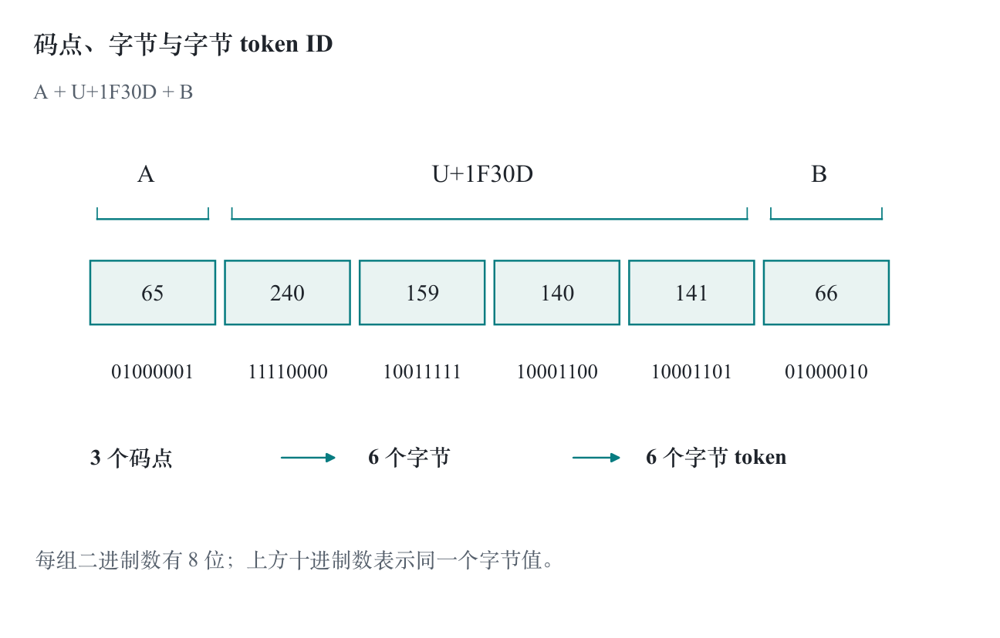{width=100%}

按括号把字节格与其码点对应起来。中间四格属于同一个码点；总共六格表示六个字节 token，并不表示六个字符。

```text
"hello" -> [104, 101, 108, 108, 111]
"A🌍B"  -> [65, 240, 159, 140, 141, 66]
```

第二个字符串有三个 Unicode 码点，但 UTF-8 用六个字节表示。本课一个字节对应一个 token，因此有六个 token。分词器决定 token 数，不是看起来有几个字就一定有几个 token。

实现思路：

1. 调用 `text.encode("utf-8")`，得到 `bytes`。这里是在选择文字到字节的编码方式。
2. 用 `list(text.encode("utf-8"))` 把字节序列展开成整数列表。遍历 `bytes` 得到的是整数；`b"a"` 展开后是 `[97]`。
3. 返回这个列表。空字符串得到空列表；大小写和空白都要保留。

只检查这一部分：

```sh
python3 exercises/01_01_text_to_tokens.py --check encode
```

成功输出是 `PASS encode: ASCII, Unicode, and empty input`。这是检查程序打印的通过信息，说明这些输入符合要求。

### 二、从 ID 解码回文字

`ByteTokenizer.decode(token_ids)` 的输入是 `list[int]`，返回值是 `str`。反向通路是：

```text
整数列表 -> bytes -> UTF-8 解码 -> 文字
```

1. 用 `bytes(token_ids)` 恢复字节对象。`[104, 101, 108, 108, 111]` 得到 `b"hello"`。
2. 用 `bytes(token_ids).decode("utf-8", errors="strict")` 解码完整的字节序列，返回字符串。
3. 保留异常。单字节值越界应报 `ValueError`；不合法或不完整的 UTF-8 应报 `UnicodeDecodeError`。不能用 `errors="ignore"` 悄悄丢掉内容。

能按 UTF-8 编码的完整文字需要满足 `decode(encode(text)) == text`。截取一段 ID 不一定能解码，因为可能截在多字节字符中间。

```sh
python3 exercises/01_01_text_to_tokens.py --check decode
```

### 三、构造训练窗口

函数名是 `make_example(token_ids, start, context_length)`。

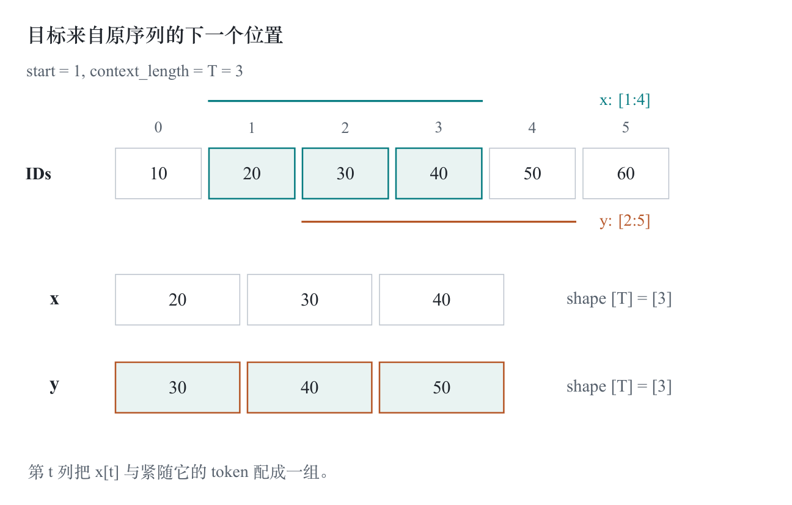{width=100%}

逐列比较输入与目标：目标总比对应输入晚一个原序列位置。因此 T=3 时，从起点开始至少需要四个原序列 ID。

| 变量 | 类型 | 含义 |
| --- | --- | --- |
| `token_ids` | `list[int]` | 原始 token 序列；不要修改它。 |
| `start` | `int` | 输入窗口的起点，从 0 开始计数。 |
| `context_length` | `int` | 输入和目标窗口各有多少个位置。 |
| `x` | `list[int]` | 输入窗口。 |
| `y` | `list[int]` | 向后错开一个位置的目标窗口。 |
| 返回值 | 两个列表组成的元组 | 按 `(x, y)` 顺序返回。 |

完整例子：输入 `[10, 20, 30, 40, 50, 60]`，`start=1`，`context_length=3`。

```text
x = [20, 30, 40]
y = [30, 40, 50]
```

逐步实现：

1. 先检查参数：`start >= 0`、`context_length > 0`，从起点至少还有 `context_length + 1` 个 token。`if` 条件成立才执行缩进的代码；`raise ValueError(...)` 用来报告无效输入。
2. 切出 `x`：从 `start` 开始，取 `context_length` 个元素。Python 切片不包含结束下标，而且切片越界会自动截短，所以前面的长度检查不能省。
3. 切出 `y`：起点换成 `start + 1`，长度仍然相同。本例中输入 20 的目标是 30，输入 30 的目标是 40。
4. 构造完两个新列表后返回 `(x, y)`。不要改变原序列。

`"hello"` 的五个 token 可以给出四个监督位置：

| 该位置允许看到的前缀 | 下一个 token 的目标 |
| --- | --- |
| `h` | `e` |
| `he` | `l` |
| `hel` | `l` |
| `hell` | `o` |

这里是在说明将来的因果模型应当看到什么。只把目标错开一位还不能防止偷看未来，之后实现注意力时还要加因果遮罩。

```sh
python3 exercises/01_01_text_to_tokens.py --check example
```

### 课堂问答：256、UTF-8 与预测

#### 为什么是 256？为什么最大值是 255？

这里一个 byte 有 8 个 bit。每个 bit 有 0、1 两种状态，8 个位置共有 $2^{8}=256$ 种组合。从 0 开始编号，就是 0 到 255；全是 1 的 `11111111` 表示 255。

因此，256 是可能取值的数量，既不是 256 个 bit，也不是把字节值加起来。这个上限来自 8 位字节的表示方式，不是作业随便规定的数。

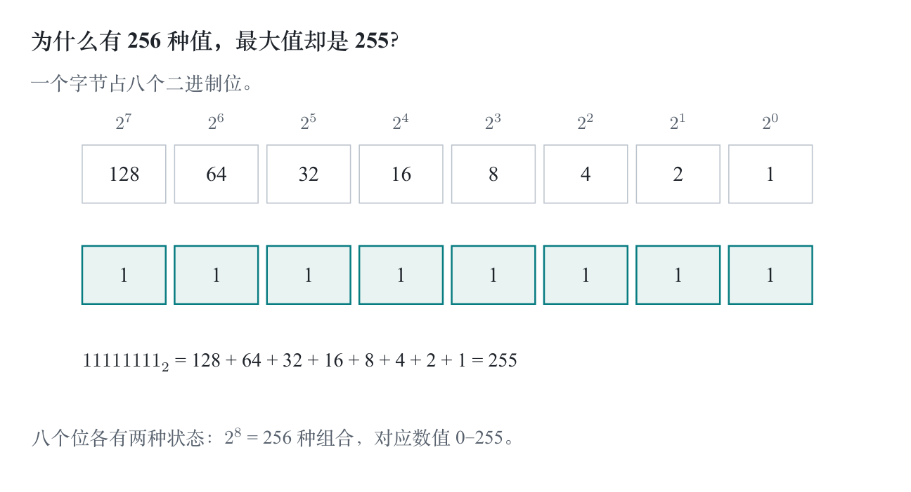{width=100%}

按列读位权：某一位为 1，就贡献该列的值；为 0，就贡献零。全零组合表示 0；图中的全一行表示 128 + 64 + 32 + 16 + 8 + 4 + 2 + 1 = 255。把零也算上，共有 256 种不同的组合。

它只限制单个原始字节。Token ID 是词表索引，第二章介绍的字节对编码（byte-pair encoding，BPE）可以继续分配 256、257 等 ID。如果学到 $k$ 条合并规则且没有特殊 token，本课连续编号的词表大小是 $256+k$，最大 ID 是 $255+k$。以后增加特殊 token，要另外计数。

#### Unicode 和 UTF-8 是两种并列的编码格式吗？

Unicode 定义字符及其码点；UTF-8 是把 Unicode 标量值表示成字节序列的一种方式。合法标量值用 1 到 4 个字节表示，不包括代理项码点。

例如 `"你"` 的码点是 `U+4F60`，UTF-8 字节值是 `[228, 189, 160]`：三个字节，共 24 个 bit，不是三个 bit。

新遇到的字符只要有合法的 Unicode 标量值，就能用现有字节值的组合表示，不需要增加“第 257 种字节”。但是，任意拼出来的字节不一定是合法 UTF-8。一个视觉上的字符还可能由多个码点构成，因此视觉字符数、码点数、字节数不一定相同。

#### `b"a"` 是什么？ID 和向量是什么关系？

`"a"` 是 `str`；`b"a"` 是 `bytes`，内部只有一个字节值 97。开头的 `b` 是 Python 表示字节对象的语法，不是内容里额外的一个字节。

```text
list(b"a") -> [97]
bytes([97]) -> b"a"
```

对于名为 `text` 的非 ASCII 字符串，`text.encode("utf-8")` 得到它的字节表示。在本课分词器里，字节值恰好就是 token ID；BPE 后面会通过词表让一个 ID 对应一串字节。

Embedding 是另一步：ID 用来选择一行浮点向量。把字节拼接起来不会自动得到 Embedding；向量维度表示有几个分量，不表示数值上限是 256。

#### 三个码点变成六个 token，如果只生成五个，一定无法解码吗？

不一定。`"A🌍B"` 的前五个字节已经包含完整的 `A` 和完整的 `🌍`，可以解码成 `"A🌍"`。但前三个字节是 `[65, 240, 159]`，截在地球符号的四字节编码中间，严格解码会失败。

要看字节是否组成完整、合法的 UTF-8，不能只看“有没有达到六个”。预测出来的 ID 也可能对应非法字节组合；继续增加 token 并不保证修好它。严格解码会报告不完整或非法编码。后面的流式显示可以暂存未完成的后缀。

“能解码”和“预测出了想要的文字”是两件事：能解码的输出仍可能预测错。

#### 训练一次预测一个，还是一次预测五个？

每个监督位置都是“根据前缀预测下一个 token”。长度为五的输入窗口提供五个这样的监督位置；有因果约束的模型可以在一次训练前向计算中同时得到这些位置的分布，因为训练输入是已知的。

生成时通常选出一个新 token，把它加到序列后，再预测下一个。训练同时计算多个已知位置的目标，不等于同时生成五个未知的未来 token。本课先准备错位的训练标签，模型和损失还没有实现。

### 检查与理解

运行全部检查：

```sh
python3 exercises/01_01_text_to_tokens.py
```

预期最后一行：

```text
Lesson 01.01 checks passed.
```

复习时解释：为什么 `"A🌍B"` 是六个字节 token？为什么目标错开一位？`"hello"` 第二个监督位置允许看到哪些输入？

下一课是 [02.01：统计 BPE 相邻 pair](#section-02-01)。第二章以本课字节词表为起点，学习把常见字节序列合成更大的 token；先检查序列能否缩短，以及原字节能否完整还原。

### 参考

- [Python 字符串编码](https://docs.python.org/3.9/library/stdtypes.html#str.encode)与[字节解码](https://docs.python.org/3.9/library/stdtypes.html#bytes.decode)。
- [minbpe](https://github.com/karpathy/minbpe)：先实现自己的版本，再比较设计。

- [Python Unicode HOWTO](https://docs.python.org/3/howto/unicode.html)：码点、编码与字节表示。

## 本章回望

第一批训练对已经明确，但逐字节表示会让常见片段显得冗长。下一章学习更大的基本单位，同时保留回到原始字节的可逆通路。

# 02 学习一套词表 {#chapter-02}

分词器是一套从数据学得、随后固定的数据处理规则。字节对编码很好地展示了这种区别：训练分词器时，频繁相邻的编号对可以创建新词表项；编码新文本时，只能按照学得的先后次序应用已有规则，陌生输入不能成为创建新ID的理由。

本章把函数分开：统计回答有哪些相邻对，选择决定使用哪条规则，合并改变一个序列。训练反复执行这些操作，编码查询冻结规则，解码先重建字节，再交给UTF-8解释。职责分清，才能避免模型训练到一半时，某个嵌入表行的编号含义突然改变。

## 02.01 字节对编码与相邻词元对统计 {#section-02-01}

### 方法来源

神经文本模型中的字节对编码（BPE）见 [Sennrich et al., 2016; R03](https://aclanthology.org/P16-1162/)；GPT-2 使用的字节级变体见 [Radford et al., 2019; R25](https://cdn.openai.com/better-language-models/language_models_are_unsupervised_multitask_learners.pdf)。

字节分词器已经能表示新文字，却经常反复写出相同的短序列。如果让这些常见片段拥有自己的 token，序列就可能缩短。BPE 的第一步很朴素：先不合并，只看看哪些相邻 pair 出现了，以及它们各出现多少次。

先走完下面的小例子，再对照 02_01_bpe_pair_counts.py 动手。编号步骤会说明函数接口，并引导核心实现；初始化和检查驱动由配套文件提供。

### 为什么要扩展字节分词器

重复的字节串可以分配自己的 token ID。对一些文本，这能缩短 token 序列，让固定长度的上下文容纳更多文字。代价是词表变大，模型的 Embedding 表和输出词表也变大。压缩率提高不等于语言模型质量一定提高。

这里的“训练分词器”是根据频率学习合并规则，不使用梯度下降。神经语言模型的参数训练是后面的另一件事。

### 完整例子：`"ababab"`

初始字节 ID 是 `[97, 98, 97, 98, 97, 98]`。相邻表示每次看当前位置和下一个位置：

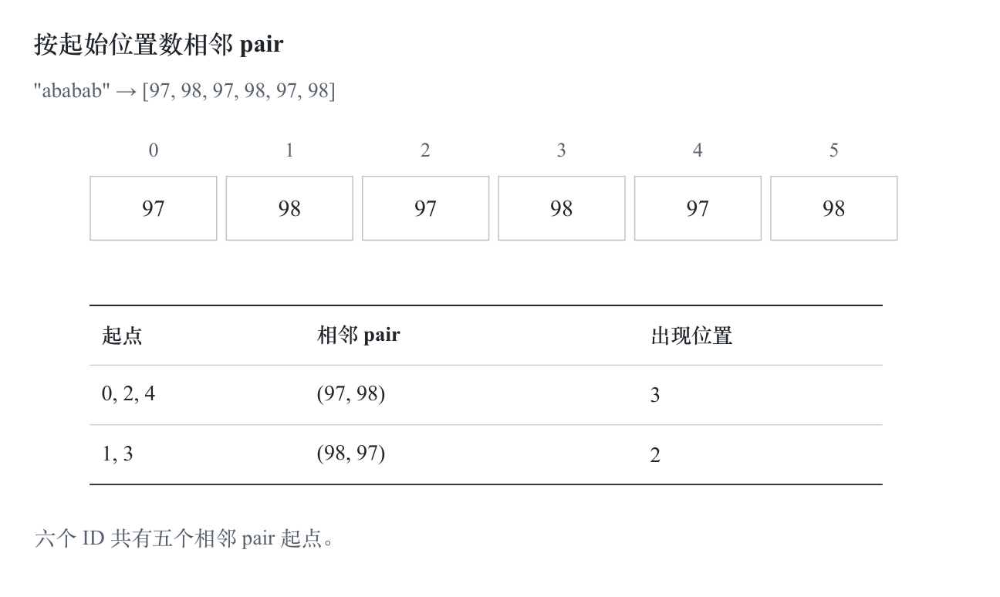{width=100%}

从左到右读 ID 序列，再比较表格的两行。起点 0、2、4 对应有顺序的 (97,98)，起点 1、3 对应 (98,97)；共享端点也照样计数。

| 起点下标 | Pair | 对应字节文字 |
| --- | --- | --- |
| 0 | `(97, 98)` | `ab` |
| 1 | `(98, 97)` | `ba` |
| 2 | `(97, 98)` | `ab` |
| 3 | `(98, 97)` | `ba` |
| 4 | `(97, 98)` | `ab` |

最终计数：

```text
{(97, 98): 3, (98, 97): 2}
```

后续训练选择最多的 `(97, 98)`，分配 ID 256，记录它表示 `b"ab"`。一次从左到右的合并得到 `[256, 256, 256]`。

此时词表有 257 个条目：原来的 256 个字节条目加上一个新条目。新 token 对应自己的一个 Embedding 向量；这里合并的是字节含义，不是把两个 Embedding 拼成一个。

```text
97  -> b"a"
98  -> b"b"
256 -> b"ab"
```

UTF-8 的原始字节没有变。以后解码要先查词表，再按顺序拼接字节，最后解码 UTF-8。`bytes([256])` 不会替你查词表，而且会因为原始字节值越界报错。BPE token 也可能只含字符的一部分字节，要保留上一课讲过的解码边界意识。

### 输入、变量与返回值

```python
count_pairs(token_ids: list[int]) -> dict[tuple[int, int], int]
```

| 名称 | 类型 | 含义 |
| --- | --- | --- |
| `token_ids` | `list[int]` | 当前序列，可以含 256 等合并后的 ID；不要修改它。 |
| `pair_counts` | `dict[tuple[int, int], int]` | 输出字典，键是有顺序的 pair，值是出现次数。 |
| `i` | `int` | 当前相邻 pair 的起点下标。 |
| `pair` | `tuple[int, int]` | 当前两个 ID，例如 `(97, 98)`。 |
| 返回值 | 计数字典 | 空序列或单个 token 返回 `{}`。 |

`(97, 98)` 和 `(98, 97)` 顺序不同，是两个不同的键。统计包含重叠：`[42, 42, 42]` 有两个 `(42, 42)`，起点分别是 0 和 1。

### 编号实现思路

1. 创建空字典 `pair_counts`。`{}` 表示空字典。
2. 遍历相邻 pair 的起点。长度为 $n$ 且 $n\ge1$ 时，有 $n-1$ 个起点。`range(len(token_ids) - 1)` 不包含结束值；六个 token 对应下标 0 至 4，空序列和单个 token 则不会进入循环。
3. 在循环内部读取 `token_ids[i]` 与 `token_ids[i + 1]`，构造 `pair`。有逗号的括号表示元组；第一次得到 `(97, 98)`。
4. 把这个键的计数加一。`pair_counts.get(pair, 0)` 读取已有计数，没有这个键就用 0。处理前两个位置后，字典是 `{(97, 98): 1, (98, 97): 1}`。
5. 循环结束后返回 `pair_counts`。返回语句放在循环外，才能统计完整序列。

提示用于复习实现逻辑；配套文件中你写好的代码保留。

### 课堂澄清：统计是否等于创造新 token？

本函数只统计出现次数，不选最高频 pair、不分配 ID、不做合并。出现一次的 pair 也会记为 1；次数低不代表字典是空的。

统计可以记录重叠位置，后面合并却不能重复使用同一个原始 token。例如 `[42, 42, 42]` 里统计有两个 pair，但一次不重叠合并只能替换一个，下一课解释原因。

### 检查与理解

```sh
python3 exercises/02_01_bpe_pair_counts.py
```

完整实现运行后，预期最后一行是：

```text
Lesson 02.01 checks passed.
```

独立解释为什么 `[97, 98, 97, 98]` 同时包含 `(97, 98)` 与 `(98, 97)`，并手算各自次数。

下一课是 [02.02：不重叠地合并 pair](#section-02-02)。之后依次连接训练循环、固定规则编码、解码和保存加载。分段边界、特殊 token、训练数据选择、压缩率和吞吐量仍需要后续学习。

### 参考

[minbpe 的统计与合并辅助函数](https://github.com/karpathy/minbpe/blob/master/minbpe/base.py)：自己实现后再比较。

## 02.02 不重叠地合并相邻词元对 {#section-02-02}

统计出一个 pair 出现几次，还不等于能直接替换几次。两个相邻匹配可能共用一个 token；如果把它用两遍，原文就变了。这一节沿着序列从左向右扫描，让每个原 token 只被消耗一次，同时保持字节内容不变。

先走完下面的小例子，再对照 02_02_bpe_merge.py 动手。编号步骤会说明函数接口，并引导核心实现；初始化和检查驱动由配套文件提供。

### 字节值与 Token ID

一个字节有 8 位，共 $2^{8}=256$ 个取值，编号 0 至 255。这是可能取值的数量，不是存了 256 个字节。

初始分词器用字节值当 ID；BPE 的 ID 256 可以表示 `b"ab"`。Token ID 是整数索引，允许超过单个字节的范围。256 的无符号二进制表示 `100000000` 需要 9 位，但不改变它对应两个字节的含义。实际数组用什么整数类型存 ID，后面做数据处理时再讨论。

### 输入与返回值

| 名称 | 类型 | 含义 |
| --- | --- | --- |
| `token_ids` | `list[int]` | 原始序列；本次扫描不要修改它。 |
| `pair` | `tuple[int, int]` | 要替换的有顺序的两 ID，例如 `(97, 98)`。 |
| `new_id` | `int` | 调用者指定的替换 ID，例如 256。 |
| `new_res` | `list[int]` | 你的实现收集的新序列。 |
| `i` | `int` | 当前扫描到的原序列位置。 |
| 返回值 | `list[int]` | 完成一次替换后的新列表。 |

输入 `[97, 98, 97, 98, 97, 98]`，`pair=(97, 98)`，`new_id=256`，结果是 `[256, 256, 256]`。

### 为什么不能重叠合并

`"aaa"` 的序列是 `[97, 97, 97]`。统计时 `(97, 97)` 出现两次，分别覆盖位置 0–1 和 1–2；两次共享中间的 token。

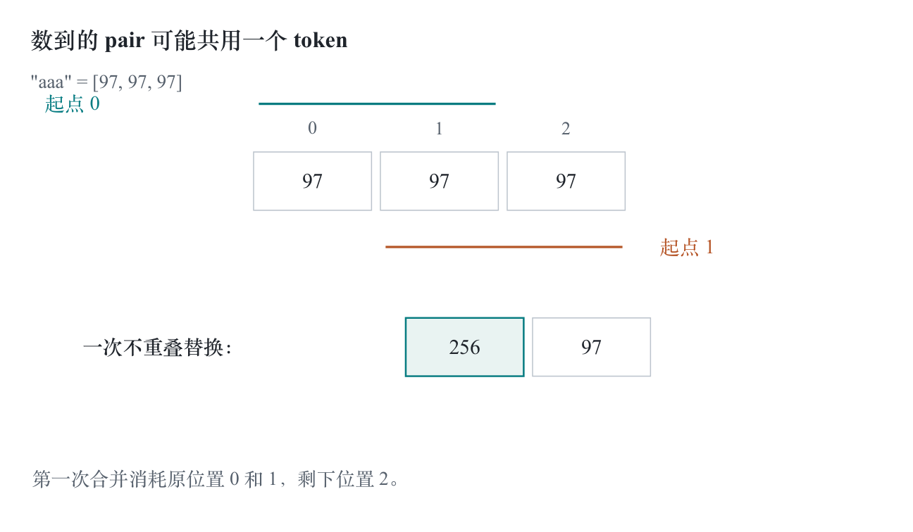{width=100%}

追踪哪些原位置已经消耗。正确结果仍是三个原字节；把两处重叠都替换，会错误地还原成四个字节。

如果 256 表示 `b"aa"`，合并前两个 token 后就已经消耗它们，第三个保留：

```text
[97, 97, 97] -> [256, 97]
原文字 aaa   -> aa + a
```

如果把两次重叠都替换，得到 `[256, 256]`，对应 `"aaaa"`，内容就变了。四个 `a` 则可以做两次不重叠替换，得到 `[256, 256]`。

### 先解释循环语法

`while 条件:` 在条件为真时重复执行缩进的代码。`if` 判断当前能否匹配；`else` 处理不匹配的情况。`i += 2` 表示给索引加二，不是给序列追加两个 token。

访问 `token_ids[i + 1]` 前，必须先确认下一个位置存在。Python 的 `and` 会先判断左边：左边为假就不会执行右边，所以可以先做边界判断，再比较两个 ID。

### 完整小过程与编号提示

以 `[97, 97, 97]`、`pair=(97, 97)`、`new_id=256` 为例：

1. 循环前创建 `new_res=[]`，设置 `i=0`。结果列表和扫描位置是不同状态。
2. 当 `i < len(token_ids)` 时继续扫描。先确认 `i + 1` 没有越界，再检查当前两个 ID 是否等于 `pair`。
3. 如果匹配，把 `new_id` 作为一个元素追加到 `new_res`，并令 `i` 前进两格。例子第一次得到 `new_res=[256]`、`i=2`。
4. 否则，把当前位置的原 ID 追加进去，令 `i` 前进一格。例子剩下最后一个 97，得到 `new_res=[256, 97]`、`i=3`。
5. 条件不再成立时退出循环，在循环外返回新列表。空输入也返回新的空列表，单 token 输入返回新的单元素列表。

每次替换会使 token 数少一。只要新 ID 的词表内容是两个子 token 字节的拼接，重建字节就保持不变。不匹配的 token 维持原有顺序。

### 检查与理解

```sh
python3 exercises/02_02_bpe_merge.py
```

完整实现运行后，预期最后一行：

```text
Lesson 02.02 checks passed.
```

检查覆盖重复与重叠、末尾匹配、已经合并过的 ID，以及不修改输入。独立解释：为什么统计出两个 `(97, 97)`，却只替换一次？

下一课是 [02.03：BPE 训练循环](#section-02-03)，把选择、分配 ID、保存字节含义与重复统计连接起来。

### 参考

[minbpe 的辅助函数](https://github.com/karpathy/minbpe/blob/master/minbpe/base.py)：完成自己的版本后再比较。

## 02.03 字节对编码的训练循环 {#section-02-03}

### 方法来源

迭代合并词表的过程沿用 [Sennrich et al., 2016; R03](https://aclanthology.org/P16-1162/) 的 BPE 思路；用于语言模型的字节级变体见 [Radford et al., 2019; R25](https://cdn.openai.com/better-language-models/language_models_are_unsupervised_multitask_learners.pdf)。

现在，统计相邻 pair 和执行一次替换都已经有了。把它们放进循环，就能学习 BPE 规则：每轮给一个重复片段分配新编号，记下编号对应的字节，再回到变短后的序列重新统计。读这段循环时，重点是追踪状态怎样变化，而不是背下整段程序。

先走完下面的小例子，再对照 02_03_bpe_train.py 动手。编号步骤会说明函数接口，并引导核心实现；初始化和检查驱动由配套文件提供。

### 输入、状态与返回值

| 名称 | 类型 | 含义 |
| --- | --- | --- |
| `text` | `str` | 用来学习合并规则的文字。 |
| `vocab_size` | `int` | 词表条目数的上限，至少 256。 |
| `ids` | `list[int]` | 当前训练文本的 token 序列，每轮替换后更新。 |
| `vocab` | `dict[int, bytes]` | 每个 ID 对应的字节内容。 |
| `merges` | `dict[tuple[int, int], int]` | 每个已学 pair 对应的新 ID。 |
| `next_id` | `int` | 下一个要分配的 ID，从 256 开始。 |
| `pair_counts` | 计数字典 | 当前 `ids` 中相邻 pair 的次数。 |
| `max_account` | `int` | 实际代码使用这个名字保存最大出现次数。 |
| `candidates` | Pair 列表 | 出现次数并列最多的 pair。 |
| `best_pair` | 两整数元组 | 按本课平局规则选出的 pair。 |
| 返回值 | 三个对象组成的元组 | 按 `(ids, merges, vocab)` 顺序返回。 |

### 初始化那行到底是什么意思

```python
vocab = {idx: bytes([idx]) for idx in range(256)}
```

这是字典推导式，可以拆成三部分：

1. `range(256)` 依次给出 0 到 255；`idx` 是本次整数。
2. 冒号左边的 `idx` 是字典键，即 token ID。
3. 冒号右边的 `bytes([idx])` 是包含这个字节值的单字节对象。

例如 `idx=97` 时建立 `97: b"a"`；`idx=0` 时建立 `0: b"\x00"`。它创建全部 256 个条目，包含训练文本里没有出现过的字节。值是字节内容，不是向量。

### 完整例子：两轮训练

使用 `text="ababab"`、`vocab_size=258`。

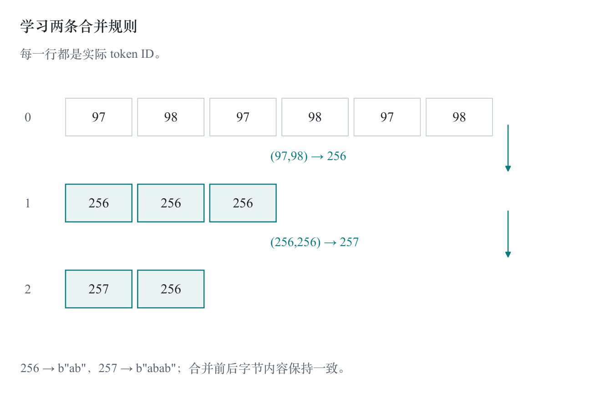{width=100%}

从上往下读三个序列状态。每轮增加一条词表记录，但按词表拼回字节，始终都是原来的六个字节。

| 阶段 | 当前 `ids` | 词表条目数 |
| --- | --- | --- |
| 初始 | `[97, 98, 97, 98, 97, 98]` | 256 |
| 第一轮后 | `[256, 256, 256]` | 257 |
| 第二轮后 | `[257, 256]` | 258 |

第一轮 `(97, 98)` 有三次，`(98, 97)` 有两次。选前者，分配 ID 256，记录：

```text
merges[(97, 98)] = 256
vocab[256] = b"ab"
```

合并后要对新的 `[256, 256, 256]` 重新计数。此时 `(256, 256)` 出现两次，但重叠，所以只替换一次。分配 257，内容是 `b"ab" + b"ab" = b"abab"`，最终序列 `[257, 256]` 表示 `b"abab" + b"ab"`，仍是原来的文字。

现在词表大小是 258，最大 ID 是 257，文本长度是两个 token。这三个数字描述不同的东西。

### 编号实现思路

1. 把文字编码为字节 ID，准备基本词表、空 `merges` 和 `next_id=256`。小于 256 的预算应报告 `ValueError`。
2. 在预算还没达到且序列至少有两个 token 时继续循环。每轮调用 `count_pairs(ids)`，得到新的 `pair_counts`。
3. 如果没有 pair，就退出循环。`if not pair_counts` 判断字典是否为空；`break` 离开最近的循环，之后仍要执行函数的返回。
4. 找最大次数，收集次数等于 `max_account` 的 pair；从候选中选数值最小的元组 `best_pair`。
5. 记录 `merges[best_pair]` 对应的新 ID，并调用 `merge_pair` 更新 `ids`。下一轮必须看到新序列。
6. 查两个子 ID 的字节内容并拼接，存入新词表条目，再给 `next_id` 加一。子 token 可以已经代表多个字节。
7. 循环结束后返回 `(ids, merges, vocab)`，返回语句放在循环外。

词表 ID 从零连续增长，所以新 ID 可以按当前条目数分配；当前实现显式维护 `next_id`。递增 ID 还记录学习顺序，之后编码用这个顺序选择规则。

### 课堂问答

#### `b"a" + b"b"` 像字符串一样拼接吗？

它拼接字节序列，结果是 `b"ab"`。显示出来的 `b` 前缀不是内容的一部分。字节块即使各自不能解码，也可以先拼接成完整字节流再解码 UTF-8；不会自动生成 Embedding。

#### `if not pair_counts` 是频率为一也退出吗？

不是。`{(97, 99): 1}` 仍是非空字典；只有 `{}` 才会让这里的 `not` 为真。本课允许合并次数为一的 pair。

预算是上限，不保证一定填满。预算 256 时不会加新条目；空文本或只剩一个 token 时没有相邻 pair，可以提前停在预算以下。

#### 平局是选字典里靠前的那个吗？

本课不是按字典插入位置选。先筛出出现次数最多的候选，再按元组数值排序：先比较第一个 ID，相同才比较第二个。

例如 `{(98, 99): 4, (97, 99): 4}` 两个都是最高频，但选 `(97, 99)`。`pair_counts.items()` 每次提供 `(pair, count)`，判断 `count` 是否等于最大值，再保存对应 `pair`。

不同平局规则可能产生不同词表；本课规定这个规则，让结果可复现。下一课编码使用的“已学规则顺序”是另一种选择依据。

#### 感觉记不住，需要背下整段代码吗？

先记状态变化：统计当前序列、选 pair、保存新 ID 和字节含义、替换、再统计。手算一轮，再独立重建一个小步骤。语法可以查，核心练习关闭 AI 自动补全。重建时先写出状态变化，再补齐语法。

### 检查与理解

```sh
python3 exercises/02_03_bpe_train.py
```

示例输出包含：

```text
ababab -> [257, 256]; vocabulary entries: 258
Lesson 02.03 checks passed.
```

检查覆盖每轮重新计数、字节不变、基本条目保留、词表上限、平局规则和提前停止。再试着用自己的话解释下面的问题。

独立解释第二轮为什么统计 `(256, 256)`，而不是继续统计 `(97, 98)`；并解释新条目为什么保留原字节内容。单个词表条目可能包含不完整 UTF-8，重建文字时应先把所有字节拼接起来。

下一课是 [02.04：选择已学规则](#section-02-04)，然后连接完整编码。

### 参考

[minbpe 的基本分词器](https://github.com/karpathy/minbpe/blob/master/minbpe/basic.py)。本课有自己明确的数值平局规则和停止条件。

## 02.04 选择已学到的合并规则 {#section-02-04}

训练好的分词器要用同一套规则处理新输入。因此，编码时问的已不是“现在谁最常见”，而是“当前能用的已学规则中，哪一条学得最早”。先把这个选择器写清楚，后面的完整编码循环就不容易和训练混在一起。

先走完下面的小例子，再对照 02_04_bpe_select_rule.py 动手。编号步骤会说明函数接口，并引导核心实现；初始化和检查驱动由配套文件提供。

### 先分清训练与编码

| 操作 | 选 pair 的依据 | 是否创建新词表条目 |
| --- | --- | --- |
| 训练 | 当前次数最高；本课用 pair 数值处理平局。 | 在预算内可以。 |
| 编码 | 当前存在的已学规则中，最早学到的规则。 | 不可以。 |

训练发现规则；编码把固定规则应用到新文本。现在仍然是分词器处理，预测下一个 token 的神经模型还没实现。

### 输入、变量与返回值

| 名称 | 类型 | 含义 |
| --- | --- | --- |
| `pair_counts` | `dict[tuple[int, int], int]` | 当前相邻 pair 与次数；键告诉我们哪些 pair 现在存在。 |
| `merges` | `dict[tuple[int, int], int]` | 已学 pair 与替换 ID；本实现较小的新 ID 表示较早规则。 |
| `candidates` | 两整数元组组成的列表 | 现在存在且有已学规则的候选。 |
| `best_pair` | 两整数元组 | 已学替换 ID 最小的候选。 |
| 返回值 | `Optional[tuple[int, int]]` | 一个 pair，或者没有规则可用时的 `None`。 |

`None` 是调用者的停止信号，不是 token ID。函数没有 `max_count` 参数；上一课的 `max_account` 用于训练频率，而这里比较 `merges[pair]`。两个输入字典都保持不变。

### 完整例子：顺序比频率优先

我们的训练器从 256 起连续分配 ID，所以 ID 256 的规则先于 257。其他分词器格式可能另存规则排名，不能普遍假设所有 ID 都有这个含义。

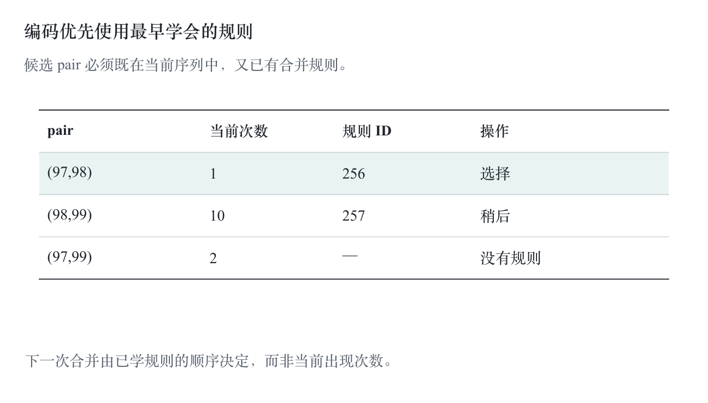{width=100%}

前两行里，次数少的 pair 因规则学得更早而被选中；第三行展示独立的无规则例子，说明“当前存在”还不够。

```python
pair_counts = {(97, 98): 1, (98, 99): 10}
merges = {(97, 98): 256, (98, 99): 257}
```

两对都在当前文本中，也都学过，但应该选 `(97, 98)`，因为它对应的 256 比 257 小。当前出现十次的 pair 并不因此获得编码优先级。

实际检查里还有反转规则顺序的独立例子：

```python
pair_counts = {(97, 98): 3, (98, 99): 1}
merges = {(97, 98): 257, (98, 99): 256}
```

1. 收集两个有规则的当前 pair，得到 `[(97, 98), (98, 99)]`。
2. 候选不是空列表，可以继续选择。
3. 比较对应的已学 ID：前者 257，后者 256。
4. 返回 `(98, 99)` 这个元组。调用者随后查到替换 ID 256，再执行合并。

直接 `min(candidates)` 会比较子 ID 元组，错误地选前者；这里要比较的是 `merges[pair]`。检查名是 `rule order overrides numeric child-pair order`。

如果当前只有 `{(97, 99): 2}`，但规则仍是上面的两个，那么候选为空，返回 `None`。现在有 pair 并不意味着它学过；词表里有规则也不意味着当前文本里能用。

### 编号实现思路

1. 建立空列表 `candidates`。用 `for` 遍历当前 pair，只有 `pair in merges` 成立时才追加。`if` 条件成立才执行它缩进的部分；字典成员检查查的是键。
2. 判断 `not candidates`。空列表会让它为真，此时返回 `None`，提前离开函数，避免对空列表取最小值。
3. 通过候选对应的 `merges[pair]` 选择 `best_pair`。`min(..., key=...)` 用 key 函数的返回值做比较，但返回原候选本身。实际代码里的 `lambda x: merges[x]` 是把候选 `x` 映射到它的已学 ID 的小函数。
4. 选择后返回 `best_pair`。返回的是 pair，不是次数，也不是替换 ID。

优先用显式循环理解过程，语法可以查，练习时关闭 AI 自动补全。文件把你的实现与提供好的检查驱动分开。

### 课堂问答：候选到底选哪些

#### 为什么 `if pair in merges: continue` 不对？

`continue` 跳过这一轮循环剩下的语句，直接进入下一轮。如果“已经学过”就跳过，恰好会排除我们需要的 pair。编码的候选应该同时在当前计数和已学规则里。

训练时筛的是“次数最高”，允许创建规则；这里筛的是“已有规则可用”。写循环前先确定当前函数在做哪件事。

#### `pair_counts.items()`、`item[0]`、`item[1]` 是什么？

对于 `pair_counts.items()` 提供的 `((97, 98), 3)`，`item[0]` 是 pair `(97, 98)`，`item[1]` 是次数 3。写成 `pair, count` 是把同样两个对象拆成两个名字。

比较 `item[1]` 和最大次数属于训练。这一课即使读取了 `count`，选择时也看 `merges[pair]`。不要把上一课的最高频逻辑搬到这里。

### 检查与下一课

```sh
python3 exercises/02_04_bpe_select_rule.py
```

完整实现运行后，预期最后一行：

```text
Lesson 02.04 checks passed.
```

检查覆盖学习顺序、当前可用规则、未知 pair、空输入和输入字典不变。独立说明为什么第二个例子选 `(98, 99)`，以及什么时候返回 `None`。

下一课是 [02.05：编码新文本](#section-02-05)，把选择器与统计、合并连接起来。

## 02.05 使用固定合并规则编码新文本 {#section-02-05}

### 方法来源

使用已学习的 BPE 合并规则编码文本的背景见 [Sennrich et al., 2016; R03](https://aclanthology.org/P16-1162/)；字节级语言模型变体见 [Radford et al., 2019; R25](https://cdn.openai.com/better-language-models/language_models_are_unsupervised_multitask_learners.pdf)。

词表已经学好，现在可以把没见过的文字交给分词器。编码不断应用已有规则，其余字节 token 则原样留下。遇到陌生 pair 并不意味着失败：基础字节词表早已给了我们保留它的方式，不需要临时发明新编号。

先走完下面的小例子，再对照 02_05_bpe_encode.py 动手。编号步骤会说明函数接口，并引导核心实现；初始化和检查驱动由配套文件提供。

### 原理：词表与规则固定

训练根据当前频率发现新规则；编码只使用已经学到的规则。新文字先变成 UTF-8 字节 ID，再应用当前能用的最早规则，直到没有规则可用。编码过程中不分配新 ID。

| 阶段 | 选择依据 | 新词表条目 |
| --- | --- | --- |
| 训练 | 当前最高频；数值 pair 处理平局。 | 预算内可以创建。 |
| 编码 | 当前存在的已学规则中，最早学到的一条。 | 不创建。 |

这是分词处理，不是预测下一个 token。编码器接收完整、已知的文字。

### 完整例子：`"ababac"`

用 `"ababab"`、预算 258 训练后，规则是：

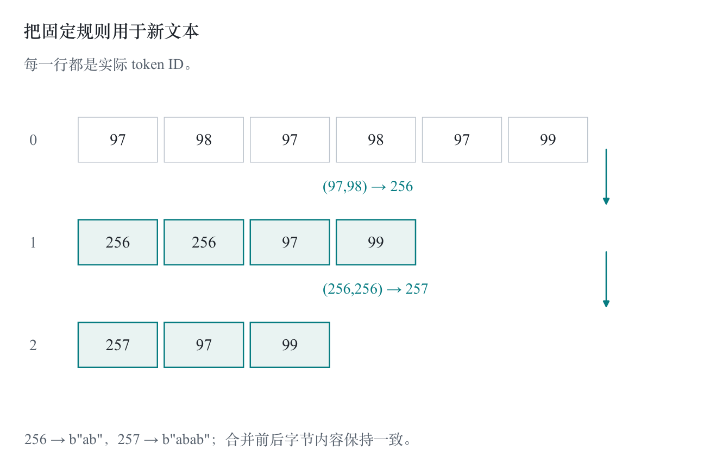{width=100%}

每次合并后，先看新序列，再重新选择。最后三个 ID 之间仍有 pair，只是已经没有可用的已学规则。

```text
(97, 98)   -> 256，内容 b"ab"，先学到
(256, 256) -> 257，内容 b"abab"，后学到
```

新文本 `"ababac"` 的编码过程：

| 阶段 | `ids` |
| --- | --- |
| 初始字节 | `[97, 98, 97, 98, 97, 99]` |
| 应用第一条规则 | `[256, 256, 97, 99]` |
| 重新统计，应用第二条规则 | `[257, 97, 99]` |
| 没有规则适用，返回 | `[257, 97, 99]` |

最后仍有相邻 pair，但 `(257, 97)` 和 `(97, 99)` 都没有已学规则，应该停止。不能为 `ac` 现场创建新 token。基础词表本来就有字节 99，即使训练文本没有 `c`。

对应的字节是 `b"abab" + b"a" + b"c"`，保留完整输入。

### 函数变量与返回值

| 名称 | 类型 | 含义 |
| --- | --- | --- |
| `text` | `str` | 调用者提供的新文字。 |
| `merges` | `dict[tuple[int, int], int]` | 固定的已学 pair 到替换 ID 的映射。 |
| `ids` | `list[int]` | 当前编码状态，每轮合并后更新。 |
| `pairs` | Pair 计数字典 | 本轮 `ids` 的相邻 pair；传给选择器的 `pair_counts` 参数。 |
| `pair` | 两整数元组或 `None` | 选择器返回的适用 pair，或停止信号。 |
| `merges[pair]` | 整数表达式 | 要传给 `merge_pair` 的已存在替换 ID。 |
| 返回值 | `list[int]` | 完整的新文本 ID 序列。 |

检查程序还使用 `vocab` 验证字节不变，但它不是 `encode_bpe` 的参数，不需要在函数里训练词表。文件已经提供辅助函数导入和初始字节转换。

### 编号实现思路

1. 建立重复循环。`while True` 一直执行，直到 `break` 退出。
2. 对当前 `ids` 调用 `count_pairs`，把结果存到 `pairs`。每次都重新统计，不能复用旧序列的计数。
3. 调用 `select_merge_pair(pairs, merges)`，把结果存为 `pair`。
4. 如果 `pair is None`，执行 `break`。`None` 表示没有规则可用；这个判断要在访问 `merges[pair]` 之前。
5. 否则查已有替换 ID，调用 `merge_pair`，把返回的新序列赋回 `ids`。本例第一轮得到 `[256, 256, 97, 99]`，下一轮才会看到两个相邻 256。
6. 离开循环后返回 `ids`，返回放在循环外，才能处理多轮。

停止条件不是“只剩一个 token”，也不是“统计字典为空”。最后三个 token 的例子仍有 pair，只是没有可用的已学规则。

### 课堂问答：`"abac"` 的末尾 `ac` 怎么办？

假设固定规则只有 $(97, 98) \to  256$。初始 `[97, 98, 97, 99]` 合并 `ab` 后是 `[256, 97, 99]`。当前 `(256, 97)` 和 `(97, 99)` 都没有规则，于是返回；`ac` 保留为两个字节 token。

如果是训练阶段，当前存在的 `ac` 可以在预算内被选中并分配新 ID。但编码阶段词表冻结，不可以创建。字节基础词表让未合并的新内容仍然能表示；不需要为所有可能的 pair 都学到规则。

检查案例可能使用独立规则集，看到同一个 ID 时要看当前案例给出的 `merges`，不能假设所有案例里的 256 都表示同一内容。

### 检查与理解

```sh
python3 exercises/02_05_bpe_encode.py
```

完整实现运行后，预期最后一行：

```text
Lesson 02.05 checks passed.
```

检查覆盖空输入、多轮、没有学过的 pair、不重叠替换、规则优先级、Unicode 字节和规则不变。独立解释末尾 `ac` 为什么不创建新 token，以及为什么每轮要更新 `ids`。

下一课是 [02.06：BPE 解码](#section-02-06)，之后 [02.07](#section-02-07) 保存加载。之后进入 [03.01：Embedding 查表](#section-03-01)。这些辅助函数把每段传入文字当作一条不间断的字节序列。准备语料时，文档边界与特殊 token 将决定哪些相邻 token 可以合并或组成训练对；保存的分词器也必须在这些用途中保持相同的 ID 含义。

## 02.06 把词元编号解码回文字 {#section-02-06}

ID 只是标签；要读回文字，必须找到给这个标签赋予含义的词表。我们先逐个查出字节片段，再按顺序拼接，最后解码完整字节流。只要 token 边界落在 UTF-8 字符内部，这个先后顺序就不能颠倒。

先走完下面的小例子，再对照 02_06_bpe_decode.py 动手。编号步骤会说明函数接口，并引导核心实现；初始化和检查驱动由配套文件提供。

### 输入、变量与返回值

```python
decode_bpe(token_ids: list[int], vocab: dict[int, bytes]) -> str
```

| 名称 | 类型 | 含义 |
| --- | --- | --- |
| `token_ids` | `list[int]` | 调用者提供的有序 ID，可以超过 255。 |
| `vocab` | `dict[int, bytes]` | ID 到字节内容的映射。 |
| `token_id` | `int` | 当前循环访问的一个 ID。 |
| `chunks` | `list[bytes]` | 收集的字节块，每个输入 ID 对应一个块。 |
| `raw_bytes` | `bytes` | 所有字节块按顺序无分隔拼接的结果。 |
| 返回值 | `str` | 对完整字节流做 UTF-8 解码得到的文字。 |

提供好的检查使用 `_, merges, vocab = train_bpe("ababab", 258)` 获取词表，再把它作为第二个参数传给解码器。这里 `_` 是一个普通变量名，表示这处不使用第一个结果。

### 完整例子：先查表，再拼接

相关条目如下：

| ID | 字节内容 | 来源 |
| --- | --- | --- |
| 97 | `b"a"` | 基础词表。 |
| 99 | `b"c"` | 基础词表，即使训练文字没出现 `c` 也存在。 |
| 256 | `b"ab"` | 第一条合并规则。 |
| 257 | `b"abab"` | 合并两个 256。 |

`"ababac"` 编码成 `[257, 97, 99]`，解码过程：

1. 查 `vocab[257]`，得到 `b"abab"`，此时 `chunks=[b"abab"]`。
2. 查 97，追加 `b"a"`，得到 `[b"abab", b"a"]`。
3. 查 99，追加 `b"c"`，得到 `[b"abab", b"a", b"c"]`。
4. 用空字节分隔符拼接，得到 `raw_bytes=b"ababac"`。
5. 对完整字节对象解码 UTF-8，返回 `"ababac"`。

257 是“四个字节的标签”，不是值为 257 的原始字节。直接 `bytes(token_ids)` 会越界；词表查找才知道这个 ID 表示哪些字节。

### 为什么不能逐个 Token 解码

`"你"` 的 UTF-8 字节是 `[228, 189, 160]`。本课训练器在预算 257 时先合并 `(189, 160)`，因此编码得到 `[228, 256]`：

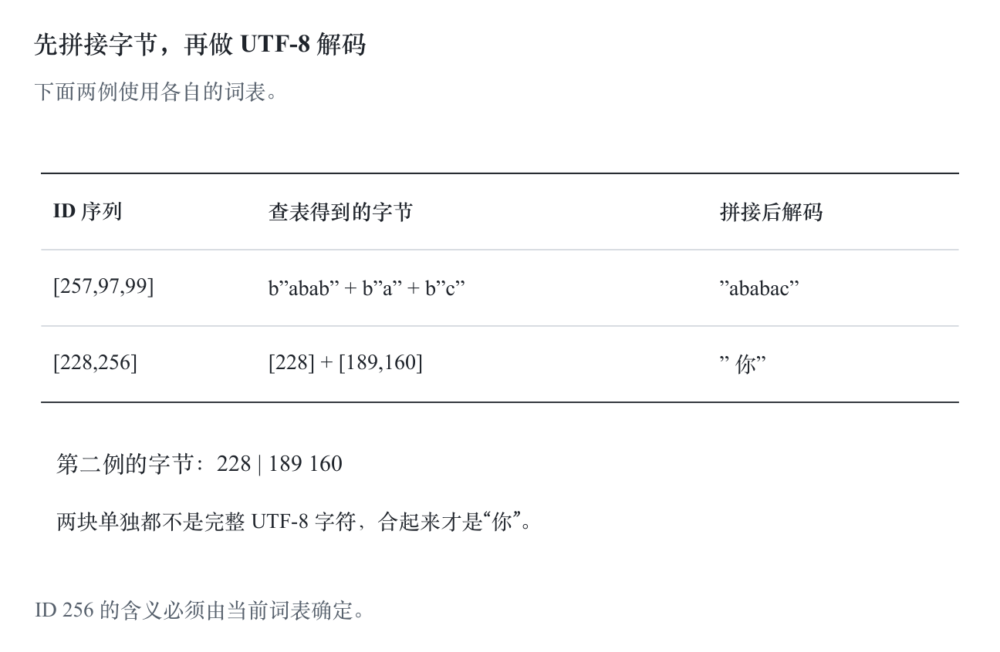{width=100%}

表格第一行还原 ASCII 算例；第二行使用另一份由“你”训练的词表。两个字节片段单独都不是合法文字，按序拼接后才组成合法 UTF-8。

```text
vocab[228] = bytes([228])      -> b"\xe4"
vocab[256] = bytes([189, 160]) -> b"\xbd\xa0"
```

两个块各自都不是完整 UTF-8 文字。按顺序拼起来才是 `"你"`。先在循环中收集，循环结束后只解码一次；否则完整输入也会被逐块解码拒绝。

生成的序列可能截在字符中间，也可能包含非法字节；拼接不保证所有序列都合法。严格解码会报告 `UnicodeDecodeError`。后面的生成课再区分流式缓冲与真正非法输出。

### 编号实现思路

1. 建立空 `chunks`。用 `for token_id in token_ids` 按原顺序访问 ID。循环内部查 `vocab[token_id]` 并 `append` 整个字节对象。`append` 增加一个元素，不会解码，也不会生成向量。
2. 循环外把这些块拼为 `raw_bytes`。`separator.join(parts)` 用分隔符连接各部分；这里需要空字节分隔符 `b""`，不能加空格或标点。
3. 在循环外用 UTF-8、`errors="strict"` 解码，并返回字符串。返回也在循环外。

空输入时不进入循环，空列表拼接为 `b""`，再解码得到 `""`，不必另加分支。缺失的词表 ID 自然报 `KeyError`；非法或不完整字节自然报 `UnicodeDecodeError`。这些异常是检查要求的行为，不要隐藏。两个输入对象保持不变。

### 课堂问答：显示奇怪，为什么还能拼？

`b"\xe4"` 等是 Python 对字节值的显示形式。字节对象能按顺序拼接，即使每块单独不能解码。`b"".join(chunks)` 拼的是里面的字节，不是显示文字里的 `b`、引号或反斜杠。

预测错不等于一定解码失败：错误预测也可能得到合法文字。不完整字符和非法字节组合才会触发这里的 UTF-8 错误；未知 ID 则在查词表时先报 `KeyError`。不能只根据生成了多少个 token 判断能否解码。

同一个整数 ID 在不同词表里可能代表不同字节。解码器必须匹配编码器或模型的词表版本；ID 没有跨词表通用的文字含义。

### 检查与理解

```sh
python3 exercises/02_06_bpe_decode.py
```

完整实现运行后，预期最后一行：

```text
Lesson 02.06 checks passed.
```

检查覆盖空输入、基础与合并 ID、顺序与重复、跨 token 的 Unicode、编解码往返、输入不变及要求的异常。

如果 Unicode 边界案例失败，检查是否在循环内解码；超过 255 的 ID 失败，检查是否直接转原始字节；多出字符，检查拼接分隔符。独立解释 `[228, 256]` 为什么必须先拼接再解码。

下一课是 [02.07：保存与加载分词器](#section-02-07)，之后进入 ID 到浮点向量的 Embedding 表。

## 02.07 保存与加载分词器 {#section-02-07}

程序结束之后，分词器也应该能原样回来。需要保存的不只是词表大小，还包括每个 ID 的字节含义，以及每条合并规则的优先级。这一节把 Python 对象转换成 JSON 记录，再从记录恢复；恢复过程不重新训练，也不重新编号。

先走完下面的小例子，再对照 02_07_bpe_save_load.py 动手。编号步骤会说明函数接口，并引导核心实现；初始化和检查驱动由配套文件提供。

### JSON 为什么需要转换

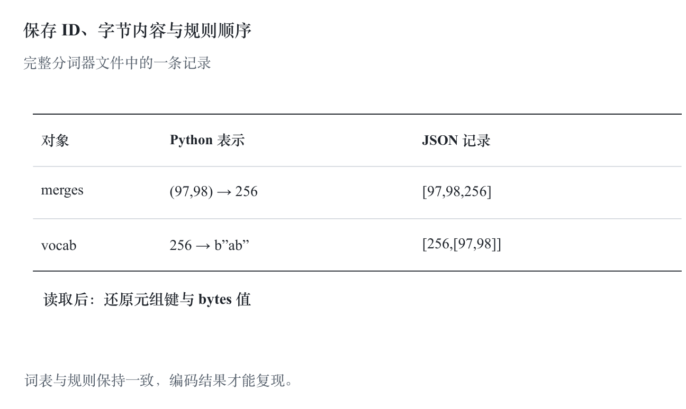{width=100%}

比较 Python 表示与 JSON 记录两列，再看下方的读取说明。序列化改变了数据表示；重新读取时，子 ID、替换 ID 和字节值都必须原样恢复。

JSON 是结构化文本格式，支持对象、数组、字符串、数字、布尔值和 null。Python 字典与列表可以对应 JSON 对象和数组，但这里的元组键、`bytes` 值不能直接按原结构保存。

我们把它们转换成记录列表：

| 内存中的数据 | 保存的记录 | 含义 |
| --- | --- | --- |
| `merges[(97, 98)] = 256` | `[97, 98, 256]` | 左子 ID、右子 ID、原替换 ID。 |
| `vocab[256] = b"ab"` | `[256, [97, 98]]` | 原 token ID 和完整字节值列表。 |

外层 `payload` 还含有 `"format": "onelong-byte-bpe"`、`"version": 1`。这说明文件结构版本，不唯一标识某个学到的词表。以后实验要保留具体分词器文件及其校验和。

保存所有基本条目和合并条目，保留原 ID。字节值直接存整数列表，不要逐条解码成 UTF-8 文字，因为单个 token 可能只有字符的一部分。

### 阶段 A：输入、变量与返回值

```python
pack_tokenizer(merges: dict[tuple[int, int], int], vocab: dict[int, bytes]) -> dict
```

| 名称 | 类型 | 含义 |
| --- | --- | --- |
| `merges` | Pair 到整数的字典 | 调用者传入的已学规则。 |
| `vocab` | ID 到 `bytes` 的字典 | 同一分词器的词表。 |
| `payload` | `dict` | 已提供外层结构，填入 `"merges"`、`"vocab"` 两个列表。 |
| `item` | `tuple[tuple[int, int], int]` | `merges.items()` 中一个条目，例如 `((97, 98), 256)`。 |
| `out_merges` | `list[list[int]]` | 三个整数构成的规则记录列表。 |
| `out_vocab` | `list` | ID 与字节列表构成的词表记录列表。 |
| `token_id` | `int` | 词表中的一个键。 |
| `token_bytes` | `bytes` | 该 ID 原来的字节内容。 |
| `list(token_bytes)` | 整数列表表达式 | 把字节内容展开成整数值。 |
| 返回值 | `dict` | 完整可保存的 `payload`，由文件辅助函数写出。 |

输入来自有效、匹配的训练结果；不要修改输入字典。函数没有文件路径参数，文件写入由提供好的辅助函数负责。

### 阶段 A 的完整例子

用 `"ababab"`、预算 258 训练。`payload` 开始已有元数据和两个空列表。

1. $(97, 98) \to  256$ 保存成 `[97, 98, 256]`，`out_merges` 变为 `[[97, 98, 256]]`。
2. $(256, 256) \to  257$ 保存成 `[256, 256, 257]`，列表现在有两条记录。
3. 基本词表从 ID 0 的 `[0, [0]]` 开始，继续保存到 ID 255，每个条目都保留。
4. ID 256 的 `b"ab"` 展开为 `[97, 98]`，记录是 `[256, [97, 98]]`。
5. ID 257 的记录是 `[257, [97, 98, 97, 98]]`。
6. 把两个收集列表放进 `payload` 的对应字段并返回。总共两条规则记录、258 条词表记录。

`list(b"ab")` 读取字节值，不是解码文字，也不修改原字节。反向用 `bytes([97, 98])` 恢复 `b"ab"`。

### 阶段 A 的编号实现思路

1. 遍历 `merges.items()`，用实际代码中的变量名 `item`。`item[0]` 是子 pair，`item[1]` 是替换 ID；`item[0][0]`、`item[0][1]` 是两个子 ID。把三整数记录追加到 `out_merges`。
2. 遍历 `vocab.items()`，用 `token_id`、`token_bytes`。把字节转成整数列表，构造包含 ID 和这个内层列表的两元素记录，追加到 `out_vocab`。
3. 两个循环结束后，把列表赋给 `payload` 的对应字段，返回 `payload`。没有合并规则时，第一个列表为空，但仍保存全部 256 个基本条目。

循环体需要缩进；循环后的赋值与返回退回外层。配套文件中的编号提示保留相关语法。

```sh
python3 exercises/02_07_bpe_save_load.py --check pack
```

阶段 A 的预期最后一行 `Lesson 02.07 stage A checks passed.`。检查涵盖精确 ID 和字节、所有条目、不完整字符的字节内容、JSON 兼容、文件写出和输入不变；它独立验证打包，不依赖还原步骤。

### 阶段 B：输入、变量与返回值

`unpack_tokenizer(payload)` 接收已经解析好的 JSON 数据，建立新的 `merges`、`vocab`，按 `(merges, vocab)` 返回。

| 名称 | 类型 | 含义 |
| --- | --- | --- |
| `payload` | `dict` | 保存的数据，不是路径或 JSON 文本；不要修改。 |
| `payload["merges"]` | `list[list[int]]` | 每条含三个整数的规则记录。 |
| `item` | `list` | 当前访问的一条记录。 |
| `a`、`b`、`c` | `int` | 实际代码的左子 ID、右子 ID、原替换 ID。 |
| `payload["vocab"]` | `list` | 每条含 ID 和字节列表的词表记录。 |
| `token_id` | `int` | 原来的词表 ID。 |
| `byte_list` | `list[int]` | 原来的整数字节值。 |
| `merges` | Pair 到整数的字典 | 新还原的规则。 |
| `vocab` | ID 到 `bytes` 的字典 | 新还原的词表。 |
| 返回值 | 两字典组成的元组 | `(merges, vocab)`。 |

文件读取辅助函数处理 JSON 解析和格式版本检查，学习函数假设接收有效、匹配的数据。

### 阶段 B 的完整例子与编号提示

1. 建立空 `merges`、`vocab` 字典，`{}` 是空字典。
2. 直接遍历 `payload["merges"]` 中的记录；这个值是列表。把一条 `item` 拆为 `a`、`b`、`c`，用元组 `(a, b)` 作键、`c` 作值。记录 `[97, 98, 256]` 恢复第一条规则，再读取 `[256, 256, 257]` 恢复第二条。
3. 遍历词表记录，把两元素 `item` 拆为 `token_id`、`byte_list`。用 `bytes(byte_list)` 还原内容，并放回原 ID。先还原所有基本条目；`[256, [97, 98]]` 恢复 `b"ab"`，`[257, [97, 98, 97, 98]]` 恢复 `b"abab"`。
4. 两个循环结束后返回 `(merges, vocab)`。逗号让返回结果成为元组；还原过程不重新分配 ID、不解码字节、不重新训练。

列表不能作为字典键，所以规则的两个子 ID 要恢复成元组。最终两条规则、258 个词表条目保持原样。重新编码 `"ababac"` 仍得到 `[257, 97, 99]`，再解码得到原文字。

先检查阶段 B，再检查完整保存加载：

```sh
python3 exercises/02_07_bpe_save_load.py --check unpack
python3 exercises/02_07_bpe_save_load.py --check all
```

阶段 B 最后一行是 `Lesson 02.07 stage B checks passed.`；完整检查最后一行是 `Lesson 02.07 checks passed.`。这些检查包括字典相同、保存前后编码相同、文字往返，以及拒绝不支持的格式与版本。

```text
merges + vocab -> pack_tokenizer -> JSON 文件
JSON 文件 -> unpack_tokenizer -> 恢复 merges + vocab
```

### 课堂问答：保存的是哪些含义

#### 训练没出现过的字节也必须保存吗？

必须。新文本可能需要那些字节。只保存训练字符串用到的条目会破坏基础字节覆盖。所有合并条目及原 ID 也要保留。

#### 有 `version=1` 就能确认是同一个分词器吗？

不能。它描述文件结构，很多不同词表都能使用这个结构。实验中需要具体分词器文件及校验和，还要记录代码与数据版本。本课保存规则和字节含义，模型参数另有检查点。

#### 为什么保存列表记录，再还原元组和字节？

JSON 不能直接表达本课的元组键和字节类型。规则记录保存子 ID 与已学 ID；词表记录保存 ID 与字节值。还原时恢复 Python 所需类型，不改变 ID 含义。即使记录列表的排列顺序改变，已学 ID 仍然保留规则优先级。

独立检查自己能否把一条规则和一条词表记录来回转换，并解释为什么 ID 不能重排。下一课是 [03.01：Embedding 查表](#section-03-01)。

## 本章回望

现在，文本已经能够表示成含义稳定的编号。接下来的问题是，模型怎样从整数中学到东西？第三章为它们赋予可训练向量，并追踪由此产生的梯度。

# 03 让模型开始学习 {#chapter-03}

词表给出了候选项，却没有说明已有前缀之后应该出现哪一项。现在引入参数：能够根据样例发生变化的数值。嵌入查表选出一行，输出映射为候选项打分，损失衡量模型给真实答案分配的概率。

这一章较长，因为同一次训练计算会逐渐扩大规模：先对标量求导，再处理张量和可训练查找表；连接logits、softmax与交叉熵，再加入预测、采样和批次。每个版本都追问相同的问题：什么是固定数据，什么是待学习参数，下一token目标在哪里，记录的损失对应哪个参数状态？

最终得到的基线有意保持简单。结构小，错误才容易定位；它的局限也会为下一章引入注意力提供具体理由。

## 03.01 从词元编号到嵌入向量 {#section-03-01}

### 方法来源

概率语言模型中的可学习词嵌入（word embeddings）见 [Bengio et al., 2003; R24](https://www.jmlr.org/papers/v3/bengio03a.html)。

分词器告诉我们一个整数代表哪个 token，模型还需要能参与学习的数值。Embedding 表为每个 ID 准备一行浮点向量。本节先用普通 Python 列表看清查表过程，尤其要区分完整词表有多大，以及这一次输入从中取出了多少行。

先走完下面的小例子，再对照 03_01_embedding_lookup.py 动手。编号步骤会说明函数接口，并引导核心实现；初始化和检查驱动由配套文件提供。

### 先走完一个例子

字节分词器把 `"aba"` 编码为 `[97, 98, 97]`。Embedding 表为每个词表 ID 保存一行浮点数。

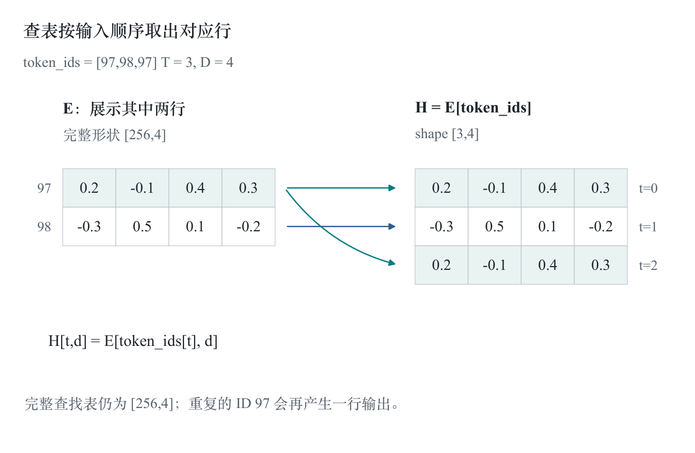{width=100%}

箭头按输入顺序从同一张表取行。位置0和2都使用 ID 97，所以输出中的两行四维向量相同。

设词表大小 $V=256$，向量维度 $D=4$，表 $E$ 的形状是 `[256, 4]`。为了演示，手动给两行数值：

| Token ID | 对应整行向量 |
| --- | --- |
| 97 | `[0.2, -0.1, 0.4, 0.3]` |
| 98 | `[-0.3, 0.5, 0.1, -0.2]` |

这些是演示值。真正模型里的参数先初始化，再通过训练损失更新，不是从字符或 ID 数值直接算出来。

按输入顺序查表：

```text
97 -> E[97] -> [ 0.2, -0.1, 0.4,  0.3]
98 -> E[98] -> [-0.3,  0.5, 0.1, -0.2]
97 -> E[97] -> [ 0.2, -0.1, 0.4,  0.3]
```

最终结果：

```text
[
    [ 0.2, -0.1, 0.4,  0.3],
    [-0.3,  0.5, 0.1, -0.2],
    [ 0.2, -0.1, 0.4,  0.3],
]
```

有三个 token 位置，每行四个分量，所以结果形状是 `[3, 4]`。第一个和第三个 ID 相同，查同一张表就得到相同的一行；后面的模型层才结合位置与上下文产生不同表示。

### 三个数量、两种形状

| 符号 | 含义 | 本例 |
| --- | --- | --- |
| $V$ | 词表条目数，也是表的行数。 | 256 |
| $D$ | 每个向量有多少浮点分量，也是表的列数。 | 4 |
| $T$ | 输入序列的 token 位置数。 | 3 |

完整表是 `[V, D]`；查出这条序列后是 `[T, D]`。将来可训练表有 $VD$ 个参数，输入长度不会改变整张表的大小。

如果 $T=6$、$D=8$，输出形状是 `[6, 8]`，共有 48 个标量。批量输入若有 $B$ 条等长序列，对应 `[B, T, D]`，批处理以后再实现。

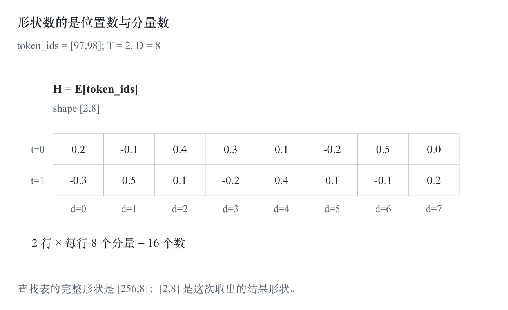{width=100%}

这张图另取 $D=8$，与作业主体的 $D=4$ 区分。形状标签 `[2, 8]` 表示两行、每行八个分量，共 16 个标量；数值行里的 `[0, 0]` 则表示两个实际为零的分量。把输入从三个位置缩短为两个位置，只改变输出的第一维，不会缩小词表。

### ID、字节内容与模型向量

Token ID 是索引，数值排序不代表语义排序，也不直接规定向量间距离。Embedding 分量是浮点数，可以为负，不限制在 0 至 255。

分词器的 `vocab` 把 ID 映射到字节内容；模型的 `embedding_table` 把同一 ID 映射到可学习向量。例如 BPE 的某个 ID 表示 `b"ab"`，它有自己的向量行，不是把两个子 token 的向量拼起来。

词表条目数必须匹配 Embedding 表行数：258 个连续编号条目对应 ID 0 至 257，需要 258 行。本例只使用基本字节词表，所以是 256 行。词表扩大改变 $V$，不自动改变 $D$。

### 输入、变量与返回值

```python
lookup_embeddings(token_ids, embedding_table)
```

| 名称 | 类型 | 含义 |
| --- | --- | --- |
| `token_ids` | `list[int]` | 调用者传入的有序 ID，可以重复。 |
| `embedding_table` | `list[list[float]]` | 每个词表 ID 对应一行、每行 $D$ 个分量的表。 |
| `vectors` | `list[list[float]]` | 你的实现收集的输出行。 |
| `token_id` | `int` | 当前循环访问的一个 ID。 |
| 返回值 | `list[list[float]]` | 每个输入位置对应一整行，保留顺序和重复。 |

假设 ID 非负且合法，表的各行长度相同。输入验证和张量运算不在本小练习范围。不要修改输入；检查程序提供表，你不需要在函数里自己创建演示表。

### 编号实现思路：复习你写好的核心代码

1. 在循环前建立空列表 `vectors`。`[]` 创建空列表；此时输出有零行。
2. 用 `for token_id in token_ids:` 按原顺序访问。循环体缩进；不要转成集合，因为集合会丢掉重复位置。
3. 在循环内部，`embedding_table[token_id]` 用方括号索引选出一行；`vectors.append(embedding_table[token_id])` 把这一整行作为一个元素加到 `vectors` 末尾。第一次有一行，处理 97、98 后有两行，每行四个数。不要把一行展开成四个独立输出元素。
4. 循环结束后返回 `vectors`。返回与循环头对齐，放在循环外；否则只处理第一个 token。空输入不进入循环，自然返回 `[]`。这里读取行值，可以复用或复制行列表，但都不能修改输入。

在 `lookup_embeddings` 的实现区域填写核心，其他部分是给定检查驱动。编写时关闭 AI 自动补全，可以查阅语法参考。

### 课堂问答

#### 维度 8 是指数值范围 0 到 256 吗？

不是。$D=8$ 表示一个向量有八个数，不规定这些数的上限下限。$T=6$ 时共有六行，每行八个数，即 `[6, 8]` 与 48 个标量。形状描述数量，不描述取值范围。

#### `embedding_table[97]` 的数值从哪来？

检查程序给的是手动演示值。97 只选择第 97 号行，不决定该行数值。真正训练时表先初始化，再随损失更新。本课只做查表，还没有训练和自动求导。

#### 重复 ID 为什么同一行？合并后的 Embedding 要拼接吗？

同一个 ID 在同一张表中查到同一行，因此输出要保留两次相同向量。之后的位置处理和注意力可以让这两个位置使用不同上下文。

BPE 合并拼接的是字节含义；新 token 的 Embedding 是自己的一行，仍有 $D$ 个分量，不定义为两个子向量的拼接。

### 检查与下一课

运行已经完成的作业进行复习：

```sh
python3 exercises/03_01_embedding_lookup.py
```

配套检查覆盖：顺序、重复、空输入、不同维度、超过 255 的合并 ID，以及输入不变。预期最后一行：

```text
Lesson 03.01 checks passed.
```

理解检查：解释 $V$、$D$、$T$ 各数什么；手算 `"aba"` 的三行；解释首尾两行为什么相同，再关闭自动补全重建查表循环。

#### 追问澄清：形状、完整表与重复 ID

`[3, 8]` 表示输出的形状：三个 token 位置，每个位置对应八个数。形状描述维度，本身不是装着这些数的张量。

在 $V=258$、$D=8$、`token_ids=[256, 97, 256]` 的例子中，要分清两个对象：

| 对象 | 行数 | 每行分量数 | 形状 |
| --- | --- | --- | --- |
| 完整 `embedding_table` | 258 个词表条目 | 8 | `[258, 8]` |
| 返回的 `vectors` | 3 个输入位置 | 8 | `[3, 8]` |

第一行和第三行相同的具体原因是：第一个和第三个 ID 都是 256。

```text
位置 0：ID 256 -> embedding_table[256]
位置 1：ID  97 -> embedding_table[97]
位置 2：ID 256 -> embedding_table[256]
```

两处读取同一张固定表中的同一行，因此得到相同向量。查表阶段，整段文字、周围 ID 和位置不会改变这行向量。后面的位置与上下文处理才可能产生不同表示。不同 ID 会查不同的行，但不同的行也可能恰好数值相同；不能反过来保证不同 ID 的向量值一定不同。

再做一个短检查：保持表不变，输入改成 `[256, 97]`，返回结果是什么形状？完整表的大小会改变吗？这个问题确认能否分清序列长度与词表大小。

缩短输入后，输出变为 `[2, 8]`，查找表大小不变。改变的是这次取出的行数，而不是词表大小。形状标准写法用逗号 `[2, 8]`；$2 \times  8$ 表示共 16 个标量值。

你写的循环先建立空 `vectors`，逐个访问 `token_id`，把 `embedding_table[token_id]` 整行追加进去。`return` 放在循环外，所以能处理所有位置，空输入也会返回空结果。这个查表逻辑正确。现在表仍是提供的数据，函数还没有更新 Embedding 参数。

下一步读 [03.02：参数、损失与梯度](#section-03-02)，先建立标量损失的原理，再通过一次梯度下降更新的作业进入训练循环。之后用可训练张量表达这个操作，建立最小的下一个 token 模型，认识词表 logits、错位目标与交叉熵。先理解最小训练通路，再进入注意力和 Transformer。

## 03.02 参数、损失与梯度 {#section-03-02}

Embedding 表里的数值要能随着错误调整，才真正进入了学习过程。更新整张表之前，我们先只训练一个数。平方误差让损失可以画出来；曲线在当前位置的斜率，则解释了梯度下降为什么往那个方向走，以及步子为什么不能随意放大。

先走完下面的小例子，再对照 03_02_scalar_gradient_step.py 动手。编号步骤会说明函数接口，并引导核心实现；初始化和检查驱动由配套文件提供。

### 训练时改变什么

Embedding 表里的数是模型参数，也就是可以调整的浮点数。表的形状由词表大小和向量维度确定。输入选择行，训练通过预测和损失更新其中的数值。输入变短会使输出行数变少，不会把整张表缩小。

语言模型中的大致路径是：

```text
token ID -> Embedding 行 -> 模型计算 -> 下一个 token 的预测
                                   -> 与已知目标比较，得到损失
损失 -> 参数的梯度 -> 更新参数
```

分词器提供 ID；训练调整模型参数。后面再实现前向计算、下一个 token 的训练目标、自动求导和参数更新。

### 只用一个可调数字的任务

暂时设预测结果就是参数自己：$\mathrm{prediction}=w$。希望它预测到 `1.0`，用平方误差衡量差距：

```text
L(w) = (w - target)^2
```

这是帮助理解的小例子，语言模型的下一个 token 目标以后再学。这里的标量目标是人为指定的；真正的 Embedding 数值通过模型和预测损失得到梯度，不是人为给每个坐标指定正确值。

| 符号 | 类型 | 含义 | 本例数值 |
| --- | --- | --- | --- |
| `w` | 浮点标量 | 可调参数，也是这个简化任务的预测。 | `0.2` |
| `target` | 浮点标量 | 固定的期望预测。 | `1.0` |
| `error` | 浮点标量 | 预测减去目标：`w - target`。 | 初始 `-0.8` |
| $L$ | 非负标量 | 平方误差损失；本例越小，预测越接近目标。 | 初始 `0.64` |
| $g$ | 浮点标量 | 梯度，即损失对 `w` 的导数。 | 初始 `-1.6` |
| `learning_rate` | 正标量 | 学习率，控制每次调整的步长。 | `0.1` |
| `w_new` | 浮点标量 | 一次更新后的参数。 | `0.36` |

### 梯度告诉我们什么

梯度描述：如果参数增加一点，损失在附近会怎样变化。只有一个数时，梯度就是导数。这个平方误差的导数是：

```text
g = dL/dw = 2 * (w - target)
```

梯度为正，表示参数增加一点会使附近的损失增大，因此下降更新让参数减小。梯度为负，表示参数增加一点会使附近的损失减小，因此更新让参数增大。本例预测等于目标时，梯度为零。

最基本的梯度下降更新规则：

```text
w_new = w - learning_rate * g
```

学习率控制步长。步长过大也可能让损失升高，不能认为所有训练里每次更新都保证降低损失。

### 为什么梯度是 $2(w-\mathrm{target})$

导数衡量的是局部变化率。让 `w` 增加一个很小的量 $h$，保持 `target` 不变，再看损失变化量与参数变化量的比值：

```text
损失变化量 / w 的变化量 = (L(w + h) - L(w)) / h
```

这里 $h$ 是用来观察损失函数的非零标量扰动，不是学习率，也不是一次训练更新。例如 `w=0.2`、`target=1.0`、`h=0.01`：

1. 原来的损失是 $(0.2 - 1.0)^{2} = 0.64$。
2. 让参数变成 `0.21`，损失是 $(0.21 - 1.0)^{2} = 0.6241$。
3. 损失变化了 $0.6241 - 0.64 = -0.0159$。
4. 比值是 $-0.0159 / 0.01 = -1.59$，已经接近梯度 `-1.6`。

展开平方就能得到精确的表达式。暂时把 `w - target` 记成 `a`：

```text
L(w + h) - L(w) = (a + h)^2 - a^2
                 = 2 * a * h + h^2
(L(w + h) - L(w)) / h = 2 * a + h
```

当 $h$ 越来越接近零，比值就越来越接近 $2a=2(w-\mathrm{target})$。这个极限就是导数 $\frac{dL}{dw}$，也就是本例一个参数的梯度。系数 `2` 来自平方误差的展开；换成别的损失函数或预测公式，导数通常也会改变。

参数变化足够小时，梯度可以估计损失的局部变化：

```text
损失变化量 ≈ g * w 的变化量
```

对于这个平方损失，精确的变化量还包含 $(\Delta w)^2$。变化量越小，这个近似越准确。

### 完整算一次更新

取 `w=0.2`、`target=1.0`、`learning_rate=0.1`。

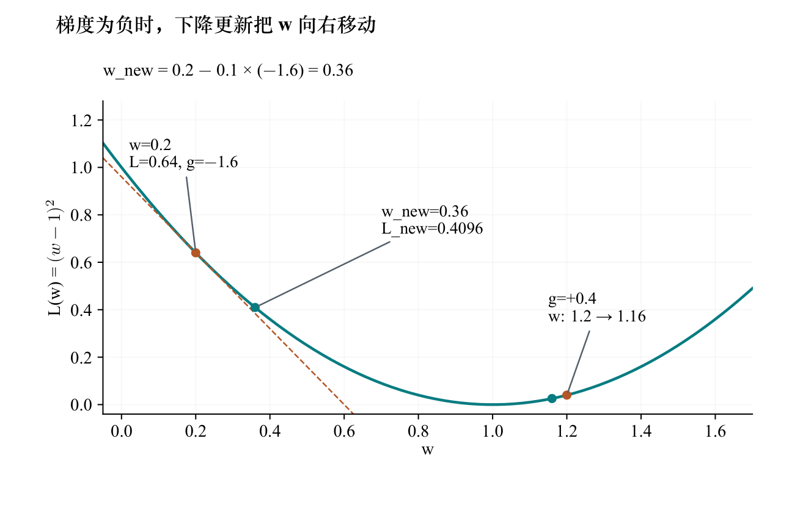{width=100%}

虚线是在 $w=0.2$ 处的负斜率切线。减去负梯度，参数向右移动到0.36；新点在实际损失曲线上更低。

1. **预测：**这个小任务的预测就是 `w`，所以预测 `0.2`。
2. **计算损失：**$(0.2 - 1.0)^{2} = (-0.8)^{2} = 0.64$。
3. **计算梯度：**$g=2 \times  (0.2 - 1.0) = -1.6$。
4. **更新参数：**$w_{\mathrm{new}}=0.2 - 0.1 \times  (-1.6) = 0.36$。减去一个负数，会让 `w` 增大。
5. **检查新预测：**更新后预测 `0.36`，损失为 $(0.36 - 1.0)^{2} = 0.4096$，比 `0.64` 小。

这个更新使可调数更接近目标。改变的是参数数值，表的维度和词表 ID 没有因此变化。

### 课堂追问：减法与更新方向

**为什么负梯度会让 `w` 增大？** 减去一个负数，等于加上一个正数。本例 $0.1 \times  (-1.6) = -0.16$，所以更新相当于给 `w` 加上 `0.16`。

再把算术和学习目的连起来：负梯度表示，在当前值附近，增加一点 `w` 会使损失减小。因此更新沿着可能减小误差的方向移动，学习率决定移动多远。

**训练会一直把参数变大吗？** 仍用同一个任务，换成 `w=1.2`、`target=1.0`、`learning_rate=0.1`：

1. **计算损失：**$(1.2 - 1.0)^{2} = 0.04$。
2. **计算梯度：**$g=2 \times  (1.2 - 1.0) = 0.4$，这次是正数。
3. **更新参数：**$w_{\mathrm{new}}=1.2 - 0.1 \times  0.4 = 1.16$。这次 `w` 减小。
4. **检查新损失：**$(1.16 - 1.0)^{2} = 0.0256$，比 `0.04` 小。

这两个例子分别从目标的两侧向目标靠近。梯度下降根据梯度调整参数，参数并不会一直增大。

**`w` 已经等于目标时会怎样？** 对于 `w=1.0`、`target=1.0`、`learning_rate=0.1`，可得 $g=0$、`w_new=1.0`。完整计算是 $g=2 \times  (1.0 - 1.0) = 0$，然后 $w_{\mathrm{new}}=1.0 - 0.1 \times  0 = 1.0$。损失为零，这次更新让参数保持不变。这个平方误差例子已经达到最小值。

**梯度 $g=-1.6$ 时，参数增加 `0.001`，损失会怎样变化？** 根据梯度与局部损失变化关系，可估计损失减少 `0.0016`：

```text
估计的损失变化 = -1.6 * 0.001 = -0.0016
精确的新损失 = (0.201 - 1.0)^2 = 0.638401
精确的损失变化 = 0.638401 - 0.64 = -0.001599
```

梯度给出的是局部线性近似。这个平方损失里，两者相差展开式中的 $h^{2}=0.000001$。

### 回到整张 Embedding 表

一行有 $D$ 个可调数。模型可以为参与计算的参数求梯度，再根据梯度调整数值。梯度来自这些数对预测损失的影响。更新后，整张表仍是 `[V, D]`。

03.01 的列表查表只读取现有数值，没有计算损失、梯度或更新。接下来的张量实现会把这些环节连接起来。参数很多时，数值与梯度都变成数组，基本更新思想相同。

### 从更新公式到函数

03_02_scalar_gradient_step.py 的接口是 `gradient_step(w, target, learning_rate)`。下面的编号步骤保留作复习与独立重建的参考。输入是三个有限浮点数：当前参数 `w`、固定目标预测 `target`、正数学习率 `learning_rate`。这些输入由调用者传入，不要换成例子里的固定数字。

返回三个浮点数组成的 tuple：`(loss, gradient, w_new)`，顺序必须一致。`loss` 和 `gradient` 都描述更新前的 `w`；`w_new` 是一次更新后的结果。例子 `gradient_step(0.2, 1.0, 0.1)` 应返回约 `(0.64, -1.6, 0.36)`。更新后的损失 `0.4096` 由检查程序另算，不是这里返回的 `loss`。

按以下编号步骤实现，函数内每行缩进四个空格：

1. **计算 `error`。** 用 `w` 减去 `target`。例子里结果是 `-0.8`。
2. **计算 `loss`。** 把 `error` 平方。Python 的乘方写法是 `value ** 2`，`^` 是另一个运算符。例子里结果是 `0.64`。
3. **计算 `gradient`。** 用 `*` 把 `error` 乘以 `2`，保留正负号。例子里结果是 `-1.6`。
4. **计算 `w_new`。** 先把 `gradient` 乘以 `learning_rate`，再用原来的 `w` 减去这个量。例子里结果是 `0.36`。其他计算仍使用原来的 `w`。
5. **返回三个值。** `return first, second, third` 会返回一个 tuple。按要求的顺序返回，`return` 与上面的计算保持同一级缩进。一次更新不需要循环。

原来的框架用 `raise NotImplementedError(...)` 让未完成的作业停下来。你已用自己的实现替换占位行。下面的检查程序保持原样。文件底部的 `if __name__ == "__main__":` 会在直接运行文件时调用检查程序；这个控制流程已经提供。

复习完成的练习时，从项目根目录运行：

```bash
python3 exercises/03_02_scalar_gradient_step.py
```

预期成功输出：

```text
PASS: negative gradient increases w and reduces loss
PASS: positive gradient decreases w and reduces loss
PASS: zero gradient leaves the parameter unchanged
PASS: supplied target and learning rate control the update
PASS: a large learning rate can increase loss
Lesson 03.02 checks passed.
```

检查程序比较浮点数时允许微小误差，因为小数计算可能出现舍入差异。它还会检查一个大步长：`learning_rate=1.2` 让 `w=0.2` 更新成 `2.12`，新损失是 `1.2544`，比原来的 `0.64` 大。照规则计算更新；正数学习率并不保证每一步都降低损失。

这个函数完成小任务中的一次训练更新。反复训练时，会把返回的 `w_new` 传入下一次调用，再用新值重新计算损失与梯度。训练循环和自动求导是后续内容。

### 下一个原理：连续更新要使用最新参数

保持 `target=1.0`、`learning_rate=0.1`。一次调用返回更新后的参数，下一次调用就要把这个值作为输入 `w`，重新计算损失与梯度。

| 更新次数 | 输入 `w` | 更新前的损失 | 输入 `w` 处的梯度 | 返回的 `w_new` |
| --- | --- | --- | --- | --- |
| 1 | `0.2` | `0.64` | `-1.6` | `0.36` |
| 2 | `0.36` | `0.4096` | `-1.28` | `0.488` |
| 3 | `0.488` | `0.262144` | `-1.024` | `0.5904` |

第二次更新先计算 $\mathrm{gradient}=2 \times  (0.36 - 1.0) = -1.28$，再得到 $w_{\mathrm{new}}=0.36 - 0.1 \times  (-1.28) = 0.488$。第三次更新后的损失是 $(0.5904 - 1.0)^{2} = 0.16777216$。

梯度取决于当前参数。如果输入已经是 `w=0.36`，却沿用 `-1.6`，会更新成 `0.52`；这使用了另一个位置的导数，而非当前位置的梯度。每轮都要重新计算损失与梯度。

返回 `w_new` 并不会自动替换调用方的 `w`。这个函数使用普通浮点数，返回一个新值；调用方要把它保留下来，供下一轮使用。如果每次都传入 `w=0.2`，就会一直返回相同的第一次更新结果。反复训练会把每次更新的输出接到下一次更新的输入。

第二次更新前的梯度为：`w` 变成 `0.36`，误差是 `-0.64`，再乘以 `2` 就得到 `-1.28`。在循环中，调用方需要保存更新后的参数，并在下一步用它重新计算梯度。

接着学习 [03.03：标量训练循环](#section-03-03)。配套练习提供详细提示，可训练张量留到后续。

### 理解检查

下一节将把单步更新放进循环。继续之前，先说明：为什么返回更新前的损失、为什么过大的学习率可能越过目标，以及训练更新 Embedding 时，改变的是表的行数，还是表里的浮点数值？

## 03.03 标量训练循环 {#section-03-03}

一次更新改变了参数，下一次就要在新位置重新计算梯度。训练循环负责把这个新值带下去，并记住每一步依据的损失。我们仍用能手算的小例子，把以后反复出现的循环结构和记录时刻先弄清楚。

先走完下面的小例子，再对照 03_03_scalar_training_loop.py 动手。编号步骤会说明函数接口，并引导核心实现；初始化和检查驱动由配套文件提供。

### 训练循环连接什么

每次要求的更新，循环依次做：

1. 用当前参数调用 `gradient_step`。
2. 记录返回的损失，它是在这次更新之前测量的。
3. 把返回的 `w_new` 保存为下一次调用使用的参数。

本练习的目标和学习率保持固定。参数在调用之间变化，所以辅助函数会重新计算损失与梯度。步数是固定预算：要求多少次就更新多少次，即使梯度为零或大步长使损失增大，也完成指定次数。

普通浮点数是一个值。辅助函数返回新值，调用方需要把它赋给工作参数。如果反复传入原来的相同输入，就只会重复得到第一次更新的结果。

### 准确的输入、状态与返回值

实现 `train_scalar(initial_w, target, learning_rate, num_steps)`。

| 名称 | 类型 | 含义 | 例子 |
| --- | --- | --- | --- |
| `initial_w` | `float` | 任何更新开始前的参数。 | `0.2` |
| `target` | `float` | 固定的目标预测。 | `1.0` |
| `learning_rate` | `float` | 正数更新系数。 | `0.1` |
| `num_steps` | `int` | 非负的更新次数。 | `3` |
| `w` | `float` | 初始化一次、逐轮保留的工作参数。 | `0.2`，然后 `0.36` |
| `losses` | `list[float]` | 按顺序记录每轮更新前的损失。 | `[0.64, 0.4096, 0.262144]` |
| `step` | `int` | 循环次数计数器，不是参数或学习率。 | `0`、`1`、`2` |

假设浮点输入有限、学习率为正、`num_steps >= 0`；检查输入有效性不属于这次核心作业。返回 `(w, losses)`，类型是 `tuple[float, list[float]]`，包含最终参数与历史。列表恰好有 `num_steps` 项。零次更新时，返回初始参数与空列表。

每次辅助函数调用返回三个局部值：`loss`、`gradient`、`w_new`。循环用损失记录历史，用新参数继续下一次调用。辅助函数已经用梯度计算好了 `w_new`。

### 完整小例子

取 `initial_w=0.2`、`target=1.0`、`learning_rate=0.1`、`num_steps=3`。

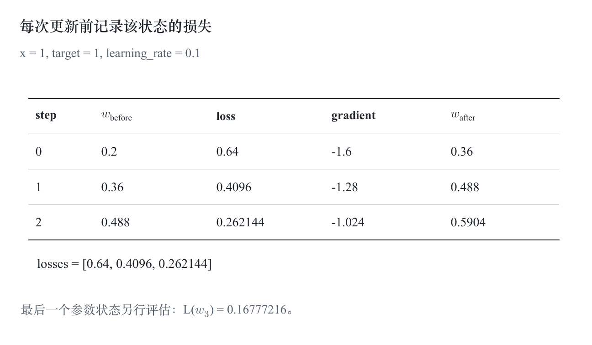{width=100%}

逐行从更新前参数读到它的损失、梯度，再读到更新后参数。三个损失条目组成返回的历史。最后一行到达最终参数，其单独评估的损失写在图底部。

循环开始前，工作参数 `w=0.2`，`losses=[]`。

1. **第一轮，`step=0`：**用 `w=0.2` 调用辅助函数，得到约 `(0.64, -1.6, 0.36)`。追加 `0.64`，保存 `w=0.36`。此时 `losses=[0.64]`。
2. **第二轮，`step=1`：**使用 `w=0.36`，而非初始值。辅助函数返回约 `(0.4096, -1.28, 0.488)`。追加 `0.4096`，保存 `w=0.488`。此时 `losses=[0.64, 0.4096]`。
3. **第三轮，`step=2`：**使用 `w=0.488`。辅助函数返回约 `(0.262144, -1.024, 0.5904)`。追加 `0.262144`，保存 `w=0.5904`。

三轮结束后，返回约：

```text
(0.5904, [0.64, 0.4096, 0.262144])
```

最终参数对应的损失是 `0.16777216`。这个列表记录每次更新使用的更新前损失，因此不额外加入最终损失作为第四项。记录时点很重要：记录需要说明损失对应哪一个参数状态。

如果 `num_steps=0`，辅助函数一次都不调用，直接返回初始化的 `w` 和空历史。例如 `train_scalar(0.2, 1.0, 0.1, 0)` 返回 `(0.2, [])`。

### 动手前的语法与缩进

`range(3)` 依次产生计数器 `0`、`1`、`2`，恰好重复三次。最后一个计数器是 `2`，因为结束值不包含在内。`range(0)` 是空的。

`for step in range(num_steps):` 会为每个计数器执行一次缩进的循环体。循环头在函数内缩进四个空格，循环体缩进八个空格。`step` 控制重复次数；调用辅助函数时传当前 `w`，不要传这个计数器。

tuple 解包按位置赋值。例如 `a, b, c = (10, 20, 30)` 会把 `10` 赋给 `a`、`20` 赋给 `b`、`30` 赋给 `c`。接收辅助函数结果时，按返回顺序使用 `loss`、`gradient`、`w_new`。

`losses.append(loss)` 把名为 `loss` 的损失浮点数追加到历史列表 `losses` 的末尾。在循环之前初始化历史，让每次循环都追加到同一列表。

`return` 会退出整个函数。放在循环之后，缩进四个空格，才能完成所有要求的更新，也能处理零次更新。

### 实现指导

请按下列步骤实现。第 4 和第 6 步也可以合并，下文单独解释：

1. **从 `initial_w` 初始化 `w`。** 用普通赋值，缩进四个空格。在循环前只做一次。
2. **初始化 `losses`。** 用 `[]` 创建新的空列表，也放在循环前。
3. **建立固定次数的循环。** 用 `for step in range(num_steps):`，缩进四个空格。第 4–6 步放在循环体内，缩进八个空格。
4. **调用辅助函数。** 将当前 `w`、`target`、`learning_rate` 传给 `gradient_step`，按顺序解包到 `loss`、`gradient`、`w_new`。例子中的第二次调用应传入 `w=0.36`。
5. **记录 `loss`。** 将这一个浮点数追加到 `losses`。两轮后列表约为 `[0.64, 0.4096]`。
6. **保留更新后的参数。** 把 `w_new` 赋给工作参数 `w`，让下一次调用读取它。两轮后应为 `0.488`。
7. **循环结束后返回。** 按顺序返回 `w`、`losses`，缩进四个空格。`return first, second` 会返回两个元素的 tuple。

你已经替换原来的 `raise NotImplementedError(...)` 占位行。提供的初始化代码从 `03_02_scalar_gradient_step.py` 加载 `gradient_step`，不会运行那一课的检查程序。这段初始化代码和本课提供的检查程序保持原样。底部的 `if __name__ == "__main__":` 在直接运行本文件时调用检查。

### 运行与预期成功输出

复习完成的练习时，从项目根目录运行：

```bash
python3 exercises/03_03_scalar_training_loop.py
```

预期输出：

```text
PASS: current parameter, recalculated gradients, and loss history
PASS: zero and one update
PASS: requested step count and separate calls
PASS: different starting values, targets, and learning rates
PASS: zero gradient still records every requested step
PASS: large steps remain visible in loss history
Lesson 03.03 checks passed.
```

检查允许微小浮点舍入差异。除了三轮例子，还会验证零次和一次更新、另一种步数、多次调用各自独立的历史、变化的输入、零梯度和大学习率。例如 `learning_rate=1.2` 时，两次更新返回约 `(-0.568, [0.64, 1.2544])`；即使某次损失上升，也按要求保留记录。

### 读懂一次 tuple 赋值

你写了：

```python
loss, gradient, w = gradient_step(w, target, learning_rate)
```

这正确地合并了接收辅助函数结果和保留新参数两件事。Python 先用旧 `w` 完成右侧的函数调用，再把三个返回值赋给左侧变量。第一次更新的过程是：

1. 辅助函数收到旧的 `w=0.2`。
2. 返回约 `(0.64, -1.6, 0.36)`。
3. 赋值后，`loss=0.64`、`gradient=-1.6`、新的 `w=0.36`。
4. `losses.append(loss)` 记录的是更新前的损失 `0.64`，虽然此时 `w` 已经存着更新后的参数。
5. 下一轮用 `w=0.36` 调用辅助函数。

第三个返回值在辅助函数里叫 `w_new`，调用方可以直接把它赋给 `w`。tuple 的位置决定哪个值赋给哪个变量。你使用的循环计数器名称 `step` 也正确，这份讲义已统一使用这个名称。收到但未继续使用的 `gradient` 不需要额外参与一次更新，因为辅助函数已经用它算好了第三个结果。

### 课堂追问：零次更新

对于 `train_scalar(0.2, 1.0, 0.1, 0)`，结果是 `(0.2, [])`：`range(0)` 跳过循环体，循环外的 return 仍会执行。

完整过程是：

1. `w = initial_w` 得到 `w=0.2`。
2. `losses = []` 创建空历史。
3. `range(0)` 不提供任何计数器，因此辅助函数调用和追加操作都不执行。
4. 最后的 `return w, losses` 与循环头处在相同缩进，仍然执行，返回 `(0.2, [])`。

空循环跳过循环体，程序接着执行后面的语句。

### 试着解释这些问题

为什么参数和损失历史要在循环之前初始化？在 tuple 赋值中，哪个时刻的 `w` 被传给 `gradient_step`，返回的新值又在什么时候赋给 `w`？为什么历史记录每次更新之前的损失，而不额外追加最终参数处的损失？结合三步轨迹与零步算例解释这些问题。

接下来学习 [03.04：链式法则与自动求导](#section-03-04)。循环的其他检查点保留作复习；链式法则入门之后再进入可训练张量。

## 03.04 链式法则与自动求导 {#section-03-04}

### 方法来源

神经网络反向传播（backpropagation）见 [Rumelhart et al., 1986; R39](https://doi.org/10.1038/323533a0)；PyTorch 计算图与梯度规则见 [PyTorch, v2.0 autograd; R16](https://docs.pytorch.org/docs/2.0/notes/autograd.html)。

参数通常不会直接变成损失，中间还隔着一连串运算。要理解自动求导，我们先沿一条最短的路径走一遍：输入乘参数，预测减目标，再把误差平方。链式法则把每一步的局部变化率连起来，得到整个计算对参数的导数。

这一节专门展开链式法则，不另设代码作业。下一节会把同一个计算写成 PyTorch 运算。

### 先定义函数与梯度，再代入数值

保持 $x$ 和 `target` 固定。模型与目标都是可调整参数 $w$ 的函数：

```text
prediction(w) = w * x
L(w) = loss = (prediction(w) - target) ** 2
     = (w * x - target) ** 2
```

这里要求的梯度是 $\frac{dL}{dw}$：损失对参数的导数。对于可微的标量函数，它的定义是：

```text
dL/dw = limit as h approaches 0 of (L(w + h) - L(w)) / h
```

$h$ 是取极限前 $w$ 的一个非零变化量。导数表示：其他固定量不变时，$w$ 变化所引起的损失局部变化率。它不是把当前损失值除以当前参数值。

通过中间变量 `prediction` 形成的这个复合函数，其**链式法则**公式为：

```text
dL/dw = dL/d(prediction) * d(prediction)/dw

dL/d(prediction) = 2 * (prediction - target)
d(prediction)/dw = x

gradient = dL/dw = 2 * (prediction - target) * x
                = 2 * (w * x - target) * x
```

第一个导数描述损失怎样响应预测值的变化，第二个描述预测值怎样响应参数的变化。相乘就把损失连接到了参数。这是本例依赖路径上的标量链式法则。下文的推导先从导数定义得到这个结果，再代入数值。

### 参数、输入、预测与损失

本例中每个量都是标量数值，Python 例子使用 `float`。

| 名称 | 作用 | 初始值 |
| --- | --- | --- |
| $w$ | 可以调整的模型参数。 | `0.2` |
| $x$ | 本例的固定输入。 | `2.0` |
| `target` | 固定的期望预测值。 | `1.0` |
| `prediction` | 模型输出，由 $wx$ 算出。 | `0.4` |
| `error` | 预测值减去目标值。 | `-0.6` |
| `loss` | 平方误差，是希望降低的标量目标。 | `0.36` |
| `gradient` | 在当前 $w$ 处，损失对 $w$ 的导数。 | 下文计算。 |
| `learning_rate` | 参数更新时使用的正数倍率。 | `0.1` |

现在参数和预测值的数值不同了。取 `x=1.0` 时，这个模型就回到之前的 $\mathrm{prediction}=w$。本次计算考察 $w$ 的变化，同时保持 $x$ 和 `target` 固定。

### 推导：为什么两个变化率相乘

在原来的 $w$ 处，记 $\mathrm{error}=wx-\mathrm{target}$。把参数改成 $w+h$，预测值和误差都恰好增加 $xh$：

```text
prediction(w + h) = prediction(w) + x * h
error_new = error + x * h
```

展开平方，得到有限变化时精确的损失差值：

```text
L(w + h) - L(w)
    = (error + x * h) ** 2 - error ** 2
    = 2 * error * x * h + x ** 2 * h ** 2
```

除以参数变化量，再取极限：

```text
(L(w + h) - L(w)) / h = 2 * error * x + x ** 2 * h

as h approaches 0:
    dL/dw = 2 * error * x
          = 2 * (w * x - target) * x
```

其中 $x^{2}h$ 趋近于零。因子 $2\,\mathrm{error}$ 来自损失对预测值的响应，因子 $x$ 来自预测值对 $w$ 的响应。把变化率相乘，就同时考虑了两层依赖。这个推导证明本例的公式；一般的链式法则把同样的局部变化率思路推广到可微复合函数。

显式保留中间变量 `error`，也可以写成三项相乘：

```text
dL/dw = dL/d(error) * d(error)/d(prediction) * d(prediction)/dw
      = (2 * error) * 1 * x
```

减去固定目标值的导数是 `1`，因此两项与三项的写法结果相同。$2\,\mathrm{error}$ 表示损失对 `error` 的导数，在这里也等于损失对 `prediction` 的导数。求损失对 $w$ 的导数，还需要包括预测值对参数的导数 $x$。取 `x=1` 时，就回到 03.02 的公式。

### 前向计算例子：代入数值

按顺序进行这三个运算：

```python
prediction = w * x
error = prediction - target
loss = error ** 2
```

当 `w=0.2`、`x=2.0`、`target=1.0` 时：

1. $\mathrm{prediction}=0.2 \times  2.0 = 0.4$。
2. $\mathrm{error}=0.4 - 1.0 = -0.6$。
3. $L=(-0.6) ^{2} = 0.36$。

从输入和参数算到损失的过程叫**前向计算（forward pass）**。其中的依赖路径是 `w → prediction → error → loss`。计算图记录这样的依赖与运算；固定输入和目标值也分别进入对应运算。

### 局部导数：每一步怎样响应变化

$\frac{dA}{dB}$ 表示 $A$ 对 $B$ 的导数：在当前位置，$B$ 变化时，$A$ 随之变化的速率。它不是把数值 $A$ 除以数值 $B$。这个变化率可以为负，也可以大于一。

从损失开始，倒着看三个运算：

1. **平方：**$L=\mathrm{error}^{2}$。损失对 `error` 的导数为 $2\,\mathrm{error}$。当前 `error=-0.6`，所以是 `-1.2`。
2. **减去固定目标：**$\mathrm{error}=\mathrm{prediction}-\mathrm{target}$。预测值增加一点，误差也增加相同的量，因此误差对预测值的导数为 `1`。
3. **乘以固定输入：**$\mathrm{prediction}=wx$。参数增加一点，预测值增加的量就是它的 $x$ 倍，因此预测值对 $w$ 的导数为 `x=2.0`。

平方的导数规则来自 03.02。本课先把它应用到中间变量 `error`，再通过链式法则连接到参数。

### 链式法则例子：计算推导出的公式

损失依赖误差，误差依赖预测，预测依赖 $w$。这条单一路径上的导数，等于各步局部导数的乘积：

```text
d(loss)/d(w)
    = d(loss)/d(error) * d(error)/d(prediction) * d(prediction)/d(w)
    = (2 * error) * 1 * x
    = (-1.2) * 1 * 2.0
    = -2.4
```

因此，这个模型与损失对应的公式是：

```text
gradient = 2 * (w * x - target) * x
```

最后的 $x$ 表示参数对预测值的影响倍率。例如，$w$ 增加 `0.001`，预测值和误差就增加 `0.002`。在当前位置，用一阶近似估计损失变化为 $-1.2 \times  0.002 = -0.0024$，也等于 $\mathrm{gradient}\times0.001$。这是对局部小变化的估计，不是有限变化的精确差值。

相乘的是各运算对应的导数。预测值 `0.4` 和损失值 `0.36` 是前向计算结果，不是额外的导数因子。

### 反向计算与自动求导

沿运算倒序计算损失梯度的过程叫**反向计算（backward pass）**，在模型训练中也叫**反向传播（backpropagation）**。本例中：

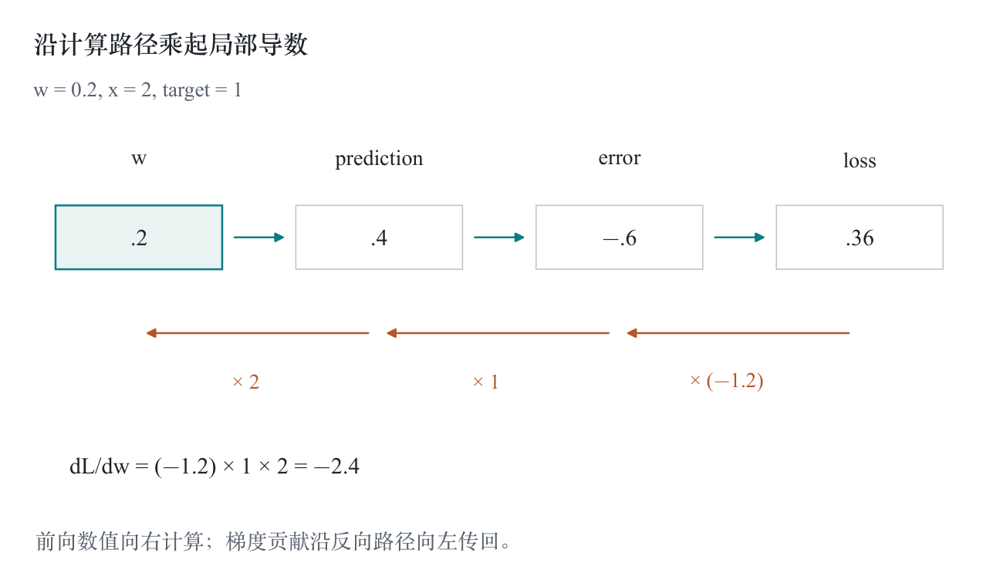{width=100%}

青绿色箭头沿前向计算前进，反向的橙色箭头对应局部导数。把图中三个因子相乘，得到 dL/dw=-2.4。

| 正在计算的梯度 | 规则 | 结果 |
| --- | --- | --- |
| 损失对 `error` 的梯度 | $2\,\mathrm{error}$ | `-1.2` |
| 损失对 `prediction` 的梯度 | 上一步梯度乘 `1` | `-1.2` |
| 损失对 $w$ 的梯度 | 上一步梯度乘 $x$ | `-2.4` |

**自动求导（automatic differentiation）**记录有关运算和中间值，再应用各运算的导数规则与链式法则来计算梯度。框架可以为很多参数完成这些记录与计算。对于标量损失，每个参数的梯度表示：保持其他参数固定时，损失对这个参数的局部变化率。

本课先跟踪一条依赖路径。一个参数通过多条路径影响损失时，需要把各条路径的梯度贡献相加；后续会用例子展开。

训练中各个环节的职责仍然分开：

1. 定义模型的前向计算和损失。
2. 通过反向计算得到梯度。
3. 使用选择的学习率，按更新规则调整参数。
4. 下一轮用新参数重新计算前向结果和梯度。

自动求导提供梯度，参数更新是单独的操作。

### 完整做一次更新

`gradient=-2.4`、`learning_rate=0.1` 时，梯度下降得到：

```text
w_new = w - learning_rate * gradient
      = 0.2 - 0.1 * (-2.4)
      = 0.44
```

用这个新参数重新前向计算：

```text
prediction_new = 0.44 * 2.0 = 0.88
error_new = 0.88 - 1.0 = -0.12
loss_new = (-0.12) ** 2 = 0.0144
```

本次更新让损失从 `0.36` 降到 `0.0144`。这些数值验证了这一次更新的结果；学习率过大仍可能使损失上升，03.02 已经演示过。前向计算、反向计算与参数更新合起来构成一轮训练。

### 一次手算练习

数值检查使用 `w=0.6`、`x=2.0`、`target=1.0`。保留计算步骤供按需复习：

1. 计算 $\mathrm{prediction}=wx$。
2. 计算 $\mathrm{error}=\mathrm{prediction}-\mathrm{target}$。
3. 计算平方运算的局部导数 $2\,\mathrm{error}$。
4. 乘上减法的导数 `1` 和乘法的导数 $x$，得到 `d(loss)/d(w)`。

当 `w=0.6`、`x=2`、`target=1` 时，预测为 `1.2`，误差为 `0.2`，损失为 `0.04`，参数梯度为 $2\times 0.2\times 2=0.8$。最后的因子 $x$ 来自预测对 w 的导数。

## 03.05 实现标量自动求导 {#section-03-05}

### 方法来源

反向传播的背景见 [Rumelhart et al., 1986; R39](https://doi.org/10.1038/323533a0)；PyTorch 的计算图、叶子张量与梯度累积规则见 [PyTorch, v2.0 autograd; R16](https://docs.pytorch.org/docs/2.0/notes/autograd.html)。

让 PyTorch 代我们求导，并没有换掉链式法则。改变的是描述计算的方式：可训练张量记录依赖，标量损失发起反向计算，参数收到对应梯度。本节把每个 API 操作都和上一节的手算对应起来，先只求导，暂不更新。

先走完下面的小例子，再对照 03_05_scalar_autograd.py 动手。编号步骤会说明函数接口，并引导核心实现；初始化和检查驱动由配套文件提供。

### 模型、损失与梯度

保持 `x` 和 `target` 固定，对参数 `w` 求导：

```text
prediction = w * x
error = prediction - target
L = loss = error ** 2

dL/dw = dL/d(error) * d(error)/d(prediction) * d(prediction)/dw
      = (2 * error) * 1 * x
      = 2 * (w * x - target) * x
```

导数公式是理解和核对结果的参考。练习中由你写前向计算，再让自动求导根据这段计算得到梯度。

### 原理：沿记录下来的运算反向求导

对于中间量 $u$，记 $g_u=\frac{dL}{du}$，即损失对这个量的导数。一个运算 $v=f(u)$ 向前一个量传回的梯度贡献是：

```text
g_u += g_v * d(v)/d(u)
```

先把梯度累加器初始化为零，从标量损失处以 $g_L=\frac{dL}{dL}=1$ 开始。`+=` 表示把这一项贡献加到已有值上；多条路径可能给同一个量贡献梯度。本练习只有一条路径，每个量只收到一项贡献。

前向计算时，PyTorch 算出张量数值，同时记录有关运算和导数规则需要的信息。反向计算时，按依赖关系的倒序，把传来的梯度与该运算的局部导数结合。这叫反向模式自动求导（reverse-mode automatic differentiation）。[官方自动求导教程](https://docs.pytorch.org/tutorials/beginner/basics/autogradqs_tutorial.html) 介绍了这个记录与传播过程。

链式法则的结果在当前前向数值处计算，浮点运算可能产生舍入误差。有限差分通过扰动输入来估计导数，本课的检查程序用它作独立核对。符号推导则像 03.04 那样变换公式。本课的自动求导沿记录的计算过程应用各运算的导数规则。

### 完整的前向与反向例子

练习中，`w_tensor` 保存公式里称为 `w` 的参数，`prediction_tensor` 保存它的预测值。求导过程中，两者都保持为张量。`grad_value` 则是完成求导后，从梯度中取出的普通 Python 数值。

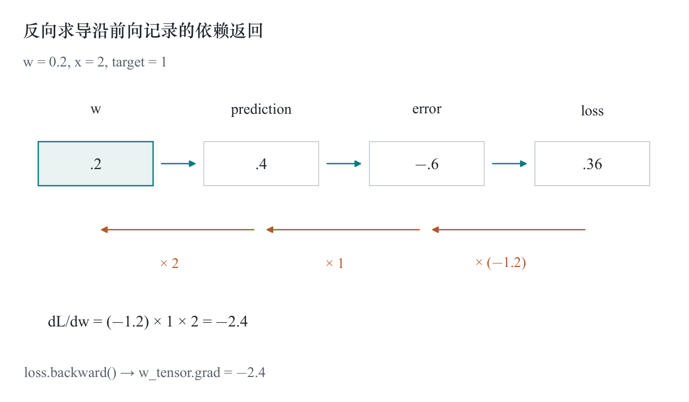{width=100%}

前向数值与手算相同。反向沿这些依赖计算，把结果放进叶子参数的 .grad；用 .item() 取普通记录数值，是另一件事。

使用 `w_value=0.2`、`x=2.0`、`target=1.0`。

| 前向计算量 | 公式 | 数值 |
| --- | --- | --- |
| 参数 `w_tensor` | 从 `w_value` 创建张量 | `0.2` |
| `prediction_tensor` | `w_tensor * x` | `0.4` |
| `error` | `prediction_tensor - target` | `-0.6` |
| `loss` | `error ** 2` | `0.36` |

反向计算前，新参数的 `w_tensor.grad` 是 `None`，表示还没有存入梯度。概念上的反向过程为：

```text
g_L = 1
g_error = g_L * (2 * error) = 1 * (-1.2) = -1.2
g_prediction = g_error * 1 = -1.2
g_w = g_prediction * x = (-1.2) * 2.0 = -2.4
```

`None` 与零梯度不同：前者表示没有存入梯度。真正算出的零导数，在反向计算后会存为数值为零的梯度张量。

反向计算后，`w_tensor.grad` 存着约 `-2.4`，参数值仍然为 `0.2`：反向计算得到了损失对参数的导数。单独的更新步骤才会使用 `w_new = w - learning_rate * gradient`。本函数只返回损失和梯度，因此没有学习率参数和更新步骤，预期返回约 `(0.36, -2.4)`。

在你之前算过的正误差例子中，`w_value=0.6`、`x=2.0`、`target=1.0` 得到预测值 `1.2`、误差 `0.2`、损失 `0.04`、参数梯度 `0.8`。

一个有用的边界例子是 `x=0`、`target=1`：无论 `w_tensor` 是多少，预测都是零，因此损失为 `1`、参数梯度为 `0`。对这个输入，改变该参数无法改变预测。单凭零梯度，不能推断损失为零。

### PyTorch 对象与语法

`import torch` 加载这个库。张量（tensor）存储数值，并支持可以参与自动求导的运算。标量张量包含一个数，维数为零，它与空张量不同；后续再扩展到向量和表。

一个单独演示创建语法的例子是：

```python
parameter = torch.tensor(0.6, dtype=torch.float64, requires_grad=True)
```

第一个参数提供数值。`dtype=torch.float64` 选择 64 位浮点精度，这是数值表示方式，不是张量形状或 Embedding 维数。`requires_grad=True` 要求在正常梯度模式下记录涉及这个张量的运算。`True` 是布尔真值，$T$ 要大写。直接创建的这个参数叫**叶子张量（leaf tensor）**，是计算的起始参数节点。参见[张量构造函数](https://docs.pytorch.org/docs/2.0/generated/torch.tensor.html)。

用这个张量做运算，会产生保持连接的张量结果。整个前向过程中，`prediction_tensor`、`error`、`loss` 都保留为张量。本例可以乘 Python 浮点数 `x`，减 Python 浮点数 `target`，同时保留对 `w_tensor` 的依赖。

`loss.backward()` 调用损失张量的方法：点号选择方法，括号执行方法。对于这个标量损失，起始梯度隐含为 `1`。方法返回 `None`，并把梯度存到参与计算的叶子张量上，包括 `w_tensor.grad`；因此在调用之后读取 `.grad`。中间张量默认不保留 `.grad` 值，但内部会使用它们的导数。本练习每次调用都创建新的 `w_tensor`；复用参数时梯度的累加与清空留到后续。参见 [Tensor.backward](https://docs.pytorch.org/docs/2.0/generated/torch.Tensor.backward.html)。

`w_tensor.grad` 是存着梯度张量的属性。`w_tensor.grad.item()` 再调用这个张量的方法，取出普通 Python 数值。类似地，`loss.item()` 取出损失数值。`.item()` 用于只有一个元素的张量，而且不可微；本练习在反向计算后，为返回结果提取数值。若提前把保持连接的 `loss` 换成 Python 浮点数，就失去了反向计算需要的张量对象。参见 [Tensor.item](https://docs.pytorch.org/docs/2.0/generated/torch.Tensor.item.html)。

### 准确的输入、局部变量与返回值

| 名称 | 类型 | 含义 |
| --- | --- | --- |
| `w_value` | `float` | 本次调用开始时的参数数值。 |
| `x` | `float` | 固定的输入倍率。 |
| `target` | `float` | 固定的期望预测值。 |
| `w_tensor` | 标量 `torch.Tensor` | 新创建、启用梯度记录的参数。 |
| `prediction_tensor`、`error`、`loss` | 标量 `torch.Tensor` | 保持连接的前向计算结果。 |
| `w_tensor.grad` | 先为 `None`，后为标量 `torch.Tensor` | 尚未计算的梯度，之后存着损失对 `w_tensor` 的导数。 |
| `grad_value` | `float` | 从已计算的参数梯度中取出的数值。 |

假设输入为有限浮点数，返回包含两个 Python 浮点数的 tuple `(loss_value, grad_value)`，两者都对应原始参数。把取出的损失存入局部变量 `loss_value`，把取出的梯度存入 `grad_value`。本函数不需要循环、条件判断或输入验证。

### 实现指导

请实现 `03_05_scalar_autograd.py` 中的 `autograd_loss_and_gradient`。按这些步骤实现函数，变量名与接口保持一致。保留提供的导入和检查程序。函数内每条实现语句都缩进四个空格。

1. **从 `w_value` 创建 `w_tensor`。** 使用 `torch.tensor(w_value, dtype=torch.float64, requires_grad=True)`。其中 `w_value` 提供数值，`torch.float64` 指定浮点类型，`requires_grad=True` 开启梯度记录。例子中数值为 `0.2`，最初 `w_tensor.grad` 为 `None`。在函数内创建，让每次调用都独立计算。
2. **计算 `prediction_tensor`。** 用 `*` 把张量 `w_tensor` 乘以参数 `x`，普通赋值保存。例子结果是存着 `0.4` 的标量张量。
3. **计算 `error`。** 从 `prediction_tensor` 中减去参数 `target`，例子结果存着 `-0.6`。
4. **计算 `loss`。** 用 `** 2` 把 `error` 平方，例子结果存着 `0.36`。保持张量与 `w_tensor` 的连接。
5. **反向计算一次。** 单独一行调用 `loss.backward()`。之后 `w_tensor.grad` 存着 `-2.4`，而 `w_tensor` 仍然存着 `0.2`。
6. **读取 `grad_value`。** 用 `.item()` 从 `w_tensor.grad` 取出数值。例子中的 Python 浮点数约为 `-2.4`；从自动求导结果读取，不手写导数公式来生成它。
7. **返回两个数。** 从 `loss` 取出数值，再按顺序返回这个数和 `grad_value`。语法 `return first, second` 产生两个元素的 tuple，例子结果约为 `(0.36, -2.4)`。

### 运行、预期输出与排错

在终端激活已有的 PyTorch 环境。从项目根目录，用该环境的 `python` 运行：

```bash
python exercises/03_05_scalar_autograd.py
```

完整实现的预期输出：

```text
PASS: negative and positive parameter gradients
PASS: unit input matches the earlier scalar loss
PASS: changed inputs and targets
PASS: zero gradients with zero and nonzero losses
PASS: separate calls produce independent results
PASS: finite-difference gradient agreement
Lesson 03.05 checks passed.
```

若无法导入 `torch`，先检查选中的解释器并激活已有环境。若损失没有求导历史，检查 `requires_grad=True` 和前向结果是否保持为张量。若 `w_tensor.grad` 为 `None`，检查是否先在保持连接的损失上运行了反向计算。`loss.backward()` 返回 `None` 是正常行为，梯度从参数属性读取。检查允许浮点舍入差异。

### 试着解释这些问题

按需复习：`requires_grad` 启用什么，为什么反向计算从 `1` 开始，梯度存在哪里，为什么反向计算后 `w_tensor` 不变，以及什么时候使用 `.item()`。接下来到 [03.06](#section-03-06) 清掉旧梯度并更新张量参数，之后再接到训练循环与 Embedding。

## 03.06 更新张量参数 {#section-03-06}

### 方法来源

张量反向计算所用的自动求导规则见 [PyTorch, v2.0 autograd; R16](https://docs.pytorch.org/docs/2.0/notes/autograd.html)；神经网络链式求导的背景见 [Rumelhart et al., 1986; R39](https://doi.org/10.1038/323533a0)。

得到梯度，只是知道了参数该怎样调整，参数本身还没有变。完整的一步训练需要清掉旧的导数缓冲区，计算新梯度，再更新原来的张量。本节把这几个动作的先后顺序讲清楚，也解释为什么前向计算和参数更新要处在不同的求导范围里。

先走完下面的小例子，再对照 03_06_tensor_gradient_step.py 动手。编号步骤会说明函数接口，并引导核心实现；初始化和检查驱动由配套文件提供。

### 导数与更新

保持输入 `x` 和期望预测值 `target` 固定。对于标量参数 `w`：

```text
prediction = w * x
error = prediction - target
L(w) = loss = error ** 2
g = dL/dw = 2 * (w * x - target) * x
w_new = w - learning_rate * g
```

导数来自 03.04 的链式法则。参数发生小变化 $\Delta w$ 时，局部估计为 $\Delta L\approx g\,\Delta w$。把梯度下降的变化量 $\Delta w=-\texttt{learning\_rate}\,g$ 代进去，得到 $\Delta L\approx-\texttt{learning\_rate}\,g^{2}$。学习率为正、梯度非零时，这个估计为负，因此选择这个更新方向。局部近似不能保证很大的有限步长也让损失下降。

对于本例的平方损失，有限变化的精确差值是：

```text
L(w + delta_w) - L(w) = g * delta_w + x ** 2 * delta_w ** 2
```

额外的平方项可能超过负的一阶项。检查程序保留了之前的大步长例子，作为边界情况。

### 课堂问答：预测减目标，还是目标减预测？

你问，`error = predicted_tensor - target` 能不能把减法顺序倒过来，以及 `target - predicted_tensor` 有什么区别。记 $a=\mathrm{prediction}=wx$、$b=\mathrm{target}$，保持 `x`、`target` 固定。对于本课的平方误差目标，两种有符号误差定义都可以：

```text
error = a - b
error_reversed = b - a = -error

loss = error ** 2 = error_reversed ** 2
```

`error_reversed` 是解释另一种定义时使用的名称，并没有作为新变量加进练习。当前练习代码仍使用 `error = predicted_tensor - target`。

正负号的含义反过来了：

| 有符号误差定义 | 正数表示 | 负数表示 |
| --- | --- | --- |
| `a - b` | 预测比目标高 | 预测比目标低 |
| `b - a` | 预测比目标低 | 预测比目标高 |

预测为 `0.4`、目标为 `1.0` 时，两种误差分别是 `-0.6`、`+0.6`，平方都等于 `0.36`。预测为 `1.2`、目标为 `1.0` 时，分别是 `+0.2`、`-0.2`，平方都等于 `0.04`。相反的符号改变了偏差的描述方式，没有改变这个平方损失的数值。

倒过来定义误差时，误差对预测值的导数也会反号。链式法则要一起算：

```text
prediction = w * x

Original definition:
    error = prediction - target
    d(error)/d(prediction) = +1
    dL/dw = (2 * error) * (+1) * x

Reversed definition:
    error_reversed = target - prediction
    d(error_reversed)/d(prediction) = -1
    dL/dw = (2 * error_reversed) * (-1) * x
```

倒过来减时，导数为什么是 `-1`？因为预测增加一点，`target - prediction` 就减少同样的量。同时 $\mathrm{error}_{\mathrm{reversed}}=-\mathrm{error}$，两处符号改变相互抵消，最终参数梯度相同。

当 `w=0.2`、`x=2.0`、`target=1.0` 时，完整比较为：

| 量 | 预测减目标 | 目标减预测 |
| --- | --- | --- |
| 预测 | `0.4` | `0.4` |
| 有符号误差 | `-0.6` | `+0.6` |
| 平方损失 | `0.36` | `0.36` |
| 误差对预测的导数 | `+1` | `-1` |
| 损失对 `w` 的导数 | $2 \times  (-0.6) \times  (+1) \times  2 = -2.4$ | $2 \times  (+0.6) \times  (-1) \times  2 = -2.4$ |

学习率为 `0.1` 时，两种写法都得到 $w_{\mathrm{new}}=0.2-0.1\times (-2.4)=0.44$。中间误差与局部导数的符号相反，但平方目标、最终参数梯度和更新相同。不能因为误差定义反过来了，就把梯度下降的减法改成加法。

手算 `error_reversed` 对应的梯度时，要带上 `-1` 因子，因此公式是 `-2 * error_reversed * x`，不能直接套 `2 * error_reversed * x`。本练习使用 `loss.backward()`，它对你实际写出的前向表达式求导，会自动包含这个因子。这种等价来自平方的对称性，不代表所有目标函数都不受减法顺序影响。

### 课堂问答：为什么减去 `learning_rate * gradient`？

你问，为什么更新要减去学习率乘梯度，而不是加上。先看梯度的含义：$g=\frac{dL}{dw}$ 描述参数增加时，损失在当前位置怎样变化。它是导数，不是预测误差，也不是让参数直接增大的指令。

参数发生小变化时：

```text
delta_L ≈ g * delta_w
```

我们希望损失变化为负。学习率为正时，选择与梯度符号相反的参数变化：

```text
delta_w = -learning_rate * g
delta_L ≈ g * (-learning_rate * g)
        = -learning_rate * g ** 2
```

$g$ 非零时，这个局部估计为负。如果改成加上学习率乘梯度，就得到 $\Delta L\approx+\texttt{learning\_rate}\,g^{2}$，局部估计为正。负号选择下降方向，正的学习率决定步子大小。

| 当前参数处的梯度 | `w` 增加一点时的效果 | 下降时怎样选 |
| --- | --- | --- |
| $g>0$ | 损失在局部增加 | 减小 `w` |
| $g<0$ | 损失在局部减少 | 增大 `w` |
| $g=0$ | 一阶变化为零 | 这次更新保持 `w` 不变 |

沿用已有例子，`w=0.2`、`x=2.0`、`target=1.0`，得到 `prediction=0.4`、`error=-0.6`、`loss=0.36`、$g=-2.4$。取 `learning_rate=0.1`，比较两种符号：

| 更新 | 新 `w` | 新预测 | 新误差 | 重新计算的损失 |
| --- | --- | --- | --- | --- |
| 减去：$0.2 - 0.1 \times  (-2.4)$ | `0.44` | `0.88` | `-0.12` | `0.0144` |
| 加上：$0.2 + 0.1 \times  (-2.4)$ | `-0.04` | `-0.08` | `-1.08` | `1.1664` |

减去这个负梯度，参数反而增大，并且本次损失降低。加上它，参数减小，本次损失升高。两种情况都要用新参数重新计算损失，才能评估有限步长的实际结果。局部下降的推理仍然需要足够小的步长，学习率很大时可能越过低点。单凭零梯度，也不能证明已经处在最小值。

可以这样理解：先把梯度看成局部斜率，再沿相反方向移动以降低损失，最后用学习率缩放移动量。

### 课堂问答：用数值看正梯度和负梯度

你想看一个具体例子，说明为什么正梯度时增加参数会让损失上升，负梯度时增加参数会让损失下降。

这次比较把固定输入设为 `x=1.0`、`target=1.0`，回到之前的标量模型。先定义损失和导数，再代入数值：

```text
L(w) = (w - 1) ** 2
g(w) = dL/dw = 2 * (w - 1)
```

到 `1` 的距离平方，在 `w=1` 时最小。导数在当前参数处计算，所以同一个函数在不同位置可以有不同的梯度符号。先不使用优化器，直接比较两个起点，把参数增加或减少 `0.1` 后重新计算损失。

**从 `w=2` 出发：梯度为正。** 导数为 $g(2)=2(2-1)=+2$。

| 从起点做什么 | 参数 | 精确损失 |
| --- | --- | --- |
| 原来 | `2.0` | $(2.0 - 1) ^{2} = 1.0$ |
| 增加 `0.1` | `2.1` | $(2.1 - 1) ^{2} = 1.21$ |
| 减少 `0.1` | `1.9` | $(1.9 - 1) ^{2} = 0.81$ |

增加参数会远离目标，损失上升；减少参数会靠近目标，损失下降。因此在梯度下降中，正梯度对应负的参数变化。

**从 `w=0` 出发：梯度为负。** 导数为 $g(0)=2(0-1)=-2$。

| 从起点做什么 | 参数 | 精确损失 |
| --- | --- | --- |
| 原来 | `0.0` | $(0.0 - 1) ^{2} = 1.0$ |
| 增加 `0.1` | `0.1` | $(0.1 - 1) ^{2} = 0.81$ |
| 减少 `0.1` | `-0.1` | $(-0.1 - 1) ^{2} = 1.21$ |

这时增加参数会靠近目标，损失下降；减少参数会远离目标，损失上升。因此在梯度下降中，负梯度对应正的参数变化。

两个起点的损失都等于 `1`，梯度却分别为 `+2`、`-2`。梯度的正负描述局部斜率，不是在说损失本身为正还是为负。在这个例子里，起点位于最低点的两边，因此坡度相反；一般模型仍要根据自己的损失导数判断。

取 `learning_rate=0.05`，把两种情况接到更新公式：

```text
At w=2, g=+2:
    w_new = 2 - 0.05 * 2 = 1.9
    loss: 1.0 -> 0.81

At w=0, g=-2:
    w_new = 0 - 0.05 * (-2) = 0.1
    loss: 1.0 -> 0.81
```

同一条减法规则，在两个起点都选择了合适的下降方向。表格数值是有限步长下的精确计算，允许浮点舍入；$\Delta L\approx g\,\Delta w$ 则是一阶估计。变化量为 `0.1` 时，额外的平方项解释了估计增加 `0.2` 与实际增加 `0.21` 的差别，也解释了估计减少 `0.2` 与实际减少 `0.19` 的差别。这些例子说明局部方向；变化很大时可能跨过最低点。

### 完整做第一次更新

使用 `w=0.2`、`x=2.0`、`target=1.0`、`learning_rate=0.1`。代码中的参数叫 `w_tensor`，预测叫 `predicted_tensor`。

| 阶段 | 计算 | 结果 |
| --- | --- | --- |
| 清掉旧梯度 | 丢弃已存的 `.grad` | 参数仍为 `0.2` |
| 前向预测 | $0.2 \times  2.0$ | `0.4` |
| 前向误差 | `0.4 - 1.0` | `-0.6` |
| 前向损失 | $(-0.6) ^{2}$ | `0.36` |
| 反向梯度 | $2 \times  (-0.6) \times  2.0$ | `-2.4` |
| 参数更新 | $0.2 - 0.1 \times  (-2.4)$ | `0.44` |

反向计算存入梯度，参数仍为 `0.2`。更新才把参数变为 `0.44`。更新后重新前向计算，得到预测 `0.88`、误差 `-0.12`、损失 `0.0144`。

函数返回原来的 `(loss_value, grad_value)`，约为 `(0.36, -2.4)`。与此同时，调用者的张量现在存着 `0.44`。返回的损失来自产生该梯度的那次前向计算，不是重新算出的 `0.0144`。这与 03.03 记录更新前损失的约定一致。

### 为什么必须清掉旧梯度

反向计算会把梯度贡献加到叶子张量已有的 `.grad` 上。复用一个参数，重新前向计算，并不会自动清除这个已存的数值。[官方自动求导教程](https://docs.pytorch.org/tutorials/beginner/basics/autogradqs_tutorial.html) 演示了这种累加。

我们的函数每一步都在开头清除梯度，因为本次更新应该使用当前前向计算的导数。给 `w_tensor.grad` 赋值 `None`，表示丢弃旧的已存梯度，不会把参数清零，也不会替换参数。接着运行反向计算，就会存入新梯度。首次调用时 `.grad` 本来就是 `None`，同样可以这样处理。

在同一个参数上调用两次，可以看出区别：

```text
First call:
    w_before = 0.2
    loss = 0.36
    gradient = -2.4
    w_after = 0.44

Second call, after clearing the old gradient:
    w_before = 0.44
    prediction = 0.88
    error = -0.12
    loss = 0.0144
    gradient = 2 * (-0.12) * 2.0 = -0.48
    w_after = 0.44 - 0.1 * (-0.48) = 0.488
```

第二次调用如果没有清除，`.grad` 会变成 $-2.4 + (-0.48) = -2.88$。用这个累加值更新，就得到 `0.728`，而不是 `0.488`。合并多个 batch 时可以有意累积梯度，但那是后续内容，需要配套的缩放和更新时机。本课每次调用完成一次更新，所以先清掉旧梯度。在开头清除，也让调用者能在本次结束后查看当前梯度。

### 为什么更新要用 `torch.no_grad()`

前向计算需要保持可微，才能在当前参数处求出 $\frac{dL}{dw}$。反向计算结束后，为下一步改变参数，不应该继续扩展这次计算的反向图。只把更新放进 `torch.no_grad()`。[自动求导机制文档](https://docs.pytorch.org/docs/2.0/notes/autograd.html) 解释了它在优化器更新中的用途。

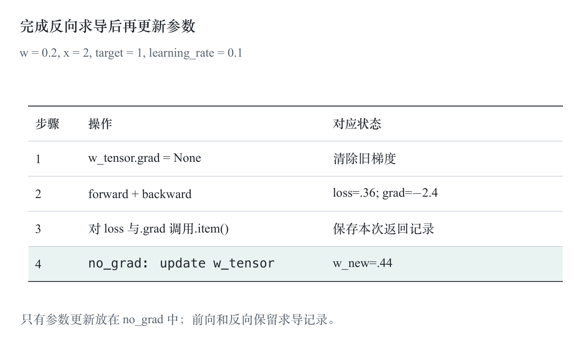{width=100%}

按编号从上到下读各行，把旧状态的损失、梯度和新参数分开。只有最后的原地更新放进 torch.no_grad()。

新的 Python 关键字 `with` 为缩进的代码块进入一个临时上下文。对 `torch.no_grad()` 来说，块中的运算不会被记录到反向计算图；离开代码块后，恢复此前的梯度模式。在函数里，语法形状为：

```python
    with torch.no_grad():
        # Write the parameter update here, with eight spaces of indentation.
        ...
    # Outside the block: return with four spaces of indentation.
```

冒号开始代码块。`...` 是说明结构的占位符，不是写好的更新。已有的 `w_tensor.requires_grad` 仍为 `True`，这个临时上下文不会永久冻结参数。之后在块外重新前向计算，仍然可以记录这个参数的运算。前向和反向计算都放在这个上下文之外。参见 [no_grad API](https://docs.pytorch.org/docs/2.0/generated/torch.no_grad.html)。

在正常梯度模式下，直接对需要梯度的叶子参数原地更新，会触发运行错误。本课使用的顺序是：前向、反向，然后在该上下文内更新参数。对优化过程本身求导属于后续进阶内容。

### 更新调用者持有的参数

与 03.05 的函数不同，本函数接收一个已经创建好的张量。局部名称 `w_tensor` 指向调用者传进来的同一个张量对象。需要原地改变里面的数值，让调用者以及下一次调用看到更新后的参数。

运算符 `-=` 表示减去某个值再赋回；对于这里的张量，它会原地做减法。一个单独演示数字语法的例子是 `counter -= 2`。练习中，在 no-grad 块内，从 `w_tensor` 减去学习率乘梯度。普通的 `w_tensor = ...` 如果指向新算出的张量，只会把函数内的局部名称重新绑定，不会改变调用者持有的张量。不要创建替代参数，也不要用 `.data` 绕过这个机制。保持原来的可训练叶子张量及其存储。

### 课堂继续：把 `.data` 更新改成临时上下文

`.data` 与参数共享存储，但绕过正常的自动求导跟踪；修改它可能绕过修改检查，如果后续某次反向计算需要被覆盖的旧值，就可能得到错误梯度。[官方迁移指南](https://pytorch.org/blog/pytorch-0_4_0-migration-guide/) 演示了这个问题。此前使用 `.data` 的实现通过了单步数值检查，因为更新发生在那一步的反向计算之后。该检查没有让后续反向计算再使用被覆盖的旧值，因此不能暴露绕过修改检查的问题。参数更新使用明确的 no-grad 上下文，同时保留 PyTorch 正常的修改记录机制。

`with torch.no_grad():` 为缩进的代码块进入临时模式，它不是循环或条件判断。参数已有的 `requires_grad=True` 保持不变，算出的 `.grad` 也还存着。原地更新保留正常的修改记录机制，同时不把更新运算加到反向图中。离开代码块后恢复此前的模式，下一次前向就又可以记录运算。

动手前，走完同一个例子：

| 时刻 | `w_tensor` 数值 | 已存梯度 | 准备返回的数值 |
| --- | --- | --- | --- |
| 清掉旧梯度后 | `0.2` | `None` | 尚未算出 |
| 前向与反向结束后 | `0.2` | `-2.4` | `(0.36, -2.4)` |
| no-grad 更新结束后 | `0.44` | `-2.4` | 仍为原来的 `(0.36, -2.4)` |

更新公式仍为 `w_new = w - learning_rate * gradient`，即 $0.2 - 0.1 \times  (-2.4) = 0.44$。上下文改变的是这个更新怎样参与自动求导的记录，不改变算术本身。

当时只需要你改这一处：

1. 在现有更新行上方，以四个空格缩进写 `with torch.no_grad():`。括号调用上下文管理器，冒号开始代码块。
2. 更新行缩进八个空格。对 `w_tensor` 本身使用 `-=`，去掉 `.data`，减去 `learning_rate` 与 `w_tensor.grad` 的乘积，保持原来的参数对象。
3. 返回行仍缩进四个空格，放在上下文外，返回已经存好的 `loss_value`、`grad_value`，再运行相同的检查命令。不需要新循环或替代参数。

### 课堂跟进：上下文里只放参数更新

检查过程中，你保存了新版本，去掉 `.data`，加上了 `with torch.no_grad()`；但这个块也包含 `predicted_tensor`、`error`、`loss` 和 `loss.backward()`。运行这份检查时的快照，在反向处停止，报错为：

```text
element 0 of tensors does not require grad and does not have a grad_fn
```

这个上下文也关闭了前向运算的记录，所以新算出的 `loss` 没有记录对参数的依赖。在同一块内调用反向，不能补回缺失的前向图。如果前向仍放在 no-grad 模式中，只把反向移出去也不够。已有参数的 `requires_grad=True`，不会强制记录该上下文中的运算。

正确顺序是：记录前向计算，对记录下来的计算求导，保存结果，然后暂时停止记录来更新参数。`w_tensor=0.2`、`x=2.0`、`target=1.0` 时，前向得到损失 `0.36`；反向存入梯度 `-2.4`，参数仍为 `0.2`。只有更新才在学习率 `0.1` 下把参数变为 `0.44`。

当时的局部修改仍留给你完成：

1. 梯度清除、前向计算、`loss.backward()`，以及提取 `loss_value`、`grad_value`，都保持函数内四个空格缩进，放在上下文外。
2. 在这些操作之后，以四个空格写 `with torch.no_grad():`；其中只保留缩进八个空格的参数更新，仍使用 `learning_rate` 与 `w_tensor.grad` 做减法。
3. 返回行仍放在上下文外，缩进四个空格，再运行相同的练习命令。


### 准确的输入、变量、返回与副作用

你完成的实现按要求执行：清除已存梯度，计算 `predicted_tensor`、`error`、`loss`，运行反向，提取 `loss_value`、`grad_value`，在 no-grad 块内更新 `w_tensor`，再返回保存的数值。第一个例子返回约 `(0.36, -2.4)`，调用者的参数变为 `0.44`；下一次从 `0.44` 开始，返回约 `(0.0144, -0.48)`，同一个参数变为 `0.488`。提供的检查验证了这一顺序、存储不变、新梯度，以及参数仍为可训练叶子。

| 名称 | 类型 | 含义 |
| --- | --- | --- |
| `w_tensor` | 标量浮点 `torch.Tensor` | 传入的可训练叶子，`requires_grad=True`；已存梯度可能为 `None` 或旧数据。 |
| `x` | `float` | 固定的输入倍率。 |
| `target` | `float` | 固定的期望预测值。 |
| `learning_rate` | 非负 `float` | 决定更新大小的倍率。 |
| `predicted_tensor`、`error`、`loss` | 标量 `torch.Tensor` | 当前前向计算，保留与参数的连接。 |
| `loss_value`、`grad_value` | `float` | 反向之后取出的数值，对应更新前的参数。 |

假设输入是有限值，张量满足上述条件，输入验证不属于本次练习。提供的检查程序创建 CPU `float64` 参数。准确返回两个 Python 浮点数 `(loss_value, grad_value)`。传入的参数被原地更新，仍是可训练叶子，并保留本次 `.grad`，直到下一次调用清除。学习率为零时参数值不变，但反向仍然算出梯度。

### 实现指导

请实现 `03_06_tensor_gradient_step.py` 中的 `tensor_gradient_step`；下列步骤说明实现方法。导入、参数初始化和检查程序都已提供。函数内普通语句缩进四个空格，只有 `with` 内的更新缩进八个空格。

1. **清除旧梯度。** 用属性赋值语法 `object.attribute = value`，把 `w_tensor.grad` 设为 `None`。例子中的参数仍然是 `0.2`。
2. **计算 `predicted_tensor`。** 用 `*` 把 `w_tensor` 乘以 `x`，保存张量结果，其中存着 `0.4`。
3. **计算 `error` 和 `loss`。** 从预测中减去 `target`，再用 `** 2` 把误差平方。分别存着 `-0.6`、`0.36`，保留张量依赖。
4. **运行反向计算。** 对 `loss` 调用一次 `backward()`，放在 no-grad 上下文之外。`w_tensor.grad` 现在存着 `-2.4`，参数仍为 `0.2`。
5. **保存返回数值。** 对 `loss` 使用 `.item()` 得到 `loss_value`，对 `w_tensor.grad` 使用 `.item()` 得到 `grad_value`。它们是原始前向、反向结果的 Python 浮点数。
6. **执行更新。** 在四个空格处写 `with torch.no_grad():`。在里面缩进八个空格，对 `w_tensor` 使用 `-=`，减去 `learning_rate` 与 `w_tensor.grad` 的乘积。同一个张量现在存着 `0.44`。
7. **在上下文外返回。** 回到四个空格，用 `return first, second` 先返回 `loss_value`，再返回 `grad_value`。例子返回约 `(0.36, -2.4)`；保留已存的当前梯度。

本函数不需要循环：调用一次就更新一步。提供的检查程序会在同一个张量上再调用一次，验证下一步。

### 运行与预期输出

激活已有 PyTorch 环境，从项目根目录运行：

```bash
python exercises/03_06_tensor_gradient_step.py
```

修正后的完整实现的预期输出：

```text
PASS: both gradient directions and in-place trainable parameters
PASS: repeated steps use current parameters and fresh gradients
PASS: previously stored gradients are cleared
PASS: zero gradients and zero learning rate
PASS: changed inputs, targets, and learning rates
PASS: a large learning rate can increase loss
Lesson 03.06 checks passed.
```

修正后的实现把前向和反向放在 no-grad 更新块外，已通过这些检查；之前的尝试保留为诊断例子。叶子张量原地操作报错，通常表示更新放在了 no-grad 块外。第二轮梯度错误，可能是保留了旧梯度。调用者参数不变，可能是只重新绑定了局部名称，或没有执行更新。第一个例子返回 `0.0144`，可能是返回了更新后的损失，而非约定的原始损失。检查允许浮点舍入差异。

### 试着解释这些问题

按需复习：为什么清除 `.grad` 不改变参数？为什么第二步的新梯度是 `-0.48`？为什么只有更新放在 `no_grad` 里，调用者又怎样看到参数变化？讲义与练习框架检查，不等于这些问题已被独立回答。接下来到 [03.07](#section-03-07)，把验证过的更新接入张量训练循环，之后引入可训练的 Embedding。

## 03.07 张量训练循环 {#section-03-07}

之前的标量步骤每次返回一个新数值；现在的张量步骤会原地改变持续使用的参数。新的训练循环要顺着这个接口来组织：参数只创建一次，每轮让辅助函数更新它，再记录返回的损失，不额外多做一次更新。

先走完下面的小例子，再对照 03_07_tensor_training_loop.py 动手。编号步骤会说明函数接口，并引导核心实现；初始化和检查驱动由配套文件提供。

### 要实现的递推关系

保持 `x`、`target`、`learning_rate` 固定。用 $w_t$ 表示第 $t$ 次更新之前的参数，初值为 $w_0=\texttt{initial\_w}$。对 $t=0,1,\ldots,\texttt{num\_steps}-1$：

```text
w_0 = initial_w
prediction_t = w_t * x
error_t = prediction_t - target
loss_t = error_t ** 2
gradient_t = 2 * error_t * x
w_(t+1) = w_t - learning_rate * gradient_t
```

每次梯度都在当前参数 $w_t$ 处计算，不是一直在 `initial_w` 处计算。上一次更新后的参数，就是下一次开始时的参数。这些公式描述反复执行梯度下降；代码中每次梯度由辅助函数通过自动求导获得，循环内不手写导数。

历史与返回值为：

```text
losses = [loss_0, loss_1, ..., loss_(num_steps-1)]
final_w = w_(num_steps)
return (final_w, losses)
```

`num_steps=0` 时，历史为空，最终参数就是初值。准确记录 `num_steps` 个更新前损失，不额外加一个训练结束后的结果。

### 原理：一个持续使用的参数，每轮更新一步

循环开始前，只创建一次 `w_tensor`。它里面的数值会变，但同一个张量对象会继续供下一轮使用。已完成辅助函数的行为是：

```text
tensor_gradient_step(w_tensor, x, target, learning_rate)
    returns (loss_value, grad_value)
    updates the supplied w_tensor in place
```

辅助函数已经清除旧梯度、构建当前的前向计算、运行反向、提取更新前的损失与梯度，并在自己的 no-grad 块内更新。外层循环每轮调用它一次，再追加它返回的损失。不要额外反向一次或更新一次。外层循环保持正常梯度模式，让辅助函数的前向能记录依赖。

每次调用辅助函数，都会执行新的前向运算，构建这一轮的计算图。我们保留的是参数张量，不是上一轮的 `loss` 张量或反向图。本题不需要 `retain_graph=True`，也不是对同一个旧损失重复反向。每次新反向之前，梯度由辅助函数清除。

比较两种辅助函数的接口：

| 之前的标量循环 | 本次张量循环 |
| --- | --- |
| `gradient_step` 返回 `(loss, gradient, w_new)` | `tensor_gradient_step` 返回 `(loss_value, grad_value)` |
| 调用者必须保存返回的 `w_new` | 传进去的 `w_tensor` 已经被原地更新 |
| 工作参数是 Python 数值 | 工作参数是一个可训练张量 |

这次返回的两个数不包含新参数。循环中解包 `grad_value` 是为了看清接口，不必把它放进损失历史。不要把辅助函数返回的 tuple 赋给 `w_tensor`。

### 完整走三次更新

使用 `initial_w=0.2`、`x=2.0`、`target=1.0`、`learning_rate=0.1`、`num_steps=3`。

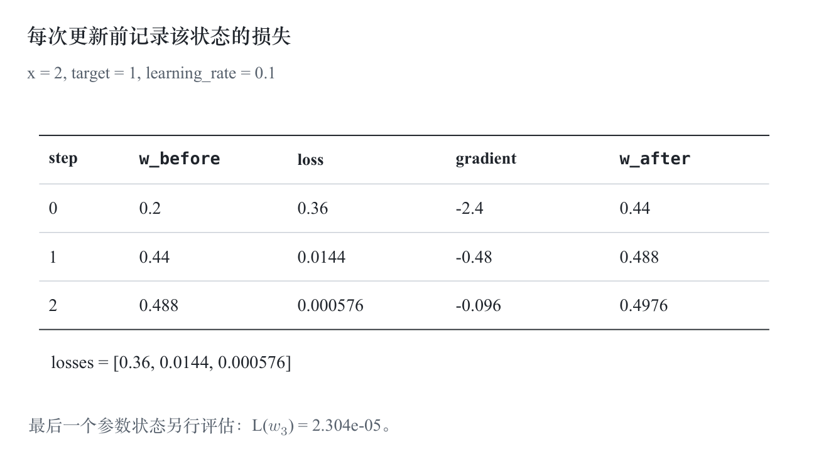{width=100%}

表格每行记录同一个张量的一次辅助函数调用，包括更新前后的数值。三个损失条目组成返回的旧状态历史；$L_{3}$ 在图底部单独评估。

循环之前，创建一个存着 `0.2` 的可训练 `w_tensor`，以及新的 `losses=[]`。

| 循环计数器 | 更新前参数 | 预测 | 误差 | 更新前损失 | 梯度 | 更新后参数 |
| --- | --- | --- | --- | --- | --- | --- |
| `0` | `0.2` | `0.4` | `-0.6` | `0.36` | `-2.4` | `0.44` |
| `1` | `0.44` | `0.88` | `-0.12` | `0.0144` | `-0.48` | `0.488` |
| `2` | `0.488` | `0.976` | `-0.024` | `0.000576` | `-0.096` | `0.4976` |

第一步，$\mathrm{gradient}=2\times (-0.6)\times 2=-2.4$，$w_{\mathrm{new}}=0.2-0.1\times (-2.4)=0.44$，保存返回的损失 `0.36`。同一个参数现在存着 `0.44`。

第二步，辅助函数使用 `0.44`，得到 `prediction=0.88`、`error=-0.12`、`loss=0.0144`、$\mathrm{gradient}=2\times (-0.12)\times 2=-0.48$。参数更新为 $0.44-0.1\times (-0.48)=0.488$，追加 `0.0144`。

第三步，使用 `0.488`，得到 `prediction=0.976`、`error=-0.024`、`loss=0.000576`、`gradient=-0.096`。参数变为 `0.4976`，追加 `0.000576`。

状态依次变化为：

```text
Before looping: w_tensor=0.2, losses=[]
After counter 0: w_tensor=0.44, losses=[0.36]
After counter 1: w_tensor=0.488, losses=[0.36, 0.0144]
After counter 2: w_tensor=0.4976, losses=[0.36, 0.0144, 0.000576]

Return approximately:
(0.4976, [0.36, 0.0144, 0.000576])
```

所有数值都可能有浮点舍入，检查程序允许很小的误差。

### 为什么调用之后追加，记录的仍是旧损失

辅助函数返回的是在参数更新前，从前向结果中取出的 Python 浮点数。调用返回时，`w_tensor` 已经变了，但 `loss_value` 仍对应产生那次前向计算的参数。因此，调用之后把它加入列表，记录的仍是更新前损失。

最终参数处的损失为 $(0.4976\times 2-1)^{2}=0.00002304$，这是对 $w_3$ 的另外一次评估；请求的三次更新使用并记录的是 $L_0$、$L_1$、$L_2$。不要把最终评估追加成第四项。后续训练系统可以把最终评估与更新历史分别报告。

### 输入、局部变量与返回值

检查已完成代码，确认 `w_tensor`、`losses` 在 `for i in range(num_steps)` 前初始化。循环体调用一次 `tensor_gradient_step`，追加 `loss_value`；循环后的返回提取 `w_tensor.item()`。计数器叫 `i` 完全有效：三步例子中，它取得 `0, 1, 2`，与原提示中的 `step` 相同。辅助函数直接更新张量，因此不需要给返回的 `w_new` 赋值。`grad_value` 被解包后没有使用，因为本题只记录损失。

在这个三步算例中，同一个张量依次以 `0.2`、`0.44`、`0.488` 传给辅助函数，最终结果约为 `(0.4976, [0.36, 0.0144, 0.000576])`；零步时则返回初值和空列表。

| 名称 | 类型 | 含义 |
| --- | --- | --- |
| `initial_w` | `float` | 本次训练开始前的参数数值。 |
| `x` | `float` | 固定的输入倍率。 |
| `target` | `float` | 固定的期望预测值。 |
| `learning_rate` | 非负 `float` | 每次更新使用的倍率。 |
| `num_steps` | 非负 `int` | 请求的更新次数。 |
| `w_tensor` | 标量 `torch.Tensor` | 循环前用 `float64`、`requires_grad=True` 创建的唯一可训练参数。 |
| `losses` | `list[float]` | 新的历史列表，每一步保存一个更新前损失。 |
| `i` | `int` | 循环计数器，统计重复次数，不是参数或学习率。 |
| `loss_value`、`grad_value` | `float` | 单步函数返回的两个数值。 |
| `final_w` | `float` | 用 `.item()` 取出的最终参数；是否单独创建同名局部变量由你决定。 |

假设浮点输入有限，学习率和步数满足上述非负要求，不需要写输入验证。返回 tuple `(final_w, losses)`，由一个 Python 浮点数和一个 Python 浮点数列表组成。不同函数调用各自创建参数张量和历史列表；零步返回 `(initial_w, [])`。

提供的 `runpy.run_path` 初始化代码找到同目录的 `03_06_tensor_gradient_step.py`，加载辅助函数，但不运行它的检查程序。编号文件名与加载方式沿用已有练习，你无需实现这部分。

### 动手前先说明语法与缩进

`torch.tensor(value, dtype=torch.float64, requires_grad=True)` 创建可训练标量。把 `initial_w` 用作初值，在循环外创建。`[]` 创建新的历史列表，也放在循环外。

`for` 关键字重复执行一个代码块。`range(num_steps)` 提供计数器：`range(3)` 给出 `0, 1, 2`，准确执行三轮；`range(0)` 不提供计数器，跳过循环体。循环头末尾的冒号开始缩进的代码块。函数内部，初始化和循环头缩进四个空格，里面的辅助函数调用与追加缩进八个空格。

tuple 解包按顺序绑定两个返回值，例如无关的语法演示 `first, second = (10, 20)`。这里第一个结果是 `loss_value`，第二个是 `grad_value`。`losses.append(loss_value)` 把一个损失浮点数追加到列表末尾。

`return` 会退出函数，放在循环后、缩进四个空格，保证更新全部完成，也让零步情况能返回。用 `w_tensor.item()` 取出最终参数。如果把返回放在循环里，第一轮就会退出，而 `num_steps=0` 时根本不会执行到返回。

### 实现指导

请实现 `03_07_tensor_training_loop.py` 中的 `train_tensor`。保留提供的初始化与检查程序，以下六步留作复习或重建实现：

1. **只创建一次 `w_tensor`。** 缩进四个空格，用张量构造函数传入 `initial_w`、`torch.float64`、`requires_grad=True`。例子从 `0.2` 开始，创建放在循环之前。
2. **创建 `losses`。** 缩进四个空格，用 `[]` 创建新的空列表。即使请求零次更新，初值也是 `[]`。
3. **开始循环。** 缩进四个空格，使用 `for i in range(num_steps):`。`num_steps=3` 时，循环体针对计数器 `0`、`1`、`2` 执行。
4. **调用辅助函数。** 缩进八个空格，调用 `tensor_gradient_step(w_tensor, x, target, learning_rate)`，把两个结果解包到 `loss_value`、`grad_value`。第一次返回约 `(0.36, -2.4)`，已经把 `w_tensor` 变为 `0.44`。不要用这两个返回结果给参数赋新值。
5. **记录损失。** 缩进八个空格，只把 `loss_value` 追加到 `losses`。两轮之后，约为 `[0.36, 0.0144]`。循环中不需要额外反向或更新。
6. **循环后返回。** 回到四个空格，用 `.item()` 取出最终参数，再使用 `return first, second` 先返回浮点数，后返回 `losses`。三步结果约为 `(0.4976, [0.36, 0.0144, 0.000576])`；零步结果为 `(initial_w, [])`。

不要把循环放进 no-grad 上下文，也不要在循环内部重新创建参数。

### 可选数学复习：为什么这个例子的损失降得快

对于这个固定标量例子，把更新公式代入下一轮误差：

```text
error_(t+1)
    = x * (w_t - learning_rate * 2 * error_t * x) - target
    = (1 - 2 * learning_rate * x ** 2) * error_t

loss_(t+1) = (1 - 2 * learning_rate * x ** 2) ** 2 * loss_t
```

`x=2`、`learning_rate=0.1` 时，误差倍率为 `0.2`，损失倍率为 `0.04`，即 $0.36 \to  0.0144 \to  0.000576$。`x` 非零时，$0<\texttt{learning\_rate}<\frac{1}{x^{2}}$ 会让误差幅值收缩。这个精确关系针对固定标量平方损失；`x=0` 时参数不能影响预测，学习率为零时参数不动。大步长可能让损失增加，所以历史应如实记录，而不是假定一定改善或提前结束。

### 运行与预期输出

激活已有 PyTorch 环境，从项目根目录运行：

```bash
python exercises/03_07_tensor_training_loop.py
```

完整实现的预期输出：

```text
PASS: repeated tensor updates and pre-update loss history
PASS: zero and one update
PASS: requested step count and separate calls
PASS: supplied helper reuse and one persistent parameter tensor
PASS: changed inputs, targets, and learning rates
PASS: zero gradients and zero learning rate still record every step
PASS: large-step loss increases remain visible
Lesson 03.07 checks passed.
```

历史长度不对，可能是返回放进了循环，或额外追加最终损失。一直重复第一步的数值，可能是在循环内部重新创建初始参数。损失没有求导历史，可能是外层循环放进了 no-grad 模式。要求浮点数的位置出现 tuple 或张量，可能是追加了辅助函数的整个返回值，或没有取出最终参数的数值。

### 试着解释这些问题

按需复习：为什么参数和历史列表在循环之前创建？为什么没有赋值 `w_new`，第二轮仍能读到 `0.44`？为什么历史最后一项是 `0.000576`，而非最终损失 `0.00002304`？为什么零步仍能返回？

接下来是 [Lesson 03.08：可训练 Embedding](#section-03-08)，完成后再接到最小的下一个 token 目标。

## 03.08 可训练的嵌入向量 {#section-03-08}

### 方法来源

神经语言模型中的嵌入学习见 [Bengio et al., 2003; R24](https://www.jmlr.org/papers/v3/bengio03a.html)；下文使用的 PyTorch 梯度机制见 [PyTorch, v2.0 autograd; R16](https://docs.pytorch.org/docs/2.0/notes/autograd.html)。

现在可以从一个可训练数字，走向整张 Embedding 表了。查表决定哪些行参与这次损失，反向计算再把导数送回这些来源行。为了看清机制，本节暂时提供目标向量；后面真正的下一个 token 预测，会代替人工向量提供学习信号。

先走完下面的小例子，再对照 03_08_embedding_gradient_step.py 动手。编号步骤会说明函数接口，并引导核心实现；初始化和检查驱动由配套文件提供。

### 从一个标量参数，到一整张参数表

在 03.06 中，可训练参数是浮点数 `w_tensor`。这次，`embedding_table` 里的每个浮点数都是一个参数。一张 $V$ 行、$D$ 列的表，共有 $VD$ 个可训练数值。查表只是为当前损失选出其中一些数值，原表不会缩成那几行。

过程仍然是：用当前参数计算损失，对参数求导，再更新参数。整数 token ID 负责选择行；学习改变的是这些行里的浮点数。

### 符号、形状，以及下标怎样读

后面的公式和代码统一使用以下名称：

| 符号 | 准确的代码名称 | 含义 | 形状或范围 |
| --- | --- | --- | --- |
| $E$ | `embedding_table` | 可训练的浮点查找表 | `[V, D]` |
| $V$ | 表的行数 | 词表大小 | 正整数 |
| $D$ | 表的列数 | 每个 Embedding 向量的分量数 | 正整数 |
| $T$ | 输入长度 | 本次调用中 token 的位置数 | 正整数 |
| $i_t$ | `token_ids[t]` | 输入位置 $t$ 上的 ID | `0` 到 $V-1$ 之间的整数 |
| $Z$ | `selected_vectors` | 按输入顺序选出的向量 | `[T, D]` |
| $Y$ | `target_vectors` | 本次教学目标中的固定目标向量 | `[T, D]` |
| $e$ | `errors` | 各分量的预测值减目标值 | `[T, D]` |
| $L$ | `.item()` 前的 `loss_value` | 衡量当前误差的一个数 | 标量张量 |
| $G$ | 反向后的 `embedding_table.grad` | 损失对表中每个数值的导数 | `[V, D]` |
| $\eta$ | `learning_rate` | 更新倍率，也就是学习率 | 非负浮点数 |

数学上，表是实数矩阵，记为 $E\in\mathbb{R}^{V\times D}$；练习中用浮点张量存储。$V$ 来自分词器词表，可以超过 256。$D$ 统计分量的个数，不规定分量的数值上限。向量里可以有负数，也可以有大于一的数。

下标从零开始，与 Python 一致。$t$ 从 `0` 到 $T-1$，遍历输入位置；$r$ 从 `0` 到 $V-1$，遍历表中行；$d$ 从 `0` 到 $D-1$，遍历向量分量。公式里的 $E_{r,d}$ 就是代码中的 `embedding_table[r, d]`。

注意输入位置与表中行不同。`token_ids=[0,2]` 时，输入位置 `t=1` 上的 ID 是 `2`，因此它读取表的第 `r=2` 行。多个位置也可以放相同的 ID，读取同一行。

求导时，ID、目标向量和维度都视为固定量。我们问的是：表里的某个浮点数改变一点，损失会怎样变化？求导对象是表的数值，不是整数行号。

### 查表、损失、梯度与更新

#### 1. 查表：选中输出来自哪一行

$$
Z_{t,d}=E_{i_t,d}
$$

读作：输入位置 $t$ 的第 $d$ 个分量，等于这个位置的 token ID 所指向的表中行的第 $d$ 个分量。代码操作是 `embedding_table[token_ids]`。输出形状为 `[T,D]`，参数表仍为 `[V,D]`。

#### 2. 误差与平均平方损失

$$
e_{t,d}=Z_{t,d}-Y_{t,d}
$$

$$
L=\frac{1}{TD}\sum_{t=0}^{T-1}\sum_{d=0}^{D-1}\left(Z_{t,d}-Y_{t,d}\right)^2
$$

两个求和符号表示：遍历每个输入位置，再遍历向量中的每个分量。每个分量分别算偏差、平方，把所有平方加起来，再除以选中分量总数 $TD$。两个位置、每个向量两个分量，就是四个分量，除以四。除数不是词表大小 $V$，因为这个损失来自选中输出，而非词表中的所有行。

对应张量操作是逐元素相减、`** 2`，以及不传维度参数的 `.mean()`。它把 `[T,D]` 中全部平方误差平均成一个标量。[MSELoss 文档](https://docs.pytorch.org/docs/2.0/generated/torch.nn.MSELoss.html) 描述的也是这种对全部元素求平均的方式。

#### 3. 先推导损失对一个选中分量的梯度

先把选中输出 $Z$ 的各个数值当作独立变量。对其中一个 $Z_{t,d}$ 求导时，其他平方误差项都与它无关，视为常数；目标 $Y_{t,d}$ 和除数 $TD$ 也固定不变。用平方函数的导数和链式法则：

$$
\frac{\partial L}{\partial Z_{t,d}}
=\frac{1}{TD}\cdot 2\left(Z_{t,d}-Y_{t,d}\right)\cdot 1
=\frac{2e_{t,d}}{TD}
$$

最后的 `1` 来自 $Z_{t,d}-Y_{t,d}$ 对 $Z_{t,d}$ 的导数。符号 $\partial$ 表示偏导数：其他选中分量暂时固定，只改变这一个分量。结果描述这个分量略微增加时，损失的局部变化率。

误差是 `1`，总分量数是四，梯度就是 $2\times 1/4=0.5$。误差是 `2`，梯度就是 $2\times 2/4=1.0$。这一步得到的是选中输出的梯度；接着还要传回产生这些输出的参数表。

#### 4. 用链式法则，把梯度传回来源行

固定分量 $d$，查表这一步的局部导数为：

$$
\frac{\partial Z_{t,d}}{\partial E_{r,d}}=
\begin{cases}
1,& i_t=r,\\
0,& i_t\ne r.
\end{cases}
$$

位置 $t$ 读取第 $r$ 行时，那个表中分量增加一点，选中分量就增加同样的一点，因此导数为 `1`。它读取其他行时，这个选中分量不会变化，因此导数为 `0`。查表中，不同向量分量之间也没有交叉依赖。

一个参数可以影响多个输入位置，因此它的梯度需要把所有相关位置的贡献加起来：

$$
\begin{aligned}
G_{r,d}&=\frac{\partial L}{\partial E_{r,d}}\\
&=\sum_{t=0}^{T-1}
\frac{\partial L}{\partial Z_{t,d}}
\frac{\partial Z_{t,d}}{\partial E_{r,d}}\\
&=\frac{2}{TD}\sum_{\substack{0\le t<T\\i_t=r}}\left(E_{r,d}-Y_{t,d}\right)
\end{aligned}
$$

最后一个求和，只统计 ID 等于第 $r$ 行的输入位置。没有位置读取这一行，就没有贡献，梯度为零。多个位置读取同一行，就把贡献加到同一个参数上。被选中的行也可能梯度为零，例如误差为零，或正负贡献相互抵消。

$G$ 的形状是 `[V,D]`，因为表中每个参数都有一个导数。选中输出的梯度形状是 `[T,D]`。区分这两个形状，就能理解：即使输入只读两行，反向得到的仍是完整表梯度。

#### 5. 更新表中每个分量

$$
E_{\mathrm{new}}=E-\eta G
$$

展开到一个分量，就是：

$$
(E_{\mathrm{new}})_{r,d}=E_{r,d}-\eta G_{r,d}
$$

梯度为正，更新会减小这个数；梯度为负，更新会增大这个数；梯度为零，这个数保持不变。这与 [03.06](#section-03-06) 的梯度下降规则相同，只是一起作用到所有分量。步子过大仍可能让损失上升，不能保证任何学习率都会改善损失。

这里关于零梯度的结论，限定于本课仅通过查表形成的损失和普通梯度下降。后面的目标可能引入参数表的其他损失路径。本函数中，`loss_value.backward()` 会完成求导与贡献分配；这些公式用来解释机制，不要求你手写梯度计算。

### 完整小例子：逐步前向，再逐步反向

从以下输入开始：

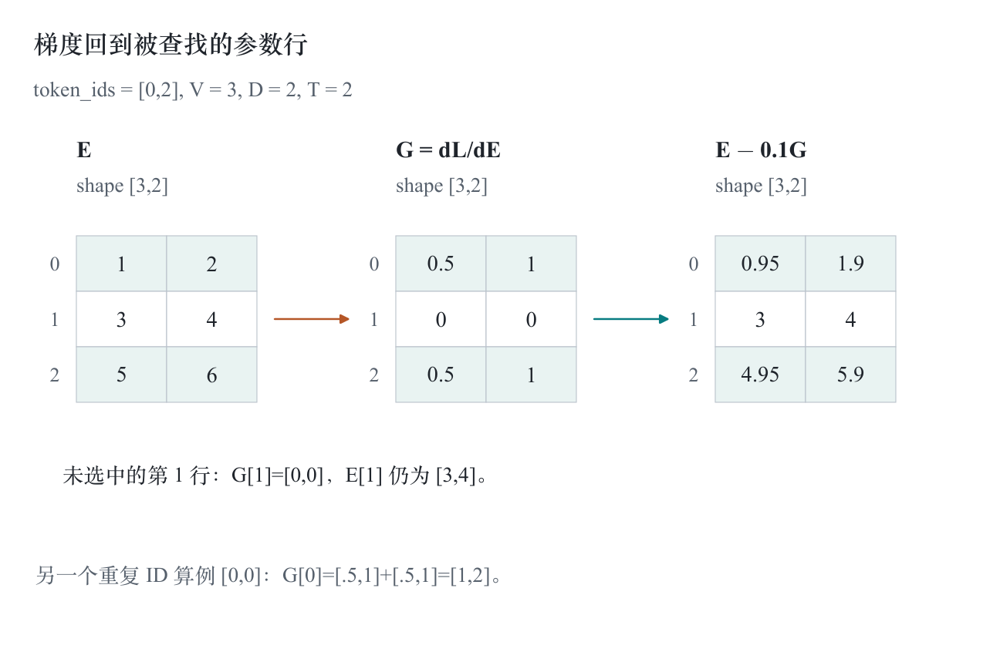{width=100%}

三个矩阵对照完整表、梯度表与更新结果；图底部另用目标全为零的 `[0,0]` 算例，说明两份已归一化贡献怎样累加到第0行。

$$
\begin{aligned}
E&=\begin{bmatrix}1&2\\3&4\\5&6\end{bmatrix}\\
\mathrm{token\_ids}&=[0,2]\\
Y&=\begin{bmatrix}0&0\\4&4\end{bmatrix}\\
\eta&=0.1
\end{aligned}
$$

为了方便与练习核对，同样的输入也保留为纯文本：

```text
embedding_table E =
    row 0: [1.0, 2.0]
    row 1: [3.0, 4.0]
    row 2: [5.0, 6.0]

token_ids = [0, 2]
target_vectors Y = [[0.0, 0.0], [4.0, 4.0]]
learning_rate = 0.1
```

这里 $V=3$、$D=2$、$T=2$，所以 $TD=4$。三个假想 token 的 ID 是 `0`、`1`、`2`，这个小词表只用于手算。

#### 第一步：按输入顺序选择行

位置 `t=0` 上的 ID 是 `0`，读取 `[1,2]`。位置 `t=1` 上的 ID 是 `2`，读取 `[5,6]`：

$$
Z=\begin{bmatrix}1&2\\5&6\end{bmatrix}
$$

表是 `[3,2]`，选中输出是 `[2,2]`。表的第 `1` 行仍然存在，只是本次没有读取。

#### 第二步：减目标，再对各分量分别平方

$$
e=Z-Y
=\begin{bmatrix}1-0&2-0\\5-4&6-4\end{bmatrix}
=\begin{bmatrix}1&2\\1&2\end{bmatrix}
$$

`errors ** 2` 对每个数单独平方，这里没有做矩阵乘法：

$$
\text{squared errors}=\begin{bmatrix}1^2&2^2\\1^2&2^2\end{bmatrix}
=\begin{bmatrix}1&4\\1&4\end{bmatrix}
$$

#### 第三步：平均四个平方误差

$$
L=\frac{1+4+1+4}{2\times 2}=\frac{10}{4}=2.5
$$

标量 `loss_value` 是 `2.5`。如果只求和，会得到 `10`；如果只除以两个 token 位置，会得到 `5`。两者都与本课对全部分量求平均的目标不同。

#### 第四步：对选中输出求导

每个分量都用 $2e_{t,d}/4$：

$$
\frac{\partial L}{\partial Z}
=\begin{bmatrix}2\times 1/4&2\times 2/4\\2\times 1/4&2\times 2/4\end{bmatrix}
=\begin{bmatrix}0.5&1\\0.5&1\end{bmatrix}
$$

逐项追踪时，要分清位置、来源行、误差和梯度贡献：

| 位置 $t$ | 分量 $d$ | 来源行 `token_ids[t]` | 选中数值 | 目标 | 误差 | 贡献 `2*error/4` |
| --- | --- | --- | --- | --- | --- | --- |
| `0` | `0` | `0` | `1` | `0` | `1` | `0.5` |
| `0` | `1` | `0` | `2` | `0` | `2` | `1.0` |
| `1` | `0` | `2` | `5` | `4` | `1` | `0.5` |
| `1` | `1` | `2` | `6` | `4` | `2` | `1.0` |

#### 第五步：把贡献传回原表

位置 `0` 把 `[0.5,1.0]` 传回表的第 `0` 行；位置 `1` 把 `[0.5,1.0]` 传回第 `2` 行。表的第 `1` 行没有贡献：

$$
G=\frac{\partial L}{\partial E}
=\begin{bmatrix}0.5&1\\0&0\\0.5&1\end{bmatrix}
$$

也可以把损失直接写成表中参数的函数，看得更清楚：

$$
L(E)=\frac14\left[(E_{0,0}-0)^2+(E_{0,1}-0)^2+(E_{2,0}-4)^2+(E_{2,1}-4)^2\right]
$$

里面没有 $E_{1,0}$，也没有 $E_{1,1}$。改变这两个参数都不会改变本次损失，所以对应导数都是零。`loss_value.backward()` 会把这个完整的 `[3,2]` 张量存到 `embedding_table.grad`。

#### 第六步：从原表减去学习率乘梯度

$$
E_{\mathrm{new}}=
\begin{bmatrix}1&2\\3&4\\5&6\end{bmatrix}
-0.1\begin{bmatrix}0.5&1\\0&0\\0.5&1\end{bmatrix}
=\begin{bmatrix}0.95&1.9\\3&4\\4.95&5.9\end{bmatrix}
$$

| 表中行 | 原来的数值 | 梯度 | 更新后的数值 |
| --- | --- | --- | --- |
| `0` | `[1.0, 2.0]` | `[0.5, 1.0]` | `[0.95, 1.9]` |
| `1` | `[3.0, 4.0]` | `[0.0, 0.0]` | `[3.0, 4.0]` |
| `2` | `[5.0, 6.0]` | `[0.5, 1.0]` | `[4.95, 5.9]` |

第一个数是 $1.0-0.1\times0.5=0.95$；同一行第二个数是 $2.0-0.1\times1.0=1.9$。第 `1` 行减去零，第 `2` 行使用与第 `0` 行相同的分量梯度。表仍为 `[3,2]`，ID 仍为 `[0,2]`。

#### 第七步：分清返回记录与更新后的参数

函数返回更新前的损失 `2.5` 和上面的完整梯度快照；它同时原地更新传入的表。这两个返回值，记录的是产生本次更新的计算。

如果随后重新查表、计算更新后损失，两个位置的误差都会变成 `[0.95,1.9]`，因此：

$$
L(E_{\mathrm{new}})=\frac{0.95^2+1.9^2+0.95^2+1.9^2}{4}=2.25625
$$

这次重新评估是一个新计算，不会改变已经返回的 Python 损失值 `2.5`，也不会改变已复制的梯度快照。

### 重复 ID：两个位置，共享一行参数

重新从原表开始，把输入和目标改为：

$$
\mathrm{token\_ids}=[0,0],
\qquad Y=\begin{bmatrix}0&0\\0&0\end{bmatrix}
$$

两个位置都读取同一行参数 `[1,2]`，所以：

$$
\begin{aligned}
Z&=\begin{bmatrix}1&2\\1&2\end{bmatrix}\\
e&=\begin{bmatrix}1&2\\1&2\end{bmatrix}\\
L&=\frac{1+4+1+4}{4}=2.5
\end{aligned}
$$

共有四个选中分量，因此每个位置贡献 `[0.5,1.0]`。查表的链式法则把两处贡献都送到第 `0` 行：

$$
G_{0,:}=[0.5,1.0]+[0.5,1.0]=[1.0,2.0]
$$

这里 `G[0, :]` 中的冒号表示第 `0` 行的全部分量。完整梯度与更新结果为：

$$
G=\begin{bmatrix}1&2\\0&0\\0&0\end{bmatrix},
\qquad E_{\mathrm{new}}=\begin{bmatrix}0.9&1.8\\3&4\\5&6\end{bmatrix}
$$

这一行是共享的。反向会把贡献相加，不会为每次出现创建一行独立参数。本例只有第 `0` 行改变。

#### 为什么重复输入不一定让最终梯度倍增

计算时保留平均损失的除数。下面两次调用都从 `[1,2]` 开始，目标都为零：

| 输入 | 选中分量总数 | 每个位置的贡献 | 第 0 行的总梯度 |
| --- | --- | --- | --- |
| `[0]` | $1\times 2=2$ | $[2\times 1/2, 2\times 2/2]=[1,2]$ | `[1,2]` |
| `[0,0]` | $2\times 2=4$ | $[2\times 1/4, 2\times 2/4]=[0.5,1]$ | $[0.5,1]+[0.5,1]=[1,2]$ |

两个减半的贡献相加，最终梯度相同。前面 `[0,2]` 与 `[0,0]` 的比较保持 $T=2$，改变的是哪些行收到贡献。计算时要同时考虑依赖路径的数量和损失的归一化。

贡献也能相互抵消。输入为 `[0,0]`、原行是 `[1,2]`，第一个位置的目标为 `[0,0]`，第二个位置的目标为 `[2,4]`，误差就分别是 `[1,2]` 和 `[-1,-2]`。行梯度贡献 `[0.5,1]` 和 `[-0.5,-1]` 相加为零。因此，被选中的行不一定有非零梯度。

### 张量操作与新语法

`embedding_table[token_ids]` 按顺序选择行，保留重复，并保持对浮点表的可微连接。这替代了之前查表练习的 Python 列表表示。`selected_vectors` 保留为张量；如果把它转成普通数值，再新建张量，就会丢失原来的依赖。

同形状张量相减、`** 2` 都逐元素执行。没有维度参数的 `.mean()` 把全部元素平均成标量；不是只求和，除数也不是 $V$ 或只有 $T$。反向之后，表的梯度形状是 `[V,D]`，不是选中输出的 `[T,D]`。

`.item()` 把标量损失取成 Python 浮点数；多元素梯度矩阵不能用一次 `.item()` 取出来，返回的 `gradient_table` 保持为张量。

`.clone()` 复制张量，使用独立存储。普通反向之后，复制 `embedding_table.grad`，以后修改已存梯度时，返回的快照不会跟着变。这里梯度缓冲区已有 `requires_grad=False`；复制本身不是关闭求导的通用方法。参见 [clone 文档](https://docs.pytorch.org/docs/2.0/generated/torch.clone.html)。

更新仍使用 03.06 的 `with torch.no_grad():`，前向与反向留在块外。块内从 `embedding_table` 本身减去学习率乘完整梯度，不是更新选中输出。保留原来的可训练叶子，当前梯度留着供查看，下一次调用再清除。

### 把数学公式对应到张量操作

提供的表是可训练叶子：它是原始参数张量，而非从其他需要求导的张量计算得到的结果。查表产生一个新结果，但这个结果仍与原参数保持依赖。正常梯度模式下，PyTorch 会记录查表、相减、平方和平均这些操作之间的关系：

$$
E\longrightarrow Z\longrightarrow e\longrightarrow L
$$

反向沿着依赖关系倒着计算导数，把参数梯度存到 `embedding_table.grad`。调用反向不会自动更新参数数值，更新是另外一步。

| 数学关系或目的 | 张量操作 | 本例应得到什么 |
| --- | --- | --- |
| $Z_{t,d}=E_{i_t,d}$ | `embedding_table[token_ids]` | 选中数值 `[[1,2],[5,6]]`，形状 `[T,D]` |
| $e=Z-Y$ | 从 `selected_vectors` 减去 `target_vectors` | 误差 `[[1,2],[1,2]]` |
| 每个误差分别平方 | `errors ** 2` | `[[1,4],[1,4]]` |
| 平均 $TD$ 个分量 | 对平方误差调用 `.mean()` | 标量张量 `2.5` |
| $G=\partial L/\partial E$ | `loss_value.backward()` | 完整梯度存入表的 `.grad` |
| 保存标量损失作为返回值 | `loss_value.item()` | Python 浮点数 `2.5` |
| 保存独立的梯度快照 | 对表的 `.grad` 调用 `.clone()` | 独立的 `[V,D]` 梯度张量 |
| $E_{\mathrm{new}}=E-\eta G$ | 在 `torch.no_grad()` 中从原表原地相减 | 更新后的参数表 |

反向之前要保留张量 `loss_value`。用 `.item()` 得到的 Python 浮点数，没有能让反向追溯到参数表的张量依赖。完成反向之后再取出返回数值，不会影响已经完成的计算。

把已存梯度直接赋给另一个变量名，两者就指向同一个张量。如果以后原地修改这个张量，两个名字看到的值都会改变。`.clone()` 为返回的快照提供独立存储。把 `.grad` 设为 `None` 则是另一件事：移除表对旧梯度缓冲区的引用，表中的参数数值不会改变。普通反向会向已有梯度缓冲区累加，所以每个独立更新步骤都先清除旧梯度。

选中输出是一个计算结果。更新这个结果，不会完成本作业要求的参数表更新。应该把完整的 `[V,D]` 梯度作用到 `embedding_table` 本身。

前向和反向需要记录依赖；更新参数则放在临时的 `with torch.no_grad():` 上下文中。`with` 让缩进块内进入这个上下文，退出块后恢复此前的梯度模式。缩进结构如下：

```python
    with torch.no_grad():
        ...  # Update the original table here: eight spaces.
    ...  # Return outside the context: four spaces.
```

这个片段只展示块结构，不是作业答案。下面七个实现步骤说明各个操作的位置。

### 准确的输入、变量与返回值

| 名称 | 类型与形状 | 含义 |
| --- | --- | --- |
| `embedding_table` | 浮点 `torch.Tensor`，`[V,D]` | 提供的可训练叶子，`requires_grad=True`；原地更新它。 |
| `token_ids` | 整数 `torch.Tensor`，`[T]`，`torch.long` | 选择表中行的有效索引，不训练它。 |
| `target_vectors` | 固定浮点 `torch.Tensor`，`[T,D]` | 教学损失所用的目标向量，与表的 dtype、device 相同。 |
| `learning_rate` | 非负 `float` | 更新倍率。 |
| `selected_vectors`、`errors` | 浮点 `torch.Tensor`，`[T,D]` | 保持连接的查表结果与各分量偏差。 |
| `.item()` 前的 `loss_value` | 标量 `torch.Tensor` | 全部选中分量的平方偏差平均值。 |
| `.item()` 后的 `loss_value` | `float` | 取出的更新前损失。 |
| `gradient_table` | 浮点 `torch.Tensor`，`[V,D]` | 当前损失对表的导数的独立副本。 |

假设数值有限、ID 有效、$V>0$、$D>0$、$T>0$，目标固定且 `requires_grad=False`，处于正常梯度模式。本函数不需要验证或创建输入张量。可以存在空查表结果，但这份平均损失作业要求至少一个选中分量，没有空输入训练情况。提供的检查使用 CPU `float64` 表与目标，ID 使用 `torch.long`。

返回 `(loss_value, gradient_table)`，两者都对应更新前的表；传入的表已经更新，仍是可训练叶子。ID 和目标向量保持原值。返回的梯度是快照，不是替代参数表。

### 实现指导

`03_08_embedding_gradient_step.py` 中的练习需要实现。下面七步引导编写 `embedding_gradient_step`。输入张量与检查程序已经提供。普通语句缩进四个空格，只有上下文中的更新缩进八个空格。实际代码用 `errors` 表示偏差，先用 `loss_value` 表示损失张量，再让它指向取出的浮点数。

1. **清除旧梯度。** 缩进四个空格，用属性赋值语法 `object.attribute = value`，把 `embedding_table.grad` 设为 `None`。原表数值不变；这保证下一次反向计算本轮梯度时，不把上一轮梯度加进来。
2. **查出 `selected_vectors`。** 缩进四个空格，使用 `embedding_table[token_ids]`，把结果保存为 `selected_vectors`。方括号按顺序选取整行；整数索引张量可以一次选择多行，并保留重复。例子得到 `[[1,2],[5,6]]`，形状 `[2,2]`；保留这个有依赖关系的张量来计算损失。
3. **计算 `errors` 与 `loss_value`。** 两个语句都缩进四个空格。从 `selected_vectors` 减去 `target_vectors`，保存为 `errors`；用 `** 2` 逐元素平方，再调用没有维度参数的 `.mean()`，保存为 `loss_value`。括号先把平方误差表达式作为整体，再对它求平均。误差应为 `[[1,2],[1,2]]`，平方为 `[[1,4],[1,4]]`，标量损失为 `2.5`。
4. **反向一次。** 缩进四个空格，用方法调用语法 `object.method()` 写 `loss_value.backward()`，留在 no-grad 块外。此时 `embedding_table.grad` 应为 `[[0.5,1],[0,0],[0.5,1]]`，形状 `[3,2]`。这一步只计算、保存梯度，表还没有更新。
5. **保存返回值。** 缩进四个空格，先用 `.clone()` 复制 `embedding_table.grad`，保存为 `gradient_table`；再用 `.item()` 取出标量损失，让 `loss_value` 指向这个浮点数。这是你的实际顺序。应得到完整的 `[3,2]` 梯度张量和 Python 浮点数 `2.5`。多个元素的矩阵不能用一次 `.item()` 取出；复制让已保存梯度拥有独立存储。
6. **原地更新表。** 在四个空格处写 `with torch.no_grad():`；里面缩进八个空格，对 `embedding_table` 使用 `-=`，减去 `learning_rate` 乘 `embedding_table.grad`。例子第 `0` 行变为 `[0.95,1.9]`，第 `1` 行仍为 `[3,4]`。
7. **在块外返回。** 缩进回到四个空格，用 `return first, second` 的语法。你的代码先返回 `loss_value`，再返回 `gradient_table.detach()`；`.detach()` 返回不带自动求导连接的张量。这里它有效但多余，因为普通 backward 已产生不跟踪求导的梯度，`.clone()` 也已经让快照拥有独立存储。逗号形成两个返回项，调用方可以解包。损失是 `2.5`，梯度快照仍描述原表；传入的表已经原地更新，无需作为第三个返回值。

本函数不需要循环，索引与算术一起作用到张量。核心由你写，提示不是完成的函数。

### 运行与预期输出

激活已有 PyTorch 环境，从项目根目录运行：

```bash
python exercises/03_08_embedding_gradient_step.py
```

完成实现后，预期输出：

```text
PASS: indexed lookup, mean loss, table gradients, and untouched rows
PASS: repeated token positions add gradient contributions to one row
PASS: different vector dimensions and vocabulary IDs above 255
PASS: zero loss and zero learning rate
PASS: old gradients are cleared and repeated steps use the updated table
PASS: returned gradient snapshots have independent storage
PASS: full table gradients agree with finite differences
Lesson 03.08 checks passed.
```

原框架在实现前通过占位行抛出 `NotImplementedError`；练习代码现在通过提供的检查。第一个例子损失为 `10`，表示把四个平方误差求和而没有平均。重复行少了贡献，可能是覆盖贡献或断开查表依赖。表没有变化，可能是只更新了选中输出。旧梯度快照也跟着变，可能是返回别名而非独立副本。提供的输入与检查程序保持原样。

### 试着解释这些问题

按需复习：区分表、选中输出、梯度的形状；解释除数 $TD$；说明本目标里未选中行为什么梯度为零；结合归一化手算重复 ID 的贡献；区分 ID 与可训练数值；说明为什么复制梯度快照。这个教学损失先验证查表梯度。接下来到 [Lesson 03.09：logits 与 softmax](#section-03-09)，把向量转换为候选概率；[03.10](#section-03-10) 再用真实的下一个 token ID 定义损失，替代本课人为提供的目标向量。

## 03.09 从预测分数到概率分布 {#section-03-09}

一个 Embedding 向量还不是对下一个 token 的预测。我们需要输出映射，为词表中的每个候选打分，再把这些分数转换成概率。这样，每个输入位置都有了自己的分布；向量维度、序列长度和词表大小也终于在一次计算中各有分工。

先走完下面的小例子，再对照 03_09_logits_and_softmax.py 动手。编号步骤会说明函数接口，并引导核心实现；初始化和检查驱动由配套文件提供。

### Logits 在语言模型中的位置

分词器提供 token ID，Embedding 查表提供浮点向量。语言模型处理输入，在每个位置得到一个向量；输出映射给词表中的全部候选 token 打分，softmax 再把同一位置的分数转换成概率。

```text
input token IDs -> embedding vectors -> position vectors [T,D]
               -> vocabulary logits [T,V] -> probabilities [T,V]
```

这里 `hidden_vectors` 是提供的各位置向量。最小模型可以直接使用查表结果，后面的 Transformer 会先处理上下文，再做输出映射。这份练习实现输出映射和概率转换，注意力与完整语言模型还没有实现。

在下一个 token 预测中，概率的第 $v$ 列对应词表 ID $v$，一行表示该位置对下一个 token 的候选分布。下面的小词表只有三个假想 ID：`0`、`1`、`2`，它不是完整字节分词器。

Logit 是 softmax 之前的实数分数，可以为负、为零、为正；不要求在零到一之间，也不要求一行加起来等于一。在同一行中，分数越高，softmax 概率越高。输入向量有 $D$ 个分量，输出有 $V$ 个候选分数。$D$ 与 $V$ 数的是不同的东西，不需要相等。

例子里的权重为方便手算而指定，没有通过数据学习。这种未训练的小输出层算出的概率，只是本次数学计算的输出，不能据此认为模型已经具备语言能力。

### 输入位置数 T 到底是什么意思？

一个常见问题是：输入位置是什么意思，为什么会有多个？这里讨论一条序列，一个位置就是分词后输入序列里的一个槽位。$T$ 统计这次输入包含多少次 token 出现。一段文字通常包含多个 token，所以会有多个位置。

概念上：

$$
T=\operatorname{len}(\mathrm{token\_ids})
$$

当前 `compute_logits` 收到的是向量而非 ID。`hidden_vectors` 的每行对应其中一个位置，因此这里的 $T$ 是 `hidden_vectors.shape[0]`；没有给练习额外增加 `token_ids` 参数。本课先讨论一条序列，多条序列的 batch 维度在后续学习。

#### 一个具体的 token 序列

为了讲清位置，先假设分词器把 `我爱猫` 分成三个 token：`我`、`爱`、`猫`：

| 从零开始的位置 | 这个位置上的 token |
| --- | --- |
| `0` | `我` |
| `1` | `爱` |
| `2` | `猫` |

三个位置都放着 token，所以 $T=3$。这里一个字对应一个 token，是明确的教学假设，不代表已有字节/BPE 分词器一定这样切。实际 token 边界由分词器决定，应统计分词后的 token，而非原文字数。例如，之前的 `[256,97,256]` 也是 $T=3$，虽然只有两种不同 ID，重复 ID 仍占据另一个位置。

每个位置都有一个向量。如果向量维度是 $D=8$，形状就是：

```text
position 0 -> one 8-component vector
position 1 -> one 8-component vector
position 2 -> one 8-component vector

hidden_vectors: [3,8]
logits:         [3,V]
probabilities:  [3,V]
```

$T$ 数输入中的出现次数，$D$ 数每个向量的分量，$V$ 数完整词表的候选项。词表大小不必为三。如果另一个小词表恰好只有 `我`、`爱`、`猫`、`。` 四项，那么 $V=4$，概率形状为 `[3,4]`：三个输入位置，每个位置四个候选概率。

本课原来的数值例子是 `hidden_vectors=[[1,2],[2,1]]`。它有两个向量，每个位置一个，所以 $T=2$、$D=2$。第一个向量为 `[1,2]`，第二个向量为 `[2,1]`。那个例子的词表有三个候选项，因此 logits 为 `[2,3]`。上面的文字示例是另一个例子，不替换练习中的数值输入。

#### 为什么训练时每个位置都能有一行预测？

假设完整训练序列为 `我`、`爱`、`猫`、`。`。此前学过的错位窗口可以写为：

```text
input tokens:  [我, 爱, 猫]
target tokens: [爱, 猫, 。]
```

在因果下一个 token 模型中，对应关系是：

| 位置 | 这个位置允许使用的上下文 | 训练时的下一个 token 目标 |
| --- | --- | --- |
| `0` | `我` | `爱` |
| `1` | `我爱` | `猫` |
| `2` | `我爱猫` | `。` |

三行输出分别预测三个已知前缀后面的下一个 token。训练数据已经给出了目标，所以训练可以在一次前向中计算多个位置的下一个 token 预测与损失。因果模型必须防止较早位置看到输入中的后续 token，否则它可能直接读到答案；因果遮罩与注意力是后续内容。

在能处理上下文的模型中，一个 hidden 向量可以表示截止该位置的允许前缀。本练习的 `hidden_vectors` 由外部提供，输出映射独立处理每行；它本身不组合前面的 token，也不执行因果遮罩。这里学习的是最后的“向量到分数到概率”机制，上下文处理还没有实现。

#### 这与一次生成一个下一个 token 有什么关系？

当前输入分词后为 `我`、`爱`、`猫`，已经有三个输入位置。生成下一个 token 时，使用最后一个输入位置的分布选择下一项。如果选出了 `。`，追加后输入变成四个位置；后续生成步骤再预测这个更长前缀之后的内容。

所以，多个输入位置描述的是已经提供的上下文，并不让一次下一个 token 生成步骤产生多个未知的未来 token。如果计算全部位置的概率，前面的行对应更短前缀，最后一行对应当前完整前缀。$T$ 统计输入长度，不统计一次生成步骤选出多少个未来 token。


### 符号、准确代码名称与形状

| 符号 | 代码名称 | 含义 | 形状或范围 |
| --- | --- | --- | --- |
| $H$ | `hidden_vectors` | 每个位置提供的浮点向量 | `[T,D]` |
| $W$ | `output_weights` | 把向量分量连接到候选分数的权重 | `[D,V]` |
| $b$ | `output_bias` | 每个词表 token 的一个附加分数偏置 | `[V]` |
| $Z$ | `logits` | 所有位置对全部候选 token 的分数 | `[T,V]` |
| $P$ | `probabilities` | 每个位置的 softmax 概率分布 | `[T,V]` |
| $T$ | 位置数 | 本次调用的输入向量个数 | 正整数 |
| $D$ | 向量维度 | 每个输入向量的分量数 | 正整数 |
| $V$ | 词表大小 | 候选 token ID 的数量 | 正整数 |
| $t,d,v$ | 公式下标 | 位置、向量分量、词表候选项 | 从零开始 |
| $m_t$ | `row_max[t,0]` | 位置 $t$ 上最大的分数 | `row_max` 为 `[T,1]` |

下标从零开始：$0\le t<T$、$0\le d<D$、$0\le v<V$。$Z_{t,v}$ 就是 `logits[t,v]`。本课的 $Z$ 表示 logits，03.08 选出的 Embedding 向量可以作为本课的 $H$。

假设输入是有限浮点数，$T>0$、$D>0$、$V>0$，形状匹配、dtype 和 device 相同，处于正常梯度模式。提供的检查使用 CPU `float64`，输入可能需要梯度。学生不负责创建张量或验证输入；空行与非有限数值不在本练习约定内。

### 从向量得到词表分数

对每个位置和候选 token：

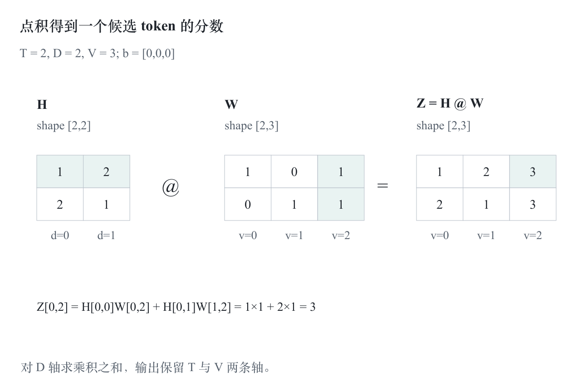{width=100%}

取 H 的一行与 W 的一列对应相乘再相加，就得到一个候选分数。D 个分量变成 V 个候选列，两个输入位置仍对应两行。

$$
Z_{t,v}=\sum_{d=0}^{D-1}H_{t,d}W_{d,v}+b_v
$$

读作：计算某个候选分数时，把输入的每个分量乘以这个候选项对应的权重，将乘积相加，最后加上这个候选项的偏置。$W$ 的每一列对应一个候选项，第 $v$ 列包含给候选 $v$ 打分所用的 $D$ 个权重。

矩阵形式为：

$$
Z=HW+b
$$

形状对应关系是：

$$
[T,D]\;@\;[D,V]\longrightarrow[T,V]
$$

中间两个 $D$ 必须匹配，外面的两个大小决定结果有 $T$ 行、$V$ 列。Python 的 `@` 对两个二维张量执行这种矩阵乘法；[矩阵乘法文档](https://docs.pytorch.org/docs/2.0/generated/torch.matmul.html) 说明了形状规则。`*` 是逐元素乘法，不能计算这里的行与列加权求和。

给 `[T,V]` 的分数加上 `[V]` 偏置，就是把同一偏置向量加到每一行。可以把 `[V]` 看作按 `[1,V]` 对齐，再沿 $T$ 行广播。这遵循[广播规则](https://docs.pytorch.org/docs/2.0/notes/broadcasting.html)，无需学生写循环或手动复制偏置矩阵。

之后基于损失的训练循环可以同时训练 $W$、`b` 与 Embedding 表。Softmax 本身没有可训练参数。本练习返回 logits，并保留它们与输入向量、权重、偏置的依赖。

### 从分数得到概率

在位置 $t$ 上，softmax 为：

$$
P_{t,v}=\frac{e^{Z_{t,v}}}{\sum_{j=0}^{V-1}e^{Z_{t,j}}}
$$

这里 $e\approx2.71828$ 是自然常数，$e^x=\exp(x)$ 是指数函数。这个 `e` 不是 03.08 中表示误差的变量。$j$ 遍历同一行的全部词表候选项，$v$ 是我们正在求概率的那个候选项。

指数函数把任何有限实数分数变成正权重，并保留分数的大小顺序。再除以全部权重之和，就完成一行的归一化：

$$
\sum_{v=0}^{V-1}P_{t,v}
=\frac{\sum_{v=0}^{V-1}e^{Z_{t,v}}}{\sum_{j=0}^{V-1}e^{Z_{t,j}}}=1
$$

对于有限实数且 $V>1$ 的一行，数学上的概率严格大于零、小于一。$V=1$ 时，唯一概率为一。浮点计算可能把非常小的概率下溢为零，因此数值检查允许闭区间 `[0,1]`，核对行和时也使用误差容限。[官方 softmax 文档](https://docs.pytorch.org/docs/2.0/generated/torch.nn.functional.softmax.html) 定义了沿指定维度的归一化。

分母只统计同一个位置的 $V$ 个候选项，不把 $T$ 个位置混在一起。每行单独加起来等于一，整个 `[T,V]` 输出的总和因此为 $T$。

Softmax 保留分数顺序。同一行两个候选项的概率比为：

$$
\frac{P_{t,a}}{P_{t,b}}=e^{Z_{t,a}-Z_{t,b}}
$$

分数相差一，概率比就约为 `2.71828`。决定分布的是分数的相对差异；相同分数会得到相同概率，即使这个共同分数是负数。

Softmax 算出分布后，选择 token 是后续操作：贪心规则选择最大概率候选项，采样则可以按这个分布选择。本课两个本函数都不执行选择。

### 稳定的 Softmax：减去每行最大值

直接计算 `exp(1000)` 会超出常用浮点格式的数值范围。非常负的分数也可能让一行未经平移的指数全部下溢为零。这样，数学上定义良好的 softmax，在计算机上却可能出现无法计算的商。

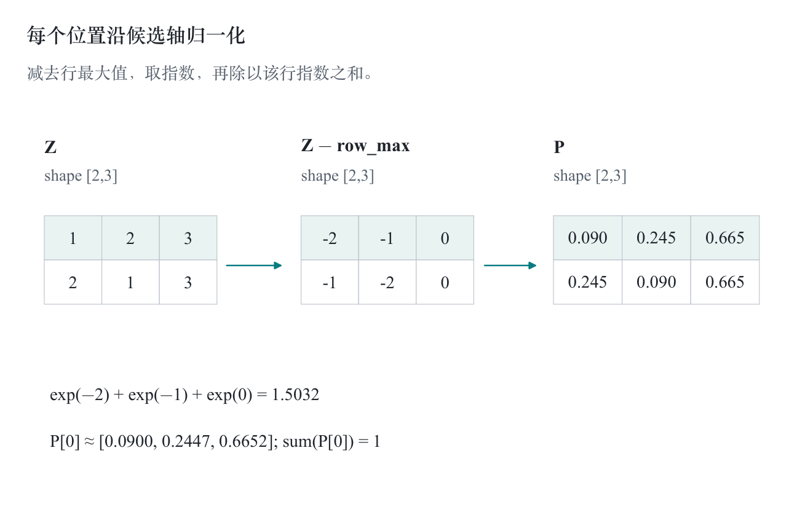{width=100%}

沿同一行观察减最大值和归一化。候选列的顺序不变，每行独立求和为1，不和其他输入位置混算。

先证明：一行全部分数都减去相同的有限常数 `c`，概率分布不变：

$$
\begin{aligned}
\frac{e^{Z_{t,v}-c}}{\sum_j e^{Z_{t,j}-c}}
&=\frac{e^{-c}e^{Z_{t,v}}}{e^{-c}\sum_j e^{Z_{t,j}}}\\
&=\frac{e^{Z_{t,v}}}{\sum_j e^{Z_{t,j}}}
\end{aligned}
$$

在精确算术中，共同因子可以约掉。我们选择每行最大的分数：

$$
m_t=\max_{0\le j<V}Z_{t,j},\qquad
P_{t,v}=\frac{e^{Z_{t,v}-m_t}}{\sum_{j=0}^{V-1}e^{Z_{t,j}-m_t}}
$$

所有平移后的分数都不大于零，因此指数不大于一；至少有一个分数平移后为零，所以有 $\exp(0)=1$。这避开了很大的正数指数，也防止本课有限 `float64` 例子中出现一整行指数全为零。很小的尾部概率仍可能下溢为零。

每个位置使用自己的最大值和分母。整张张量只取一个全局最大值，可能让分数相差很远的另一行的指数全部变成零；提供的检查包含偏移差异很大的两行，用来发现这个错误。

例如 `[1001,1002,1003]` 减去 `1003` 后变为 `[-2,-1,0]`。它与 `[1,2,3]` 得到相同的数学概率，同时避开了很大的指数计算。

### 完整手算例子：输出映射与 Softmax

使用：

$$
\begin{aligned}
H&=\begin{bmatrix}1&2\\2&1\end{bmatrix}\\
W&=\begin{bmatrix}1&0&1\\0&1&1\end{bmatrix}\\
b&=[0,0,0]
\end{aligned}
$$

这里 $T=2$、$D=2$、$V=3$：两个输入位置，每个向量两个分量，三个候选 token。

#### 第一步：计算每个行与列的分数

位置 `0` 的向量是 `[1,2]`，三个权重列分别为 `[1,0]`、`[0,1]`、`[1,1]`：

$$
\begin{aligned}
Z_{0,0}&=1\times1+2\times0+0=1\\
Z_{0,1}&=1\times0+2\times1+0=2\\
Z_{0,2}&=1\times1+2\times1+0=3
\end{aligned}
$$

位置 `1` 的向量是 `[2,1]`：

$$
\begin{aligned}
Z_{1,0}&=2\times1+1\times0+0=2\\
Z_{1,1}&=2\times0+1\times1+0=1\\
Z_{1,2}&=2\times1+1\times1+0=3
\end{aligned}
$$

所以：

$$
Z=\begin{bmatrix}1&2&3\\2&1&3\end{bmatrix}
$$

输入向量形状为 `[2,2]`，logits 为 `[2,3]`。输出映射把向量分量数转换成候选项数。

再看非零偏置：保持 $H$ 与 $W$，把 `b` 改成 `[0.5,-1,2]`：

$$
Z=\begin{bmatrix}1+0.5&2-1&3+2\\2+0.5&1-1&3+2\end{bmatrix}
=\begin{bmatrix}1.5&1&5\\2.5&0&5\end{bmatrix}
$$

后面的 softmax 手算使用原先零偏置的 logits，即 `[1,2,3]` 与 `[2,1,3]`。

#### 第二步：找出每行最大值，并保留一列的形状

$$
\mathrm{row\_max}=\begin{bmatrix}3\\3\end{bmatrix}
$$

它的形状为 `[2,1]`。第 `0` 行减去第 `0` 行最大值，第 `1` 行减去第 `1` 行最大值：

$$
\mathrm{shifted\_logits}
=\begin{bmatrix}1-3&2-3&3-3\\2-3&1-3&3-3\end{bmatrix}
=\begin{bmatrix}-2&-1&0\\-1&-2&0\end{bmatrix}
$$

传入的 logits 本身保持原值。

#### 第三步：对每个平移后的分数计算指数

$$
\mathrm{exp\_scores}
=\begin{bmatrix}e^{-2}&e^{-1}&e^0\\e^{-1}&e^{-2}&e^0\end{bmatrix}
\approx\begin{bmatrix}0.1353352832&0.3678794412&1\\0.3678794412&0.1353352832&1\end{bmatrix}
$$

现在得到的是正权重，还没有归一化为概率。

#### 第四步：分别加起每行的候选权重

两行各自的权重和都是：

$$
0.1353352832+0.3678794412+1\approx1.5032147244
$$

因此 `row_sums` 约为 `[[1.5032147244],[1.5032147244]]`，形状 `[2,1]`。这个形状为每个位置保留了独立分母。

#### 第五步：每个权重除以本行分母

| 位置 | 候选 ID | Logit | 平移后分数 | 指数权重 | 概率，近似值 |
| --- | --- | --- | --- | --- | --- |
| `0` | `0` | `1` | `-2` | `0.1353352832` | `0.0900305732` |
| `0` | `1` | `2` | `-1` | `0.3678794412` | `0.2447284711` |
| `0` | `2` | `3` | `0` | `1.0` | `0.6652409558` |
| `1` | `0` | `2` | `-1` | `0.3678794412` | `0.2447284711` |
| `1` | `1` | `1` | `-2` | `0.1353352832` | `0.0900305732` |
| `1` | `2` | `3` | `0` | `1.0` | `0.6652409558` |

第一行候选 `0` 的概率，计算为 $0.1353352832 / 1.5032147244$，约为 `0.0900305732`。每个分量都按本行分母相除：

$$
P\approx\begin{bmatrix}0.0900305732&0.2447284711&0.6652409558\\0.2447284711&0.0900305732&0.6652409558\end{bmatrix}
$$

每行加起来等于一，输出形状仍为 `[2,3]`。两行都是候选 `2` 的概率最大，但返回概率张量还没有选择或生成这个 token。

展示的小数做了四舍五入；真正计算保留张量的完整精度，检查使用误差容限。

### 新语法：维度、keepdim 与广播

阶段 A 引入 `@`，阶段 B 引入指数与沿指定轴的归约。本课无需新循环或上下文关键字；函数内所有学生语句都缩进四个空格。

对 `[T,V]`，`dim=0` 是位置轴，`dim=1` 是词表轴。`dim=-1` 表示最后一个轴，本课也就是词表轴。最大值与求和都要沿这个最后的轴计算。

`logits.max(dim=-1, keepdim=True)` 返回两个部分：最大数值，以及最大数值的位置索引。我们通过 `.values` 取出数值，得到 `row_max` 张量。[max 文档](https://docs.pytorch.org/docs/2.0/generated/torch.max.html) 说明了这两个返回项。这里要减的是最大分数，不是其索引。

`keepdim=True` 把被归约的维度保留为大小一。对 `[2,3]` 归约，不保留维度会得到 `[2]`，保留则得到 `[2,1]`。广播从最右边的维度开始对齐：

```text
logits:    [T,V]
row_max:   [T,1]
subtraction result: [T,V]

exp_scores: [T,V]
row_sums:   [T,1]
division result: [T,V]
```

每行的一个值，会作用到该行的 $V$ 个数上。单独的 `[T]` 不表示每行一个列值：对 `[2,3]`，最右边的 `2` 与 `3` 冲突；当 $T=V$ 时，甚至可能不报错却按错误的方向广播。保留 `[T,1]`，能明确表达本意。

`torch.exp(shifted_logits)` 逐元素计算 $e^x$，形状不变。`exp_scores.sum(dim=-1, keepdim=True)` 为每行给出一个分母。没有维度参数的 `.sum()` 会把所有行一起加起来；[sum 文档](https://docs.pytorch.org/docs/2.0/generated/torch.sum.html) 说明了沿维度归约与保留形状的规则。

前向结果要保持与输入的依赖。上一课返回的是记录用的梯度快照；本课返回的是前向概率张量，未来损失还要通过它求导。因此，本函数中避免 `.item()`、`.detach()`、把列表重新构造为张量，或进入 no-grad 模式；这两个函数内也不执行反向或参数更新。

### 准确输入、中间量与返回值

| 名称 | 类型与形状 | 含义 |
| --- | --- | --- |
| `hidden_vectors` | 浮点 `torch.Tensor`，`[T,D]` | 阶段 A 的各位置向量输入。 |
| `output_weights` | 浮点 `torch.Tensor`，`[D,V]` | 按本作业明确的布局，每列对应一个候选项。 |
| `output_bias` | 浮点 `torch.Tensor`，`[V]` | 每行共同使用的候选偏置。 |
| `weighted_scores` | 浮点 `torch.Tensor`，`[T,V]` | 加偏置前的矩阵乘积。 |
| `logits` | 浮点 `torch.Tensor`，`[T,V]` | 阶段 A 的返回值，也是阶段 B 的输入。 |
| `row_max` | 浮点 `torch.Tensor`，`[T,1]` | 阶段 B 通过归约结果的 `.values` 取得的各行最大值。 |
| `shifted_logits`、`exp_scores` | 浮点 `torch.Tensor`，`[T,V]` | 平移后的分数，以及它们的指数权重。 |
| `row_sums` | 浮点 `torch.Tensor`，`[T,1]` | 每个位置的权重和。 |
| `probabilities` | 浮点 `torch.Tensor`，`[T,V]` | 阶段 B 返回值，每行沿候选项归一化。 |

两个函数各返回一个张量，dtype 和 device 与输入相同；输入需要梯度时，返回值也保留相应求导路径。两个函数都不改变任何输入。输入创建与检查已提供，学生只实现两段前向计算。

### 阶段 A：compute_logits 的实现指导

打开 `03_09_logits_and_softmax.py`，找到 `compute_logits` 中阶段 A 的学生区域。普通语句缩进四个空格。

1. **计算 `weighted_scores`。** 使用 `@`，左边是 `hidden_vectors`，右边是 `output_weights`。中间的两个 $D$ 匹配，得到 `[T,V]`。手算例子在加偏置前为 `[[1,2,3],[2,1,3]]`。
2. **加 `output_bias`，得到 `logits`。** 使用张量相加语法 `left + right`，`[V]` 自动广播到各行。零偏置时例子不变；偏置 `[0.5,-1,2]` 得到 `[[1.5,1,5],[2.5,0,5]]`。输入张量保持原样。
3. **返回 `logits`。** 缩进四个空格，用 `return value`。保留张量，以及它与向量、权重、偏置的依赖。

检查阶段 A 时运行：

```bash
python exercises/03_09_logits_and_softmax.py --check logits
```

这个阶段成功时的最后一行为：

```text
PASS logits: all three check categories
```

该命令只检查阶段 A。现在两个阶段都已实现，也可以分别核对。

### 阶段 B：softmax_probabilities 的实现指导

阶段 A 之后，找到 `softmax_probabilities(logits)` 的学生区域。六个步骤全部缩进四个空格，张量操作一起处理完整输入，学生无需写循环。

1. **找出 `row_max`。** 使用 `logits.max(dim=-1, keepdim=True).values`。关键字参数选择词表轴，并保留一列的形状；`.values` 选择最大数值而非索引。例子得到 `[[3],[3]]`，形状 `[2,1]`。
2. **计算 `shifted_logits`。** 从 `logits` 减去 `row_max`，保存新的相减结果。例子为 `[[-2,-1,0],[-1,-2,0]]`。不对传入的 logits 原地相减。
3. **计算 `exp_scores`。** 对 `shifted_logits` 调用 `torch.exp`。第一行约为 `[0.1353352832,0.3678794412,1.0]`，形状仍为 `[2,3]`。
4. **计算 `row_sums`。** 对 `exp_scores` 调用 `.sum(dim=-1, keepdim=True)`。求和对象是指数权重，不是原始 logits。例子得到 `[[1.5032147244],[1.5032147244]]`，形状 `[2,1]`。
5. **计算 `probabilities`。** 使用逐元素 `/`，让 `exp_scores` 除以 `row_sums`。广播让每个分母作用到本行，第一行约为 `[0.0900305732,0.2447284711,0.6652409558]`。
6. **返回 `probabilities`。** 保留 `[T,V]` 张量与后续求导路径。这个函数不选择 token，也不更新参数。

本作业由你使用基本操作实现；检查程序里的 `torch.softmax` 是提供的参考。核心实现由你完成。运行：

```bash
python exercises/03_09_logits_and_softmax.py --check softmax
```

这个阶段成功时的最后一行为：

```text
PASS softmax: all five check categories
```

该命令独立检查阶段 B。两个阶段都完成后，运行：

```bash
python exercises/03_09_logits_and_softmax.py --check all
```

完整预期输出为：

```text
PASS: row-column score projection and shared vocabulary bias
PASS: different vector/vocabulary dimensions and preserved inputs
PASS: projection gradients reach vectors, weights, and bias
PASS logits: all three check categories
PASS: worked-example probabilities and vocabulary-axis normalization
PASS: equal logits, negative logits, and a one-token vocabulary
PASS: row-wise shift invariance and large-score numerical stability
PASS: varied shapes and unchanged input scores
PASS: softmax gradients agree with the PyTorch reference
PASS softmax: all five check categories
PASS: connected vectors-to-probabilities forward and backward pipeline
Lesson 03.09 checks passed.
```

原框架在实现前通过占位行抛出 `NotImplementedError`，现在两个已完成函数都通过提供的检查。提供的输入创建与检查程序保持原样。漏写 `.values` 可能留下归约结果对象而非张量；缺少 `keepdim` 可能造成形状错误；对所有元素一起归一化会得到错误行和；未经平移的指数可能溢出；断开返回值依赖会阻止后续训练梯度。

### 阅读问题与易混淆概念

**为什么 logits 可以是负数？** 它们是分数。`[-2,-1,0]` 的指数都是正数，softmax 仍能得到归一化分布。负分数不代表负概率。

**减去最大值会丢失信息吗？** 一行全部分数减去相同常数，所有分数差异保持不变，共同指数因子可以约掉。如果给各候选项减去不同的任意偏移，通常会改变分布。

**输入 token ID 与输出候选 ID 是同一条轴吗？** 输入位置决定哪些向量进入计算，输出列枚举全部 $V$ 个词表候选项。输入长度 $T=2$，词表 $V=3$ 时，每行仍有三个候选概率，词表不会缩小。

**两行输出表示同时生成两个未来 token 吗？** 例子计算的是两个提供位置的分布。在因果模型中，每个训练位置利用允许看到的上下文，预测自己的下一个 token 目标。自回归生成则从当前位置分布选择下一个 token，追加后再计算下一次分布。上下文处理和生成循环在后续学习。

**Softmax 本身就是训练损失吗？** 它返回分布，还不知道哪个候选才是正确答案。[03.10](#section-03-10) 的交叉熵会选出真实下一个 token ID 的概率，取其负对数；这个标量损失随后在 [03.11](#section-03-11) 中引导参数的联合更新。

### 可选参考：Softmax 为什么能够传递梯度

为保证材料完整，这里保留推导，不要求学生手写导数代码。只看一个位置，记 $s=\sum_k e^{z_k}$、$p_i=e^{z_i}/s$。同时对分子和公共分母求导：

$$
\frac{\partial p_i}{\partial z_j}
=\frac{\mathbf{1}_{i=j}e^{z_i}s-e^{z_i}e^{z_j}}{s^2}
=p_i\left(\mathbf{1}_{i=j}-p_j\right)
$$

指示符 $\mathbf{1}_{i=j}$ 在同一候选项时为一，否则为零。因此 $i=j$ 时导数为 $p_i(1-p_i)$，不同候选项时为 $-p_ip_j$。增加一个分数，会通过公共分母影响它自己和其他项的概率。稳定形式定义相同的数学函数。Autograd 处理有依赖关系的张量操作；提供的检查会核对梯度，无需你实现这个导数。

### 试着解释这些问题

可选复习：区分 $D$ 与 $V$；手算行与列生成分数以及偏置广播；计算一行概率；证明平移不变性；解释词表轴和 `[T,1]` 归约；说明返回概率为什么保留依赖。接下来是 [Lesson 03.10：下一个 token 的交叉熵](#section-03-10)。

## 03.10 下一个词元目标的交叉熵 {#section-03-10}

### 方法来源

[Bengio et al., 2003; R24](https://www.jmlr.org/papers/v3/bengio03a.html) 中的下一个词预测目标，为本节负对数概率损失提供了语言建模背景。

概率分布告诉我们模型在预测什么，训练还需要衡量它和真实下一个 token 差多少。交叉熵选出真实目标的概率，把它变成惩罚，再汇总各位置的惩罚。我们既要看懂这个目标，也要保留它通往参数的梯度路径。

先走完下面的小例子，再对照 03_10_cross_entropy_loss.py 动手。编号步骤会说明函数接口，并引导核心实现；初始化和检查驱动由配套文件提供。

### 真实目标到底是什么？

每个输入位置，都有训练数据中已经观察到的下一个 token ID。假设教学分词器把 `我爱猫。` 切为 `我`、`爱`、`猫`、`。`，错位窗口就是：

```text
input tokens:  [我, 爱, 猫]
target tokens: [爱, 猫, 。]
```

这种切法是明确的例子假设，不代表已有字节/BPE 分词器一定这样切。完整因果模型只让每个位置使用允许看到的前缀；上下文处理和因果遮罩仍是后续内容。本练习直接接收分数。

`target_ids[t]` 指出位置 $t$ 上正确候选项的列号。它不是概率、目标 Embedding 向量，也不是用 argmax 选出的模型预测。`target_ids=[2,0]` 表示位置 `0` 的真实下一个 token ID 为 `2`，位置 `1` 的真实 ID 为 `0`。ID 为零不代表概率为零。

### 公式之前：符号与形状

| 符号 | 准确代码名称 | 含义 | 形状 |
| --- | --- | --- | --- |
| $Z$ | `logits` | 提供的原始词表分数 | `[T,V]` |
| $P$ | 数学上的 softmax 概率 | 每行分数所对应的分布 | `[T,V]` |
| $y_t$ | `target_ids[t]` | 位置 $t$ 上观察到的下一个 token 候选项 | `target_ids` 为 `[T]` |
| $\ell_t$ | 单个位置的损失 | 真实候选项概率的负对数 | 每个位置一个值 |
| $L$ | `loss` | 这些位置损失的平均值 | 标量张量 |
| $m_t$ | `row_max[t,0]` | 一行中最大的分数 | `row_max` 为 `[T,1]` |
| $S$ | `shifted_logits` | 每行减去自己最大值后的分数 | `[T,V]` |

$T$ 统计输入位置数，03.09 已经澄清。每个位置提供一个目标损失；$V$ 统计每个分布的候选项数，下标从零开始。Logits 是浮点张量，目标 ID 是固定的整数张量，dtype 为 `torch.long`，每行一个 `[0,V)` 范围内的有效 ID。

假设 $T>0$、$V>0$，分数有限、目标 ID 有效、device 匹配，处于正常梯度模式。检查使用 CPU `float64` 分数。输入创建与验证已提供，学生唯一需要创建的新张量是行索引序列。两个输入的数值都保持原样。

### 负对数似然与平均损失

分数所对应的概率为：

$$
P_{t,v}=\frac{e^{Z_{t,v}}}{\sum_{j=0}^{V-1}e^{Z_{t,j}}}
$$

对真实的下一个 token $y_t$：

$$
\ell_t=-\ln P_{t,y_t}
$$

函数返回各位置的平均值：

$$
L=-\frac1T\sum_{t=0}^{T-1}\ln P_{t,y_t}
$$

读作：每行取出真实候选项的概率，取自然对数、变为负数，再对 $T$ 个位置损失求平均。除数是 $T$，不是 $V$ 或 $TV$。候选项共同决定概率，但每个位置只提供一个监督结果。[CrossEntropyLoss 文档](https://docs.pytorch.org/docs/2.0/generated/torch.nn.CrossEntropyLoss.html) 描述了这种类别索引目标形式。

自然对数是指数函数的反函数：$\ln(e^x)=x$。`torch.log` 逐元素执行自然对数，参见 [log 文档](https://docs.pytorch.org/docs/2.0/generated/torch.log.html)。概率在零到一之间时，对数不大于零，取负使损失不小于零。真实 token 的概率越大，损失越小：

| 真实 token 的概率 | 损失 $-\ln p$，近似值 |
| --- | --- |
| `0.9` | `0.105361` |
| `0.5` | `0.693147` |
| `0.1` | `2.302585` |
| `0.01` | `4.605170` |

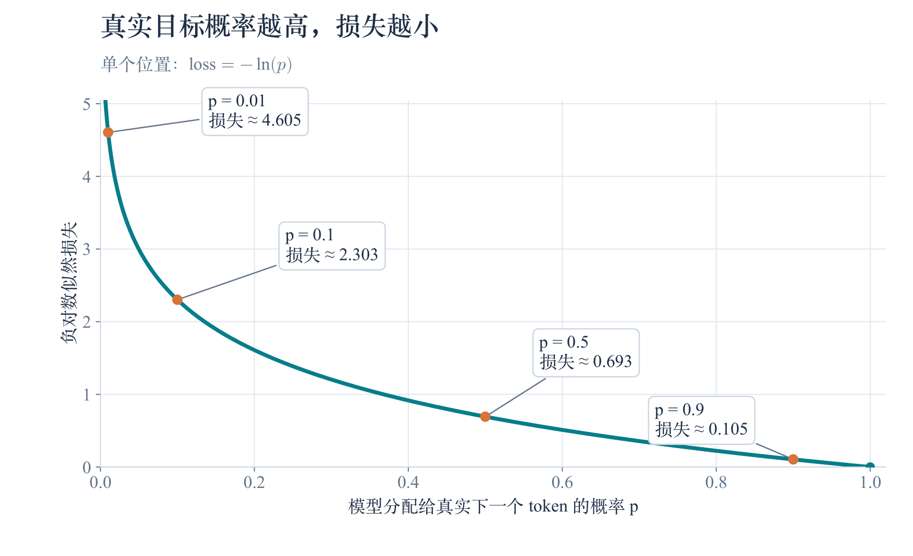{width=100%}

**图 03.10-1——把公式读成一条曲线。** 横轴是模型给真实 token 分配的概率，纵轴是该位置的损失。沿曲线向右走，概率变大、损失变小；橙色点对应上表。定义域是 $0<p\le1$。图的可见纵轴范围到五附近，但 `p` 趋近零时，损失还会无限增大。标注值经过四舍五入。

概率为一时损失为零，概率趋近零时损失无限增大。局部导数为：

$$
\frac{d(-\ln p)}{dp}=-\frac1p<0
$$

所以，增加真实 token 的概率会降低目标函数。即使 argmax 预测正确，损失也可以大于零：给正确项分配 `0.665241` 的概率，仍不同于给它概率一。

#### 为什么叫交叉熵？

对确定类别目标，定义目标分布 $Q_{t,v}$：真实 ID 处为一，其他地方为零：

$$
Q_{t,v}=\mathbf{1}_{v=y_t},\qquad
\ell_t=-\sum_{v=0}^{V-1}Q_{t,v}\ln P_{t,v}=-\ln P_{t,y_t}
$$

这是目标分布与模型分布之间的交叉熵。类别索引给出了相同目标，无需构造完整的 `[T,V]` one-hot 矩阵。

对序列模型，观察到的下一个 token 的似然，是条件概率的连乘。取负对数把乘法变成加法：

$$
-\ln\left(\prod_{t=0}^{T-1}P_{t,y_t}\right)
=-\sum_{t=0}^{T-1}\ln P_{t,y_t}
$$

再除以 $T$，就是本课使用的逐位置平均损失。在分词器与评估约定相同时，这有助于比较不同长度例子的平均损失。

### 从 Logits 推导稳定计算形式

把 softmax 代入对数：

$$
\begin{aligned}
\ln P_{t,v}
&=\ln\left(\frac{e^{Z_{t,v}}}{\sum_j e^{Z_{t,j}}}\right)\\
&=Z_{t,v}-\ln\left(\sum_j e^{Z_{t,j}}\right)
\end{aligned}
$$

所以 $\ell_t=\ln(\sum_j e^{Z_{t,j}})-Z_{t,y_t}$。直接使用等价的分数表达式，就可以避免先得到极小概率，再对它取对数。

复用上一课的稳定平移：

$$
\begin{aligned}
m_t&=\max_j Z_{t,j}\\
S_{t,v}&=Z_{t,v}-m_t\\
\ln P_{t,v}&=S_{t,v}-\ln\left(\sum_j e^{S_{t,j}}\right)
\end{aligned}
$$

平移不改变 softmax。每个平移后分数都不大于零，至少有一个指数为一。在这里的有限数值例子中，即使某个很小的候选项指数下溢，行和仍保持正数。用平移后的分数减去行和的对数，就直接得到候选项的对数概率。

例如分数为 `[1000,0,-1000]`，真实 ID 为 `2`：

```text
shifted logits: [0,-1000,-2000]
exponentials in float64: [1,0,0]
log of their sum: 0
true-target log-probability: -2000 - 0 = -2000
loss: 2000
```

先算 softmax，会得到数值上为零的目标概率，`log(0)` 不有限。直接使用对数分数表达式，仍能得到正确的有限损失 `2000`。给概率加一个下限进行裁剪，会改变这个损失，无法复现本课目标。

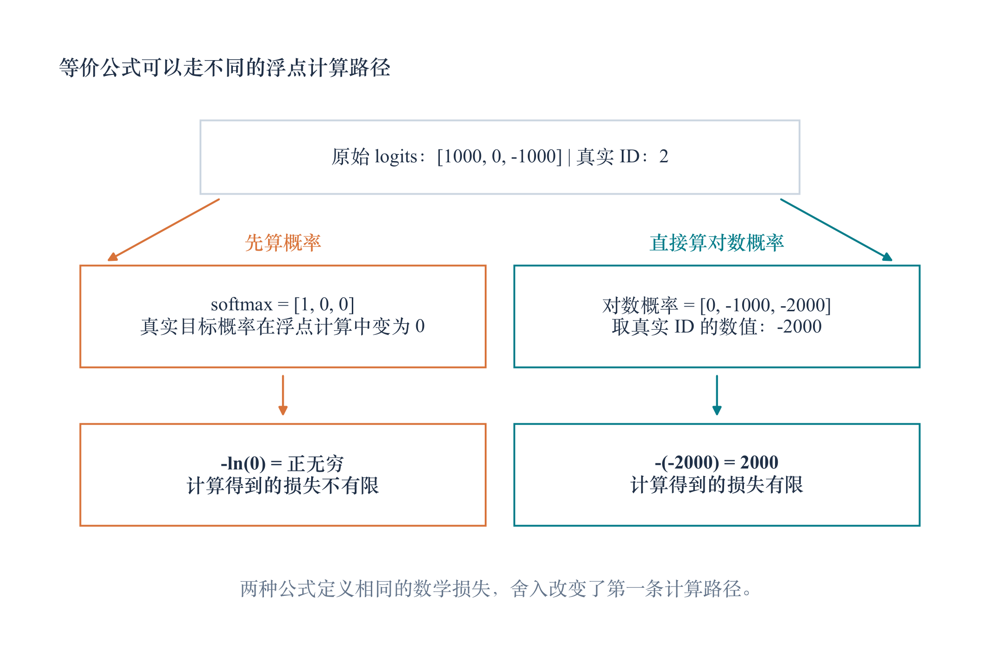{width=100%}

**图 03.10-2——从同一组 logits 沿箭头读。** 左边先用浮点数保存概率，真实候选项的极小概率在取对数之前下溢为零。右边直接计算平移后的对数概率，取出 `-2000`，再取负得到 `2000`。图中展示的是浮点计算结果；数学上，这个候选项的 softmax 概率仍大于零。两条路径定义相同目标，但数值计算过程不同。

实际使用中，[cross_entropy](https://docs.pytorch.org/docs/2.0/generated/torch.nn.functional.cross_entropy.html) 接收原始 logits，稳定的 [logsumexp](https://docs.pytorch.org/docs/2.0/generated/torch.logsumexp.html) 是常用基本操作。本课由学生使用基础操作展开机制。已经完成的 softmax 仍用于查看分布和选择 token；本损失通过等价稳定表达式计算它的对数。

### 完整手算例子

复用 03.09 的分数行，并提供真实目标：

$$
Z=\begin{bmatrix}1&2&3\\2&1&3\end{bmatrix},\qquad
\mathrm{target\_ids}=[2,0]
$$

这里 $T=2$、$V=3$。上一课的 softmax 给出：

$$
P\approx\begin{bmatrix}0.0900305732&0.2447284711&0.6652409558\\0.2447284711&0.0900305732&0.6652409558\end{bmatrix}
$$

#### 第一步：每行确认要评价哪个概率

| 位置 | 真实目标 ID | 选中的概率 | 该位置损失，近似值 |
| --- | --- | --- | --- |
| `0` | `2` | `0.6652409558` | `0.4076059644` |
| `1` | `0` | `0.2447284711` | `1.4076059644` |

第一行给真实 token 分配了更多概率，因此损失更小。两行都是候选 `2` 的概率最大，但第二行的真实目标是候选 `0`。把 argmax 当作目标，就会奖励模型自己的预测，而没有评价数据中实际出现的结果。

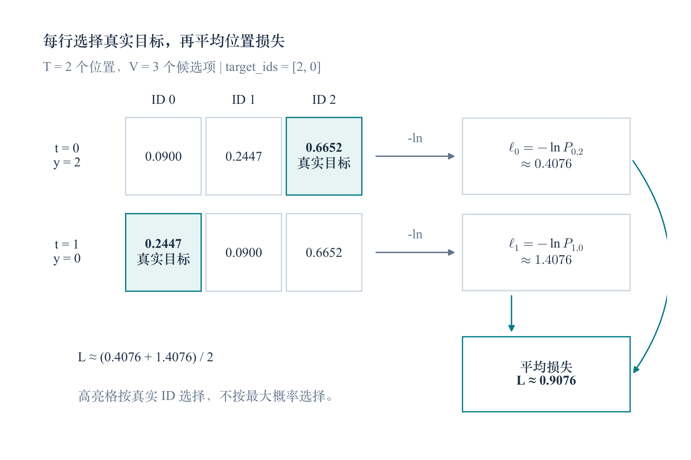{width=100%}

**图 03.10-3——把行读成位置，把列读成候选 ID。** 目标 `[2,0]` 选中青绿色的 `(0,2)` 与 `(1,0)`。第二行选中的概率约为 `0.2447`，尽管候选 `2` 的概率更大。每个选中值经过负自然对数，得到一个位置损失。最后一个框对两个损失取平均，所以除以 $T=2$；$V=3$ 表示列数。图中概率与损失都由完整精度计算后四舍五入展示。

#### 第二步：平移分数，计算逐行归一化量

```text
row_max = [[3],[3]]
shifted_logits = [[-2,-1,0],[-1,-2,0]]
exp_scores = [[0.1353352832,0.3678794412,1],
              [0.3678794412,0.1353352832,1]]
row_sums = [[1.5032147244],[1.5032147244]]
log_row_sums = [[0.4076059644],[0.4076059644]]
```

最大值与行和张量都是 `[2,1]`，平移后的分数与指数都是 `[2,3]`。

#### 第三步：计算全部对数概率，无需对极小概率取对数

$$
\ln P\approx
\begin{bmatrix}-2-0.4076059644&-1-0.4076059644&0-0.4076059644\\-1-0.4076059644&-2-0.4076059644&0-0.4076059644\end{bmatrix}
$$

得到：

```text
log_probabilities =
    [[-2.4076059644,-1.4076059644,-0.4076059644],
     [-1.4076059644,-2.4076059644,-0.4076059644]]
```

对数概率本身不是概率；它可以为负，各项之和也不等于一。

#### 第四步：每个位置选一个真实目标坐标

构造 `row_indices=[0,1]`，与 `target_ids=[2,0]` 按位置配对：

```text
row_indices[0]=0, target_ids[0]=2 -> coordinate (0,2)
row_indices[1]=1, target_ids[1]=0 -> coordinate (1,0)

target_log_probabilities = [-0.4076059644,-1.4076059644]
```

表达式 `log_probabilities[row_indices, target_ids]` 得到 `[T]`，不生成所有行与全部所列目标的组合矩阵。

#### 第五步：取负，再平均两个位置

$$
L=\frac{0.4076059644+1.4076059644}{2}\approx0.9076059644
$$

返回这个标量张量，保留它与 logits 的连接。展示的小数经过四舍五入，检查使用完整精度和误差容限。

对照：三个候选分数相同时，任何目标的概率都是 $\frac{1}{3}$，损失为 $\ln3\approx1.098612$。如果词表只有一个候选项，概率为一，损失为零。检查程序覆盖这两种情况。

### 新语法：log、行索引与配对索引

`torch.log(row_sums)` 对每个行归一化量计算自然对数，保持 `[T,1]`。它是指数求和后的对数，不是对数之和，也不是对可能为负的原始 logits 取对数。

`logits.shape[0]` 给出 $T$。`torch.arange(logits.shape[0], device=logits.device)` 在分数张量所在 device 上创建 `[0,1,...,T-1]`。整数边界产生整数索引，参见 [arange 文档](https://docs.pytorch.org/docs/2.0/generated/torch.arange.html)。两个位置就得到 `[0,1]`。

用两个等长索引张量，`matrix[rows, columns]` 会按同一下标配对，逐个取出坐标。本例取 `(0,2)` 和 `(1,0)`。Embedding 课的单索引查表选择整行，这里从每行选择一个数。选择仍可对浮点对数概率求导，整数标签与行索引只是固定选择器。

取负使用一元 `-`，括号把负的选中向量作为整体，再 `.mean()`。此时向量有 $T$ 个数，所以平均除以 $T$。损失必须保留为张量；`.item()` 只用于已经保留求导张量之后的日志记录。

### 准确输入、中间值与返回值

| 名称 | 类型与形状 | 含义 |
| --- | --- | --- |
| `logits` | 浮点 `torch.Tensor`，`[T,V]` | 原始分数，保留数值与计算图。 |
| `target_ids` | 整数 `torch.Tensor`，`[T]`，`torch.long` | 每行观察到的下一个 token 的列号。 |
| `row_max` | 浮点张量 `[T,1]` | 每个位置的最大分数。 |
| `shifted_logits`、`exp_scores` | 浮点张量 `[T,V]` | 平移后分数与指数权重。 |
| `row_sums`、`log_row_sums` | 浮点张量 `[T,1]` | 归一化量与其自然对数。 |
| `log_probabilities` | 浮点张量 `[T,V]` | 各候选项所对应概率的对数。 |
| `row_indices` | 整数张量 `[T]` | 与 `target_ids` 对齐的位置索引。 |
| `target_log_probabilities` | 浮点张量 `[T]` | 每个真实结果所选出的一个值。 |
| `loss` | 标量浮点张量 | 真实目标负对数概率的平均值。 |

返回值的 dtype 和 device 与 logits 相同。Logits 需要梯度时，标量也保留连接；两个输入保持原值。函数内不清除梯度、不反向、不更新参数。

### 实现指导

打开 `03_10_cross_entropy_loss.py`，找到 `cross_entropy_loss(logits, target_ids)`。按以下步骤实现函数。全部语句缩进四个空格，不需要循环或上下文块。

1. **找 `row_max`。** 复用 `logits.max(dim=-1, keepdim=True).values`。例子为 `[[3],[3]]`，形状 `[T,1]`。
2. **计算 `shifted_logits`。** 从 `logits` 减去 `row_max`，保存新结果。例子为 `[[-2,-1,0],[-1,-2,0]]`，形状 `[T,V]`。
3. **计算 `exp_scores` 和 `row_sums`。** 使用 `torch.exp`，再 `.sum(dim=-1, keepdim=True)`。本例两行分母都约为 `1.5032147244`。
4. **计算 `log_row_sums`。** 对 `row_sums` 调用 `torch.log`。例子为 `[[0.4076059644],[0.4076059644]]`，形状 `[T,1]`。
5. **计算 `log_probabilities`。** 从 `shifted_logits` 减去 `log_row_sums`，广播让每行使用一个对数归一化量。第一行约为 `[-2.407606,-1.407606,-0.407606]`。
6. **构造 `row_indices`。** 使用 `torch.arange(logits.shape[0], device=logits.device)`。例子为 `[0,1]`，整数张量 `[T]`。
7. **选择 `target_log_probabilities`。** 使用配对索引 `log_probabilities[row_indices, target_ids]`。例子为 `[-0.407606,-1.407606]`，形状 `[T]`。
8. **计算并返回 `loss`。** 对选中向量取负、用 `.mean()` 平均，返回标量张量。例子约为 `0.907606`，保留连接供后续反向。

核心由你实现。提供的参考函数不代替要求展开的基础计算。输入设置通过同目录的 `03_09_logits_and_softmax.py` 加载 `compute_logits`，也检查梯度能经查表传回 Embedding 表。提供的设置和检查程序保持原样。

在已有 PyTorch 环境中，从项目根目录运行：

```bash
python exercises/03_10_cross_entropy_loss.py
```

完成实现后的预期输出为：

```text
PASS: true-target selection and mean loss in the worked example
PASS: varied targets, vocabulary sizes, single-candidate case, and preserved inputs
PASS: row-shift invariance and finite loss for very unlikely targets
PASS: logit gradients equal mean-normalized probability minus target indicator
PASS: PyTorch loss agreement and finite-difference gradient agreement
PASS: loss gradients reach the embedding table and completed output projection
Lesson 03.10 checks passed.
```

### 公式参考：这个损失怎样指导训练？

这里保留推导供理解，不要求手写导数代码。对单行：

$$
\ell_t=\ln\left(\sum_j e^{Z_{t,j}}\right)-Z_{t,y_t}
$$

对对数归一化量和选中分数求导，再考虑平均因子：

$$
\frac{\partial L}{\partial Z_{t,v}}
=\frac1T\left(\frac{e^{Z_{t,v}}}{\sum_j e^{Z_{t,j}}}-\mathbf{1}_{v=y_t}\right)
=\frac{P_{t,v}-\mathbf{1}_{v=y_t}}{T}
$$

指示符在真实候选项处为一，其他候选项处为零。真实候选概率小于一时，其梯度为负；若直接对分数做梯度下降，就会提高这个分数。其他候选分数的梯度为正。实际模型训练通过链式法则更新产生分数的参数，这些参数的作用可能跨位置共享。

手算例子第 `0` 行的真实候选为 `2`，该 logit 的梯度为 $(0.6652409558-1)/2\approx-0.1673795221$。候选 `0` 的梯度为 $0.0900305732/2\approx0.0450152866$。虽然标量损失选择真实对数概率，但所有候选项都通过共同归一化量参与计算。

### 阅读问答

**为什么只平均真实目标的损失？** 每个位置提供一个真实下一个 token。所有词表候选项通过归一化影响它的概率，但它们不是 $V$ 个独立观察结果。

**为什么不拿 argmax 当目标？** 目标来自数据。把它换成模型当前最喜欢的候选项，就没有评价实际的下一个 token 预测。

**为什么这个函数不做 backward？** 它提供可微目标。后续训练步骤会清除参数梯度、计算分数与损失、调用反向并更新参数。评估也会复用损失计算，不能因此强制触发更新。

接下来是当前带提示的 [03.11](#section-03-11)：最小下一个 token 训练步骤，连接 Embedding、输出映射、本损失与参数更新。处理上下文的注意力仍是后续章节。

**同一归约的两种写法。** `torch.sum(exp_scores, dim=-1, keepdim=True)` 与 `exp_scores.sum(dim=-1, keepdim=True)` 做的是同一种归约；两者都为每行保留一列，便于广播。

## 03.11 一次联合的下一个词元训练步骤 {#section-03-11}

查表、词表分数和损失已经连成一条计算通路。一次反向传播，就能告诉三组参数各自该怎样变化。本节先在旧参数状态下算齐所有梯度，再一起更新表、输出权重和偏置，避免把更新前后的数值混用。

先走完下面的小例子，再对照 03_11_next_token_train_step.py 动手。编号步骤会说明函数接口，并引导核心实现；初始化和检查驱动由配套文件提供。

### 符号、输入与求导对象

| 符号 | 准确参数名称 | 类型与形状 | 作用 |
| --- | --- | --- | --- |
| $E$ | `embedding_table` | 可训练浮点叶子张量 `[V,D]` | 输入 token 的向量表 |
| $x$ | `token_ids` | 固定的 `torch.long` 张量 `[T]` | 输入查表的行选择器 |
| $W$ | `output_weights` | 可训练浮点叶子张量 `[D,V]` | 向量到候选项的权重 |
| $b$ | `output_bias` | 可训练浮点叶子张量 `[V]` | 各位置共享的候选偏置 |
| $y$ | `target_ids` | 固定的 `torch.long` 张量 `[T]` | 真实下一个 token 的候选 ID |
| $\eta$ | `learning_rate` | 不小于零的 Python 浮点数 | 更新幅度系数 |
| $H$ | `selected_vectors` | 有求导依赖的浮点张量 `[T,D]` | 选出的输入向量 |
| $Z$ | `logits` | 有求导依赖的浮点张量 `[T,V]` | 原始输出分数 |
| $L$ | `loss` | 有求导依赖的标量张量 | 真实目标的平均交叉熵 |

$V$ 是词表大小，$D$ 是向量维度，$T$ 是输入位置数。一次更新中输入和真实目标固定不变。损失是三组可训练张量的函数 $L(E,W,b)$；对其中一个参数分量求偏导时，其他分量固定。整数 ID 用于选择位置，不是求导对象。

假设维度为正、数值有限、ID 有效、dtype/device 匹配，且处于正常梯度模式。三组参数分别存储，都是 `requires_grad=True` 的叶子张量，没有相互绑定。检查程序把它们构造成 CPU `float64` 张量，学生不需要重新创建参数或写输入验证。

### 查表、预测与一个标量目标

查表为每个输入位置选一行：

$$
H_{t,d}=E_{x_t,d}
$$

已经完成的输出映射计算：

$$
Z_{t,v}=\sum_{d=0}^{D-1}H_{t,d}W_{d,v}+b_v,\qquad Z=HW+b
$$

已经完成的损失评价真实的下一个 token ID：

$$
P_{t,v}=\frac{e^{Z_{t,v}}}{\sum_j e^{Z_{t,j}}},\qquad
L(E,W,b)=-\frac1T\sum_{t=0}^{T-1}\ln P_{t,y_t}
$$

`compute_logits(selected_vectors, output_weights, output_bias)` 给出 $Z$；`cross_entropy_loss(logits, target_ids)` 用 03.10 的稳定表达式给出 $L$。单独调用已经完成的 softmax 可以展示分布，但把原始 logits 交给损失函数时，无需先做这个调用。

通过同一张有连接的计算图，损失可以传到三组参数：

$$
G_E=\frac{\partial L}{\partial E},\qquad
G_W=\frac{\partial L}{\partial W},\qquad
G_b=\frac{\partial L}{\partial b}
$$

每组梯度与对应参数形状相同。一个标量目标可以产生很多偏导数，各参数不会共用同一个标量梯度。调用一次 `loss.backward()`，就会按链式法则沿计算图，把参与计算的叶子张量的 `.grad` 填好。[PyTorch backward 文档](https://docs.pytorch.org/docs/2.0/generated/torch.Tensor.backward.html)。

三组梯度都对应更新前的同一份状态，全部算好后执行普通梯度下降：

$$
\begin{aligned}
E_{\mathrm{new}}&=E-\eta G_E\\
W_{\mathrm{new}}&=W-\eta G_W\\
b_{\mathrm{new}}&=b-\eta G_b
\end{aligned}
$$

公式逐分量执行。某个分量的梯度为正，就减小该分量；梯度为负，就增大该分量。Embedding 的值现在通过预测质量获得训练方向，目标向量由人指定的阶段已经接到了下一个 token 预测目标。

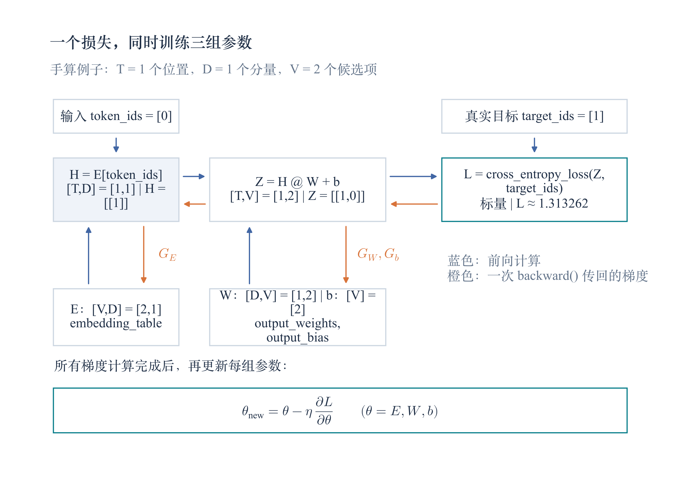{width=100%}

**图 03.11-1——蓝色沿前向读，橙色沿反向读。** 输入 ID 从 $E$ 选出 $H$；$W$ 和 $b$ 把它变为 $Z$；真实目标 ID 决定标量损失。反向箭头表示梯度传向三组参数的路径。整数 ID 没有梯度或更新箭头。底部更新框发生在反向完成之后。形状与数值对应下面的小例子。

### 完整小例子：两个候选项，一个输入位置

使用只有两个 ID 的教学词表。token 序列 `[0,1]` 提供输入 `[0]`、目标 `[1]`。取 $T=1$、$D=1$、$V=2$，便于看到每个分量；这些小维度只用于手算。

$$
E=\begin{bmatrix}1\\2\end{bmatrix},\quad
W=\begin{bmatrix}1&0\end{bmatrix},\quad
b=\begin{bmatrix}0&0\end{bmatrix},\quad
x=[0],\quad y=[1],\quad\eta=0.1
$$

偏置实际保存为一维 `[2]` 张量，数学行向量写法只是把两个数横着列出。

#### 1. 前向：计算分数、真实概率和损失

选中输入行零：$H=[[1]]$，形状 `[1,1]`。矩阵乘法加上偏置得到：

$$
Z=\begin{bmatrix}1\times1+0&1\times0+0\end{bmatrix}
=\begin{bmatrix}1&0\end{bmatrix}
$$

两个概率与真实目标损失为：

$$
P=\begin{bmatrix}\frac{e^1}{e^1+e^0}&\frac{e^0}{e^1+e^0}\end{bmatrix}
\approx\begin{bmatrix}0.7310585786&0.2689414214\end{bmatrix},\qquad
L=-\ln P_{0,1}\approx1.3132616875
$$

真实 ID 是 `1`，对应第二个概率。$T=1$ 表示一个位置损失；除以 $V=2$ 会算错。此时只做了前向计算，参数还没有改变。

#### 2. 反向：推出本例的全部梯度

03.10 给出的公式是：

$$
(G_Z)_{t,v}=\frac{P_{t,v}-\mathbf{1}_{v=y_t}}{T}
$$

本例目标指示向量为 `[0,1]`，所以：

$$
G_Z=\begin{bmatrix}0.7310585786&-0.7310585786\end{bmatrix}
$$

对权重 $W_{0,0}$，分数 $Z_{0,0}=H_{0,0}W_{0,0}+b_0$ 对它的局部导数为 $H_{0,0}=1$。乘上损失对分数的导数，就得到 $1\times0.7310585786$。对 $W_{0,1}$，得到 $1\times(-0.7310585786)$。每个偏置对自己分数的局部导数也是一。因此：

$$
G_W=\begin{bmatrix}0.7310585786&-0.7310585786\end{bmatrix},\qquad
G_b=\begin{bmatrix}0.7310585786&-0.7310585786\end{bmatrix}
$$

要传回选中的 Embedding 分量，就把经过两个候选项的路径贡献相加：

$$
\frac{\partial L}{\partial H_{0,0}}
=\sum_v\frac{\partial L}{\partial Z_{0,v}}W_{0,v}
=0.7310585786\times1+(-0.7310585786)\times0
=0.7310585786
$$

本次只选中了 $H_{0,0}=E_{0,0}$，所以：

$$
G_E=\begin{bmatrix}0.7310585786\\0\end{bmatrix}
$$

输入表的行一没有被使用。真实目标 ID 为 `1`，是选输出候选项来算损失，并没有让输入查表选择行一。本练习的查表/输出参数没有绑定，使用普通梯度下降，因此那一输入行的梯度为零；候选项一的输出权重和偏置仍然有非零梯度。

#### 3. 使用这些旧梯度更新三组参数

选中 Embedding 分量：$1-0.1\times0.7310585786\approx0.9268941421$。第二个候选项权重：$0-0.1\times(-0.7310585786)\approx0.0731058579$。对每个分量应用相同更新规则，得到：

$$
\begin{aligned}
E_{\mathrm{new}}&\approx\begin{bmatrix}0.9268941421\\2\end{bmatrix},\\
W_{\mathrm{new}}&\approx\begin{bmatrix}0.9268941421&0.0731058579\end{bmatrix},\\
b_{\mathrm{new}}&\approx\begin{bmatrix}-0.0731058579&0.0731058579\end{bmatrix}.
\end{aligned}
$$

表中未使用的行仍精确等于 `2`。更新之前复制梯度、提取原始损失；函数按顺序返回：

```text
loss_value = 1.3132616875
gradient_table = [[0.7310585786],[0]]
gradient_weights = [[0.7310585786,-0.7310585786]]
gradient_bias = [0.7310585786,-0.7310585786]
```

浮点张量保留完整梯度值，展示的小数经过四舍五入。这四个返回值都描述更新前状态；传入的参数对象现在保存更新后的值。

#### 4. 单独再做前向检查，看到更新的效果

用三组更新后的参数重新计算：

$$
\begin{aligned}
Z'_{0,0}&\approx0.9268941421\times0.9268941421-0.0731058579
\approx0.7860268929\\
Z'_{0,1}&\approx0.9268941421\times0.0731058579+0.0731058579
\approx0.1408672493
\end{aligned}
$$

新的真实目标概率约为 `0.3440811280`，新损失约为 `1.0668778121`。模型仍然给候选项零更高概率；一次有用更新不一定立即纠正 argmax。本例提高了真实目标的概率，降低了损失。第二次前向属于检查程序，不是本函数所返回的观察结果。

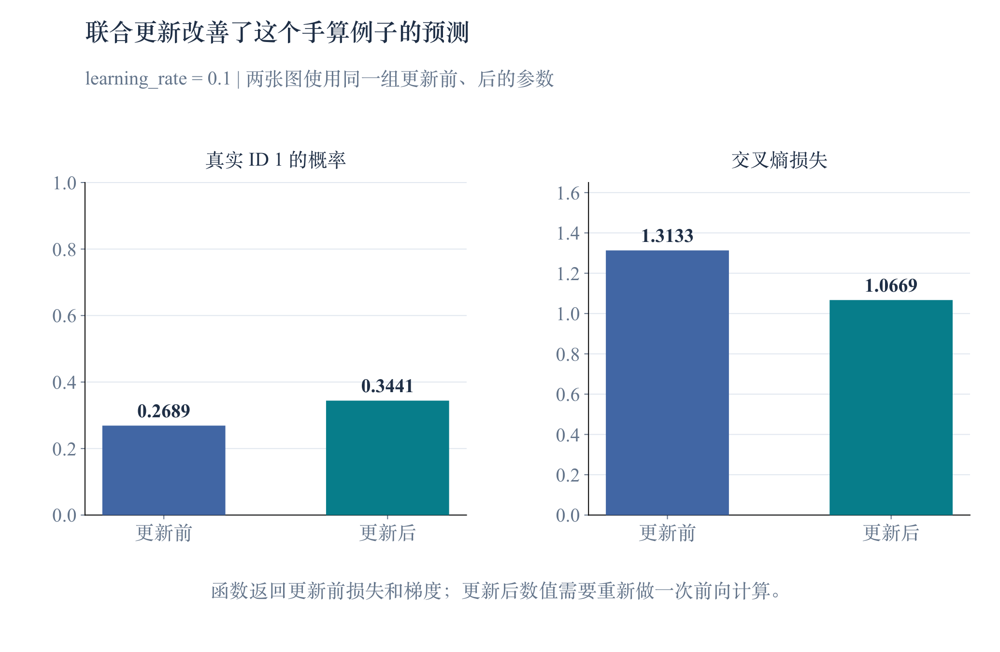{width=100%}

**图 03.11-2——比较一份参数状态和下一份状态。** 蓝色使用原来的 $E,W,b$；青绿色使用 `learning_rate=0.1` 更新后的三组张量。左图纵轴是概率，右图纵轴是损失。函数返回原始损失 `1.3133`；单独再做前向，才得到新损失 `1.0669`。柱子标注值经过四舍五入。这个改善是本例的计算结果，足够大的步长可以使损失增加。

### 多个位置的导数参考

学生调用自动求导，不需要手写这些导数公式。这里说明共享参数的求导路径与形状：

$$
G_W=H^{\mathsf T}G_Z,\qquad
(G_b)_v=\sum_t(G_Z)_{t,v},\qquad
G_H=G_ZW^{\mathsf T}
$$

$G_W$ 的矩阵乘法把各位置对共享权重的贡献相加；$G_b$ 的求和对应偏置广播的反向；$G_H$ 的乘法把各候选项路径传回向量分量。对查表：

$$
(G_E)_{r,d}=\sum_{t:x_t=r}(G_H)_{t,d}
$$

重复输入 ID 会把贡献加到同一表行，本目标中未使用的行梯度为零。除以 $T$ 已经出现在 $G_Z$，沿链式法则传递时，无需再除以 $T$、$D$ 或 $V$。小例子的 $H=1$，所以权重和偏置的梯度值恰好相同，通常情况下不必相同。

步长足够小时，一阶损失变化估计为：

$$
\Delta L\approx-\eta\left(\lVert G_E\rVert_F^2+\lVert G_W\rVert_F^2+\lVert G_b\rVert_2^2\right)
$$

这些范数合计各梯度分量的平方。局部近似解释了下降方向，不能保证任意有限学习率都降低损失。检查程序包含一个使损失增加的大步长。

### 准确返回值与梯度清除含义

返回 `(loss_value, gradient_table, gradient_weights, gradient_bias)`。第一个值是从原始标量 `loss.item()` 提取的 Python 浮点数。其他值是三组 `.grad` 经过 `.clone()` 得到的独立张量快照，形状分别为 `[V,D]`、`[D,V]`、`[V]`，dtype/device 与各自参数一致。普通 backward 得到的这些梯度不带求导依赖，clone 负责复制存储，不需要再 detach。

完成 backward 前，`loss` 一直保留为张量。提取数值是为了记录；[item 文档](https://docs.pytorch.org/docs/2.0/generated/torch.Tensor.item.html) 说明返回 Python 数字，不保留求导连接。为记录结果单独使用 `loss_value` 这个名字。

开始时清除全部三个 `.grad`，因为 backward 会向叶子张量累计梯度。本课需要本次梯度，旧步骤的累积先清除。设置 `.grad=None` 清除保存的导数，不改变参数值。下一次调用的前向会使用上一次更新后的值。

只有参数修改放在 `with torch.no_grad():` 内。该上下文让更新操作不被记录为新计算图，同一组叶子参数仍可在下次调用中训练。查表、分数计算、损失计算与 backward 都保持正常梯度模式。[No-grad 文档](https://docs.pytorch.org/docs/2.0/generated/torch.no_grad.html)。

### 动手前先理解新的循环与缩进

`parameters = (embedding_table, output_weights, output_bias)` 创建一个元组，保存三组现有张量的引用，不复制值，也不把它们拼成大张量。`for parameter in parameters:` 依次访问每个对象，末尾冒号开启缩进的循环体。清除当前对象的 `.grad`，就作用于真正的那组参数。

更新循环中的 `parameter -= learning_rate * parameter.grad` 在 no-grad 下直接修改原始张量。如果写成 `parameter = parameter - ...`，只是把循环里的局部名字改为指向新张量，调用者原来的参数没有更新。作业要求持续更新原有张量。

| 区域 | 行首空格数 |
| --- | --- |
| 普通函数语句，以及外层 `for`/`with` | `4` |
| 清除梯度的 `for` 循环体 | `8` |
| no-grad 内的参数 `for` | `8` |
| 同时位于 no-grad 和参数循环内的更新语句 | `12` |
| 离开两个块后的最终 return | `4` |

两个循环都遍历三组参数，不是遍历输入位置或训练次数。张量运算已同时计算全部 $T$ 个位置。

### 实现指导

打开 `03_11_next_token_train_step.py`，找到 `next_token_train_step(embedding_table, token_ids, output_weights, output_bias, target_ids, learning_rate)`。按以下步骤实现函数。

1. **把参数放在一起并清除梯度。** 四空格处创建 `parameters`，按表、权重、偏置的顺序放入三组可训练张量。四空格处写 `for parameter in parameters:`，八空格处赋值 `parameter.grad = None`。参数值保持原样。
2. **查出 `selected_vectors`。** 回到四空格，用 `embedding_table[token_ids]` 索引。形状 `[T,D]`，本例为 `[[1]]`，保持与原始表的求导连接。
3. **算 `logits`。** 四空格处调用 `compute_logits(selected_vectors, output_weights, output_bias)`。形状 `[T,V]`，本例为 `[[1,0]]`；该辅助函数已经包含偏置。
4. **算 `loss`。** 四空格处调用 `cross_entropy_loss(logits, target_ids)`。返回有连接的标量，本例约为 `1.3132616875`，保留 `loss` 张量。
5. **做一次反向。** 四空格处调用 `loss.backward()`。表、权重和偏置的梯度都已算好，描述同一份旧参数状态。本例选中的表梯度为正，候选项一的权重和偏置梯度为负。
6. **保存观察值。** 四空格处用 `.item()` 得到 `loss_value`。对相应参数的 `.grad` 调用 `.clone()`，分别保存 `gradient_table`、`gradient_weights`、`gradient_bias`，保留独立的完整梯度张量。
7. **更新三组原始张量。** 四空格处进入 `with torch.no_grad():`；八空格处写 `for parameter in parameters:`；十二空格处用 `-=` 减去 `learning_rate * parameter.grad`。选中的表值约变为 `0.9268941421`。只有这个更新循环放在 no-grad 中。
8. **按规定顺序返回。** 四空格处，离开两个块，返回 `loss_value`、`gradient_table`、`gradient_weights`、`gradient_bias`。这些值描述更新前状态，不需要第二次前向或外层训练循环。

已提供的加载程序用可移植的同目录文件名，暴露辅助函数。保留此前实现和提供的设置/检查程序。核心实现负责连接组件，无需重写损失或手推导数。

在已有 PyTorch 环境中，从项目根目录运行：

```bash
python exercises/03_11_next_token_train_step.py
```

学生完成核心后的预期输出为：

```text
PASS: worked example, three parameter gradients, and joint in-place update
PASS: multiple positions, varied dimensions, repeated IDs, and untouched input rows
PASS: zero learning rate and single-candidate zero gradients
PASS: all old gradients cleared and repeated calls use updated trainable parameters
PASS: independent table, weight, and bias gradient snapshots
PASS: all parameter gradients agree with trusted autograd and finite differences
PASS: pre-update reporting, small-step improvement, and possible large-step loss increase
Lesson 03.11 checks passed.
```

### 阅读问答

**一个损失怎样训练几个张量？** 各参数分量都有自己的偏导数。有连接的反向计算沿所有影响同一标量的路径求导，包括输出映射和输入查表。

**为什么 Embedding 变小，真实概率却提高？** Embedding 坐标是特征，不是概率。本例减小选中的特征，会减小起初受偏好的候选项的分数贡献；两个输出列和偏置的变化也影响预测。要用完整的新模型评价更新效果。

**为什么真实目标对应的输入表行没改变？** 输入 ID 选表行，目标 ID 选损失中的候选列。本课使用未绑定的参数，这两种选择是不同操作。

**Backward 会更新参数吗？** 它计算并保存导数，后续 no-grad 中的修改才执行按学习率缩放的更新。

**学习率为零时会怎样？** 仍计算并返回损失和梯度，参数值保持不变。某个梯度分量为零，也会使其对应参数分量保持不变。

接下来是当前带提示的 [03.12](#section-03-12)：重复调用本步骤，保留参数并记录更新前损失历史。上下文处理仍是后续章节。

## 03.12 重复下一个词元的训练步骤 {#section-03-12}

下一个 token 模型已经能更新一次，现在让同一组参数继续走几步。要让损失历史有意义，就得知道每个数来自哪个参数状态。本节反复使用同一组训练配对，专心看清参数怎样延续，以及损失究竟记录在更新的哪个时刻。

先走完下面的小例子，再对照 03_12_next_token_training_loop.py 动手。编号步骤会说明函数接口，并引导核心实现；初始化和检查驱动由配套文件提供。

### 准确输入与返回值

| 名称 | 类型与形状 | 含义 |
| --- | --- | --- |
| `embedding_table` | 可训练浮点叶子张量 `[V,D]` | 已存在的输入向量表，原地更新 |
| `token_ids` | 固定的 `torch.long` 张量 `[T]` | 输入表行选择器 |
| `output_weights` | 可训练浮点叶子张量 `[D,V]` | 已存在的输出权重，原地更新 |
| `output_bias` | 可训练浮点叶子张量 `[V]` | 已存在的共享偏置，原地更新 |
| `target_ids` | 固定的 `torch.long` 张量 `[T]` | 真实下一个 token 的候选 ID |
| `learning_rate` | 不小于零的 Python 浮点数 | 原样传给单步辅助函数 |
| `num_steps` | 不小于零的 Python 整数 | 准确的更新调用次数 |
| `losses` | 新建的 `list[float]` | 按顺序记录每次调用的更新前损失 |

$T$ 是每一步的监督输入位置数，$D$ 是向量分量数，$V$ 是词表候选项数。沿用 03.11 的有效 ID、有限数值、dtype/device 匹配、参数独立存储和正常梯度模式假设。检查程序提供 CPU `float64` 可训练叶子张量，学生不创建参数或验证输入。

函数只返回 `losses`。调用者已经持有原始三组参数对象，它们的值会变为最终训练结果。列表每项是 Python 浮点数，而不是损失张量或梯度元组。`num_steps=0` 时返回新建空列表，参数值和已有梯度都保持原样。

### 参数状态与损失历史

把完成 $k$ 次更新后三组张量中的值记为：

$$
\theta_k=(E_k,W_k,b_k),\qquad \theta_0=(E_0,W_0,b_0)
$$

这个记号描述持续使用的张量内部数值变化，不表示重新创建张量对象。本练习中输入 ID、目标 ID 与学习率固定。定义某份参数状态的目标函数：

$$
L(\theta)=-\frac1T\sum_{t=0}^{T-1}\ln\operatorname{softmax}(E[x]W+b)_{t,y_t},\qquad
L_k=L(\theta_k)
$$

这里 $x$ 是 `token_ids`，$y$ 是 `target_ids`，softmax 在每行的词表候选项维度归一化。已经完成的稳定损失函数实现这个目标。

一次调用计算当前梯度，改变参数：

$$
\theta_{k+1}=\theta_k-\eta\nabla_{\theta}L(\theta_k),\qquad k=0,\ldots,N-1
$$

$N=$ `num_steps`，$\eta$ 是 `learning_rate`。梯度包含 03.11 中三组与参数形状对应的导数。每次调用使用最新数值，由辅助函数重新前向并得到本次梯度；下一次调用从 $\theta_{k+1}$ 开始。

返回的数值记录为：

$$
\mathrm{losses}[k]=L(\theta_k),\qquad
\mathrm{losses}=[L_0,L_1,\ldots,L_{N-1}]\quad(N\ge1)
$$

完成 $N$ 次调用后，原张量保存 $\theta_N$。最后记录的值衡量 $\theta_{N-1}$，即最后一次更新前的状态。单独前向可以计算 $L(\theta_N)$，按照本课约定，它不再作为历史的新项。因此 $N$ 次更新经过 $N+1$ 份参数状态，但准确产生 $N$ 个记录值。

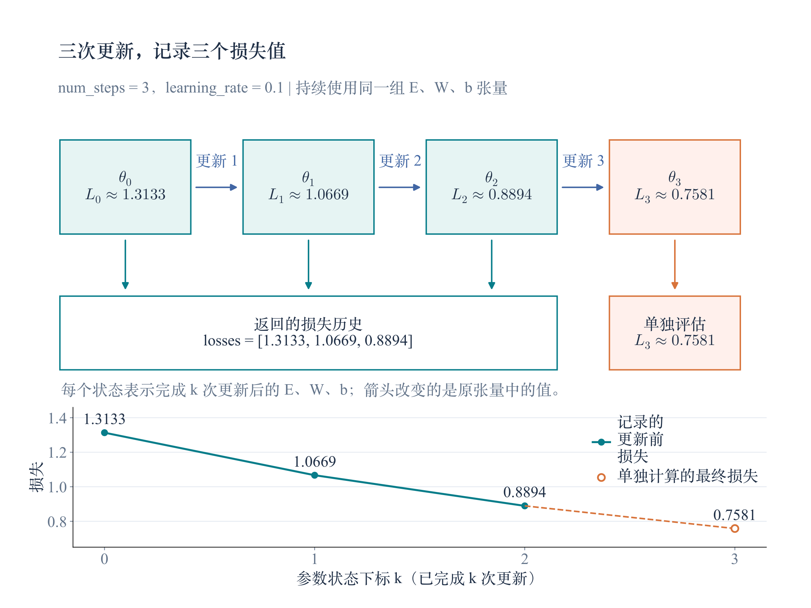{width=100%}

**图 03.12-1——先沿参数状态读，再沿记录值读。** 顶部每个框表示同一组 $E,W,b$ 在完成 $k$ 次更新后的数值，蓝色箭头是三次更新调用。青绿色箭头收集每次调用开始时的损失。橙色状态是最终训练状态，它的损失单独评估。曲线中青绿色实心点是返回的历史，橙色空心点是单独的最终评估。数值经过四舍五入，对应下面的完整例子。

### 完整的三次更新例子

复用 03.11 的同一个例子：

```text
embedding_table = [[1],[2]]
output_weights = [[1,0]]
output_bias = [0,0]
token_ids = [0]
target_ids = [1]
learning_rate = 0.1
num_steps = 3
```

表形状为 `[2,1]`，权重 `[1,2]`，偏置 `[2]`，两个 ID 张量都是 `[1]`。token 序列 `[0,1]` 提供观察到的输入/目标对。第一次前向选出 `[[1]]`，得到分数 `[[1,0]]`，真实概率约为 `0.2689414214`，损失为：

$$
L_0=-\ln(0.2689414214)\approx1.3132616875
$$

第一次调用使用 03.11 已推导的梯度，使表中选中的分量变为约 `0.9268941421`。第二次从全部三组更新后的张量开始。下面列出每份状态的所有有效参数分量与评估损失；这个固定窗口中，未使用的表行 `E[1,0]` 始终精确为 `2`。

| 已完成更新数 $k$ | `E[0,0]` | `W[0,0]` | `W[0,1]` | `b[0]` | `b[1]` | 评估损失 $L_k$ |
| --- | --- | --- | --- | --- | --- | --- |
| `0` | `1.0000000000` | `1.0000000000` | `0.0000000000` | `0.0000000000` | `0.0000000000` | `1.3132616875` |
| `1` | `0.9268941421` | `0.9268941421` | `0.0731058579` | `-0.0731058579` | `0.0731058579` | `1.0668778121` |
| `2` | `0.8708925573` | `0.8660974061` | `0.1339025939` | `-0.1386977451` | `0.1386977451` | `0.8894180392` |
| `3` | `0.8277585808` | `0.8147926734` | `0.1852073266` | `-0.1976082643` | `0.1976082643` | `0.7580921817` |

例如状态一的 $H\approx0.9268941421$，候选项零的概率约为 `0.6559188720`。本例只有一个位置、真实目标为 `1`，新的分数梯度是 $[p_0,-p_0]$。下一次选中表分量的梯度为：

$$
\begin{aligned}
\frac{\partial L_1}{\partial E_{0,0}}
&=p_0(W_{0,0}-W_{0,1})\\
&\approx0.6559188720\times(0.9268941421-0.0731058579)\\
&\approx0.5600158483.
\end{aligned}
$$

因此第二次调用把该分量改为约 $0.9268941421-0.1\times0.5600158483=0.8708925573$。参数已经变化，所以梯度也不同于第一次的 `0.7310585786`。包装函数把这些计算交给已经完成的辅助函数。

按执行顺序追踪 Python 列表与调用者持有的张量：

| 调用 | 开始状态 | 辅助函数返回的第一项 | 调用后状态 | append 后的 `losses` |
| --- | --- | --- | --- | --- |
| `1` | $\theta_0$ | `1.3132616875` | $\theta_1$ | `[1.3132616875]` |
| `2` | $\theta_1$ | `1.0668778121` | $\theta_2$ | `[1.3132616875,1.0668778121]` |
| `3` | $\theta_2$ | `0.8894180392` | $\theta_3$ | `[1.3132616875,1.0668778121,0.8894180392]` |

列表 append 发生在辅助函数完成更新并返回之后，但保存的数字仍描述更新前状态，因为辅助函数在更新前已提取该损失。语句执行的时间，与记录值所衡量的状态，是不同概念。

函数返回约：

```text
[1.3132616875, 1.0668778121, 0.8894180392]
```

原参数对象现在保存：

```text
embedding_table = [[0.8277585808],[2]]
output_weights = [[0.8147926734,0.1852073266]]
output_bias = [-0.1976082643,0.1976082643]
```

评估这些参数，可以得到单独的最终损失 `0.7580921817`。把它追加进返回列表，会改变本练习的历史记录约定。仅为了评估而再次调用更新函数也不合适，因为那会执行第四次更新。展示的数值经过四舍五入，检查使用完整精度。

### 零步、重复调用与训练预算

`num_steps=0` 时，`range(0)` 没有任何迭代，不调用单步函数、不清除梯度、不改变参数。循环外的最终 return 仍执行，返回 `[]`。学习率为零但步数为三时，仍调用辅助函数三次，记录三个损失；参数值不变，梯度依然每次重新计算。

每次函数调用都创建自己独立的历史列表。如果调用者把同一组已训练参数再次传入，就从当前值继续训练。固定数据和学习率时，先三次再两次更新，与不中断的五次更新，经过相同的参数变化过程；两次返回的列表依然各自独立。

`num_steps` 数的是更新调用次数，不是生成 token 数或 epoch 数。每次调用评价全部 $T$ 个给定目标，所以这个教学预算执行 $NT$ 次训练监督位置计算；重复计算不等于有 $NT$ 个不同样本。epoch 需要定义完整遍历某个数据集的过程，本固定窗口函数没有实现它。

本例在 `learning_rate=0.1` 时损失逐步下降，任意学习率并不保证每一步都下降；检查会保留大步长带来的损失增加。反复使用的训练对上损失降低，也不等于在未见文本上表现良好。数据划分与独立评估仍在后续学习。

### 复用辅助函数，保持求导连接

`next_token_train_step(embedding_table, token_ids, output_weights, output_bias, target_ids, learning_rate)` 返回四项元组，保存为 `step_result`。下标零 `step_result[0]` 是更新前的 Python 损失；剩余项是梯度快照，本函数不把它们存入损失历史。

辅助函数已经清除全部参数梯度、创建前向计算、做一次反向，并在自己的 no-grad 块内更新原始参数。包装函数保持正常梯度模式，每次迭代准确调用一次，不重复里面的动作。持续使用全部三组原始参数对象，让更新进入下一次调用。

`losses` 只积累浮点数，不保存可微损失图，也不保存每一步的完整梯度张量。教学辅助函数仍为观察创建梯度快照，但它们不属于返回的历史；理解学习版以后再改进实际训练效率。

### 动手前理解循环语法与缩进

`losses = []` 创建新空列表。`for step in range(num_steps):` 重复缩进的循环体。步数为三时，计数器取 `0,1,2`，第一次调用对应计数器零。`step` 是局部的重复计数名字；真正的参数和学习率写在辅助函数参数中。

`step_result[0]` 用从零开始的下标，选择元组第一项。`losses.append(loss_value)` 把这个浮点数加到列表末尾。如果追加整个元组，会保存损失和梯度张量，而不是要求的标量历史。

新列表、循环头和最终 return 用四空格，循环内的函数调用、第一项选取和 append 用八空格。return 放在循环外，才能在全部调用完成后执行，也能处理零次调用。不需要新嵌套更新块，已经完成的辅助函数内部负责它。

### 五个实现指导

打开 `03_12_next_token_training_loop.py`，找到 `train_next_token(embedding_table, token_ids, output_weights, output_bias, target_ids, learning_rate, num_steps)`。按以下计划实现函数。

1. **创建历史列表。** 四空格处用 `[]` 创建 `losses`。参数已提供，循环开始前列表为空。
2. **指定重复预算。** 四空格处写 `for step in range(num_steps):`，冒号开启八空格循环体。`range(3)` 重复三次，`range(0)` 跳过循环体。
3. **复用一次完整更新。** 八空格处按顺序向 `next_token_train_step` 传入 `embedding_table`、`token_ids`、`output_weights`、`output_bias`、`target_ids`、`learning_rate`，返回元组保存为 `step_result`。第一次调用让原张量从 $\theta_0$ 变到 $\theta_1$，下一次看到的是 $\theta_1$。
4. **记录元组第一项。** 仍在八空格处，把 `step_result[0]` 保存为 `loss_value`，再调用 `losses.append(loss_value)`。两次后例子列表约为 `[1.3132616875,1.0668778121]`。辅助函数的梯度快照不属于历史记录项。
5. **循环后返回。** 回到四空格，返回 `losses`。三次调用得到三个浮点数，零次得到 `[]`。原参数张量保存最终值，不再追加评估或执行更新。

核心继续留给你写。提供的加载程序导入同目录单步函数，不运行它的检查程序。保留这些设置和此前全部实现。

在已有 PyTorch 环境中，从项目根目录运行：

```bash
python exercises/03_12_next_token_training_loop.py
```

学生完成循环后的预期输出为：

```text
PASS: three updates, ordered pre-update losses, and final parameter values
PASS: zero and one step preserve the specified budget and gradient state
PASS: supplied step reused exactly once per update with persistent parameters
PASS: fresh histories and continuation across separate calls
PASS: varied positions, vocabulary dimensions, repeated IDs, and learning rates
PASS: zero learning rate and single-candidate zero loss still record every step
PASS: large-step loss increases remain visible without extra updates
Lesson 03.12 checks passed.
```

### 阅读问答

**为什么最后记录的损失不是最终训练损失？** 每个辅助函数返回更新前状态的损失。最后一次调用后，参数比最后记录值对应的状态多前进了一步，单独前向才能衡量新状态。

**为什么只返回列表，不返回新参数？** 调用者仍持有同一组张量对象，原地更新已经改变了它们的值，列表提供训练观察值。

**为什么每一步清除梯度？** 本循环要的是当前损失的导数，不是此前各步的累计。辅助函数在每次新反向之前清除梯度。

**三步是不是生成三个 token？** 它表示对提供的输入/目标对做三次参数更新。生成 token 是后续使用参数值进行预测的操作。

接下来是 [03.13](#section-03-13)：固定参数预测下一个 token，并介绍自回归思想。生成循环为 [03.14](#section-03-14)，上下文注意力与实际数据/优化仍是后续内容。

**调用续行不会新增代码块。** 圆括号里的参数可以分成多行，续行缩进用来组织参数；`for`、`with` 等带冒号的控制流头部，才会开启新的缩进代码块。

## 03.13 预测下一个词元 {#section-03-13}

训练负责改变模型，预测则使用此刻已经确定的模型。给定一段提示，我们查看最后一个位置的分布，从中选出一个下一个 ID。这是生成循环里最小的一步；先把这一小步的输入、输出和求导范围弄清楚。

先走完下面的小例子，再对照 03_13_predict_next_token.py 动手。编号步骤会说明函数接口，并引导核心实现；初始化和检查驱动由配套文件提供。

### 输入、符号与返回值

| 符号或值 | 准确代码名称 | 类型/形状 | 含义 |
| --- | --- | --- | --- |
| $E$ | `embedding_table` | 浮点张量 `[V,D]` | 本次预测固定使用的输入向量表 |
| $x$ | `context_ids` | `torch.long` 张量 `[T]` | 非空提示序列的 token ID |
| $W$ | `output_weights` | 浮点张量 `[D,V]` | 固定的输出映射权重 |
| $b$ | `output_bias` | 浮点张量 `[V]` | 固定的候选项偏置 |
| $H$ | `selected_vectors` | 浮点张量 `[T,D]` | 提示序列查出的向量行 |
| $Z$ | `logits` | 浮点张量 `[T,V]` | 各位置的候选分数 |
| $P$ | `probabilities` | 浮点张量 `[T,V]` | 各行归一化后的分布 |
| $p$ | `next_probabilities` | 不带求导连接的浮点张量 `[V]` | 提示序列之后的下一个分布 |
| $\hat v$ | `next_token_id` | Python `int` | 贪心选出的候选 ID |

$T$ 数提示序列中的 token 出现位置，$D$ 是向量分量数，$V$ 是词表候选项数，下标从零开始。假设维度为正、ID 有效、形状/device/dtype 兼容，前向分数有限。提供的浮点参数是叶子张量，可以需要梯度或被冻结；保留其标记、值、存储和已有梯度。检查构造 CPU `float64` 张量。

按顺序返回 `(next_token_id, next_probabilities)`。ID 位于 `[0,V)`，概率向量的浮点 dtype/device 与参数一致。保留输入提示序列与调用者的梯度模式。本函数不需要真实目标标签、损失计算、backward、学习率或参数更新。

### 从提示序列得到下一个分布

已经完成的操作仍为每个输入位置计算一行：

$$
H_{t,d}=E_{x_t,d},\qquad Z=HW+b,\qquad
P_{t,v}=\frac{e^{Z_{t,v}}}{\sum_j e^{Z_{t,j}}}
$$

下一个 token 跟在最后一个输入位置后面，因此选择：

$$
p_v=P_{T-1,v},\qquad p=P[T-1,:]
$$

代码中 `probabilities[-1]` 选择最后一行，并去掉位置轴：`[T,V]` 变为 `[V]`。负一是表示最后一个位置的行下标，不是负的 token ID。

较早的行对应较早位置之后的预测。提示序列有两个 token 时，行零预测第一个 token 之后，行一预测第二个 token 之后；要延长整个提示序列，需要的是行一。计算多行，不意味着一次生成多个新的未来 token。

贪心选择取最大概率：

$$
\hat v=\underset{0\le v<V}{\operatorname{argmax}}\;p_v
$$

`next_probabilities.argmax()` 返回最大项的下标，是标量整数张量；`.item()` 把它变为 Python 整数。这个下标才是候选 ID，而对向量调用 `.max()` 得到概率值。多个最大项相同时，选择第一个下标，因此本向量中最小的并列 ID 获胜。[Argmax 文档](https://docs.pytorch.org/docs/2.0/generated/torch.argmax.html)。

精确算术下，softmax 保留分数排序，因此贪心选择也可以比较 logits。本作业计算概率，是为了返回完整分布供观察。按概率采样是另一种选择规则，后续再学。

### 完整手算例子

使用以下人为选定的算术参数，不把它们报告为训练结果。这个教学词表只有两个 ID：

$$
E=\begin{bmatrix}1&2\\3&1\end{bmatrix},\qquad
W=\begin{bmatrix}1&0\\0&1\end{bmatrix},\qquad
b=[0,0],\qquad x=[0,1]
$$

这里 $T=2$、$D=2$、$V=2$，维度数相等只是巧合。偏置实际保存为一维 `[2]` 张量，提示序列有两个位置。查表得到：

$$
H=\begin{bmatrix}1&2\\3&1\end{bmatrix},\qquad
Z=HW+b=\begin{bmatrix}1&2\\3&1\end{bmatrix}
$$

例如最后一行候选项零的分数为 $3\times1+1\times0+0=3$，候选项一的分数为 $3\times0+1\times1+0=1$。

稳定 softmax 的中间值为：

```text
row_max = [[2],[3]]
shifted_logits = [[-1,0],[0,-2]]
exp_scores = [[0.3678794412,1],[1,0.1353352832]]
row_sums = [[1.3678794412],[1.1353352832]]
probabilities = [[0.2689414214,0.7310585786],
                 [0.8807970780,0.1192029220]]
```

最后一行为：

$$
p=\begin{bmatrix}\frac1{1+e^{-2}}&\frac{e^{-2}}{1+e^{-2}}\end{bmatrix}
\approx\begin{bmatrix}0.8807970780&0.1192029220\end{bmatrix},\qquad\hat v=0
$$

返回 Python 整数 `0` 与形状 `[2]` 的概率张量。ID 零不意味着概率为零。第一行偏好 ID 一，所以误选第一行会给出不同的结果，也不是在延长本提示序列。对整个矩阵做 argmax，会把位置轴和候选轴一起展平，而不是从最后一行选一个候选项。

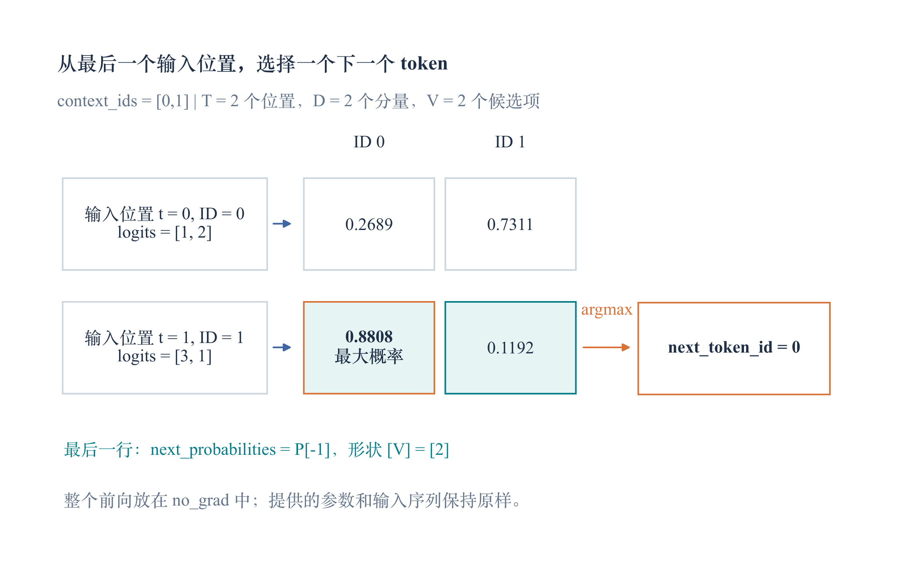{width=100%}

**图 03.13-1——列表示候选 ID，行表示输入位置。** 第一行属于第一个提示 token，两个青绿色格组成最后一行的 `[V]` 分布。橙色边框标出候选项零处的最大概率；返回 ID 为 `0`，同时返回完整的最后一行。标注由上面的计算四舍五入得到。

### 训练与推理的范围不同

| 操作 | 03.11 训练步骤 | 本课推理函数 |
| --- | --- | --- |
| 输入 | 输入 ID 和真实目标 ID | 提示序列 ID |
| 前向追踪 | 为反向保留连接 | 整个前向在 no-grad 中 |
| Backward | 计算各参数梯度 | 没有 |
| 参数更新 | 反向之后执行 | 参数保持固定 |
| 已有梯度 | 清除后替换成本次梯度 | 保留 |
| 结果 | 更新前损失与梯度快照 | 贪心 ID 与下一个分布 |

`with torch.no_grad():` 让其中的前向运算不追踪梯度，不会永久改变原参数的 `requires_grad` 标记，也不会清除已有梯度。把查表、输出映射、softmax 和选择放在这个上下文中，离开它之后返回，使调用者原来的梯度模式恢复。[No-grad 文档](https://docs.pytorch.org/docs/2.0/generated/torch.no_grad.html)。

返回的概率向量不带求导连接，无需再 detach。参数仍能用于后续训练调用，由训练函数自己清除梯度。推理读取模型分数并选择结果；训练的监督来源仍是观察到的真实 ID，不把贪心预测换成训练标签。

### 已验证的训练到字节预测示例

提供的检查还会用你完成的循环训练一个小的当前字节模型，再调用本课推理函数。这个例子与两个 ID 的手算例子分开记录。

| 项目 | 可移植说明 |
| --- | --- |
| 训练辅助代码 | 03.12 配套接口，实现后使用 |
| 合成数据版本 | `synthetic-byte-aba-v1`：`aba` 的 UTF-8 字节 |
| 分词器版本 | `utf8-byte-256-v1`：token ID 等于字节值 |
| 训练输入 / 目标 | `[97,98]` / `[98,97]`，对应 $\texttt{a}\to\texttt{b}$ 与 $\texttt{b}\to\texttt{a}$ |
| 形状 | $V=256$、$D=2$、$T=2$ |
| 初始化 | 表先为零，行 97 设置 `[1,2]`，行 98 设置 `[3,1]`；输出权重与偏置为零 |
| 更新预算 | 普通梯度下降，`learning_rate=0.1`、`num_steps=100`，共 200 次监督位置计算 |
| 评估 | 固定使用同样两对数据，计算平均交叉熵和无更新的贪心查询 |

初始输出权重和偏置为零，所以每个候选概率为 $\frac{1}{256}$，初始平均损失 $\ln256\approx5.5451774445$。100 次更新后，单独计算的最终平均损失约为 `0.0188148725`。最后一个更新前历史值约为 `0.0190794658`，保持了 03.12 中的区别。

| 提示/查询 | 训练后的贪心下一个 ID | 分配给该目标的概率 |
| --- | --- | --- |
| `a`，ID `[97]` | `98`，字节 `b` | `0.9789934959` |
| `ab`，ID `[97,98]` | `97`，字节 `a` | `0.9837342743` |

完整分布包含 256 个候选项。这些数值说明对重复使用的合成关系产生了学习，不是未见文本的评估表现。查表加输出映射架构仍只使用当前字节。检查与插图保留了数据、初始化、预算、评估和代码来源，不保存权重文件或原始运行日志。

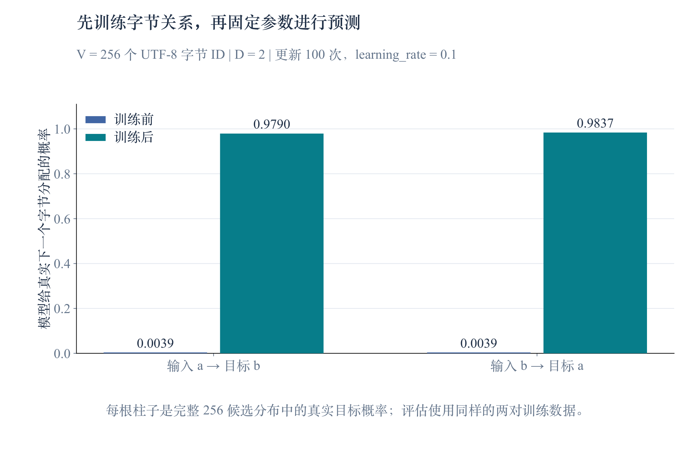{width=100%}

**图 03.13-2——观察每个给定训练对的预测。** 每根柱子是完整 256 候选分布中的一个真实目标概率，不是只在两个候选项间归一化。训练前为 $\frac{1}{256}$，训练后固定参数的查询给出约 `0.9790` 或 `0.9837`。两次查询评价的是训练对，独立 NumPy 计算复现了这些数值。

### 自回归生成下一步增加什么？

当前函数返回一个 ID，提示序列保持原样。生成函数可以追加这个 ID，再用延长后的提示序列询问，保持参数固定并重复。对人为选定的手算参数：

| 预测调用 | 调用前提示序列 | 最后一行分布，约为 | 选择的 ID | 延长后的提示序列 |
| --- | --- | --- | --- | --- |
| `1` | `[0,1]` | `[0.8808,0.1192]` | `0` | `[0,1,0]` |
| `2` | `[0,1,0]` | `[0.2689,0.7311]` | `1` | `[0,1,0,1]` |
| `3` | `[0,1,0,1]` | `[0.8808,0.1192]` | `0` | `[0,1,0,1,0]` |

这就是自回归思想：生成的输出成为下一次输入的一部分。它改变 token 序列，训练则改变参数值。生成循环和停止预算是 [03.14](#section-03-14) 独立作业。

本模型各行是独立查表，所以不同提示只要最后一个 ID 相同，下一个分布就相同，即使此前 token 不同。包含上下文的模型，需要把允许看到的前缀组合进最后位置的隐藏向量，注意力和 Transformer 组件留到后续学习。

贪心选择最大化当下这一步，并不必然最大化整条序列的联合概率。例如第一步 $A=0.6$、$B=0.4$，A 后最佳继续概率为 `0.51`，B 后为 `0.99`；贪心 A 路径概率为 `0.306`，B 路径为 `0.396`。这个可选概率例子说明选择的局部性，更广泛的解码方法后续再学。

### 七个实现指导

看完手算过程，再打开 `03_13_predict_next_token.py`，找到 `predict_next_token(embedding_table, context_ids, output_weights, output_bias)`，只替换学生占位行。

1. **进入推理范围。** 四空格处写 `with torch.no_grad():`，冒号开启八空格缩进的上下文块。步骤 2–6 放在里面，原参数标记与梯度保持原样。
2. **查出提示向量。** 八空格处用 `embedding_table[context_ids]` 索引，保存为 `selected_vectors`。形状 `[T,D]`，本例为 `[[1,2],[3,1]]`。
3. **计算分数。** 八空格处调用 `compute_logits(selected_vectors, output_weights, output_bias)`，保存为 `logits`。形状 `[T,V]`，本例为 `[[1,2],[3,1]]`。
4. **计算分布。** 八空格处调用 `softmax_probabilities(logits)`，保存为 `probabilities`，复用稳定函数，每行和为一。
5. **选择最后一行。** 八空格处把 `probabilities[-1]` 保存为 `next_probabilities`。形状变为 `[V]`，本例向量约为 `[0.8807970780,0.1192029220]`。
6. **选择候选 ID。** 八空格处对该向量调用 `.argmax()`，再对标量整数结果调用 `.item()`，保存为 `next_token_id`。本例为 Python 整数 `0`，并列时选择第一个候选下标。
7. **离开上下文后返回。** 四空格处依次返回 `next_token_id`、`next_probabilities`。提示序列与参数保持原样，后续生成函数负责追加选出的 ID。

张量创建和辅助函数加载均已提供。保留设置、检查程序和此前实现，新的核心只做推理，不训练，也不延长输入序列。

在已有 PyTorch 环境中，从项目根目录运行：

```bash
python exercises/03_13_predict_next_token.py
```

完整实现的预期输出为：

```text
PASS: worked example, last-position distribution, and Python integer selection
PASS: single/multiple positions, repeated IDs, varied shapes, and merged vocabulary IDs
PASS: stable extreme logits and deterministic first-index tie handling
PASS: unchanged parameters, prompts, gradient buffers, trainability, and caller mode
PASS: completed helpers reused under no-grad without retaining a forward graph
PASS: repeatable predictions, independent outputs, and current-token model scope
PASS: completed training loop connects to byte-level next-token inference
Lesson 03.13 checks passed.
```

### 阅读问答

**推理为什么没有目标 ID？** 下一个 token 正是请求预测的结果，可以另用已知目标评价预测，但选择输出不需要真实标签。

**为什么保留已有梯度？** 预测不需要新梯度或参数更新。保留缓冲区让调用者能够查看上一步训练，下次训练函数会自行清除它们。

**一个 ID 是否总能解码成一个字？** 词表项可能是一个字节、字节片段或多个字节。积累词表项，再使用已经完成的 [BPE 解码器](#section-02-06)；一个选中的 token 不一定是完整 UTF-8 字符。字节例子中的 `a` 与 `b` 是完整 ASCII 字节。合并 token 的 ID 可以超过 255，不能把它限制在原始字节值范围。

**贪心选择会改变学到的模型吗？** 它读取分布、选择 ID，提供的参数保持固定。本确定性函数对相同提示反复调用，会产生相同选择。

## 03.14 自回归生成 {#section-03-14}

### 方法来源

通过反复预测下一个词元进行自回归语言建模的背景见 [Radford et al., 2019; R25](https://cdn.openai.com/better-language-models/language_models_are_unsupervised_multitask_learners.pdf)。

把一次预测的结果接回输入，就能开始生成。每一步，序列变长，参数却保持不变。本节把这个递推过程逐步展开，再把积累的 ID 交给解码器；遇到多字节字符时，不急着把每一步都单独转成文字。

先走完下面的小例子，再对照 03_14_autoregressive_generation.py 动手。编号步骤会说明函数接口，并引导核心实现；初始化和检查驱动由配套文件提供。

### 输入与返回约定

| 准确名称 | 类型／形状 | 含义 |
| --- | --- | --- |
| `embedding_table` | 浮点张量 `[V,D]` | 固定的 token 向量，$E$ |
| `context_ids` | `torch.long` 张量 `[T]` | 原始非空提示序列 |
| `output_weights` | 浮点张量 `[D,V]` | 固定的词表投影，$W$ |
| `output_bias` | 浮点张量 `[V]` | 固定的候选偏置，$b$ |
| `num_new_tokens` | Python 整数 $N\ge0$ | 恰好需要新追加多少个 ID |
| `generated_ids` | 返回的 `torch.long` 张量 `[T+N]` | 原始提示加上续写部分 |

$T$ 是原提示长度，$V$ 是词表大小，$D$ 是向量维度。假定 ID 有效、维度为正、形状／dtype／device 相容、前向分数有限；输入校验不属于学生任务。输出与提示使用相同 dtype／device，存储独立。保留原提示、参数值／存储／可训练标记／已有梯度，以及调用者的梯度模式。

返回一个完整 ID 张量，不返回概率向量、Python 列表或元组。即使 $N=0$，也返回原提示的独立副本，模型调用次数为零。本课恰好生成 $N$ 个新 token 后停止。遇到序列结束标记（end-of-sequence，EOS）时停止、上下文截断和采样留到后续。

### 序列变化，参数固定

令 $x$ 表示原始 `context_ids` 提示，$\theta=(E,W,b)$ 表示参数，$s^{(k)}$ 表示生成 $k$ 个新 token 后的完整序列：

$$
s^{(0)}=x,\qquad |s^{(k)}|=T+k
$$

函数计算 $H^{(k)}=E[s^{(k)}]$、$Z^{(k)}=H^{(k)}W+b$，并逐行计算 $P^{(k)}=\operatorname{softmax}(Z^{(k)})$。选择其最后一行，再做贪心选择：

$$
p^{(k)}=P^{(k)}[T+k-1,:],\qquad
v_k=\underset{0\le v<V}{\operatorname{argmax}}\;p^{(k)}_v
$$

对 $k=0,\ldots,N-1$，追加这个单独的 ID：

$$
s^{(k+1)}=\operatorname{concat}(s^{(k)},[v_k]),\qquad
|s^{(k+1)}|=T+k+1,\qquad \theta\text{ stays fixed}
$$

最终返回 $s^{(N)}$，长度为 $T+N$。下一轮分布会受到刚选出的 ID 影响，所以循环把输出反馈到输入。一直使用未变化的原提示，只是在重复原查询，不是在生成续写。

当前查表加输出投影模型中，$p^{(k)}=\operatorname{softmax}(E_{s^{(k)}[-1]}W+b)$：只有最后一个 ID 影响分布。传入完整前缀建立生成接口；以后注意力会结合更早位置的信息。这个小模型能重复 token 转移关系，但尚未实现依赖上下文的语言理解。

### 完整的小例子

继续使用 03.13 中人为选定、便于手算的参数；它们不是声称训练得到的结果：

$$
E=\begin{bmatrix}1&2\\3&1\end{bmatrix},\quad
W=\begin{bmatrix}1&0\\0&1\end{bmatrix},\quad b=[0,0],\quad
x=[0,1],\quad T=2,\quad N=3
$$

最后 ID 为 `1` 时，该行分数是 `[3,1]`；稳定 softmax 减去 `3`，得到 `[0,-2]`，再把 $[1,e^{-2}]$ 除以 $1+e^{-2}$。概率约为 `[0.8807970780,0.1192029220]`，所以选择 ID `0`。

最后 ID 为 `0` 时，分数是 `[1,2]`；减去 `2`，得到 `[-1,0]`，再把 $[e^{-1},1]$ 除以 $e^{-1}+1$。概率约为 `[0.2689414214,0.7310585786]`，所以选择 ID `1`。

| 循环 $k$／调用次数 | 当前 `generated_ids` | 最后 ID | 最后一行概率，约为 | 选择 ID | 拼接后 |
| --- | --- | --- | --- | --- | --- |
| `0` / `1` | `[0,1]` | `1` | `[0.8808,0.1192]` | `0` | `[0,1,0]` |
| `1` / `2` | `[0,1,0]` | `0` | `[0.2689,0.7311]` | `1` | `[0,1,0,1]` |
| `2` / `3` | `[0,1,0,1]` | `1` | `[0.8808,0.1192]` | `0` | `[0,1,0,1,0]` |

返回 `tensor([0,1,0,1,0])`，形状 `[5]`。原 `context_ids` 仍是 `[0,1]`。三次预测产生三个新 ID `[0,1,0]`，完整返回序列则有五个 ID。若 $N=1$，返回 `[0,1,0]`；若 $N=0$，不调用预测，返回新的 `[0,1]`。

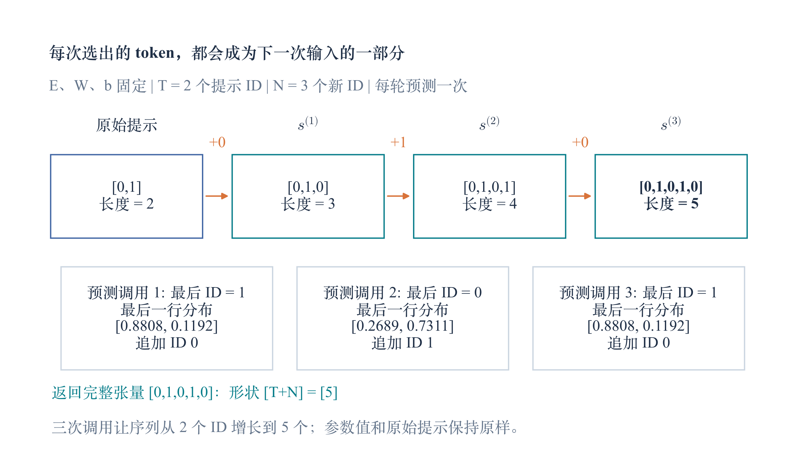{width=100%}

**图 03.14-1——从左到右读上方方框。** 每个箭头追加一个选中的 ID；`+0` 表示追加 ID 零，不是给已有元素加数值零。下方卡片给出对应的最后行分布。三次调用把长度从二增加到五，所有调用都使用相同参数值。

### 新语法：复制与拼接 ID 张量

`generated_ids = context_ids.clone()` 生成独立的张量副本。普通赋值 `generated_ids = context_ids` 只是给同一个张量增加名字。虽然后续拼接会创建新存储，先复制仍能保证零预算时的返回独立。这些整数 ID 没有梯度图；这里的复制不是梯度分离操作。[Clone 文档](https://docs.pytorch.org/docs/2.0/generated/torch.clone.html)。

辅助函数返回元组的第一项是 Python 整数。要把它拼接到一维 ID 序列，需要先创建长度为一的一维张量：

```python
torch.tensor([next_token_id], dtype=generated_ids.dtype,
             device=generated_ids.device)
```

`[next_token_id]` 的方括号很关键：它给出形状 `[1]`。如果直接用一个整数，会得到形状 `[]` 的标量张量。`dtype` 是张量数值类型，这里为 `torch.long`；`device` 表示张量存储在哪里。保持二者相同，让新 ID 与当前序列相容。

`torch.cat((generated_ids, next_id_tensor), dim=0)` 沿已有序列轴拼接两个张量。里面的元组提供两个张量；`dim=0` 是这些一维序列唯一的轴。第一轮把 `[0,1]` 与 `[0]` 拼成 `[0,1,0]`。把返回的新张量重新保存到 `generated_ids`：`cat` 不会原地延长原张量。加法会加数值，stacking 会创建新轴。[拼接文档](https://docs.pytorch.org/docs/2.0/generated/torch.cat.html)。

 `predict_next_token` 已经把整个前向放在 no-grad 中。这个外层函数只处理整数序列并调用它。生成时不清除已有梯度、不调用 backward、不更新参数。之后的训练调用仍自行控制梯度清除。

### 七个实现指导

看完公式和完整过程，再打开 `03_14_autoregressive_generation.py`；只替换 `generate_token_ids` 的占位行。

1. **复制提示。** 四空格处用 `context_ids.clone()` 初始化 `generated_ids`。本例为 `[0,1]`，形状 `[2]`；这也定义了零预算结果。
2. **计数新 token。** 四空格处写遍历 `range(num_new_tokens)` 的 `for` 循环。冒号开启八空格缩进的循环体，步骤 3–6 放在里面。`range(3)` 给出 `0,1,2`；`range(0)` 不执行任何一轮。
3. **用当前序列预测。** 八空格处调用 `predict_next_token`，按顺序传入 `embedding_table`、`generated_ids`、`output_weights`、`output_bias`，保存为 `prediction_result`。第二个参数每轮都会变化。
4. **取选中的 ID。** 八空格处将 `prediction_result[0]` 保存为 `next_token_id`。辅助函数返回 `(ID, probabilities)`，下标 `0` 取 Python 整数，本例依次是 `0`、`1`、`0`。
5. **把一个 ID 包成张量。** 八空格处用 `torch.tensor` 从 `[next_token_id]` 创建 `next_id_tensor`，指定 `dtype=generated_ids.dtype`、`device=generated_ids.device`。形状 `[1]`，第一次为 `[0]`。
6. **追加并保存结果。** 八空格处用 `torch.cat((generated_ids, next_id_tensor), dim=0)` 拼接两者，把结果重新赋给 `generated_ids`。第一次新形状是 `[3]`。
7. **循环后返回。** 退回四空格，返回 `generated_ids`。三轮得到总共五个 ID；零轮返回复制的提示。如果返回写在循环体内，只会生成第一个 token 就结束。

保留设置和检查程序。学生写生成循环，解码器加载与文本检查已提供。在已有环境中，从项目根目录运行：

```bash
python exercises/03_14_autoregressive_generation.py
```

实现后的预期输出：

```text
PASS: worked trace, full prompt-plus-continuation tensor, and original prompt preservation
PASS: zero/one/multiple-token budgets, varied shapes, repeated IDs, and noncontiguous prompts
PASS: exactly one completed-helper call per new token with the full growing prefix
PASS: fixed parameters, stored gradient objects/values, trainability, and caller mode
PASS: vocabulary IDs above 255 remain IDs and decode through the matching byte vocabulary
PASS: repeatable independent outputs, continued calls, and accumulated UTF-8 decoding
PASS: completed training -> fixed-parameter generation -> matching decoder: abababa
Lesson 03.14 checks passed.
```

### 将积累的 ID 接到解码器

生成函数返回 ID。调用者使用 `generated_ids.tolist()` 得到 [02.06 解码器](#section-02-06) 要求的 Python 列表，并提供与模型 ID 对应的词表。查出各 token 的字节内容，按顺序拼接，然后解码整体字节。不能假定每个 token 都是一个字节，也不能对所有 ID 直接调用 `bytes([ID])`。

提供的合并 ID 例子使用示意词表，其中 `vocab[256]=b"ab"`。ID `[97,256,256]` 解码为 `aabab`：三个 token、五个 ASCII 字符。它单独检查大于 255 的 ID 是否保留，与下面训练过的原始字节例子分开。

原始字节词表中，`中` 对应 `[228,184,173]`，十六进制为 `E4 B8 AD`。`[228,184]` 是不完整前缀，严格解码会抛出 `UnicodeDecodeError`；补上 `173`，整体才解码成一个字符。预算计数的是 token，可能停在字符中间。保留积累的 ID；安全的字节流式显示以及未完成输出的处理策略留到后续。不要悄悄改变严格解码器，也不要认为所有生成字节序列都一定是有效 UTF-8。

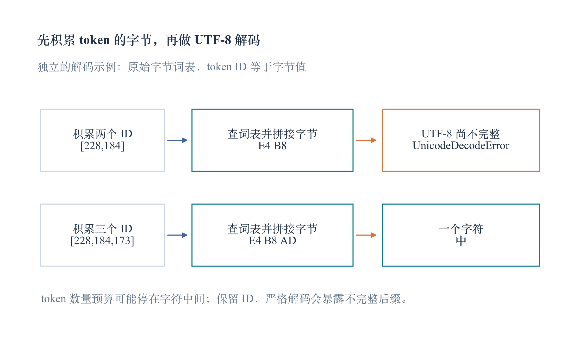{width=100%}

**图 03.14-2——沿每行从 ID 读到拼接字节，再读到文字。** 这是独立解码示例，不代表模型会生成中文。上行暴露不完整后缀；下行给出 `中` 的完整编码。十进制 ID 与十六进制字节表示相同数值。

### 已验证的训练到生成示例及其范围

| 项目 | 可移植说明 |
| --- | --- |
| 已完成训练／推理辅助函数代码 | 03.12–03.14 配套接口 |
| 数据／分词器版本 | `synthetic-byte-aba-v1` / `utf8-byte-256-v1` |
| 训练对 | 输入 `[97,98]`，目标 `[98,97]`：$\texttt{a}\to\texttt{b}$、$\texttt{b}\to\texttt{a}$ |
| 形状／初始化 | $V=256,D=2,T=2$；表全零，只有行 97 为 `[1,2]`、行 98 为 `[3,1]`；权重与偏置全零 |
| 训练预算 | 普通梯度下降，学习率 `0.1`，更新 100 次，使用 200 个监督位置 |
| 评估协议 | 复用同样数据的合成验证；提示 `[97]`，六次贪心预测，参数固定 |
| 返回 ID／解码文字 | `[97,98,97,98,97,98,97]` / `abababa` |

[03.13 的记录](#section-03-13) 保留此初始化和预算下的平均损失、目标概率测量。本续写验证训练 → 预测 → 生成 → 解码的连接。它展示了在重复使用的合成数据上学到的两条字节转移关系，不是独立测试集上的语言能力证据。不保存权重或原始执行日志。

### 阅读问答与下一步

**一次调用会预测三个 token 吗？** 每次辅助函数只选择一个。三轮循环调用三次，本例预测前提示长度依次为二、三、四。

**不断生成会教会模型吗？** 它增长输入序列，参数、已有梯度与可训练标记都固定。训练使用真实目标与损失来改变参数。

**为什么连提示一起返回？** 完整序列方便继续调用和解码。如果只想要新 ID，调用者可以取 `generated_ids[context_ids.numel():]`；本作业仍返回完整张量。

**为什么示例反复重复？** 这个小模型学习当前 token 的转移关系，并使用确定性的贪心选择。它还没有结合更早上下文的注意力；改变选择策略与改进模型／数据，会改变流程的不同部分。

**为什么学生张量名与函数名相同，外部调用仍能运行？** 赋值在函数内部绑定这个局部名称；模块层面的同名仍指向函数，所以外部调用者仍能正常调用。本循环不需要递归调用。使用 `generated_ids` 等不同局部名字能更清楚地表达张量角色，但保留这份合法实现。

[03.15](#section-03-15) 介绍另一种选择 token 的方式：先用温度调整分布，再按分布采样。[03.16](#section-03-16) 把这个选择接入当前生成循环，03.17 的 EOS 停止与 03.18 的续写解码再完成输出通路。[03.19](#section-03-19) 随后回到训练，让一批包含多个窗口；[03.20](#section-03-20) 让批次维度贯穿分数与损失。

## 03.15 温度与采样 {#section-03-15}

每次选概率最大的 token，只是使用分布的一种方式。温度改变分布有多集中，采样再按概率抽出一个 ID。本节把这两个动作分开理解，让随机性从哪里来、怎样延续，都有清楚的含义。

先走完下面的小例子，再对照 03_15_temperature_and_sampling.py 动手。编号步骤会说明函数接口，并引导核心实现；初始化和检查驱动由配套文件提供。

### 阶段 A 的输入、符号与输出

| 名称／符号 | 类型／形状 | 含义 |
| --- | --- | --- |
| `logits`，$Z$ | 浮点张量 `[T,V]` | 每个位置各候选项的分数 |
| `temperature`，$\tau$ | 正的有限 Python 浮点数 | 在 softmax 前应用的缩放量 |
| `scaled_logits` | 浮点张量 `[T,V]` | 分数除以温度的结果 |
| `probabilities`，$P^{(\tau)}$ | 返回的浮点张量 `[T,V]` | 每行归一化的候选分布 |

$T$ 仍表示位置数量，$V$ 表示词表候选数量。用 $\tau$ 表示温度，避免与 $T$ 混淆。假定 $T,V>0$、logits 有限、缩放后分数有限；输入校验不是学生任务。保留输入值、dtype／device、已有梯度，以及自动求导连接，与 03.09 数学函数一致。之后由推理调用者控制 no-grad 范围。

### 温度在归一化之前缩放 logits

$$
P^{(\tau)}_{t,v}=
\frac{\exp(Z_{t,v}/\tau)}{\sum_{j=0}^{V-1}\exp(Z_{t,j}/\tau)},\qquad \tau>0
$$

先计算 `scaled_logits = logits / temperature`，再复用 `softmax_probabilities`。辅助函数已经在求指数前减去每个缩放行的最大值。**在 softmax 前除 logits**，不是在 softmax 后除概率：分母必须对调整后的指数分数重新归一化。

两个候选项的相对概率解释了温度的作用：

$$
\frac{P^{(\tau)}_{t,a}}{P^{(\tau)}_{t,b}}
=\exp\!\left(\frac{Z_{t,a}-Z_{t,b}}{\tau}\right)
$$

分数差为正时，较小 $\tau$ 放大差距，使概率更集中于高分项；较大 $\tau$ 缩小相对差距，让分布更平坦。$\tau=1$ 时恢复原 softmax。在精确算术中，除以正数保留分数排序，因此贪心 argmax 的获胜项与并列关系不变。采样策略使用调整后的分布时，温度才会影响选择频率；温度本身不会把 argmax 变成采样。

$\tau$ 从正数趋近零时，概率集中在最大分数上；若最大值唯一，其极限概率为一，若多个最大值相等，它们分享极限概率质量。$\tau$ 无限增大时，有限分数的候选概率趋近均等的 $1/V$。这是数学极限，不是可以直接除以零的理由。本作业只接受严格正温度；以后调用者可以把温度零定义为单独的贪心分支。极端缩放下，浮点舍入可能产生零概率或并列。

### 完整的温度手算

用人为选定的两位置张量 `logits=[[3,1],[1,3]]`，其中 $T=2,V=2$。这是算术输入，不是训练结果。令 `temperature=0.5`：

```text
scaled_logits = [[6,2],[2,6]]
row_max = [[6],[6]]
shifted_logits = [[0,-4],[-4,0]]
exp_scores = [[1,0.0183156389],[0.0183156389,1]]
row_sums = [[1.0183156389],[1.0183156389]]
probabilities = [[0.9820137900,0.0179862100],
                 [0.0179862100,0.9820137900]]
```

第一行候选零的概率为：

$$
p_0^{(\tau)}=\frac{e^{3/\tau}}{e^{3/\tau}+e^{1/\tau}}
=\frac{1}{1+e^{-2/\tau}}
$$

| 温度 | 第一行缩放分数 | ID 0 概率 | ID 1 概率 | 贪心 ID |
| --- | --- | --- | --- | --- |
| `0.5` | `[6,2]` | `0.9820137900` | `0.0179862100` | `0` |
| `1` | `[3,1]` | `0.8807970780` | `0.1192029220` | `0` |
| `2` | `[1.5,0.5]` | `0.7310585786` | `0.2689414214` | `0` |

第二行把这些概率交换，在三个设置下都偏好 ID `1`。返回所有位置的行，形状 `[2,2]`，之后由推理调用者选择最后一行。较低温度不会训练出不同参数，较高温度也不保证文字质量更好。

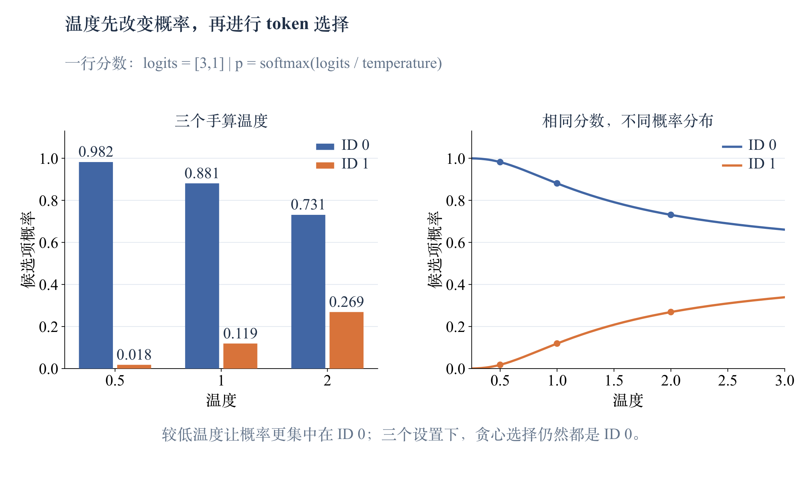{width=100%}

**图 03.15-1——横轴是温度，纵轴是概率。** 蓝色为候选 ID 零，橙色为 ID 一。柱子给出表中三个设置，曲线标记相同数值。分数 `[3,1]` 固定，蓝色一直更高，因此单独使用 argmax 始终选 ID 零。

可选自动求导复习：求导时温度固定。链式法则给出 $\partial P_{t,a}/\partial Z_{t,b}=(1/\tau)P_{t,a}(\delta_{ab}-P_{t,b})$，其中下标相等时 $\delta_{ab}$ 为一，否则为零。提供的检查用此解析导数验证阶段 A 保留连接。数学概率函数保留图，推理外层则像 03.13 那样把整个前向放入 no-grad。

### 阶段 B：从一行概率中采样一个 ID

`sample_token_id(probabilities, generator)` 接收浮点张量 `[V]`，表示一行归一化候选分布，以及调用者提供的 `torch.Generator`。假定元素有限、非负、和为正，并且在支持的后端上与生成器 device 相容。返回 `[0,V)` 中的一个 Python 整数。保留概率值／存储／可训练标记／已有梯度，以及调用者梯度模式。提供的生成器状态会随着抽取前进，全局随机流保持不变。

令 $X$ 表示采样出的 token ID。符号 $\sim$ 表示“从某分布抽取”；类别分布（categorical distribution）$\operatorname{Categorical}(p)$ 以 $p_v$ 为各 ID 的概率：

$$
X\sim\operatorname{Categorical}(p),\qquad
\Pr(X=v)=p_v
$$

用独立的三个候选项例子 `probabilities=[0.6,0.3,0.1]` 比较贪心与采样。贪心每次都选择 ID `0`；采样则以 `0.6`、`0.3`、`0.1` 的概率选择 ID `0`、`1`、`2`。概率较大表示机会较大，不表示必然。相邻抽样可以重复，一次抽样也不能估计频率。

完整的概率示意把单位区间划分为：

| 假设均匀随机数 $u$ 所在区域 | 选择 ID | 区域长度 |
| --- | --- | --- |
| $0\le u<0.6$ | `0` | `0.6` |
| $0.6\le u<0.9$ | `1` | `0.3` |
| $0.9\le u<1$ | `2` | `0.1` |

因此 $u=0.2$ 示意选 ID `0`，$u=0.75$ 选 ID `1`，$u=0.95$ 选 ID `2`。ID 一的例子展示了合法采样结果可以不是 argmax。这些数值解释分布，并不声称 PyTorch 照图实现，也不声称某个种子产生这些具体随机数。

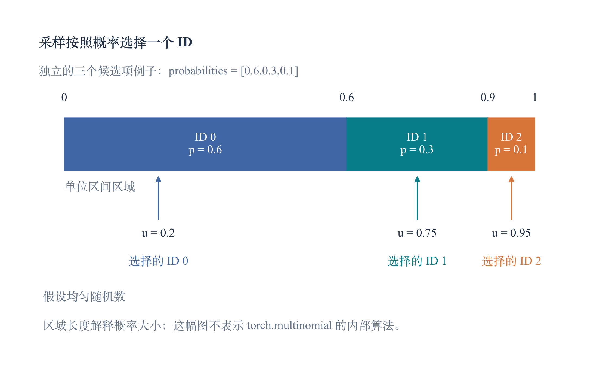{width=100%}

**图 03.15-2——区域宽度等于候选概率。** 箭头标出三个区域中的三个假设抽样。这是独立的 `[3]` 概率例子，与两个候选项的温度计算分开。

使用 `torch.multinomial(probabilities, num_samples=1, generator=generator)`。输入 `[V]` 时，它返回包含抽中**下标**的 `[1]` 整数张量。`.item()` 将该下标提取为 Python 整数。通用 API 也接受未归一化的非负权重，本作业提供归一化概率。即使默认 `replacement=False`，每次调用抽一个也不会禁止之后调用再次抽到同一 ID；该选项约束的是一次调用内部的多次抽取。[Multinomial 文档](https://docs.pytorch.org/docs/2.0/generated/torch.multinomial.html)。

### 设置一次种子，之后复用随机流

生成器保存伪随机状态。提供的设置创建它，并调用一次 `.manual_seed(seed)`；之后每次采样使用持续前进的随机流。传入 `generator=generator` 指定这个流。不要在 `sample_token_id` 中重新设种子、创建替代生成器，或改变全局随机性。[Generator 文档](https://docs.pytorch.org/docs/2.0/generated/torch.Generator.html)。

两个生成器具有相同初始状态、输入、调用顺序和相容运行环境时，可以复现一个流。持续使用同一个生成器，不表示每次结果都不同；每次重设种子则会重新开始随机流。不同库版本或后端之间不承诺完全相同的具体抽样序列。检查在当前运行环境中与参考操作比较，并单独观察多次抽样的频率，允许有限样本偏差。

### 实现计划：两个小阶段

所有核心语句使用四空格缩进。两个辅助函数都不需要循环，重复属于生成流程。保留提供的加载与检查程序。

1. **A1——缩放分数。** 在 `temperature_probabilities` 中将 `logits` 除以 `temperature`，保存为 `scaled_logits`。形状仍为 `[T,V]`；温度 `0.5` 时例子变成 `[[6,2],[2,6]]`。使用新结果，保留原输入。
2. **A2——复用归一化。** 调用 `softmax_probabilities(scaled_logits)`，保存为 `probabilities`。已加载的完成函数处理稳定逐行归一化，第一行约为 `[0.9820,0.0180]`。
3. **A3——返回张量。** 返回 `probabilities`，保留图、dtype／device 和 `[T,V]` 形状。这个数学函数中不使用 `.item()` 或 no-grad。先检查阶段 A，再继续。
4. **B1——抽一个候选项。** 在 `sample_token_id` 中调用 `torch.multinomial`，传入 `probabilities`、`num_samples=1` 和 `generator=generator`，保存为 `sampled_ids`。形状 `[1]`，按概率选择，不用 argmax。
5. **B2——提取 ID。** 用 `sampled_ids.item()` 得到 `next_token_id`，这是 Python 整数。它是下标，不是被选中的概率值。
6. **B3——返回整数。** 返回 `next_token_id`。概率输入固定，提供的随机流前进。不要在函数内设置种子。

在已有环境中，从项目根目录依次运行：

```bash
python exercises/03_15_temperature_and_sampling.py --check temperature
python exercises/03_15_temperature_and_sampling.py --check sample
python exercises/03_15_temperature_and_sampling.py --check all
```

单独命令分别以 `Lesson 03.15 temperature checks passed.` 和 `Lesson 03.15 sample checks passed.` 结束。两个阶段都实现后，完整输出为：

```text
PASS: temperature worked example, row-wise normalization, and unchanged greedy ordering
PASS: positive temperatures, extreme/tied scores, varied shapes/dtypes, and shift invariance
PASS: completed stable helper reused with connected analytic gradients and preserved inputs/buffers
PASS: Python ID return, zero-probability exclusion, merged IDs, and input/gradient/mode preservation
PASS: supplied random stream matches one categorical draw per call without global RNG changes
PASS: reproducible caller-seeded streams and many-draw frequencies consistent with probabilities
PASS: fixed-parameter logits -> temperature -> last row -> sampling -> growing-prefix pipeline
Lesson 03.15 checks passed.
```

### 连接与阅读问答

最后提供的检查使用人为选定的 `E=[[1,2],[3,1]]`、二乘二的单位矩阵（identity matrix）$W$（主对角线为一，其余位置为零）、零 `b`、提示 `[0,1]`、温度 `2`、六个新 ID，以及生成器种子 `137`。调用者将查表／投影／温度计算放在 no-grad 中，选择最后一行概率，采样一个 ID，再追加。结果匹配参考随机流，产生总共八个 ID，并保留参数。原贪心预测和生成循环保持原样； [03.16](#section-03-16) 接起采样生成，再由 03.17 控制 EOS 停止、03.18 解码新增内容。

**为什么不把概率除以温度？** 那没有实现指数分数缩放，也不能单靠这一步保持概率和为一。温度在 softmax 前起作用。

**采样能选到零概率 token 吗？** 不能。较小的正概率可能被选中，零概率不会。大于 255 的合并 token ID 仍是词表下标。

**随机选择就是均匀选择吗？** 均匀抽样给各项相同机会，这里机会跟随提供的概率。较高温度让分布更平坦，但有限温度采样通常不等于均匀抽样。

**这会改善模型知道的知识吗？** 参数固定。选择策略改变如何使用一个分布；上下文结构、数据和训练决定模型行为的其他部分。

## 03.16 采样式自回归生成 {#section-03-16}

现在，把生成循环中的贪心选择换成采样选择。序列递推还是熟悉的那个过程，但随机数流要在步骤之间持续使用。随着提示变长，张量的类型和设备也必须始终一致。

先走完下面的小例子，再对照 03_16_sampled_generation.py 动手。编号步骤会说明函数接口，并引导核心实现；初始化和检查驱动由配套文件提供。

### 准确输入与返回值

| 名称 | 类型／形状 | 含义 |
| --- | --- | --- |
| `embedding_table`，$E$ | 浮点张量 `[V,D]` | 固定的 token 向量 |
| `context_ids`，$x$ | `torch.long` 张量 `[T]` | 原始非空提示 |
| `output_weights`，$W$ | 浮点张量 `[D,V]` | 固定的词表投影 |
| `output_bias`，$b$ | 浮点张量 `[V]` | 固定的候选偏置 |
| `num_new_tokens`，$N$ | Python 整数 $N\ge0$ | 恰好追加多少个新 ID |
| `temperature`，$\tau$ | 正的有限 Python 浮点数 | softmax 前的 logits 缩放量 |
| `generator` | 调用者提供的 `torch.Generator` | 已设置种子的伪随机流 |
| `generated_ids` | 返回的 `torch.long` 张量 `[T+N]` | 提示加采样续写 |

$T$ 是提示长度，$V$ 是词表大小，$D$ 是向量维度。假定 ID 有效、形状／dtype／device 与生成器支持情况相容，logits 与缩放后 logits 有限；输入校验不是学生任务。返回与提示 device 相同、存储独立的完整 ID 张量，包含原提示。保留原提示值，以及参数值／存储／可训练标记／已有梯度、调用者梯度模式和全局随机流。每生成一个新 ID，提供的生成器随着一次已完成采样函数调用向前推进。

$N=0$ 时返回提示的独立副本，不调用投影、温度或采样函数，也不消耗生成器状态。本课使用正温度公式，不增加零温度分支、EOS 停止或上下文截断。调用者仍用对应分词器词表解码 ID。

### 在递推中加入采样

令 $s^{(k)}$ 为生成 $k$ 个 ID 后的完整序列，满足 $s^{(0)}=x$ 和 $|s^{(k)}|=T+k$。每轮 $k=0,\ldots,N-1$：

$$
H^{(k)}=E[s^{(k)}],\qquad Z^{(k)}=H^{(k)}W+b
$$

温度函数对每个位置分别归一化词表列：

$$
P^{(k)}_{t,v}=\frac{\exp(Z^{(k)}_{t,v}/\tau)}
{\sum_{j=0}^{V-1}\exp(Z^{(k)}_{t,j}/\tau)},\qquad
p^{(k)}=P^{(k)}[T+k-1,:]
$$

采样一个 ID，再把输出反馈到下一次输入：

$$
v_k\sim\operatorname{Categorical}(p^{(k)}),\qquad
s^{(k+1)}=\operatorname{concat}(s^{(k)},[v_k])
$$

返回 $s^{(N)}$，长度为 $T+N$。ID 序列与随机流状态变化；$E,W,b$ 和温度保持固定。持续传入同一个生成器，不在每轮重设。

`compute_logits` 返回 `[T+k,V]`，`temperature_probabilities` 保留该形状；`probabilities[-1]` 将其降为 `[V]`；`sample_token_id` 返回 Python 整数。再用 `[1]` 整数张量扩展一维 ID 序列。每轮只选择一个 token，三个新 token 需要三个完整循环。

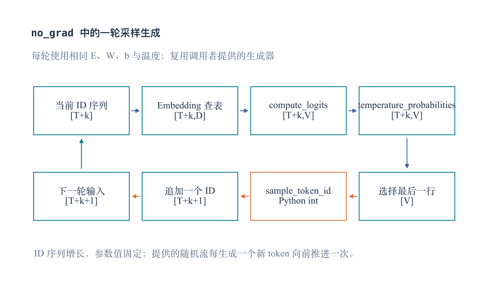{width=100%}

**图 03.16-1——上行向右读，再沿下行向左读。** 左边向上箭头进入下一轮，此时下标为 $k+1$，长度就是上一轮的 $T+k+1$。只对最后一个分布采样，橙色标出 ID 选择，整个过程参数值固定。

当前查表加输出投影模型的下一个分布仍只使用最后输入 ID。传入增长的完整前缀建立接口，依赖上下文的注意力留到后续。随机输出本身不会增加上下文理解或训练出新知识。

### 使用假设选择的完整例子

继续使用 03.13 中人为选定、便于手算的模型：

$$
E=\begin{bmatrix}1&2\\3&1\end{bmatrix},\quad
W=\begin{bmatrix}1&0\\0&1\end{bmatrix},\quad b=[0,0],\quad
x=[0,1],\quad T=2,\quad \tau=2,\quad N=3
$$

第一次前向得到 `selected_vectors=[[1,2],[3,1]]`；因为 $W$ 为单位矩阵、`b` 为零，logits 与这些向量的数值相同。温度缩放得到 `[[0.5,1],[1.5,0.5]]`。最后一行减去 `1.5`，得到 `[0,-1]`；指数 $[1,e^{-1}]$ 归一化为：

$$
p^{(0)}\approx[0.7310585786,0.2689414214]
$$

用单位区间的示意随机数 $u=0.2$，选择 ID `0` 并追加，得到 `[0,1,0]`。下一轮最后 ID 是零，该行分数变为 `[1,2]`；缩放并稳定减最大值后为 `[-0.5,0]`，指数为 $[e^{-0.5},1]$：

$$
p^{(1)}\approx[0.3775406688,0.6224593312]
$$

示意 $u=0.3$ 小于第一段累计边界 `0.3775`，所以再次选择 ID `0`，尽管 ID `1` 概率更大。序列变成 `[0,1,0,0]`。最后 ID 相同，下次分布不变，示意 $u=0.8$ 则选 ID `1`。

| 调用 | 当前序列 | 最后一行概率，约为 | 示意 $u$ | 采样 ID | 延长后序列 |
| --- | --- | --- | --- | --- | --- |
| `1` | `[0,1]` | `[0.7311,0.2689]` | `0.2` | `0` | `[0,1,0]` |
| `2` | `[0,1,0]` | `[0.3775,0.6225]` | `0.3` | `0` | `[0,1,0,0]` |
| `3` | `[0,1,0,0]` | `[0.3775,0.6225]` | `0.8` | `1` | `[0,1,0,0,1]` |

**对这些假设选择**，返回 `tensor([0,1,0,0,1])`，形状 `[5]`。它们解释递推与合法的非贪心选择，不是承诺的 PyTorch 种子抽样记录，也不代表内部算法。真实采样器使用调用者的生成器；提供的检查单独把真实抽样和最终生成器状态与同运行环境参考比较。

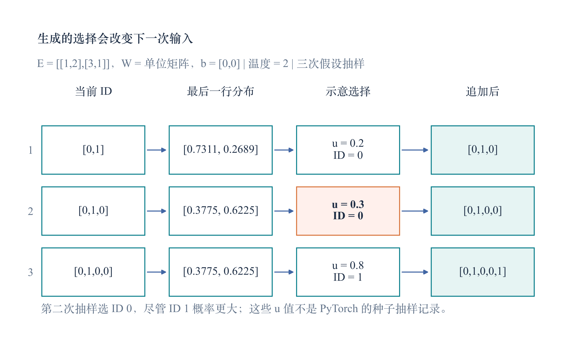{width=100%}

**图 03.16-2——每行最右边序列成为下一行输入。** 橙色第二次选择合法，因为 ID 零有正概率。它改变下一次输入，从而改变下一次使用的分数。本模型的贪心路径会返回 `[0,1,0,1,0]`，两条路径第三次调用的输入不同。

### 完整 no-grad 范围与嵌套缩进

03.15 的数学温度函数在正常使用时保留自动求导。这里的生成调用者把整个查表／投影／温度计算放在 `torch.no_grad()` 下。它不会永久改变参数标记、清除梯度或更新权重。上下文结束后恢复调用者之前的梯度模式。[No-grad 文档](https://docs.pytorch.org/docs/2.0/generated/torch.no_grad.html)。

有两层嵌套：no-grad 上下文里包含循环，循环里包含每轮操作。每层增加四个空格：

| 缩进 | 位置 | 语句 |
| --- | --- | --- |
| 四空格 | 函数体 | 复制提示、进入 no-grad、最终返回 |
| 八空格 | no-grad 内 | `for step in range(num_new_tokens):` |
| 十二空格 | 上下文与循环内 | 查表、分数、概率、最后行、采样、创建张量、追加 |

`with` 的冒号开启临时梯度上下文，`for` 的冒号开启重复执行的循环体。四空格处、两个块之后返回。返回放在循环内会在第一个 token 后结束；只在最后分离结果、前向仍保持跟踪，则依然会构建多余的中间图。

### 十个实现步骤

完成 03.15 并看完公式、完整过程后再做。只替换 `generate_sampled_ids` 的核心占位，保留设置、检查与此前实现。

1. **复制提示。** 四空格：用 `context_ids.clone()` 初始化 `generated_ids`。本例形状 `[2]`、值 `[0,1]`，也处理零预算结果。
2. **进入推理范围。** 四空格：写 `with torch.no_grad():`，所有循环都放在此上下文中。
3. **计数新生成的 ID。** 八空格：遍历 `range(num_new_tokens)`。步骤 4–9 使用十二空格，位于两个块之内。三个新 token 的计数依次为 `0,1,2`。
4. **查出当前序列向量。** 十二空格：用 `embedding_table[generated_ids]` 得到 `selected_vectors`。本例形状依次为 `[2,2]`、`[3,2]`、`[4,2]`。
5. **计算分数。** 十二空格：调用 `compute_logits(selected_vectors, output_weights, output_bias)`，保存为 `logits`。形状 `[T+k,V]`，第一次最后一行是 `[3,1]`。
6. **应用提供的温度。** 十二空格：调用 `temperature_probabilities(logits, temperature)`，保存为 `probabilities`。复用完成函数，第一次最后一行约为 `[0.7311,0.2689]`。
7. **选择下一个分布。** 十二空格：将 `probabilities[-1]` 保存为 `next_probabilities`，形状 `[V]`。
8. **采样一个 ID。** 十二空格：调用 `sample_token_id(next_probabilities, generator)`，保存为 `next_token_id`。每次传入相同生成器，不重设种子或替换它。
9. **包成张量并追加。** 十二空格：用 `torch.tensor([next_token_id], dtype=generated_ids.dtype, device=generated_ids.device)` 创建 `next_id_tensor`。再用 `torch.cat((generated_ids, next_id_tensor), dim=0)` 拼接，把新张量重新赋给 `generated_ids`。第一次延长后形状 `[3]`。
10. **退出两个块后返回。** 四空格：返回 `generated_ids`，形状 `[T+N]`。示意选择得到 `[0,1,0,0,1]`，零预算得到独立的 `[0,1]`，没有辅助函数调用或随机抽取。

生成器由调用者提供且已设置种子，相邻抽样可以重复。用相同生成器状态和返回序列继续生成，在初始状态、输入、策略和运行环境相容时，应与一次更长调用一致。每轮重新设置种子会重启随机流。[Generator 文档](https://docs.pytorch.org/docs/2.0/generated/torch.Generator.html)。

完成本次公式／例子讲解并实现后，从项目根目录运行：

```bash
python exercises/03_16_sampled_generation.py
```

实现后的预期输出：

```text
PASS: worked recurrence with scripted valid choices, including a non-greedy selection
PASS: positive temperatures, exact budgets, varied shapes/prompts, and reference random streams
PASS: completed helpers reused once per token in order under full no-grad with growing prefixes
PASS: fixed parameters, stored gradients, original prompts, global RNG, and caller-mode preservation
PASS: zero budget returns an independent prompt without forward calls or random-state consumption
PASS: same-state replay and continued calls agree with one longer call while outputs stay independent
PASS: single-candidate generation and merged IDs decoded through the matching vocabulary
Lesson 03.16 checks passed.
```

### 阅读问答

**为什么不调用贪心预测函数？** 它的选择规则是 argmax。这个外层需要分数与温度函数，再接采样函数；保留先前的贪心路径。

**一次采样函数调用会返回所有未来 token 吗？** 它只选择一个 ID。生成循环恰好调用 $N$ 次，每次增长一次前缀。

**调用者的种子会指定上面的假设 u 值吗？** 不会，那些数字用于解释合法选择。真实抽样记录取决于生成器状态、输入、调用顺序和运行环境；检查采用相容参考，不承诺跨版本固定列表。

**怎样把结果显示成文字？** 对积累 ID 使用对应字节词表与 [02.06 解码器](#section-02-06)。提供的示意合并词表将 ID `256` 映射为 `b"ab"`，ID `[97,256,256]` 解码成 `aabab`。token 可以跨多个字节，token 预算也可能停在 UTF-8 字符内部，严格解码行为保持原样。


本循环总会用完要求的 token 预算。[03.17](#section-03-17) 将改变这条规则：新采样出的 EOS 可以让生成提前结束；即使 EOS 始终不出现，最大新 token 上限仍会限制工作量。


## 03.17 结束标记与生成停止 {#section-03-17}

生成循环还要回答一个实际问题：什么时候结束？新 token 的预算限制最多做多少工作，新生成的 EOS 则可能让它提前停下。本节把这两种条件写清楚，并保留那个说明停止原因的标记。

先走完下面的小例子，再对照 03_17_generation_stopping.py 动手。编号步骤会说明函数接口，并引导核心实现；初始化和检查驱动由配套文件提供。

### 输入、输出与本课约定

| 准确名称 | 类型／形状 | 含义 |
| --- | --- | --- |
| `embedding_table` | 浮点张量 `[V,D]` | 固定的 token 向量 |
| `context_ids` | `torch.long` 张量 `[T]` | 原始非空提示 |
| `output_weights` | 浮点张量 `[D,V]` | 固定的词表投影 |
| `output_bias` | 浮点张量 `[V]` | 固定的候选偏置 |
| `max_new_tokens` | Python 整数 $M\ge0$ | 最多追加多少个新 ID |
| `temperature` | 正的有限 Python 浮点数 | 传给 03.16 的采样温度 |
| `generator` | 调用者提供的 `torch.Generator` | 持续使用的随机流 |
| `eos_token_id` | `[0,V)` 中 Python 整数，或 `None` | 配置的停止标记，或关闭此停止规则 |

假定 ID 有效、形状／dtype／device／生成器相容，分数与缩放后分数有限。不要求练习实现输入校验。返回 `(generated_ids, stop_reason)`：

- `generated_ids`：存储独立的 `torch.long` 张量 `[T+L]`，包含原提示和生成出的 EOS，其中 $0\le L\le M$。
- `stop_reason`：新生成的 EOS 结束循环时为 Python 字符串 `"eos"`，否则最大预算耗尽时为 `"length"`。

保留原提示值、参数值／存储／可训练标记／已有梯度、调用者梯度模式和全局随机性。每次单 token 函数调用持续传入同一个生成器。EOS 追加后立即停止，不再多抽一次。零预算返回独立提示副本与 `"length"`，辅助函数调用为零，生成器状态不变。

只有**新生成的** ID 触发本次请求的 EOS 停止。原提示中的 EOS，包括最后一个 ID，本身不结束这次新续写。这个明确约定把提示解释与新输出的停止分开。如果 EOS 恰好出现在最后允许的一次抽样，原因仍为 `"eos"`，即使同时用尽长度预算。

### 实际长度受两个停止事件限制

令 $v_0,v_1,\ldots$ 表示按同一个持续策略原本会采样的新 ID，$e$ 为配置的 EOS。定义第一个新 EOS 的位置，从一开始计数：

$$
K=\inf\{k+1\mid k\ge0,\;v_k=e\}
$$

这里 $\inf$ 表示选取满足条件的最小正位置。EOS 关闭（`None`）或没有新 EOS 时，取 $K=\infty$。给定最大预算 $M$：

$$
L=\min(M,K),\qquad |\mathrm{generated\_ids}|=T+L
$$

停止原因是：

$$
r=\begin{cases}
\text{eos},&K\le M\\
\text{length},&K>M
\end{cases}
$$

这里 $T$ 是原提示长度，$M$ 是最多生成的新 token 数，$L$ 是实际生成数量；如果 EOS 结束输出，它也计入 $L$。上限不计已有提示 token。零预算不抽任何新 ID，所以 $L=0$，原因是 `"length"`。

递推仍然先追加，再判断：

$$
s^{(k+1)}=\operatorname{concat}(s^{(k)},[v_k])
$$

这样保留返回 ID 中被选出的 EOS，使停止事件可检查。显示文字时，再由调用者单独处理控制标记。

### EOS ID 表示什么

EOS 是特殊控制 token，含义由分词器／模型协议定义，没有通用数字 ID，也不是 UTF-8 的结束字节。下面的小例子定义 `0 -> a`、`1 -> b`、`2 -> EOS`；这与原始字节词表中 ID `2` 表示字节值 `2` 不同。

对已有连续词表 $0,\ldots,V_{\mathrm{old}}-1$，一种扩展方式是保留此前未占用的 ID $V_{\mathrm{old}}$，将候选数增为 $V_{\mathrm{old}}+1$。Embedding 增加一行，输出头增加一列和一个偏置项，训练例子需要教会模型在目标序列边界之后输出 EOS。不能覆盖已存在的合并 token ID，也不能认为加入停止条件就教会了模型何时结束。

现有教学 BPE 字节字典还没有完整的特殊 token 序列化／分段策略。本作业明确提供示意 EOS 配置，通用分词器整合留到后续。解码器继续严格解码，由调用者先处理特殊标记，再提供普通 token 字节映射。

### 完整的小例子

使用人为选定的三候选模型，词表版本为 `illustrative-ab-eos-v1`：

$$
E=\begin{bmatrix}1&0\\0&1\\0&0\end{bmatrix},\quad
W=\begin{bmatrix}0&1000&0\\0&0&1000\end{bmatrix},\quad
b=[0,0,0],\quad x=[0],\quad M=5,\quad\tau=1,\quad e=2
$$

输入 ID 零查出向量 `[1,0]`。分数是 `[0,1000,0]`，稳定减最大值后得到 `[-1000,0,-1000]`。提供的 `float64` 计算中，极小指数下溢成零，概率为 `[0,1,0]`，第一次抽取 ID `1`。

输入 ID 一查出向量 `[0,1]`。分数为 `[0,0,1000]`，平移后为 `[-1000,-1000,0]`，计算概率为 `[0,0,1]`，选择 EOS ID `2`。这些计算得到的精确独热行强制出一条测试路径；数学上的极小指数仍为正数。参数不是声称训练得到的结果。

| 辅助函数调用 | 调用前提示 | 请求新 ID 数 | 新追加 ID | 完整序列 | 操作 |
| --- | --- | --- | --- | --- | --- |
| `1` | `[0]` | `1` | `1` | `[0,1]` | 新 ID 不是 EOS，继续 |
| `2` | `[0,1]` | `1` | `2` | `[0,1,2]` | 设置原因 `"eos"`，然后 break |
| `3–5` | — | — | — | — | 不调用 |

返回 `(tensor([0,1,2]), "eos")`。这里 $T=1$、$K=2$、$L=\min(5,2)=2$，完整长度为 `3`，包含 EOS ID。调用者分离最终标记后，普通显示 ID `[0,1]` 通过 `{0:b"a",1:b"b"}` 解码为 `ab`。

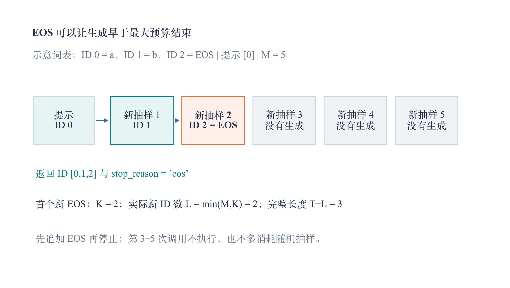{width=100%}

**图 03.17-1——数真正生成的方框，不数最大槽位。** 橙色是新追加 EOS，灰色槽位为未使用预算，不消耗函数调用或随机性。原提示还贡献一个返回 ID。

| 相同强制路径的设置 | 实际结果 | 原因 |
| --- | --- | --- |
| `max_new_tokens=0` | `[0]`，没有抽样 | `"length"` |
| `max_new_tokens=1` | `[0,1]` | `"length"` |
| `max_new_tokens=2` | `[0,1,2]` | `"eos"`，即使这是最后允许的一次 |
| `max_new_tokens=5` | `[0,1,2]` | `"eos"`，在预算耗尽前 |

`eos_token_id=None` 时关闭 EOS 停止，会使用完整预算。如果配置的标记始终没有新采样出来，也由长度上限结束。禁用 EOS 后，后续序列未必无限沿用前两个强制步骤，之后的抽样仍跟随模型分布。

### 实现前先讲新控制流语法

`None` 在这个函数的约定中表示 EOS 停止关闭。`eos_token_id is not None` 检查是否配置了 ID。不能替换成真假值判断：整数 EOS ID `0` 有效，但 `bool(0)` 是假。

`next_token_id == eos_token_id` 比较值，`=` 则用于赋值。`and` 要求两个条件都真，左边为假时会短路、不执行右边。`if condition:` 只在条件为真时执行缩进的代码块。停止条件就是：配置存在**且**新采样 ID 等于该 EOS。

`break` 立即退出最近的一层循环。随后继续执行循环后面的语句，最终返回放在那里；`break` 本身不会从函数返回。[Python break 参考](https://docs.python.org/3/reference/simple_stmts.html#the-break-statement)。

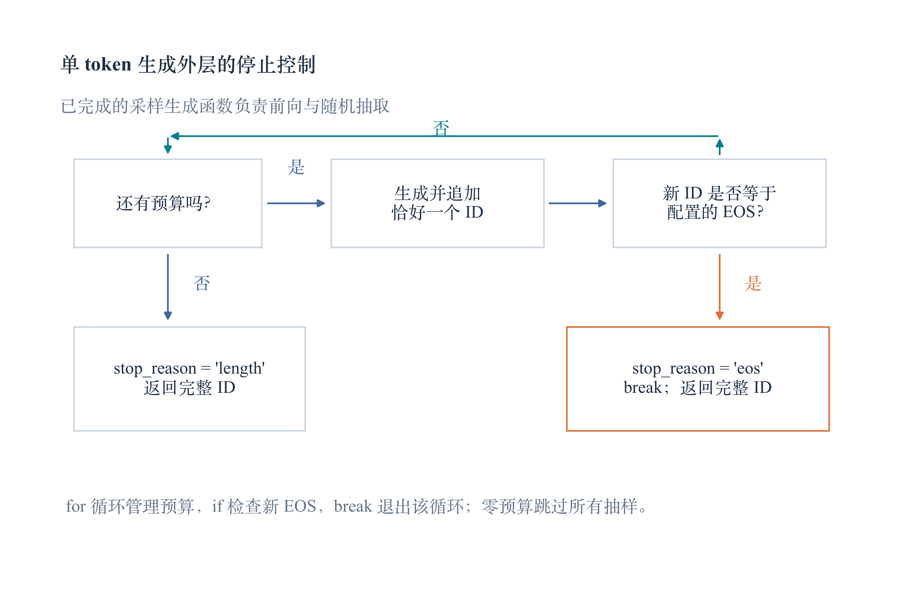{width=100%}

**图 03.17-2——预算和 EOS 控制不同位置。** `for` 已经管理最大次数，此图是概念图，不要求另外实现 while 循环。先生成并追加一个 ID，再检查新 EOS。成立则设置 `"eos"` 并 break，否则若预算剩余，就进行下一轮。

### generate_until_eos 的八个实现步骤

在 `03_17_generation_stopping.py` 中，使用上表输入实现 `generate_until_eos`。所有前向与采样仍由 `generate_sampled_ids` 处理。外层只做整数与控制操作，不需要单独更新参数、反向传播或清除梯度。复用辅助函数的 no-grad 范围即可，不必新增外层上下文。

1. **复制提示。** 四空格：用 `context_ids.clone()` 初始化 `generated_ids`。本例 `[0]`，形状 `[1]`，也定义独立的零预算返回。
2. **初始化默认原因。** 四空格：将 `stop_reason` 设置为 `"length"`。只有检测到 EOS 事件才替换它。
3. **在最大预算内循环。** 四空格：写 `for step in range(max_new_tokens):`，循环体用八空格。`range(5)` 允许五轮，而 `break` 可以在两轮之后提前结束。
4. **生成一个新 ID。** 八空格：按顺序传入 `embedding_table`、`generated_ids`、`output_weights`、`output_bias`、字面量 `1`、`temperature`、`generator`，调用 `generate_sampled_ids`。把完整返回张量重新保存为 `generated_ids`，第一次得到 `[0,1]`。字面量 `1` 是每次调用的新 token 数。
5. **取新追加 ID。** 八空格：将 `generated_ids[-1].item()` 保存为 `next_token_id`。先为 `1`，再为 `2`，是 Python 整数。
6. **判断停止条件。** 八空格：写 `if`，用 `and` 连接 `eos_token_id is not None` 与 `next_token_id == eos_token_id`。冒号开启十二空格缩进的代码块。
7. **记录 EOS 并退出循环。** 十二空格：将 `stop_reason` 设为 `"eos"`，随后同样十二空格处写 `break`。EOS 已经追加，不再调用生成函数。
8. **循环后返回。** 退回四空格：返回 `generated_ids, stop_reason`。本例为 `(tensor([0,1,2]), "eos")`，零预算则返回复制的提示与 `"length"`。

先完成并检查 03.16，因为本外层函数每生成一个新 ID，都要调用一次它的采样生成函数。保留提供的设置与检查，从项目根目录运行：

```bash
python exercises/03_17_generation_stopping.py
```

实现后的预期输出：

```text
PASS: worked EOS path, appended stop marker, two new IDs, and eos reason
PASS: zero/short/full budgets, disabled or absent EOS, and eos priority on the final allowed draw
PASS: completed generation helper reused for one new ID per growing-prefix call with no call after EOS
PASS: stochastic EOS-or-budget stopping matches a same-runtime reference and generator state
PASS: EOS ID zero is valid and only newly generated IDs trigger stopping
PASS: fresh returns, fixed parameters/gradients, caller/global RNG preservation, and zero-budget independence
PASS: caller separates the illustrative EOS control marker before matching-vocabulary byte decoding
Lesson 03.17 checks passed.
```

### 阅读问答

**为什么在返回 ID 中保留 EOS？** 它记录了哪个采样事件结束请求。调用者可以显示时移除特殊标记，同时保留原 ID 与原因用于检查。

**最大预算能保证 UTF-8 字符完整吗？** 不能，上限计数 token，普通 token 字节仍需要积累后严格解码。显示处理与安全的字节流式输出，继续与这两个停止规则分开。

**为什么不先生成全部 M 个，再从第一个 EOS 截断？** 那会在停止事件之后多消耗推理和随机抽样。本作业即时停止，保留实际 L 次抽样后的随机流位置。

**添加 if 就能教会模型 EOS 吗？** 不能，停止外层响应配置 ID。模型需要合适训练目标与对应特殊 token 协议，才能学会什么时候应该给该 ID 高概率。

停止规则确定产生了哪些 ID，以及循环为何结束。要只显示新增文字，[03.18](#section-03-18) 会排除提示、分开末尾 EOS，再把剩余 ID 交给配套字节解码器；解码器仍可能报告不完整或非法 UTF-8。

## 03.18 把新生成的内容解码成文字 {#section-03-18}

生成结果既包含提示，也包含后续内容，末尾还可能带着控制 token。要只显示新文字，必须先选对 ID，再解释它们对应的字节。这个小小的适配函数里，token 数量、字节边界和文字边界各管一件事。

先走完下面的小例子，再对照 03_18_decode_continuation.py 动手。编号步骤会说明函数接口，并引导核心实现；初始化和检查驱动由配套文件提供。

### 准确的输入与返回值

| 名称 | 类型 | 含义 |
| --- | --- | --- |
| `generated_ids`，$g$ | 一维 `torch.long` 张量 `[T+L]` | 生成返回的完整 ID，包含提示 |
| `prompt_length`，$T$ | Python 整数，$0\le T\le |g|$ | 提示的 **token 数**，不是字节数或字符数 |
| `vocab` | `dict[int, bytes]` | 配套的普通 token ID 到原字节内容的映射 |
| `eos_token_id`，$e$ | Python 整数或 `None` | 独立的 EOS 控制 ID；`None` 表示不移除标记 |
| 返回的 `text` | Python `str` | 新生成的普通 token 文字，不含提示和末尾 EOS |

假设张量形状与提示长度有效。配置的 EOS 与 `vocab` 中的普通键分开。按照 03.17 的输出协议，新生成的 EOS 只会出现在末尾。本课只移除一个末尾标记，不扫描任意控制 ID，也不悄悄丢弃未知 ID。标记 ID、字节词表必须来自同一套约定的分词器与模型协议。

保持 `generated_ids`、`vocab`、调用方梯度模式和随机流不变。没有普通新增内容时返回 `""`。未知普通 ID 经解码器查表抛出 `KeyError`；无效或不完整的 UTF-8 抛出 `UnicodeDecodeError`。这些错误继续显式暴露，是作业约定的一部分。

### 选择 ID，再解释它们的字节

设 $g$ 包含 $T$ 个提示 token 和 $L$ 个新 ID，新增尾部是：

$$
c=g[T:],\qquad |c|=L
$$

只有当 $L>0$、配置了 EOS、且 $c_{L-1}=e$ 时，令 $\delta=1$；否则 $\delta=0$。只去掉这个末尾控制标记：

$$
q=\begin{cases}c[:-1]&\delta=1\\c&\delta=0\end{cases},
\qquad m=|q|=L-\delta
$$

对剩下的普通 ID，按顺序查表并拼接字节：

$$
B=\operatorname{concat}_{i=0}^{m-1}\operatorname{vocab}[q_i],\qquad
\text{text}=\operatorname{UTF8Decode}_{\mathrm{strict}}(B)
$$

如果 $m=0$，空拼接结果是 `b""`，解码后就是 `""`。现有的 `decode_bpe` 已经完成最后两个操作。`decode_continuation` 在调用它之前，负责选择 token 与分开控制标记。

这条路径不是直接用 `bytes(ids)` 转换 ID。合并 ID 256 可以代表多个字节，它本身不能作为一个原始字节。EOS 表示控制事件，不是普通字节内容。token 数、字节数都不能直接决定解码后的字符数。

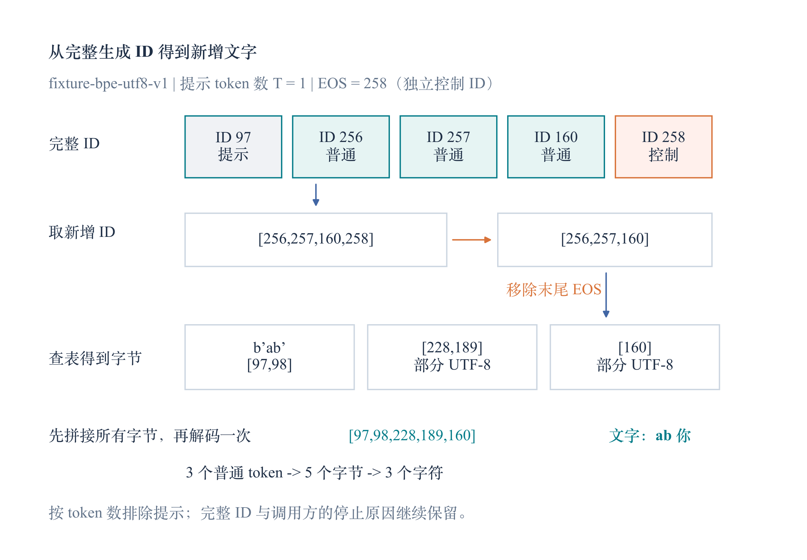{width=100%}

**图 03.18-1——从完整 ID 向下读。** 灰色提示被排除，橙色标出 EOS，青色保留普通字节内容。中文的两个部分字节块只有拼接后才有效。本例三个普通 token 得到五个字节、三个 Unicode 码点。

### 完整小例子

使用手工构造的 `fixture-bpe-utf8-v1`，供计算与解码练习，不声称来自一次训练。全部基础 ID `0..255` 映射到 `bytes([id])`。新增的普通词表项与独立控制 ID 如下：

```text
vocab[256] = b"ab"
vocab[257] = bytes([228,189])
eos_token_id = 258
generated_ids = tensor([97,256,257,160,258])
prompt_length = 1
```

提示只有一个 token：ID 97，普通内容是 `b"a"`。首先，`.tolist()` 得到 `[97,256,257,160,258]`；从索引一开始切片得到 `[256,257,160,258]`。列表非空、配置了 EOS、最后一个 ID 是 258，所以移除这一个元素，得到 `[256,257,160]`。

| 普通 ID | `vocab` 字节内容 | 拼接之前的含义 |
| --- | --- | --- |
| `256` | `b"ab"`，字节值 `[97,98]` | 两个 ASCII 字母 |
| `257` | `bytes([228,189])` | “你”的前两个字节，单独不完整 |
| `160` | `bytes([160])` | “你”的最后一个字节，单独无效 |

拼接这些块得到字节值 `[97,98,228,189,160]`，严格 UTF-8 解码得到 **`"ab你"`**。返回值不包含提示的 `"a"`；如果连提示一起显示，则会是 `"aab你"`。中文的两个字节块不能各自单独解码。

这里三个普通 token、五个字节、三个 Unicode 码点是不同的计数。更一般地，视觉上的一个字符可能包含多个码点，因此 Python 字符串长度不是通用的可见符号计数。

### 一套具体的特殊 token 协议

本例有 258 个普通 ID，即 `0..257`。把尚未占用的 258 留给 EOS，模型候选数就变为 $V=259$。整合后的模型需要 `[259,D]` 的 Embedding、`[D,259]` 的输出权重、`[259]` 的偏置，普通字节词表则不包含 EOS。添加候选项不会自动训练其含义，仍然需要合适的序列结束训练目标。

不要覆盖已学到的合并 ID，也不要认为每个模型的 EOS 都是 258。超过 255 的普通合并 ID 仍然是普通 token。本适配函数使用明确提供的映射，不修改现有 BPE 训练规则或 JSON 格式。特殊 token 元数据的持久化和实际训练整合仍留到后续。

调用方可以保留 `generated_ids` 和 `stop_reason`，另外以 `prompt.numel()` 作为 `prompt_length` 请求显示文字。停止原因说明生成为什么结束，不代表返回字节一定是有效文字。

### 生成停止与 UTF-8 有效性是两回事

最大预算计算的是 token 数。它可能在字节 `[228,189]` 后结束，缺少“你”的最后一个字节 160。即使这两个字节之后生成 EOS，也不能补齐它们。移除 EOS 后，严格解码依然抛出 `UnicodeDecodeError`。已经完整但无效的字节序列，例如 `[255]`，同样失败。这里沿用 02.06 的严格策略。[Python `bytes.decode` 文档](https://docs.python.org/3/library/stdtypes.html#bytes.decode)。

还有一种 **提示边界** 情况：完整普通 ID `[228,189,160]` 能解码成“你”；如果 `prompt_length=1`，新增尾部只有 `[189,160]`，它从字符内部开始，无法独立解码。如果 `prompt_length=0`，同一完整输入就能成功解码。

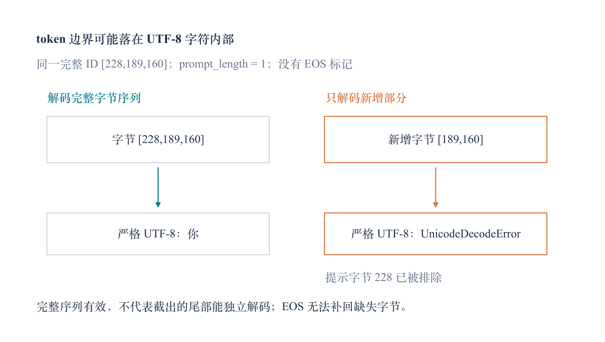{width=100%}

**图 03.18-2——比较两个字节流。** 左侧保留三个字节；右侧排除了提示字节 228，尾部就不是能独立解码的 UTF-8。本适配函数明确报告错误。显示合并后的完整文字、跨边界保留增量解码器状态、使用替换字符，都是另外的显示策略；本课不实现它们。

### 写代码前先认识语法

`.tolist()` 把整数张量转换成 Python 列表。`all_ids[prompt_length:]` 从该 token 索引选到末尾；`continuation_ids[:-1]` 排除最后一个元素。这两种列表切片都产生新列表。`len(continuation_ids)>0` 在访问 `[-1]` 前先确认有元素。

`and` 从左到右求值，遇到假条件就停止。因此，非空检查要放在最后 ID 的查找之前。`eos_token_id is not None` 判断是否配置 EOS；直接判断这个数的真假，会错误地禁用有效 ID 0。`==` 比较值，`=` 做赋值。`if` 以冒号结尾，内部语句再多缩进一级。[Python 序列与布尔运算](https://docs.python.org/3/library/stdtypes.html#common-sequence-operations)。

### 五步引导实现

完成 03.17，并看完本课公式与完整例子后，只写 `decode_continuation` 中标记的学生区域。提供的解码器负责字节操作，复用即可。

1. **转换完整 ID。** 四个空格：调用 `generated_ids.tolist()`，保存为 `all_ids`。本例 `[97,256,257,160,258]`，原张量保持不变。
2. **选择新 ID。** 四个空格：把 `all_ids[prompt_length:]` 保存为 `continuation_ids`。本例 `[256,257,160,258]`。按提示 token 数切片，不按文字长度切片。
3. **安全检查末尾标记。** 四个空格：写一个 `if`，用 `and` 连接三个检查：列表非空、配置了 EOS、最后一个 ID 等于 `eos_token_id`。先检查非空再取 `[-1]`，明确判断是否配置，不判断 EOS 数字的真假。
4. **移除这一个标记。** `if` 内八个空格：用 `[:-1]` 切片替换 `continuation_ids`。本例得到 `[256,257,160]`。不要丢弃所有未知 ID，也不要改变完整张量。
5. **复用解码器并返回。** `if` 后恢复四个空格：调用 `decode_bpe(continuation_ids, vocab)` 并返回它的 `str`。本例是 `"ab你"`，空列表返回 `""`。不要捕获作业要求的错误，也不要重新实现拼接与解码。

| 边界情况 | 应有结果 |
| --- | --- |
| 只有提示，或第一个新 ID 就是 EOS | `""` |
| 长度停止，普通新增字节完整 | 解码所有普通新增 ID |
| `eos_token_id=None` | 不移除任何 ID，把尾部按普通数据解码 |
| 配置 EOS ID `0`，普通词表不含它 | 新尾部末尾出现它时移除 |
| 未知普通 ID，或意外出现在中间的控制标记 | 查表抛出 `KeyError` |
| 新字节无效／不完整，包括切在字符内部的提示边界 | `UnicodeDecodeError` |

完成核心实现及前置作业后，从项目根目录运行：

```bash
python exercises/03_18_decode_continuation.py
```

提供的程序应输出：

```text
PASS: prompt exclusion, trailing EOS removal, merged IDs, and cross-token UTF-8
PASS: empty output, immediate EOS, length stopping, zero prompt, and ordered repeats
PASS: explicit EOS ID zero, disabled removal, prompt control IDs, and unhidden interior markers
PASS: completed decoder reused with a Python list, preserved inputs/mode/RNG, and strided IDs
PASS: unknown IDs and incomplete/invalid UTF-8 propagate required decoder errors
PASS: valid full text can have an invalid independently decoded continuation at a byte boundary
PASS: EOS and length returns from generation both display only the matching-vocabulary continuation
Lesson 03.18 checks passed.
```

### 阅读问题

**为什么不解码全部内容后再删除提示字符串？** token 数指定准确的 ID 边界。按重复的文字片段删除可能删错位置，提示单独解码也可能因为结束在字符内部而失败。本课采用只显示新增部分的策略，先选择 ID。

**为什么不在普通词表中把 EOS 映射为 `b""`？** 这样会悄悄改变普通 token 映射，也失去明确的控制区别。本协议把控制 ID 分开，显示适配函数只移除允许的最后一个标记。

**成功遇到 EOS 就一定能读出答案吗？** 它只确定一个停止事件。字节有效性、上下文建模与答案质量分别是不同的性质。

此前，每次训练调用接收的是一条输入位置序列。[03.19](#section-03-19) 回到数据准备，把多个窗口组成一批，每行都有自己的错位下一 token 目标。生成与解码继续使用这里建立的单序列接口。

## 03.19 批量下一个词元训练窗口 {#section-03-19}

现在回到训练，继续使用第一章的错位窗口。这次由多个起点各取一行，再把这些行叠起来形成一批。批次维度由此出现，但每个位置的任务没变：预测原序列中紧随其后的 token。

先走完下面的小例子，再对照 03_19_next_token_batch.py 动手。编号步骤会说明函数接口，并引导核心实现；初始化和检查驱动由配套文件提供。

### 准确输入与返回值

| 准确名称 | 类型／形状 | 含义 |
| --- | --- | --- |
| `token_ids`，$s$ | 一维 `torch.long` 张量 `[N]` | 已经编码的源 token 流 |
| `start_positions`，$i$ | 非空 `list[int]`，长度 $B$ | 每行一个源起点，顺序由调用者指定 |
| `context_length`，$T$ | 正 Python 整数 | 每行输入位置数，也等于每行目标位置数 |
| `input_ids`，$X$ | 返回 `torch.long` 张量 `[B,T]` | 输入窗口 |
| `target_ids`，$Y$ | 返回 `torch.long` 张量 `[B,T]` | 对应的下一个 token 正确答案 |

$N$ 数源 token，$B$ 数样本条数，$T$ 数每条样本的位置。$V$ 是词表大小，与这三个量分别不同。输出保持源张量的设备。保持源数据、起点列表、调用方梯度模式和随机流不变。返回两个新张量，与源数据、彼此以及后续调用分别独立。

假设输入有效：$B\ge1$、$T\ge1$，且每个起点满足 $0\le i_b$ 与 $i_b+T<N$，不布置参数验证。允许重复、重叠或不按大小排序的起点，并保留提供的顺序。ID 可以超过 255。本课不处理空批次、padding、打乱、文档边界策略或新的特殊 token 映射。

### 每个输入位置对应一个下一个 token 答案

对于批次行 $b=0,\ldots,B-1$、位置 $t=0,\ldots,T-1$：

$$
X_{b,t}=s_{i_b+t},\qquad Y_{b,t}=s_{i_b+t+1}
$$

输入和目标每行都有 $T$ 个 ID。由于最后一个输入也需要下一个 token 的答案，两行合起来需要源序列中连续的 $T+1$ 个 ID：

$$
X_b=s[i_b:i_b+T],\qquad
Y_b=s[i_b+1:i_b+T+1]
$$

需要的最后一个源索引为 $i_b+T$，它必须小于 $N$。最大有效起点是 $N-T-1$。切片的结束位置不包含在结果中：`s[0:3]` 包含索引 `0,1,2`，不包含索引 3。

把 $B$ 行沿新的 batch 维度堆起来：

$$
X=\operatorname{stack}(X_0,\ldots,X_{B-1}),\qquad
Y=\operatorname{stack}(Y_0,\ldots,Y_{B-1}),\qquad
\operatorname{shape}(X)=\operatorname{shape}(Y)=[B,T]
$$

这个固定长度、没有损失屏蔽的批次包含 $BT$ 个监督位置。这是在数目标比较次数，不代表已经提升模型质量，也不是测得的训练吞吐量。

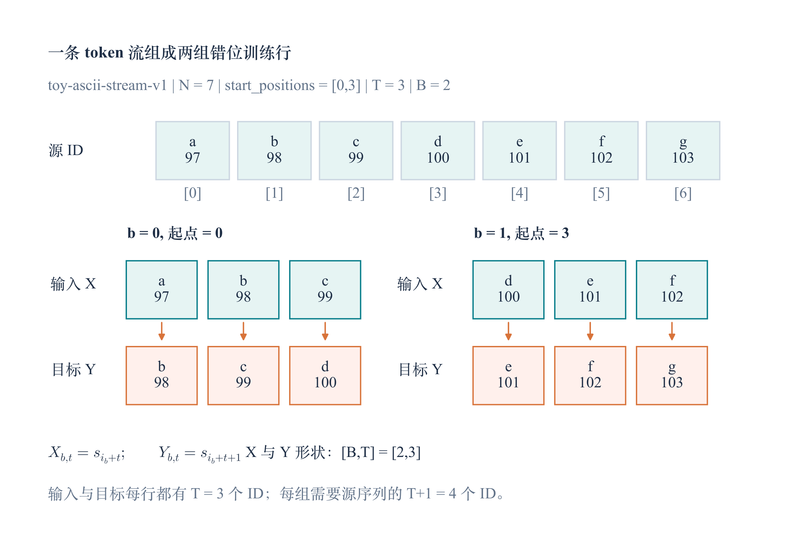{width=100%}

**图 03.19-1——每个向下箭头都是一组预测与答案。** 上方源序列标出真实 token 索引，下方每行输入有三个 ID，目标也有三个。最后一个目标来自额外的第四个源 token。两条样本组成 `[2,3]` 张量。

### 完整小例子

使用示意字节 token 流 `toy-ascii-stream-v1`，即 `"abcdefg"` 的 UTF-8 字节：

```text
token_ids = tensor([97,98,99,100,101,102,103])
start_positions = [0,3]
context_length = 3
N = 7, B = 2, T = 3
```

循环之前，`input_rows=[]`、`target_rows=[]`。第一个提供的起点是 `start=0`，输入取索引 `0:3`，目标取索引 `1:4`：

```text
x_row = [97,98,99]   # abc
y_row = [98,99,100]  # bcd
```

分别将这两个张量追加到两个列表；每个列表现在包含一个 `[3]` 张量。下一个起点是 `start=3`，输入取 `3:6`，目标取 `4:7`：

```text
x_row = [100,101,102]  # def
y_row = [101,102,103]  # efg
```

两组源片段分别是 `abcd` 与 `defg`，共享 $d$：它是第一条样本的最后答案，也是第二条样本的第一个输入。因此，本例两个四-token 片段只需要七个不同的源位置，有效窗口允许重叠。

追加之后，每个列表都有两个 `[3]` 张量。分别沿维度零 stack，得到：

$$
X=\begin{bmatrix}97&98&99\\100&101&102\end{bmatrix},\qquad
Y=\begin{bmatrix}98&99&100\\101&102&103\end{bmatrix}
$$

返回 `(input_ids, target_ids)`，它们的形状分别为 `[2,3]`。例如 `input_ids[0,1]` 是 98（`b`），对应答案 `target_ids[0,1]` 为 99（`c`）。第一行最后输入 `c` 预测 $d$，而 $d$ 位于该行输入窗口之外。

| 行 | 输入 | 目标 | 三组对齐比较 |
| --- | --- | --- | --- |
| `0` | `abc` | `bcd` | `a→b`、`b→c`、`c→d` |
| `1` | `def` | `efg` | `d→e`、`e→f`、`f→g` |

箭头表示输入与目标的位置对应关系。后续上下文模型还能使用该位置之前的可见 token，箭头不要求它只能使用一个 ID。此前的查表加输出投影基线确实只使用当前 ID，本次不改变这个模型。

### 为什么目标错位，为什么训练能使用多个位置

把输入原样复制为目标，会让模型学习预测当前 ID；下一个 token 建模则把实际观察到的下一个 ID 分配给每个位置，所以最后输入位置依然有目标。如果全行只重复最后一个目标，就丢掉了其他位置原本要做的比较。

对于后续的因果上下文模型，位置 $t$ 应使用的分布是：

$$
p_\theta(Y_{b,t}\mid X_{b,0},\ldots,X_{b,t})
$$

训练时使用真实观察到的前面 token 作为输入，通常称为 teacher forcing。已知输入行使多个位置的预测可以一起计算，因果可见范围则阻止未来位置影响此前的预测。目标张量用于算损失，不作为模型前向输入。

在输入行 `abc` 中，预测 `b` 的位置能看 `a`；预测 `c` 的位置能看 `ab`；预测 $d$ 的位置能看 `abc`。虽然输入行保存了 `b` 和 `c`，第一个预测也不能看它们。仅仅构造错位目标不会自动实现这个限制；因果注意力与 mask 留到后续。

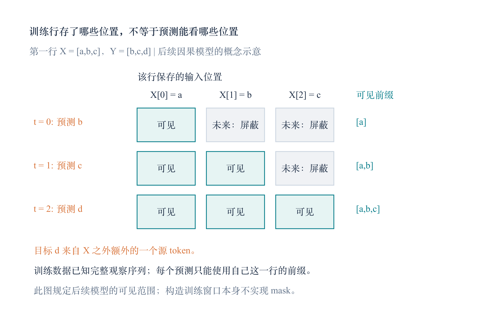{width=100%}

**图 03.19-2——青色表示概念上因果模型允许使用的输入。** 灰色是应屏蔽的未来位置，橙色标出真实下一个 ID。窗口构造函数只提供数据，不实现 mask，也不会让此前的模型自动获得上下文能力。自由生成时未知未来 ID，依然需要按顺序逐个选择。

后续固定长度批量训练的平均 token 损失可以写为：

$$
\mathcal L=-\frac{1}{BT}\sum_{b=0}^{B-1}\sum_{t=0}^{T-1}
\log p_\theta(Y_{b,t}\mid X_{b,0:t})
$$

这里的 $X_{b,0:t}$ 是数学上包含位置 $t$ 的前缀；对应 Python 切片是 `input_ids[b, :t+1]`。批次构造函数不计算这些概率或损失。加入 padding mask 或加权损失时，归一化协议也要另行确定。

### 新语法与存储

`[]` 建立 Python 列表。`input_rows.append(x_row)` 添加一个张量，保留它作为一行的结构。`for start in start_positions:` 按调用者提供的顺序访问起点，包括重复起点。循环内部八个空格，设置和最终返回四个空格。假设输入有效，本课不需要新的条件或错误处理。

张量切片可以与源共享存储，因此不要原地修改收集的行视图。`torch.stack(rows, dim=0)` 为同形状张量添加新维度，得到 `[B,T]`；两个 `[3]` 行得到 `[2,3]`。这些行为也在已有运行环境中验证。[PyTorch stack 文档](https://docs.pytorch.org/docs/2.0/generated/torch.stack.html)。

相比之下，`torch.cat(rows, dim=0)` 会把两个一维行拼成 `[6]`。生成时，`cat` 用来延长一条 ID 序列；这里用 `stack` 把不同样本保存成不同行。对这些一维行使用 `stack(..., dim=1)` 则会把新 batch 维度放到其他位置，得到 `[T,B]`。

### 七步引导实现

完成并检查 03.18、看完本课讲解后，只替换 `make_next_token_batch` 中的占位语句；保留提供的检查程序和以前的练习实现。

1. **准备行列表。** 四个空格：创建两个独立的新列表 `input_rows` 与 `target_rows`，每个将收集 $B$ 个 `[T]` 张量。
2. **访问选好的起点。** 四个空格：写 `for start in start_positions:`，八个空格的内部处理一条样本。本例 `start` 先是 0，再是 3，使用列表里的值，不是它们的列表索引。
3. **取错位切片。** 八个空格：用 `token_ids[start:start+context_length]` 得到 `x_row`；`y_row` 从 `start+1` 开始，到 `start+context_length+1` 之前结束。第一组是 `[97,98,99]` 与 `[98,99,100]`。
4. **收集两行。** 八个空格：把 `x_row` 追加到 `input_rows`，把 `y_row` 追加到 `target_rows`。两轮后，每个列表包含两个 `[3]` 张量。不要修改切片视图。
5. **堆叠输入行。** 循环外恢复四个空格：调用 `torch.stack(input_rows, dim=0)`，保存为 `input_ids`，本例形状 `[2,3]`。
6. **堆叠目标行。** 四个空格：沿维度零 stack `target_rows`，保存为 `target_ids`。本例两行是 `bcd` 与 `efg`，同样 `[2,3]`。
7. **返回两个张量。** 两次 stack 后保持四个空格，按顺序返回 `input_ids, target_ids`。在循环内部返回会漏掉后面的样本。

完成讲解与实现后，从项目根目录运行：

```bash
python exercises/03_19_next_token_batch.py
```

提供的检查应输出：

```text
PASS: complete worked batch, shifted final targets, and two [2,3] tensors
PASS: one sample, one position, maximal span, and the last valid start
PASS: supplied order, repeated/overlapping starts, and vocabulary IDs above 255
PASS: strided source, dtype/device propagation, caller mode, and unchanged random stream
PASS: fresh outputs independent of the source, each other, and later calls
PASS: varied batch/window sizes agree with completed single-window references
PASS: six aligned supervised positions feed completed projection/loss with connected gradients
Lesson 03.19 checks passed.
```

### 接到模型形状与阅读问题

对 `[B,T]` ID 查 Embedding，会得到 `[B,T,D]` 向量。上下文模型应在计算上下文时保留样本和位置维度，再输出 `[B,T,V]` 分数。$V$ 是每个位置的候选 ID 数，不是第三个样本维度。

最后提供的检查使用另一套更小的独立示例：ID `[0,1,2,0,1,2,0]`、起点 `[0,3]`、长度 3，以及 $V=3,D=2$ 的固定参数。它把 **独立查表基线** 的六个向量整理为 `[6,2]`，调用投影与损失函数，并检查梯度。这是正确性衔接，不更新参数，也不声称训练质量改善。注意力计算之前必须保留可区分的样本轴与位置轴，让每个 token 只读取本序列内允许的前缀。这里能展开，是因为查表与输出映射独立计算每个位置；上下文模型则在完成上下文计算后，再展开 logits 来计算损失。

**起点必须连续或者随机吗？** 不必。这个函数接收已经选好的有效起点。`[2,0,2]` 表示按该顺序构造三条样本，第零行和第二行来自同一源窗口；怎样选择采样策略是另外的工作。

**T+1 意味着模型多接收一个 token 吗？** 不是。数据构造需要额外一个源 token 给最后输入提供答案，返回的每行模型输入仍然只有 T 个 token。

**批量训练是不是在训练不同模型？** 后续整个批次共享同一个模型的参数；$B$ 组织数据，不是每行各建立一个模型。

**第二行会看第一行吗？** 每行是独立样本，第二行的前缀是 $d$、`de`、`def`，不对第一行的 `abc` 做注意力。截取窗口也会省略所选起点之前的源上下文。共享模型参数不意味着合并样本上下文。

**窗口可以跨文档吗？** 本课假设调用方提供一条允许取这些片段的流。实际数据处理必须约定文档边界、EOS 插入、划分与屏蔽，不在这里悄悄选择策略。训练窗口可以重叠；训练与验证划分要单独设计，防止共享数据泄漏。

[03.20](#section-03-20) 将对这些输入与目标批次做两件事：为每个位置计算一组词表分数，再平均各位置对齐的真实目标损失。两个操作都保留后续参数更新所需的梯度通路。

## 03.20 批量预测分数与平均词元损失 {#section-03-20}

批量输入多了一个维度，每个位置却仍然需要自己的词表分数和真实目标。本节让批次轴、位置轴一起经过查表与输出映射，再把它们共同展开，接回熟悉的二维损失接口。分数怎样排列，答案就必须怎样跟随。

先走完下面的小例子，再对照 03_20_batched_logits_and_loss.py 动手。编号步骤会说明函数接口，并引导核心实现；初始化和检查驱动由配套文件提供。

### 准确输入、输出与状态

| 准确名称 | 类型／形状 | 含义 |
| --- | --- | --- |
| `embedding_table`，$E$ | 浮点张量 `[V,D]` | 共享的 token 向量表 |
| `input_ids`，$X$ | `torch.long` 张量 `[B,T]` | 每条样本／位置的实际输入 ID |
| `output_weights`，$W$ | 浮点张量 `[D,V]` | 共享的词表投影 |
| `output_bias`，$\beta$ | 浮点张量 `[V]` | 共享的候选偏置 |
| `logits`，$Z$ | 浮点张量 `[B,T,V]` | 阶段 A 返回值，阶段 B 分数输入 |
| `target_ids`，$Y$ | `torch.long` 张量 `[B,T]` | 已经错位的实际下一个 token 答案 |
| 返回的 `loss`，$\mathcal L$ | 标量浮点张量，形状 `[]` | 真实目标负对数概率的平均值 |

$B$ 数样本，$T$ 数每条样本的位置，$D$ 数向量特征，$V$ 数每个位置的候选 ID。公式中偏置写成 $\beta$，与行索引 $b$ 分开。例如 `logits[1,0]` 是一个 `[V]` 分数向量；`logits[1,0,2]` 是第二条样本（索引 1）、位置零、候选 ID 2 的分数。

假设维度为正、ID 有效、dtype／设备兼容，分数有限且处于检查所使用的数值范围内，不布置验证参数。保持全部输入值、参数存储／可训练标记／已存梯度、调用方梯度模式和全局随机状态不变。启用梯度时保留计算图。本函数内部不 detach、进入 no-grad、backward、清除梯度、取 Python 浮点数或更新参数。

没有忽略位置、padding 权重、类别权重或标签平滑。$BT$ 个目标等权参与损失。数据构造已经把目标错位，本课不再次错位。

### 每个位置有一组词表分数

对于 $b=0,\ldots,B-1$、$t=0,\ldots,T-1$、$v=0,\ldots,V-1$：

$$
H_{b,t,:}=E[X_{b,t}],\qquad \operatorname{shape}(H)=[B,T,D]
$$

$$
Z_{b,t,v}=\sum_{d=0}^{D-1}H_{b,t,d}W_{d,v}+\beta_v,
\qquad \operatorname{shape}(Z)=[B,T,V]
$$

所有位置使用同一套向量表和输出参数，分数是原始 logits。每个位置在数学上的候选分布是：

$$
P_{b,t,v}=\frac{\exp(Z_{b,t,v})}{\sum_{j=0}^{V-1}\exp(Z_{b,t,j})}
$$

对每个 `(b,t)` 分别沿候选维度 $V$ 归一化。每个位置的真实目标 ID 选择一个概率，所需平均损失为：

$$
\mathcal L=-\frac{1}{BT}\sum_{b=0}^{B-1}\sum_{t=0}^{T-1}
\log P_{b,t,Y_{b,t}}
$$

分母数监督位置。每个位置有 $V$ 个候选分数，却只对应一个提供的正确答案。03.10 的稳定函数直接从原分数计算目标对数概率，避免先得到极小概率、下溢为零，再取对数的问题。

### 展开位置，保留候选与答案对应关系

把批量位置映射到展开后的行索引：

$$
q=bT+t,\qquad \widetilde Z_{q,v}=Z_{b,t,v},\qquad
\widetilde Y_q=Y_{b,t}
$$

分数形状 `[B,T,V] → [B*T,V]`，同时目标形状 `[B,T] → [B*T]`，候选列保持在一起。$B=2,T=2$ 时，位置顺序为 `(0,0),(0,1),(1,0),(1,1)`。

阶段 A 也按这个顺序，把向量 `[B,T,D] → [B*T,D]` 后调用现有二维投影；得到 `[B*T,V]` 分数再恢复为 `[B,T,V]`。阶段 B 以同顺序展开分数和目标，调用现有二维损失函数。

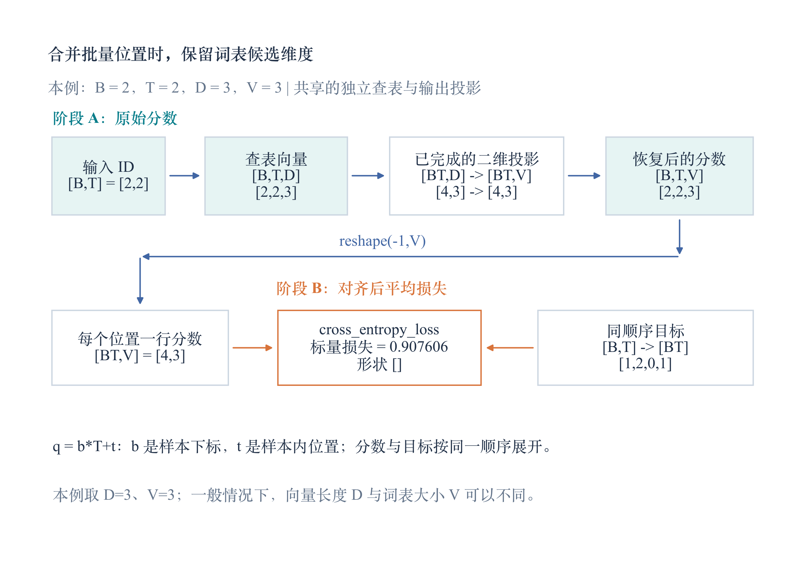{width=100%}

**图 03.20-1——阶段 A 从左向右，再沿分数路径进入阶段 B。** 阶段 A 返回恢复后的原始分数，阶段 B 另外接收目标，计算一个标量。本例 $D$ 和 $V$ 正好都是三，但含义与可取大小不同。

### 完整小例子

使用人为选定的 `batch-three-id-v1`，不声称来自已经训练出的能力。源 ID `[0,1,2,0,1]`、起点 `[0,2]`、行长度二，得到：

$$
X=\begin{bmatrix}0&1\\2&0\end{bmatrix},\qquad
Y=\begin{bmatrix}1&2\\0&1\end{bmatrix},\qquad B=2,\ T=2
$$

选择共享参数。这里 $I_3$ 是三乘三的单位矩阵（identity matrix）：主对角线为一，其他位置为零。

$$
E=\begin{bmatrix}1&2&3\\2&1&3\\3&2&1\end{bmatrix},\qquad
W=I_3,\qquad \beta=[0,0,0],\qquad D=3,\ V=3
$$

查表得到 `[2,2,3]` 的 `hidden_vectors`。单位权重与零偏置使其值和分数相同：

```text
logits = [
    [[1,2,3], [2,1,3]],
    [[3,2,1], [1,2,3]],
]
flat_logits = [[1,2,3], [2,1,3], [3,2,1], [1,2,3]]
flat_targets = [1,2,0,1]
```

第一个位置的 `[1,2,3]` 最大值为 3，减去后是 `[-2,-1,0]`，指数约为 `[0.1353352832,0.3678794412,1]`。指数和与其对数为：

$$
S=1+e^{-1}+e^{-2}\approx1.5032147244,\qquad
\log S\approx0.4076059644
$$

提供的目标是 ID 1，其概率为 $\frac{0.3678794412}{S}\approx0.2447284711$，稳定的负对数概率为 $1+\ln(S)\approx1.4076059644$。最大分数候选是 ID 2，但损失按实际答案 ID 1 选择。

四行都是 `[1,2,3]` 的排列，因此共用 $S$。完整目标计算如下：

| 展开 q | 位置 `(b,t)` | 原始分数 | 目标 ID | 选中概率 | 负对数概率 |
| --- | --- | --- | --- | --- | --- |
| `0` | `(0,0)` | `[1,2,3]` | `1` | `0.2447284711` | `1.4076059644` |
| `1` | `(0,1)` | `[2,1,3]` | `2` | `0.6652409558` | `0.4076059644` |
| `2` | `(1,0)` | `[3,2,1]` | `0` | `0.6652409558` | `0.4076059644` |
| `3` | `(1,1)` | `[1,2,3]` | `1` | `0.2447284711` | `1.4076059644` |

因此：

$$
\mathcal L=\frac{1.4076059644+0.4076059644+0.4076059644+1.4076059644}{4}
\approx0.9076059644
$$

返回带有该值的标量张量，保留梯度路径。函数已经取了这次平均，外层适配函数不再额外除一次。

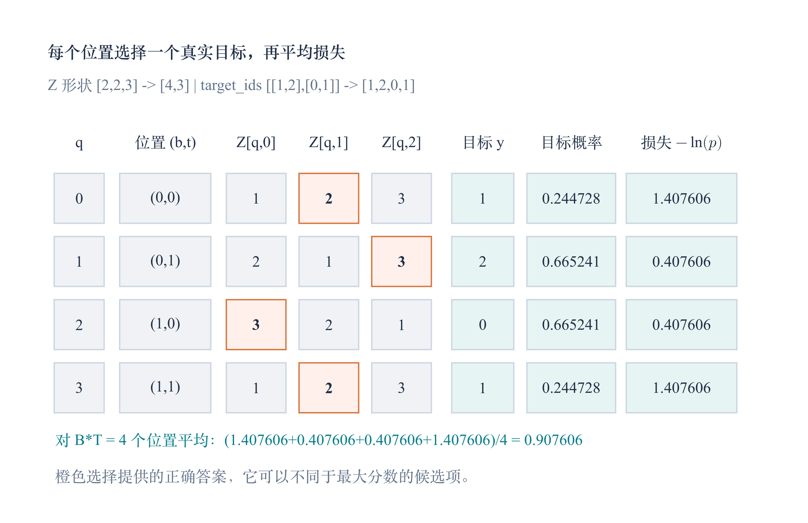{width=100%}

**图 03.20-2——橙色标出每行真实目标的分数列。** 概率与损失列都对应这个候选，四个损失一起平均，其中包括输入 ID 零的两次出现。

### reshape 之后梯度依然连接

在正常梯度模式下，平均损失对分数的导数是：

$$
\frac{\partial\mathcal L}{\partial Z_{b,t,v}}
=\frac{P_{b,t,v}-\mathbf1\{v=Y_{b,t}\}}{BT}
$$

第一个位置的梯度约为 `[0.0225076433,-0.1888178822,0.1663102389]`。目标分量为负，局部增加该分数会降低损失；非目标分量为正。$\frac{1}{BT}$ 来自对四个位置的平均。

调用方之后可以运行 `loss.backward()`，得到共享向量表、权重与偏置的梯度。重复 ID 零的两个位置向同一行 Embedding 贡献梯度；因为 $W$ 是单位矩阵，合计表行梯度约为 `[0.0450152866,-0.3776357645,0.3326204779]`。Backward 计算梯度，优化器／更新仍是另一步操作。

### 动手前先认识 reshape 语法

`batch_size, context_length = input_ids.shape` 解包两个维度。`embedding_table[input_ids]` 保留 `[B,T]`，再追加向量维度 $D$。`.reshape(-1, embedding_dim)` 合并前两个维度，让 PyTorch 根据元素总数推断缺失大小。本例 $2\times 2\times 3=12$ 个值变成四行、每行三个值。

一次 reshape 只能有一个 `-1`。随后 `.reshape(batch_size, context_length, -1)` 恢复样本与位置维度，推断出 $V$。算损失时，`.reshape(-1, vocab_size)` 保留每个位置的候选向量，目标的 `.reshape(-1)` 则给每个展开位置提供一个 ID。

Reshape 保留逻辑元素顺序，根据布局可能返回视图或副本。不要依赖它拥有独立存储，也不要原地修改结果。它保留自动求导连接，处理跨步布局时所需的复制不代表 detach。[PyTorch reshape 文档](https://docs.pytorch.org/docs/2.0/generated/torch.reshape.html)。

### 阶段 A：六步引导实现

03.19 已验证完成，看完本课公式与完整例子后，只写 `compute_batch_logits` 标记的学生区域。全部语句四个空格缩进，不需要循环或上下文块。

1. **读批次形状。** 将 `input_ids.shape` 解包到 `batch_size`、`context_length`，本例分别为二。
2. **查向量。** 把 `embedding_table[input_ids]` 保存为 `hidden_vectors`，形状 `[2,2,3]`。
3. **准备现有函数的向量行。** 从 `embedding_table.shape[1]` 读取 `embedding_dim`，把 `hidden_vectors` reshape 到 `(-1, embedding_dim)`，保存为 `flat_hidden`，形状 `[4,3]`，保留四个位置的顺序。
4. **复用一次投影。** 调用 `compute_logits(flat_hidden, output_weights, output_bias)`，保存 `flat_logits`，形状 `[B*T,V]`，保留计算图。
5. **恢复批次维度。** 将 `flat_logits` reshape 到 `(batch_size, context_length, -1)`，保存为 `logits`，形状 `[2,2,3]`。
6. **返回原始分数。** 返回张量 `logits`，概率转换与抽样继续由其他函数负责。

实现后单独检查阶段 A：

```bash
python exercises/03_20_batched_logits_and_loss.py --check logits
```

最后一行应为 `Lesson 03.20 logits checks passed.`

### 阶段 B：五步引导实现

只写 `batch_cross_entropy` 标记的学生区域，所有语句仍为四个空格。

1. **读候选数量。** 把 `logits.shape[-1]` 保存为 `vocab_size`，本例为三。
2. **展开分数的位置维度。** 把 `logits.reshape(-1, vocab_size)` 保存为 `flat_logits`，形状 `[4,3]`，保留候选列。
3. **按相同顺序展开答案。** 把 `target_ids.reshape(-1)` 保存为 `flat_targets`，得到 `[1,2,0,1]`，已经错位的 ID 保持原顺序。
4. **复用一次稳定损失。** 调用 `cross_entropy_loss(flat_logits, flat_targets)`，保存 `loss`，它已经平均四行真实目标的损失。
5. **返回保持连接的标量。** 返回张量 `loss`，Backward、清除梯度与更新留给后续训练调用方。

用提供的分数示例单独检查阶段 B：

```bash
python exercises/03_20_batched_logits_and_loss.py --check loss
```

最后一行应为 `Lesson 03.20 loss checks passed.`。阶段 B 的独立检查不要求阶段 A 已经完成。

两个核心都写完后运行：

```bash
python exercises/03_20_batched_logits_and_loss.py --check all
```

合并检查应输出：

```text
PASS: worked [B,T] lookup and restored [2,2,3] raw scores
PASS: nonsquare batch shapes, D different from V, bias, singleton axes, and merged IDs
PASS: 2D helper reuse, logical position order, strided IDs, fixed state, and caller mode
PASS: four true targets selected in matching order and averaged to one scalar
PASS: varied shapes/dtypes, row shifts, single candidate, large IDs, and stable extreme loss
PASS: 2D stable helper reuse, aligned flattening of strided tensors, and preserved mode
PASS: connected analytic gradients scaled by B*T, finite differences, and existing buffers
PASS: full batch forward/loss reaches all parameters with repeated-ID accumulation and no update
Lesson 03.20 checks passed.
```

### 阅读问题

**展开会把多条样本当成一个上下文吗？** 本课独立计算每个查表向量的分数，合并位置行只是在适配原函数，不改变预测。后续上下文模型做注意力时必须保留样本和序列结构，最后得到的 logits 再用于展开的 token 损失；不要在注意力之前把样本合成一条序列。

**为什么不再次错位目标，或者用 argmax 当答案？** 数据构造已经提供实际下一个 ID，再次错位会使标签不对齐；argmax 会改成评价模型自己的选择，而不是实际答案。

**为什么不把概率传给原损失函数？** 它要求原始 logits，并在内部稳定计算对数概率，提前 softmax 会改变输入解释。[交叉熵文档](https://docs.pytorch.org/docs/2.0/generated/torch.nn.CrossEntropyLoss.html)。

**库的交叉熵能直接接收 `[B,T,V]` 吗？** 常用类别索引接口使用 `[N,C,...]` 分数，类别维度在第二维。本例将 $V$ 放在最后，所以适配函数使用明确的 `[B*T,V]` 分数、`[B*T]` 目标，以及二维函数；其他布局需要有意做相容转换。

**为什么返回标量张量，而不是 `.item()`？** 训练调用方需要计算图来 backward；保留连接的损失后，显示／记录日志可以使用 `.item()`，它不适合作为本函数的返回值。


### 课堂澄清：例子中的维度与展开下标

图中的具体数值用于这个算例；公式中的一般形状约定适用于满足输入条件的其他例子。

**D=V=3 表示 D 与 V 必须一直相等吗？** 不表示。D 数 Embedding 特征，V 数候选 ID。例如 B=2,T=3,D=2,V=5 时，表为 [5,2]，权重为 [2,5]，查表向量为 [2,3,2]，展开向量为 [6,2]，展开分数为 [6,5]，恢复分数为 [2,3,5]。矩阵乘法 [6,2] @ [2,5] 把长度为二的特征变成五个候选分数。损失保留 [6,5] 分数和六个目标 ID。

**q=b*T+t 用的是批次大小 B 吗？** 小写 b 是从零开始的样本下标，与表示样本数量的大写 B 不同。B=2,T=2 时，位置 (0,0),(0,1),(1,0),(1,1) 分别对应 q=0,1,2,3。第二行首个位置是 1*2+0=2。一般有 0<=b<B、0<=t<T、0<=q<B*T。分数与目标使用相同映射，每行保留全部 V 个候选项。

## 03.21 用一批下一个词元目标联合更新一次参数 {#section-03-21}

多条样本可以共同产生一次参数更新。各位置的损失先平均成一个标量，梯度再汇到共享参数上，最后才改变这些参数。本节把联合训练步骤扩展到一批数据，同时保留之前学过的记录时刻与参数对象。

先走完下面的小例子，再对照 03_21_batch_train_step.py 动手。编号步骤会说明函数接口，并引导核心实现；初始化和检查驱动由配套文件提供。

### 准确的输入、返回值与作用

| 准确名称 | 类型与形状 | 含义 |
| --- | --- | --- |
| `embedding_table`，$E$ | 可训练的浮点叶子张量 `[V,D]` | 共享 token 向量表 |
| `input_ids`，$X$ | 固定的 `torch.long` 张量 `[B,T]` | 每个样本、每个位置的输入 ID |
| `output_weights`，$W$ | 可训练的浮点叶子张量 `[D,V]` | 共享的词表投影权重 |
| `output_bias`，$\beta$ | 可训练的浮点叶子张量 `[V]` | 每个候选项一个偏置 |
| `target_ids`，$Y$ | 固定的 `torch.long` 张量 `[B,T]` | 已经错位构造好的下一个 token 答案 |
| `learning_rate`，$\eta$ | 非负 Python 浮点数 | 三个参数共用的更新倍率 |

$B$ 是样本行数，$T$ 是每行位置数，$D$ 是向量特征数，$V$ 是候选 ID 数。$D$ 与 $V$ 可以不同，本课特意取 $D=1,V=2$。假设维度为正、ID 合法、浮点类型和设备兼容、数值有限、正常梯度模式，三个参数分别存储且不共享权重。本课不要求编写输入验证。

返回 `(loss_value, gradient_table, gradient_weights, gradient_bias)`：

- `loss_value` 是 Python 浮点数，表示**更新前**的平均损失。
- 三个梯度是独立张量副本，形状分别为 `[V,D]`、`[D,V]`、`[V]`，都来自同一个更新前状态。
- 原来的三个参数张量包含更新后的值，保留其存储、类型、设备及可训练叶子身份。两个 ID 张量和随机状态保持不变。
- 本次梯度保留在 `.grad` 中；下一次调用开始时清除。返回的梯度副本必须在后续调用或修改实时梯度缓冲区后依然保持原值。

叶子参数就是初始化时提供的原始可训练张量，不是前向计算产生的中间张量。反向传播后，它的 `.grad` 保存导数。ID 用来选择表中的行，是固定观测数据，不是可训练的浮点参数。

### 前向、平均损失、梯度、更新

令 $b=0,\ldots,B-1$、$t=0,\ldots,T-1$、$d=0,\ldots,D-1$、$v=0,\ldots,V-1$。先把当前参数保持在同一个状态：

$$
H_{b,t,:}=E[X_{b,t}],\qquad
Z_{b,t,v}=\sum_d H_{b,t,d}W_{d,v}+\beta_v
$$

$$
P_{b,t,v}=\frac{e^{Z_{b,t,v}}}{\sum_j e^{Z_{b,t,j}}},\qquad
\mathcal L(E,W,\beta;X,Y)
=-\frac1{BT}\sum_{b,t}\log P_{b,t,Y_{b,t}}
$$

求导时，`X` 与 $Y$ 固定。损失通过这条连接的计算路径依赖三个参数。调用 `compute_batch_logits` 与 `batch_cross_entropy`；稳定损失函数直接计算对数概率。下面的数学概率是为了理解导数，你的核心代码无需再调用 softmax。

一个候选分数的导数为：

$$
(G_Z)_{b,t,v}=\frac{\partial\mathcal L}{\partial Z_{b,t,v}}
=\frac{P_{b,t,v}-\mathbf1\{v=Y_{b,t}\}}{BT}
$$

指示函数在该候选等于真实目标时取一，否则取零。分母来自对监督位置求平均。已有函数已经处理这个分母，不要再把损失或梯度除以 $B$、$T$ 或 $V$。

按同一顺序 $q=bT+t$ 展开位置，$\widetilde H$ 的形状为 `[B*T,D]`，$\widetilde G_Z$ 为 `[B*T,V]`。对线性输出层应用链式法则：

$$
G_W=\widetilde H^\mathsf T\widetilde G_Z,\qquad
(G_\beta)_v=\sum_{b,t}(G_Z)_{b,t,v},\qquad
(G_H)_{b,t,:}=(G_Z)_{b,t,:}W^\mathsf T
$$

Embedding 表是共享的，同一个输入 ID 的每次出现都向同一表行贡献梯度：

$$
(G_E)_{i,:}=\sum_{(b,t):X_{b,t}=i}(G_H)_{b,t,:}
$$

在这个只查表的目标中，没有被选中的表行梯度为零。这些公式解释自动求导在做什么；实现时调用**一次** `loss.backward()`，无需手写上述导数。

三个梯度都在相同旧状态计算完毕后：

$$
E_{\mathrm{new}}=E-\eta G_E,\qquad
W_{\mathrm{new}}=W-\eta G_W,\qquad
\beta_{\mathrm{new}}=\beta-\eta G_\beta
$$

为什么减？对很小的变化 $\Delta\theta$，有 $\Delta\mathcal L\approx G_\theta^\mathsf T\Delta\theta$。选择 $\Delta\theta=-\eta G_\theta$，一阶项变成 $-\eta\lVert G_\theta\rVert^2\le0$。这是局部近似；步子过大时，实际损失可能上升。

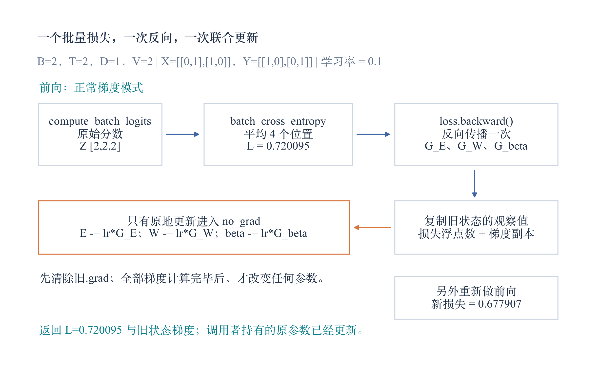{width=100%}

**图 03.21-1——上行向右读，再沿下行向左读。** 前向和反向使用正常梯度模式，只有最后原地更新进入 `torch.no_grad()`。更新之前保存旧状态的损失与梯度副本。

### 完整例子：四个位置，D 与 V 不同

使用手动指定的正确性样例 `batch-two-id-sgd-v1`。源 ID 为 `[0,1,0,1]`，起点为 `[0,1]`，$T=2$：

$$
X=\begin{bmatrix}0&1\\1&0\end{bmatrix},\quad
Y=\begin{bmatrix}1&0\\0&1\end{bmatrix},\quad
E=\begin{bmatrix}1\\2\end{bmatrix},\quad
W=\begin{bmatrix}1&0\end{bmatrix},\quad\beta=[0,0],\quad\eta=0.1
$$

这里 $B=2,T=2,D=1,V=2$。张量形状分别为 `E: [2,1]`、`H: [2,2,1]`、`W: [1,2]`、`Z: [2,2,2]`。投影把长度为一的向量变成两个候选分数。按 `(0,0),(0,1),(1,0),(1,1)` 展开：

| q | 输入 ID | 向量 | 分数 | 目标 ID | 目标概率 | 位置损失 |
| --- | --- | --- | --- | --- | --- | --- |
| 0 | 0 | `[1]` | `[1,0]` | 1 | `0.2689414214` | `1.3132616875` |
| 1 | 1 | `[2]` | `[2,0]` | 0 | `0.8807970780` | `0.1269280110` |
| 2 | 1 | `[2]` | `[2,0]` | 0 | `0.8807970780` | `0.1269280110` |
| 3 | 0 | `[1]` | `[1,0]` | 1 | `0.2689414214` | `1.3132616875` |

对于 `[1,0]`，减去最大值一，得到 `[0,-1]`。目标为候选一，所以 $p_1=e^{-1}/(1+e^{-1})\approx0.2689414214$，$-\log p_1=1+\log(1+e^{-1})\approx1.3132616875$。对于 `[2,0]`，目标为候选零，所以 $p_0=1/(1+e^{-2})\approx0.8807970780$，损失为 $\log(1+e^{-2})\approx0.1269280110$。

$$
\mathcal L=\frac{1.3132616875+0.1269280110+0.1269280110+1.3132616875}{4}
\approx0.7200948493
$$

令 $a=0.7310585786/4\approx0.1827646447$，$c=(0.8807970780-1)/4\approx-0.0298007305$。全部分数梯度为：

$$
\widetilde G_Z=\begin{bmatrix}a&-a\\c&-c\\c&-c\\a&-a\end{bmatrix}
$$

因为 $W^\mathsf T=[1,0]^\mathsf T$，每个位置的向量梯度就是该行分数梯度的第一项。输入零的两次贡献加成 $2a$，输入一的两次贡献加成 $2c$。权重梯度需要各向量乘以对应分数梯度，向量依次为 `[1,2,2,1]`。偏置梯度直接把四行相加。因此：

$$
G_E=\begin{bmatrix}2a\\2c\end{bmatrix}
\approx\begin{bmatrix}0.3655292893\\-0.0596014610\end{bmatrix}
$$

$$
G_W=[2a+4c,\;-(2a+4c)]
\approx[0.2463263673,-0.2463263673]
$$

$$
G_\beta=[2a+2c,\;-(2a+2c)]
\approx[0.3059278283,-0.3059278283]
$$

各参数减去 `0.1` 乘自己的梯度：

$$
\begin{aligned}
E_{\mathrm{new}}&\approx\begin{bmatrix}0.9634470711\\2.0059601461\end{bmatrix},\\
W_{\mathrm{new}}&\approx[0.9753673633,0.0246326367],\\
\beta_{\mathrm{new}}&\approx[-0.0305927828,0.0305927828].
\end{aligned}
$$

例如，$E_{0,0}=1-0.1\times0.3655292893=0.9634470711$。第二行梯度为负，因此增大：$2 - 0.1\times (-0.0596014610) = 2.0059601461$。

函数返回 `0.7200948493` 与三个**旧状态**的梯度副本。在新状态另外重新计算前向，输入零的分数为 `[0.9091220465,0.0543250245]`，输入一为 `[1.9259552757,0.0800048704]`，选中的目标概率依次为 `[0.2984275419,0.8636509327,0.8636509327,0.2984275419]`，新平均损失为 `0.6779073607`。提供的检查程序会验证这个单独的观察值；它不是本函数返回的损失。

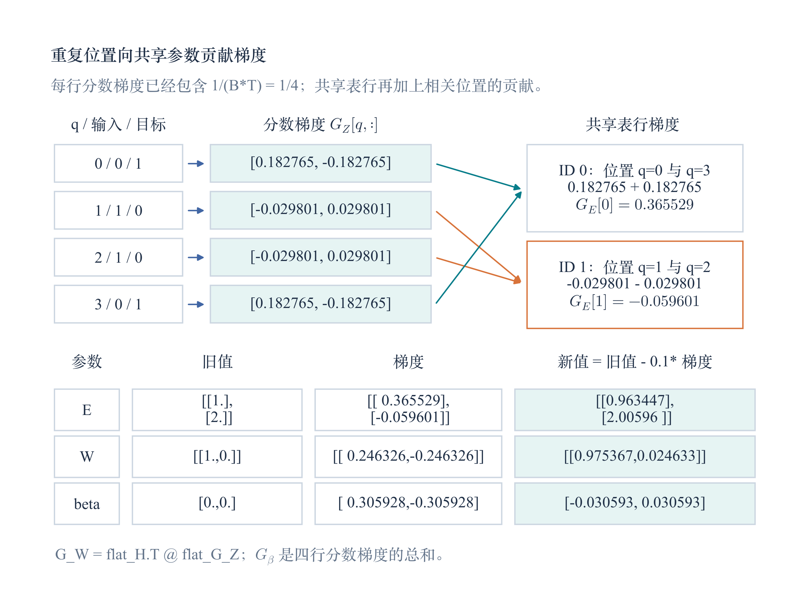{width=100%}

**图 03.21-2——四个位置的贡献构成三个共享参数的梯度。** 每项贡献已经包含平均因子 $\frac{1}{4}$。下方表格展示旧值、梯度与新值，每列都使用同一个样例。

### 写代码之前：语法与状态

`parameters = (embedding_table, output_weights, output_bias)` 创建含三个引用的元组，不复制张量。`for parameter in parameters:` 逐个访问原张量。循环内的 `parameter.grad = None` 清除此前的导数缓冲区，参数值保持不变。

反向传播通常会向已有梯度累加。**本批次内部**重复 ID 的贡献应该相加；本作业中，**上一次更新**留下的梯度应该先清除。跨批次梯度累积是后续有意设计的训练方法。

直到调用 `loss.backward()`，`loss` 都必须是保持连接的标量张量。另存 `loss_value = loss.item()`，得到用于报告的 Python 浮点数。浮点数没有 `.backward()` 方法。普通反向传播生成不跟踪梯度的导数缓冲区，对 `.grad` 调用 `.clone()` 就能取得独立副本，不需要再 detach。

`with torch.no_grad():` 把梯度跟踪设置限定在缩进块内，只把三个更新放进去。`embedding_table -= learning_rate * embedding_table.grad` 原地修改原参数。用 `=` 赋值为新计算出的张量只会重新绑定局部名字，不会更新调用者原来的参数。

### 八步实现计划

只填写 `batch_train_step` 标出的学生区域。加载器已经提供两个 03.20 函数，不用在这里重新实现 softmax 或手写导数。

1. **清除上次梯度。** 四空格：把三个参数组成 `parameters`，再开始 `for parameter in parameters:`。循环体用八空格，把 `.grad` 设为 `None`。不放入 ID；所有参数数值保持原样。
2. **计算批量分数。** 回到四空格，调用一次 `compute_batch_logits(embedding_table, input_ids, output_weights, output_bias)`，保存为 `logits`，例子中形状为 `[2,2,2]`。前向计算在 no-grad 外。
3. **计算保持连接的平均损失。** 四空格，调用一次 `batch_cross_entropy(logits, target_ids)`，保存为 `loss`。这是接近 `0.7200948493` 的标量张量。目标不变，直接使用已有函数的平均值。
4. **反向传播一次。** 四空格，调用 `loss.backward()`。此时 `embedding_table.grad`、`output_weights.grad`、`output_bias.grad` 都对应相同旧参数。先完成反向，再更新。
5. **保存报告数值。** 四空格，用 `loss.item()` 保存 `loss_value`。张量变量和用于报告的浮点变量分开。
6. **复制三个梯度。** 四空格，对各自 `.grad` 调用 `.clone()`，分别得到 `gradient_table`、`gradient_weights`、`gradient_bias`。例子的完整数值就是上面的三个矩阵／向量。
7. **更新原参数。** 四空格开始 `with torch.no_grad():`。块内用八空格写三个明确的 `-=` 更新，每个参数使用自己的梯度。不需要再套循环。例子中表的首项变成 `0.9634470711`。
8. **返回旧状态的观察值。** 回到上下文外的四空格，按顺序返回 `loss_value, gradient_table, gradient_weights, gradient_bias`。本函数不重新做第二次前向。

### 检查命令与预期输出

在仓库根目录、已有环境中运行：

```bash
python exercises/03_21_batch_train_step.py
```

你实现核心后，预期输出为：

```text
PASS: four-position mean, all three gradients, in-place update, and pre-update return
PASS: varied B/T/D/V, distinct targets, singleton axes, and one-candidate zero gradients
PASS: completed batch helpers called once with unchanged old parameters before backward
PASS: stale gradients cleared, repeated calls use current parameters, and snapshots stay independent
PASS: zero learning rate still computes gradients; a large step can increase loss
PASS: strided ID tensors, IDs above 255, dtype preservation, and fixed input/random state
PASS: actual window builder and batch helpers connect across three toy updates
Lesson 03.21 checks passed.
```

实现前，特意保留的 `NotImplementedError` 表示学生区域还没有填写。检查用独立的库函数参考对比损失和梯度，验证更新与原存储保留，并接起实际前置函数。这些是本作业提供的检查程序，不是你要编写的代码。

### 问答、适用范围与理解检查点

**这里是更新四次吗？** 四个监督位置共同形成一个平均损失，一次反向传播，再联合更新一次参数。参数改变之前，它的梯度已经包含所有相关位置的贡献。

**为什么相同位置的贡献会相加，而整个批次复制一遍后平均值不变？** 额外贡献增大总和，复制整个批次时平均分母也按比例增大。本例每项已含 $\frac{1}{4}$，共享表行再加上自己的两项贡献。任意改变批次并不保证平均值或梯度相同。

**清除 `.grad` 会清除学到的参数吗？** 不会，只重置导数缓冲区。下次前向仍使用已经更新过的参数。

**no-grad 会让训练停止吗？** 它避免把参数更新操作本身接入新的求导图。本次所需梯度已经在该上下文外通过前向和反向计算完成。

**为什么这里返回浮点数，03.20 却返回张量？** 03.20 是供调用者求导的损失组件。本训练步骤已经完成反向传播，返回的是报告数值和复制好的导数。

**每次更新一定降低损失吗？** 不一定。例子的小步长降低了本批次损失，大步长可能提高它。这个微小固定样例的训练损失下降，不证明泛化能力或语言模型能力。

**能独立还原原理吗？** 可选检查点：解释四位置分母；推导 `2a` 和 `2c`；解释全部梯度为什么必须来自旧状态；区分此前更新的残留梯度与重复 ID；解释副本和返回时间。可以先口述，再对照算例核对。

## 03.22 按顺序持续训练多个批次 {#section-03-22}

训练不总是反复看同一批数据。一张有顺序的起点表，让我们能追踪不同批次怎样依次作用于同一组参数。它还会带来一个值得仔细理解的现象：历史损失升高，可能是因为数据换了，不一定是更新写错了。

先走完下面的小例子，再对照 03_22_batch_training_loop.py 动手。编号步骤会说明函数接口，并引导核心实现；初始化和检查驱动由配套文件提供。

### 准确输入、返回值与状态

| 准确名称 | 类型与形状 | 含义 |
| --- | --- | --- |
| `embedding_table`，$E$ | 可训练的浮点叶子张量 `[V,D]` | 已经存在的 token 向量表 |
| `token_ids` | 固定的 `torch.long` 张量 `[N]` | 构造批次的源序列 |
| `output_weights`，$W$ | 可训练的浮点叶子张量 `[D,V]` | 已经存在的词表投影 |
| `output_bias`，$\beta$ | 可训练的浮点叶子张量 `[V]` | 已经存在的候选偏置 |
| `batch_starts` | `list[list[int]]` | 有序调度表；每个内层列表提供一个批次／一次更新的起点 |
| `context_length`，$T$ | 正 Python 整数 | 每行输入／目标的位置数 |
| `learning_rate`，$\eta$ | 非负 Python 浮点数 | 原样传给每次更新的倍率 |

$N$ 是源序列长度，$D$ 是向量长度，$V$ 是候选数。令 $K=$ `len(batch_starts)`；更新下标 $k$ 对应的样本数为 $B_k=$ `len(batch_starts[k])`。各批次样本数可以不同。例如 `[[0,1],[3,4]]` 表示更新两次，每次两个样本；`[[0],[3,4]]` 表示更新两次，样本数依次为一和二。$K$ 数更新次数，$B_k$ 数该次更新内部的样本。

假设 $N\ge T+1$，每个内层列表非空，起点满足 $0\le\texttt{start}\le N-T-1$，ID 合法，浮点类型／设备兼容，参数分别存储，并处于正常梯度模式。允许重复起点。**外层**调度表可以为空，不布置输入验证。

返回一个新的 `losses: list[float]`，长度为 $K$，顺序与更新顺序一致。原参数保留最终值，不返回替代张量。源 ID、嵌套调度表、调用者梯度模式和随机状态保持不变。最后一次更新的梯度保留在缓冲区。空调度返回 `[]`，不调用两个函数，原参数值与已有梯度缓冲区都保持不变。

### 批次变化，参数持续保留

对更新 $k$，记起点列表为 $S_k$，样本数为 $B_k$，样本下标为 $b$。其中 $k=0,\ldots,K-1$、$b=0,\ldots,B_k-1$、$t=0,\ldots,T-1$：

$$
(X_k)_{b,t}=\texttt{token\_ids}[S_k[b]+t],\qquad
(Y_k)_{b,t}=\texttt{token\_ids}[S_k[b]+t+1]
$$

两个张量形状均为 $[B_k,T]$，目标已向后错位一位。复用 `make_next_token_batch(token_ids, start_positions, context_length)`，不用再次编写切片逻辑。

令 $\theta_k=(E_k,W_k,\beta_k)$ 表示已经更新 $k$ 次、下一次更新之前的参数。使用这组参数产生的数学候选概率：

$$
\mathcal L_k=\mathcal L(\theta_k;X_k,Y_k)
=-\frac{1}{B_kT}\sum_{b,t}\log P_{\theta_k}(Y_{k,b,t}\mid X_{k,b,t})
$$

这里的条件概率符号指当前 ID 查表基线，不表示已经通过 attention 利用了完整前缀。每一步求导时，输入和目标固定，求的是损失对当前参数的导数。

$$
\theta_{k+1}=\theta_k-\eta\nabla_\theta\mathcal L(\theta_k;X_k,Y_k),\qquad
\texttt{losses}[k]=\mathcal L_k
$$

递推意味着第二次调用从第一次更新后的参数开始。在循环中重新创建参数或恢复初始值会破坏这条关系。`batch_train_step` 已经负责清旧梯度、前向／反向、复制观察值和更新三个参数；本外层函数组织数据、记录返回损失，不再额外 backward 或更新。

更新次数与监督位置预算为：

$$
K=\operatorname{len}(\texttt{batch\_starts}),\qquad
M=T\sum_{k=0}^{K-1} B_k
$$

$M$ 数处理过的监督位置，包含重复窗口和重叠，不是源序列中互不重复的 ID 数，也不是新增生成 token 数或词表大小。

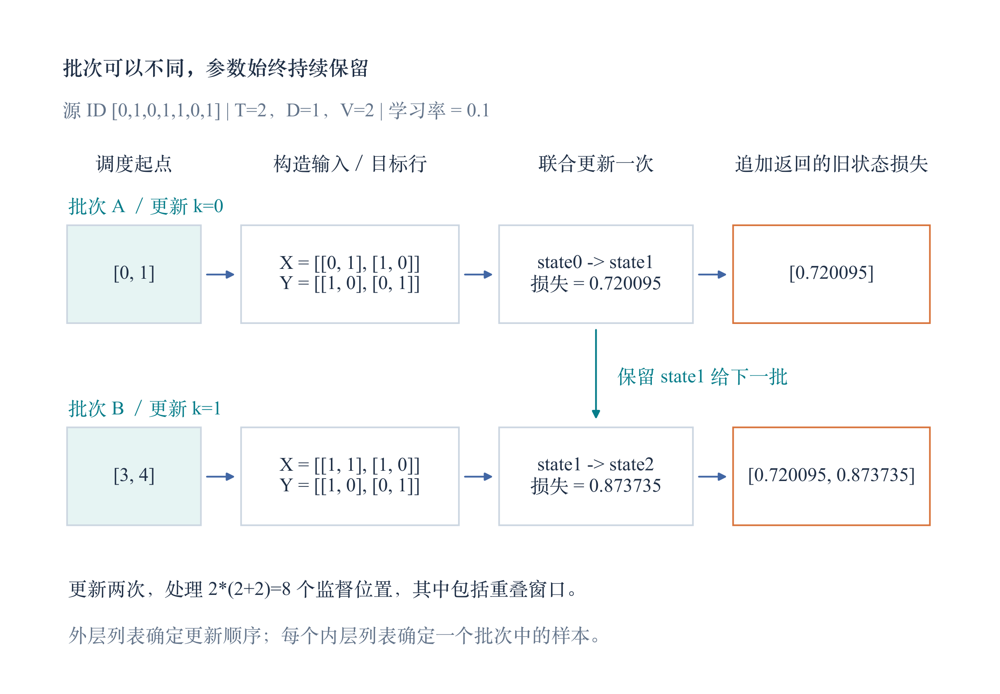{width=100%}

**图 03.22-1——从上到下读两行更新。** 每行列出源起点、构造的输入和目标、更新前后参数状态，以及一个返回损失。第一行产生第二行继续使用的状态。

### 完整例子：两个不同批次

使用手动指定的正确性样例 `ordered-two-batch-v1`：

```text
token_ids = [0,1,0,1,1,0,1]
batch_starts = [[0,1],[3,4]]
context_length = 2
learning_rate = 0.1
```

初始参数为 `E=[[1],[2]]`、`W=[[1,0]]`、`beta=[0,0]`，因此 $D=1,V=2$。更新次数 $K=2$，每次样本数 $B_0=B_1=2$，处理的监督位置为 $M=2(2+2)=8$。源序列只有七个 ID，重叠窗口仍然可以合法地处理八个监督位置。

#### 第一批：起点 [0,1]，状态 $\theta_{0}$

起点零得到输入 `[0,1]`、目标 `[1,0]`；起点一得到输入 `[1,0]`、目标 `[0,1]`：

$$
X_0=\begin{bmatrix}0&1\\1&0\end{bmatrix},\qquad
Y_0=\begin{bmatrix}1&0\\0&1\end{bmatrix}
$$

这与 03.21 的完整例子相同。展开分数为 `[1,0],[2,0],[2,0],[1,0]`，目标 `[1,0,0,1]` 选择概率 `[0.2689414214,0.8807970780,0.8807970780,0.2689414214]`，四个位置损失为：

```text
[1.3132616875, 0.1269280110, 0.1269280110, 1.3132616875]
```

平均为 $L_0=0.7200948493$。旧状态梯度为：

```text
G_E    = [[ 0.3655292893],[-0.0596014610]]
G_W    = [[ 0.2463263673, -0.2463263673]]
G_beta = [ 0.3059278283, -0.3059278283]
```

第一步把原参数更新为 $\theta_1$：

```text
E_1    = [[0.9634470711],[2.0059601461]]
W_1    = [[0.9753673633,0.0246326367]]
beta_1 = [-0.0305927828,0.0305927828]
losses = [0.7200948493]
```

虽然 append 发生在函数返回之后，该数字表示的是**更新之前**的状态，不用新参数重新计算它。

#### 第二批：起点 [3,4]，状态 $\theta_{1}$

起点三得到输入 `[1,1]`、目标 `[1,0]`；起点四得到输入 `[1,0]`、目标 `[0,1]`：

$$
X_1=\begin{bmatrix}1&1\\1&0\end{bmatrix},\qquad
Y_1=\begin{bmatrix}1&0\\0&1\end{bmatrix}
$$

源序列包含 $1\to 1$，这些目标是正确的。使用上一轮得到的 $\theta_1$：输入一的分数为 `[1.9259552757,0.0800048704]`，输入零为 `[0.9091220465,0.0543250245]`。例如，输入一、候选零的分数为 $2.0059601461\times 0.9753673633 - 0.0305927828 \approx  1.9259552757$。

| q | 输入 ID | 目标 ID | 选中的概率 | 位置损失 |
| --- | --- | --- | --- | --- |
| 0 | 1 | 1 | `0.1363490673` | `1.9925370102` |
| 1 | 1 | 0 | `0.8636509327` | `0.1465866049` |
| 2 | 1 | 0 | `0.8636509327` | `0.1465866049` |
| 3 | 0 | 1 | `0.2984275419` | `1.2092281165` |

因此：

$$
\mathcal L_1=\frac{1.9925370102+0.1465866049+0.1465866049+1.2092281165}{4}
\approx0.8737345841
$$

第二次的旧状态梯度为：

```text
G_E    = [[0.1667523248],[0.1404598367]]
G_W    = [[0.4653389228,-0.4653389228]]
G_beta = [0.3231313141,-0.3231313141]
```

例如，最后位置的分数梯度约为 `[0.1753931145,-0.1753931145]`，乘 $W_1^{\mathsf T}$ 得到输入零的表梯度 $0.1753931145\times (0.9753673633-0.0246326367) \approx  0.1667523248$。三个输入一位置共同向其共享表行贡献梯度。完整链式法则推导保存在 03.21；本循环交给单步函数完成。

第二次更新后，同一组原张量保存 $\theta_2$：

```text
E_2    = [[0.9467718386],[1.9919141624]]
W_2    = [[0.9288334710,0.0711665290]]
beta_2 = [-0.0629059142,0.0629059142]
losses = [0.7200948493,0.8737345841]
```

返回这个两项历史。例如 $(E_2)_{0,0}=0.9634470711-0.1\times0.1667523248\approx0.9467718386$。调用者已经持有最终参数张量；另外做最终评估不等于第三次更新，也不自动增加一条历史。

### 为什么返回的损失历史可以上升

两项历史使用不同数据，也使用不同参数状态：

$$
\texttt{losses}[0]=\mathcal L(\theta_0;X_0,Y_0),\qquad
\texttt{losses}[1]=\mathcal L(\theta_1;X_1,Y_1)
$$

第二批包含当前模型较难预测的 $1\to 1$ 目标。只比较 `0.720095` 与 `0.873735`，不能单独看出参数更新的作用。作为本例说明，把两个固定批次分别在同样的连续参数状态下重新计算：

| 参数状态 | 固定批次 A | 固定批次 B |
| --- | --- | --- |
| $\theta_0$ | `0.7200948493` | `0.9235114302` |
| $\theta_1$ | `0.6779073607` | `0.8737345841` |
| $\theta_2$ | `0.6404176541` | `0.8092791313` |

**本例中**两列固定数据的损失都下降，而记录历史从 $\theta_0$ 上的 A 切换到了 $\theta_1$ 上的 B。这些固定批次重算用于解释例子，不是留出的验证集。小步长也不保证一般情况下每批损失都下降。后续会定义固定评估协议和独立验证划分。

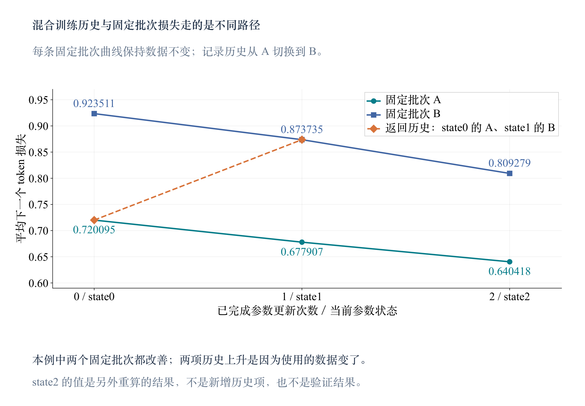{width=100%}

**图 03.22-2——横轴为已经完成的更新次数。** 两条实线各自保持数据固定，只改变参数。橙色虚线历史连接更新次数零时的 A 与次数一时的 B。它只有两项，次数二对应的最终状态不会自动加入历史。

### 实现前先讲语法与控制流程

`batch_starts` 是嵌套列表。`for start_positions in batch_starts:` 逐个访问内层列表本身。对于 `[[0,1],[3,4]]`，循环变量先是 `[0,1]`，然后是 `[3,4]`，不是更新下标 `0,1`，也不是某个单独起点。

`make_next_token_batch(...)` 返回两个张量，用元组解包保存为 `input_ids, target_ids`。`batch_train_step(...)` 返回四项元组，保存为 `step_result`；`[0]` 选择更新前的 Python 浮点数。`losses.append(loss_value)` 向新的列表添加一个浮点数。

函数内初始化、`for` 开头和最后 `return` 使用四空格，循环内部使用八空格。外层列表为空时，循环体执行零次，仍然到达 `return losses`。把 return 写在循环里面会在第一批后就结束，也不能正确处理空调度。

批次构造函数负责目标对齐，单步函数负责清梯度、前向／反向、副本和更新。这个组织循环保持正常梯度模式，不需要外层 no-grad、额外更新或重新创建参数。

### 七步实现计划

完成 03.21 后，只填写 `train_batches` 标出的学生区域。

1. **创建历史。** 四空格，用 `[]` 创建 `losses`。初始状态是一个新的空列表；参数张量已经存在。
2. **访问调度批次。** 四空格，开始 `for start_positions in batch_starts:`。八空格循环体在例子中依次收到 `[0,1]` 与 `[3,4]`。
3. **构造当前批次。** 八空格，调用一次 `make_next_token_batch(token_ids, start_positions, context_length)`，解包为 `input_ids, target_ids`。第一批形状均为 `[2,2]`，直接使用已有的目标错位。
4. **训练一次。** 八空格，调用一次 `batch_train_step(embedding_table, input_ids, output_weights, output_bias, target_ids, learning_rate)`，保存为 `step_result`。它把原参数改成下一状态。
5. **选择旧状态损失。** 八空格，把 `step_result[0]` 保存为 `loss_value`。第一次为 `0.7200948493`，第二次为 `0.8737345841`。
6. **追加一次。** 八空格，使用 `losses.append(loss_value)`。不存整个元组或梯度，两次更新后列表含两个浮点数。
7. **循环后返回。** 四空格，返回 `losses`。空调度得到 `[]`；调用者原参数持有最终状态，不添加最终重算损失。

### 检查命令与预期输出

完成前置 03.21 和本课核心后，在仓库根目录运行：

```bash
python exercises/03_22_batch_training_loop.py
```

预期输出：

```text
PASS: two different batches, pre-update history, and persistent final parameters
PASS: empty schedule returns a fresh list and preserves values and existing gradient buffers
PASS: supplied batch order, varying batch sizes, repeated starts, and aligned targets
PASS: one builder and one step call per batch, same parameter objects, and normal gradient mode
PASS: separate calls continue from current parameters and keep independent loss histories
PASS: zero learning rate still visits every scheduled batch and records one loss each
PASS: strided source, IDs above 255, dtype preservation, and unchanged source/schedule/random state
Lesson 03.22 checks passed.
```

实现之前，`NotImplementedError` 标记尚未填写的核心实现。即使 03.22 循环已完成，非空调度也需要 03.21 单步函数。检查程序的初始化与库函数参考已经提供，不是额外的学生任务。

### 阅读问答与理解检查点

**一个批次是整条源序列吗？** 不是。源序列形状为 `[N]`，内层起点列表选择多个长度为 $T$ 的窗口，组成 $[B_k,T]$；外层调度表指定每次更新使用哪个批次。

**相同输入 ID 对应不同目标，说明对齐错了吗？** 不一定。源序列既有 $1\to 0$ 也有 $1\to 1$，当前 ID 基线必须为这些输入一共享同一分布。后续上下文模型可以利用前文区分出现位置，数据目标仍然是实际下一个 ID。

**每次循环都重新初始化参数吗？** 不要。保留递推：下一批使用上一轮学到的状态。单独再次调用这个函数，也从调用者提供的当前参数值继续。

**空调度等于学习率为零吗？** 不等于。空调度不构造批次、不调用训练步骤、不改变梯度；非空调度配零学习率仍然逐批计算损失／梯度、记录结果，只是参数数值不变。

**这里是一个 epoch 或随机采样吗？** 调度表只是有序列表，不保证完整覆盖数据一次，也没有引入随机性。epoch 定义、打乱与随机流归属会在后面明确引入。

**能把混合历史当成验证结果吗？** 这些值对应变化中的训练数据和参数状态。在给定状态使用固定评估集，是另一种测量。如果批次大小不同，对批次均值再平均也需要有意选择权重；完整评估留到后续。

可选独立检查点：区分 $N$、$K$、$B_k$、$T$；手动构造两批；追踪旧状态损失时间与共享参数连续性；解释混合历史上升、空调度与零学习率。可以先口述，再用一个小例子核对。

## 03.23 固定参数下的批量损失评估 {#section-03-23}

要比较模型状态，测量本身就不能一边测一边训练。评估把参数固定下来，汇总所有选中位置的损失。各批大小不同时，只有按位置数加权，最后的平均值才真正对应我们想衡量的那个整体。

先走完下面的小例子，再对照 03_23_evaluate_batches.py 动手。编号步骤会说明函数接口，并引导核心实现；初始化和检查驱动由配套文件提供。

### 准确输入、返回值与状态

| 准确名称 | 类型／形状 | 含义 |
| --- | --- | --- |
| `embedding_table`，$E$ | 浮点张量 `[V,D]` | 提供的 token 向量 |
| `token_ids` | 固定的 `torch.long` 张量 `[N]` | 提供的评估源序列 |
| `output_weights`，$W$ | 浮点张量 `[D,V]` | 提供的词表投影 |
| `output_bias`，$\beta$ | 浮点张量 `[V]` | 提供的候选偏置 |
| `batch_starts` | 非空 `list[list[int]]` | 每批一个非空起点列表 |
| `context_length`，$T$ | 正整数 | 每条样本的监督位置数 |

没有 `learning_rate`：评估函数读取提供的参数状态。参数可以 `requires_grad=True` 或 `False`，这些标记保持不变。假设 ID 合法、浮点类型／设备兼容、$N\ge T+1$、起点满足 $0\le\texttt{start}\le N-T-1$，分数有限且处于检查支持的数值范围内，不布置输入验证。

返回一个 Python 浮点数：位置损失总和除以总位置数。保留参数值／存储／类型／设备／可训练标记、已有梯度缓冲区对象和值、源 ID、嵌套调度表、调用者梯度模式和随机状态。不 backward、清梯度、更新参数，也不调用 `batch_train_step`／`train_batches`。

各批可以有不同的 $B_k$。每次调度出现都计入，包括重复起点和重叠窗口。同一个参数状态下，覆盖相同位置出现次数时，改变分批方式不改变结果；只重复或更换其中一些位置，会改变权重，也可能改变指标。

### 只有一个固定参数状态

令 $\theta=(E,W,\beta)$ 在全部 $K$ 个评估批次中保持固定。第 $k$ 批有 $B_k$ 行，每行 $T$ 个位置，因此监督位置数 $n_k=B_kT$。批次构造函数提供对齐的输入 $X_k$ 与目标 $Y_k$。

下标范围为 $k=0,\ldots,K-1$、$b=0,\ldots,B_k-1$、$t=0,\ldots,T-1$、$d=0,\ldots,D-1$，候选 $v,j=0,\ldots,V-1$。每个位置的候选分布和目标损失为：

$$
Z_{k,b,t,v}=\sum_d E[X_{k,b,t},d]W_{d,v}+\beta_v,\qquad
P_{k,b,t,v}=\frac{e^{Z_{k,b,t,v}}}{\sum_j e^{Z_{k,b,t,j}}}
$$

$$
\ell_{k,b,t}=-\log P_{k,b,t,Y_{k,b,t}},\qquad
\overline{\mathcal L}_k=\frac1{n_k}\sum_{b,t}\ell_{k,b,t}
$$

稳定损失函数返回 $\overline{\mathcal L}_k$，即**这一批内部的平均值**。本课要求每个调度位置等权的整体目标：

$$
M=\sum_{k=0}^{K-1} n_k,\qquad
\mathcal L_{\mathrm{eval}}=\frac1M\sum_{k,b,t}\ell_{k,b,t}
=\frac{\sum_k n_k\overline{\mathcal L}_k}{\sum_k n_k}
$$

这个等式来自每批均值乘自身数量：$n_k\overline{\mathcal L}_k=\sum_{b,t}\ell_{k,b,t}$。先加总这些位置损失总和，再除一次总位置数。全部位置等权，没有 padding、忽略 ID、类别权重或标签平滑。

代码中，`target_ids.numel()` 给出 $n_k$，`loss.item()*batch_positions` 还原该批损失总和，两个 Python 累加变量保存总和与总数量。

作为比较，让每批均值等权会得到：

$$
\mathcal L_{\mathrm{batches}}=\frac1K\sum_k\overline{\mathcal L}_k
$$

这个指标中，第 $k$ 批的一个位置权重为 $1/(Kn_k)$；本课目标给每个位置权重 $1/M$。批次大小相同时两个公式相同，不同时通常不同；某些损失值碰巧相同，不表示两个目标相同。

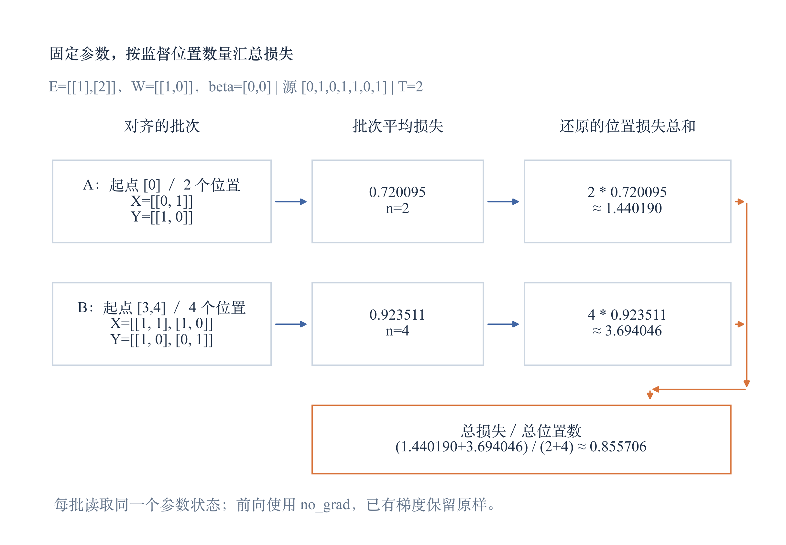{width=100%}

**图 03.23-1——沿两批数据进入最终汇总。** 两行使用同一组参数，各自的位置数先乘返回均值再相加，最后分母是六个位置。

### 完整例子：两个位置与四个位置

使用手动指定的正确性样例 `fixed-eval-six-pairs-v1`：

```text
token_ids = [0,1,0,1,1,0,1]
batch_starts = [[0],[3,4]]
context_length = 2
E = [[1],[2]]
W = [[1,0]]
beta = [0,0]
```

这里 $N=7,T=2,D=1,V=2$。第一批一个样本，第二批两个样本，整个过程都使用这些初始参数。特别是，第二批**不使用** 03.22 例子中已经更新后的参数。

#### 批次 A：起点 [0]，B=1，n=2

```text
input_ids  = [[0,1]]
target_ids = [[1,0]]
logits     = [[[1,0],[2,0]]]
```

输入零、目标一的概率为 $e^{-1}/(1+e^{-1})\approx0.2689414214$，损失为 $1+\log(1+e^{-1})\approx1.3132616875$。输入一、目标零的概率为 $1/(1+e^{-2})\approx0.8807970780$，损失为 $\log(1+e^{-2})\approx0.1269280110$。

$$
\overline{\mathcal L}_A=\frac{1.3132616875+0.1269280110}{2}
\approx0.7200948493
$$

乘两个位置，还原为 `1.4401896986`。累计值变成 `loss_sum=1.4401896986`、`total_positions=2`。

#### 批次 B：起点 [3,4]，B=2，n=4

```text
input_ids  = [[1,1],[1,0]]
target_ids = [[1,0],[0,1]]
logits     = [[[2,0],[2,0]],[[2,0],[1,0]]]
```

四个位置仍然使用初始 `E,W,beta`：

| 展开位置 | 输入 ID | 目标 ID | 目标概率 | 位置损失 |
| --- | --- | --- | --- | --- |
| 0 | 1 | 1 | `0.1192029220` | `2.1269280110` |
| 1 | 1 | 0 | `0.8807970780` | `0.1269280110` |
| 2 | 1 | 0 | `0.8807970780` | `0.1269280110` |
| 3 | 0 | 1 | `0.2689414214` | `1.3132616875` |

第一行更难：分数 `[2,0]`、目标一，损失为 $2+\log(1+e^{-2})\approx2.1269280110$。四个损失之和为 `3.6940457206`，均值为 `0.9235114302`。

累计值现在为：

```text
loss_sum = 1.4401896986 + 3.6940457206 = 5.1342354192
total_positions = 2 + 4 = 6
```

因此返回：

$$
\mathcal L_{\mathrm{eval}}
=\frac{2(0.7200948493)+4(0.9235114302)}6
\approx0.8557059032
$$

把两批的平均损失分别简记为 $L_A$、$L_B$，同一个加权结果也可以写成：

$$
L_{eval}=\frac{2L_A+4L_B}{6}\approx0.8557059032
$$

直接平均两批均值则得到：

$$
\mathcal L_{\mathrm{batches}}
=\frac{0.7200948493+0.9235114302}{2}
\approx0.8218031397
$$

这种方式让小批次中的一个位置，相对于大批次中的一个位置权重更高。批次等权时，A 的两个位置各占 $\frac{1}{4}$，B 的四个位置各占 $\frac{1}{8}$；本课的位置均值使六个位置都占 $\frac{1}{6}$。用显示的舍入值计算，末位可能略有不同；检查和插图使用完整精度。

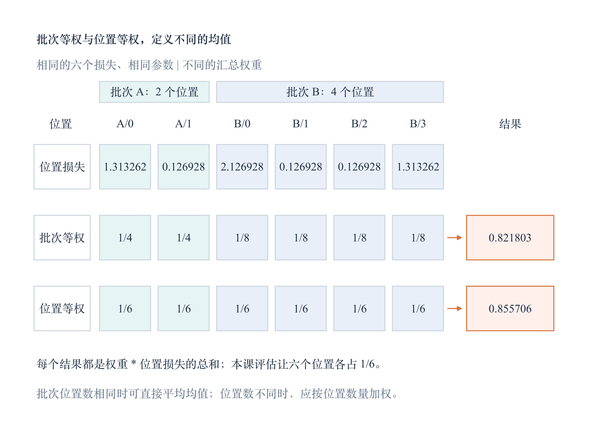{width=100%}

**图 03.23-2——沿每个位置列向下读。** 损失不变，两行汇总方式的权重不同。每个结果都是 `权重*位置损失` 的总和；位置等权这一行实现本作业要求的目标。

### 评估状态与 no-grad 范围

用 `with torch.no_grad():` 包住评估循环。它关闭查表、投影、损失等操作的普通反向模式梯度计算记录，保留参数可训练标记；退出上下文时恢复调用者此前的梯度模式。[PyTorch no-grad 文档](https://docs.pytorch.org/docs/2.0/generated/torch.no_grad.html)。

no-grad 本身不会禁止原地修改，03.21 就在其中有意更新参数。本评估函数通过只读取参数、计算前向与损失来保留参数值，也不清除已有 `.grad`；其中可能还存着上一次训练的导数。这些缓冲区保持原样，新的评估分数／损失张量没有求导图。

以后使用 `nn.Module` 模型时，还可能需要 `model.eval()` 来改变层的行为。例如，随机失活（Dropout）在训练时随机屏蔽激活值，切到评估模式后停止这种操作。模块模式与梯度跟踪是两件事：单独使用 no-grad，不会让这种层切换到评估行为。本作业只有普通参数张量，不对它们调用 `.eval()`。[模块评估文档](https://docs.pytorch.org/docs/2.0/generated/torch.nn.Module.html#torch.nn.Module.eval)。

评估需要报告数值，所以计算均值张量后使用 `.item()` 合适。03.20 如果直接返回 `.item()`，会去掉训练调用方需要的图；本评估函数没有要执行的反向传播。

### 动手前：语法与缩进

`loss_sum = 0.0` 初始化 Python 浮点数，`total_positions = 0` 初始化 Python 整数，每次调用重新创建。`target_ids.numel()` 返回元素数量：`[1,2]` 形状有两个，`[2,2]` 有四个，不是 ID 数值之和，也不是词表候选数。

初始总量与 `with torch.no_grad():` 使用四空格；上下文里面的 `for start_positions in batch_starts:` 使用八空格；循环内部构造批次、计算分数／损失／汇总使用十二空格。最后除法和 return 回到四空格，在循环和上下文之外。

嵌套让整个循环使用局部梯度设置。`+=` 增加累计量；先乘该批位置数，是把已有批次均值还原为总和，不是在重复求平均。非空输入假设保证最后分母为正。

### 八步实现计划

只填写 `evaluate_batches` 标出的学生区域。

1. **创建总量。** 四空格，把 `loss_sum` 初始化为 `0.0`，`total_positions` 初始化为 `0`。参数已提供，保留值和标记。
2. **进入评估梯度范围。** 四空格，开始 `with torch.no_grad():`，梯度设置限定在这个上下文。
3. **访问批次。** 八空格，开始 `for start_positions in batch_starts:`。循环体十二空格；例子依次取 `[0]`、`[3,4]`。
4. **构造对齐的 ID。** 十二空格，调用一次 `make_next_token_batch(token_ids, start_positions, context_length)`，解包为 `input_ids, target_ids`，形状依次为 `[1,2]`、`[2,2]`。
5. **计算原始分数。** 十二空格，调用一次 `compute_batch_logits(embedding_table, input_ids, output_weights, output_bias)`，保存 `logits`。形状依次为 `[1,2,2]`、`[2,2,2]`，使用完全相同的参数值。
6. **计算该批均值。** 十二空格，调用一次 `batch_cross_entropy(logits, target_ids)`，保存 `loss`。均值约为 `0.7200948493` 和 `0.9235114302`。
7. **加总损失与数量。** 十二空格，取 `batch_positions = target_ids.numel()`；`loss_sum` 增加 `loss.item()*batch_positions`，`total_positions` 增加 `batch_positions`。累计值从 `(1.4401896986,2)` 变成 `(5.1342354192,6)`。
8. **返回整体位置均值。** 回到四空格，返回 `loss_sum / total_positions`。得到接近 `0.8557059032` 的 Python 浮点数，原参数状态和已有梯度保持不变。

### 检查命令与预期输出

实现本核心后，在仓库根目录、已有环境中运行：

```bash
python exercises/03_23_evaluate_batches.py
```

预期输出：

```text
PASS: six-position mean weights unequal batch sizes and returns one Python float
PASS: grouping/order invariance for the same positions and deliberate duplicate-start counting
PASS: each completed helper reused once per batch under no-grad without score/loss graphs
PASS: fixed parameter values/storage/trainability and existing gradient objects/values preserved
PASS: repeated fixed-state results agree and changed supplied parameters are reevaluated
PASS: one-candidate zero loss and stable finite loss for extreme raw scores
PASS: strided source, merged IDs, floating dtypes, untrainable tensors, and caller-mode restoration
Lesson 03.23 checks passed.
```

动手前的 `NotImplementedError` 表示有意保留的学生区域。提供的独立参考把所有调度位置出现拼在一起，用库函数计算一个均值，不依赖本课的逐批加权汇总方式。数值前置函数已经完成，本检查程序不导入尚未完成的训练作业。

### 训练、验证与阅读问题

**调用这个函数就建立验证集了吗？** 没有，它测量调用者提供的源序列和窗口。训练损失使用参与更新的数据，验证损失使用没有用于这些更新的留出数据。熟悉的六对数据只演示计算；后续会实现可复现的数据划分和评估调度。

**应该在哪一步划分？** 先分开源文本／文档，再分别在各自部分内构造重叠窗口。先构造重叠窗口再分组，可能把相同 token 片段放入两边。后续语料协议也会记录分词器／数据版本与文档边界。

**更新前后比较时，哪些东西应该固定？** 保持评估源、起点调度、目标对齐、分词器解释、权重和模型行为一致。分别调用评估函数来比较参数状态，每次调用内部固定一个状态。

**可以打乱或重新分批吗？** 对当前确定性、位置独立的模型，只要调度位置出现的多重集合相同，整体位置均值在浮点舍入范围内相同；增删某些出现次数就改变权重。后续上下文模型重新分组样本时，还必须保留每条样本的上下文与 mask。

**为什么假设评估非空？** 零个位置的均值没有正分母，返回零会看起来像完美分数。本练习假设合法非空调度，不布置空集合策略；03.22 的空训练历史是另一种约定。

**评估损失更低就证明语言模型有用了吗？** 它表示在指定协议上，对目标分配的概率更好。泛化、生成质量、事实准确性和其他能力需要各自数据与评估。微小查表样例验证的是算术和状态行为。

可选独立检查点：推导按数量加权的均值；解释 `numel()` 与均值还原总和；区分 no-grad、可训练标记、已有梯度与后续模块模式；解释固定数据比较和留出源数据。

### 在课程中的位置

接下来的 [03.24](#section-03-24) 把编码、有序训练调度、本课固定参数评估与生成接成一次字节基线运行。评估器仍测量调用者提供的窗口；组合算例不会自动建立留出数据划分。

## 03.24 连接小型基线流水线 {#section-03-24}

小型语言模型基线的各个组件，终于可以接在一起运行了：编码文字，按明确的安排训练，评估最终参数，再把续写解码成文字。从头走完这条通路，既能看清我们已经搭成什么，也能看清下一章为什么必须加入上下文。

先走完下面的小例子，再对照 03_24_baseline_pipeline.py 动手。编号步骤会说明函数接口，并引导核心实现；初始化和检查驱动由配套文件提供。

### 三个阶段各做什么

记参数为

$$
\theta=(E,W,\beta),\qquad E\in\mathbb R^{256\times1},\quad W\in\mathbb R^{1\times256},\quad\beta\in\mathbb R^{256}
$$

$E$ 是词向量表，$W$ 是词表投影，$\beta$ 是偏置。$V=256$ 来自字节 ID 0–255；$D=1$ 是教学选择，两者含义不同。给定初始化返回 $E$ 全一、$W$ 和 $\beta$ 全零，三个张量都可训练。

每个输入位置独立查表并打分：

$$
h_{b,t}=E[X_{b,t}],\qquad z_{b,t}=h_{b,t}W+\beta,\qquad p_{b,t}=\operatorname{softmax}(z_{b,t})
$$

$b$ 是批内样本索引，$t$ 是窗口位置，$v$ 是词表候选 ID。真实目标 $Y$ 与输入 $X$ 已错位一格，不能再平移一次。

训练第 $k$ 批包含 $B_k$ 个窗口，每个窗口有 $T$ 个输入位置和对应目标。用 $K$ 统计本次运行的全部参数更新次数，包括调度的每次重复。每批计算平均下一 token 损失，再更新一次：

$$
L_k=-\frac1{B_kT}\sum_{b=0}^{B_k-1}\sum_{t=0}^{T-1}\log p_{\theta_k}(Y_{k,b,t}\mid X_{k,b,t}),
\qquad\theta_{k+1}=\theta_k-\eta\nabla_\theta L_k
$$

$\eta$ 就是 `learning_rate`，$T$ 就是 `context_length`。这些操作已在 03.21/03.22 完成，本课调用它们即可。`history[k]` 是更新前的 $L_{k}$，参数最后保留 $\theta_{K}$。

评估固定最终参数，对所有选中位置汇总：

$$
L_{eval}=\frac{\sum_j n_j\overline L_j(\theta_K)}{\sum_j n_j},\qquad n_j=B_jT
$$

$j$ 是评估批次索引。03.23 的 `evaluate_batches` 将每批均值按目标数量加权，并在 no-grad 下计算前向；它不会更新参数，也不会清掉已有梯度。

生成也固定 $\theta_{K}$，使用已有贪心函数，每次选一个新 ID：

$$
x_{new}=\arg\max_{v\in\{0,\ldots,255\}}p_{\theta_K}(v\mid x_{last})
$$

当前查表基线只依赖最后一个输入 ID。即使生成函数传入增长的前缀，模型也没有 attention；第四章才学习前文如何参与最后预测。

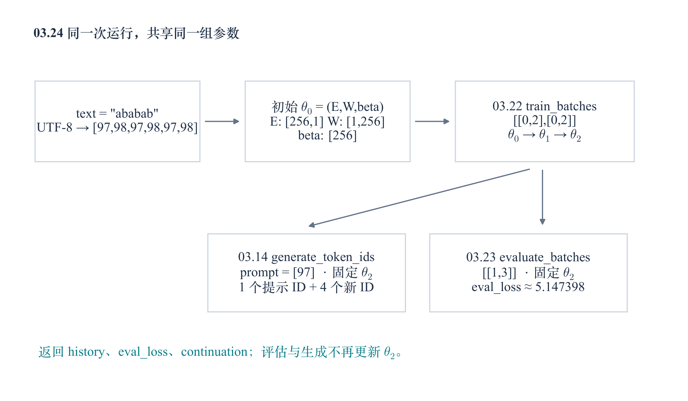{width=100%}

读图：上排按运行顺序初始化并训练；训练后的 $\theta_{2}$ 同时交给下排评估和生成。箭头表示运行的数据/状态交接，不表示评估结果再次用于更新。

### 准确输入与返回值

练习中的接口是：

```python
def run_baseline(
    text: str,
    train_starts: list[list[int]],
    eval_starts: list[list[int]],
    context_length: int,
    learning_rate: float,
    updates: int,
) -> dict:
```

| 输入 | 类型、含义 | 本例 |
| --- | --- | --- |
| text | 非空 ASCII 字符串，转成长度 $N$ 的字节 ID；$N\ge T+1$ | `"ababab"` |
| train_starts | 非空嵌套起点列表，每个内层列表是一批窗口 | `[[0,2]]` |
| eval_starts | 非空嵌套评估起点列表 | `[[1,3]]` |
| context_length | 正整数 $T$，每窗口有 $T$ 个输入与 $T$ 个下一目标 | `2` |
| learning_rate | 非负浮点 $\eta$，只交给训练步骤 | `0.2` |
| updates | 非负整数：把**整个 train_starts 调度重复几遍**，保留现有参数名 | `2` |

所有起点须满足 $0\le\texttt{start}\le N-T-1$，内层列表非空。本课假设输入合法，不另写参数验证。

特别注意：若 `train_starts` 有 $M$ 批，实际参数更新数是

$$
K=\texttt{updates}\times M,
\qquad C_{positions}=\texttt{updates}\times T\sum_{m=0}^{M-1}|\texttt{train\_starts}[m]|
$$

例如 `[[0],[1,3]] * 2` 得四批，不是两批；列表乘法重复列表项，不把起点乘二。它共享内层列表引用，而 03.22 保持调度不变，因此这里可以使用。

返回字典包含三个字段：

| 字段 | 类型 | 表示什么 |
| --- | --- | --- |
| `history` | `list[float]` | 每次训练更新前的平均损失 |
| `eval_loss` | `float` | 训练结束、参数固定时的评估均损失 |
| `continuation` | `str` | 新生成部分的文字，不含提示 |

此接口返回报告，不返回模型张量或检查点；后续课程再学习保存训练状态。

### 完整小例子：从文字走到返回字典

取上述表格中的输入。编码先得到：

```text
text       = "ababab"
位置       =  0   1   2   3   4   5
token_ids  = [97, 98, 97, 98, 97, 98]
```

`text.encode("utf-8")` 是 bytes；`list(...)` 是 `list[int]`；再转 `torch.long` 张量后形状为 `[6]`。long 是查表所需的整数存储类型，不改变 ID 的字节含义。

**先构造训练调度。** `[[0,2]] * 2` 得 `[[0,2],[0,2]]`，两次访问同一批起点。第一批：

```text
start=0: X=[97,98], Y=[98,97]
start=2: X=[97,98], Y=[98,97]

X=[[97,98],[97,98]], Y=[[98,97],[98,97]]
B=2, T=2, 输入/目标形状均为 [2,2]
```

初始 $E$ 的每行都是 `[1]`，$W$/$\beta$ 全零，因此四个位置的 256 个 logits 全为零。每个候选概率 $\frac{1}{256}$，每个目标损失为

$$
-\log(1/256)=\log256\approx5.5451774445
$$

四个相同损失的均值还是 5.5451774445，不再乘四或除四一次。03.22 记录此值，然后更新到 $\theta_{1}$。第二批数据相同，但使用 $\theta_{1}$，更新前损失约 5.3469056593；随后更新到 $\theta_{2}$。总预算是两批×两窗口×两目标=8 个监督位置出现，包括重复数据。

**再固定 $\theta_{2}$ 评估。** `eval_starts=[[1,3]]` 构造：

```text
start=1: X=[98,97], Y=[97,98]
start=3: X=[98,97], Y=[97,98]
```

这四个目标在最终参数下给出 `eval_loss≈5.1473975533`。它不是 history 的第三项，因为它发生在全部训练完成后。

{width=100%}

读图：$\theta_{0}$、$\theta_{1}$ 是两次更新的输入状态，所以其损失进入 history；$\theta_{2}$ 是最终状态，供单独评估。不同起点仍来自同一短文本，不是独立验证集。

**最后生成四个新 ID。** 提示取 `token_ids[:1]`，得到一维 `tensor([97])`。`generate_token_ids` 返回完整提示加新 ID，长度是 $1+4=5$。本次核对运行得到：

```text
完整 generated_ids = [97,98,98,98,98]
去掉一个提示 ID     = [98,98,98,98]
.tolist()           = [98,98,98,98]     # Python 整数列表
bytes(...)          = b"bbbb"
decode(...)         = "bbbb"           # Python 字符串
```

这是一次真实核对结果，不要求所有环境生成同一字串。数学上的 a/b 概率对称，微小浮点差异或并列选择会影响选 a 还是 b；检查关注正确接口和四个新字节的字符串。

返回报告在本次运行中约为：

```text
history      = [5.5451774445, 5.3469056593]
eval_loss    = 5.1473975533
continuation = "bbbb"
```

为什么不是自动续成 abab？这份特定初始化把所有词向量设成相同的 1，a/b 目标又均衡，更新保留对称性。a/b 的概率都约 0.005814517，比初始 0.00390625 高，因此损失下降；贪心生成仍可能重复同一 ID。一般当前-token 模型在参数打破对称时可以学习 a→b、b→a；这与它不能区分同末尾 ID 的不同上下文是两个问题。本课检验接线，不把下降或样本当成语言能力证据。

### 八步实现计划：你自己写核心

打开实际 03_24_baseline_pipeline.py，只编辑 START/END LEARNER CODE 之间区域。以下步骤均在函数内部，**四个空格缩进**；已有 helper 包含自己的循环，你不需要再添加训练循环。

1. **文字变 ID。** 用 `text.encode("utf-8")` 得到字节，再用 `list(text.encode("utf-8"))` 得到整数列表，把该列表传给 `torch.tensor` 并指定 `dtype=torch.long`，保存为 `token_ids`。本例期望 shape `[6]`、值 `[97,98,97,98,97,98]`。
2. **初始化一次。** 调用给定 `initial_parameters()`，元组拆包成 `embedding_table`、`output_weights`、`output_bias`。形状依次 `[256,1]`、`[1,256]`、`[256]`。之后同一次运行一直使用这三个对象。
3. **重复调度。** `train_starts * updates` 保存为 `training_schedule`。本例 `[[0,2],[0,2]]`；`updates=0` 得 `[]`，不用另写分支。
4. **调用训练。** `train_batches` 的实参依次为 `embedding_table, token_ids, output_weights, output_bias, training_schedule, context_length, learning_rate`，返回存 `history`。不要给整条流水线套 `no_grad()`，训练需要前向/反向计算图。
5. **调用评估。** `evaluate_batches` 依次接收 `embedding_table, token_ids, output_weights, output_bias, eval_starts, context_length`，返回存 `eval_loss`。没有学习率参数，也不要重新初始化或清梯度。
6. **构造提示并生成。** `context_ids` 取 `token_ids[:1]`，是一维张量 `[1]`；`token_ids[0]` 是标量、普通 `[97]` 是 Python 列表，都不是该 helper 要的形式。`generate_token_ids` 依次接收 `embedding_table, context_ids, output_weights, output_bias, 4`，返回存 `generated_ids`，shape `[5]`。
7. **仅解码续写。** 从 `generated_ids` 中切掉前 `context_ids.numel()` 个 ID，得到 `continuation_ids`。用 `continuation_ids.tolist()` 把张量变为 Python 列表，再用 `continuation_bytes = bytes(continuation_ids.tolist())` 把该列表构造成字节对象，最后调用 `continuation_bytes.decode("utf-8", errors="replace")`，得到 `continuation`。字节先拼起来再解码，不能逐字节单独解码。
8. **返回字典。** 用 `{"name": value}` 这种字典语法，把 `history`、`eval_loss`、`continuation` 三个键映射到已保存结果。返回语句仍四空格缩进。

删除占位 `raise NotImplementedError(...)` 后填核心，保留给定导入、初始化和检查程序。

### 边界与容易混淆的问题

- `updates=0`：`history=[]`，仍要评估并生成，初始评估损失 `ln256`。这不等于整个函数不执行。
- 本例最后预测可为 a 或 b；不要为了符合示意字串硬编码生成答案。
- 03.14 返回完整提示+续写，本函数只返回续写字符串。
- `errors="replace"` 只决定非法 UTF-8 的显示方式，不会修改训练目标、生成 ID 或模型参数。
- 评估和训练共用此算例文本，起点还会重叠；它只验证流程。独立验证必须先按文档划分，并用冻结分词器。
- 本课没有 BPE 合并 ID。换成 BPE 后，用词表将 ID 还原为 bytes，再拼接解码。
- 每次调用初始化一次与每批初始化一次不同，后者会丢掉前批的学习结果。

### 运行与检查

在现有 PyTorch 环境，从项目根目录运行：

```bash
python exercises/03_24_baseline_pipeline.py
```

成功的最后一行：

```text
Lesson 03.24 checks passed.
```

检查覆盖固定算例的旧状态历史/最终评估、零训练重复，以及同一组参数按顺序交给真实 helper。

### 阅读问答：列表重复、BPE 与提示长度

#### 列表乘法到底在做什么

Python 会根据操作数的类型选择运算。这里 `train_starts` 是 Python 列表，
列表乘非负整数表示重复序列，不是把列表里的每个数字乘一遍。

```python
[1, 2] * 3
# [1, 2, 1, 2, 1, 2]

[[0, 2]] * 3
# [[0, 2], [0, 2], [0, 2]]
```

内层 `[0,2]` 表示：从 ID 流的起点 0、2 各取一个窗口，组成一批，不是两批。
若原调度有两批：

```text
train_starts = [[0,2], [1,3]]
updates = 2
training_schedule = [[0,2], [1,3], [0,2], [1,3]]

第1次更新：起点 [0,2] 组成的一批
第2次更新：起点 [1,3] 组成的一批
第3次更新：起点 [0,2] 组成的一批
第4次更新：起点 [1,3] 组成的一批
```

当重复次数为 2 时，这相当于 `train_starts + train_starts`。整个调度之前只初始化
一次模型，重复列表不会重新初始化参数，每一批都接着上一批的参数继续训练。

这里的 `updates` 表示**整份批次调度的重复次数**。`train_starts` 的一次遍历可能
包含多个批次更新，因此实际 SGD 更新总数为 `len(train_starts)*updates`，
而不只是 `updates`。


#### 为什么此算例没有调用 BPE

03.24 框架先选了字节分词器，让训练、评估、生成的接线清楚可见：
`text.encode('utf-8')` 后取得字节 ID。BPE 会在字节序列上再应用学到的合并规则。
模型接收的是整数 ID，两种来源都可以；字节版是教学选择，不是模型只能用字节。
要自行扩展为 BPE 版本，可以复用第二章的训练、编码和词表序列化函数。下面的例子说明模型维度、窗口与解码步骤需要怎样一起调整。

看一个直接连接旧知识的例子，只冻结 $(97,98)\to 256$ 这一条合并：

```text
文字 "ababab"
字节 ID：    [97,98,97,98,97,98]   N=6，词表大小256
BPE ID：     [256,256,256]         N=3，词表大小257
vocab[256]： b"ab"
重新拼字节： b"ababab"
```

本例已用你实际的 `train_bpe`（词表上限257）、`encode_bpe`、`decode_bpe` 验证。
词表大小257等于256个基础项加一项合并，因此 ID256 在 BPE 词表中是合法的。

BPE 版本需要一起适配五处：

1. **编码：** 调用冻结的 `encode_bpe`。仅训练集学习规则，评估和生成提示复用同一份规则。
2. **模型维度：** 当前连续编号词表可取 $V=$ `len(vocab)`，$E$ 为 `[V,D]`，$W$ 为 `[D,V]`，偏置为 `[V]`。此处应为257，现有硬编码256行无法查到 ID256。
3. **窗口与计数：** 起点、$T$ 都按 BPE 后的 token 数计算。本例 $N$=3、$T$=2 时只有起点0合法；字节版 $N$=6、$T$=2 时允许0..3。因此原字节起点表不能直接搬过来，初始均匀损失也从 ln256 变为 ln257。
4. **解码：** 每个 ID 查 `vocab` 取 bytes，拼接后解码。`bytes([256])` 不合法，因为256是词表 ID，不是单个字节值。严格 `decode_bpe` 可用于合法 UTF-8 往返；模型可能生成任意字节，显示时仍需明确非法 UTF-8 策略。
5. **检查：** 四个新 token 不一定等于四个字符。如果四个新 ID 都是256，就对应 `"abababab"`，共八个 ASCII 字符。BPE 作业要替换字节例子的特定损失与四字符假设。

这说明第二章的 BPE 会怎样进入完整模型；本次没有暗中改变当前字节作业的接口与检查约定。

#### 为什么本题的提示只取一个 ID

比较下面两种选择。第一种把训练窗口长度也用作提示长度：

```python
context_ids = token_ids[:context_length]
```

当 `token_ids=[97,98,97,98,97,98]`、`context_length=2` 时，它选出 `[97,98]`。
本题明确选择一个提示 ID `[97]`，对应的切片是：

```python
context_ids = token_ids[:1]
```

`context_length` 控制训练/评估窗口宽度；提示长度是另一项选择。一般生成程序
可以使用两个提示 token，这里只是与本题固定一个 token 的约定不同，不能理解成
所有两个 token 的提示都错误。

### 课堂澄清：编号、数量与批次起点

**问：**“token ID 是指所有 token 的数量，还是所有 token 的编号？
`training_schedule` 是不是那个训练批次起点表？”

一个 token ID 是**编号**，不是数量。`token_ids` 保存这段文本每个位置上的
token 编号；它也不是整个词表的清单。下面始终使用同一个字节分词例子：

```text
文字：      "ababab"
位置：       0   1   2   3   4   5
token 编号：97  98  97  98  97  98
```

上下对齐地读：位置0的编号是97，位置1的编号是98。这里97表示 `a` 对应的
字节 token，98表示 `b` 对应的字节 token。编号本身不表示有多少个 token。
这段序列总共六个 token：

\[
N = \operatorname{len}(\texttt{token\_ids}) = 6.
\]

对于本题实际的一维张量，`token_ids.numel()` 也得到6。
“这段文本所有 token 的编号”是序列 `[97,98,97,98,97,98]`；
“这段文本的 token 数量”是单个数6。

关于调度表，你的理解方向是对的：它安排每批从哪些位置取窗口，以及按什么顺序
使用这些批次。辅助函数的准确参数名是 `batch_starts`，不是 “start batches”。

```python
train_starts = [[0, 2]]
updates = 2
training_schedule = train_starts * updates
# [[0, 2], [0, 2]]
```

这里0、2是**序列中的位置**，不是 token ID。当 `context_length=2` 时，
一个内层列表 `[0,2]` 指定两个输入窗口：

| 起点位置 | 输入位置 | 输入 ID | 目标位置 | 目标 ID |
| --- | --- | --- | --- | --- |
| 0 | 0、1 | 97、98 | 1、2 | 98、97 |
| 2 | 2、3 | 97、98 | 3、4 | 98、97 |

两行合起来组成**一批**。`training_schedule` 里有两个内层列表，表示用这些起点
连续进行两次训练更新；第二次更新接着第一次更新后的参数继续。

这几个名字分别出现在调用关系的不同位置：

| 名字 | 在实际作业中的意思 |
| --- | --- |
| `train_starts` | `run_baseline` 里的原始训练批次起点表，有顺序。 |
| `training_schedule` | 把这张表重复 `updates` 次后得到的表。 |
| `batch_starts` | `train_batches` 里接收 `training_schedule` 的参数名。 |

调用处的 `training_schedule` 和辅助函数里的 `batch_starts` 指向传入的同一张表，
不是另外构造了两份训练数据。

### 课堂澄清：一批与批大小 B

**问：**“这里 batch 等于2，还是 B=1、$T$=2？这几个数量有点混了。”

刚才那个例子是 **B=2、$T$=2**。`train_starts=[[0,2]]` 的外层只有一份批次描述，
不代表 B=1。“一批”数的是有几组；“批大小 B”数的是一组里面有几条样本。
本题一条样本就是一个输入窗口及其右移一位的目标窗口。

保持 `token_ids=[97,98,97,98,97,98]`，并且 `context_length=2`：

1. 从位置0开始，取输入位置0、1，得到 `[97,98]`。
2. 从位置2开始，取输入位置2、3，也得到 `[97,98]`。
3. 把这两个窗口各放一行，合成一批输入。

```text
                         每行 T=2 个 token 位置
                         t=0     t=1
样本0，起点0              97      98
样本1，起点2              97      98
          共两行：B=2
```

竖着数有几条样本，得到 B；横着数一条样本有几个输入 token 位置，得到 $T$。
两行的内容相同，是因为原文重复；它们仍然来自原文中的不同位置。

\[
B=\operatorname{len}([0,2])=2,\qquad
T=\texttt{context\_length}=2,\qquad
\operatorname{shape}(\texttt{input\_ids})=[B,T]=[2,2].
\]

再看嵌套起点表，就可以把这几个数量分开：

| 起点安排表 | 安排几次批次更新 | 每批的 B | 每条样本的 $T$ |
| --- | --- | --- | --- |
| `train_starts=[[0,2]]` | 1 | 2 | 2 |
| `training_schedule=[[0,2],[0,2]]` | 2 | 2 | 2 |

重复安排表表示先后处理两批，不是把它们拼成一个 B=4 的大批次。
如果要 **B=1、$T$=2**，一批就只能有一个起点，例如 `[0]`；输入矩阵是
`[[97,98]]`，形状为 `[1,2]`。对应只安排一批的起点表是 `[[0]]`。

#### 追问：对应 $T$ 与 B

**一种便于记忆的表述：**“`context_length` 决定 $T$，B 就是这个 list 的长度。”
$T$ 的对应关系正确。关于 B，再明确一下：“这个 list”是指**一批的内层起点列表**。

```python
context_length = 2
train_starts = [[0, 2]]
```

这里 $T=2$ (`context_length`)，$B=2$ (`len(train_starts[0])`)，对应上图两行两列的输入矩阵。
外层的 `len(train_starts)=1` 数的是安排了几批，不是一批有几条样本。

## 本章回望

完整循环已经能够更新参数并生成文字，它利用上下文的局限也已经可以观察。下一章让模型通过可学习的注意力，读取因果约束允许的前缀。

# 04 搭建因果解码器 {#chapter-04}

注意力首先是一种在位置之间进行的运算，不是一个无需解释的“理解”能力名称。查询与键比较，产生的权重再组合值。张量布局说明哪些位置正在比较、哪些特征正在变换；因果可见性则阻止训练位置读取未来答案。

我们逐项搭建解码器：注册参数、Q/K/V映射、缩放注意力、掩码、多头、位置信息、残差路径、归一化与前馈变换。图中把形状和矩阵单元分开，因为混淆它们会让错误的转置看起来也像正确的。最后，再把这些组件接回熟悉的训练与生成循环。

## 04.01 为什么需要上下文 {#section-04-01}

### 从“输入多个位置”到“利用前文”

接上 [03.08：可训练 Embedding](#section-03-08)：**$E$ 是 embedding 矩阵，$E$[0] 就是 token ID 0 的 embedding 向量。** 示例里的 `[0,0]` 是手工设定的向量值，维度 $D=2$。

本课的新内容是把多个位置的 embedding 汇总成上下文表示。先回顾第三章：把 token ID 查成 embedding 向量，再投影成 logits。对某个样本的位置 $t$，可以写成：

$$
u_t = E[x_t],\qquad z_t = u_tW + b.
$$

这里 $x_t$ 是当前 token ID，$E$ 是共享的 embedding 表，$u_t$ 是查出的向量，$z_t$ 是预测下一个 token 的分数。固定参数后，只要当前 ID 相同，这条计算就得到相同的分数；更早的输入没有参与当前位置的计算。

例如 `[0, 1]` 与 `[2, 1]` 的最后一个 ID 都是 `1`，旧模型在末尾都读取 `E[1]`。即使训练代码把两个位置装进同一个张量，最后位置也不会自动读到前面那个位置。

因此，要分清两件事：**窗口长度 $T$ 决定提供多少输入位置，模型的计算方式决定每个输出能利用其中哪些位置。** 增大 `context_length` 本身不会给逐位置查表增加上下文交互。

本课先用一个容易手算的方法：每个位置把自己和前面的 embedding 向量取平均。这个平均向量叫该位置的上下文状态，记作 $h_t$。以后可以把 $h_t$ 交给输出层得到 logits；这份作业只实现产生这些状态的函数。

把两个表示的角色区分开：$u_t=E[x_t]$ 是当前 token 的 embedding；$h_t$ 是多个可见位置的 embedding 聚合后的上下文表示。二者都是 $D$ 维向量。固定 $E$ 后，相同 ID 查出的 embedding 相同，聚合后的 $h_t$ 则可能因前文不同而改变。

### 先把公式读清楚

**前缀**指从序列开头到某个位置为止的一段，包含那个位置。本课的序列指传入的输入窗口，位置在窗口内从 0 开始。第一个位置的前缀只有自己；第二个位置的前缀含前两个输入。

$$
\boxed{h_t = \frac{1}{t+1}\sum_{j=0}^{t}E[x_j]}
$$

| 符号 | 含义 |
| --- | --- |
| $t$ | 当前输出位置的下标，从 0 开始 |
| $j$ | 求和时遍历的输入位置下标，从 0 到 $t$ |
| $x_j$ | 第 $j$ 个位置存放的 token ID |
| $E[x_j]$ | 按该 ID 查出的 $D$ 维向量 |
| $t+1$ | 从位置 0 到位置 $t$，一共有多少个可见位置 |
| $h_t$ | 这些向量逐个坐标平均后的 $D$ 维向量 |

求和符号的意思是把一串向量相加。先展开前三个位置：

$$
h_0=E[x_0],\qquad
h_1=\frac{E[x_0]+E[x_1]}{2},\qquad
h_2=\frac{E[x_0]+E[x_1]+E[x_2]}{3}.
$$

除数数的是**参与平均的位置**，不是向量里有几个数。即使 $D=8$，在位置 $t=1$ 仍除以 2。每个坐标都用同一个位置计数相除，$D$ 不变。

“因果”在这里指计算只能依赖自己和之前的输入：$h_0$ 不能使用 $x_1$。训练时输入窗口已经在内存里，仍需要遵守这个限制；否则预测下一个 token 时就可能直接读到目标。

{width=100%}

读图：左边每一行代表一个输出位置 $t$，每一列代表一个输入位置 $j$。第一行权重 `[1, 0]` 表示只看第一个输入；第二行 `[1/2, 1/2]` 表示平均前两个输入。橙色的 0 对应未来位置。右边用同一张 embedding 表处理两条序列，末尾虽然都是 ID 1，平均后的状态却不同。每个权重都乘整个向量。

这些权重是固定规则，不是本课新训练出来的参数。它为以后学习有内容差异的聚合权重提供一个起点。

### 函数约定与维度

作业中的函数名和参数名如下：

```python
def prefix_mean(embedding_table: torch.Tensor, input_ids: torch.Tensor) -> torch.Tensor:
```

| 变量 | 类型与形状 | 表示什么 |
| --- | --- | --- |
| `embedding_table` | 浮点张量 `[V, D]` | $V$ 个 token 的共享查找表，每行 $D$ 个坐标 |
| `input_ids` | `torch.long` 张量 `[B, T]` | $B$ 条样本，每条有 $T$ 个输入位置 |
| 返回值 | 浮点张量 `[B, T, D]` | 每条样本的每个位置各有一个前缀平均向量 |

假定 $T$>0，ID 位于 `0` 到 `V-1`，输入设备兼容。返回值保持 embedding 的浮点类型与设备，不修改两个输入，并保留到 `embedding_table` 的自动求导路径。

ID 可以来自字节分词器或 BPE 等固定分词器。本函数只按 ID 查表与聚合；本例的 0、1、2 是便于手算的三个示例编号。

完整的逐坐标公式是：

$$
H_{b,t,d}=\frac{1}{t+1}\sum_{j=0}^{t}E_{X_{b,j},d}.
$$

这里 $b$ 选样本，$t$ 选输出位置，$d$ 选向量坐标；只有 $j$ 沿同一条样本的前缀移动。不同样本之间不混合，特征坐标也不相加。

本例刻意很小，$B=T=D=2$，但这三个维度没有相同含义。比如 `[B,T,D]=[2,3,4]` 是两条样本、每条三个位置、每个位置四个坐标；除数就应为 `[1,2,3]`。

### 课堂追问：`E[0] = [0, 0]` 的两个数字表示什么

`E` 是 embedding 查找表。`E[0]` 表示取出 **token ID 0 对应的那一行**。
右边的 `[0, 0]` 是这一行的整个向量，包含两个坐标，所以向量维度 $D=2$。
它仍表示一个 token，并不是两个 token。

| token ID（选哪一行） | 第一个坐标 | 第二个坐标 | 取出的向量 |
| --- | --- | --- | --- |
| 0 | 0 | 0 | `[0, 0]` |
| 1 | 2 | 0 | `[2, 0]` |
| 2 | 0 | 4 | `[0, 4]` |

左边方括号里的 0 是**查表编号**；右边的两个 0 是**向量坐标值**。
这些数恰好相同，承担的作用却不同。例如 `E[1]=[2,0]` 的意思是用编号 1
找到整行 `[2,0]`，不是找到两个 token，也不是说这个 token 出现两次。

可以暂时把二维向量想成平面上的一个点：三个 token 分别放在 `(0,0)`、
`(2,0)`、`(0,4)`。这只是帮助理解坐标的类比，不表示真实世界中的物理位置。
如果 $D=3$，就为一个 token 保存三个坐标；维度增加不改变 token 的个数。

**本例的坐标是人为给定、方便手算的数，没有为每一维规定人能直接读懂的语义。**
不能把第一个 0 解读成“没有语义”，也不能默认第一个坐标表示词性、第二个坐标
表示某种固定含义。若把 $E$ 作为可训练参数，损失的梯度会调整这些坐标，
让整个向量逐渐成为对预测任务有用的表示。各个坐标通常没有预先指定的独立名称。

因此，当前先掌握这层关系：**一个 token ID → 查出一个向量 → 向量里有 $D$ 个可训练数值**。
这里 $D=2$ 是算例的选择，既不限制词表大小 $V$，也不限制输入位置数 $T$。

### 课堂追问：`embedding_table[input_ids]` 的形状怎样对应

一个常见问题是：`embdded = embedding_table[input_ids]` 中，两个输入的 shape
差得很远，为什么仍然能索引？这里用的是整数张量索引：`input_ids` 中的每个
整数都指定 embedding 表的一个行号；每个 ID 被替换成那一整行 $D$ 维向量。
这一步按 ID 查行，两者的形状无需相同。

先只查一个整数：`embedding_table[1]` 得到 `[2,0]`，形状是 `[D]=[2]`。
再查一串整数：`embedding_table[[0,1]]` 依次取得第 0、1 行，得到
`[[0,0],[2,0]]`，形状是 `[T,D]=[2,2]`。带批次时，`input_ids` 的每行仍
按相同方式查表：

```text
embedding_table [V,D] = [3,2]
ID 0 → [0,0]
ID 1 → [2,0]
ID 2 → [0,4]

input_ids [B,T] = [2,2]          embedded [B,T,D] = [2,2,2]
[
    [0, 1],                    → [[0,0], [2,0]],
    [2, 1],                    → [[0,4], [2,0]],
]
```

准确地写，`embedded[b,t,:] = embedding_table[input_ids[b,t],:]`。
例如 `input_ids[1,0]=2`，因此 `embedded[1,0,:]=embedding_table[2,:]=[0,4]`。
原有的 $B$、$T$ 结构保留，每个位置新增 $D$ 个向量坐标。一般结果形状为
**索引张量的形状 + 每个被选中行的形状**，本课就是 `[B,T] + [D] → [B,T,D]`。

$V=3$ 数的是可供选择的表行，不是输出中必须遍历的新轴。本例只出现 ID 0、1、2，
其中 ID 1 被两个位置重复选择，所以得到四个向量而非三行表的一份副本。
若表是 `[100,8]`、ID 张量是 `[2,3]`，结果就是 `[2,3,8]`：两条样本，
每条三个位置，每个位置八个坐标。每个 ID 仍须在 0 到 99 之间。

这里示例用 Python 的整数列表展示索引顺序；实际函数参数 `input_ids` 是
`torch.long` 张量。局部变量名 `embdded` 也能使用，只要后续拼写一致；讲义统一
使用更常见的拼写 `embedded`。下方完整算例用 `embedded` 表示这些查出的向量。

### 完整手算：同一个 ID，前文不同

使用与提供的检查程序完全相同的数据：

```text
embedding_table = [
    [0, 0],   # ID 0
    [2, 0],   # ID 1
    [0, 4],   # ID 2
]

input_ids = [
    [0, 1],   # sample 0
    [2, 1],   # sample 1
]
```

$V=3$、$D=2$、$B=2$、$T=2$。注意 `input_ids[1,0]` 的 **2 是 token ID**，不是说这里有两个 token。

先查表，得到 `[B,T,D]=[2,2,2]`：

```text
sample 0: [[0, 0], [2, 0]]
sample 1: [[0, 4], [2, 0]]
```

样本 0：第一个位置只能看自己，所以 $h_0=[0,0]$。第二个位置可见两个向量：

$$
h_1=\frac{[0,0]+[2,0]}{2}=\frac{[2,0]}{2}=[1,0].
$$

样本 1：第一个位置的状态是 $h_0=[0,4]$。第二个位置同样除以两个可见位置：

$$
h_1=\frac{[0,4]+[2,0]}{2}=\frac{[2,4]}{2}=[1,2].
$$

因此函数应返回：

```text
[
    [[0, 0], [1, 0]],
    [[0, 4], [1, 2]],
]
```

两个末尾状态从相同的 `[2,0]` 变成不同的 `[1,0]` 与 `[1,2]`，说明前文现在参与了计算。它允许后续输出层作出不同预测；是否真的产生不同 logits，还取决于输出层参数。

### 怎样把求和改写成张量操作

把查表结果叫作 $U$，先计算前缀和 $S$，再除以计数 $C$：

$$
U_{b,t,:}=E[X_{b,t}],\qquad
S_{b,t,:}=\sum_{j=0}^{t}U_{b,j,:},\qquad
C_{0,t,0}=t+1,\qquad
H=S/C.
$$

`cumsum` 是 cumulative sum，即累加和。例如 `[2,5,1]` 会得到 `[2,7,8]`：每个输出都保留从开头加到该位置的结果。`sum` 则通常只给一个总和 8。

对 `[B,T,D]` 张量使用 `cumsum(dim=1)` 时，每条样本、每个坐标各自沿位置累加，输出形状仍为 `[B,T,D]`。本例得到：

```text
sample 0: [[0, 0], [2, 0]]
sample 1: [[0, 4], [2, 4]]
```

然后准备 `[1,2]` 两个除数：位置 0 的整条向量除以 1，位置 1 的整条向量除以 2。

{width=100%}

读图：查表、前缀和、前缀均值方框里的一行是一条 $D$ 维向量，这三列保留样本与位置。中间的计数方框为每个位置放一个标量计数，在所有样本间共享。图的运算是 `前缀和 / 计数 = 前缀均值`；计数来自位置数量 $T$，不由前缀和的数值产生。

#### 为什么计数要变成 `[1,T,1]`

希望对齐的维度是：

```text
prefix_sums: [B, T, D]
divisors:    [1, T, 1]
result:      [B, T, D]
```

广播会沿长度为 1 的轴复用数值：第一个 1 表示所有样本使用同一组计数，最后一个 1 表示同一位置的所有坐标使用同一个除数。$T$ 轴逐位置对应。

直接拿 `[T]` 相除会从最右边的维度对齐。本例 $T=D=2$，程序可能不报错，却会把 `[1,2]` 分别用在两个**特征坐标**上。例如第二条样本的前缀和 `[2,4]` 会误算为 `[2/1,4/2]=[2,2]`，正确结果应为 `[2/2,4/2]=[1,2]`。形状能运行不代表语义正确。

### 一步一步写代码

打开 exercises/04_01_context_baseline.py。只填写 `prefix_mean` 的 `START LEARNER CODE` 与 `END LEARNER CODE` 之间，删除占位的 `raise NotImplementedError(...)`。保留函数签名与提供的检查驱动。

本函数内各条语句都用四个空格缩进。这条张量实现路线不需要 `for` 或 `if`，也不需要新建模型参数。下面给出操作和预期结果，由你组织成函数。

1. **查表并保存为 `embedded`。** 用 `embedding_table[input_ids]` 这个索引表达式。形状从 ID 的 `[B,T]` 变成 `[B,T,D]`，本例值见上文。对向量做后续计算，不对整数 ID 求平均。
2. **计算 `prefix_sums`。** 对上一步的张量调用 `.cumsum(dim=1)`。`dim=1` 是中间的位置轴，输出依然是 `[B,T,D]`；本例第二条样本最后一行为 `[2,4]`。`dim=0` 会混合样本，`dim=2` 会混合特征，均不符合公式。
3. **读取 $T$，建立 `counts`。** `input_ids.shape[1]` 就是位置数。`torch.arange(start, end)` 包含起点、不包含终点，所以要得到 1 到 $T$，起点用 1、终点用 `T+1`。用 `device=embedded.device` 和 `dtype=embedded.dtype` 让计数与向量匹配。本例计数应为浮点 `[1,2]`，不是 `[0,1]`，否则首项会除以 0。
4. **整理除数形状。** 对 `counts` 调用 `.reshape(1, T, 1)`，可命名为 `divisors`。`reshape` 只重新组织已有的两个数，不会创造更多可见位置。这里 `[1,2,1]` 的中间 2 才是 $T$；它不是两个样本各自的计数。
5. **相除并返回。** 用 `/` 逐元素做 `prefix_sums` 与 `divisors` 的除法，广播后得到 `[B,T,D]`；用 `return` 把结果交回调用者，缩进仍为四个空格。打印结果不能代替返回。

保留查表、累加与除法的计算图。不要调用 `.detach()`、转换成 NumPy，或用 `torch.tensor(existing_tensor)` 包装结果重新建张量。本课的平均规则没有新增可训练参数，embedding 表仍可以通过后续损失接收到梯度。

### 检查时具体在检查什么

在已有 PyTorch 环境中，从仓库根目录运行：

```bash
python exercises/04_01_context_baseline.py
```

正确实现的预期结尾是：

```text
Lesson 04.01 checks passed.
```

当前文件里的提供程序会核对：上面的完整数值结果；求和后反向传播能否给 $E$ 留下梯度；改变第二个输入是否保持第一个输出不变；只有一个输入位置时是否返回它自己的 embedding。

这些是数值、因果依赖和基本梯度连通性检查，不是模型效果评估。`E.grad is not None` 也不等于已经检查每个梯度的精确数值。尚未填写时出现 learner TODO 是占位实现提示；是否完成要以你写入后的实际运行结果为准。

可选手算：若以后有损失 $L$ 作用在某个 $h_t$ 上，那么它对一个可见位置向量的直接梯度系数为 $1/(t+1)$；未来位置的直接系数为 0。若同一个表行被多个位置查到，它会累加多条梯度路径。对于本例的 `H.sum()`，$E$ 的三行每个坐标的梯度分别是 1.5、1、1.5。

### 平均能解决什么，还会丢掉什么

它解决的是“此前完全不读取更早输入”的局限，但同一前缀的不同词序仍可能得到相同的最后状态：

$$
\frac{E[a]+E[b]+E[c]}{3}
=
\frac{E[b]+E[a]+E[c]}{3}.
$$

所以 `[a,b,c]` 与 `[b,a,c]` 的**最后一个状态**相同。两条序列的中间状态未必相同，不要把这个结论扩大成整段输出都相同。

固定平均还给每个可见位置相同权重，不能按当前内容选择谁更重要。后续注意力会引入内容相关的聚合权重，并结合位置表示处理顺序信息；注意力本身并不自动补上所有位置信息。

完成后，试着独立解释：为什么 `dim=1` 对，为什么 `[1,T,1]` 对，以及把第二个 token 改掉时第一个输出为什么不变。实际代码检查结果与这份解释分别记录。

下一节 [04.02：注册参数与模型模块](#section-04-02)整理 `nn.Module`；随后再进入 $Q$/$K$/$V$ 投影和注意力计算。

### API 参考与课堂记录

操作定义可查官方 [cumsum](https://docs.pytorch.org/docs/stable/generated/torch.cumsum.html)、[arange](https://docs.pytorch.org/docs/stable/generated/torch.arange.html)与 [PyTorch 2.0 广播规则](https://docs.pytorch.org/docs/2.0/notes/broadcasting.html)。前两项为随版本更新的 API 参考；本课所用调用已在现有 PyTorch 2.0 运行时复核。

## 04.02 注册参数与模型模块 {#section-04-02}

### 为什么现在学 Module

第三章分别传递 embedding 表、输出权重和偏置。模型变大后，我们希望一个模型对象保存这些参数，让优化器找到它们，也让保存与加载有统一入口。`nn.Module` 是 PyTorch 的模型基类；“注册”就是把子模块及其参数纳入这个模型的管理范围。

04.01 学的是跨位置聚合。本课选用熟悉的逐位置“embedding → logits”演示模块组织；这份 `TokenModel` 的接口没有前缀平均步骤。后面的 $Q$/$K$/$V$ 和注意力会在模块框架中接入上下文计算。

### 公式、符号和形状

$$
U=E[X],\qquad Z=UW^\top+\beta.
$$

| 符号或变量 | 形状 | 含义 |
| --- | --- | --- |
| $X$ / `input_ids` | `[B,T]`，long | $B$ 条样本，每条 $T$ 个 token ID |
| $E$ / `self.embedding.weight` | `[V,D]`，浮点 | $V$ 个 token 的 embedding 表 |
| U | `[B,T,D]`，浮点 | 每个输入位置查出的 embedding 向量 |
| $W$ / `self.head.weight` | `[V,D]`，浮点 | 每个候选 token 对应一行输出权重 |
| $\beta$ / `self.head.bias` | `[V]`，浮点 | 每个候选 token 的偏置 |
| $Z$ / 返回值 | `[B,T,V]`，浮点 | 每个位置对全部 $V$ 个候选项的原始分数 |

`nn.Linear(D,V)` 接收最后一维 $D$，输出最后一维 $V$，保留前面的 $B$、$T$ 结构。它的权重按 `[输出宽度,输入宽度]=[V,D]` 存储；这与第三章手写 `[D,V]` 权重的方向不同。因此数学式有转置，调用 `self.head(U)` 时模块会完成相应计算。

{width=100%}

读图：输入 $X$ 是一条样本的两个位置；Embedding 保存六个数，Linear 保存六个权重与三个偏置，最终输出两个位置各三个分数。图中 $P=15$ 数的是可训练标量总数，不是输出位置数，也不是参数张量的个数。

### 先看已经提供的类

```python
class TokenModel(nn.Module):
    def __init__(self, vocab_size: int, width: int):
        super().__init__()
        self.embedding = nn.Embedding(vocab_size, width)
        self.head = nn.Linear(width, vocab_size)

    def forward(self, input_ids: torch.Tensor) -> torch.Tensor:
```

- `class TokenModel(nn.Module)`：定义一个继承 PyTorch 模型基类的类。
- `__init__`：创建模型实例时运行的初始化方法。`vocab_size` 是正整数 $V$，`width` 是正整数 $D$。
- `self`：当前模型实例。`self.embedding` 和 `self.head` 是这个实例保存的两个子模块。
- `super().__init__()`：先完成父类初始化，建立参数和子模块管理所需的内部状态。
- `nn.Embedding(V,D)`：创建 embedding 表；`self.embedding(input_ids)` 的核心就是按 ID 查它的 `.weight`。
- `nn.Linear(D,V)`：创建输出权重和偏置；`self.head(vectors)` 把每个 $D$ 维向量变成 $V$ 个 logits。
- `forward`：说明输入怎样经过已有子模块得到输出。通常调用 `model(input_ids)`，PyTorch 的调用机制会执行 `forward`。

初始化负责建立模型状态；多次调用同一个模型会使用已有参数。若在 `forward` 里反复新建层，就不能保持同一套参数供持续训练。

### 完整小例子：从查表到三个分数

本课换一组便于手算的参数，和 04.01 的示例表不同。提供的检查程序会把 $E$ 与 $W$ 的数值分别设置成：

```text
E = [[1,0],       W = [[1,0],       β = [0,0,0]
     [0,1],            [0,1],
     [1,1]]            [1,1]]

X = [[0,2]]       B=1, T=2, V=3, D=2
```

输入中是两个 ID：0 和 2。查表后两个位置分别得到 `[1,0]` 与 `[1,1]`，所以 U 的形状是 `[1,2,2]`。

对于第一个位置的向量 `[1,0]`，与 $W$ 的三行分别做点积，再加三个零偏置：

$$
z_0=[1\times1+0\times0,\;1\times0+0\times1,\;1\times1+0\times1]
=[1,0,1].
$$

对于第二个位置的向量 `[1,1]`：

$$
z_1=[1\times1+1\times0,\;1\times0+1\times1,\;1\times1+1\times1]
=[1,1,2].
$$

最终返回 `[[[1,0,1],[1,1,2]]]`，形状 `[1,2,3]`。这些是 logits；后续损失或生成步骤再按需要处理它们。

这里 $E$ 与 $W$ 只是初始示例数值相同。检查程序的 `copy_` 复制数值，二者仍是独立参数，并没有绑定为同一个参数对象。

### 注册之后，参数怎样被找到

本模型有三个参数张量：

| 参数名 | 形状 | 可训练标量数 |
| --- | --- | --- |
| `embedding.weight` | `[3,2]` | 6 |
| `head.weight` | `[3,2]` | 6 |
| `head.bias` | `[3]` | 3 |

$$
P=VD+VD+V=3\times2+3\times2+3=15.
$$

`model.parameters()` 可以遍历这三个 Parameter 对象，优化器据此找到参数；它不会返回十五个单独的张量。因此先建立模型，再用它的参数建立优化器。普通张量属性即使可求导，也不会因此自动注册成 Parameter；本课提供的 Embedding 与 Linear 已处理参数注册。

还要区分三个动作：`forward` 计算输出；对损失调用 `backward()` 计算梯度；优化器的 `step()` 才执行参数更新。把层放进 Module 不会自动替你训练。

`model.state_dict()` 提供按名称组织的参数与持久缓冲区状态。持久缓冲区（persistent buffer）是随模块保存的已注册张量，例如运行中的统计量，不一定是可训练参数。这个小模型只有表里的三个参数条目。给另一个同结构模型调用 `load_state_dict(...)` 可以复制这些值，复现相同输入的输出。返回的状态字典默认共享底层状态的存储，若要独立保留历史快照，仍需复制或及时序列化。完整断点恢复还要考虑优化器等状态，留到后续课程。

### 一步一步写代码

打开 04_02_registered_model.py。构造函数已经给定，保留它和检查程序；只填写 `forward` 的学习者区域，删除占位 `raise`。

1. **查 embedding。** 在方法体内用八个空格缩进，调用 `self.embedding(input_ids)`。局部结果可命名 `embedded`，形状从 `[B,T]` 变成 `[B,T,D]`；本例是 `[[[1,0],[1,1]]]`。
2. **计算 logits。** 同样八个空格缩进，把上一步的向量传给 `self.head`。它对最后一维投影，保留 $B$、$T$。本例得到 `[[[1,0,1],[1,1,2]]]`，形状 `[B,T,V]`。
3. **返回结果。** 使用 `return` 交回原始 logits，缩进仍为八个空格。保持张量与计算图连通，让调用者能继续计算损失和梯度。

`self` 后的点号表示访问当前模型保存的属性；模块名后加括号表示调用这个模块处理输入。这里不需要手动循环 $B$、$T$，也不需要在函数中计算 softmax、更新参数或调用 `backward()`。

### 运行与理解检查

在已有环境中，从仓库根目录运行：

```bash
python exercises/04_02_registered_model.py
```

实现正确后，预期输出：

```text
Lesson 04.02 checks passed.
```

提供的检查核对：指定参数下的精确 logits；可训练标量总数 15；三个参数是否都接到梯度；把状态加载到另一个模型后是否得到相同输出。检查中的 `with torch.no_grad():` 用于手动设置示例参数，离开该块后恢复梯度记录。`eval()` 切换层的训练/评估模式，含义不同。

完成后试着解释：为什么两个参数矩阵都是 `[V,D]`，最终却得到 `[B,T,V]`？为什么一次 forward 不会自动改变权重？

下一节是 [04.03：$Q$/$K$/$V$ 投影](#section-04-03)。官方参考：[Module](https://docs.pytorch.org/docs/stable/generated/torch.nn.Module.html)与 [Linear](https://docs.pytorch.org/docs/main/generated/torch.nn.Linear.html)为滚动文档，本课基本行为在现有 PyTorch 2.0 中核对。

## 04.03 查询、键和值投影 {#section-04-03}

### 方法来源

查询、键和值（Q/K/V）投影见 [Vaswani et al., 2017; R04](https://arxiv.org/abs/1706.03762) 第 3.2 节。

### 从已经会的线性层出发

$Q$、$K$、$V$ 都是你已经见过的向量线性变换：**同一份输入 x，分别乘三张权重矩阵，得到三种表示。** 本课“投影”指这种线性变换，不要求是几何里的正交投影。

04.01 用固定平均让各个可见位置等权参与。注意力希望根据当前内容分配不同权重，因此需要准备两类信息：用来匹配的表示，以及匹配后传递的内容。

| 名称 | 本课中的用途 |
| --- | --- |
| Query，$Q$，查询向量 | 当前输出位置用什么表示来寻找相关输入 |
| Key，$K$，键向量 | 每个输入位置用什么表示与查询匹配 |
| Value，values，值向量 | 之后实际按注意力权重聚合的内容 |

“寻找”“匹配”是计算角色的解释，向量本身都是数值。没有人为规定某维必须表示词性，也没有给每个位置写一条自然语言问题。这里的值张量 $V$ 与之前的词表大小 $V$ 同名不同义；代码中用 `values` 区分。

### 先看公式与形状

公式里的 $X$ 对应函数参数 `x`：

$$
Q=XW_Q,\qquad K=XW_K,\qquad V_{\mathrm{values}}=XW_V.
$$

| 参数或结果 | 类型与形状 | 含义 |
| --- | --- | --- |
| `x` | 浮点 `[B,T,D]` | 每个位置已有的向量表示，可以来自 embedding 或前一层 |
| `wq` | 浮点 `[D,d]` | 查询投影权重 |
| `wk` | 浮点 `[D,d]` | 键投影权重 |
| `wv` | 浮点 `[D,dv]` | 值投影权重 |
| 第一个返回值 q | 浮点 `[B,T,d]` | 查询向量 |
| 第二个返回值 k | 浮点 `[B,T,d]` | 键向量 |
| 第三个返回值 values | 浮点 `[B,T,dv]` | 值向量 |

$B$ 是样本数，$T$ 是位置数，$D$ 是输入向量宽度，d 是查询/键的宽度，$d_v$ 是值的宽度。之后 q 与 k 要做点积，所以它们的宽度相同；用于聚合的值向量可以有不同宽度 $d_v$。三个权重在所有样本、所有位置间共享，输入与权重具有匹配的浮点类型和设备。

**x 已经是向量，不是 token ID。** 因此本课直接做矩阵乘法，无需再次查 embedding 表。本练习的权重由调用者传入，没有偏置；放进完整模型时，可按 04.02 的方式注册这些可训练参数。

{width=100%}

**图 1 只读形状（shape / size）。** 每张卡都明确写 `shape = ...`，圆括号里的数表示各轴有多大。例如 q 的 `shape = (1,2,1)` 表示一条样本、两个位置、每个查询向量一个坐标；这三个尺寸不是 q 里面存放的三个数。

左边只有一份 x，三条箭头都从它出发。中间分别是 wq、wk、wv 的形状，右边是对应输出的形状。$B$、$T$ 保留，最后一维从 $D$ 变为 d 或 $d_v$。张量的具体内容放在下方独立的数值图中。

### 矩阵乘法究竟沿哪个轴计算

第一条分支的形状关系是：

$$
[B,T,D]\;@\;[D,d]\;\longrightarrow\;[B,T,d].
$$

相接的 $D$ 维参与求和，$B$、$T$ 保留。看一个输出坐标：

$$
Q_{b,t,r}=\sum_{f=0}^{D-1}X_{b,t,f}(W_Q)_{f,r}.
$$

b 选样本，t 选位置，r 选输出坐标，f 遍历输入的 $D$ 个坐标。求和下标 f 没有遍历其他位置，所以**这一步没有新增跨位置的信息聚合**。如果 x 本来已经带有上下文，投影仍会保留相应来源，但不会因此再读取新的位置。

刚学过的 `nn.Linear` 按 `[输出宽度,输入宽度]` 存权重；这里传入的是直接右乘的 `[输入宽度,输出宽度]` 矩阵。若用 `nn.Linear(D,d,bias=False)` 表示同一变换，它保存的 `.weight` 就是本课 wq 的转置。

### 完整手算：一条样本、两个位置

使用与检查驱动一致的小例子：

```text
x = [[[1,2], [3,4]]]       shape [1,2,2]
wq = [[1], [0]]            shape [2,1]
wk = [[0], [1]]            shape [2,1]
wv = [[1,0], [0,1]]        shape [2,2]

B=1, T=2, D=2, d=1, dv=2
```

`[1,2]` 与 `[3,4]` 是两个位置的浮点向量，里面的数是坐标值。

{width=100%}

**图 2 只读具体数值。** 方括号内是实际参与运算的数，三行分别是 `x @ wq`、`x @ wk`、`x @ wv`。为了看清矩阵乘法，这里只展开唯一的样本 $b=0$，省略最外层批次包装；完整张量的三维形状仍以图 1 为准。

例如 q 的完整内容为 `[[[1],[3]]]`，而图 2 画出其中样本 $b=0$ 的两行：第一行是数值 1，第二行是数值 3。它的完整 `shape` 仍是 `(1,2,1)`。**形状说明怎么组织，内容说明具体存了什么。**

第一条投影：

$$
q_0=[1\times1+2\times0]=[1],\qquad
q_1=[3\times1+4\times0]=[3].
$$

所以 q 为 `[[[1],[3]]]`，形状 `[1,2,1]`。

第二条投影同样从 x 出发：

$$
k_0=[1\times0+2\times1]=[2],\qquad
k_1=[3\times0+4\times1]=[4].
$$

所以 k 为 `[[[2],[4]]]`，形状 `[1,2,1]`。

wv 是单位矩阵：

$$
v_0=[1\times1+2\times0,\;1\times0+2\times1]=[1,2],\qquad
v_1=[3\times1+4\times0,\;3\times0+4\times1]=[3,4].
$$

所以 values 为 `[[[1,2],[3,4]]]`，形状 `[1,2,2]`。这个手选的 wv 保持数值不变；一般可训练的 wv 会改变向量。wq 取第一坐标、wk 取第二坐标也只是本例权重的效果，实际投影可以组合所有输入坐标。

### $Q$、$K$ 怎么决定“匹配”，$V$ 为什么另算

下一课会让查询位置 i 与键位置 j 做点积：

$$
s_{ij}=q_i\cdot k_j.
$$

本例的未缩放分数为：

$$
QK^\top=\begin{bmatrix}1\times2&1\times4\\3\times2&3\times4\end{bmatrix}
=\begin{bmatrix}2&4\\6&12\end{bmatrix}.
$$

这里展示的是单个样本的二维分数表；含批次的实际形状为 `[1,2,2]`。行 i 是发起查询的位置，列 j 是被匹配的位置。这些分数后续会归一化为权重，再加权 values。把匹配依据和传递内容分开，模型就能学习不同的坐标组合。

这是未加掩码的分数预览，不是概率。04.04 讲缩放、softmax 与值聚合，04.05 落实因果遮罩；本作业只返回三种投影。

### 一步一步写代码

打开 04_03_qkv_projection.py，实际接口是：

```python
def project_qkv(
    x: torch.Tensor,
    wq: torch.Tensor,
    wk: torch.Tensor,
    wv: torch.Tensor,
) -> tuple[torch.Tensor, torch.Tensor, torch.Tensor]:
```

只改学习者区域，删除占位 `raise`。普通函数体每行四个空格缩进；权重已经作为参数传进来，不在函数中重新创建。

1. **生成查询。** 用 `@` 计算 `x` 与 `wq` 的矩阵乘积，可保存为 `q`。本例应得到 `[[[1],[3]]]`，形状 `[B,T,d]`。`@` 在这里实现上面的坐标乘积求和；`*` 是逐元素乘法，含义不同。
2. **生成键和值。** 分别用同一份 `x` 与 `wk`、`wv` 相乘，可保存为 `k` 和 `values`。本例分别得到 `[[[2],[4]]]` 与 `[[[1,2],[3,4]]]`。两行都与第一步保持相同缩进；三条分支都读取 x。
3. **按顺序返回。** 用 `return` 返回查询、键、值三个张量，英文逗号分隔会形成元组。调用者会用 `q, k, v = project_qkv(...)` 对应接收，所以顺序必须为 query、key、value。

保持张量运算与梯度路径；不要转成列表/NumPy，不要 detach 或重新包装结果。函数不修改 x 或三个权重。

### 运行与检查

在已有环境中，从仓库根目录运行：

```bash
python exercises/04_03_qkv_projection.py
```

正确实现的预期输出：

```text
Lesson 04.03 checks passed.
```

提供的程序检查本例三个投影的数值，验证 `q.sum()+k.sum()+v.sum()` 对 x 的梯度每个坐标都是 2，并改变尺寸为 $B=2$、$T=3$、$D=5$、$d=2$、$d_v=4$ 检查查询和值的形状。

完成后尝试解释：为什么 $Q$ 与 $K$ 同宽，values 可以不同宽？为什么三次投影都要从 x 出发？

[原始论文 §3.2](https://arxiv.org/html/1706.03762v7#S3.SS2)说明查询、键、值与学习投影的关系。下一节：[04.04：缩放点积注意力](#section-04-04)。

## 04.04 缩放点积注意力 {#section-04-04}

### 方法来源

缩放点积注意力及键维度平方根缩放因子见 [Vaswani et al., 2017; R04](https://arxiv.org/abs/1706.03762) 第 3.2.1 节。

本课先固定原检查例子：**$B=1$、$T_q=1$、$T_k=2$、$d=2$、$d_v=1$**。先把“几条向量”和“每条几个数”分清，再跟踪同一组输入完成计算。

### 从三种投影到一次信息聚合

上一课准备了 $Q$、$K$、values；单独的线性投影没有新增跨位置交互。这一课让每个查询与所有给定键比较，根据匹配权重组合对应位置的 values：

$$
\boxed{O=\operatorname{softmax}_{\text{keys}}\!\left(\frac{QK^\top}{\sqrt d}\right)V_{\mathrm{values}}}
$$

可以分成四步：原始匹配分数 $R$、缩放分数 $S$、归一化权重 A、聚合结果 O。

$$
R=QK^\top,\qquad S=R/\sqrt d,\qquad
A=\operatorname{softmax}_{\text{keys}}(S),\qquad O=AV_{\mathrm{values}}.
$$

这里 $Q$/$K$/values 都是浮点向量张量。d 是查询与键的坐标数；values 的坐标数是 $d_v$。A 的每行回答“这个查询给各个输入位置多少权重”，不是对整个词表预测下一个 token 的概率。

本课实现一般的**不带掩码注意力核**：每个查询都可以读取全部给定键。若要用它根据前缀预测下一个 token，就需要在 04.05 加上因果遮罩，防止后面的输入位置提前泄露答案。

### 接口、轴与返回顺序

```python
def attention(q: torch.Tensor, k: torch.Tensor, values: torch.Tensor) -> tuple[torch.Tensor, torch.Tensor]:
```

| 参数或结果 | 类型与完整 shape | 含义 |
| --- | --- | --- |
| `q` | 浮点 `(...,Tq,d)` | $T_q$ 个查询，每个 d 个坐标 |
| `k` | 浮点 `(...,Tk,d)` | $T_k$ 个键，每个 d 个坐标 |
| `values` | 浮点 `(...,Tk,dv)` | 与键逐位置对应的 $T_k$ 个值向量 |
| `weights` / A | 浮点 `(...,Tq,Tk)` | 每个查询对各个键位置的权重 |
| `output` / O | 浮点 `(...,Tq,dv)` | 每个查询聚合出的 $d_v$ 维向量 |

返回顺序是 **`output, weights`**。`...` 表示前面的批次等轴，本课先理解成 $B$；它们在三个输入之间匹配。q/k 的最后一维 d 必须相同，k/values 的位置数 $T_k$ 必须相同，浮点类型与设备兼容。函数保留输入值和自动求导路径。

#### 怎样根据形状契约判断是否转置 $K$

矩阵乘法 `(m,n) @ (n,p)` 的相接轴必须匹配。$K$ 每行存一条键时，直接相乘是 `(Tq,d) @ (Tk,d)`；每个查询与每个键做点积需要 `(Tq,d) @ (d,Tk)`。例如 q 为 `(3,4)`、k 为 `(5,4)` 时，$K$ 应先变成 `(4,5)`，结果才是 `(3,5)`。即使 $T_k=d=2$ 使两种写法的尺寸数字恰好都能算，行列含义仍决定正确计算。

自注意力（self-attention）从同一序列的表示生成查询、键和值。对起点对齐的整段序列计算，有 $T_q=T_k=T$；这份通用函数也支持数量不同的查询与键。手算只用一个查询、两个键，便于看清权重含义。

### 先数清楚：一个样本、一个查询、两对键和值

先固定使用原检查算例，$d=2$、$d_v=1$，保持输入不变。每条横向向量里实际有几个数，比“宽度”这个词更直接：

| 对象 | 有几条向量 | 每条向量的内容 | 每条有几个数 |
| --- | --- | --- | --- |
| $Q$ | 1 条查询 | [1,0] | 2，所以 $d=2$ |
| $K$ | 2 条键 | [0,0] 与 [1.5537…,0] | 每条 2，所以 $d=2$ |
| $V$ | 2 条值向量 | [2] 与 [6] | 每条 1，所以 $d_v=1$ |

这里 1.5537… 表示完整的 $\sqrt2\ln3$，只省略显示后面的小数位，并没有用四位小数替换实际输入。

{width=100%}

读图：外面的整个框是一份输入，所以 $B=1$。紫色只有一条查询；蓝、橙两行各是一对对应的 $K$ 与 $V$。横向标尺数每条向量里的数字，而标题数有几条向量。**有两条 $V$，不等于 $d_v=2$；每条 $V$ 只有一个数，因此 $d_v=1$。**

同一条查询分别与两条键比较，这是两次比较，不是两条查询。比较后得到两个位置权重，最终再把两个值向量合成为这条查询的一条输出。

完整 shape 的每一项也可以直接数出来：q 的 `(1,1,2)` 表示 1 份样本、1 条查询、每条 2 个数；k 的 `(1,2,2)` 表示 1 份样本、2 条键、每条 2 个数；values 的 `(1,2,1)` 表示 1 份样本、2 条值向量、每条 1 个数。

本课主线保持这一组输入。文末另有更多查询和 $d_v=4$ 的补充算例，等当前例子走通后再看。

### 第一步：每个查询分别匹配每个键

省略批次轴写成矩阵乘法：

$$
(T_q,d)\;@\;(d,T_k)\longrightarrow(T_q,T_k).
$$

k 原本按 `(Tk,d)` 存放，所以先交换最后两轴，得到 `(d,Tk)`。`transpose(-2,-1)` 中，-1 是最后一轴，-2 是倒数第二轴；批次轴不动。

逐个元素的定义是：

$$
R_{b,i,j}=\sum_{r=0}^{d-1}Q_{b,i,r}K_{b,j,r}.
$$

i 选查询位置，j 选键位置，r 遍历匹配坐标。每个分数就是一条查询向量与一条键向量的点积；每一行包含同一个查询与全部 $T_k$ 个键的匹配结果。

特别注意：后文的原检查算例中 $T_k=d=2$，转置前后的数值 shape 都是 `(1,2,2)`，但轴的含义与张量内容依然交换。应按符号轴判断操作，不能只看尺寸数字是否改变。

### 第二步：为什么除以平方根

$$
S=R/\sqrt d.
$$

d 变大时，点积是更多坐标乘积的和，典型数值尺度可能变大，使 softmax 过于尖锐，梯度变小。在各坐标独立、零均值、单位方差的理想假设下：

$$
\operatorname{Var}(q\cdot k)=d,\qquad
\operatorname{Std}(q\cdot k)=\sqrt d.
$$

因此用平方根控制尺度。训练后的坐标不一定严格符合这些假设，这不是对任意向量方差的保证。缩放也不会把分数变成概率，后面的 softmax 才把每行变成归一化权重。代码应从 `q.shape[-1]` 读取 d，不要写死本例的 2。

### 第三步：沿键轴做 softmax

$$
A_{b,i,j}=\frac{\exp(S_{b,i,j})}
{\sum_{\ell=0}^{T_k-1}\exp(S_{b,i,\ell})}.
$$

对固定的 b、i，分母遍历所有键位置。输出仍是 `(...,Tq,Tk)`，每行非负且和为 1。softmax 沿轴归一化，但不会把这个轴删掉。本例的最后一轴就是 $T_k$，因此用 `dim=-1`。

若沿查询轴归一化，会让不同查询互相竞争，改变所需含义。若某一行的分数都相等，均匀权重是正确结果。

### 第四步：用权重聚合对应的值

$$
(T_q,T_k)\;@\;(T_k,d_v)\longrightarrow(T_q,d_v),\qquad
O_{b,i,c}=\sum_{j=0}^{T_k-1}A_{b,i,j}(V_{\mathrm{values}})_{b,j,c}.
$$

这里 c 是值向量的坐标，j 才是被加权求和的位置。相同的注意力权重作用于对应值向量的所有坐标。结果每个查询一个向量，因此保留 $T_q$；向量来自 values，因此宽度是 $d_v$。跨位置的信息聚合就发生在这一步。

### 完整手算：一个查询，两个候选位置

给定检查驱动中的同一组数据：

```text
q = [[[1,0]]]                       shape = (1,1,2)
k = [[[0,0], [sqrt(2)*ln(3),0]]]    shape = (1,2,2)
values = [[[2], [6]]]               shape = (1,2,1)

B=1, Tq=1, Tk=2, d=2, dv=1
```

这些是人为选定、方便手算的数，不是训练结果。ln 是自然对数。定义具体数值常量 $a=\sqrt2\ln3\approx1.5537$；它是矩阵内容的简写，不是形状变量。

先转置键：

$$
Q=\begin{bmatrix}1&0\end{bmatrix},\qquad
K=\begin{bmatrix}0&0\\a&0\end{bmatrix},\qquad
K^\top=\begin{bmatrix}0&a\\0&0\end{bmatrix}.
$$

匹配分数与缩放结果：

$$
R=[1\times0+0\times0,\;1\times a+0\times0]=[0,a],\qquad
S=[0,a]/\sqrt2=[0,\ln3].
$$

softmax 的指数与总和为：

$$
\exp(S)=[1,3],\qquad
A=\left[\frac1{1+3},\frac3{1+3}\right]=[0.25,0.75].
$$

{width=100%}

读图：两条分支都从同一条 q0 出发。蓝色分支得到 0，橙色分支得到 ln(3)；指数为 1 与 3，总和为 4，因此两条键的位置权重为 25% 与 75%。图中的分支数表示比较次数，不改变查询条数。

两个权重分别对应值 2 与 6：

$$
O=[0.25,0.75]\begin{bmatrix}2\\6\end{bmatrix}
=[0.25\times2+0.75\times6]=[5].
$$

按完整张量结构，`output = [[[5]]]`，shape 为 `(1,1,1)`；`weights = [[[0.25,0.75]]]`，shape 为 `(1,1,2)`。75% 的权重给第二个值，输出靠近 6；这组匹配权重没有参与预测词表中的哪个 token。

{width=100%}

读图：蓝色 0.25 只乘蓝色 v0=[2]，橙色 0.75 只乘橙色 v1=[6]，两个贡献相加得到 [5]。输入 $V$ 的每条只有一个坐标，输出也保留一个坐标；一条查询对应一条输出，完整 output.shape 为 `(1,1,1)`。

### 一步一步写代码

打开 04_04_scaled_attention.py，只改 `attention` 的学习者区域，删除占位 `raise`。这是普通函数，每条语句四空格缩进，所需 `math` 和 `torch` 已导入。

1. **转置键。** 对 `k` 调用 `.transpose(-2,-1)`，结果可命名为 `k_transposed`。形状从 `(...,Tk,d)` 变成 `(...,d,Tk)`；本例样本内数值从 `[[0,0],[a,0]]` 变成 `[[0,a],[0,0]]`。
2. **计算并缩放分数。** 用 `@` 计算 q 与转置后键的乘积，再除以 `math.sqrt(q.shape[-1])`。结果可命名 `scores`，shape 为 `(...,Tq,Tk)`；本例应为 `[[[0,ln(3)]]]`。
3. **得到权重。** 对分数用 `torch.softmax(..., dim=-1)`，结果可命名 `weights`。这一步沿 $T_k$ 归一化且不改变 shape，本例是 `[[[0.25,0.75]]]`。使用提供的 softmax 运算即可。
4. **聚合值。** 用 `@` 计算权重与 `values` 的乘积，可命名为 `output`。相接的 $T_k$ 轴求和，本例为 `[[[5]]]`，输出 shape 为 `(...,Tq,dv)`。
5. **按接口返回。** 用 `return` 返回 output、weights 两个张量，逗号分隔形成元组。调用者会写 `output, weights = attention(...)`，注意顺序。

保留张量计算图，不 detach、转 NumPy 或重新包装输出；不修改 q、k、values。这个函数不创建新的投影权重，也不在内部执行参数更新。

### 运行、检查与下一课

在已有 PyTorch 环境中，从仓库根目录运行：

```bash
python exercises/04_04_scaled_attention.py
```

预期成功输出：

```text
Lesson 04.04 checks passed.
```

原检查核对本例输出和权重，验证 q 的梯度存在且有限，并用 $B=2$、$T_q=3$、$T_k=5$、$d=4$、$d_v=7$ 的等分数例子核对输出 shape、每行权重和及输出值。

原理来源：[Attention Is All You Need §3.2.1](https://arxiv.org/html/1706.03762v7#S3.SS2.SSS1)。详见验证附录。下一课：[04.05：因果可见性与隔离](#section-04-05)。

### 补充图解：更多查询，以及 $d_v$ 与 d 不同的情况

以下是单独的扩展示例，不改变主线原例子的输入。它用三个查询和四维值向量，展示轴尺寸改变后同样的转置、归一化与聚合过程。

#### 把 d 与 $d_v$ 直接画成每行的列数

“匹配向量宽度”指的是 **$Q$ 与 $K$ 的每一行各有多少个数**；“值向量宽度”指的是 **$V$ 的每一行有多少个数**。先看一个专为观察矩阵变换准备的补充算例：$B=1$、$T=3$、$d=2$、$d_v=4$，以下只展开样本 $b=0$。它不替换主线中的原作业检查输入。

```text
a = sqrt(2)*ln(2), c = sqrt(2)*ln(3)
Q = [[1,0], [0,1], [1,1]]                  shape = (3,2)
K = [[0,0], [a,0], [0,c]]                  shape = (3,2)
V = [[0,0,6,12], [6,12,0,0], [12,6,12,6]] shape = (3,4)
```

{width=100%}

读图：顶部信息带写 shape，横向标尺明确标出 $d=2$ 或 $d_v=4$，格子内才是实际数值；上方小数字是列索引。每条横行是一条向量，例如 q2=[1,1] 有两个数，而 v2=[12,6,12,6] 有四个数。a 与 c 是人为选定的数值常量，分别约为 0.9803、1.5537，便于后面得到简单权重。

同一种行色表示同一个序列位置：k0 与 v0 对应，k1 与 v1 对应，k2 与 v2 对应。$Q$ 和 $K$ 逐坐标相乘再求和，所以二者每行的坐标数要相同。$V$ 后面参与的是“多个完整向量的加权和”，只要求位置数与 $K$ 对应，坐标数可以不同。

这些宽度由投影矩阵的输出列数决定。沿用 04.03 的右乘约定，若输入 x 的末维为 $D$：

$$
\begin{aligned}
Q&=XW_q,&\quad W_q&\in\mathbb R^{D\times d};\\
K&=XW_k,&\quad W_k&\in\mathbb R^{D\times d};\\
V_{\mathrm{values}}&=XW_v,&\quad W_v&\in\mathbb R^{D\times d_v}.
\end{aligned}
$$

所以这里可以把 $Q$/$K$ 的投影输出宽度选成 2，把 $V$ 的输出宽度选成 4。它们都是可学习坐标，不要人为给每一列预设固定的语义名称。完整 q、k shape 为 `(1,3,2)`，values 为 `(1,3,4)`。

[原作业小例子的完整 shape 图](#section-04-04)仍保留，和主线中一个查询、两个键的数值例子配套。两个示例分别用于看清矩阵几何与核对原检查。

#### $K$ 的行转成列，再算一个分数

{width=100%}

读图：上半图的橙色 k1=[a,0] 从 $K$ 的第 1 行变成 $K$ 转置后的第 1 列，两个数的先后顺序不变。形状从 `(3,2)` 变成 `(2,3)`。下半图跟踪紫色 q2=[1,1]，与橙色键列计算出橙色 R[2,1]。把它与三个键都比较，就得到一整行：

$$
R_{2,:}=[1\times0+1\times0,\;1\times a+1\times0,\;1\times0+1\times c]=[0,a,c].
$$

一条 $Q$ 行和一条 $K$ 行完成点积后，两个坐标归并成一个分数；比较三个键就得到三个分数。$R$ 的列数因此是键的位置数 $T=3$，并不是原来 $d=2$ 个坐标。

#### 沿着同一条查询走到 4 维输出

继续跟踪图中的 q2。缩放后的分数与归一化权重为：

$$
S_{2,:}=[0,a,c]/\sqrt2=[0,\ln2,\ln3],\qquad
A_{2,:}=\frac{[1,2,3]}{1+2+3}=[1/6,2/6,3/6].
$$

{width=100%}

读图：上半图显示从 $S$ 到 exp($S$) 再到 A 的每一个矩阵。下半图的紫色权重行对应三个位置，分别乘上 $V$ 的蓝、橙、绿三条完整行；结果的四列沿用 $V$ 的四个坐标。

$$
\begin{aligned}
o_2&=\frac16[0,0,6,12]+\frac26[6,12,0,0]+\frac36[12,6,12,6]\\
&=[0,0,1,2]+[2,4,0,0]+[6,3,6,3]\\
&=[8,7,7,5].
\end{aligned}
$$

同一个位置权重作用于该值向量的所有四个坐标，而不是每列再分配一组新的注意力权重。这里 $d=2$ 已经在匹配阶段求和；最终输出的每一行仍有 $d_v=4$ 个数。矩阵尺寸是 `(3,3) @ (3,4) → (3,4)`，恢复批次轴后 output.shape 为 `(1,3,4)`。

## 04.05 因果可见性与隔离 {#section-04-05}

### 方法来源

解码器中用于阻止关注后续位置的掩码见 [Vaswani et al., 2017; R04](https://arxiv.org/abs/1706.03762) 第 3.1 节。

### 为什么需要限制可见范围

设一段已经分好 token 的序列为 A、$B$、C、$D$。训练时输入与目标错开一个位置：

| 查询位置 i | 当前输入 | 本行目标 | 本行允许读取的输入位置 |
| --- | --- | --- | --- |
| 0 | A | $B$ | 0：A |
| 1 | $B$ | C | 0、1：A、$B$ |
| 2 | C | $D$ | 0、1、2：A、$B$、C |

我们希望位置 i 用已知前缀预测下一项。虽然训练时整段输入都已提供，位置 0 不能读取输入位置 1 的 $B$，否则目标答案就进入了计算。**当前位置 i 可以保留，因为本行预测的是下一位置 i+1。** 这里讨论的是输入位置之间的可见性，目标张量本身用于计算损失。

04.04 的一般注意力会比较所有给定键。现在 q、k、values 来自同一段、起点对齐的序列，查询与键都长 $T$，只允许键位置 j 满足 j≤i。本课限定这个方形布局。后续的缓存生成（cached generation）会复用先前调用存下的键和值；查询与键可能从不同绝对位置开始，因此可见规则必须计入这个偏移。

### 先读公式：先遮罩，再归一化

先计算与 04.04 相同的缩放分数：

$$
S_{b,i,j}=\frac{\sum_{r=0}^{d-1}Q_{b,i,r}K_{b,j,r}}{\sqrt d}.
$$

定义布尔遮罩 $M$：**True 表示屏蔽**，False 表示保留。

$$
M_{i,j}=(j>i),\qquad
\widetilde S_{b,i,j}=\begin{cases}
S_{b,i,j},&j\le i,\\
-\infty,&j>i.
\end{cases}
$$

然后沿每行的键位置归一化，并加权值向量：

$$
A_{b,i,j}=\frac{\exp(\widetilde S_{b,i,j})}
{\sum_{\ell=0}^{T-1}\exp(\widetilde S_{b,i,\ell})},\qquad
O_{b,i,c}=\sum_{j=0}^{T-1}A_{b,i,j}(V_{\mathrm{values}})_{b,j,c}.
$$

这里 b 为样本索引，i 为查询位置，j 为键位置，r 为查询／键的坐标，c 为值向量坐标。实现中的 `scores_masked` 对应 $\widetilde S$，`weights` 对应 A，`output` 对应 O。

负无穷的作用来自：

$$
\exp(-\infty)=0.
$$

所以未来位置分子为 0，也不贡献分母；允许位置的权重自动重新归一化。遮罩与 softmax 都保持分数 shape 不变。这一顺序与原始 Transformer 的解码器自注意力一致。[原始论文 §3.2.3](https://arxiv.org/html/1706.03762v7#S3.SS2.SSS3)

{width=100%}

读图：每张表上方的信息带标出 **二维矩阵的 shape**；格子里面是 **具体布尔值、分数或权重**。行 i 选择查询，列 j 选择键。橙色为未来位置，绿色为允许位置；文字和值也表达同一含义，不依赖颜色。分数与权重展开的是样本 $b=0$，完整张量仍保留 $B$ 轴。$M$ 本身是二维表。

### 接口与每个维度

```python
def causal_attention(q: torch.Tensor, k: torch.Tensor, values: torch.Tensor) -> tuple[torch.Tensor, torch.Tensor]:
```

| 参数或结果 | 类型与 shape | 含义 |
| --- | --- | --- |
| `q` | 浮点 `(...,T,d)` | $T$ 个查询，每个 d 个坐标 |
| `k` | 浮点 `(...,T,d)` | 同一序列的 $T$ 个键 |
| `values` | 浮点 `(...,T,dv)` | 与键逐位置对应的 $T$ 个值向量 |
| `scores` / `scores_masked` | 浮点 `(...,T,T)` | 每对查询与键的分数 |
| `future_mask` | 布尔 `(T,T)` | True 表示未来键，需要屏蔽 |
| `weights` | 浮点 `(...,T,T)` | 每个查询对各个键的权重 |
| `output` | 浮点 `(...,T,dv)` | 每个查询的聚合结果 |

返回顺序为 **`output, weights`**。$T$ 为正整数，三个输入长度相同且起点对齐；d 与 $d_v$ 可以不同。`...` 是匹配的前导轴，本课先理解为 $B$，也可包含后续多头课程中的 $H$。输入应使用兼容的浮点类型与设备、有限值。保留输入数据与自动求导图。

省略前导轴，两次矩阵乘法的尺寸为：

$$
(T,d)\;@\;(d,T)\longrightarrow(T,T),\qquad
(T,T)\;@\;(T,d_v)\longrightarrow(T,d_v).
$$

第一次沿 d 求和，第二次沿键位置 $T$ 求和；第二次左边保留的 $T$ 是查询位置。两个轴都长 $T$，也不能交换它们的意义。

### 课堂排错：为什么 masked_fill 报 3 和 2 不匹配

**调试算例：** 原驱动第一个算例在 `scores.masked_fill(feature_mask, float("-inf"))` 报错。除了报错行，还要检查上游生成 `scores` 的操作。错误表达式把 `k.transpose(-2,-1)` 放在了 `q` 的左边。

实际算例的 `q` 和 `k` 都是 `(1,3,2)`：一个样本、三个位置，每条查询／键有两个坐标。转置后的 `k` 为 `(1,2,3)`。只省略最前面的样本轴，对比两种乘法：

```text
submitted: K^T @ Q : (2,3) @ (3,2) -> (2,2)
required:  Q @ K^T : (3,2) @ (2,3) -> (3,3)
```

矩阵乘法把中间相邻的两个维度求和，保留外侧两个维度。第一种乘法本身合法，但它沿位置求和，留下两个坐标轴。注意力需要每个查询位置与每个键位置的分数：第 i 行、第 j 列应为 q[i] 与 k[j] 的点积，对两条向量的坐标求和。因此要用第二种乘法，保留两个位置轴。转置 $K$ 和放对乘法顺序，两件事都需要。

当前完整 `scores` 为 `(1,2,2)`，`feature_mask` 为 `(1,3,3)`。最后一轴的 2 和 3 不相等，也没有一方为 1，无法广播，所以报错。**$T=3$、$d=2$ 都保留，修正生成分数的乘法。** 若把 `length` 改成 2，就会遮罩坐标对而非位置对，后面也无法正确聚合三条值向量。

在 `causal_attention` 内按以下顺序修改，每条语句保持四空格缩进：

1. **改正乘法顺序。** `q` 放在 `@` 前，`k.transpose(-2,-1)` 放在后面，继续除以 `math.sqrt(q.shape[-1])`。原驱动第一个算例的 `scores.shape` 应变成 `(1,3,3)`。
2. **遮罩使用二维表。** 将 `torch.ones` 中的 `(1,length,length)` 改成 `(length,length)`，保留布尔类型、设备和 `.triu(1)`。局部变量名 `feature_mask` 可以保留。原先开头的 1 在这次带批次的算例中可以广播，并非本次报错的直接原因；二维 `(T,T)` 表还能支持无批次输入，不额外增加输出轴。
3. **检查中间形状，再重跑原驱动。** 临时打印 `.shape`，应与下表一致。定位后删除临时打印，保留原检查驱动。

```text
q, k                 (1,3,2)
k.transpose(-2,-1)   (1,2,3)
scores               (1,3,3)
feature_mask         (3,3)
scores_masked        (1,3,3)
weights              (1,3,3)
values               (1,3,1)
output               (1,3,1)
```

仍用同一个算例：q、k 全为零，正确分数表的九个元素也全为零。[因果遮罩图](#section-04-05) 展示三行三列的表：遮罩并做 softmax 后，三行为 `[1,0,0]`、`[1/2,1/2,0]`、`[1/3,1/3,1/3]`。乘值 `[2,4,8]`，得到 `2`、$\frac{2+4}{2}=3$、$\frac{2+4+8}{3}=\frac{14}{3}$。这些是内容；输出 shape 为 `(1,3,1)`。

### 对同一组 $Q$、$K$、$V$ 加遮罩，看见多维值向量

为了看清 d 与 $d_v$，沿用 04.04 的补充图示算例：$B=1$、$T=3$、$d=2$、$d_v=4$，展开样本 $b=0$。它与下一节原检查的全零 q/k 算例分开，不修改作业输入。

```text
a = sqrt(2)*ln(2), c = sqrt(2)*ln(3)
Q = [[1,0], [0,1], [1,1]]                  shape = (3,2)
K = [[0,0], [a,0], [0,c]]                  shape = (3,2)
V = [[0,0,6,12], [6,12,0,0], [12,6,12,6]] shape = (3,4)
```

{width=100%}

读图：$Q$/$K$ 的每一行有两个数，$V$ 的每一行有四个数；列数由上方标尺明确标出。k0 与 v0 对应，k1 与 v1 对应，k2 与 v2 对应。$Q$/$K$ 的点积必须匹配相同坐标数；$V$ 的整行加权只要求位置对应，因此 $d_v$ 可以不同于 d。[完整的转置与两次矩阵乘法过程](#section-04-04)见上一课图解。

这组数据的缩放分数、因果权重与输出为：

$$
S=\begin{bmatrix}0&\ln2&0\\0&0&\ln3\\0&\ln2&\ln3\end{bmatrix},\qquad
A_{\mathrm{causal}}=\begin{bmatrix}1&0&0\\1/2&1/2&0\\1/6&2/6&3/6\end{bmatrix}.
$$

{width=100%}

读图：上半图从 True 表示屏蔽的布尔表，走到填充分数和权重；下半图把同样的权重乘上完整 $V$ 矩阵。信息带写尺寸，格内写内容。第一行只读 v0，第二行读前两条，第三行仍能读全部三条。

$$
O_{\mathrm{causal}}=A_{\mathrm{causal}}V_{\mathrm{values}}
=\begin{bmatrix}0&0&6&12\\3&6&3&6\\8&7&7&5\end{bmatrix}.
$$

例如第二行是 $\frac{v_0+v_1}{2}=[3,6,3,6]$。同一个位置权重作用于值向量的全部四个坐标，遮罩不会把 $d_v=4$ 改成 $d=2$；完整输出 shape 仍为 `(1,3,4)`。这直接展示：因果限制改变可读位置，$V$ 的坐标宽度则一路保留到输出。

### 完整手算：$T=3$，值为 2、4、8

沿用实际检查驱动的输入：

```text
q = k = [[[0,0], [0,0], [0,0]]]   shape = (1,3,2)
values = [[[2], [4], [8]]]          shape = (1,3,1)

B=1, T=3, d=2, dv=1
```

这些是方便观察的人工算例，不是训练结果。查询和键全零，故点积与缩放分数全为零。展开样本 $b=0$：

$$
S=\begin{bmatrix}0&0&0\\0&0&0\\0&0&0\end{bmatrix},\qquad
M=\begin{bmatrix}
\mathrm{False}&\mathrm{True}&\mathrm{True}\\
\mathrm{False}&\mathrm{False}&\mathrm{True}\\
\mathrm{False}&\mathrm{False}&\mathrm{False}
\end{bmatrix}.
$$

先填充，再取指数：

$$
\widetilde S=\begin{bmatrix}
0&-\infty&-\infty\\0&0&-\infty\\0&0&0
\end{bmatrix},\qquad
\exp(\widetilde S)=\begin{bmatrix}1&0&0\\1&1&0\\1&1&1\end{bmatrix}.
$$

每行分母分别为 1、2、3，因此：

$$
A=\begin{bmatrix}
1&0&0\\\frac12&\frac12&0\\\frac13&\frac13&\frac13
\end{bmatrix}.
$$

第 0 行只能读一个值，第 1 行读前两个，第 2 行读全部三个。本例允许位置恰好等分，是因为它们的分数都为 0；一般训练后的注意力不必均匀。

{width=100%}

读图：上方信息带独立标出两个输入矩阵及结果的尺寸；方括号里才是数值。下方对照只修改位置 2，前两行输出保持不变。完整输出仍是三维张量。

逐行加权：

$$
O_0=1\times2=2,\qquad
O_1=\frac12\times2+\frac12\times4=3,\qquad
O_2=\frac13(2+4+8)=\frac{14}{3}.
$$

完整返回值的内容与 shape 分别为：

```text
output  = [[[2], [3], [14/3]]]                  shape = (1,3,1)
weights = [[[1,0,0], [0.5,0.5,0], [1/3,1/3,1/3]]]  shape = (1,3,3)
```

如果不遮罩，三行都对三个值取平均，输出全为 14/3。因果遮罩改变的是每行允许聚合的范围。

### 用“修改未来”理解因果隔离

保持 q、k 不变，只把最后一个值 8 改成 800：

$$
O'_0=2,\qquad O'_1=3,\qquad
O'_2=\frac{2+4+800}{3}=\frac{806}{3}\approx268.6667.
$$

前两行不能读取位置 2，所以输出不变。这是一次前向隔离检查。对固定 q、k，还有：

$$
\frac{\partial O_{b,i,c}}{\partial(V_{\mathrm{values}})_{b,j,c}}=A_{b,i,j}=0
\quad\text{when }j>i.
$$

原驱动还从第 0 行输出反传，检查后续位置的 values 梯度全为零。这验证本注意力核的隔离行为。完整模型仍需保证其他层和数据路径同样不读未来，后续组装课继续检查。

### 课堂问答：深层特征里还保留原来的因果位置吗

**常见问题是，整理后：** 第一层注意力可以加因果遮罩。但后面特征已经融合，原来的序列顺序、感受野锚点是不是消失了？后续层为什么还能用同样的三角遮罩？

**先区分位置和内容。** 隐藏状态 `H` 的 shape 为 `(B,T,D)`，$T$ 索引序列位置，$D$ 索引每条表示内部的坐标。混合坐标、聚合上下文会改变向量内容，却不会把输出搬到另一个位置。固定一个样本，$h_i^{(\ell)}$ 表示经过第 ell 层后、仍属于位置 i 的向量。它可以概括多个 token，同时保留自己的位置索引。

直接看注意力运算，省略批次轴：

$$
Q^{(\ell)}=H^{(\ell)}W_q^{(\ell)},\quad
K^{(\ell)}=H^{(\ell)}W_k^{(\ell)},\quad
V^{(\ell)}=H^{(\ell)}W_v^{(\ell)},\qquad
O_i^{(\ell)}=\sum_{j=0}^{i} A_{i,j}^{(\ell)}V_j^{(\ell)}.
$$

投影在特征坐标上做变换，保留 $T$ 行。加权求和消去键位置 j，查询位置 i 留作输出行。因此 `(T,T) @ (T,dv) -> (T,dv)` 仍然为每个查询保留一条输出。第 1 行即使包含输入 0、1 的信息，也不会变成新的一行，更不会与第 0 行交换。位置编码为计算提供位置信号；行索引本身的保留来自这些张量操作。

{width=100%}

读图：每一列始终对应同一个序列位置。每个框代表一条 $D$ 维向量，完整张量 shape 在上方单独标注。框内列出的是**可依赖哪些输入，不是向量坐标的具体数值**。灰／绿色箭头从上一层的位置 j 指向下一层的位置 i，只允许 j≤i。橙色条展示撤掉第二层遮罩后可能出现的路径：未来输入 x2 经位置 2 的上下文表示，进入更早的位置 0。

输入为 A、$B$、C 时，可依赖的范围如下：

| 位置 | 初始输入表示 | 第一层因果计算后 | 第二层因果计算后 |
| --- | --- | --- | --- |
| 0 | A | A | A |
| 1 | $B$ | A、$B$ | A、$B$ |
| 2 | C | A、$B$、C | A、$B$、C |

这是依赖范围的上界，不是说向量直接存着这些 token，也不保证每条依赖都实际非零。后续层在已有上下文特征上构造新特征。完整前缀注意力的第一层已经可以读取自己的全部前缀；加深不一定继续扩大最大时间范围。表示的位置仍锚定在 i，可读范围始终不能越过 i。

**为什么每一层都要限制？** 若第二层不遮罩，它的第 0 行就能读取第一层第 1 行，而那条表示可能包含 $B$。路径 $B\to h_1^{(1)}\to h_0^{(2)}$ 让位置 0 在本该只根据 A 预测 $B$ 时提前得到 $B$ 的信息。读取未来 token 的表示，也会像直接读取未来 token 一样泄漏答案。第一层加过遮罩，并不意味着它的每一行都可以安全地供更早的查询读取。

可以用逐层推导说明。令 $\mathcal D(h)$ 表示一条表示可能依赖的输入位置集合。初始第 i 行只依赖输入 i；固定的位置编码不会增加对未来输入 token 的依赖。假设上一层每个 j 都只依赖自己的前缀，下一层 i 又只读取 j≤i 的行，那么：

$$
\mathcal D(h_i^{(0)})\subseteq\{i\},\qquad
\mathcal D(h_i^{(\ell+1)})
\subseteq\bigcup_{j=0}^{i}\mathcal D(h_j^{(\ell)})
\subseteq\{0,\ldots,i\}.
$$

查询、键、值以及由它们计算的权重，都只使用上述允许的上一层状态。标准特征投影、逐位置前馈网络、每个位置内部沿特征维度的归一化，以及同一位置上的残差相加，也会保留这一限制。如果其他操作已把未来输入混入较早行，后面的遮罩无法把这次泄漏补救回来。

#### 完整的两层数值反例

沿用原值 `[2,4,8]`。**两次**注意力计算都选 $q=k=0$，shape 为 `(1,3,2)`，值为标量，shape 为 `(1,3,1)`。第一层的输出作为第二次计算的 `values`。这是特意选择的纯注意力算例，省略残差和归一化，不代表完整的已训练 Transformer。

允许位置的分数都相等，因此每次加遮罩的计算都得到权重 A；若第二次取消遮罩，则得到覆盖全序列的均匀权重 U。下面展开样本 $b=0$，矩阵 shape 与内容分开标注：

$$
A=\begin{bmatrix}1&0&0\\1/2&1/2&0\\1/3&1/3&1/3\end{bmatrix},\qquad
U=\begin{bmatrix}1/3&1/3&1/3\\1/3&1/3&1/3\\1/3&1/3&1/3\end{bmatrix},
\qquad \operatorname{shape}(A)=\operatorname{shape}(U)=(3,3).
$$

$$
x=\begin{bmatrix}2\\4\\8\end{bmatrix},\qquad
y^{(1)}=Ax=\begin{bmatrix}2\\3\\14/3\end{bmatrix},\qquad
\operatorname{shape}(x)=\operatorname{shape}(y^{(1)})=(3,1).
$$

第二次仍加遮罩：第 0 行只读 2，第 1 行平均 2 和 3，第 2 行平均三条已经融合的表示：

$$
y^{(2)}=Ay^{(1)}
=\begin{bmatrix}2\\(2+3)/2\\(2+3+14/3)/3\end{bmatrix}
=\begin{bmatrix}2\\5/2\\29/9\end{bmatrix}.
$$

第二次取消遮罩：**连第 0 行**都读到第一层的全部三行：

$$
z^{(2)}=Uy^{(1)}
=\begin{bmatrix}29/9\\29/9\\29/9\end{bmatrix}.
$$

两种完整输出 shape 都是 `(1,3,1)`，只检查 shape 无法发现因果错误。再只把未来输入 8 改成 800，第一层输出变成 `[2,3,806/3]`。两次都遮罩时，第二层为 `[2,5/2,821/9]`，前两项保持不变；第二次取消遮罩时，三项全变成 `821/9`，连第 0 行也变了。这就直接展示了未来泄漏。

**复用的是什么？** 对于位置对齐、长度不变的自注意力层，每层重复 j≤i 这一可见规则。各层会重新计算 $Q$/$K$/$V$、分数、权重与特征，不会直接复用前一层的结果。本玩具算例权重恰好相等，仅因为特意选择了全零查询和键。

**适用边界是什么？** 普通解码器自注意力保留对齐的位置轴，不引入时间步幅，也不重排各行。如果某种结构做了池化、位置重排或位置偏移，就需要按真实位置对应关系确定可见性，不能机械套同尺寸三角表。缓存下的单 token 推理中，提供的键可能已经全部位于合法前缀，不必显式建立方形遮罩，但因果限制仍然成立。本作业处理的是方形、对齐的训练输入。同一张表里最后一个查询行确实没有更晚的键需要遮住，较早行仍各自有未来位置。

解码器堆栈的遮罩自注意力与逐位置前馈变换见[原始 Transformer 论文 §3.1–3.3](https://arxiv.org/html/1706.03762v7#S3.SS2.SSS3)。上述依赖推导和数值反例是本课给出的讲解。

### 课堂问答：中间的通道数量可以缩小吗

**常见问题是，整理后：** 中间层不是可以缩小通道数量吗？缩小以后，元素不就变少了吗？

可以：特征宽度 $D$ 缩小，每个位置里的特征坐标就更少了。对于 `(B,T,D)` 张量，这件事本身不会减少 $T$ 个位置。前面的多层依赖图为了示意方便，让各层 $D$ 相同；其因果推导不要求所有层的特征宽度都相等。

取 $B=1$、$T=3$，输入宽度为 4，输出宽度为 2。对每个位置使用相同的右乘投影，下面展开的矩阵省略批次轴：

$$
Z=XW,\qquad
(3,4)\;@\;(4,2)\longrightarrow(3,2).
$$

{width=100%}

读图：上方信息带写矩阵 shape，格内是特意选取的特征数值，不是 token ID。同色行追踪变换前后的同一个位置；$W$ 的行索引输入特征，而非序列位置。完整批次 shape 从 `(1,3,4)` 变成 `(1,3,2)`。

```text
X = [[1, 2, 3, 4],       W = [[1,0],       Z = [[ 4, 6],
     [5, 6, 7, 8],            [0,1],            [12,14],
     [9,10,11,12]]            [1,0],            [20,22]]
                              [0,1]]
```

每一行使用同样的规则：`[a,b,c,d] -> [a+c,b+d]`。第 0 行变成 `[1+3,2+4]=[4,6]`；第 1 行变成 `[5+7,6+8]=[12,14]`；第 2 行变成 `[9+11,10+12]=[20,22]`。数字总数确实从 12 个减少到 6 个，但三个位置行都保留了。每条新行只依赖对应的旧行，因此这个投影没有新增跨位置依赖。

这种压缩对任意输入向量通常不是无损的：在这个 $W$ 下，`[1,2,3,4]` 与 `[2,2,2,4]` 都变成 `[4,6]`，无法由输出唯一还原原输入。可学习的窄投影仍然可以保留任务需要的有用信息。特征细节减少，并不意味着序列位置消失。

如果后续查询和键的 shape 都为 `(1,3,2)`，分数乘法仍为：

$$
\operatorname{shape}(QK^\top)=(1,3,3),\qquad
(3,2)\;@\;(2,3)\longrightarrow(3,3).
$$

两个坐标轴参与求和，三个查询位置与三个键位置保留下来。此时查询／键宽度 $d=2$，缩放用它的平方根，因果遮罩仍为 `(3,3)`。$Q$、$K$ 的匹配宽度要相同，值向量的宽度仍可以不同。压缩后的未来位置表示仍然可能带有未来信息，因此通道变窄不会免除后续层的因果限制。

若减少的是 **$T$**，例如 `(1,3,4) -> (1,2,4)`，才改变了位置数量。如果做了位置池化或合并，就需要明确各新位置对应的原输入范围与可读关系，不能仅把旧三角表改个尺寸。本阶段的注意力作业保留对齐的位置。

### 认识两个新操作，再写核心

`triu(diagonal=1)` 保留主对角线上方一条及更高处，将其余位置置零。先造全 True 的布尔 `(T,T)` 表，再 `.triu(1)`，就得到上面的 $M$。`1` 是对角线偏移量，不是保留一个元素。`.triu(0)` 会把主对角线也标成 True；本课 True 表示屏蔽，因此必须用 1。

`tensor.masked_fill(mask, value)` 返回一个张量，把 mask 为 True 的位置替换成 value，其余值保留。使用没有结尾下划线的 `masked_fill`，不原地修改输入。此处填充值为 `float("-inf")`，表示浮点负无穷；布尔表需要与分数位于同一设备。

二维遮罩 `(T,T)` 与分数 `(...,T,T)` 的最后两轴对齐，在前导轴上广播，相当于每个样本使用相同可见规则。无需为每个样本写循环；日后分数为 `(B,H,T,T)` 时也可使用同一个二维遮罩。

本课布尔值的含义由 **masked_fill 的契约**决定：True 处执行填充。不要把这个约定直接套到所有名为 mask 的其他 API 上。

### 一步一步实现计划

完成 04.04 后，打开 04_05_causal_mask.py，只改 `causal_attention` 的学习者区域，删除占位 `raise`。`torch`、`math` 已导入。下面每条语句都在函数内，四空格缩进，无需新增循环或条件分支。

1. **计算缩放分数。** 按 04.04 的操作，用 q 乘 `k.transpose(-2,-1)`，除以 `math.sqrt(q.shape[-1])`，保存为 `scores`。shape 为 `(...,T,T)`；本例所有元素均为 0。
2. **读取位置数。** 从 `q.shape[-2]` 读取 $T$，可用局部变量 `length`；最后一轴是 d，倒数第二轴才是 $T$。本例 length 为 3，不要写死。
3. **构造未来遮罩。** 用 `torch.ones` 创建 `(length,length)` 表，指定 `dtype=torch.bool` 与 `device=q.device`，再调用 `.triu(1)`，保存为 `future_mask`。本例应得到上文的布尔表；True 仅在严格上三角。
4. **填充分数。** 对 `scores` 调用 `.masked_fill(future_mask, float("-inf"))`，保存为 `scores_masked`。shape 仍为 `(...,T,T)`，仅未来格变为负无穷。
5. **计算权重。** 对 `scores_masked` 使用 `torch.softmax(..., dim=-1)`，保存为 `weights`。本例三行分别为 `[1,0,0]`、`[0.5,0.5,0]`、`[1/3,1/3,1/3]`。
6. **聚合并返回。** 用 `weights @ values` 得到 `output`，shape 为 `(...,T,dv)`；随后按 `output, weights` 顺序返回两个张量。两条语句均保持四空格缩进。本例输出为 `[[[2],[3],[14/3]]]`。

无需重新计算投影、创建新参数或在函数内更新权重；保持张量运算，保留求导路径。

### 几个错误为什么会失败

- **把未来分数乘 0。** 对普通有限分数，结果是 0，而 exp(0)=1；未来仍占据权重。原本未来分数就是 0 时，这种做法甚至完全不改结果。
- **softmax 后只把未来权重清零。** 本例第 0 行从 `[1/3,1/3,1/3]` 变成 `[1/3,0,0]`，行和只有 1/3，输出为 2/3。额外正确归一化在精确数学下可得到相同分布，但本课采用更直接的“先填负无穷，再 softmax”。
- **遮住对角线。** 第 0 行可能全为负无穷，标准 softmax 会产生 NaN；本课保留对角线，使有限输入时每行至少有一个允许位置。
- **把 True 当作允许。** 这里 True 表示待替换的位置，用错三角方向会把可读前缀屏蔽。
- **忘记设备。** 遮罩要跟随输入设备；布尔 dtype 不随 q 的浮点 dtype 变化。

### 并行训练与逐步生成

训练时真实输入序列已知，可以一次计算全部查询行。每行分别受遮罩限制，用自己的前缀预测下一项。并行计算并不等于允许读取未来。

自回归生成时，下一个实际 token 尚未选出；先根据当前前缀选出一个 token，再把它加入前缀，才能继续下一步。这与训练中一次处理多行没有矛盾。生成速度优化在后续推理课程展开。

### 运行与检查

在已有 PyTorch 环境中，从仓库根目录运行：

```bash
python exercises/04_05_causal_mask.py
```

预期成功输出：

```text
Lesson 04.05 checks passed.
```

原驱动核对 `[2,3,14/3]`，断言未来权重严格为零、每行权重和为 1，确认修改未来值不影响前两行，并检查第 0 行对未来 values 的梯度为零。备课另外检查 $T=1$、不同前导轴与不等特征宽度；这些是教师验证，不替学生完成核心。

理解提示：为什么保留对角线？为什么用 `.triu(1)` 而不是 `.triu(0)`？为什么把分数改为 0 不够？这些可在完成后口述或手算，与代码结果分别记录。

资料：[原始论文 §3.2.3](https://arxiv.org/html/1706.03762v7#S3.SS2.SSS3)；操作语义亦与现有 PyTorch 2.0 运行时核对。下一课：[04.06：多个注意力头](#section-04-06)。

## 04.06 多头注意力 {#section-04-06}

### 方法来源

多头注意力（multi-head attention）的定义见 [Vaswani et al., 2017; R04](https://arxiv.org/abs/1706.03762) 第 3.2.2 节。

### 从一次注意力到多个头

04.05 用一组查询、键和值，给每个查询计算一行位置权重。多头注意力在不同的学习投影子空间中分别执行这种计算，再把同一位置的各头结果拼接。

本练习先把输入投影成总宽度 $D$，再将这个宽度分成 $H$ 组，每组宽度为：

$$
d_h=D/H,\qquad D=H d_h.
$$

$H$ 是调用者通过 `heads` 指定的正整数，必须整除 $D$。头沿投影后的特征方向划分；每个头都保留全部 $T$ 个位置。不同头可以得到不同权重，但不要求每个输入、每个位置上的权重都不同，也不人为指定某个头只能负责某种语义。

前两课允许查询／键宽度 d 与值宽度 $d_v$ 不同。本练习采用一个具体的等宽设计：**每头 $Q$、$K$、$V$ 的宽度都为 $d_h=D/H$**；这不改变前两课的一般接口。

数学上，先独立投影，再按头取相应的列：

$$
Q=XW_q,\quad K=XW_k,\quad V_{\mathrm{values}}=XW_v,
\qquad W_q,W_k,W_v\in\mathbb R^{D\times D}.
$$

对每个头 h：

$$
S^{(h)}=\frac{Q^{(h)}(K^{(h)})^\top}{\sqrt{d_h}},\qquad
\widetilde S^{(h)}_{i,j}=\begin{cases}S^{(h)}_{i,j},&j\le i\\-\infty,&j>i,\end{cases}
$$

$$
A^{(h)}=\operatorname{softmax}_{\text{keys}}(\widetilde S^{(h)}),\qquad
O^{(h)}=A^{(h)}V^{(h)},\qquad
Y=\operatorname{Concat}_{\text{features}}(O^{(0)},\ldots,O^{(H-1)})W_o.
$$

拼接恢复 $D$ 个坐标，`wo` 再让各头信息通过线性变换混合。这里不含偏置、dropout 或后续残差模块。[原始论文 §3.2.2](https://arxiv.org/html/1706.03762v7#S3.SS2.SSS2)

### 先看函数的尺寸契约，再选择操作

```python
def multihead(x: torch.Tensor, wq: torch.Tensor, wk: torch.Tensor, wv: torch.Tensor, wo: torch.Tensor, heads: int) -> torch.Tensor:
```

`torch.Tensor` 只标注类型，不能据此推断尺寸；下面的布局是调用者与函数之间约定的输入契约，已写到实际函数的 docstring 中。

| 参数／结果 | 类型与 shape | 每个轴的含义 |
| --- | --- | --- |
| `x` | 浮点 `(B,T,D)` | $B$ 个样本，每个 $T$ 个位置，每个位置 $D$ 个数 |
| `wq` | 浮点 `(D,D)` | 输入宽度 $D$ → 查询总宽度 $D$ |
| `wk` | 浮点 `(D,D)` | 输入宽度 $D$ → 键总宽度 $D$ |
| `wv` | 浮点 `(D,D)` | 输入宽度 $D$ → 值总宽度 $D$ |
| `wo` | 浮点 `(D,D)` | 合头后的宽度 $D$ → 输出宽度 $D$ |
| `heads` | Python 正整数 $H$ | 指定分成几组，$D$ 能被 $H$ 整除 |
| 返回值 | 一个浮点 `(B,T,D)` 张量 | 每个位置一个输出；本函数不返回权重元组 |

四组权重采用此前的右乘约定，不需要转置：`x @ wq` 等都是 `(B,T,D) @ (D,D)`。所有浮点输入使用兼容的 dtype 与设备，保留输入和求导图。这里 x 已是向量张量，不是 token ID。

### 本课固定一个算例，不在中途换数据

整个讲义与三张图都使用下面这一组人工输入：

```text
B=1, T=3, D=4, H=2, dh=2
x = [[[1,0,0,1],
      [0,1,0,1],
      [1,1,1,0]]]                  shape = (1,3,4)
wq, wk, wv, wo: each equals I4     shape = (4,4)
```

I4 是四阶单位矩阵，主对角线为 1，其余为 0；`torch.eye(4)` 可以构造它：

$$
I_4=\begin{bmatrix}1&0&0&0\\0&1&0&0\\0&0&1&0\\0&0&0&1\end{bmatrix}.
$$

因此本例 $Q=K=V$=x。训练模型时三种投影分别学习，不因本例数值相同而共享定义。选择 $T=3$、$H=2$，是为了让交换前后的数值 shape 也能看出区别。

### 第一步：把每个位置的坐标分组

先做三条投影，得到 `q_flat`、`k_flat`、`v_flat`，均为 `(B,T,D)`。同一个 x 分别读取，不是 q 再投影成 k。

把每个位置的 $D=4$ 个数分成 $H=2$ 组，每组 $d_h=2$ 个数。例如位置 t0：

```text
[1,0,0,1] → head 0: [1,0] ; head 1: [0,1]
```

这一步对应 `reshape(B,T,H,dh)`，轴意义为：

$$
q_{\mathrm{split}}[b,t,h,r]=q_{\mathrm{flat}}[b,t,h d_h+r].
$$

也就是说，它给原来一条 $D$ 维向量增加分组方式，不删掉坐标，不增加样本或位置。$K$、$V$ 做同样的分组。

{width=100%}

读图：蓝色始终是头 0，橙色始终是头 1。左边每行是一个位置的四个数；中间每个位置单独列出两条头向量；右边才是每个头所拥有的完整三位置矩阵。顶部信息带写 shape，格子里是实际内容；左、中展示样本 $b=0$ 的布局，右边按 `[b,h]` 选出二维矩阵。

### 第二步：为什么还要 transpose(1,2)

reshape 后是 `(B,T,H,dh)`：先选位置 t，再选头 h。为了让 `causal_attention` 把每个头当作独立的前导组，需要调整为 `(B,H,T,dh)`：先选头，再遍历这个头的全部位置。

$$
q_{\mathrm{heads}}[b,h,t,r]=q_{\mathrm{split}}[b,t,h,r].
$$

这里调用 `.transpose(1,2)`，交换的是 $T$ 与 $H$。它与注意力内部的 `k.transpose(-2,-1)` 有不同目的：

| 操作 | 交换的轴 | 目的 |
| --- | --- | --- |
| 分头后的 `.transpose(1,2)` | $T$ 与 $H$ | 把同一头的所有位置放到一起 |
| helper 内 $K$ 的 `.transpose(-2,-1)` | $T$ 与 $d_h$ | 把键行变为列，以便查询／键做点积 |

因此每个头实际得到：

$$
Q^{(0)}=K^{(0)}=V^{(0)}=\begin{bmatrix}1&0\\0&1\\1&1\end{bmatrix},\qquad
Q^{(1)}=K^{(1)}=V^{(1)}=\begin{bmatrix}0&1\\0&1\\1&0\end{bmatrix}.
$$

两头都看全部三个位置，但使用不同的投影坐标片段。本例因使用单位投影而直接对应输入列；一般情况下，前面的学习投影已经混合了输入坐标。

### 第三步：各头独立做因果注意力

helper 接收的 q/k/values 都是 `(B,H,T,dh)`，$B$、$H$ 都作为前导轴。$K$ 的最后两轴转置后是 `(B,H,dh,T)`：

$$
(B,H,T,d_h)\;@\;(B,H,d_h,T)\longrightarrow(B,H,T,T),
$$

$$
(B,H,T,T)\;@\;(B,H,T,d_h)\longrightarrow(B,H,T,d_h).
$$

第一次沿 $d_h$ 求和，第二次沿键位置 $T$ 求和；头之间没有在这两次乘法中互相求和。helper 内部从 `q.shape[-1]` 读到 $d_h=2$，所以除以的是 $\sqrt2$，不是 $\sqrt D=2$。调用者无需再次缩放或加遮罩。

令：

$$
r=1/\sqrt2,\qquad
p=\frac1{1+e^r},\qquad
\alpha=\frac1{2+e^r},\qquad
\beta=\frac{e^r}{2+e^r}.
$$

约有 $p=0.330238$、$\alpha$=0.248255、$\beta$=0.503490。注意 $\alpha$、$\beta$ 是本例权重计算的数值简写，不是 shape。

两头的缩放并遮罩后的分数矩阵分别为：

$$
\widetilde S^{(0)}=\begin{bmatrix}r&-\infty&-\infty\\0&r&-\infty\\r&r&2r\end{bmatrix},\qquad
\widetilde S^{(1)}=\begin{bmatrix}r&-\infty&-\infty\\r&r&-\infty\\0&0&r\end{bmatrix}.
$$

逐行 softmax 后：

$$
A^{(0)}=\begin{bmatrix}1&0&0\\p&1-p&0\\\alpha&\alpha&\beta\end{bmatrix},\qquad
A^{(1)}=\begin{bmatrix}1&0&0\\1/2&1/2&0\\\alpha&\alpha&\beta\end{bmatrix}.
$$

{width=100%}

读图：每一横排是一整个头，从左到右是该头的 $Q$/$K$/$V$、缩放并遮罩后的分数、softmax 权重与输出。矩阵上方分别标尺寸，行标 t0、t1、t2 仍是序列位置。边框跟踪同一个位置 t1；图中小数为四位显示，计算使用完整精度。

以 t1 为例，头 0 的查询是 [0,1]，与前两个键的点积为 0、1。缩放得到 [0,r]，权重为 [p,1-p]，输出为：

$$
O^{(0)}_1=p[1,0]+(1-p)[0,1]=[p,1-p].
$$

头 1 的查询是 [0,1]，前两个键都为 [0,1]。两个分数相同，因此各占一半，输出为：

$$
O^{(1)}_1=\tfrac12[0,1]+\tfrac12[0,1]=[0,1].
$$

这就显示了同一位置、不同头可以使用不同权重。本例 t2 的两头权重恰好相同也是合法的。所有行的完整输出为：

$$
O^{(0)}=\begin{bmatrix}1&0\\p&1-p\\\alpha+\beta&\alpha+\beta\end{bmatrix},\qquad
O^{(1)}=\begin{bmatrix}0&1\\0&1\\\beta&2\alpha\end{bmatrix}.
$$

### 第四步：按同一位置合头，再乘 wo

helper 返回 `head_output`，shape 为 `(B,H,T,dh)`。先 `.transpose(1,2)` 回到 `(B,T,H,dh)`，把同一个位置的 $H$ 条结果放在一起，再 reshape 为 `(B,T,D)`。

$$
\operatorname{merged}_{b,t,:}=\operatorname{Concat}
\left(O_{b,0,t,:},\ldots,O_{b,H-1,t,:}\right).
$$

例如 t0 的 `[1,0]` 与 `[0,1]` 拼成 `[1,0,0,1]`。这是沿特征方向拼接，不是让三个位置变成六个，也不是对两头取平均。

{width=100%}

读图：左边两份结果各有三行、两列，右边保留三行，蓝、橙两组列相接成四列。上方标明反向轴交换与 reshape 的 shape，底部写输出投影的乘法尺寸。

完整合头结果与最终输出为：

$$
\operatorname{merged}=\begin{bmatrix}
1&0&0&1\\p&1-p&0&1\\\alpha+\beta&\alpha+\beta&\beta&2\alpha
\end{bmatrix},\qquad Y=\operatorname{merged}W_o.
$$

本例 wo=I4，所以最终完整返回张量约为：

```text
output = [[[1,        0,        0,        1       ],
           [0.330238, 0.669762, 0,        1       ],
           [0.751745, 0.751745, 0.503490, 0.496510]]]
shape = (1,3,4)
```

### 所有中间变量的 shape，逐行对照

| 变量／阶段 | 一般 shape | 本例 shape |
| --- | --- | --- |
| x | `(B,T,D)` | `(1,3,4)` |
| wq、wk、wv、wo | `(D,D)` | `(4,4)` |
| q_flat、k_flat、v_flat | `(B,T,D)` | `(1,3,4)` |
| q_split、k_split、v_split | `(B,T,H,dh)` | `(1,3,2,2)` |
| q_heads、k_heads、v_heads | `(B,H,T,dh)` | `(1,2,3,2)` |
| helper 内 $K$ 转置后 | `(B,H,dh,T)` | `(1,2,2,3)` |
| helper 内 scores、head_weights | `(B,H,T,T)` | `(1,2,3,3)` |
| head_output | `(B,H,T,dh)` | `(1,2,3,2)` |
| by_position | `(B,T,H,dh)` | `(1,3,2,2)` |
| merged、最终 output | `(B,T,D)` | `(1,3,4)` |

### 八步实现计划：每步先预测尺寸再写

完成 04.05 后，打开 04_06_multihead_attention.py。只改 `multihead` 的学习者区域，删除占位 `raise`。所需导入和 helper 已给出；普通函数内部每条语句四空格缩进，无需手写头循环。

1. **读取尺寸。** 用元组解包把 `x.shape` 的三个数读入 `batch,length,width`，再用 `width // heads` 得到 `head_width`。`//` 是整数除法；本例分别为 1、3、4 和 2。
2. **三条独立投影。** 用 x 分别右乘 `wq,wk,wv`，保存为 `q_flat,k_flat,v_flat`，每个 shape 都是 `(batch,length,width)`。本例单位投影后仍为 x。
3. **拆分末维。** 各自调用 `.reshape(batch,length,heads,head_width)`，保存为 `q_split,k_split,v_split`。本例 shape 为 `(1,3,2,2)`，每个位置内有两条长度 2 的向量。
4. **按头组织位置。** 对上述三个张量各调用 `.transpose(1,2)`，保存为 `q_heads,k_heads,v_heads`，得到 `(1,2,3,2)`。这次交换 $T$、$H$，不是 $K$ 的最后两轴。
5. **调用已有注意力。** 把三份 head 张量传给 `causal_attention`。它返回两个张量：`head_output` 和 `head_weights`；后者可以用局部变量接收或忽略。本例 shape 分别为 `(1,2,3,2)` 与 `(1,2,3,3)`。不要再除平方根、再 softmax 或再加遮罩。
6. **回到按位置组织。** 对 `head_output` 调用 `.transpose(1,2)`，保存为 `by_position`，得到 `(1,3,2,2)`。
7. **合并头坐标。** 对 `by_position` 调用 `.reshape(batch,length,width)` 得到 `merged`，shape 为 `(1,3,4)`，每一行按头顺序拼接。不能跳过上一步直接把按头排列的数据 reshape 成最终输出。
8. **输出投影并返回。** 用 `merged @ wo` 得到最终张量并返回，shape 为 `(B,T,D)`；不要返回 helper 的两个结果元组，不做参数更新，保留输入与梯度路径。

转置后的张量可能不连续，`.view(...)` 不保证能用于这种布局。本练习使用 `.reshape(...)`，在必要时可复制数据以完成形状变换，梯度连接仍保留；它不会替你纠正错误的轴顺序。参见[官方 reshape 说明](https://docs.pytorch.org/docs/stable/generated/torch.reshape.html)；本课布局也已在现有 PyTorch 2.0 运行时核对。

### 检查什么，以及什么仍未完成

在已有 PyTorch 环境中，从仓库根目录运行：

```bash
python exercises/04_06_multihead_attention.py
```

实现及前置作业完成后，预期输出：

```text
Lesson 04.06 checks passed.
```

原驱动使用随机 $B=2$、$T=3$、$D=4$ 的输入，检查 $H=2$ 时输出 shape、首位置等于输入（单位投影与因果条件下），$H=1$ 时等于单头因果 helper，梯度连通，以及修改未来位置不改变较早输出。图示中的固定数据用于手算；原驱动没有被改写。

理解提示：$H$ 翻倍且 $D$ 固定时，每头宽度怎样变？为什么不直接 reshape 成 `(B,H,T,dh)`？为什么合头前要先换回 $T$、$H$？

资料：[原始论文 §3.2.2](https://arxiv.org/html/1706.03762v7#S3.SS2.SSS2)。下一课：[04.07：位置信息](#section-04-07)。

## 04.07 可训练的绝对位置向量 {#section-04-07}

### 方法来源

正弦与可学习位置表示见 [Vaswani et al., 2017; R04](https://arxiv.org/abs/1706.03762) 第 3.5 节；关于长度泛化的研究见 [Kazemnejad et al., 2023; R29](https://arxiv.org/abs/2305.19466)。

**本课学的是哪一种位置编码？** 位置编码描述的是用途；熟悉的正弦、余弦公式只是其中一种构造。本作业选择**可训练的绝对位置表**。下文“两种位置向量的生成方法”会对照这两种方案，展开正弦公式与长度边界。它们都为一个位置提供 $D$ 个浮点坐标，但坐标的来源不同。本作业不要求实现正弦生成器。

### 先讲缺少什么能力，再写代码

**注意力为什么需要位置信号？**

同样一组 token，顺序改变，应该产生的预测也可能改变。 例如“狗咬人”和“人咬狗”，词没变，谁发出动作、谁承受动作却变了。模型可能需要找到前一个 token、较早出现的 token，或某个相对位置。单独的 token embedding 表示 token 内容；同一个 token 初次出现和再次出现，查到的都是同一条向量。把向量按行排好，并不等于已经把行号作为数值输入交给共享的点积计算。

第一层若只接收 token embedding，则：

$$
q_i=e_iW_q,\qquad k_j=e_jW_k,\qquad v_j=e_jW_v,\qquad
s_{ij}=\frac{q_i k_j^\top}{\sqrt d}.
$$

这里 $e_i$ 是“第 i 个位置上的 token 的 embedding”，不是“整数 i 的 embedding”。$Q$/$K$/$V$ 投影沿所有位置共享权重。这个分数式里，**键的位置编号 j 本身没有作为一个输入特征出现**。把同一个 token 搬到另一行，会把它的键和值搬过去，但这个动作本身不会改变它们的坐标。

#### 固定查询下，把可读键和值成对换位，会发生什么

比较符号序列 `A B C` 与 `B A C`，只看**第一层最后一个查询 C**。两种序列中，这一行的因果遮罩都允许读取全部三个位置。C 的查询相同，A、$B$ 的键和值成对交换，C 的键和值不变。

| 可读 token | 它的键 | 它的值 | 固定查询 C 给它的分数与权重 |
| --- | --- | --- | --- |
| A | $k_A$ | $v_A$ | $s_A$、$a_A$ |
| $B$ | $k_B$ | $v_B$ | $s_B$、$a_B$ |
| C | $k_C$ | $v_C$ | $s_C$、$a_C$ |

换位后，分数向量以及 softmax 权重中的 A、$B$ 两项跟着交换。因为分母仍是同样三个指数项之和，每个 token 对应的权重没有改变。最后输出：

$$
o_C=a_Av_A+a_Bv_B+a_Cv_C
=a_Bv_B+a_Av_A+a_Cv_C.
$$

A 搬到别的位置后，原来乘 A 值向量的数仍然乘 A 的值向量。求和没有保留这两个项目谁原先放在更早的位置。因此，**这一层固定末位查询的输出**区分不了这两个顺序，尽管输入张量的行顺序确实不同。这是对一个具体计算的陈述，不能直接说整个输出张量在任意重排后都不变。

因果条件要说准确：较早的查询行会看到不同前缀，多层因果网络可以沿这些不对称路径获得顺序线索。不能把这个固定查询的例子推广成“任何不加显式位置向量的解码器都完全不知道顺序”。关于无显式位置嵌入（no positional embedding，NoPE）解码器的研究也说明，显式位置 embedding 并不是表示位置的唯一方法。[Kazemnejad 等，NeurIPS 2023](https://arxiv.org/abs/2305.19466)

### 给实际计算加入一个依赖位置的输入

本课选择可训练的绝对位置向量。位置 i 上的 token 先形成：

$$
h_i=e_i+p_i.
$$

调用者选中的 $p_i$ 始终对应位置 i。它是一条 $D$ 维浮点参数向量，不是把整数 i 填到每个坐标。不同位置分别存储各自的行，可以学成不同向量。接下来的模型计算于是同时收到内容贡献与位置贡献：

$$
q_i=(e_i+p_i)W_q=e_iW_q+p_iW_q,\qquad
k_j=(e_j+p_j)W_k=e_jW_k+p_jW_k.
$$

这一步分配律就是机制所在：加 $P$ 改变了生成 $Q$、$K$ 的真实数值，进而改变比较分数。它不是贴在行旁边、实际运算却不读取的标签。同样的加法输入还会通过 $V=HW_v$ 改变值向量。

进一步展开未缩放的分数，可以看到四类相互作用：

$$
q_i k_j^\top
=(e_iW_q)(e_jW_k)^\top+(e_iW_q)(p_jW_k)^\top
+(p_iW_q)(e_jW_k)^\top+(p_iW_q)(p_jW_k)^\top.
$$

四项分别组合内容／内容、内容／位置、位置／内容和位置／位置信号，使参数能学习与位置相关的关系。但它们没有规定一种固定距离度量，也不保证未训练的头立刻正确使用位置。

#### 机制算例：两个相同 token，一路算到注意力权重

这组小数值只用于展示机制，和后面作业的取行算例明确分开。取 $B=1$、$T=2$、$D=d=2$，单头，$Q$/$K$ 投影为单位矩阵，只看最后一个查询 $i=1$。前后两次计算使用相同因果遮罩，这一行都允许读取两个键。

不加显式位置时，token A 的两次出现使用相同 embedding：

```text
e_A = [1,0]
H = Q = K = [[1,0], [1,0]]       shape = (2,2), sample b=0
q1 = [[1,0]]                     shape = (1,2)
```

两项缩放分数与对应权重为：

$$
s_{1,:}=\frac{[1,1]}{\sqrt2},\qquad a_{1,:}=[0.5,0.5].
$$

现在选两条示意位置行 `p0=[0,0]`、`p1=[0,1]`，token embedding 与投影权重都保持不变：

```text
h0 = [1,0] + [0,0] = [1,0]
h1 = [1,0] + [0,1] = [1,1]
H = Q = K = [[1,0], [1,1]]       shape = (2,2), sample b=0
q1 = [[1,1]]                     shape = (1,2)
```

最后一个查询现在做的比较为：

$$
s_{1,0}=\frac{1\cdot1+1\cdot0}{\sqrt2}=\frac1{\sqrt2},\qquad
s_{1,1}=\frac{1\cdot1+1\cdot1}{\sqrt2}=\frac2{\sqrt2}.
$$

$$
a_{1,0}=\frac{\exp(1/\sqrt2)}{\exp(1/\sqrt2)+\exp(2/\sqrt2)}\approx0.330238,\qquad
a_{1,1}\approx0.669762.
$$

{width=100%}

图中展开样本 $b=0$，只展示最后一行分数／权重；shape 与内容分区标注。两条位置行放的仍是同一个 token，但已产生不同的键，查询也发生了改变。若再令 $V=H$，这条查询的输出会从 `[1,0]` 变成约 `[1,0.669762]`。没有新增 token、位置或遮罩；比较结果改变，是因为依赖位置的数值进入了计算。

这些数是为了看清机制而选取的，不是训练结果。自身位置权重较大只是这组示意值的结果，不是所有头都必须偏爱自身的规则。原始 Transformer 说明在注意力堆栈前加入位置向量，并讨论固定与可训练的选择。[原始论文 §3.5](https://arxiv.org/html/1706.03762v7#S3.SS5)

### 为什么相加，位置向量的含义又从哪里来

相加保留输入宽度 $D$，已有投影可直接处理；线性映射对和满足上面的分配律，使两部分都能影响注意力。拼接也可以是一种设计，但会改变宽度或需要另一层投影。相加是一项建模选择，不是数学上唯一合法的操作。

和不是两个加数的无损记录：通常不能只由 h 唯一还原 e、p。例如 `[1,0]+[0,1]` 与 `[0,0]+[1,1]` 都得到 `[1,1]`。不能用“保证完美分离内容和位置”或“保证所有 token／位置组合唯一”来解释相加。模型联合学习 token 向量、位置向量与后续权重，服务于预测任务，并不要求再从表示中原样拆回两条向量。

位置行是初始化一次并反复使用的参数，不是每次前向都重新随机抽取。每个坐标也没有预先指定的语言学含义。它有稳定的位置角色，是因为在选定的坐标系统里，输入位置 i 始终选择 $p_i$。直接把标量 i 填成一条向量也能提供某种信号，但那是另一种约束更强的设计；可训练 $D$ 维向量则提供可分别学习的坐标。

语言模型训练的目标仍是下一个 token。损失沿注意力和加法反传，在 $h=e+p$ 中，每个加数都接收来自 h 的上游梯度。因此，被选中的位置行会收到使用它的样本贡献，并由同一个优化器更新。无需另外提供“正确位置向量应该长什么样”的标签。分别存储的各行可以收到不同梯度，其数值模式通过训练获得用途。

绝对位置是相对于本次模型输入所用原点的编号，通过 `offset+t` 选取，不一定是 token 在整份原始文档中的全局下标。可训练绝对位置表本身不保证相邻向量相近，也不保证精确恢复距离 j-i；后面的结构化位置方案会引入其他关系。

### 位置信号与因果可见性各自负责什么

位置向量提供输入属于哪个槽位的信号，因果遮罩限制查询可读哪些键槽位。$P$ 存的是参数，不是未来 token 的实际内容。加 $P$ 不会自动阻断未来读取，遮罩也不会显式完成位置表查行。我们的解码器用两种机制分别承担这些功能。遮罩本身也有结构上的顺序信息，因此前面的单层例子必须说清适用范围。

下方作业算例中的 `[1,2]+[10,20]=[11,22]` 只能核对位置向量是否选对、加对，属于实现检查；这个算式单独不能解释结构动机。先跟清上面的“内容 → 加位置 → $Q$/$K$ → 分数 → 权重”，再回到下面的原作业输入。

### 两种位置向量的生成方法

**课堂提问，编辑整理：** 我记得 positional encoding 有正弦、余弦和 $2\pi$ 的复杂公式，为什么这份作业的位置向量要学习？输入无论长短都使用同一组吗？它的上限是什么？

先区分位置编号与它选取或生成的向量。位置 p 是 0、1、2 这样的整数；它的表示 PE(p) 是一条含 $D$ 个浮点坐标的向量。二者都不是 token ID。因此，同一个 token 出现在不同位置，可以得到不同的位置向量。

| 构造方法 | 坐标从哪里来？ | 训练是否直接更新这些坐标？ |
| --- | --- | --- |
| 可训练的绝对位置表，本作业使用 | 初始化一次 shape 为 `(M,D)` 的表 $P$；位置 p 选择 $P$[p] 行 | 会，前提是把 $P$ 注册为可训练参数并纳入优化 |
| 固定的正弦绝对位置编码 | 把位置 p 代入指定的正弦、余弦函数 | 不会；后续可训练权重仍需学习如何使用这个固定信号 |

这两种相加式构造都使用 `h = token_vector + position_vector`，保留宽度 $D$。固定编码也可以预先算好存进表，所以看到“查表”本身不能判定是否可训练。“位置编码”和“位置嵌入”在不同材料中的叫法未必完全统一，要看数值如何产生。

原始 Transformer 论文明说有可训练与固定等不同选择，并采用下面的正弦构造。这里先学可训练表，是为了衔接已经学过的可训练 Embedding 操作；这是一项模型设计选择，不是正弦公式的近似版。[Attention Is All You Need，第 3.5 节](https://arxiv.org/html/1706.03762v7#S3.SS5)

#### 正弦公式：每次只看一对坐标

先假设特征宽度 $D$ 为偶数，让 i 从 0 取到 $D$/2−1：

$$
PE(p,2i)=\sin\!\left(\frac{p}{10000^{2i/D}}\right),\qquad
PE(p,2i+1)=\cos\!\left(\frac{p}{10000^{2i/D}}\right).
$$

- p 是绝对位置，通常就是 `offset+t`，从 0 开始。
- $D$ 是特征宽度，论文里写作 $d_{\mathrm{model}}$；它不是当前输入长度 $T$。
- i 索引的是**坐标对**。$D=4$ 时，$i=0$ 填坐标 0、1；$i=1$ 填坐标 2、3。这些不是不同的 token 位置。
- 一对坐标使用同一个角度。这一对为**同一条位置向量**提供两个数字，并不生成两条 token 向量。
- 10000 是人为选择的基数，控制波的频率分布；它不是词表大小，也不是最大上下文长度。

第一次读时，可以先把嵌套的指数命名为分母 $a_i$，再把函数里的角度命名为 $\theta_i$：

$$
a_i=10000^{2i/D},\qquad \theta_i(p)=p/a_i,\qquad
\big[PE(p,2i),PE(p,2i+1)\big]=[\sin\theta_i(p),\cos\theta_i(p)].
$$

p 前进一步，这一对的角度就前进 $1/a_i$ 弧度。所以 $a_i$ 越大，这对坐标变化越慢。所有位置共用选好的这一组变化速度，每个位置代入各自的 p。

#### $2\pi$ 从哪里来，“周期”又是什么意思

$2\pi$ 弧度就是完整的一圈，相当于 360 度；四分之一圈是 $\pi/2$ 弧度。观察 $[\sin\theta,\cos\theta]$：$\theta=0$ 时为 `[0,1]`，$\theta=\pi/2$ 时为 `[1,0]`，$\theta=\pi$ 时为 `[0,−1]`，$\theta=2\pi$ 时又回到 `[0,1]`。这解释了波为何循环；token 位置本身仍是整数编号。

要让缩放后的角度 $p/a_i$ 走完一圈，p 必须增加 $\lambda_i=2\pi a_i$。因此，原公式也可以用“沿位置轴的周期” $\lambda_i$ 来写：

$$
\lambda_i=2\pi\,10000^{2i/D},\qquad
\sin\!\left(\frac{p}{a_i}\right)=\sin\!\left(\frac{2\pi p}{\lambda_i}\right),\qquad
\cos\!\left(\frac{p}{a_i}\right)=\cos\!\left(\frac{2\pi p}{\lambda_i}\right).
$$

这只是同一个函数的不同写法。原论文的公式把 $2\pi$ 隐含在周期里；有的教程显式定义周期，就会把 $2\pi$ 写进函数内部。不能把它当成最大 token 数，也不能不带相应的周期分母就直接给每个位置乘 $2\pi$。

#### 完整的固定函数算例：$D=4$，位置为 0、1、2

$i=0$ 时，$10000^{0/4}=1$，坐标 0、1 是 $\sin p,\cos p$；$i=1$ 时，$10000^{2/4}=100$，坐标 2、3 是 $\sin(p/100),\cos(p/100)$。因此：

$$
PE(p)=[\sin(p),\cos(p),\sin(p/100),\cos(p/100)].
$$

代入 $p=1$，前一对的角度是 1 弧度，约 57.30 度；后一对是 0.01 弧度，约 0.573 度。计算函数值：

$$
PE(0)=[0,1,0,1],
$$

$$
PE(1)\approx[0.8415,0.5403,0.0100,0.99995],\qquad
PE(2)\approx[0.9093,-0.4161,0.0200,0.99980].
$$

三个位置选出的矩阵，shape 就是 `(T,D)=(3,4)`：共三行，每行四个坐标。$T$ 增加时增加的是行数，而不是每行的坐标数量。

{width=100%}

**读图方法：** 左图跟踪坐标 0、1，在约 6.28 个位置的跨度内走完一圈；右图跟踪坐标 2、3，一圈约跨 628.32 个位置，它的横轴范围是左图的 100 倍。两图的圆点都标 $p=1$。曲线连续绘制用于辅助理解，下表只在整数 token 位置求值。格内是四舍五入后的坐标值，shape 另行标注。特别注意，位置 6 并没有走到 $2\pi$，不等于位置 0；某一对坐标存在周期，也不意味着整条位置向量或模型上下文应该循环回头。

#### 为什么要正弦、余弦成对，还要多种速度

只用 $\sin p$，同一圈内也会丢失区分，例如 $\sin(\pi/6)=\sin(5\pi/6)$；配上 $\cos p$，就能区分这两个角度。这一对描述圆周上的相位，但仍有周期。再把多种速度的坐标对放在一起，就能提供多种尺度的位置变化，而不依赖一个反复循环的标量。这是一种有结构的表示，不是在证明浮点向量有无限种不同取值，更不能由此保证任意远距离的预测都正确。

成对使用还有一个代数原因。给定位移 $\Delta$，令 $\delta_i=\Delta/a_i$、$\theta=p/a_i$，三角函数的和角公式给出：

$$
\begin{bmatrix}\sin(\theta+\delta_i)\\\cos(\theta+\delta_i)\end{bmatrix}
=\begin{bmatrix}\cos\delta_i&\sin\delta_i\\-\sin\delta_i&\cos\delta_i\end{bmatrix}
\begin{bmatrix}\sin\theta\\\cos\theta\end{bmatrix}.
$$

对这一对坐标，相同位移在不同起点 p 都对应同一个二坐标线性变换。对于尚未投影的两条位置向量，三角恒等式还给出：

$$
PE(p)\cdot PE(q)=\sum_{i=0}^{D/2-1}\cos\!\left(\frac{p-q}{a_i}\right).
$$

这个点积依赖位移 p−q。这些关系为这种结构提供了具体动机。实际注意力还混合 token 内容以及可训练的 $Q$/$K$ 投影，所以分数不保证等于这个纯相对距离函数。这里的矩阵和点积关系由展示的构造直接推导，不能当成“模型已经学会某种位置行为”的证据。

#### 输入长短不同，还用同一组向量吗

**是：模型参数保持不变时，复用同一套“位置编号 → 向量”的对应关系。每个位置取各自的行。** 输入变长不会把位置坐标系统拉伸到新长度。可训练表与固定函数都遵循这个原则：

| 本次输入 | 使用的位置行 | $D=4$ 时选出矩阵的 shape |
| --- | --- | --- |
| $T=3$，offset=0 | P0、P1、P2 | `(3,4)` |
| $T=5$，offset=0 | P0、P1、P2、P3、P4 | `(5,4)` |
| $T=2$，offset=3 | P3、P4 | `(2,4)` |

前两次输入里的 P1 是同一条向量；续写使用的 P3，与完整长输入中的 P3 也相同。P0、P1 是整条向量的名称，不是具体坐标值。固定正弦函数再次代入同一个 p，就得到同一个函数值；可训练表在训练中经过优化器更新后，P1 可能改变，上面的长度比较限定在同一个参数状态。“同一套对应关系”不等于所有位置使用同一条向量，也不代表能看到更多 token 后，包含上下文信息的输出仍然相同。

{width=100%}

**读图方法：** 每个标有 P0 等名称的格子代表一整条 $D=4$ 向量，没有画它内部的坐标值。绿色格表示选中行。前两条输入的 $T$ 不同，位置 1 仍使用 P1；最后一条因 offset=3 而从 P3 开始。表容量 $M$、选出行数 $T$、向量宽度 $D$ 是三个不同的量。

#### 到底什么限制了长度

1. **可训练表的容量。** 本课 `position_table` 有 $M$ 行，合法下标为 0 到 $M$−1，契约要求 `offset + T <= M`。例如 M=8、offset=0 时，T=8 合法，T=9 要取不存在的 P8。offset=6、T=2 合法；offset=7、T=2 不合法。选行不会自动绕回 P0。额外添加未训练行会改变模型参数，仅这样做并不能获得有用的长上下文能力。
2. **正弦函数与存储缓冲区。** 数学公式可以在超出某次训练长度的位置继续求值，2π 和 10000 都不是位置编号的上限。不过，实现可能只预先存好 M 行，并按这个缓冲区限制下标。继续生成额外行能扩展可用的固定数值，无需学习新的位置参数。
3. **模型实际可用的上下文。** 有位置向量，不等于在该长度上就能可靠建模语言。训练覆盖、位置泛化、配置中的注意力／遮罩／缓存边界，以及内存和计算量仍然有影响。位置很大时，有限数值精度也有影响。即使某行存在，也不代表它得到过充分训练。每次只续写 T=1，并不能消除总位置边界 `offset + T <= M` 或模型读取历史的限制。

两种构造里，只要 D 不变，每条位置向量的宽度就不随 T 改变。长输入使用更多条位置向量；不会拉长一条向量，不会自动循环重复八行表，也不会因为公式能返回数字就获得无限可靠的上下文。

**课堂澄清：** “一直用那一组”若指固定的位置表，或固定的一组波变化速度，并按所需位置选行／求值，这个理解是对的；若指所有位置共用同一条向量，就不对。

#### 正弦可以一直算下去，为什么还选择可训练表

**课堂提问，编辑整理：** 正弦位置编码可以继续计算更远位置，为什么这里仍用可训练的位置表？两种方法各有什么优缺点？

在新位置生成向量，与在那个位置做出有用预测，是不同要求。固定函数无需新增位置参数就能解决前者，不能因此证明后者。可训练表选择另一种取舍：在表与训练数据覆盖的位置内，让坐标直接适应任务。

| 比较项 | 可训练绝对位置表 | 固定正弦绝对位置编码 |
| --- | --- | --- |
| 位置参数 | M×D 个可训练值，训练时另有梯度／优化器状态 | 位置函数本身没有可训练参数 |
| 适应方式 | 选中行随任务梯度自由调整 | 坐标／频率固定，由 Embedding 和后续权重学习如何使用 |
| 内置结构 | 不强制相邻行或相同位移之间的关系 | 多尺度成对波具有前面推导的位移恒等式 |
| 可提供的长度 | 需要已分配行；补入未训练新行不等于自动外推 | 可在已存前缀或训练长度之外继续生成数值 |
| 泛化 | 少用／未见行可能训练不足；位置特定模式可能过拟合 | 能算数值，不保证模型泛化到未见长度 |
| 存储／运行 | 存 M×D 个值，选行相加 | 可预计算缓冲区后同样选行相加，也可动态求值 |
| 预测效果 | 针对任务、数据与训练预算评估 | 在匹配条件下评估，公式本身不能决定普遍优劣 |

“没有位置参数”不等于“不需要学习位置”：注意力仍要学习对固定特征的有用操作。缓存好的正弦表也可能占 M×D 个存储值，但无需位置参数梯度或优化器动量。每次 forward 都重算 sin／cos 是实现选择，并非不可避免的运行开销。

把任务损失写成 J(θ,P)，θ 表示其余权重，选中的可训练行可以更新：

$$
P_{p,:}\leftarrow P_{p,:}-\eta\frac{\partial J}{\partial P_{p,:}}.
$$

固定正弦方案的 PE(p) 已规定好，没有这一步位置更新；梯度仍穿过相加和后续网络更新 θ。M=8、D=4 时，可训练方案有32个位置参数，固定生成器有0个可训练位置参数。两者可提供同宽向量，供同样的后续注意力结构使用。

当前目标是在受控上下文长度内理解完整可训练模型。可训练表复用已经学过的 Embedding／参数／梯度概念，也明确容量。这是教学与基线选择，不是在声称预测效果更好。后续对照应固定数据、tokenizer、宽度、深度、训练／评估协议和预算，只改变位置构造，分别报告范围内与更长长度上的行为。替换已训练模型的位置方案，会改变其输入，不能未经适配或重训就假设兼容或效果不变。

原论文在所评估的翻译任务上，报告可训练／正弦两种方案效果近似。这只限于那些实验，不是普遍结论，也不能证明无限上下文。[Attention Is All You Need，第3.5节](https://arxiv.org/html/1706.03762v7#S3.SS5)

后面的[05.02](#section-05-02)会学习旋转式 Q／K 位置机制。它也使用三角函数，但旋转查询／键与相加正弦向量是不同机制。完成本作业不需要切换方案。

### 先看公式，再实现

令 X 为传入的输入向量，P 为位置表，o 为非负偏移 offset：

$$
H_{b,t,c}=X_{b,t,c}+P_{o+t,c}.
$$

- b 索引 B 个样本中的一个。
- t 索引本次输入的 T 个局部位置，从 0 开始。
- c 索引每条向量的 D 个特征坐标。
- o+t 指定从 P 中选择的绝对位置。

这是**逐坐标相加**，不做拼接，也不做矩阵乘法。P 的特征宽度必须与 X 的 D 相同。相加保留位置数 T 与宽度 D：

$$
(B,T,D)+(1,T,D)\longrightarrow(B,T,D).
$$

开头的 1 表示这一组位置加数沿 B 个样本共享、广播。P 是浮点向量表，不是整数位置编号列表、token 词表，也不是参数数量符号。

### 准确的函数与尺寸契约

```python
def add_positions(x: torch.Tensor, position_table: torch.Tensor, offset: int = 0) -> torch.Tensor:
```

| 参数或结果 | 类型与 shape | 含义 |
| --- | --- | --- |
| `x` | 浮点 `(B,T,D)` | 已经查表得到的输入向量，不是 token ID |
| `position_table` | 浮点 `(M,D)` | M 个可用绝对位置，每个位置有 D 个坐标 |
| `offset` | 非负 Python 整数 o | 本次局部第 0 行的绝对位置；默认 0 |
| `selected` | 浮点 `(T,D)` | 位置表中第 o 到 o+T-1 行 |
| `position_batched` | 浮点 `(1,T,D)` | 为同一组位置行补上单例批次轴 |
| 返回值 | 一个浮点 `(B,T,D)` 张量 | 输入加上各自对应的位置向量 |

要求 `offset+T <= M`，浮点类型与设备兼容。本作业所有批样本共用一个 offset；每个样本各用一个偏移需要另一种接口。保留两个浮点输入的数值与梯度，返回一个新的、保持计算图连通的张量。

P 由调用者传入。在完整模型中，可训练位置表应初始化一次，注册为可训练参数，并在多次前向中复用。本函数只选行并相加，不创建新表，也不执行优化器更新。下面的值是为手算选取的，并非训练结果。

### 回到原作业的输入

前面的机制演示不替换配套检查。以下实现追踪回到原检查驱动的输入：

```text
B=1, T=2, D=2, M=3, offset=1

x = [[[1,2], [1,2]]]             shape = (1,2,2)
position_table = [[ 0, 0],
                  [10,20],
                  [30,40]]      shape = (3,2)
```

每条输入向量有两个坐标，两条向量恰好相同。本例 T 与 D 都等于 2 只是巧合，图中用位置行标签与坐标列标签区分两者。

局部位置 0 使用 P[1]，局部位置 1 使用 P[2]：

| 局部 t | 绝对位置 offset+t | 输入向量 | 选中位置向量 | 输出向量 |
| --- | --- | --- | --- | --- |
| 0 | 1 | `[1,2]` | `[10,20]` | `[11,22]` |
| 1 | 2 | `[1,2]` | `[30,40]` | `[31,42]` |

{width=100%}

读上半图：从 P 中取出选中的行。灰色 P[0] 不使用，绿色和橙色分别对应 t=0、t=1。下半图展开样本 b=0，三个数值矩阵的 shape 都为 `(T,D)=(2,2)`。信息带写尺寸，色块里写具体数值。完整输入和输出仍为 `(1,2,2)`。

逐坐标计算：

$$
H_{0,0,:}=[1,2]+[10,20]=[11,22],\qquad
H_{0,1,:}=[1,2]+[30,40]=[31,42].
$$

因此完整结果为：

```text
[[[11,22], [31,42]]]             shape = (1,2,2)
```

示例中的 `[10,20]`、`[30,40]` 是人工选取的，不存在“位置 1 必须是 10 或 20”的规定。训练时，位置表根据语言模型损失学到有用坐标。不同位置可以学习不同向量，但数学上并不强制它们唯一。

### 先理解切片，再选行

Python 的 `table[start:stop]` 包含 start，不包含 stop。从 `x.shape[1]` 读出长度 T。本例 offset=1、length=2，终点为 3，所以 `position_table[1:3]` 选中第 1、2 行，不选第 3 行。

选中张量为 `(T,D)=(2,2)`。不要只取 `position_table[offset]`：那只得到一个 `(D,)` 向量，它可能广播到全部位置，丢失本来要表达的位置区别。切片长度也不要用 D；即使主例 T=D，它们计数的轴仍然不同。

范围是调用者应保证的前提。Python 切片超过末尾可能静默截短；某些情况下截短后的结果甚至能继续广播，返回错误结果却不报异常。要满足 `offset >= 0` 与 `offset+T <= M`；本作业不要求额外实现一套参数校验。

### unsqueeze 与广播分别做什么

`tensor.unsqueeze(0)` 在最前面插入一条长度为 1 的轴，所有数值及其顺序保持不变：

```text
selected             (T,D)   = (2,2)
position_batched     (1,T,D) = (1,2,2)
x                    (B,T,D)
output               (B,T,D)
```

0 指定插入轴的位置，不是插入一个数值 0。新增的 1 是维度大小，不是新增 token。这个操作不会把位置表复制成新可训练参数，也不会切断梯度连接。

{width=100%}

上半图展示补轴前后的真实数值；下半图展示相同位置加数用于 $B=3$ 个样本。这是三个批次切片，不是三个序列位置；每个切片仍有 $T=2$ 行。广播无需手动重复张量。本接口只有一个共享 offset，因此所有样本在 $t=0$ 都加 $P$[1]，在 $t=1$ 都加 $P$[2]。

PyTorch 也允许 `(B,T,D)+(T,D)`，通过隐式前导轴对齐完成相加。本课显式使用 unsqueeze，是为了让沿批次共享的意图更清楚；不要理解为只有这一种合法的相加语法。

### 为什么位置表能收到梯度

设 G 为从后续计算传来的梯度，与 $H$ 同 shape。因为加法对每个加数的导数是 1：

$$
\frac{\partial L}{\partial X_{b,t,c}}=G_{b,t,c},\qquad
\frac{\partial L}{\partial P_{o+t,c}}=\sum_{b=0}^{B-1}G_{b,t,c}.
$$

只有选中的 $P$ 行会从本操作收到贡献。使用主例及标量损失 `L=output.sum()`，G 的每个元素都为 1。$B=1$ 时：

```text
x.grad = [[[1,1], [1,1]]]        shape = (1,2,2)
position_table.grad = [[0,0],
                       [1,1],
                       [1,1]]   shape = (3,2)
```

$P$[0] 没有参与，所以梯度为零。若 $B=3$ 且仍对全部输出求和，选中行的梯度变成 `[3,3]`，因为三个样本共同贡献；若损失取平均，上游梯度也会按相应比例缩放。这让可训练位置向量能收到学习信号，但相加操作本身不会更新参数。

本函数里不要使用 `.detach()`，不要转成 Python 列表，也不要用 `torch.tensor(...)` 重建已有数值；这些做法可能断开所需的计算图。保留普通切片、unsqueeze 与加法，也不要把这些计算放进 no-grad 区域。

### 续写时 offset 表示什么

offset 指定的是**本次调用中**第一条输入的绝对位置。它不改变 token ID，不移动内存中的元素，也不表示批大小。

若已处理的五条前缀输入占据绝对位置 0–4，下一条新输入就属于位置 5。此时单 token 调用使用 offset=5，选择 $P$[5]；一次新传入两个连续 token，就选择 $P$[5]、$P$[6]。位置 4 的预测会选出位置 5 的 token；把选出的 token 再作为输入喂回去时，它才使用位置 5。要区分正在预测的目标位置与当前输入自己的位置。

全新的完整提示通常从 offset=0 开始。原检查刻意用 offset=1，是为了检查非零起点的选行。缓存实现是后面的课程；`add_positions` 不创建也不读取缓存。

### 三步实现计划

打开 04_07_position_embeddings.py，只在 `add_positions` 的实现标记之间替换占位 `raise`。函数内部四空格缩进，不需要循环、条件分支、新导入、投影或优化器。

1. **读长度，选位置行。** 从 `x.shape[1]` 读出 `length`。用起点 `offset`、终点 `offset+length` 做切片，保存为 `selected`。选择 $T$ 条完整行，保留每行全部坐标。本例得到 `(2,2)`，内容为 `[[10,20],[30,40]]`。
2. **明确共享批次轴。** 对 `selected` 调用 `.unsqueeze(0)`，保存为 `position_batched`。本例 shape 变成 `(1,2,2)`，内容为 `[[[10,20],[30,40]]]`。数值不变，也不需要手动复制。
3. **相加并返回。** 用逐元素 `+` 将 `x` 与 `position_batched` 相加，在相同的四空格缩进处返回所得张量。本例为 `[[[11,22],[31,42]]]`，shape 为 `(1,2,2)`。使用普通加法而非原地 `+=`，保留双方输入与梯度路径。

函数旁的 docstring 与编号提示保留同样的契约和中间结果，作为上述讲解的补充；核心操作与返回语句由学习者填写。

### 边界及与前课的联系

- Token ID 与绝对位置是两种索引。Token embedding 按词表 ID 查行，这张表按 offset+t 查行。
- 相加保留 $T$ 和 $D$，不缩小通道、不合并位置、不拼接注意力头，也不改变因果遮罩。
- 在第 t 行加入位置向量是局部操作。$P$ 是可训练参数，不是从未来 token 计算的向量，因此不会新增对未来输入的泄漏。
- 本阶段将组装的简单模型在注意力堆栈之前给输入加位置向量。不能因为每层都需要因果限制，就把同一位置表也在每层反复相加。
- 可训练位置表只提供已分配的 $M$ 行；不能保证超过训练范围的新位置表现。即使行已分配但尚未训练，也不等于模型已经获得长度泛化能力。
- 后续旋转位置课程用另一种机制变换查询和键，不能把它直接当成本课相加，也不应在没有明确设计时机械叠加两种方案。

### 运行与检查

使用现有 PyTorch 环境，从仓库根目录运行：

```bash
python exercises/04_07_position_embeddings.py
```

实现后预期输出：

```text
Lesson 04.07 checks passed.
```

原检查驱动保持不变，检查 offset=1 的准确输出、x 的梯度连通、未使用 $P$[0] 的梯度为零，以及 $B=3$ 的广播。保留给定检查驱动。不声称提供非法输入的异常契约，也不据此声称模型效果。

可选理解提示：offset=5 时局部 $t=1$ 用哪一行？为什么 `(1,T,D)` 沿 $B$ 广播却没有增加位置？为什么选中 $P$ 行的梯度要对样本求和？解释或重建与代码检查分别记录。

## 04.08 残差、层归一化与逐位置前馈网络 {#section-04-08}

### 方法来源

残差学习、层归一化（LayerNorm）与 GELU 分别见 [He et al., 2016; R23](https://arxiv.org/abs/1512.03385)、[Ba et al., 2016; R05](https://arxiv.org/abs/1607.06450) 与 [Hendrycks and Gimpel, 2016; R22](https://arxiv.org/abs/1606.08415)；下文采用的预归一化布局见 [Xiong et al., 2020; R21](https://proceedings.mlr.press/v119/xiong20b.html) 的分析。

### 这一个子层负责什么

注意力从不同的允许位置聚合信息。前馈网络 FFN 则在每个位置内部独立变换特征坐标。它可以处理注意力已经收集的上下文信息，而不新增一次对其他位置的读取。

本课组合三个操作：LayerNorm 对每个位置的特征做中心化和尺度调整，作为分支输入；FFN 在两次可训练的仿射变换之间加入 GELU；残差连接把分支算出的修正量加回原输入。

**Pre-norm** 表示在分支内部、进行分支计算前归一化。恒等路径保留原始 x。本课只实现 FFN 残差子层，不是完整解码器块；04.09 再把注意力残差子层与这个 FFN 子层接起来。

### 总公式与函数约定

采用与 PyTorch `nn.Linear` 一致的行向量记法：

$$
N=\operatorname{LN}(X),\quad
U=NW_{\mathrm{up}}^{\top}+b_{\mathrm{up}},\quad
A=\operatorname{GELU}(U),\quad
R=AW_{\mathrm{down}}^{\top}+b_{\mathrm{down}},\quad
Y=X+R.
$$

$N$ 对应 `normalized`，U 对应 `expanded`，A 对应 `activated`，$R$ 对应 `branch`，$Y$ 为返回的输出。这里没有注意力分数，也不做 softmax。

```python
def pre_norm_ffn(x: torch.Tensor, norm: nn.Module, up: nn.Module, down: nn.Module) -> torch.Tensor:
```

| 参数或结果 | 类型与 shape | 含义 |
| --- | --- | --- |
| `x` | 浮点张量 `(B,T,D)` | 已有隐藏特征，每个位置一条 $D$ 维向量 |
| `norm` | 给定的 `nn.LayerNorm(D)` | 只归一化最后的特征轴，保留 `(B,T,D)` |
| `up` | 给定的 `nn.Linear(D,Dff)` | 把每条 $D$ 维向量映射为 Dff 个坐标 |
| `down` | 给定的 `nn.Linear(Dff,D)` | 恢复 $D$ 个坐标，以便与原输入相加 |
| 返回值 | 一个浮点张量 `(B,T,D)` | 原始 x 加上分支结果 |

$D$、Dff 是正整数宽度，$B$ 数样本，$T$ 数位置。Dff 常比 $D$ 大，但接口也允许更窄的中间宽度。文件里的 **`F` 是导入的 `torch.nn.functional` 模块**，不是整数宽度；`F.gelu` 是该模块中的激活函数。讲义用 Dff 表示中间宽度，避免混淆。

模块对象都已创建并持有参数。例如 `norm(x)` 是调用现有模块计算，不是在新建 LayerNorm。使用调用者提供、类型与设备兼容的对象，保留 x 和全部参数数值以及自动求导路径。本函数不初始化、不替换参数，也不执行优化器更新。

### LayerNorm：在每个位置内部计算统计量

对样本 b、位置 t 的 $D$ 个特征坐标计算：

$$
\mu_{b,t}=\frac1D\sum_{c=0}^{D-1}X_{b,t,c},\qquad
\sigma^2_{b,t}=\frac1D\sum_{c=0}^{D-1}(X_{b,t,c}-\mu_{b,t})^2.
$$

然后使用可训练的逐特征增益与偏置：

$$
N_{b,t,c}=\gamma_c\frac{X_{b,t,c}-\mu_{b,t}}{\sqrt{\sigma^2_{b,t}+\epsilon}}+\beta_c.
$$

分母使用**总体方差**，除以 $D$ 而非 $D$-1。手动核对 PyTorch 2.0 数值时，`var(..., unbiased=False)` 或 `correction=0` 对应这一选择。本作业直接调用给定 LayerNorm，不要求自己实现统计量。Gamma、$\beta$ 都为 `(D,)`，沿位置共享参数；均值和方差则在每个位置分别计算。[官方 LayerNorm 契约](https://docs.pytorch.org/docs/stable/generated/torch.nn.LayerNorm.html)

正常模型中的 $\epsilon$ 是加在根号内部的小正数，避免分母为零，LayerNorm 默认为 `1e-5`。手算检查刻意对非常量向量 `[1,3]` 设 eps=0，以得到整洁的精确值；保留调用者提供的模块，不要自己修改 $\epsilon$。

在增益／偏置之前，归一化后数值的方差为 $\sigma^2/(\sigma^2+\epsilon)$。因此有正 $\epsilon$ 或任意可训练增益／偏置时，最终输出并不保证方差严格为 1。归一化也保留输入 shape，不删除位置或通道。

#### 用原输入手算

原驱动第一个算例为 $B=1$、$T=1$、$D=2$、Dff=5：

```text
x = [[[1,3]]]                   shape = (1,1,2)
norm = LayerNorm(2, eps=0)
gamma = [1,1], beta = [0,0]
```

两个数字属于**同一个位置的一条向量**，不是两个 token。

$$
\mu=(1+3)/2=2,\qquad
\sigma^2=((1-2)^2+(3-2)^2)/2=1.
$$

减去均值，除以标准差，再使用单位增益／零偏置：

$$
[1,3]-2=[-1,1],\qquad
N=[-1,1]/\sqrt{1+0}=[-1,1].
$$

{width=100%}

色块内是 $b=0$、$t=0$ 的两个坐标值，shape 信息另行标注。统计量框明确写出由哪两个数求均值／方差。后面遇到多行序列时，每行分别做这件事。若沿 $T$ 混合统计量，会读取其他位置，可能引入未来输入；`LayerNorm(D)` 避开这种跨位置归一化。

### FFN 改变特征宽度，并加入非线性

两次仿射变换只作用于最后一轴：

```text
x / normalized       (B,T,D)
expanded             (B,T,Dff)
activated            (B,T,Dff)
branch / output      (B,T,D)
```

位置数 $T$ 始终不变。原例的特征宽度从 2 变成 5，再变回 2。Down 必须恢复 $D$，才能逐坐标加回原输入；这一分支没有 token 池化、分头或跨 token 注意力。

`nn.Linear(in_features,out_features)` 的权重存成 `(out_features,in_features)`，计算 `input @ weight.T + bias`。因此：

$$
(B,T,D)\;@\;(D,D_{\mathrm{ff}})\longrightarrow(B,T,D_{\mathrm{ff}}),\qquad
(B,T,D_{\mathrm{ff}})\;@\;(D_{\mathrm{ff}},D)\longrightarrow(B,T,D).
$$

实际 `up.weight` 为 `(Dff,D)`，偏置为 `(Dff,)`；`down.weight` 为 `(D,Dff)`，偏置为 `(D,)`。模块内部会处理这些转置与偏置相加，作业里直接调用 `up(...)`、`down(...)`。此前 $Q$/$K$/$V$ 作业给的是已按右乘约定摆放的矩阵；这里介绍的是 `nn.Linear` 对象的权重存储约定。[官方 Linear 契约](https://docs.pytorch.org/docs/stable/generated/torch.nn.Linear.html)

#### GELU 逐坐标计算，保留 shape

每个标量 z 分别经过：

$$
\operatorname{GELU}(z)=z\Phi(z)
=\frac z2\left(1+\operatorname{erf}\left(\frac z{\sqrt2}\right)\right).
$$

Phi 是标准正态分布的累积分布函数（cumulative distribution function）：$\Phi(z)$ 表示均值为 0、方差为 1 的正态随机变量不大于 $z$ 的概率。$\operatorname{erf}$ 是误差函数（error function），可按上方恒等式表示同一个累积概率。输出是变换后的特征值，不是 token 概率。正负输入都被平滑缩放，负数也可能输出负数。无需自己实现 Phi 或 erf，文件已导入 `F.gelu`。使用默认的 `approximate="none"`，与配套检查一致，不另选 tanh 近似。[官方 GELU 契约](https://docs.pytorch.org/docs/stable/generated/torch.nn.GELU.html)

$$
\operatorname{GELU}(-1)\approx-0.158655,\qquad
\operatorname{GELU}(0)=0,\qquad
\operatorname{GELU}(1)\approx0.841345.
$$

{width=100%}

主线的零分支检查只用到 0 点；-1、1 用来说明函数，并在后面明确标注的补充算例中使用。GELU 保留全部轴与 shape。如果两个仿射变换之间不加非线性，它们可以合并成一个仿射变换；这一结论只针对这两个仿射层，不是说含 LayerNorm 的整个块都为线性。

### 残差相加：保留 x，再学习修正量

把整个 FFN 分支记为 $R$($X$)：

$$
Y=X+R(X),\qquad
R(X)=\operatorname{down}(\operatorname{GELU}(\operatorname{up}(\operatorname{norm}(X)))).
$$

原输入沿恒等路径直接保留，分支可以学习修正量，不必先把整条输入表示重新复现出来。对于一个位置的向量，雅可比矩阵为：

$$
\frac{\partial y}{\partial x}=I+J_R(x),\qquad
\nabla_x L=\nabla_y L+J_R(x)^\top\nabla_y L.
$$

若先看标量残差，同一件事就是：

$$
y=x+r(x),\qquad \frac{dy}{dx}=1+r'(x).
$$

向量情况下，雅可比矩阵第 `(c,r)` 项表示分支输出坐标 c 对输入坐标 r 的导数。单位矩阵对角线为 1，其余为 0；$D=2$ 时是 `[[1,0],[0,1]]`。这就是标量导数中直接贡献 1 的向量推广。

I 是 $D$×$D$ 单位矩阵，$J_R$ 是分支的雅可比矩阵。这为梯度提供一条直接的恒等贡献，但不保证完整模型中的所有梯度都有界或绝不相互抵消。

原检查第一例把 **up/down 的全部权重和偏置设为零**。在所示 LayerNorm 有定义的输入上，分支因此恒为零、导数也为零。完整计算为：

```text
x           [[[1,3]]]             (1,1,2)
normalized  [[[-1,1]]]            (1,1,2)
expanded    [[[0,0,0,0,0]]]       (1,1,5)
activated   [[[0,0,0,0,0]]]       (1,1,5)
branch      [[[0,0]]]             (1,1,2)
output      [[[1,3]]]             (1,1,2)
```

五个 0 是同一位置的五个特征。由于整个分支的导数为零，残差雅可比矩阵就是 I，`output.sum().backward()` 得到 `x.grad=[[[1,1]]]`。仅仅在某个输入点分支值为零，不足以断言导数也为零；本检查中的零权重建立了更强的条件。

{width=100%}

沿上方分支向右，再向下经过 GELU，最后经 down 向左走。尺寸与数值分区显示。橙色路径将原始 x 直接送到加号处，绕过归一化。全部数值都来自原检查的 $b=0$、$t=0$。

Pre-norm 为 `x + FFN(LN(x))`；post-norm 会在求和之后再归一化，二者计算不同。本作业使用前者。LayerNorm 放置位置与优化行为的关系见 [Xiong 等人的 ICML 2020 论文](https://arxiv.org/abs/2002.04745)。不要再归一化最后的和，也不要用 `normalized` 替代原 x 加残差。

### 补充：相同输入下的非零分支

零分支适合核对残差，但没有展示非零 GELU 输出。在这个**单独的手算补充**中，保留上面的 x、norm、$B$、$T$、$D$ 和 Dff，只改变投影权重，两个偏置仍为零：

```text
up.weight = [[1,0],          shape = (5,2)
             [0,1],
             [0,0],
             [0,0],
             [0,0]]

down.weight = [[1,0,0,0,0],  shape = (2,5)
               [0,1,0,0,0]]
```

扩展后前两个坐标复制归一化向量，经过 GELU 后，down 选择这前两个坐标：

```text
normalized = [-1,1]
expanded   = [-1,1,0,0,0]
activated  ≈ [-0.158655,0.841345,0,0,0]
branch     ≈ [-0.158655,0.841345]
output     ≈ [0.841345,3.841345]
```

{width=100%}

图中展示行向量乘法 `(1,2) @ (2,5) -> (1,5)` 与 `(1,5) @ (5,2) -> (1,2)`。显示的小数经过舍入，计算时保留完整精度。完整张量 shape 全程保留 $B=1$、$T=1$。这组数据没有替换或改写原检查驱动。

### 五步实现计划

打开 04_08_residual_norm_ffn.py，在04.07之后准备好继续时，只替换 `pre_norm_ffn` 学习者区域里的占位。每条语句保持函数内四空格缩进，不需要循环、条件分支、新模块或参数初始化。

1. **归一化分支输入。** 用给定 `norm` 处理 `x`，保存为 `normalized`。shape 为 `(B,T,D)`，主例为 `[[[-1,1]]]`。保留原 x 作为残差。
2. **第一次仿射变换。** 把 `normalized` 传给 `up`，保存为 `expanded`。shape 为 `(B,T,Dff)`；主例有五个零坐标。模块会处理自己的权重与偏置。
3. **经过 GELU。** 把 `expanded` 传给已导入的 `F.gelu`，保存为 `activated`。shape 不变，主例的 0 仍为 0；不插入 softmax，也不改变近似选项。
4. **恢复特征宽度。** 把 `activated` 传给 `down`，保存为 `branch`。shape 回到 `(B,T,D)`，主例为 `[[[0,0]]]`。
5. **加回原输入并返回。** 用普通 `+` 将 `x` 与 `branch` 相加，在同样的四空格缩进处返回一个张量。主例输出为 `[[[1,3]]]`。避免原地 `+=`，也不要把 x 替换成归一化版本。

函数 docstring 与学习者区域旁的编号提示保留同一契约与中间尺寸，只引导、不代填核心。模块调用都保留在自动求导计算图中；更新参数和清理梯度属于训练循环，不在这个前向函数中执行。

### 位置隔离与常见错误

这个子层的每条输出行只依赖对应输入行。共享模块参数会分别作用到每个位置，不等于把输入数值跨位置汇总。在这里修改较晚行，不会改变较早输出。如果输入行已含上下文，FFN 可以变换这些特征；它自己不再去读取另一行。

- 用给定 `LayerNorm(D)`，只归一化 $D$。若归一化 `(T,D)`，既改变计算，也可能暴露未来输入。
- 改宽度时保留 $T$。Dff 不是 token 数、头数，也不是函数模块别名 $F$。
- 把 GELU 放在 up 和 down 之间。Up/down 都包含调用者提供的偏置。
- 不在函数里创建新的 `Linear` 或 `LayerNorm`，否则会丢弃调用者提供的已学习状态。
- 分支加回原始 x；加回 normalized 会改变残差路径。
- 保留梯度连接：不 detach，不从列表重建张量，不使用 no-grad，也不原地改动输入／参数。
- 保留调用者的 $\epsilon$。首个手算例 eps=0 是针对非常量输入的设定；正常默认值能处理常量向量和 $D=1$，避免除零。

### 运行与检查

准备继续时，在现有 PyTorch 环境中运行：

```bash
python exercises/04_08_residual_norm_ffn.py
```

实现后预期输出：

```text
Lesson 04.08 checks passed.
```

原检查驱动保持不变：先检查精确的 LayerNorm 算例、零分支恒等输出与恒等路径梯度，再核对随机非零 $B=2$、$T=4$、$D=3$、Dff=7 情况是否符合指定组合。


可选理解提示：down 为什么必须恢复 $D$？一个位置的方差由哪些数计算？为什么残差加回 x 而非 normalized？逐位置 FFN 为什么能处理上下文信息，却没有新增一次读取其他 token 的操作？

## 04.09 组装因果解码器 {#section-04-09}

### 方法来源

Transformer 解码器注意力见 [Vaswani et al., 2017; R04](https://arxiv.org/abs/1706.03762)；仅解码器语言模型见 [Radford et al., 2019; R25](https://cdn.openai.com/better-language-models/language_models_are_unsupervised_multitask_learners.pdf)。

### 我们要组装什么，为什么要这样连接

到这里，Embedding 查表生成 token 特征，加位置提供与槽位相关的特征，因果多头注意力与可见位置交换信息，pre-norm FFN 则变换每个位置的特征。语言模型需要把这些组件连起来，为每个输入位置给出词表预测。

一个解码器块细化整段序列的表示，保持 `(B,T,D)` 布局不变。后一块读取前一块已经形成的上下文特征。这增加的是表示深度，不是增加一批样本、一个头、一个新生成 token，也不改变 $T$。本作业各块的结构相同，但可训练权重各自独立。

这里是**仅解码器（decoder-only）**模型，没有独立编码器，也没有编码器到解码器的交叉注意力。在编码器—解码器设计中，编码器（encoder）先表示另一段输入序列，再由交叉注意力（cross-attention）让解码器读取那些表示。`TinyDecoder.forward` 接收 token ID，返回原始 logits。损失计算、优化器更新和自回归采样由调用者负责，会在[04.10](#section-04-10)中连起来。

前置内容：[04.06 多头注意力](#section-04-06)、[04.07 加位置](#section-04-07)、[04.08 残差／归一化／FFN](#section-04-08)。实际文件分别为 `04_06_multihead_attention.py`、`04_07_position_embeddings.py`、`04_08_residual_norm_ffn.py`。运行组装后的练习实现前，需要完成04.08。

### 先讲公式：一段序列经过 $L$ 个块

令 $X$ 为整数输入 ID，$E$ 为 token Embedding 表，$P$ 为可训练位置表，$L$ 为块数。本接口每次调用从 offset=0 开始：

$$
H_0=E[X]+P_{0:T},\qquad H_0\in\mathbb R^{B\times T\times D}.
$$

选中的位置行沿 $B$ 个样本广播，只在进入块堆叠前相加一次。对于每个块索引 ℓ=0,…,$L$−1：

$$
N_\ell=\operatorname{LN}_{1,\ell}(H_\ell),\qquad
U_\ell=H_\ell+\operatorname{MHA}_{\ell,\mathrm{causal}}(N_\ell),
$$

$$
R_\ell=\operatorname{LN}_{2,\ell}(U_\ell),\qquad
H_{\ell+1}=U_\ell+\operatorname{FFN}_\ell(R_\ell).
$$

上面的每个张量都是 `(B,T,D)`。每个 LayerNorm 分别对各位置最后 $D$ 个坐标统计；注意力分支混合可见位置，FFN 分支逐位置变换特征。本课给定 FFN 的内部宽度为 4D：

$$
\operatorname{FFN}_\ell(R)=
\operatorname{GELU}(RW_{up,\ell}^{\top}+b_{up,\ell})W_{down,\ell}^{\top}+b_{down,\ell},
$$

$$
(B,T,D)\ @\ (D,4D)\longrightarrow(B,T,4D),\qquad
(B,T,4D)\ @\ (4D,D)\longrightarrow(B,T,D).
$$

收缩的是输入最后的特征轴和图示转置权重的第一个轴。原始 H_ℓ、U_ℓ 分别构成两条残差路径，不能用各自归一化后的分支输入替代原残差。每个块都有自己独立的两份 LayerNorm 和 $Q$/$K$/$V$／输出／FFN 参数。

全部块运行之后，再使用独立的最终 LayerNorm 和词表头：

$$
F=\operatorname{LN}_f(H_L),\qquad Z=FW_{head}^{\top},\qquad
(B,T,D)\ @\ (D,V)\longrightarrow(B,T,V).
$$

这里 $F$ 是数学上的张量名；练习导入中的 `F` 是 PyTorch functional 模块。`self.head` 把权重存成 `(V,D)`，调用时内部自动转置；`bias=False` 表示最终头不加偏置。本 forward 内没有最终 softmax。

{width=100%}

**读图方法：** 顶行从 ID 出发，经 Embedding／位置、两个不同的块，到达 logits。中间展开单个块：两次残差加法都保持 `(B,T,D)`，每层注意力都保留因果 mask。底部写出词表头乘法的两个操作数及结果尺寸。shape 信息带描述维度；`[[0,1,2]]` 是实际输入内容。H0／H1／H2 是整张张量的名字，不是具体坐标值。

这是用于教学的 pre-norm 结构。原始 Transformer 论文画的是 post-norm 编码器—解码器结构，不能把原图直接当成本课类的精确接线图。[原始 Transformer](https://arxiv.org/abs/1706.03762)、[Pre-LN 分析](https://arxiv.org/abs/2002.04745)。

### 准确的构造参数、输入与返回契约

```python
class TinyDecoder(nn.Module):
    def __init__(self, vocab_size: int, width: int, heads: int, layers: int, max_length: int):
        super().__init__()
        self.embedding=nn.Embedding(vocab_size,width)
        self.positions=nn.Parameter(torch.zeros(max_length,width))
        self.blocks=nn.ModuleList([DecoderBlock(width,heads) for _ in range(layers)])
        self.norm=nn.LayerNorm(width)
        self.head=nn.Linear(width,vocab_size,bias=False)

    def forward(self, input_ids: torch.Tensor) -> torch.Tensor:
```

| 名称 | 类型／尺寸 | 含义与算例 |
| --- | --- | --- |
| `vocab_size` | 正整数 $V$ | 候选 token ID 数；$V=5$ 表示 ID 0…4 |
| `width` | 正整数 $D$ | 隐藏特征宽度；$D=4$ |
| `heads` | 正整数 | 每层注意力的头数；2，因此每头宽度为2 |
| `layers` | 整数 $L$≥1 | 独立解码器块数量；$L=2$ |
| `max_length` | 正整数 $M$ | 可训练位置表容量；$M=8$ |
| `input_ids` | `torch.long`，`(B,T)` | $B$≥1，1≤$T$≤$M$，每个 ID 在 `[0,V)` 内；输入与参数使用兼容设备 |
| 返回 `logits` | 浮点 `(B,T,V)` | 未归一化的下一个 token 分数，每个输入位置一条 $V$ 维向量 |

要求 `width % heads == 0`。$T$ 可在容量内随调用改变，$D$、$V$ 则由构造参数确定。本接口假设普通无填充序列，没有 padding mask、KV cache 或 offset 参数。不能把只传入续写片段理解为带缓存的续写：这个 forward 会从位置零重新编号，也只看到传入的内容。

`self.embedding.weight` 和 `self.head.weight` 都是 `(V,D)`，但它们是用途不同的独立参数。前者按 token 查特征，后者从上下文特征计算候选分数；这里没有权重共享。给定构造器把可训练位置初始化为零，各行可在训练中通过不同梯度获得不同值。在训练之前，全零表不会给不同位置增加显式区分。

网络接收 token ID，不限定前面的 tokenizer 使用 byte 还是 BPE。$V$ 必须与 tokenizer 及输出头一致。这里直接给出玩具 ID；forward 不编码文本，也不改变 tokenizer 的词表。

### 哪些已经提供，哪些由你写

`DecoderBlock.forward` 已经对 `self.norm1(x)` 调用多头注意力，加回原始 x，然后把结果及 `self.norm2`、`self.up`、`self.down` 交给 `pre_norm_ffn`。不要重复编写这些分支，也不要在 `block(hidden)` 外额外加一条块级残差；块内部已经包含两次残差相加。

`nn.ModuleList` 注册子模块，让父模型的参数遍历、设备／dtype 变换和 `state_dict()` 都能包含它们。它**不会自动执行堆叠**，forward 中的遍历要由你编写。构造器的列表推导式每次创建一个新的 `DecoderBlock`；反复引用同一个已有块会共享其参数，变成另一种模型。[ModuleList 官方文档](https://docs.pytorch.org/docs/stable/generated/torch.nn.ModuleList.html)

在 `__init__` 创建模块，才能让参数持久存在。在 forward 里重新创建块或词表头，会改变优化器及检查点所管理的权重。调用已有模块使用 `module(argument)`；调用 `model(input_ids)` 会进入 forward 机制，并自动传入 `self`。

### 完整小例子：两个带非零因果注意力的块

保留原维度 $V=5$、$D=4$、heads=2、$L=2$、$M=8$，输入 `[[0,1,2]]`，$B=1$、$T=3$。原给定检查使用随机初始化、$B=2$，其随机输出不是下面的手算数值。**仅为这份独立的确定性算例**，把已有参数取为：

```text
embedding.weight，shape (V,D)=(5,4)：
ID0 [ 1,-1, 1,-1]
ID1 [ 1, 1,-1,-1]
ID2 [ 1,-1,-1, 1]
ID3 [-1, 1,-1, 1]
ID4 [ 0, 0, 0, 0]

positions：全零，shape (M,D)=(8,4)
每个 LayerNorm：gamma=1，beta=0，eps=1e-5
两个块：q=k=零矩阵 (4,4)；v=o=单位矩阵 (4,4)
两个块：全部 up/down 权重和偏置为零
head.weight，shape (V,D)=(5,4)：
[1,0,0,0]
[0,1,0,0]
[0,0,1,0]
[0,0,0,1]
[1,1,1,1]
```

这些值用于展示数据流，不要粘贴进构造器或学习者区域。把 FFN 分支置零，是为了单独看清两次注意力残差更新；$V$ 和输出投影仍为非零。一般模型及原检查驱动保留可训练、随机初始化的分支。

#### A：查表并加位置

三个 ID 选出三行。$P$[0:3] 为零，所以 `(B,T,D)=(1,3,4)` 的 H0，展开样本 $b=0$ 后为：

```text
H0[0] = [[1,-1, 1,-1],
         [1, 1,-1,-1],
         [1,-1,-1, 1]]
```

每行均值为零、总体方差为一，归一化结果就是原行除以 `sqrt(1+1e-5)`。

#### $B$：这里的两头注意力为什么都是均匀权重

$Q$／$K$ 投影矩阵为零，所以每个允许读取的缩放分数都是零。一行可见 n 个键时，每个权重都是 `exp(0)/(n*exp(0))=1/n`。两个头、两个块都得到：

$$
A=\begin{bmatrix}1&0&0\\1/2&1/2&0\\1/3&1/3&1/3\end{bmatrix},\qquad A\in\mathbb R^{3\times3}.
$$

$V$ 的单位投影保留归一化特征；每个头用同一个 A 平均各自的两个坐标，拼接后恢复四个坐标，单位输出投影保持结果。于是，仅在本算例中，每个样本的完整多头注意力可以化成 `A @ LN(H)`。即使 $Q$／$K$ 为零，注意力输出也不为零。

#### C：第一个残差块

因为 FFN 分支为零：

$$
H_1=H_0+A\operatorname{LN}(H_0).
$$

以局部 $t=1$ 为例，注意力分支取归一化后第0、1行的平均。暂不考虑很小的 $\epsilon$ 缩放，这个平均为 `[1,0,0,-1]`；加回原始 `[1,1,-1,-1]`，约为 `[2,1,-1,-2]`。追踪所有行，保留四位小数：

```text
H1[0] ≈ [[2.0000,-2.0000, 2.0000,-2.0000],
         [2.0000, 1.0000,-1.0000,-2.0000],
         [2.0000,-1.3333,-1.3333, 0.6667]]
```

FFN 中的归一化仍然执行，但零权重的 up/down 分支返回零，残差状态不变。普通模型中的 FFN 通常会产生非零贡献。

#### $D$：第二个块接收 H1，不重新接收 H0

示例中相同的 A，这次平均的是归一化后的 **H1** 各行。必须根据新行重新计算归一化；第二个块既不是复制第一个块的输出，也不是重新从 Embedding 开始：

$$
H_2=H_1+A\operatorname{LN}(H_1).
$$

```text
H2[0] ≈ [[3.0000,-3.0000, 3.0000,-3.0000],
         [3.1324, 0.8162,-0.8162,-3.1324],
         [3.2264,-1.7701,-1.5251, 0.0688]]
```

两个块都保持三行位置、每行四个特征。这个均匀注意力算例碰巧给两层选择了相同的投影设置；实际构造器为它们分别存储参数。

#### $E$：最终归一化与词表头

最终 LayerNorm 得到：

```text
F[0] ≈ [[1.0000,-1.0000, 1.0000,-1.0000],
        [1.3685, 0.3566,-0.3566,-1.3685],
        [1.6196,-0.8886,-0.7656, 0.0346]]
```

给出的词表头前四行分别选择四个特征，第五行把它们求和。这里每条最终归一化行均值为零，所以第五个分数为零，允许浮点舍入误差：

```text
Z[0] ≈ [[1.0000,-1.0000, 1.0000,-1.0000,0.0000],
        [1.3685, 0.3566,-0.3566,-1.3685,0.0000],
        [1.6196,-0.8886,-0.7656, 0.0346,0.0000]]
```

展开样本 $b=0$ 时，乘法是 `(3,4) @ (4,5) -> (3,5)`；完整张量是 `(1,3,4) @ (4,5) -> (1,3,5)`。$t=2$ 对候选 ID0 的点积约为 `[1.6196,-0.8886,-0.7656,0.0346] · [1,0,0,0] = 1.6196`。这五个分数不是概率，不要求加起来等于一。

{width=100%}

**读图方法：** 先看 H0→H1，再看 H2→$Z$；公式明确 H2 接收的是 H1。格内是四舍五入的坐标值；矩阵上方单独标完整 shape，包含省略绘制的 $B=1$ 轴，并注明样本 $b=0$。隐藏状态的 c 是特征索引，$Z$ 中的 c 是候选 ID 0…4。第五个分数为零，来自特定的头权重及零均值最终归一化，不是 token ID4 的一般属性。

特殊权重不改变通用尺寸账本：

| 阶段 | 通用 shape | 本算例 |
| --- | --- | --- |
| `input_ids` | `(B,T)` | `(1,3)` |
| `self.embedding` 的结果 | `(B,T,D)` | `(1,3,4)` |
| 选中的 `self.positions` | `(T,D)`，按 `(1,T,D)` 广播 | `(3,4)`，再为 `(1,3,4)` |
| `add_positions` 之后 | `(B,T,D)` | `(1,3,4)` |
| 每个解码器块 | `(B,T,D)` | `(1,3,4)` |
| `self.norm` 的结果 | `(B,T,D)` | `(1,3,4)` |
| `self.head` 的结果及返回 | `(B,T,V)` | `(1,3,5)` |

### 一行输出到底预测什么

输入 ID 为 `[[0,1,2]]` 时，Z[0,0] 用前缀 `[0]` 预测输入位置0后面的 token；Z[0,1] 使用 `[0,1]`；Z[0,2] 使用 `[0,1,2]`。若训练流是 `[0,1,2,3]`，三行对应的目标就是 `[1,2,3]`。forward 接收输入 ID，不接收这组目标。

返回全部 $T$ 行，可以在一次调用里计算所有错位目标的训练损失。生成时，后续代码可以只取 `logits[:,-1,:]` 来选下一个 token。在 forward 里 argmax 或采样，会丢掉交叉熵需要的信息，也不符合返回契约。

交叉熵接收未归一化的 logits，内部稳定计算对数概率。$B=2$、$T=3$、$V=5$ 时，原驱动把 `(2,3,5)` reshape 为 `(6,5)`，对应六个目标，每个位置的五个候选分数始终在一起。[CrossEntropyLoss 官方文档](https://docs.pytorch.org/docs/stable/generated/torch.nn.CrossEntropyLoss.html)

### 因果隔离与上下文敏感为什么是两项检查

把 `[[0,1,2]]` 改为 `[[0,1,4]]`，前面的 $t=0$、1 输出必须保持不变，因为它们允许使用的输入没有改变。逐层归纳：进入下一块的各行仍只依赖前缀，逐位置 LayerNorm／FFN 不引入未来依赖，每层注意力使用 mask 就能保持这一性质。比较时保持权重不变、计算确定；本作业没有 dropout。

再把 `[[0,1,2]]` 改为 `[[3,1,2]]`，最后一行允许变化，因为它可以读取较早的位置0。完全忽略上下文的模型也可能通过未来隔离检查，所以原随机算例还要求这次改动使末行变化。敏感性是一种能力，不保证任意参数设置下、任意早期 token 改动都一定改变最终 logits。

本模型的位置只加一次，因果 mask 则在每层注意力使用。循环遍历的是深度，每个块依然一起处理全部 $T$ 个位置。更详细的因果依赖推导保存在[04.05](#section-04-05)。

### 只有一个可见键：跟踪单位置前缀

沿用上面确定性例子的全部权重，只取第一个前缀 `input_ids=[[0]]`，shape 为 `(B,T)=(1,1)`，保留 $D=4$、$V=5$、heads=2、$L=2$、$M=8$。这是同一算例的较小视图，不改变给定检查或构造器。

查表并加零位置后，`H0=[[[1,-1,1,-1]]]`。每个头只有一个可见键，注意力权重为1；$V$／输出投影为单位矩阵，所以注意力返回 LN($H$)。零 FFN 分支不增加数值。保留实际 epsilon1e-5，四舍五入后：

$$
H_1\approx[[[2,-2,2,-2]]],\qquad
H_2\approx[[[3,-3,3,-3]]].
$$

第二个块接收 H1，重新计算归一化。最终 LayerNorm 把这一行近似变回 `[1,-1,1,-1]`，给定 `(5,4)` 的头再把四个坐标映射为五个候选分数：

$$
Z\approx[[[1,-1,1,-1,0]]],\qquad
(1,1,4)\ @\ (4,5)\longrightarrow(1,1,5).
$$

分数对应 token ID0…4，预测单输入之后的 token；没有追加 token 或特征。小例子虽只有一个位置，也应返回全部位置；原三位置轨迹及驱动需要三行输出。下方六步使用实际函数名和方法／循环的对应缩进。

### 六步实现计划

打开 04_09_decoder_model.py，只在 `TinyDecoder.forward` 的实现标记内修改，保留 `DecoderBlock`、构造器、导入和原检查驱动。下面给出操作计划，由你完成核心实现。

1. **查输入特征。** 用 `module(argument)` 的调用语法，让现有 `self.embedding` 处理 `input_ids`，把结果保存为 `hidden`。方法内部用八空格缩进，预期 `(B,T,D)`，算例为 `(1,3,4)`。调用已有模块与重新构造一个 `nn.Embedding` 是两件事。
2. **加位置。** 把 `hidden`、`self.positions` 传给已有 `add_positions`，保留默认 offset=0，并用返回值更新 `hidden`。仍为八空格，得到同 shape 的 H0。不要给整数 ID 加位置、不要加入全部 $M$ 行，也不要在块循环里再次加位置。
3. **依次运行所有块。** `for block in self.blocks:` 每轮从 ModuleList 取出下一个模块。循环头用八空格；循环体用十二空格：用当前 block 处理当前 `hidden`，再把返回张量赋回 `hidden`。$L=2$ 时先得到 H1，再把 H1 交给下一块得到 H2。不要每次都喂 H0、忽略返回值、额外加残差，或在循环内 return。
4. **归一化最终隐藏状态。** 循环结束后退回八空格，把最新 `hidden` 交给已有 `self.norm`，保存归一化张量。shape 仍为 `(B,T,D)`。这是最终归一化，不替代各块内部独立的归一化。
5. **计算词表分数。** 用已有 `self.head` 处理归一化张量，保存为 `logits`。它自动处理所存权重的转置，并保留 $B$／$T$，预期 `(B,T,V)`。这里不需要 flatten、手动转置隐藏状态、softmax 或选择 token ID。
6. **返回全部 logits。** 在循环外、八空格缩进处返回一个 `logits` 张量。手算输入的 shape 为 `(1,3,5)`；原双样本驱动预期 `(2,3,5)`。

`for` 只重复其缩进块；退回八空格表示结束循环体，随后 `return` 结束整个 forward 调用。本课不需要新的条件分支、break、continue、优化器、mask 构造或批次／位置嵌套循环。

### 参数与检查点检查

注册机制使 `embedding.weight`、`positions`、`blocks.0.q` 等名字、两层归一化／FFN、最终归一化及词表头进入 `named_parameters()` 和 `state_dict()`。检查点存储权重，加载并不意味着两个模型实时共用同一组参数对象。先用相同维度构造新模型，再加载状态，在相同计算设置下复现输出。

可选的参数算术：本结构每块有四张不带偏置的 $D$×$D$ 投影矩阵、两份带增益／偏置的 LayerNorm，以及含偏置的 `Linear(D,4D)`、`Linear(4D,D)`，共 $12D^2+9D$ 个参数。整个不共享 Embedding／词表头的模型为：

$$
N=2VD+MD+L(12D^2+9D)+2D.
$$

$V=5$、$D=4$、$L=2$、$M=8$ 时，$N=536$。头数把已有坐标分组，不让这些投影矩阵的数量再乘头数。这是由本文件结构推导的核对式，不是实验结果或所有 Transformer 通用的参数公式。

### 运行与检查

完成04.08和本课学习者区域后运行：

```bash
python exercises/04_09_decoder_model.py
```

成功时预期：

```text
Lesson 04.09 checks passed.
```

未完成04.08可能显示 `learner TODO or an unfinished prerequisite`，表示缺少练习实现，不是环境安装问题；继续使用已有环境。

原检查驱动保持不变，核对 $B=2$、$T=3$、$V=5$ 输出尺寸、改变末位输入后前面输出不变、特定早期 token 改动后末位输出变化、全部注册参数的梯度连通，以及状态字典保存／加载后的输出一致。`grad is not None` 不代表每个梯度都非零，也不代表模型已经学会语言。


## 04.10 训练小型因果解码器并生成文本 {#section-04-10}

### 方法来源

本节使用的自适应优化器 Adam 由 [Kingma and Ba, 2015; R09](https://arxiv.org/abs/1412.6980) 提出。

### 本课把什么连起来


04.09组装了 token ID → 隐藏特征 → 因果块 → logits。本课再加入错位目标、损失、自动梯度和优化器，之后用训练后的模型逐个生成 token。调用 `fit_tiny` 时模型已经存在，要更新同一个对象，不是再构造一份解码器。

先反复拟合同一个很小且一致的批次，用它诊断整条计算能否学会给定映射。失败时检查目标对齐、mask、参数注册、梯度和优化器，也考虑数据一致性、模型容量和学习率；失败本身不能证明某一个特定错误。成功也只是反复使用这批数据的结果，不是独立数据泛化或有用语言模型的证据。

### 先讲公式：logits、目标与平均交叉熵

令 $X$、$Y$ 都为 `(B,T)`，$Y$ 已经包含每个输入位置所对应的下一个 token。一次 forward 返回 $Z=f_\theta(X)$，shape 为 `(B,T,V)`。对目标 y=Y[b,t]：

$$
p_{b,t,v}=\frac{e^{Z_{b,t,v}}}{\sum_{j=0}^{V-1}e^{Z_{b,t,j}}},\qquad
\ell_{b,t}=-\log p_{b,t,y}
=-Z_{b,t,y}+\log\sum_{v=0}^{V-1}e^{Z_{b,t,v}}.
$$

共有 $B$×$T$ 个目标位置，所以平均目标为：

$$
L=\frac1{BT}\sum_{b=0}^{B-1}\sum_{t=0}^{T-1}\ell_{b,t}.
$$

实现时把**原始 logits**交给 `F.cross_entropy`，不提前做 softmax，它会在内部稳定计算对数概率。把 logits reshape 成 `(B*T,V)`，目标 reshape 成 `(B*T,)`，每个位置的全部 $V$ 个候选始终放在同一行。行对应关系为 $q=bT+t$。`reshape(-1,V)` 自动推断 $BT$，`-1` 不是新增维度或负长度。不要把 logits 展平成没有候选轴的一长条。[交叉熵官方文档](https://docs.pytorch.org/docs/stable/generated/torch.nn.CrossEntropyLoss.html)

#### 课堂追问：没有调用 softmax，它去哪里了

一个常见问题是：`loss = F.cross_entropy(logits_flat, target_flat)` 没有显式调用 softmax，怎样得到概率损失？这个接口接收原始分数，已经包含 softmax 归一化对应的数学计算。对本课整数目标、无权重／无忽略位置、默认平均与无标签平滑的设置，数学上等价于：

```python
loss = F.cross_entropy(logits_flat, target_flat)

# Equivalent expanded calculation for understanding:
log_probs = F.log_softmax(logits_flat, dim=-1)
loss_expanded = F.nll_loss(log_probs, target_flat)
```

$N=BT$，`log_probs` 仍为 `(N,V)`。NLL 是 negative log-likelihood（负对数似然）；`F.nll_loss` 选择每行真实目标的对数概率、取负，再默认求平均。这是数学等价关系，不意味着内部必须先生成一张普通概率表或调用固定的 Python 函数序列。[官方说明](https://docs.pytorch.org/docs/stable/generated/torch.nn.CrossEntropyLoss.html)

对一行原始分数 z 和真实目标 y：

$$
p_v=\frac{e^{z_v}}{\sum_j e^{z_j}},\qquad
\log p_v=z_v-\operatorname{logsumexp}(z),\qquad
\ell=-\log p_y=-z_y+\operatorname{logsumexp}(z).
$$

**完整小算例，独立于原二分类批次：** logits=`[[2,1,0]]`，shape `(1,3)`；目标=`[0]`，shape `(1,)`。三列对应候选ID0、1、2；目标0是候选编号，不是要求模型输出数值0。

```text
softmax probabilities: [[0.66524096, 0.24472847, 0.09003057]]  shape (1,3)
log probabilities:     [[-0.40760596,-1.40760596,-2.40760596]] shape (1,3)
select true ID0:        -0.40760596                         shape (1,)
negative and mean:      0.40760596                          scalar, shape ()
```

单行平均就是该行自身；原批次有8行，就平均8个目标损失。提前用 `cross_entropy(softmax(logits), target)` 会把概率当成新的 logits 再归一化，改变目标与梯度。本算例正确损失约0.407606，提前 softmax 后误传得到约0.797190。

{width=100%}

**读图方法：** 图复用03.10的另一个极端算例：logits=`[1000,0,-1000]`、目标ID2。左路普通浮点概率舍入为`[1,0,0]`后，`-log(0)`变为无穷；右路稳定对数概率为`[0,-1000,-2000]`，目标损失仍为2000。它与上方`[2,1,0]`算例分开。两路定义同一数学损失，舍入导致计算结果不同；这解释了为什么直接计算 log-softmax 更稳定。

`loss.backward()` 会经过内部归一化把梯度传回模型，softmax 的作用没有消失。注意力中的 softmax 沿键位置归一化，这里的归一化沿 $V$ 个词表候选，作用不同。生成时采样／查看概率可以另算 softmax；贪心 argmax 对有限分数保留相同排序，可以直接从 logits 选择。

### 完整批次算例与 teacher forcing

原驱动构造 `TinyDecoder(2,8,2,1,16)`：$V=2$、$D=8$、heads=2、$L=1$、$M=16$。$B=2$、$T=4$ 的批次为：

```text
input_ids  X = [[0,1,0,1], [1,0,1,0]]    shape (2,4)
target_ids Y = [[1,0,1,0], [0,1,0,1]]    shape (2,4)
```

第一行可以从五个 ID 的流 `[0,1,0,1,0]` 读取：前四个是 $X$，后四个是 $Y$；第二行对应 `[1,0,1,0,1]`。$Y=1-X$ 只是这个二值交替算例的便捷写法，不是一般文本的目标构造规则。

只有 $X$ 进入解码器。训练使用真实的先前输入 token，这称为 teacher forcing。$t=0$ 看到 `[0]`、预测目标1；$t=1$ 看到 `[0,1]`、预测目标0，后面依次类推。虽然所有真实输入位置一次传入，因果 mask 仍阻止某行读取后面的输入。标签进入损失，不进入注意力计算。$Y$ 已经对齐，不能再次平移。

模型 logits 为 `(2,4,2)`，reshape 成 `(8,2)`；目标变成：

```text
[1,0,1,0,0,1,0,1]                       shape (8,)
```

若作一个**均匀预测的算术示例**，各行给真实目标的概率都是0.5，每行损失为 `-ln(0.5)=ln(2)≈0.693147`，八行平均仍为0.693147。若真实目标概率全为0.75，平均损失则为 `-ln(0.75)≈0.287682`。这是算术示意，不是实际随机初始化的实测损失，也不是承诺的训练轨迹。

{width=100%}

**读图方法：** 上方格子是实际 token ID，行是 $B$、列是 $T$。下表含义改变了：每一行对应展平后的一个 `(b,t)` 位置，两列是设定的候选概率。绿色按真实目标选择，右侧损失框平均八项。shape 信息与格内数值分开标注。

### 为什么用 Adam，它记住了什么

#### 先看目的：方向更平滑，步幅按参数坐标调整

普通梯度下降用本轮梯度直接更新：

$$
g_s=\nabla_\theta L_s(\theta_{s-1}),\qquad
\theta_s=\theta_{s-1}-\eta g_s.
$$

$\theta$ 是要学习的模型参数，$\eta$ 是学习率。不同批次给出的梯度可能来回波动，不同参数的梯度尺度也可能差很多。Adam 在这个更新思路上增加两份记忆：**梯度的指数滑动平均 m，用来平滑方向；梯度平方的指数滑动平均 v，用来估计近期尺度。** 最后用前者除以后者的平方根，再乘学习率。它仍依赖 backward 提供的梯度，不替代求导。

这里的“按参数调整”是指每个参数坐标有自己的 m、v 和缩放系数。比如权重 shape 为 `(8,8)`，它的 m、v 也都是 `(8,8)`，逐元素计算，不是给整张权重表只算一个平均值。这与沿特征轴归一化激活的 LayerNorm 是不同操作。

#### 先把所有符号说清楚，包括 $\beta$ 的上标

| 符号 | 含义 | 本作业设置或例子 |
| --- | --- | --- |
| $s$ | 第几次参数更新，从1开始；不是序列位置 $T$，也不是总更新数 | 第1步 s=1，第2步 s=2 |
| $g_s$ | 用更新前参数 $\theta_{s-1}$ 算出的本轮损失梯度 | 示例 $g_1$=0.2 |
| $\beta_1$ | m 保留旧统计的比例，新的梯度占1-$\beta_1$ | 0.9，即90%旧统计+10%新梯度 |
| $\beta_2$ | v 保留旧统计的比例，新的梯度平方占1-$\beta_2$ | 0.999，即99.9%旧统计+0.1%新平方 |
| $\beta_1^s$、$\beta_2^s$ | $\beta_1$、$\beta_2$ 分别自乘 s 次；用于启动偏差修正 | s=2时为0.81、0.998001 |
| $m_s$、$v_s$ | 该参数坐标更新到第 s 步的两份历史统计 | $m_0$=$v_0$=0 |
| $\widehat m_s$、$\widehat v_s$ | 修正零初始化影响后的统计，公式用帽子表示 | 不是新的模型参数 |
| $\eta$、$\epsilon$ | 基础学习率、避免零分母的小正数 | 0.03、1e-8 |

下标1、2用来区分两种 $\beta$；上标 s 表示**乘方**，不是 $\beta_1$ 乘 s，也不是另一个要训练的参数。本课 $\beta$ 固定不变，变化的是 s：

$$
\beta_1^s=(0.9)^s,\qquad \beta_2^s=(0.999)^s.
$$

| 更新次数 s | $\beta_1^s$ | $\beta_2^s$ |
| --- | --- | --- |
| 1 | 0.9 | 0.999 |
| 2 | 0.81 | 0.998001 |
| 3 | 0.729 | 0.997002999 |

Python 的乘方写 `beta_1 ** s`；`^` 在 Python 中是按位异或，不能照数学上标写成 `beta_1 ^ s`。$\beta$ 越接近1，历史记忆通常越长、对新梯度的反应越慢。它们是优化器超参数，不通过 backward 学习。此处假设每轮所有参数都参与更新；PyTorch 实际为各参数维护其更新计数。

#### 第一份记忆 m：把方向平滑下来

$$
m_s=\beta_1m_{s-1}+(1-\beta_1)g_s
=0.9m_{s-1}+0.1g_s.
$$

例如之前 $m=0.2$，本轮梯度突然变为-0.2，则新 $m=0.9$×0.2+0.1×(-0.2)=0.16。当前梯度翻了符号，历史方向还没有立即翻转。这能缓和一次波动，也意味着方向突然改变时会有滞后；不能声称 Adam 每轮必定沿当前负梯度或让损失下降。

#### 第二份记忆 v：记录大小，不让正负抵消

$$
v_s=\beta_2v_{s-1}+(1-\beta_2)g_s^2.
$$

这里的 $g_s^2$ 是逐元素平方。+0.2和-0.2平方后都为0.04，因此 v 可以记录梯度幅度而不因符号相反而抵消。v 常叫“二阶原始矩估计”：**梯度平方的平滑统计，不是二阶导数，也不是减去均值后的方差。** 平方根把它恢复到与梯度相同的量纲，得到类似近期 RMS 的尺度。

#### 为什么还要除以 $1-\beta^s$

Adam 从 $m_0$=$v_0$=0 开始，这个0只是“还没见过梯度”的初始状态。先人为指定每步梯度恒为0.2，便于看清启动影响；这不是实测网络轨迹。

第1步：$m_1$=0.9×0+0.1×0.2=0.02。虽然已见梯度是0.2，未修正的统计却只有0.02，因为90%的权重仍留给初始0。第2步：$m_2$=0.9×0.02+0.1×0.2=0.038，仍明显小于0.2。

把递推展开就能看到分母的来源：

$$
\begin{aligned}
m_1&=0.1g_1,\\
m_2&=0.09g_1+0.1g_2,\\
m_3&=0.081g_1+0.09g_2+0.1g_3.
\end{aligned}
$$

前三步真实梯度的总权重分别是0.1、0.19、0.271，即$1-0.9^{1}$、$1-0.9^{2}$、$1-0.9^{3}$。一般地，展开前的初始状态项为 $\beta_1^s$ $m_0$，梯度项的总权重为：

$$
m_s=\beta_1^s m_0+(1-\beta_1)\sum_{k=1}^{s}\beta_1^{s-k}g_k,
\qquad
(1-\beta_1)\sum_{k=1}^{s}\beta_1^{s-k}=1-\beta_1^s.
$$

$m_0$=0时，除以这份真实梯度的总权重，就得到权重之和为1的加权平均；对平方梯度用相同推导即可得到 v 的修正：

$$
\widehat m_s=\frac{m_s}{1-\beta_1^s},\qquad
\widehat v_s=\frac{v_s}{1-\beta_2^s}.
$$

恒定梯度的前两步可以完整核对：

| 量 | 第1步 s=1 | 第2步 s=2 |
| --- | --- | --- |
| 给定梯度 $g_s$ | 0.2 | 0.2 |
| 未修正 $m_s$ | 0.02 | 0.038 |
| $1-\beta_1^s$ | 0.1 | 0.19 |
| 修正后 $\widehat m_s$ | 0.2 | 0.2 |
| 未修正 $v_s$ | 0.00004 | 0.00007996 |
| $1-\beta_2^s$ | 0.001 | 0.001999 |
| 修正后 $\widehat v_s$ | 0.04 | 0.04 |

例如第2步的 $v_2$=0.999×0.00004+0.001×0.04=0.00007996，再除以0.001999得到0.04。修正的是**零初始化造成的统计偏差**，不是模型的 bias 参数、数据偏差或预测错误。恒定梯度时恢复恒定值；梯度变化时仍是近期梯度的加权平均，不会神奇地知道“真实最佳梯度”。随 s 增大，两个 $\beta^s$ 趋近0，修正分母趋近1。

{width=100%}

**读图方法：** 上半图把 g 分成“保留符号的 m”和“先平方的 v”两路，再合并为更新量；下半图以 $\beta_1$=0.9展示前三步的原始权重。灰色是初始0的权重，彩色才是已见梯度；除以彩色总权重$1-\beta_1^s$。灰色不是零梯度样本或参数数值。v 分支按 $\beta_2$=0.999独立做同样的修正。

#### 把方向和尺度合成一次参数更新

$$
\theta_{s,i}=\theta_{s-1,i}
-\underbrace{\frac{\eta}{\sqrt{\widehat v_{s,i}}+\epsilon}}_{\text{该坐标的缩放系数}}
\underbrace{\widehat m_{s,i}}_{\text{平滑后的梯度}}.
$$

每个坐标都有自己的分母。**固定 $\widehat m_s$ 比较时**，$\widehat v_s$越大，更新幅度越小；但 m 和 v 都由梯度决定，不能简单说“本轮梯度越大，Adam就一定走得越小”。若把整段梯度都乘同一个正数，分子和分母的主要尺度会一起变化，在 $\epsilon$ 可忽略时大致抵消。学习率 $\eta$ 仍控制整体步幅，Adam不代表可以忽略学习率选择。

首次标量更新给定 $\theta_0$=1、$g_1$=0.2、$\eta$=0.03。上表已经得到 $\widehat m_s$=0.2、$\widehat v_s$=0.04，因此：

$$
\theta_1=1-0.03\frac{0.2}{\sqrt{0.04}+10^{-8}}
=1-0.03\frac{0.2}{0.2+10^{-8}}\approx0.97.
$$

普通 SGD 此时得到1-0.03×0.2=0.994。若再**给定**第2步梯度也为0.2，则修正统计仍为0.2、0.04，参数约为0.94；真实模型要用新参数重算梯度，不保证梯度不变。首次梯度若为-0.2，$\widehat m_s$为负、分母为正，减去负更新量会增大参数；后续方向由平滑后的 m 决定。这里 $\epsilon$ 在根号外，与 LayerNorm 的方差表达式不同。

本作业使用 Adam 默认 $\beta_1$=0.9、$\beta_2$=0.999、$\epsilon$=1e-8，不使用权重衰减。公式对应原论文的标准 Adam；不要求学生手写优化器。[Adam 论文](https://arxiv.org/abs/1412.6980)、[优化器官方文档](https://docs.pytorch.org/docs/stable/generated/torch.optim.Adam.html)。

在训练循环前**只构造一个优化器**，m／v 才能跨更新保留。每轮重新构造 Adam 会丢失历史。不过，这个简单函数每次单独调用 `fit_tiny` 都会创建新优化器；它不是跨多次调用保存优化器状态的恢复训练接口。

实现关系也要分清：`loss.backward()` 计算 g；`optimizer.step()` 更新 m、v、计数 s并修改参数；`optimizer.zero_grad(...)` 清空参数的 `.grad`，保留优化器统计。

{width=100%}

**读图方法：** 上方流程使用指定标量梯度，不是解码器权重的实测值。下方是真实循环的顺序：算损失、记录 Python 浮点数、反向传播、更新参数。长80的历史记录更新1…80之前的损失，不包含更新80次后新增的一次 forward 评估。

### 准确函数契约与副作用

```python
def fit_tiny(model: nn.Module, input_ids: torch.Tensor, target_ids: torch.Tensor, steps: int, learning_rate: float) -> list[float]:
```

| 名称 | 类型／shape | 含义 |
| --- | --- | --- |
| `model` | 已存在的兼容 `nn.Module` | 注册了可训练参数；forward 返回原始 `(B,T,V)` logits |
| `input_ids` | `torch.long`，`(B,T)` | 已准备好的 ID，$B$≥1、$T$≥1，ID 对模型合法 |
| `target_ids` | `torch.long`，相同 `(B,T)` | 已错位的标签，各值在 `[0,V)` 内，不是 one-hot 向量 |
| `steps` | 非负 Python 整数 | 对同一批次进行多少次优化器更新 |
| `learning_rate` | 正浮点数 | Adam 步长；原算例为0.03 |
| 返回 `history` | Python `list[float]` | 每次更新前的标量平均损失，长度恰为 `steps` |

输入与模型使用兼容设备，$T$ 不超过解码器位置容量。复用传入模型及其参数对象，不改变输入与目标张量。函数调用 `model.train()`，结束后保留训练模式；优化器修改原模型参数。零步调用返回 `[]` 且不更新参数数值，但设置训练模式仍是一项副作用。

本函数不重新创建模型、不返回替换模型、不构造标签、不采样输入、不实现 tokenizer。$V$ 从返回 logits 的最后一轴读取；`input_ids.max()+1` 未必等于词表大小。

### 训练模式、梯度与参数更新

`model.train()` 切换模块的训练模式标志，本身不计算损失、不反传，也不更新参数。真正更新仍需要 forward → 损失 → backward → 优化器更新。本作业没有 dropout，但保留模式调用能明确这个函数的用途。

`loss.backward()` 计算参数梯度；`optimizer.step()` 读取梯度并修改参数；`optimizer.zero_grad(set_to_none=True)` 清空旧梯度，同时保留 Adam 的动量统计。三者分别完成不同工作。

`loss.item()` 提取用于记录的 Python 浮点数；只要没有用这个数覆盖原变量，就不会替换或 detach 原 `loss` 张量。把浮点数 append 到 history 后，仍对保留的张量反向传播。Python 浮点数没有 `.backward()` 方法。

### 八步实现计划

只编辑 04_10_train_tiny_transformer.py 中 `fit_tiny` 的实现标记内部，保留导入及原驱动。

1. **四空格处准备持久状态。** 用 `model.parameters()` 和传入 `learning_rate` 构造 `torch.optim.Adam`，保存为 `optimizer`，保持默认零权重衰减。调用 `model.train()`，创建空 `history` 列表。每次函数调用只做一次，放在更新循环外。
2. **建立循环。** 四空格处写 `for _ in range(steps):`，循环体用八空格。`range(0)` 没有迭代，后面的 return 仍可返回空列表。`_` 是不用的计数变量名。
3. **清空旧梯度。** 循环内调用 `optimizer.zero_grad(set_to_none=True)`。PyTorch 默认累加梯度，清空后本轮才只对自己的损失求导。清 `.grad` 与删除 Adam 的动量状态不同，不要重新创建优化器。
4. **运行当前模型。** 调用 `model(input_ids)`，保存 `(B,T,V)` 的 `logits`。从 `logits.shape[-1]` 读出 $V$，把分数 reshape 为 `(-1,V)`、标签 reshape 为 `(-1)`，算例预期 `(8,2)`、`(8,)`。每次更新后都要重新 forward，才能使用最新权重。
5. **计算并记录损失。** 将 reshape 后的原始 logits、标签交给 `F.cross_entropy`，保存标量 `loss`。更新前把 `loss.item()` append 到 history；`.item()` 生成 Python 浮点数，避免列表保留整张计算图。仍保留张量 `loss` 用于求导。
6. **反向一次。** 在损失张量上调用 `.backward()`，为注册参数填充梯度，本身还不改变参数数值。不要对提取出的 Python 数字求导，也不要在 `no_grad` 中运行训练 forward。
7. **更新一次。** backward 后调用 `optimizer.step()`，读取当前梯度、更新动量并修改同一个模型的参数。下一轮回到清梯度及新的 forward。第6／7步都保持八空格。
8. **循环外返回。** 退回四空格，返回完整 `history`。steps0 预期 `[]`，steps80 必须有80个 Python 浮点数。在循环内 return 会只训练一轮。

这里的学习率是诊断设置，不是更大训练的推荐值。

### 生成：选择最后一行，逐步增长前缀

拟合后，给定驱动切换评估模式，并用 `torch.no_grad()` 包住生成。`.eval()` 控制依赖模式的模块行为，`no_grad()` 关闭计算图记录，用途不同；这个小解码器没有 dropout。拟合时仍必须启用梯度。

当前前缀有 k 个 ID，forward 返回 `(1,k,V)`。取 `[0,-1]`：第0个样本、最后一个输入位置、全部 $V$ 个候选。贪心生成选择：

$$
x_{k}=\underset{v\in\{0,\ldots,V-1\}}{\operatorname{argmax}}\ Z_{0,k-1,v}.
$$

把这个整数追加到 Python 前缀，再把完整的新前缀重新交给 forward。argmax 不需要 softmax，因为 softmax 保持分数排序。本作业没有 KV cache，每次重新计算完整前缀，位置也始终从0开始。

拟合交替算例后，原驱动预期：

```text
prefix [0]         -> logits (1,1,2) -> 最后一行 t=0 -> ID1
prefix [0,1]       -> logits (1,2,2) -> 最后一行 t=1 -> ID0
prefix [0,1,0]     -> logits (1,3,2) -> 最后一行 t=2 -> ID1
prefix [0,1,0,1]   -> logits (1,4,2) -> 最后一行 t=3 -> ID0
prefix [0,1,0,1,0] -> logits (1,5,2) -> 最后一行 t=4 -> ID1
returned prefix: [0,1,0,1,0,1]
```

{width=100%}

**读图方法：** 每一行是一次新的 forward。第一列为实际前缀内容，下一列是 shape 信息，之后为选中的位置索引与追加 ID。初始一个 token 加上生成的五个，最终有六个 ID。本例实际 forward 最长输入有五个 ID，$M=16$；再次调用前，要确认所传前缀不超容量，没有自动截断、绕回或缓存。这个超出四个训练位置的小例子成功，不是一般的长上下文证明。

生成循环是给定检查代码，不是本课另一份待实现核心。teacher forcing 在训练中使用真实的先前 token，生成则基于已经选出的 ID，因此错误可能影响后面的选择。这个二 ID 玩具序列没有一般文本解码环节，真实 tokenizer 后续需要匹配的 decode 函数。

### 运行与理解给定检查

完成04.09及本函数后，在现有环境运行：

```bash
python exercises/04_10_train_tiny_transformer.py
```

成功时预期：

```text
Lesson 04.10 checks passed.
```

原驱动保持不变：seed10，先零步调用、确认参数数值不变，再以 lr0.03 对同一批次进行80次 Adam 更新。要求80个损失、最后记录值低于0.15且低于初值，贪心结果为 `[0,1,0,1,0,1]`。80次更新共监督640个含重复计数的 token 位置。阈值是这个算例的验收条件，不是验证集或语言质量分数。


### 后续实验与课堂记录

接线诊断通过后，独立的真实文本实验可使用有许可的数据、固定训练／验证切分、tokenizer／数据版本、便携配置、训练预算及固定评估提示。记录完整代码 commit、验证损失、生成样例和结论，大权重／数据留在 Git 外。不要把反复拟合同批次的训练损失称为“验证损失”。

## 本章回望

解码器已经成为一组熟悉运算的完整组合。现代变体会改变其中一些运算及其数值行为，却不会免除对输入输出约定的检查。

# 05 选择可靠的模型组件 {#chapter-05}

一张模型结构图并不能讲完数值计算。归一化决定移去哪些统计量，位置旋转决定坐标对如何变化，门控前馈层则产生两条需要逐元素对齐的分支。优化器还会引入自己的状态和时间约定。

本章用RMSNorm、旋转位置嵌入与SwiGLU重新检查解码器，再展开初始化、AdamW、学习率调度、梯度裁剪与检查点恢复。重点是弄清每次替换保留了什么、改变了什么。尤其要记住，检查点恢复的是一个过程，而不只是模型权重的副本。

## 05.01 均方根归一化 {#section-05-01}

### 方法来源

均方根归一化（RMSNorm）由 [Zhang and Sennrich, 2019; R06](https://arxiv.org/abs/1910.07467) 提出。

### 从第一个解码器走向另一种归一化选择

第一个解码器在 pre-norm 分支和词表头前使用 LayerNorm。第五章研究可放入同一因果残差骨架的其他组件；本节学习 RMSNorm，05.04再组合已验证零件成为另一个基线。下面对照的是：省去减均值之后，每行仍用一个共享尺度调整幅度，计算结果会怎样变化。

归一化为后续投影提供幅度受控的特征。RMSNorm 从每条特征行取得一个共享尺度，再允许逐坐标学习增益。与 LayerNorm 的核心区别是它不减去行均值，去掉中心化会简化计算；实际速度与模型质量仍取决于实现和实验。[RMSNorm 原论文](https://arxiv.org/abs/1910.07467)、[作者的解释与公式](https://github.com/bzhangGo/rmsnorm)。

前置知识为最后一轴归约／广播、梯度和[04.08 LayerNorm](#section-04-08)。这是独立张量函数，不依赖04.10的练习实现。继续用已有环境，本作业不依赖新版内置 RMSNorm 模块。

区分交叉熵内部的词表softmax与这里的归一化。本课 RMSNorm 处理的是隐藏**特征**：每个 `(b,t)` 位置有$D$个坐标，独立调整这一行的幅度；softmax 则把$V$个候选分数转为总和等于1的概率。RMSNorm 的坐标不是候选概率，这里的归一化控制特征幅度。读公式时保持轴和目的的区别。

### 先讲公式：均方根，再乘可训练增益

一条特征行 x 有 $D$ 个坐标，定义均方与稳定后的分母：

$$
a=\frac1D\sum_{j=0}^{D-1}x_j^2,\qquad
r=\frac1{\sqrt{a+\epsilon}},\qquad
y_i=g_i x_i r.
$$

- $x_i$ 是第 i 个特征坐标，不是 token ID 或概率。
- $D$ 是一行的特征数，不是 $B$、$T$、词表大小或层数。
- a 是该行 $D$ 个坐标共享的一个标量。
- $\epsilon$ 对应正数 `eps`，位于根号内，默认1e-6。
- r 是稳定后 RMS 的倒数，提示中叫 `inverse_rms`。
- $g_i$ 对应 `gain[i]`，是传入的、可参与训练的逐特征乘数；本函数没有加性偏置。

“均方根”就是平方 → 求平均 → 开根号。严格的 RMS 为 sqrt(a)；实现使用 sqrt(a+$\epsilon$)，防止零分母。`torch.rsqrt(z)` 计算1/sqrt(z)，一次完成开根号和取倒数。[rsqrt 官方文档](https://docs.pytorch.org/docs/stable/generated/torch.rsqrt.html)

令 u=x*r 表示乘 gain 前的向量，它乘的是一个正标量，因此非零行的方向不变；不均匀或负的 gain 则可能改变最终方向或符号。$\epsilon$ 为正时：

$$
\frac1D\sum_i u_i^2=\frac{a}{a+\epsilon}.
$$

a 远大于 $\epsilon$ 时，这个值接近1。RMS 归一化通常不会让均值变为零，不是把每个坐标变成1，也不要求所有输出在[-1,1]内，更不是概率。乘任意 gain 后，均方也未必接近1；不乘 gain 时，欧几里得长度约为 sqrt($D$)，通常不是1。

### 原算例完整展开，每一步都保留

原驱动第一份输入为 `x=[[3,4]]`，shape `(1,2)`、float64；`gain=[1,2]`，shape `(2,)`，eps=0.000001，$D=2$：

```text
square:          [[9,16]]                  shape (1,2)
mean_square:     [[12.5]]                  shape (1,1)
mean_square+eps: [[12.500001]]              shape (1,1)
denominator:    [[3.53553405...]]           shape (1,1)
inverse_rms:    [[0.28284270...]]           shape (1,1)
normalized:     [[0.84852810,1.13137080]]   shape (1,2)
output:         [[0.84852810,2.26274161]]   shape (1,2)
```

特别注意，最终第二个坐标是 `4/sqrt(12.500001)*2`，不是只除分母。gain 分别乘每个特征，不是第二份归一化统计。

{width=100%}

**读图方法：** 第一行由两个特征计算一个统计量，下一行先用同一倒数分母缩放，再分别乘两个 gain。信息带写 shape，数值单独放置。底部是**两边统一使用 gain=[1,1] 的独立对照**，不是原 gain=[1,2] 的最终输出。

### 在匹配设置下比较 LayerNorm

令行均值为 mu，总体方差为 sigma²：

$$
\mu=\frac1D\sum_j x_j,\qquad
\sigma^2=\frac1D\sum_j(x_j-\mu)^2,\qquad
\frac1D\sum_jx_j^2=\sigma^2+\mu^2.
$$

在乘增益或加偏置之前，两者的归一化核心为：

$$
u_i^{\mathrm{LN}}=\frac{x_i-\mu}{\sqrt{\sigma^2+\epsilon}},\qquad
u_i^{\mathrm{RMS}}=\frac{x_i}{\sqrt{\sigma^2+\mu^2+\epsilon}}.
$$

x=[3,4] 时，mu=3.5、sigma²=0.25。统一单位增益、LayerNorm 不加偏置、eps 均为1e-6：

| 阶段 | LayerNorm | RMSNorm |
| --- | --- | --- |
| 分子 | `[-0.5,0.5]` | `[3,4]` |
| 分母 | `sqrt(0.250001)` | `sqrt(12.500001)` |
| 输出 | 约 `[-0.999998,0.999998]` | 约 `[0.848528,1.131371]` |

给所有坐标加相同常数，LayerNorm 的中心化会把它抵消，RMSNorm 的结果一般会改变。均值为零且 $\epsilon$ 相同时，两者归一化核心一致；要让完整输出一致，还需增益相同且 LayerNorm 偏置为零。仅凭这种构造不能判断哪一个在某任务中训练更好。

正数缩放具有另一种性质。对正标量 c、固定增益及 a=mean($x^2$)：

$$
\frac{cx}{\sqrt{c^2a+\epsilon}}=
\frac{x}{\sqrt{a+\epsilon/c^2}}.
$$

$\epsilon$ 为0时，对正比例缩放精确不变；本课使用正 $\epsilon$，所以只在均方明显大于 $\epsilon$ 时近似不变，接近零时这个近似可能失效。c 为负还会在增益前翻转方向，不能笼统说任意带符号缩放都不变。

### 到底沿哪一轴统计，keepdim 留住什么

输入为 `(B,T,D)` 时，只对最后 $D$ 个坐标求统计，每个 `(b,t)` 行彼此独立：

$$
(B,T,D)\xrightarrow{\mathrm{square}}(B,T,D)
\xrightarrow{\mathrm{mean}(-1,\mathrm{keepdim=True})}(B,T,1).
$$

随后 `(B,T,1)` 沿 $D$ 个特征广播，`gain` 的 `(D,)` 沿全部 $B$／$T$ 行广播，不混合不同位置，因此不会给因果网络新增未来依赖。

同样适用于一般 `(...,D)`：输入 `(D,)` 时统计为 `(1,)`，输入 `(N,D)` 时统计为 `(N,1)`。不保留 `keepdim=True` 时，`(B,T)` 可能无法广播，也可能因某些尺寸碰巧相等而沿错误轴对齐；shape 合法本身不能证明归约轴正确。

图中 $b=0$ 的三个位置分别为 `[3,4]`、`[0,0]`、`[-3,4]`，均方分别是12.5、0、12.5。gain=[1,2] 时输出约 `[0.8485,2.2627]`、`[0,0]`、`[-0.8485,2.2627]`。完整输入／输出为 `(1,3,2)`，统计为 `(1,3,1)`。

{width=100%}

**读图方法：** 上半图只展开样本 $b=0$，每条 t 行保留自己的统计；零行分母为 sqrt(eps)，输出仍为零。下半图是每个坐标都为1000的独立 float16 算例，用来解释 dtype 顺序，没有改变上半图的数值。

### 为什么一定要先提高精度，再平方

float16 可以表示1000，但$1000^{2}=1$,000,000 超过其最大有限值65504，平方可能在后面的 mean 之前就溢出；把已经溢出的值再转 float32，不能恢复它。顺序必须是：

```text
float16/bfloat16 x -> float32 工作张量
-> 平方 -> 沿 D 平均 -> 加 eps -> 开根号取倒数
-> 乘工作张量 x -> 把 normalized 转回 x.dtype
-> 乘相同 dtype 的 gain
```

x 全为1000、gain 全为1时，float32 均方为1,000,000，RMS 倒数约0.001，得到原 dtype 下约为1的输出。bfloat16 转换也能改善统计精度，但其范围不同于 float16，不能声称$1000^{2}$也会让 bfloat16 溢出。

float32 输入仍用 float32，float64 输入仍用 float64；无条件 `.float()` 会降低 float64 的统计精度。浮点 `.to(...)` 转换仍在自动求导图中，不要 detach。更宽工作统计保护的是这里展示范围内的计算，不是所有浮点值或整个网络；最终低精度结果或极大 gain 仍可能超范围。

### 函数约定与 dtype 契约

```python
def rmsnorm(x: torch.Tensor, gain: torch.Tensor, eps: float = 1e-6) -> torch.Tensor:
```

| 名称 | 类型／shape | 含义 |
| --- | --- | --- |
| `x` | 浮点 `(...,D)`，$D$≥1 | 特征行；支持 float16、bfloat16、float32、float64 |
| `gain` | 浮点 `(D,)`，与 x 同 dtype／device | 每特征一个乘数，沿前导轴广播 |
| `eps` | 正 Python 浮点数 | 加在根号内的均方上，默认1e-6 |
| 返回 | 与 x 同 shape／dtype／device | 归一化并乘增益后的张量，保留梯度 |

gain 同 dtype 是本课“返回原 dtype”契约的一部分；半精度 normalized 乘 float32 gain 可能提升输出类型，混合 dtype gain 因而不在本接口内，不需要猜测处理方式。保留输入与 gain 数值；本函数不创建参数或优化器，由调用者传入 gain，并可将其注册为参数。原驱动用 `requires_grad=True` 检查梯度连通。

x=0 时，$\epsilon$ 使分母为正，sqrt(1e-6)=0.001，有限 gain 下输出为零，但零输出不等于输入梯度为零。$D=1$ 时，RMSNorm 在乘 gain 前仍近似保留非零输入的符号，LayerNorm 的中心化核心则得到零。

### 六步实现计划

打开 05_01_rmsnorm.py。先跟完整算例，再只修改 `rmsnorm` 学习者区域，保留原驱动。

1. **选择工作 dtype。** 四空格处用 `if ... in ...:` 判断 `x.dtype` 是否属于 `(torch.float16, torch.bfloat16)`。`in` 检查元组成员，if 内用八空格；这两种输入选择 `torch.float32`。四空格处的 `else:` 处理其余类型，八空格内选择 `x.dtype`。把选择保存为 `work_dtype`。
2. **生成工作张量。** 退回四空格，调用 `x.to(work_dtype)` 保存 `work`，shape 仍为 `(...,D)`，只改变工作精度。必须在平方前执行，保留原 x 及其 dtype 供最后转回。
3. **计算均方。** 对 `work` 使用 `.square()` 和 `.mean(dim=-1,keepdim=True)`，保存 `mean_square`。x 为 `(1,2)` 的[3,4]时，应得到 `(1,1)` 的12.5。不减均值，不沿 $T$ 求平均。
4. **得到 RMS 倒数。** 给 `mean_square` 加传入的 `eps`，再调用 `torch.rsqrt`，保存 `inverse_rms`。统计 shape 不变，算例约为0.28284270；在 rsqrt 后才加 eps 会改变函数。
5. **归一化并恢复 dtype。** 用 `work` 乘 `inverse_rms`，广播后恢复 `(...,D)`，保存 `normalized`，再转回原 `x.dtype`。乘 gain 前算例约为[0.84852810,1.13137080]。不要把很大的平方统计转回 float16。
6. **乘增益并返回。** 四空格处，用 normalized 乘传入 `gain`，返回一个张量。原例约为[[0.84852810,2.26274161]]，shape `(1,2)`、float64。使用普通乘法，不需原地修改、逐行手写循环、detach、item 或参数更新。

### 可选的梯度推导

对单行，令 $r=(a+\epsilon)^{-1/2}$，链式法则给出：

$$
\frac{\partial r}{\partial x_j}=-\frac{x_j}{D}r^3,\qquad
\frac{\partial y_i}{\partial x_j}=g_i\left(\delta_{ij}r-\frac{x_ix_j}{D}r^3\right),\qquad
\frac{\partial y_i}{\partial g_i}=x_ir.
$$

$\delta_{ij}$ 在 $i=j$ 时为1，否则为0。同一行的各坐标共同影响尺度，所以梯度并非只把 gain 除以 RMS。原例损失取 sum(output) 时，输入梯度约[-0.0905,0.0679]，gain 梯度约[0.8485,1.1314]；共享 gain 的梯度对全部前导行累加。零行的输入导数为对角 gain/sqrt(eps)，gain 导数为零。由 autograd 处理这些关系，推导用于核对机制，不要求在本函数里手动求导。

### 运行与检查

在已有环境运行：

```bash
python exercises/05_01_rmsnorm.py
```

实现后预期：

```text
Lesson 05.01 checks passed.
```

原驱动保持不变，核对准确 float64 增益算例、输入／gain 梯度连通、零行，以及输入为1000的 float16 有限结果和 dtype 保留。备课仅用内存参考函数；额外核对独立逐行算术、1／2／3阶输入、非连续 float64、解析梯度、有限差分 gradcheck、四种 dtype、零／大数行及输入／gain 保持不变。四张双语预览、来源算术、双语公式和讲义链接已检查。

用除以sqrt(mean_square+eps)实现，与乘rsqrt数学等价，浮点舍入可能有细微差别。重新绑定函数局部名字x不会修改调用者张量。

## 05.02 旋转位置编码 {#section-05-02}

### 方法来源

旋转位置嵌入（RoPE）由 [Su et al., 2021; R07](https://arxiv.org/abs/2104.09864) 在 RoFormer 中提出；第 3.2 节与第 3.4.2 节介绍了逐对旋转及其相对位置性质。

RoPE 在注意力比较之前，根据位置旋转已经投影的查询和键向量。先跟踪一条向量的坐标配对；本课后面的相对位置推导再解释这些旋转为什么有用。

### 补讲：先把四个数字配起来，再逐个认识符号

#### 一条向量、四个坐标、两对数字

只看一个位置、一个头的一条向量`[1,2,3,4]`，shape为`(4,)`。格内是四个浮点特征值，不是四个token。坐标编号从0开始：

```text
坐标编号：  0   1   2   3
具体数值：  1   2   3   4
配对：     [1, 2] [3, 4]
对编号：     i=0    i=1
```

“特征对”只是“两个特征坐标组成的一对”，没有新增张量种类。因为二维旋转需要两个坐标，这个实现把长向量拆成若干个二维小向量。这是选定的计算约定，不代表某两个特征天然具有成对语义。第一对是坐标0和1，第二对是坐标2和3。每对各自按二维公式旋转，最后放回原坐标顺序。

代码中的隔项取值会生成下面两条辅助切片：

```text
even = [1,3]  # values from coordinates 0,2
odd  = [2,4]  # values from coordinates 1,3

same column 0: even[0], odd[0] -> [1,2]
same column 1: even[1], odd[1] -> [3,4]
```

even／odd指坐标编号的奇偶，不是元素数值的奇偶。第一项坐标0属于even，第二项坐标1属于odd。even和odd只是两个计算容器；它们的同一列共同组成原来的一对。不要把even里的1、3当成一起旋转的一对。代码把所有对的第一个坐标一起算、所有对的第二个坐标一起算，最后重新交错，数学操作仍是各对独立旋转。

{width=100%}

**读图方法：** 上方编号与数值分开；颜色表示原配对。中间每列是一对，第一行来自even，第二行来自odd。底部才引入各对速度和位置3的角度，先读上半图再读下半图。

#### $\omega_i$读作什么，它与base分别负责什么

像“Wi”的符号实际是希腊字母$\omega$加下标i，写作$\omega_i$或数学符号$\omega_i$。它不是这里新建的一张$W$权重矩阵。给几个量逐个命名：

| 写法 | 读法／作用 | 本例数值 |
| --- | --- | --- |
| $d$ | 这条每头向量有几个坐标 | 4 |
| $i$ | 第几对，编号从0开始 | 0或1 |
| base | 选取旋转速度的固定超参数 | 默认10000 |
| $\omega_i$ | 第i对每前进一个位置转多少弧度 | 1或0.01 |
| $p$ | 当前这条向量的绝对位置 | 本完整算例取3 |
| $p\omega_i$ | 位置编号乘速度，得到旋转角度 | 3或0.03弧度 |

数学写法如下，先把$\omega$当成“旋转速度”读：

$$
\omega_i=\mathrm{base}^{-2i/d},\qquad \theta_{p,i}=p\times\omega_i.
$$

base的10000是这个位置编码方案的常用设置，不是词表上限或一个必须由数学得出的最大数。选定base和d后就能算出一组固定速度；它们不通过本作业的backward学习。默认base>1使后面的对转得更慢，提供不同距离尺度的变化。不同速度不是“能旋转”的前提，而是设计多种位置变化尺度的方法。

#### 负指数一步一步算，不跳中间过程

对于本例$d=4$、base=10000：

$$
\omega_0=10000^{-2\times0/4}=10000^0=1,
$$

$$
\omega_1=10000^{-2\times1/4}=10000^{-1/2}
=\frac1{\sqrt{10000}}=\frac1{100}=0.01.
$$

只做了两件事：给第0对定速度1，给第1对定速度0.01。同一条向量两对共用位置$p=3$，即从0起数的第4个位置：

$$
\theta_{3,0}=3\times1=3,\qquad
\theta_{3,1}=3\times0.01=0.03.
$$

$p\omega_i$不是另一个神秘变量；它就是乘法。角度用弧度，不额外乘$2\pi$。

#### 把同一条四维向量完整转完

现在输入仍为`[1,2,3,4]`，位置3。第一对`[1,2]`转3弧度，第二对`[3,4]`转0.03弧度：

```text
pair 0:
  first  = 1*cos(3) - 2*sin(3) = -1.27223251
  second = 1*sin(3) + 2*cos(3) = -1.83886499
pair 1:
  first  = 3*cos(.03) - 4*sin(.03) = 2.87866810
  second = 3*sin(.03) + 4*cos(.03) = 4.08818664
output = [-1.27223251,-1.83886499,2.87866810,4.08818664]
```

输出仍为四个坐标，平方长度仍为30。对照切片实现：旋转后的even是`[-1.27223251,2.87866810]`，odd是`[-1.83886499,4.08818664]`；重新交错后才得到最终向量。

本补讲使用`[1,2,3,4]`；原$d=2$检查和较宽$d=4$的`[1,0,2,0]`会在本课后面分别标注的例子中出现；本段只沿同一条`[1,2,3,4]`走完。先把“配对→每对速度→位置乘速度→逐对旋转”建立起来，再读后面的矩阵／相对位置推导。

### 补讲：逐行跟踪旋转实现

下面逐行跟踪`inv_freq = base**(-pair_coords/d)`，看每个相邻坐标对怎样获得旋转速度，再看位置怎样决定旋转角度。始终用同一输入，分别标记尺寸、编号和数值。

#### 先确定输入和这段代码要做什么

本例的完整输入为：

```python
x = torch.tensor([[[[1., 2., 3., 4.]]]])
positions = torch.tensor([3])
base = 10000.
```

x的**shape为`(1,1,1,4)`**，依次表示$B=1$个样本、$H=1$个头、$T=1$行、$d=4$个特征坐标。四层方括号只是把同一条四维向量放进四轴接口；实际要旋转的数值是`x[0,0,0]=[1,2,3,4]`。它是某个位置的$Q$或$K$特征，不是四个token ID。

$T=1$表示这次只传入一行；`positions=[3]`说明这一行的绝对位置是3，即从0起数的第4个位置。行数不等于行的位置编号。我们的任务是让`[1,2]`、`[3,4]`分别按该位置对应的角度旋转，再按原顺序放回四个坐标。

#### 第1至5行：准备数值精度，算每对的旋转速度

开始逐行追踪前，先确定 `work_dtype`：float64 输入使用 float64，其余支持的浮点输入使用 float32。它决定旋转运算的数值精度，不改变输入形状。

**第1行：`x = x.to(work_dtype)`。** `.to(...)`把数字转成指定的浮点类型，例如float16转float32；不是把x转换成token，也不是移动token的位置。shape和值的数学含义不变，精度／可表示范围可能改变，浮点转换保留梯度。本行让局部名字x指向转换结果，不会把调用者原张量的dtype原地改掉；但之后在此函数内读`x.dtype`，读到的就是工作类型。这与末尾恢复原类型有关。

**第2行：`d = x.shape[-1]`。** `.shape`读各个轴有多长，`-1`表示最后一个轴，所以得到整数4。它不是在读取向量末尾那个值4；本例恰好同数。即使把特征改为`[9,8,7,6]`，d也仍为4。

**第3行：创建pair_coords。**

```python
pair_coords = torch.arange(start=0, end=d, step=2,
                           dtype=work_dtype, device=x.device)
```

`arange`按步长生成数。start=0从0开始，end=4不包含4，step=2每次加2，因此得到`[0.,2.]`，shape为`(2,)`。这两个数是每对的**起始坐标编号**：第一对从0开始，第二对从2开始。它们不是从x取出的特征值，也不是对编号`[0,1]`。dtype使它适合接下来的浮点运算；device使它与x处于同一计算设备。

**第4行：`inv_freq = base**(-pair_coords/d)`。** 先算括号中的东西，再做乘方；这不是把base与括号相乘。

```text
pair_coords         = [0, 2]        shape (2,)
-pair_coords / d     = [0, -0.5]     shape (2,)
10000 ** [0, -0.5]  = [1, 0.01]     shape (2,)
```

{width=100%}

**读图方法：** 最上方格外是坐标编号，格内是x的特征值。中间从左到右三张卡只处理编号；各卡的两列始终对应第一对／第二对。下方分别展开两条算式。底部的位置乘法属于下一步，不混入inv_freq这一行。

Python的`**`表示乘方；对张量逐项计算。第0对对应坐标0，第1对对应坐标2：

$$
\omega_0=10000^{-0/4}=10000^0=1,\qquad
\omega_1=10000^{-2/4}=10000^{-1/2}
=\frac{1}{\sqrt{10000}}=\frac1{100}=0.01.
$$

负指数表示取倒数；1/2次方表示平方根。代码里的pair_coords就是公式里的2i，因此这里写`-pair_coords/d`，没有漏乘2。`inv_freq`是沿用的常见变量名；在本公式里把它读成“每前进一个位置，转多少弧度”即可，单位是弧度／位置。其与周期的关系是`周期=2*pi/inv_freq`，不是此处还需再取一次倒数。

这种指数安排让各对的速度按固定比例递减，从而提供不同的位置变化尺度；它是设计选择，并非唯一可能的配速公式。

这行只根据base、d和坐标编号计算速度，没有使用x里的1、2、3、4，也没有使用positions；换一条同宽度向量、保持base不变，就会得到同样的速度。后面对不同位置使用同一组速度，乘各自的位置后得到不同角度。

**第5行：`positions = positions.to(work_dtype)`。** 把整数位置`[3]`变成工作类型中的`[3.]`，shape仍为`(1,)`。它只是为浮点乘法准备类型，绝对位置仍为3。

#### 第6至8行：从位置和速度得到角度，再得到正弦、余弦

**第6行：`position_angles = positions[:,None] * inv_freq[None,:]`。** 在索引里，`:`表示取全部元素，`None`表示插入一个长度为1的轴，不是填入一个空值。于是：

```text
positions                 [3.]             shape (1,)
positions[:,None]         [[3.]]           shape (1,1)
inv_freq                  [1.,0.01]        shape (2,)
inv_freq[None,:]           [[1.,0.01]]      shape (1,2)
product                   [[3.,0.03]]      shape (1,2)
```

这里`*`是逐项乘法，借助广播，让位置3分别乘两对的速度。完整角度公式是：

$$
\theta_{p,i}=p\omega_i,\qquad [3\times1,\ 3\times0.01]=[3,\ 0.03].
$$

一般情况下`(T,1)`乘`(1,d/2)`得到`(T,d/2)`：每行一个位置，每列一对。不是矩阵乘法`@`。广播可以理解为“尺寸1的方向复用这个数来配齐”，不表示新增token。角度用弧度；3弧度约171.9度，不是3度。

**第7行：`cos_angles = position_angles.cos()`。** 对每个角度取余弦，不需要手算三角函数。结果约为`[[-0.98999250,0.99955003]]`，shape仍为`(1,2)`。

**第8行：`sin_angles = position_angles.sin()`。** 对相同角度取正弦。结果约为`[[0.14112001,0.02999550]]`，shape仍为`(1,2)`。两张表分别给每一对准备旋转公式中的两个系数。

#### 第9至12行：分开取坐标，再独立旋转每一对

**第9行：`even = x[...,0::2]`。** `...`保留前面的$B$、$H$、$T$轴；最后一个轴上，`0::2`表示从0开始，每隔2项取一项，一直取到末尾。因此取坐标0和2，显示这一行的值为`[1,3]`，完整shape是`(1,1,1,2)`。

**第10行：`odd = x[...,1::2]`。** 从坐标1开始，每隔2项取一项，得到坐标1和3，对应值`[2,4]`，同样是`(1,1,1,2)`。这里even／odd说的是**编号**的奇偶；even里的1和3不是一起旋转的一对。要按同一列配回去：

```text
                   第0对       第1对
even里的数           1           3
odd里的数            2           4
角度                 3           0.03
```

**第11行：`rotated_even = even*cos_angles - odd*sin_angles`。** 对一对坐标`[a,b]`，旋转后的第一个坐标是$a\cos\theta-b\sin\theta$。因此同时算出两对的第一个新坐标：

$$
\begin{aligned}
a'_0&=1\cos3-2\sin3\approx-1.27223251,\\
a'_1&=3\cos0.03-4\sin0.03\approx2.87866810.
\end{aligned}
$$

`rotated_even`显示为`[-1.27223251,2.87866810]`，完整shape仍为`(1,1,1,2)`。角度表`(T,d/2)`从末尾对齐时可视作`(1,1,T,d/2)`，所以同一位置的角度在所有$B$、$H$上共享；最后两轴$T$、d/2必须对应。

**第12行：`rotated_odd = even*sin_angles + odd*cos_angles`。** 旋转后的第二个坐标是$a\sin\theta+b\cos\theta$：

$$
\begin{aligned}
b'_0&=1\sin3+2\cos3\approx-1.83886499,\\
b'_1&=3\sin0.03+4\cos0.03\approx4.08818664.
\end{aligned}
$$

`rotated_odd`显示为`[-1.83886499,4.08818664]`，shape同上。这两行都读取原来的even和odd；第12行没有使用rotated_even，也没有把第一对和第二对混在一起。`*`仍是对应元素相乘，不是点积。

为什么是这两个公式？把`[a,b]`当作二维箭头，旋转时，原来沿横轴的a贡献`[a*cos(theta),a*sin(theta)]`，原来沿纵轴的b贡献`[-b*sin(theta),b*cos(theta)]`。把两份贡献相加，就是这两行。后面“原检查的完整小例子：$d=2$”一节的二维旋转图展示同一个规则；这里并非为了凑形状而任意选择加减号。

#### 第13至14行：重新交错放回，再恢复原类型

**第13行前半：`torch.stack([rotated_even,rotated_odd],dim=-1)`。** `stack`插入新轴；`dim=-1`让新轴排在最后。它把同一对的第一个／第二个新坐标放在一起。下面只展示去掉$B$、$H$、$T$后的数值：

```text
[[-1.27223251, -1.83886499],   # 第0对：[新的第一个数，新的第二个数]
 [ 2.87866810,  4.08818664]]   # 第1对：[新的第一个数，新的第二个数]
```

完整shape由`(1,1,1,2)`变成`(1,1,1,2,2)`，最后两轴分别数“几对”和“每对几个坐标”。它不是把rotated_even整排放在rotated_odd前面；直接cat两个切片会改变坐标顺序。

**第13行后半：`.flatten(start_dim=-2)`。** `-2`表示倒数第二轴；默认一直合并到最后轴。这里只把`(两对,每对两项)=(2,2)`并成4，其他$B$、$H$、$T$轴保持原样，不是把整个张量压成一条长列表。

```text
x_rope[0,0,0] = [-1.27223251,-1.83886499,2.87866810,4.08818664]
x_rope.shape  = (1,1,1,4)
```

旋转改变数值，不改变token顺序、行数、头数或宽度；输出平方长度约为30，与输入$1^{2}$+$2^{2}$+$3^{2}$+$4^{2}$相同。

**第14行：`return x_rope.to(x.dtype)`有一个恢复类型的问题。** 因为第1行已经重绑了局部x，这里的x.dtype现在是工作类型，而不是传入前的类型。原float16／bfloat16输入会得到float32输出，违反本课“返回原dtype”的约定；原float32／float64算例看不出这个问题。这不是旋转公式错误。

为保留输出类型，做两处小调整，均在函数内部四空格缩进，保留中间旋转计算：

1. 在`x = x.to(work_dtype)`**之前**保存`original_dtype = x.dtype`。这一行记下原标签，不转换任何数。
2. 最后一行改为`return x_rope.to(original_dtype)`。直到计算结束才转换回去。

下方实现计划建议把工作张量保存为`work`，所以可以在末尾读取未重绑的x.dtype；上面逐行追踪的写法继续使用名字x，因此需要另存原类型。两种变量组织都可以，关键是保留原dtype。


### 为什么又学一种位置表示

04.07把位置向量加到输入特征上：$h_p=e_p+P_p$。这里换一个注入位置的方法：先得到$Q$、$K$，再根据各自的位置旋转它们的特征。注意力分数因此同时包含内容和位置差的信息。RoPE 是 Rotary Position Embedding，中文常称旋转位置编码。[RoFormer 原论文](https://arxiv.org/abs/2104.09864)

先固定两个内容向量$q=k$=[1,0]。不加任何位置变换时，无论把它们放在哪个位置，点积总是1。我们希望比较同样内容时，距离不同也能改变分数。例如“前一个位置”和“前三个位置”可以对应不同的匹配。RoPE通过确定的旋转角把位置写进这个比较。

因果 mask 决定哪些键允许看；位置表示为允许看的内容提供位置信号。mask 不代替 RoPE，RoPE也不代替mask。这个固定向量例子不意味着多层因果网络完全无法从其他路径获取顺序信息。

### 输入的四个轴，各自数什么

本课准确函数为：

```python
def apply_rope(x: torch.Tensor, positions: torch.Tensor, base: float = 10000.) -> torch.Tensor:
```

| 名称 | 类型／shape | 含义 |
| --- | --- | --- |
| x | 浮点 `(B,H,T,d)` | 已投影并拆头的一份$Q$或$K$，不是token ID |
| $B$ | 正整数尺寸 | 样本数 |
| $H$ | 正整数尺寸 | 注意力头数 |
| $T$ | 正整数尺寸 | 此次传入的位置数量 |
| $d$ | 正偶数尺寸 | 每个头的特征宽度；拆头时通常$d=D/H$ |
| positions | 整数 `(T,)`，与x同设备 | 各行的绝对位置，本接口在所有$B$／$H$之间共享 |
| base | 正Python浮点数，默认10000 | 控制各特征对的频率，本课固定不学习 |
| 返回 | 与x同shape／dtype／device | 每个位置内部旋转后的特征，保留梯度 |

这里d是每头宽度，不是总隐藏宽度$D$，也不是词表大小$V$。$T=2$只表示传入两行，positions可以是`[0,1]`，也可以是`[10,11]`。张量行索引与绝对位置数值不能混为一谈。

x支持float16、bfloat16、float32、float64；推荐positions用torch.long。位置通常是非负token索引，旋转公式也定义在负整数上。本接口不处理各样本不同的二维位置表，不增加输入校验作业。

### 先看二维旋转：转的是特征，不是token行

把相邻两个特征坐标记作a、b，将它们看成二维平面上的一根箭头。逆时针旋转角度$\theta$后：

$$
a'=a\cos\theta-b\sin\theta,\qquad
b'=a\sin\theta+b\cos\theta.
$$

这两行也能写成矩阵乘法：

$$
\underbrace{\begin{bmatrix}a'\\b'\end{bmatrix}}_{(2,1)}
=
\underbrace{\begin{bmatrix}\cos\theta&-\sin\theta\\\sin\theta&\cos\theta\end{bmatrix}}_{R(\theta),\ (2,2)}
\underbrace{\begin{bmatrix}a\\b\end{bmatrix}}_{(2,1)}.
$$

这里只用列向量来解释几何；代码按两条坐标公式计算，不需要构建大旋转矩阵或交换$B$／$H$／$T$轴。相邻位置的行仍留在原位置，旋转改变的是该行内部的浮点特征。

角度以**弧度**表示：1弧度约57.3度，一整圈为$2\pi$弧度。`torch.sin`／`torch.cos`也接收弧度。本课角度公式已经是弧度，不额外乘$2\pi$。

旋转为什么保持长度？展开平方，交叉项抵消，再用$\cos^2\theta+\sin^2\theta=1$：

$$
(a')^2+(b')^2
=(a^2+b^2)(\cos^2\theta+\sin^2\theta)
=a^2+b^2.
$$

每对都保长，整条d维向量也保长；它不是把长度归一化为1。浮点实现只在误差范围内保长。

### 原检查的完整小例子：$d=2$

原驱动使用$B=H=1$、$T=2$、$d=2$：

```text
x[0,0] = [[1,0],
          [1,0]]      full x shape (1,1,2,2)
positions = [0,1]     shape (2,)
```

只有一对特征，角速度$\omega$=1。因而位置0的角度为0，位置1为1：

$$
R(0)\begin{bmatrix}1\\0\end{bmatrix}=\begin{bmatrix}1\\0\end{bmatrix},\qquad
R(1)\begin{bmatrix}1\\0\end{bmatrix}=\begin{bmatrix}\cos1\\\sin1\end{bmatrix}
\approx\begin{bmatrix}0.54030231\\0.84147098\end{bmatrix}.
$$

返回两行分别为`[1,0]`、`[0.54030231,0.84147098]`，完整shape仍为`(1,1,2,2)`。平方长度均为1。内容相同，但不同位置产生了不同方向。

{width=100%}

**读图方法：** 左图是真实二维坐标，橙色为位置0，蓝绿色为位置1，虚线投影显示cos1、sin1。右侧矩阵单独标注size，向量值另列。位置1不是旋转1度，也不是把第0行移动到第1行。

### 宽向量怎样转：配对、频率、位置角度

令i从0到d/2-1，固定配对为`(0,1)、(2,3)、…`。第i对使用：

$$
\omega_i=\mathrm{base}^{-2i/d},\qquad
\theta_{p,i}=p\omega_i.
$$

$\omega_i$是每前进一个位置所增加的弧度；p来自positions，不必等于当前行索引。频率按对决定，不是按token内容或头编号决定。默认base=10000，$d=4$时：

| 对编号i | 特征坐标 | 指数-2i/d | $\omega_i$ | 位置$p=1$的角度 |
| --- | --- | --- | --- | --- |
| 0 | (0,1) | 0 | 1 | 1弧度 |
| 1 | (2,3) | -1/2 | 0.01 | 0.01弧度 |

注意第二个频率为0.01，不是0.0001。`torch.arange(0,d,2)`产生的是每对首坐标2i，$d=4$时为`[0,2]`；所以代码中的指数是`-pair_coords/d`，不能再乘一次2。

不同频率让不同特征对在不同距离尺度上改变方向。一个周期是 $\lambda_i=2\pi/\omega_i$；上述两对约每6.283、628.319个位置转一圈。默认 `base > 1` 时后面的对更慢。这不是说每一对可以无歧义标识任意远的位置，也不是说距离越大分数就逐点单调下降。

#### 一份同时展示两个频率的数值例子

这是原$d=2$检查之外的独立例子。令$B=H=1$、$T=3$、$d=4$，各行原值均为`[1,0,2,0]`，positions=`[0,1,2]`：

```text
inv_freq = [1,0.01]                    shape (2,)
angles   = [[0,0],                     shape (3,2)
            [1,0.01],
            [2,0.02]]
output[0,0] = [[ 1,          0,          2,          0         ],
               [ 0.54030231, 0.84147098, 1.99990000, 0.01999967],
               [-0.41614684, 0.90929743, 1.99960001, 0.03999733]]
full output shape (1,1,3,4)
```

位置1时，第一对`[1,0]`转1弧度，第二对`[2,0]`只转0.01弧度。每行平方长度仍为$1^{2}$+$2^{2}=5$；第二对仍长2，旋转不是RMSNorm。

{width=100%}

**读图方法：** 上方数值表只展开`b=0,h=0`，完整shape另标。角度表列是特征对，输出表列是特征坐标；二者列数不同。下方从旋转后的偶／奇切片出发，展示stack新增末轴、flatten合并末两轴，不把size写进数值格。

### 为什么绝对位置旋转会出现相对位置

对固定内容的查询q和键k，分别位于p和r。对每个二维特征对，角度分别是$p\omega$、$r\omega$。位置变换后的点积：

$$
\widetilde q_p=R(p\omega)q,\qquad
\widetilde k_r=R(r\omega)k,
$$

$$
\widetilde q_p^{\mathsf T}\widetilde k_r
=q^{\mathsf T}R(p\omega)^{\mathsf T}R(r\omega)k
=q^{\mathsf T}R((r-p)\omega)k.
$$

第一步是转置乘积的规则；第二步利用旋转矩阵转置等于反向旋转，因此先回转$p\omega$，再转$r\omega$，净角度是$(r-p)\omega$。多对特征时，各对贡献相加，仍以位置差进入。[原论文二维与一般形式](https://arxiv.org/html/2104.09864v5#S3.SS2)

原驱动继续取$q=k$=[1,0]、$d=2$：$p=1$、$r=3$时，点积为cos(3-1)=cos2≈-0.41614684。把两个位置都加5，变成6、8，角度差仍为2，点积不变。

{width=100%}

**读图方法：** 两个圆里箭头的绝对方向不同，但夹角相同，点积相同。这里固定了原始q、k内容与频率，不能据此声称任意完整模型都对绝对位置平移不变；其他位置机制或内容变化也会影响结果。

点积为负是允许的，之后仍按原流程除sqrt(d)、加因果mask，再对键位置做softmax。RoPE本身不输出概率、不应用mask，也不混合values。

### 放在模型的哪里，与原位置表有什么关系

```text
hidden (B,T,D)
  -> Q/K/V projections and head split
  -> Q,K: (B,H,T,d) -> apply_rope separately
  -> rotated Q @ rotated K.transpose(-2,-1) / sqrt(d)
  -> causal mask -> softmax over keys -> multiply unrotated V
```

本课设计对$Q$、$K$应用旋转，不对$V$应用；$V$的宽度仍可与d不同。$Q$、$K$必须使用一致的配对方式、d和频率设置。05.04才把这些零件组合起来，当前不改04.09解码器。

| 位置方法 | 如何注入 | 是否有位置表参数 |
| --- | --- | --- |
| 04.07可训练绝对位置 | 在输入特征上加$P_p$ | 有 |
| 固定正弦／余弦位置向量 | 由函数产生向量后加到特征 | 没有可训练位置表 |
| 本课RoPE | 按位置旋转投影后的$Q$、$K$特征对 | 没有可训练位置表 |

虽然后两种都使用三角函数，但加位置向量与旋转向量是不同计算。RoPE角度可以继续按公式计算，不受有限位置表行数直接限制；这不保证超过训练长度仍有良好效果。注意力成本、数值精度、训练分布和应用设置仍约束可用长度。

### 工作精度、广播与重新交错

float64输入保持float64工作精度；float16／bfloat16／float32使用float32工作精度。先把positions转换到工作精度再计算角度，把x转换后再做乘加，最后才把结果转回保存的输入原dtype。浮点转换保留梯度，不使用detach。固定base和整数positions不是这里要学习的参数。

这能避免先在低精度中损失角度信息，但不保证任意大的位置都准确：float32到足够大的整数时不能区分所有相邻位置，三角函数的数值误差也会影响相位。不要据“能继续算公式”声称无限上下文。

完整shape账本为：

```text
x/work                    (B,H,T,d)
pair_coords/inv_freq       (d/2,)
positions[:,None]          (T,1)
inv_freq[None,:]           (1,d/2)
angles/cos/sin             (T,d/2)
even/odd                   (B,H,T,d/2)
rotated_even/rotated_odd   (B,H,T,d/2)
stack(...,dim=-1)          (B,H,T,d/2,2)
flatten(start_dim=-2)      (B,H,T,d)
```

`None`在索引中增加长度为1的轴；`...`保留前面的所有轴；`0::2`表示从0开始、每隔2个取一个。`(T,d/2)`广播时在前面补两个长度为1的轴，供所有样本和头共享角度，不需要手写循环。

stack新增一个轴，把每对排成$[\mathrm{even}_i,\mathrm{odd}_i]$。flatten只合并最后两轴，恢复`[even_0,odd_0,even_1,odd_1]`。直接cat会得到`[even_0,even_1,odd_0,odd_1]`，shape虽对，配对约定却错。相邻配对与前后半区配对可以在一致的权重／约定下关联，但不能在同一模型中随意切换。

### 八步实现计划

打开共享作业，只修改`apply_rope`的学生区域，保留原驱动。每步都可对照上面的shape和值：

1. **读宽度并选工作类型。** 四空格处从`x.shape[-1]`取得d。用四空格的`if x.dtype == torch.float64:`，八空格处选float64；四空格`else:`，八空格处选float32。保存work_dtype。后面都回到四空格，不需要for循环。
2. **准备工作张量与坐标。** 若要重绑x，先保存original_dtype=x.dtype。用`.to(work_dtype)`保存work。用`torch.arange(0,d,2,device=x.device,dtype=work_dtype)`生成pair_coords；$d=4$时值为`[0,2]`，shape `(2,)`。
3. **算频率。** 用Python乘方`**`表达`base**(-pair_coords/d)`，保存inv_freq。$d=4$时必须得到`[1,0.01]`。
4. **算每行每对的角度。** 将positions转工作类型，用`[:,None]`变成`(T,1)`，乘`inv_freq[None,:]`的`(1,d/2)`，保存angles。原例得到`[[0],[1]]`。
5. **算三角函数并拆两种坐标。** `.cos()`／`.sin()`得到相同shape；用`work[...,0::2]`与`work[...,1::2]`取even、odd，各为`(B,H,T,d/2)`。
6. **按二维公式生成两份新结果。** even*cos减odd*sin得到rotated_even，even*sin加odd*cos得到rotated_odd。不要覆盖even后再算odd；两式都应使用原切片。原例位置1分别为cos1、sin1。
7. **恢复交错排列。** 按偶结果在前、奇结果在后的顺序，用`torch.stack((...),dim=-1)`新增末轴，得到`(B,H,T,d/2,2)`。再`.flatten(start_dim=-2)`只合并末两轴，恢复原shape。
8. **转回并返回。** 回到原x.dtype，返回一个张量。保留设备、输入数值和梯度，不做原地写入、detach、item或参数更新。

### 运行与检查

```bash
python exercises/05_02_rotary_positions.py
```

实现后预期：

```text
Lesson 05.02 checks passed.
```

原驱动检查$d=2$的准确旋转、长度保持、梯度连通；另用`(2,3,4,6)`的float64向量检查长度，以及位置(1,3)／(6,8)的点积。$d=2$只有一个频率，不能单独检验不同特征对的频率变化；因此正文增加$d=4$算例。

备课仅在内存中使用临时参考：核对显式分块旋转矩阵、非默认base、不同尺寸、非连续输入、四种dtype、位置偏移、长度／内积关系、显式矩阵输入梯度与有限差分。图的算术、双语布局及讲义链接另行核对。

### 缓存位置预告与课堂记录

后续缓存中，键在其原绝对位置旋转一次后保存；例如缓存只剩位置10、11、12，下一查询仍在13，而不是因为缓存长度为3就用3。不要把已经旋转的键再旋转一遍，也不要只把新查询的位置重置为0。这里假设固定base和一致频率。只保留较晚窗口时，需要另行记录绝对位置偏移。07.03 的函数则保留从位置 0 开始的完整前缀，所以缓存长度恰好等于下一个绝对位置。

## 05.03 门控前馈网络 {#section-05-03}

### 方法来源

Swish 门控线性单元变体 SwiGLU 见 [Shazeer, 2020; R08](https://arxiv.org/abs/2002.05202)。

### 从普通前馈层到两条输入分支

04.08的前馈层先投影到中间宽度，再经过GELU，最后投影回原宽度。SwiGLU增加一条并行投影：同一份输入产生“内容”和“调节内容的乘数”，逐坐标相乘后再投影回去。这使乘数取决于当前输入，是一种可学习的乘性交互。[GLU Variants Improve Transformer](https://arxiv.org/abs/2002.05202)

“门控”在这里表示逐坐标调节，不是程序里的if开关，不是每个token只剩一个标量。每条输入特征行得到一行自己的乘数。注意力负责跨位置的信息交换，本函数对每个位置独立执行同一组特征计算，保留$B$、$T$等前导轴。

本课只学习这一个无偏置张量函数；RMSNorm、残差、因果注意力由后续组合层安排。04.09的已完成模型不在本课改写。

### 函数约定：三个名字都是权重矩阵

```python
def swiglu(x: torch.Tensor, gate: torch.Tensor, up: torch.Tensor, down: torch.Tensor) -> torch.Tensor:
```

| 名称 | 类型／shape | 含义 |
| --- | --- | --- |
| x | 浮点 `(...,D)` | 输入特征，$D$为最后一轴宽度 |
| gate | 浮点 `(D,F)` | 生成门分支预激活的权重矩阵 |
| up | 浮点 `(D,F)` | 生成内容分支的另一张权重矩阵 |
| down | 浮点 `(F,D)` | 将门控结果投影回$D$的权重矩阵 |
| 返回 | 浮点 `(...,D)` | 与x相同的前导轴、原特征宽度，保留梯度 |

$D$、$F$是正整数尺寸，$F$是中间宽度，不要求等于$D$或4D。所有输入使用相同dtype／device，所在后端需支持这些运算；原驱动与备课使用float32／float64。函数不创建新参数，由调用者传入／注册权重；保持输入和权重数值不变。

**两个$F$要分清：** shape里的$F$是中间宽度标记；代码中的`F.silu`来自`from torch.nn import functional as F`，这里的`F`是函数库别名。不要在Python里写一个整数`F`覆盖这个函数库。

### 先认识SiLU：先算sigmoid，再乘输入本身

对一个实数a：

$$
\sigma(a)=\frac1{1+e^{-a}},\qquad
\operatorname{SiLU}(a)=a\sigma(a).
$$

sigma读作sigmoid，是把单个实数映射到0和1之间的函数；它与沿候选轴归一化的softmax不同。SiLU再乘上a自身，数值范围因此改变。[SiLU官方文档](https://docs.pytorch.org/docs/stable/generated/torch.nn.functional.silu.html)

| 输入a | sigmoid(a) | SiLU(a)=a*sigmoid(a) |
| --- | --- | --- |
| -2 | 0.11920292 | -0.23840584 |
| -1 | 0.26894142 | -0.26894142 |
| 0 | 0.5 | 0 |
| 1 | 0.73105858 | 0.73105858 |
| 2 | 0.88079708 | 1.76159416 |

SiLU可为负，也可大于1，所以本课的门值不是概率，既可以减小、放大内容，也可能改变其符号。它平滑，但不意味着整个曲线单调；比如从-2到-1，输出略变小。`F.silu`执行的是完整的a*sigmoid(a)，不能只替换成sigmoid。

{width=100%}

**读图方法：** 左右图分别标出各自纵轴；左图是sigmoid，右图是SiLU。相同输入a=2在左侧约0.880797，右侧约1.761594。下表保留负值与零点，不能把两条曲线当成同一个门。

### 再串起SwiGLU，公式中的每一步对应一个变量

先做两次矩阵投影，再逐元素门控，最后投影回去：

$$
\operatorname{SwiGLU}(x)
=\left[\operatorname{SiLU}(x\,\mathrm{gate})\odot(x\,\mathrm{up})\right]\mathrm{down}.
$$

这里相邻的x和矩阵表示矩阵乘法，代码用`@`；圈点odot表示逐元素乘法，代码用`*`。对应变量表：

| 中间变量 | 计算含义 | shape |
| --- | --- | --- |
| gate_pre | x投影到gate矩阵 | `(...,F)` |
| content | 同一个原始x投影到up矩阵 | `(...,F)` |
| gate_values | 对gate_pre逐元素做SiLU | `(...,F)` |
| gated | gate_values与content逐元素相乘 | `(...,F)` |
| output | gated乘down矩阵 | `(...,D)` |

同一行的第f个中间坐标，先把输入的$D$个特征混合，再做门控：

$$
a_f=\sum_{j=0}^{D-1}x_j\,\mathrm{gate}_{j,f},\quad
c_f=\sum_{j=0}^{D-1}x_j\,\mathrm{up}_{j,f},\quad
z_f=\operatorname{SiLU}(a_f)c_f,\quad
y_k=\sum_{f=0}^{F-1}z_f\,\mathrm{down}_{f,k}.
$$

a、c、z分别是上表gate_pre、content、gated的一行；j为输入坐标，f为中间坐标，k为输出坐标。两次求和对应矩阵乘法，中间乘法不跨坐标求和。gate和up都读取原始x，不是前后串联。

### 原驱动的完整单数字算例

原例所有张量均为`(1,1)`：x=`[[1]]`，gate=`[[2]]`，up=`[[3]]`，down=`[[4]]`，$D=F=1$。

```text
1. gate_pre   = 1*2 = 2
2. content    = 1*3 = 3
3. sigmoid(2) = 1/(1+exp(-2)) ≈ 0.88079708
   gate_values= 2*sigmoid(2) ≈ 1.76159416
4. gated      ≈ 1.76159416*3 ≈ 5.28478247
5. output     ≈ 5.28478247*4 ≈ 21.13912987
```

在这个特殊一维例子里，矩阵乘法和逐元素乘法的数值看起来相同，不能靠它学会区分二者。因此下一节使用$D$不等于$F$的例子。原驱动期望值24/(1+exp(-2))与这里完全一致。

{width=100%}

**读图方法：** 同一个x分叉进入gate和up。上支先生成2，再做SiLU；下支直接生成内容3；两者汇合相乘，然后才乘down。shape信息与格内数值分开，所有框的shape在本例恰好相同。

### $D=2$、$F=3$：用完整矩阵看清尺寸与内容

这是独立于原单数字检查的例子。只取$B=T=1$的一条输入，完整x shape为`(1,1,2)`，展开的一行是`[1,2]`：

```text
gate = [[1,0, 1],     shape (2,3)
        [0,1,-1]]
up   = [[2, 1,0],     shape (2,3)
        [0,-1,2]]
down = [[1, 0],       shape (3,2)
        [0, 1],
        [1,-1]]
```

逐步计算这一行：

```text
gate_pre   = [1,2] @ gate = [1,2,-1]
content    = [1,2] @ up   = [2,-1,4]
gate_values= [0.73105858,1.76159416,-0.26894142]
gated      = [1.46211716,-1.76159416,-1.07576569]
output     = [0.38635147,-0.68582847]
```

例如第0个门预激活为$1\times1+2\times0=1$，第2个为$1\times1+2\times(-1)=-1$。最终第0个输出是$1.46211716+(-1.07576569)=0.38635147$，第1个是$-1.76159416-(-1.07576569)=-0.68582847$。

中间四份张量完整shape均为`(1,1,3)`，最终恢复`(1,1,2)`。门值第2项为负，乘上正内容4后得到负中间结果。这不是概率计算。

{width=100%}

**读图方法：** 上排是真实权重矩阵，每格一个权重，size在表外；中排依次对齐三列中间特征；最后一排用down映射回两个输出。`(1,1,3)`中的3是宽度，不是格内某个值。

若同一批次再加入一行`[0,1]`，其输出约`[-0.53788284,-0.19317574]`；前一行的输出不变。函数共享权重，但不在forward中混合不同位置的行。

### 五步实现计划

打开共享作业，只改`swiglu`学生区域。全部语句在函数内部用四空格缩进，不需要for、if、no_grad或新参数。

1. **投影门分支。** 对原始x与传入gate使用`@`，保存gate_pre。`(...,D)@(D,F)`得到`(...,F)`；原例为`[[2]]`。
2. **投影内容分支。** 对同一个原始x与up使用`@`，保存content。同shape，原例为`[[3]]`。不要让内容分支读取gate_pre。
3. **应用SiLU。** 调用现有`F.silu`处理gate_pre，保存gate_values。shape不变，原例约`[[1.76159416]]`；函数库`F`已经导入。
4. **逐元素相乘。** 用`*`将gate_values与content相乘，保存gated。shape仍为`(...,F)`，原例约`[[5.28478247]]`。这里不使用矩阵乘法`@`。
5. **投影回原宽度并返回。** 对gated与down使用`@`，再返回结果。`(...,F)@(F,D)`得到`(...,D)`；原例约`[[21.13912987]]`。返回张量本身，保留梯度。

最后两个轴的尺寸决定矩阵能否相乘，不凭“看起来能转置”来猜。权重已按`(D,F)`和`(F,D)`提供，本课不转置它们。只实现前馈函数，不在其中加残差、归一化、softmax、参数更新或`.item()`。

### 可选：为什么所有权重都能学习，零输出是否等于零梯度

SiLU的导数为：

$$
\operatorname{SiLU}'(a)=\sigma(a)+a\sigma(a)(1-\sigma(a)).
$$

门与内容相乘时，梯度分别传入两条分支，再由矩阵投影传回权重和x。由autograd完成，不要求手写反向传播。gate矩阵全0时，gate_pre=0，SiLU(0)=0，输出为0；但SiLU'(0)=1/2，gate权重仍可能得到非零梯度。不能由“当前输出0”断言所有权重都不会学习。

### 可选：参数预算为什么影响中间宽度

本课无偏置，三张矩阵共DF+DF+$FD=3DF$个参数。普通两矩阵FFN若中间宽度相同，则有2DF个参数；同宽度时SwiGLU使用1.5倍权重参数。匹配预算需要：

$$
3D F_{\mathrm{SwiGLU}}\approx2D F_{\mathrm{plain}},\qquad
F_{\mathrm{SwiGLU}}\approx\frac23F_{\mathrm{plain}}.
$$

普通FFN若取4D，匹配宽度约为8D/3，实际还需取合适整数。它是预算选择，不是本函数里硬编码的规则；原论文也通过调整中间宽度比较模型。固定$F$更换为SwiGLU，会同时改变门控和参数总数；比较时应明确参数预算，说明哪些条件发生了变化。[原论文](https://arxiv.org/abs/2002.05202)

### 运行与检查

```bash
python exercises/05_03_swiglu.py
```

实现后预期：

```text
Lesson 05.03 checks passed.
```

原驱动核对单数字算例、输入梯度为正、gate全零时输出为零。备课只用内存参考，额外核对逐坐标求和参考、非相等$D$／$F$、不同前导轴、非连续float64、全部四份输入／权重的解析梯度与有限差分、逐行独立性、零gate的梯度和输入保持不变。

## 05.04 把零件接成现代语言模型 {#section-05-04}

### 方法来源

本节模型组合使用 RMSNorm [Zhang and Sennrich, 2019; R06](https://arxiv.org/abs/1910.07467)、RoPE [Su et al., 2021; R07](https://arxiv.org/abs/2104.09864) 与 SwiGLU [Shazeer, 2020; R08](https://arxiv.org/abs/2002.05202)；输入／输出嵌入权重绑定（weight tying）见 [Press and Wolf, 2017; R26](https://aclanthology.org/E17-2025/)。

### 本课搭什么，为什么把这些零件放在一起

前面逐个学了零件，现在要把它们接成一个可训练的因果解码块。注意力让一个位置读取允许看到的前缀；RMSNorm为分支准备特征尺度；SwiGLU在每个位置内部处理特征。残差加法保留当前表示的直接通路，再加上分支学出的改变量。

比较04.09采用的设计与这里采用的设计：

| 零件 | 之前的解码器 | 本课现代基线 |
| --- | --- | --- |
| 位置信息 | 在输入加可训练位置表 | 投影后对$Q$、$K$做RoPE旋转 |
| 分支归一化 | LayerNorm | 带可训练特征gain的RMSNorm |
| 逐位置FFN | Linear → GELU → Linear | gate／up并行 → SiLU门控 → down |
| 残差结构 | 两条pre-norm残差分支 | 仍保留这两条分支 |
| 词表输出头 | 独立无偏置Linear | 可独立，也可共享词向量参数 |

表格区分了分支内部的替换与保留的残差结构：块的输入和输出仍是`(B,T,D)`。因此，外层语言模型可以保留从ID到logits的接口，而块内的归一化、位置比较与特征门控发生变化。

前置：[05.01 RMSNorm](#section-05-01)、[05.02 RoPE](#section-05-02)、[05.03 SwiGLU](#section-05-03)、[04.05因果注意力](#section-04-05)、[04.06拆头与合头](#section-04-06)。

### 准确的学生接口，以及每张已经注册的权重

你只实现`05_04_modern_model.py`里的`ModernBlock.forward(self, x)`。构造器和`ModernLM`已经提供。构造参数width、heads、hidden在公式中分别记为$D$、$H$、$F$。这里$F$是尺寸符号；Python里导入的`F`仍是torch.nn.functional命名空间。

| 对象 | 类型／shape | 含义 |
| --- | --- | --- |
| x | 浮点张量`(B,T,D)` | 进入本块的特征；不是token ID |
| $B$、$T$ | 正整数轴长度 | 此次传入的样本数、位置数 |
| self.heads | Python整数$H$ | 注意力头数 |
| $d=D/H$ | 正偶数 | 单个头的$Q$／$K$宽度；$D$必须能被$H$整除 |
| self.gain1、self.gain2 | 两个独立nn.Parameter，`(D,)` | 两条分支各自的RMSNorm增益 |
| self.q、self.k、self.v、self.o | 独立nn.Parameter，`(D,D)` | 采用行向量x @ weight约定的原始矩阵 |
| self.gate、self.up | 独立nn.Parameter，`(D,F)` | SwiGLU的门／内容投影 |
| self.down | nn.Parameter，`(F,D)` | 将SwiGLU中间特征投影回$D$ |
| 返回 | 浮点张量`(B,T,D)` | 更新后的特征；保留输入数值与梯度连接 |

$F$不必等于$D$或4D。输入与参数的浮点类型／设备需兼容，本课核对float32／float64；低精度训练以后专门验证。这个接口没有padding mask、位置offset或KV cache。$T$须为正，全部行视为真实token。forward中不做优化器更新。

`nn.Parameter`把张量注册为可训练参数。构造器里的`setattr(self,name,value)`按字符串名字创建self.q等属性，已经给好。self.q是权重，你后面局部变量q才是投影后的特征。这里用的是原始矩阵，应写`normalized @ self.q`，不用转置；它不是能写成`self.q(normalized)`的nn.Linear模块。最外层词表头才是nn.Linear，它内部按`(V,D)`存权重并自动处理转置。

### 先理解两条pre-norm残差公式

对一行特征z和可训练增益g，默认eps=1e-6：

$$
\operatorname{RMS}(z;g)_j=\frac{z_j}{\sqrt{\frac1D\sum_{k=0}^{D-1}z_k^2+\epsilon}}\,g_j.
$$

给模块中的每个状态起好名字：

$$
Z=\operatorname{RMS}(X;g_1),\quad
U=X+\operatorname{MHA}_{\mathrm{RoPE}}(Z),\quad
R=\operatorname{RMS}(U;g_2),\quad
Y=U+\operatorname{SwiGLU}(R).
$$

$X$是原输入，U是注意力更新后的状态，$Y$是FFN再更新后的状态。归一化只发生在分支入口。第一次加回$X$，不是$Z$；第二次加回更新后的U，不是旧$X$，也不是归一化后的$R$。gain1／gain2虽然都初始化为1，仍是分别学习的参数。残差直接通路的导数含有恒等项，再加分支导数，提供额外梯度路径，但不保证任意配置都训练稳定。

{width=100%}

**读图方法：** 橙线把原$X$绕过注意力分支；蓝线把U绕过FFN分支。主线框内标的是shape，不是矩阵数值。两次加法都保留$T$和$D$，内部拆头与FFN宽度变化不能改变残差输出尺寸。

### 投影、拆头、旋转、注意力：逐一追踪四个轴

用同一个$Z$分别乘三张原始矩阵，投影结果均为`(B,T,D)`。把每行$D$个特征分成$H$组、每组d个，再把头轴移到位置轴前：

```text
Z @ self.q / self.k / self.v     (B,T,D)
reshape(B,T,H,d)                (B,T,H,d)
transpose(1,2)                 (B,H,T,d)
```

这里斜杠分隔的是三个投影名称，不是在做除法。reshape把相邻特征分组；transpose交换头轴与位置轴。它们数值上可能恰好一样长，含义仍不同。没有打乱token顺序，也不能省略中间布局变化，直接把`(B,T,D)`reshape成`(B,H,T,d)`。

创建`positions=torch.arange(T,device=x.device)`，shape`(T,)`，数值为0到$T$-1。对每头的$Q$／$K$第i对，RoPE用单头宽度$d$：

$$
\omega_i=10000^{-2i/d},\qquad \theta_{t,i}=t\omega_i.
$$

分别把q、k和同一个positions送进apply_rope，shape仍为`(B,H,T,d)`。本设计不旋转v。每个头有d/2个频率对，不是一般情况下每头只有一个频率；只有$d=2$时每头恰好一对。本基线也不再额外加旧的可训练绝对位置表。

对每个样本、每个头，查询行$t$与键行$r$比较：

$$
S_{t,r}=\frac{\widetilde q_t\cdot\widetilde k_r}{\sqrt d},\qquad
\bar S_{t,r}=\begin{cases}S_{t,r}&r\le t,\\-\infty&r>t,\end{cases}\qquad
A_{t,r}=\frac{\exp(\bar S_{t,r})}{\sum_j\exp(\bar S_{t,j})},\qquad
C_t=\sum_r A_{t,r}v_r.
$$

提供的causal_attention已经完成缩放、mask、softmax和对$V$加权。它返回**两个张量**：context为`(B,H,T,d)`，weights为`(B,H,T,T)`。拆开接收，后面合头用context。不要再做一次softmax、重复除sqrt(d)，也不要把weights当特征。RoPE让比较带上位置差，mask仍然负责阻止读取未来。

### 合头，加第一次残差，再走第二条分支

causal_attention刚返回的context为(B,H,T,dv)，此实现的$d_v=D/H$，其中$H$是头数（`self.heads`），$Q$／$K$／$V$每头宽度相同。transpose(1,2)后才是(B,T,H,dv)，再reshape成(B,T,D)。这个顺序先把同一位置的各头结果放在一起，再合并特征坐标。

合头是布局变换的逆过程：

```text
context                        (B,H,T,d)
transpose(1,2)                 (B,T,H,d)
reshape(B,T,D)                 (B,T,D)
merged @ self.o                (B,T,D)
U = original X + branch        (B,T,D)
```

transpose之后用reshape；如果选view，则先contiguous().view。非连续张量直接view可能报错；更要注意，轴顺序错误时，即使尺寸碰巧对，内容仍可能错。self.o混合合并后的头特征，不混合不同位置。

对U用gain2做归一化，再调用swiglu，参数依次是$R$、self.gate、self.up、self.down：

$$
\operatorname{SwiGLU}(R)=\left[\operatorname{SiLU}(R\,\mathrm{gate})\odot(R\,\mathrm{up})\right]\mathrm{down}.
$$

两条投影同时读取同一个$R$。`@`是矩阵乘法，`*`是对应坐标相乘。分支从`(B,T,D)`变成两份`(B,T,F)`，门控后再投影回`(B,T,D)`。把返回的改变量加到U，才是$Y$。swiglu内部不加残差，这里正好加一次。

### 指定全部权重的完整数值例子

原检查驱动使用随机$D=8$、$H=2$、$F=16$。为方便逐格阅读，下面是**另一个明确指定的算术例子**：$B=1$、$T=2$、$D=4$、$H=2$、$d=2$、$F=3$。设gain1=gain2=全1，$q=k=v$=I4，o=0.5*I4；positions=[0,1]，base10000，eps1e-6。I4是4×4单位矩阵。此处每头只有一对、$\omega$=1；多频率的情况见[05.02的更宽向量例子](#section-05-02)。

FFN权重如下，每张都是独立张量：

```text
gate  shape=(4,3)
[ 1.00000000, 0.00000000, 0.00000000 ]
[ 0.00000000, 1.00000000, 0.00000000 ]
[ 0.00000000, 0.00000000, 1.00000000 ]
[ 0.00000000, 0.00000000, 0.00000000 ]
```

```text
up  shape=(4,3)
[ 1.00000000, 0.00000000, 0.00000000 ]
[ 0.00000000, 1.00000000, 0.00000000 ]
[ 0.00000000, 0.00000000, 1.00000000 ]
[ 1.00000000, 0.00000000, 0.00000000 ]
```

```text
down  shape=(3,4)
[ 0.10000000, 0.00000000, 0.00000000, 0.10000000 ]
[ 0.00000000, 0.10000000, 0.00000000, -0.10000000 ]
[ 0.00000000, 0.00000000, 0.10000000, 0.10000000 ]
```

#### 输入、第一次RMSNorm与每头的坐标

```text
X[0]  full shape=(1,2,4)
[ 1.00000000, 0.00000000, 0.00000000, 1.00000000 ]
[ 0.00000000, 1.00000000, 1.00000000, 0.00000000 ]
```

```text
Z[0]  full shape=(1,2,4)
[ 1.41421215, 0.00000000, 0.00000000, 1.41421215 ]
[ 0.00000000, 1.41421215, 1.41421215, 0.00000000 ]
```

$X$每行均方都是0.5，除sqrt(0.500001)，得到c≈1.41421215。投影权重为单位矩阵，所以拆头前完整$Q$、$K$、$V$都等于$Z$。head0拿坐标0、1，head1拿坐标2、3。位置0不旋转，位置1各旋转1弧度；$V$不转：

```text
rotated Q = rotated K, head 0  slice shape=(2,2)
[ 1.41421215, 0.00000000 ]
[ -1.19001849, 0.76410208 ]
```

```text
rotated Q = rotated K, head 1  slice shape=(2,2)
[ 0.00000000, 1.41421215 ]
[ 0.76410208, 1.19001849 ]
```

head0位置1的`[0,c]`变成`[-c*sin(1),c*cos(1)]`；head1的`[c,0]`变成`[c*cos(1),c*sin(1)]`。两头原坐标不同，得到的匹配分数也就不同。

#### 分数、因果权重与每头的输出

```text
masked scaled scores, head 0  slice shape=(2,2)
[ 1.41421073, -inf ]
[ -1.19001730, 1.41421073 ]
```

```text
weights, head 0  slice shape=(2,2)
[ 1.00000000, 0.00000000 ]
[ 0.06886681, 0.93113319 ]
```

```text
context, head 0  slice shape=(2,2)
[ 1.41421215, 0.00000000 ]
[ 0.09739227, 1.31681987 ]
```

```text
masked scaled scores, head 1  slice shape=(2,2)
[ 1.41421073, -inf ]
[ 1.19001730, 1.41421073 ]
```

```text
weights, head 1  slice shape=(2,2)
[ 1.00000000, 0.00000000 ]
[ 0.44418523, 0.55581477 ]
```

```text
context, head 1  slice shape=(2,2)
[ 0.00000000, 1.41421215 ]
[ 0.78604000, 0.62817215 ]
```

分数表和权重表的行是查询位置，列是键位置；每张 context 表的行仍是查询位置，列则是该头值向量的特征坐标。第一行只能看键0，因此权重严格为[1,0]。head0的第二行分数约为[-1.19001730,1.41421073]，第一个权重为1/(1+exp(2.60422804))≈0.06886681，所以输出为0.06886681*[c,0]+0.93113319*[0,c]。head1有另一组分数，因此加权和也不同。

{width=100%}

**读图方法：** 每个小表明确写出展示的是`(T,d)`或`(T,T)`切片，完整张量仍含$B$、$H$。底部每行先接head0两项，再接head1两项。这里$H=T=d=2$只是数值恰好相等，三个轴的含义仍不同。

#### 合头、第一次残差与第二次RMSNorm

```text
merged[0]  full shape=(1,2,4)
[ 1.41421215, 0.00000000, 0.00000000, 1.41421215 ]
[ 0.09739227, 1.31681987, 0.78604000, 0.62817215 ]
```

```text
U[0]  full shape=(1,2,4)
[ 1.70710607, 0.00000000, 0.00000000, 1.70710607 ]
[ 0.04869614, 1.65840994, 1.39302000, 0.31408607 ]
```

```text
R[0]  full shape=(1,2,4)
[ 1.41421308, 0.00000000, 0.00000000, 1.41421308 ]
[ 0.04449106, 1.51520054, 1.27272793, 0.28696366 ]
```

例如位置1的U为$[0,1,1,0] + 0.5[0.09739227,1.31681987,0.78604000,0.62817215]$。$R$是对这个新U重新归一化得到的，不能复用$Z$。保留U，后面还要把它加回去。

#### 并行投影、门控与最后一次残差

```text
gate_pre[0]  full shape=(1,2,3)
[ 1.41421308, 0.00000000, 0.00000000 ]
[ 0.04449106, 1.51520054, 1.27272793 ]
```

```text
content[0]  full shape=(1,2,3)
[ 2.82842615, 0.00000000, 0.00000000 ]
[ 0.33145472, 1.51520054, 1.27272793 ]
```

```text
gate_values[0]  full shape=(1,2,3)
[ 1.13763487, 0.00000000, 0.00000000 ]
[ 0.02274031, 1.24220784, 0.99426698 ]
```

```text
gated[0]  full shape=(1,2,3)
[ 3.21771622, 0.00000000, 0.00000000 ]
[ 0.00753738, 1.88219398, 1.26543137 ]
```

```text
ffn_branch[0]  full shape=(1,2,4)
[ 0.32177162, 0.00000000, 0.00000000, 0.32177162 ]
[ 0.00075374, 0.18821940, 0.12654314, -0.06092252 ]
```

```text
Y[0]  full shape=(1,2,4)
[ 2.02887770, 0.00000000, 0.00000000, 2.02887770 ]
[ 0.04944988, 1.84662934, 1.51956314, 0.25316355 ]
```

位置0的gate_pre第一个坐标为c2≈1.41421308，content第一个坐标为2*c2，所以gated为`[SiLU(c2)*(2*c2),0,0]≈[3.21771622,0,0]`。乘down得到`[0.32177162,0,0,0.32177162]`，再加U才得到表中的$Y$。位置1的三个中间坐标都有贡献；down中的负数使分支的第四个坐标为负，这是合法的特征改变量。

{width=100%}

**读图方法：** 每张表一直是同样的两个token行，格内没有混入尺寸标签；完整shape另写在旁边。$F=3$与$D=4$不同，所以能看到扩展／回投影。最后相加的对象是U。图保留六位小数、正文八位，计算过程始终保留完整精度和eps。

### 从一个块到ModernLM，再到词表原始分数

给定ModernLM先把整数input_ids`(B,T)`查成词向量，依次执行所有已注册块，最后用self.gain做rmsnorm，再调用nn.Linear词表头。返回`(B,T,V)`，即每个输入位置的原始下一个token分数。构造参数为vocab_size、width、heads、hidden、layers、tied=False。学习用堆叠解码器约定layers>=1；ID为torch.long且在[0,$V$)内，与模型设备一致，$B$、$T$为正；本课不增加输入校验作业。

`nn.ModuleList`负责注册各块，真正逐个执行的是已经给出的for循环。不同深度的块各有参数，不是在遍历token位置。不要在整个block返回值外再加残差。最后的self.gain也独立于每块gain1／gain2。

`tied=True`时，提供的`self.head.weight=self.embedding.weight`让两端共享**同一个Parameter对象**，不是只复制一次初始数值。$E$为`(V,D)`：输入时按ID取$E$的行，输出时算final_normalized @ E.T。两种用途的梯度都汇入同一$E$。nn.Linear调用内部处理转置，不要手动转置其注册权重，也不要另建embedding。

继续同一个数值例子：一个块、$V=3$、最后gain全1，并共享权重：

```text
E  shape=(3,4)
[ 1.00000000, 0.00000000, 0.00000000, 1.00000000 ]
[ 0.00000000, 1.00000000, 1.00000000, 0.00000000 ]
[ 1.00000000, -1.00000000, 0.00000000, 0.00000000 ]
```

```text
final_normalized[0]  full shape=(1,2,4)
[ 1.41421322, 0.00000000, 0.00000000, 1.41421322 ]
[ 0.04111677, 1.53544241, 1.26349216, 0.21050139 ]
```

```text
logits[0]  full shape=(1,2,3)
[ 2.82842644, 0.00000000, 1.41421322 ]
[ 0.25161817, 2.79893456, -1.49432563 ]
```

`input_ids=[[0,1]]`取$E$前两行，正好得到上面的$X$。位置1第一个logit是$0.04111677+0.21050139\approx0.25161817$；第二个为$1.53544241+1.26349216\approx2.79893456$；第三个为$0.04111677-1.53544241\approx-1.49432563$。三列是候选词表分数，不是新增加三个输入位置。之后训练调用F.cross_entropy前不用先softmax。

{width=100%}

**读图方法：** 上方$E$是一份参数，在两处使用。下方取样本0的归一化两行乘E.T，保留$T=2$，把$D=4$变成$V=3$。这里没有可训练位置表。真实tokenizer只要与$V$匹配，产生的ID也可以送入模型；块本身不训练BPE、不解码字节、不采样token。

### 参数预算：共享权重到底省多少

每块有四张$D$×$D$注意力权重、三张各含DF个元素的FFN权重，以及两份各$D$个元素的gain：

$$
P_{\mathrm{block}}=4D^2+3DF+2D,\qquad
P_{\mathrm{tied}}=L P_{\mathrm{block}}+D+VD,\qquad
P_{\mathrm{untied}}=L P_{\mathrm{block}}+D+2VD.
$$

本代码没有偏置或位置表参数。数值例子每块108、最后gain为4、embedding为12，总计共享124，不共享136。原驱动`ModernLM(7,8,2,16,2,tied=True)`每块656、最后gain为8、embedding为56，总计共享1376，不共享1432。共享省VD个参数，也约束输入／输出表示，不保证损失一定更低。构造器已实现该选项。

### 学生区域的八步实现指引

打开真实文件，只编辑ModernBlock.forward两个标记之间的部分。因为在类的方法中，普通语句用**八空格缩进**；本课不需要新增for循环或初始化参数。保留x作为原残差状态。下面$Z$／U／$R$是建议局部名，不是要求新建属性。

1. **读尺寸，第一次归一化。** 用`B,T,D=x.shape`拆出尺寸，从self.heads读$H$，用整数除法`D//H`得到d。调用rmsnorm，参数为x、self.gain1，保存$Z$，shape`(B,T,D)`。例子第0行为[c,0,0,c]。`//`给出整数宽度，方便reshape。
2. **分别投影并拆头。** 对同一$Z$分别用`@ self.q`、`@ self.k`、`@ self.v`。每份结果用`.reshape(B,T,H,d).transpose(1,2)`，保存局部q、k、v。例子完整shape为`(1,2,2,2)`，head0第0行[c,0]、head1第0行[0,c]。原始Parameter不能按nn.Linear调用。
3. **造位置，只旋转q／k。** 用torch.arange($T$,device=x.device)，得到[0,1]。将q和positions传给apply_rope，再独立处理k；重绑局部投影特征，v保持不变。两边默认base一致。
4. **调用给定注意力，拆开返回值。** 两个返回值分别接context、weights；不用weights时可用`_`接收，它只是表示刻意不使用的普通变量名。context为`(B,H,T,d)`，weights为`(B,H,T,T)`，不用再加mask、softmax或缩放。
5. **合头并做输出投影。** 把context轴1、2转置，再reshape为`(B,T,D)`，然后用`@ self.o`。例子分支是上面merged表的0.5倍。
6. **第一次残差。** 将原x加上注意力分支，保存U，仍为`(B,T,D)`。例子第0行为`[1.70710607,0,0,1.70710607]`，不要加归一化后的$Z$。
7. **第二条分支。** 对U、self.gain2调用rmsnorm，保存$R$。再用$R$、self.gate、self.up、self.down调用swiglu。返回的是`(B,T,D)`的FFN改变量，还不是最后的残差结果。第0行改变量为`[0.32177162,0,0,0.32177162]`。
8. **返回第二次残差。** 用八空格缩进返回U加FFN改变量。第0行为`[2.02887770,0,0,2.02887770]`。保留全部$T$行和梯度；不detach、不原地覆盖输入、不更新权重、不返回注意力权重或token ID。

这些提示引导你实现，不往学生区域填入完整forward。保留给定ModernLM与检查驱动。

### 运行与检查

```bash
python exercises/05_04_modern_model.py
```

实现和函数依赖正常后，预期：

```text
Lesson 05.04 checks passed.
```

前置函数未实现会显示learner TODO，不说明学习环境坏了。原驱动检查$B=2$、$T=3$、$D=8$的输出shape；改最后输入行后前两行不变；所有已注册块参数都有梯度连接；注意力／FFN矩阵全零时为恒等映射；共享参数对象身份；完整模型logits尺寸。分支矩阵全零后，两条残差仍保留，所以输出等于x，不要求RMSNorm的gain也为零。

### 为什么多层之后因果mask仍成立

在位置$t$，RMSNorm、特征投影、RoPE、SwiGLU和残差加法都不读取其他行；因果注意力只读取r<=t。如果输入的每行$r$原本只依赖自身前缀，经过本块后，行$t$仍只依赖自己的前缀。反复堆叠也保留这个性质。特征值变化或特征宽度变化，不会让token轴的顺序消失。

当前forward每次重算整段输入，位置编号从0到$T$-1，没有offset或缓存解码。后面做缓存必须保留绝对位置，不能只把新传入的缓存token重新当位置0。没有有限位置表不代表可用上下文无限长：注意力工作量／存储的平方增长、数值精度和训练长度仍有约束。

## 05.05 自适应优化、初始化与权重衰减 {#section-05-05}

### 方法来源

Adam 的矩估计与偏差修正见 [Kingma and Ba, 2015; R09](https://arxiv.org/abs/1412.6980)，解耦权重衰减见 [Loshchilov and Hutter, 2019; R10](https://arxiv.org/abs/1711.05101)；连接数如何影响初始化的分析见 [Glorot and Bengio, 2010; R38](https://proceedings.mlr.press/v9/glorot10a.html)。

### 你要实现什么，它在训练的哪一步

模型forward给出预测，损失衡量误差，backward算出梯度；优化器再决定怎样用梯度修改参数。04.10调用了PyTorch Adam，这次你要亲手实现一次简化的、处理稠密张量的AdamW更新。如果不熟悉动量或乘方，可先回看[之前的Adam讲解](#section-04-10)。

标题里有两种发生时间不同的操作：

| 操作 | 什么时候做 | 目的 |
| --- | --- | --- |
| 初始化模型权重 | 开始新训练、创建模型时做一次 | 选择起点尺度，打破不希望保留的对称性 |
| AdamW更新 | 每次选定的梯度计算之后 | 改已有参数，保留优化器记忆 |

本作业只实现第二行。初始化在后文结合05.04真实构造器解释，不要求你改它，更不能每步都重新初始化模型。gradient已经传给你，本函数不做backward、不创建模型、不算损失、不裁剪梯度、不选择学习率调度。

### 函数约定：输入、持久状态与返回值

```python
def adamw_update(parameter: torch.Tensor, gradient: torch.Tensor,
                 first: torch.Tensor, second: torch.Tensor, step: int,
                 learning_rate: float, beta1: float, beta2: float,
                 eps: float, decay: float) -> None:
```

| 参数 | 类型／含义 | 本次会改吗 |
| --- | --- | --- |
| parameter | 任意非空shape的稠密浮点张量，保存待训练数值 | 会，原地改 |
| gradient | 与parameter同shape／dtype／device的损失梯度 | 不改 |
| first | 同shape／dtype／device，保存上一次有正负号的梯度平均 | 会，原地改 |
| second | 同shape／dtype／device，保存上一次梯度平方平均 | 会，原地改 |
| step | 正Python整数：这个参数从1开始数的更新次数 | 不改 |
| learning_rate | 非负Python标量，公式中$\eta$ | 不改 |
| beta1、beta2 | [0,1)内的固定平均系数 | 不改 |
| eps | 正标量，加在平方根之后 | 不改 |
| decay | 非负权重衰减系数，公式中$\lambda$ | 不改 |
| 返回 | None，调用者直接观察张量被修改后的内容 | 不返回新参数 |

本课使用有限实数float32／float64；parameter、gradient、first、second须有各自不重叠的存储。缓冲是普通不参与自动求导的优化器状态，second非负。新训练开始时first和second初始化为零，后续调用要传入上一步保留的缓冲和正确次数。若参数是矩阵，记忆也是同形矩阵，每个参数坐标各有一份，不对行、token或全部权重求平均。

step不是token数量$T$，也不是epoch编号。梯度累积（gradient accumulation）先把若干较小批次（microbatch）的梯度相加，再做一次优化器更新。真正更新这个参数才增加 step，不是每个小批次都加。本接口不处理gradient=None的跳过规则；明确传入零梯度张量，仍算一次更新。

### 先认识符号，再看公式

| 数学符号 | 实际参数／含义 |
| --- | --- |
| $\theta_{t-1}$、$\theta_t$ | 调用前／后的parameter |
| $g_t$ | 第t次更新传入的gradient |
| $m_{t-1}$、$m_t$ | 更新缓冲前／后的first |
| $v_{t-1}$、$v_t$ | 更新缓冲前／后的second |
| $\beta_1$、$\beta_2$ | beta1／beta2，旧记忆保留的比例 |
| $t$ | step，对这个参数从1、2、3……数更新 |
| $\eta$、$\lambda$、$\epsilon$ | learning_rate、decay、eps |
| $\widehat m_t$、$\widehat v_t$ | 临时的偏差校正结果，不是替代保存的缓冲 |

$\beta_1^t$里，下标1表示选beta1，上标t表示乘方。$t=2$时，beta1=0.9给出$0.9^{2}=0.81$，beta2=0.99给出$0.99^{2}=0.9801$。Python写`beta1 ** step`，不是`beta1 * step`，也不是`beta1 ^ step`；Python的`^`不是乘方。$\beta$本身固定，随着次数变化的是它的幂。

### 两份梯度记忆：方向与平方尺度

一份对有符号梯度做加权平均，另一份对每个坐标的梯度平方做加权平均：

$$
m_t=\beta_1m_{t-1}+(1-\beta_1)g_t,\qquad
v_t=\beta_2v_{t-1}+(1-\beta_2)g_t^2.
$$

beta1=0.9时，first保留旧值的90%，加上当前梯度的10%。它可以为正或负，平滑方向，不是只听最新一次的正负号。beta2=0.99时，second保留旧值99%，加上梯度平方的1%；负梯度平方后同样给尺度正贡献。

v是原始二阶矩估计，不是二阶导数，也不等于精确方差；方差还要减均值的平方。用$\sqrt{\widehat v_t}+\epsilon$除方向记忆，是按每个坐标自己的梯度历史调节尺度，不是概率归一化，不要求元素加起来为1，也不保证参数每步位移相等或损失每步下降。

### 为什么启动校正要除以1减去一个幂

两份缓冲都从零开始。先假设梯度一直为常数g，展开第一条递推，得到等比数列：

$$
m_t=(1-\beta_1)(1+\beta_1+\cdots+\beta_1^{t-1})g
=(1-\beta_1^t)g.
$$

$t=1$、beta1=0.9时，未校正记忆只有0.1g；缺的那部分权重来自初始零状态。除以目前真实梯度累积到的权重，可以去掉这种启动衰减。平方记忆同理：

$$
\widehat m_t=\frac{m_t}{1-\beta_1^t},\qquad
\widehat v_t=\frac{v_t}{1-\beta_2^t}.
$$

| step | 1-beta1**step，beta1=0.9 | 1-beta2**step，beta2=0.99 |
| --- | --- | --- |
| 1 | 0.1 | 0.01 |
| 2 | 0.19 | 0.0199 |
| 3 | 0.271 | 0.029701 |

梯度变化时，校正仍归一化已累积的权重，但不能预测真实当前梯度，也不保证对变化中的真实均值无偏。下一次递推仍要使用**未校正的**$m_t$、$v_t$，即first、second。另建临时张量算$\widehat m_t$／$\widehat v_t$，不能把first／second原地除以校正分母，否则下一步记忆就错了。step=0会使分母为零，所以合法次数从1开始。

### AdamW：旧参数单独收缩，再减自适应改变量

把两项贡献分开写：

$$
\theta_{\mathrm{decayed}}=(1-\eta\lambda)\theta_{t-1},\qquad
\Delta_t=\eta\frac{\widehat m_t}{\sqrt{\widehat v_t}+\epsilon},\qquad
\theta_t=\theta_{\mathrm{decayed}}-\Delta_t.
$$

自适应项跟随梯度记忆；权重衰减直接作用于旧参数，不进入这些记忆。这就是本课的解耦规则，eps在平方根外面。[官方AdamW算法](https://docs.pytorch.org/docs/stable/generated/torch.optim.AdamW.html)

$\eta$=0.1、$\lambda$=0.1时，旧参数乘0.99：1变成0.99，-2变成-1.98，都是先向零靠近，再叠加自适应贡献。“收缩”的解释假设通常使用0到1之间的乘数，任意非负超参数并不保证收缩。解耦指与梯度记忆分开，不是与学习率无关：本步衰减仍由$\eta\lambda$决定。

减号作用于带正负号的自适应项，减负数会增大参数；方向记忆可能与最新梯度异号，下面两步例子会看到。若先减自适应项，再把整个结果乘0.99，就连刚算出的自适应改变量也额外衰减了，公式会不同。

### 写代码前，完整算一个坐标

取原驱动坐标0，用shape(1,)的单元素张量表示：旧$p=1$、$g=2$、first=second=0、step=1、learning_rate=0.1、beta1=0.9、beta2=0.99、eps=1e-8、decay=0.1。

```text
1. first       = 0.9*0 + 0.1*2       = 0.2
2. second      = 0.99*0 + 0.01*(2*2) = 0.04
3. first_hat   = 0.2/(1-0.9**1)      = 2
4. second_hat  = 0.04/(1-0.99**1)     = 4
5. denominator = sqrt(4) + 1e-8      = 2.00000001
6. adaptive    = 0.1*2/2.00000001    = 0.0999999995
7. decayed     = (1-0.1*0.1)*1       = 0.99
8. new p       = 0.99-adaptive       = 0.8900000005
```

保存first=0.2、second=0.04和新p；传入的gradient仍为2；函数返回None。展示数值经过舍入，计算中保留eps。普通无衰减SGD会得到$1-0.1\times2=0.8$；AdamW基于历史尺度的更新是另一个算法。

{width=100%}

**读图方法：** 上路输入是梯度，同时流入两份记忆；下路输入是旧参数，进入衰减；最后相减时两路才汇合。shape与数值分开标注，每个框始终描述同一参数坐标。持久缓冲与临时校正量的角色不同。

### 原检查的两个坐标、两次更新

每个向量shape都是(2,)，表示两个参数坐标，不是两个token位置。起点p=[1,-2]、first=[0,0]、second=[0,0]。先传g1=[2,-1]，再传g2=[-0.5,3]，两次之间保留更新后的三个张量，超参数不变。

#### 第1步：两个坐标各自更新

| 量 | 坐标0 | 坐标1 |
| --- | --- | --- |
| 更新前参数 | 1.00000000000 | -2.00000000000 |
| 当前梯度 | 2.00000000000 | -1.00000000000 |
| 一阶记忆 first | 0.20000000000 | -0.10000000000 |
| 二阶记忆 second | 0.04000000000 | 0.01000000000 |
| 临时 first_hat | 2.00000000000 | -1.00000000000 |
| 临时 second_hat | 4.00000000000 | 1.00000000000 |
| 衰减后的参数 | 0.99000000000 | -1.98000000000 |
| 自适应改变量 | 0.09999999950 | -0.09999999900 |
| 更新后参数 | 0.89000000050 | -1.88000000100 |

坐标1的自适应项为负，所以减去它，会让参数从衰减后的-1.98升到约-1.88。两份记忆的每个坐标都要保留，不能对两个坐标取平均。

#### 第2步：沿用第1步真正保存的记忆

这次$1-0.9^{2}=0.19$，$1-0.99^{2}=0.0199$。坐标0：`first=0.9*0.2+0.1*(-0.5)=0.13`，`second=0.99*0.04+0.01*0.25=0.0421`。坐标1：`first=0.9*(-0.1)+0.1*3=0.21`，`second=0.99*0.01+0.01*9=0.0999`。

| 量 | 坐标0 | 坐标1 |
| --- | --- | --- |
| 更新前参数 | 0.89000000050 | -1.88000000100 |
| 当前梯度 | -0.50000000000 | 3.00000000000 |
| 一阶记忆 first | 0.13000000000 | 0.21000000000 |
| 二阶记忆 second | 0.04210000000 | 0.09990000000 |
| 临时 first_hat | 0.68421052632 | 1.10526315789 |
| 临时 second_hat | 2.11557788945 | 5.02010050251 |
| 衰减后的参数 | 0.88110000049 | -1.86120000099 |
| 自适应改变量 | 0.04704085846 | 0.04932981491 |
| 更新后参数 | 0.83405914204 | -1.91052981590 |

虽然坐标0当前梯度是-0.5，它的first_hat仍为正，因此这一步仍减去正的自适应改变量。这是方向记忆，不是符号写错。如果清零缓冲，或把校正结果当持久缓冲保存，就会得到不同轨迹。

{width=100%}

**读图方法：** 左边第1步、右边第2步，每张表两列分别是两个参数坐标，行含义一致。绿色行强调要保存的状态，临时校正量另外列出。原驱动既对照参数轨迹，也对照最后的记忆，不是只看某个标量结果。

### 为什么给Adam的梯度加L2会变成另一种算法

L2惩罚（L2 penalty）为较大的参数值增加代价：$\|\theta\|_2^2$ 是所有参数坐标的平方和。记 $L(\theta)$ 为任务损失，$J(\theta)$ 为加入惩罚后的目标：

$$
J(\theta)=L(\theta)+\frac{\lambda}{2}\|\theta\|_2^2,\qquad
\nabla J=g+\lambda\theta.
$$

对无动量普通SGD，减$\eta(g+\lambda\theta)$等于先衰减$\theta$再减$\eta g$。但Adam要按坐标历史变换传入梯度，把$g+\lambda\theta$送进去，会同时改变两份记忆，因此通常不等于AdamW的独立参数衰减。[解耦权重衰减原论文](https://arxiv.org/abs/1711.05101)

另起一个新例子：$p=1$、$g=0$、$m=v=0$、step1，其余系数相同。Adam加该L2惩罚后，有效梯度为0.1，得到$m=0.01$、$v=0.0001$、$\widehat m_t$=0.1、$\widehat v_t$=0.01，自适应减量约0.1，新p≈0.90000001。AdamW则保持$m=v=0$，没有自适应减量，仅通过衰减得到$p=0.99$。

{width=100%}

**读图方法：** 这是明确另起的对照例子，不是上面轨迹的第3步；两边都从零记忆开始。若旧first不为零，零梯度也可能继续移动参数；gradient=None属于另一个优化器分支，本函数不实现。

### 初始化：上一课为什么除以sqrt(fan-in)

按05.04的行向量约定，x为(1,n)、$W$为(n,m)、y=x@W为(1,m)。fan-in的n数的是一个输出特征要累加多少输入项，不是输出宽度$m$：

$$
y_j=\sum_{i=0}^{n-1}x_iW_{ij},\qquad
\operatorname{Var}(y_j)=n\,\operatorname{Var}(x_i)\operatorname{Var}(W_{ij}).
$$

这个等式假设输入各项独立、零均值且共同方差q；权重独立、零均值且共同方差$\sigma_W^2$；权重与输入也独立。每项乘积贡献$q\sigma_W^2$，交叉协方差在这些假设下消失。如果$q=1$、权重标准差为1，输出方差就是n。选择权重方差1/n，也就是**标准差$1/\sqrt n$**，可以让这个简化模型的输出方差为1。

标准差与方差不能混：$n=4$时，标准差0.5对应方差0.25。randn除sqrt(n)是在缩放分布标准差，不会让一次抽样的样本方差恰好等于规定数。零均值／方差说的是随机分布，具体抽到的数有正有负，实测统计也会波动。

| 05.04真实原始矩阵 | shape | fan-in | 提供的标准差尺度 |
| --- | --- | --- | --- |
| q、k、v、o | (D,D) | $D$ | $1/\sqrt D$ |
| gate、up | (D,F) | $D$ | $1/\sqrt D$ |
| down | (F,D) | $F$ | $1/\sqrt F$ |

这解释了给定randn/sqrt(width)与randn/sqrt(hidden)的选择，不是对门控、归一化注意力网络的普适最优结论。nn.Linear权重存储方向与原始x@$W$相反；按fan计算的初始化API默认Linear存储约定，因此用在原始Parameter上时，要先核对矩阵方向。[官方初始化说明](https://docs.pytorch.org/docs/stable/nn.init.html)

#### 深度缩放是另一个可选近似

如果2L条残差改变量彼此独立、零均值、方差均为$s^2$，每条再乘$\alpha$，那么：

$$
\operatorname{Var}\left(\sum_{r=1}^{2L}\alpha\Delta h_r\right)=2L\alpha^2s^2.
$$

选$\alpha=1/\sqrt{2L}$，这个简化模型里累加改变量的方差就保持$s^2$。实际分支相互相关，还有非线性门控、归一化和依赖输入的注意力，因此这里只说明可选缩放的动机，不保证实际统计，也不要求给05.04补上这种缩放。整个隐藏状态的方差还包含输入及协方差项。以后做真实实验时再记录、观察激活／梯度统计；本课没有测量这些统计。

{width=100%}

**读图方法：** 上方框是shape；左图改变输入宽度$n$，右图改变深度$L$。横纵轴都用对数尺度，画的是上述假设下的解析值。绿线保持1来自相应缩放，不表示真实模型每个激活都等于1。底表列的是权重标准差，不是方差。

#### 哪些参数衰减，是配置选择

一种常见配置是衰减矩阵权重，不衰减归一化gain与偏置。这是应测试和记录的惯例，不是定理或必须最优；embedding的处理也有不同选择。05.04共享词向量／输出头是同一个Parameter，不能独立更新两次。本函数只使用调用者传入的decay，不要求你在这里再实现参数分组。

把全部隐藏权重初始化得完全相同可能保留不希望出现的对称性，因此05.04的全零分支恒等检查不等于训练方案。某些特定设计中，单独偏置、位置表或残差投影可以刻意从零开始；这不说明能把所有模型权重或优化器记忆每步都重置。

### 原地更新、no_grad与八步实现

调用者一直拿着parameter、first、second的引用。`buffer = expression`只会重绑局部变量名，不会替换调用者原张量的内容。以`_`结尾的mul_、add_等方法，会原地修改那个张量。本题需要这样做；前面的forward作业避免原地改输入，是另一种接口要求。

用`with torch.no_grad():`，让优化器的修改不被记录进计算图。它不会删除已有梯度，也不会永久把requires_grad改成False；不要用.data或detach代替正确的更新写法。本作业不改parameter.grad，也不改gradient；清梯度由外层训练循环负责，缓冲则保留给后续调用／检查点。

打开真实文件，只写adamw_update两个标记之间的部分。读完算例再移除占位。普通函数内部四空格，with里面八空格；函数里不需要逐坐标循环。

1. **进入更新上下文。** 四空格写`with torch.no_grad():`，其中修改／计算用八空格。with让该模式只作用于缩进区域，离开后恢复原模式。
2. **原地更新first。** 用mul_先保留旧内容的beta1倍，再用add_加缩放后的gradient。通用语法`buffer.add_(other, alpha=coefficient)`；对应beta1*old_first+(1-beta1)*gradient。单坐标例子结束时应为0.2。
3. **原地更新second。** 先mul_保留旧内容beta2倍，再加缩放后的逐元素梯度平方。通用`buffer.addcmul_(a,b,value=c)`表示buffer += c*a*b；两份乘数都用同一个gradient，系数1-beta2，例子结束应为0.04。不要去平方first。
4. **新建临时校正量。** 两个标量分母分别用`** step`，用普通`/`保存新first_hat、second_hat。不要对持久缓冲用div_。例子校正量为2、4，下次调用接到的缓冲仍须为0.2、0.04。
5. **造分母。** 对second_hat用`.sqrt()`，然后加eps。shape与parameter相同，例子为2.00000001。不要把eps放根号里，也不要对first_hat开根号。
6. **原地做解耦衰减。** 用mul_让parameter乘1-learning_rate*decay，例子p先变0.99。这次乘法作用于尚未减自适应项的旧参数，不能修改gradient。
7. **原地减自适应贡献。** 通用`buffer.addcdiv_(a,b,value=c)`表示buffer += c*a/b。分子选校正后first，分母选刚准备的分母，系数用负learning_rate；也可以先算出改变量，再原地减去。例子得到0.8900000005。
8. **返回None。** 离开with后退回四空格，可写`return None`，或让函数自然结束。不要返回parameter或动量元组；驱动直接观察三个张量的内容。它会带着这些缓冲、新gradient和step2再次调用你。

### 运行与检查

```bash
python exercises/05_05_adamw_initialization.py
```

实现后预期：

```text
Lesson 05.05 checks passed.
```

本函数没有未完成模型依赖。原驱动在float64下执行两步，与torch.optim.AdamW对照，检查返回None、gradient不变，以及first／second与exp_avg／exp_avg_sq一致。它不证明所有边界或初始化选择都正确。

扩展检查可以覆盖单坐标／向量算术、未改动原驱动、float32／float64和非连续矩阵更新、对象／存储身份与已有梯度保留、零梯度、零衰减、零学习率及$\beta$=0端点，并与独立算术和现有PyTorch优化器对照。learning_rate=0时参数不动，但有传入梯度时记忆仍更新。

本题覆盖稠密实数、不对优化步骤求导的更新，不实现稀疏梯度、混合精度主权重、AMSGrad、maximize、capturable／fused执行或完整分组策略。初始化图是解析示意，不是质量或性能实测。真实训练保存模型参数、两份记忆与更新次数；只恢复参数会重启一条不同的优化器轨迹。05.07再展开完整续训状态。

## 05.06 学习率调度与全局梯度裁剪 {#section-05-06}

### 方法来源

下文使用的余弦退火曲线可参照 [Loshchilov and Hutter, 2017; R27](https://arxiv.org/abs/1608.03983) 中的 SGDR 调度；梯度范数裁剪见 [Pascanu et al., 2013; R28](https://proceedings.mlr.press/v28/pascanu13.html)。

### 优化器周围的两个控制，作用不同

05.05解释AdamW怎样用梯度、记忆与权重衰减修改参数。本课为那次更新做准备：选择当前更新索引的学习率，并限制全局梯度长度。函数返回一个学习率，同时修改已有梯度缓冲，所有参数值保持不变。

| 控制 | 输入 | 输出／效果 |
| --- | --- | --- |
| 学习率调度 | 更新索引与选定终点 | 一个Python浮点学习率 |
| 全局范数裁剪 | 已有参数梯度与max_norm | 联合长度太大时，全部梯度一起缩放 |
| 函数外的优化器更新 | 准备好的梯度与已设置的学习率 | 修改参数与优化器状态 |

warmup>1时，预热让最初学习率更小，给早期表示与优化器记忆发展时间；后期逐渐减小学习率，可以让更新幅度趋于更小。这些是设计动机，不保证训练稳定或损失更优。裁剪限制偶发过大梯度的幅度，同时保留它的方向，也不能解决所有更新不稳定问题。

### 函数约定与副作用

```python
def scheduled_clip(parameters: list[torch.Tensor], step: int,
                   warmup: int, total: int, peak: float,
                   minimum: float, max_norm: float) -> tuple[float, float]:
```

| 参数 | 含义／要求 |
| --- | --- |
| parameters | 不重复的浮点参数张量列表；每个.grad为同形稠密实数张量或None |
| step | Python整数s，从0起数的更新索引；0<=step<=total |
| warmup | 整数w，预热索引数量；1<=warmup<total |
| total | 整数S，调度允许的最后索引，不自动等于调用次数 |
| peak | 非负最大学习率 |
| minimum | 余弦阶段的最小学习率，0<=minimum<=peak |
| max_norm | 正标量c，全部梯度联合L2范数的最大值 |
| 返回 | `(lr, original_global_grad_norm)`，两项都是Python float |

只允许改已有.grad内容。保留参数值、梯度对象及其shape／dtype／device，也保留None。不创建梯度、不更新Adam记忆、不做backward、不在这里修改优化器学习率，这些由调用者负责。不同参数／梯度可以有不同shape。列表不应重复参数，也不应让梯度存储重叠；共享权重只放一次。

本课使用有限梯度，且平方和可用float64表示；统计所在后端须支持float64。本次核对原生float32／float64更新，不实现稀疏梯度、NaN／Inf策略或分布式范数归约，不增加额外输入校验作业。

### 先定义计数器，再读学习率公式

记step=$s$、warmup=$w$、total=$S$、peak=$\eta_{\max}$、minimum=$\eta_{\min}$。s数的是优化器更新位置，不是token数量T、batch大小B或模型深度。05.05的AdamW用从1起数的step=t，本函数调度从0起数。若每轮恰好更新一次，t=s+1；遇到梯度累积或跳过更新，要明确跟踪实际更新进度，不能只因为读了另一个小批次就推进。

本作业精确采用：

$$
\eta_s=\begin{cases}
\eta_{\max}\dfrac{s+1}{w},&0\le s<w,\\
\eta_{\min}+\dfrac{\eta_{\max}-\eta_{\min}}{2}
\left[1+\cos\left(\pi\dfrac{s-w}{S-w}\right)\right],&w\le s\le S.
\end{cases}
$$

这是两个分支，不是把两种学习率相乘。Python的`if step < warmup:`选上半段，`else:`选下半段。标量计算用math.cos与math.pi；函数不会生成一张学习率张量，也不采样token。

### 预热：为什么有s+1，为什么峰值出现两次

预热中，s=0给出peak/w，s=w-1给出peak。+1让peak>0时第一步已是正学习率，而不是从0起步。w=2且peak=0.1时，两次预热调用给出0.05、0.1；w=1时，唯一一次预热已使用peak。

到s=w，余弦阶段的进度为0，也给出peak。因此本课在w-1与w两个相邻索引上达到相同峰值，是当前定义的结果；不要为了换一条曲线擅自改掉一个边界。

**末端索引与更新次数：** total=6时，允许采样0..6，共七个点。如果训练循环是range(total)，它只用0..5；你可以检查端点6，但不因此多做一次优化器更新。不要为了走到图上端点而额外训练第七步。若希望最后一次真实更新使用minimum，应让$S$与那个更新的索引一致。保留名字total，是为了对应真实作业。

### 余弦衰减：分三次变换推导

先把剩余进度缩放到0到1，再映射到半圈：

$$
u=\frac{s-w}{S-w}\in[0,1],\qquad
\phi=\pi u,\qquad
a(u)=\frac{1+\cos\phi}{2}.
$$

$u=0$时，$\cos0=1$，a=1；$u=0.5$时，$\cos(\pi/2)=0$，a=0.5；$u=1$时，$\cos\pi=-1$，a=0。再缩放并平移：$\eta_{\min}+(\eta_{\max}-\eta_{\min})a$，就从peak走到minimum，中间沿平滑半余弦变化，不是每步减去相同数。角度用弧度。[官方余弦调度公式](https://docs.pytorch.org/docs/stable/generated/torch.optim.lr_scheduler.CosineAnnealingLR.html)

本函数是无内部状态、显式给索引、另带预热分支的调度，不是直接调用PyTorch有状态scheduler；边界以本课公式为准。不要越过$S$继续算，否则余弦以后会重新上升，已经超出接口。peak=minimum时余弦阶段恒定，两者都为0则全程学习率为0。

### 完整学习率例子，包含原检查那一次调用

取warmup=2、total=6、peak=0.1、minimum=0.01：

| step s | 阶段 | 余弦进度u | 学习率 |
| --- | --- | --- | --- |
| 0 | 预热 | — | 0.05000000000 |
| 1 | 预热 | — | 0.10000000000 |
| 2 | 余弦 | 0 | 0.10000000000 |
| 3 | 余弦 | 0.25 | 0.08681980515 |
| 4 | 余弦 | 0.5 | 0.05500000000 |
| 5 | 余弦 | 0.75 | 0.02318019485 |
| 6 | 余弦 | 1 | 0.01000000000 |

原检查调用step=4，处于余弦段：

```text
progress = (4-2)/(6-2) = 0.5
angle    = pi*0.5     = pi/2
cosine   = cos(pi/2)  = 0
lr       = 0.01 + 0.5*(0.1-0.01)*(1+0)
         = 0.055
```

展示小数经过舍入；浮点$\cos(\pi/2)$可能是非常接近0，而不严格等于0。

{width=100%}

**读图方法：** 横轴是优化器更新索引，纵轴是一个标量学习率。橙底为预热，虚线2处开始余弦进度；1、2两个点都等于peak。底表明确包括端点6，不表示已经训练七次。

### 全局梯度范数：合并的是梯度元素，不是参数值

设第i个参数的梯度张量为$g^{(i)}$，可以想象把全部已有梯度展平、接成向量G，它的长度为：

$$
n=\|G\|_2=\sqrt{\sum_{i:\,g^{(i)}\ne\mathrm{None}}\sum_j\left(g_j^{(i)}\right)^2}.
$$

j遍历该梯度张量的所有元素，不管它是什么shape。累加元素平方，不是有符号元素之和，也不是每张梯度范数直接相加；不除以参数数目或token数。无需真的拼出一张大向量。[PyTorch全局范数裁剪](https://docs.pytorch.org/docs/stable/generated/torch.nn.utils.clip_grad_norm_.html)也采用这种联合梯度含义。

None表示根本没有梯度张量，要跳过；零梯度张量存在，只是贡献0。列表为空或全部None，$n=0$。每份梯度都应**先转float64，再平方求和**，避免先在窄类型里平方溢出。例如float16能表示1000，却容不下它的平方；先溢出再转换类型，救不回原数。这只保护统计计算，不等于认证整套混合精度训练。

### 同一个比例保留联合方向

令c=max_norm：

$$
\alpha=\begin{cases}c/n,&n>c,\\1,&0\le n\le c,\end{cases}
\qquad \widetilde g^{(i)}=\alpha g^{(i)}.
$$

仅n>c时缩放；这个条件也保证n>0，因此不加eps也不会除零。如果原梯度已经足够短，不要把它放大到c。全部坐标乘同一个正数，非零联合梯度方向不变，新长度为$\alpha$*n<=c，浮点结果允许舍入。返回提前保存的**原始**n，方便诊断，不返回裁剪后的长度。

现有PyTorch裁剪工具在分母加入了小稳定项，阈值附近会有细小差异。本作业使用上面的精确分段比例，靠条件处理零情况；与工具对照时允许这点数值差异。

### 从原检查输入，一直算到返回值

原驱动提供：

```text
parameter p values: [1,1]       shape (2,)
p.grad:            [3,4]       shape (2,)
parameter q values:[1]         shape (1,)
q.grad:            None
step=4, warmup=2, total=6, peak=.1, minimum=.01, max_norm=2
```

调度按前面推导得到lr=0.055。裁剪过程：

```text
squared norm = 3**2 + 4**2 = 25
original norm = sqrt(25)  = 5
5 > 2, so factor         = 2/5 = 0.4
new p.grad               = [3*0.4,4*0.4] = [1.2,1.6]
new gradient norm        = sqrt(1.2**2+1.6**2) = 2
return                   = (0.055,5.0)
```

p仍是[1,1]，q仍是[1]，q.grad仍为None。返回5不是没有裁剪成功，而是特意报告裁剪前的长度，让调用者知道原梯度有多大。两项返回值都是Python float，不是参数张量或损失。

{width=100%}

**读图方法：** 参数值与.grad另列，只有后者参与平方与缩放；q.grad=None跳过，不创建零张量。底部区分修改后的梯度、不变的参数与裁剪前诊断值。

### 为什么每个参数各自裁剪，结果会变

另起一个几何例子：两个标量参数，梯度分别3、4，c=2。全局裁剪得到[1.2,1.6]，长度2，保留比例4/3。如果每个标量各自裁剪到幅度2，会变成[2,2]，总长度sqrt(8)>2，比例也变成1。逐元素截断到[-2,2]同样不等于全局范数裁剪。

{width=100%}

**读图方法：** 圆的半径为2；正确结果沿原射线到圆上，分别裁剪的[2,2]在圆外且方向不同。这里两条轴是两个参数的梯度坐标，不是token位置或张量尺寸。

对不含动量／衰减的普通SGD：

$$
\|\Delta\theta_{\mathrm{SGD}}\|_2=\eta\|\widetilde G\|_2\le\eta c.
$$

AdamW还使用旧记忆、自适应除法与独立衰减，不能直接推出同样的参数位移上界。例如一个新Adam坐标，$g=0.01$、$c=0.1$，不需要裁剪；第一次自适应改变量为$\eta$*0.01/(0.01+eps)，约等于$\eta$，仍大于$\eta$*c。裁剪限制的是优化器输入梯度，不是所有优化器最终参数位移或之后的损失。

### 正确放进训练循环

backward产生梯度后调用scheduled_clip，把返回的lr设置到优化器，再执行优化器更新。仅返回一个数，不会自动改优化器配置。如果model和optimizer已存在，接线形式为：

```python
lr, original_norm = scheduled_clip(
    list(model.parameters()), step, warmup, total, peak, minimum, max_norm
)
for group in optimizer.param_groups:
    group["lr"] = lr
optimizer.step()
```

优化器参数组（parameter group）是一组共用更新设置的参数，在 `optimizer.param_groups` 中以字典保存。循环在 step 前修改各组的学习率字段。这个简单例子对各组用同一lr；不同组用不同学习率，需要明确设计。它属于调用者，不写进本函数。下一轮累积前再清梯度，不能在当前裁剪前清掉它们。

梯度累积时，先合并全部小批次贡献，再裁剪一次；每个小批次先裁剪再相加，通常不等于对总和裁剪。自动混合精度（automatic mixed precision，AMP）对选定运算使用较低精度。可选的损失缩放（loss scaling）先放大损失，让小梯度仍可表示；反缩放（unscaling）再将梯度除以相同倍数。以后使用它时，先反缩放累积梯度，再裁剪，再按对应协议执行优化器更新。否则，裁剪会把放大后的范数与原梯度所用阈值比较。[官方AMP裁剪例子](https://docs.pytorch.org/docs/stable/notes/amp_examples.html#gradient-clipping)说明这个顺序；本课不新增AMP环境或配置。

{width=100%}

**读图方法：** 未缩放梯度时跳过AMP框；突出显示的helper只改.grad，后面的优化器step才改参数值。区分从0起数的调度s和从1起数的Adam t，helper内部没有模型训练或优化器状态更新。

### 八步实现，明确每一层缩进

打开真实文件，只编辑scheduled_clip学生标记之间的部分。它是顶层函数，普通语句四空格；每层if／else／for／with再多四空格。最后return必须在所有循环与条件之外。

1. **预热分支。** 四空格写`if step < warmup:`，八空格计算peak*(step+1)/warmup，保存lr。例子step0为0.05，step1为0.1；Python的`/`得到浮点结果。
2. **余弦分支。** 四空格写`else:`，八空格算`progress=(step-warmup)/(total-warmup)`，再将`math.cos(math.pi*progress)`放进公式。step4得到0.055；不要把边界改为<=。
3. **收集已有梯度。** 回四空格创建空列表，再写`for parameter in parameters:`，循环体八空格。在八空格处判断`if parameter.grad is None:`，十二空格写`continue`跳过；回八空格把.grad追加进列表。`is None`检查缺失，不判断数值是否为0；continue开始下一轮循环。
4. **累计元素平方。** 四空格将Python浮点squared_norm初始化为0.0，遍历已收集梯度。八空格处，统计读取先detach、转torch.float64，再square、sum全部元素，用.item()取出标量累加。sum()不指定轴时归约该张量全部元素；原例得到9+16=25。.item()在这里用于诊断统计，不是模型特征或需反传的损失。
5. **保存原始范数。** 四空格用math.sqrt对平方和开根，保存Python float original_norm。空列表或全零自然得到0，之后不要用裁剪后结果覆盖它。
6. **决定是否缩放。** 四空格写`if original_norm > max_norm:`，八空格算factor=max_norm/original_norm。它小于1，原例为0.4；零范数或已经足够小的梯度不会进入除法。
7. **原地缩放梯度缓冲。** 在if内部八空格写`with torch.no_grad():`，其中十二空格遍历梯度，每次十六空格调用`gradient.mul_(factor)`。下划线表示改原.grad内容；`gradient = gradient*factor`只会重绑局部名。保留梯度对象、shape与参数值。
8. **返回两个Python浮点数。** 所有循环／条件结束后，四空格返回lr、original_norm元组。原例为(0.055,5.0)，不是(0.055,2.0)。如果在循环内return，就会漏后续梯度，或空列表时没有返回。

### 运行与检查

```bash
python exercises/05_06_schedule_clipping.py
```

这个独立函数实现后预期：

```text
Lesson 05.06 checks passed.
```

原驱动检查完整step4调用、lr0.055、原范数5、裁剪后[1.2,1.6]、参数值不变、None保留，以及空列表时索引0、6的学习率端点；没有覆盖全部shape、调度边界或接线策略。

备课只用临时内存参考，不替换学生占位。独立计算核对七个调度点及其他预热／终点边界、平坦／零调度、多张梯度／矩阵的全局算术、None／全零／刚好阈值／低于阈值、返回原范数、梯度对象与参数保留、非连续float32／float64、平方前float64转换，以及与现有裁剪工具的近似一致。原驱动保持不变，插图和讲义链接另外复核。这些是算术检查，不是语料训练或模型质量提升证据。

## 05.07 精确保存与恢复训练 {#section-05-07}

### 训练停下来以后，应该从哪里接上？

想象你做完更新1，关掉程序，过一段时间再回来做更新2。加载权重能恢复模型当时的预测；要接回同一条训练轨迹，还要恢复优化器的历史记忆、进度与接下来用到的随机选择。检查点（checkpoint）就是为了继续训练而保存的状态快照。

05.05–05.06讲了AdamW的记忆与按更新索引选择的学习率。本课负责保存状态，不负责再求一次梯度或更新参数。先用很小的线性模型，让每个数都能看清；语言模型的张量多得多，但问题相同：下一次更新由哪些状态决定？

本课构造的是**内存中一份独立的字典**。把这份字典写进磁盘文件，是后文说明的另一个操作。

### 先说清状态，再写公式

令s表示已经完成的优化器更新次数。写成：

$$
\mathcal C_s=(\Theta_s,O_s,s,R_s^{\mathrm{cpu}},R_s^{\mathrm{sampler}}).
$$

| 符号 | 含义 | 返回字典的键 |
| --- | --- | --- |
| $\Theta_s$ | 保存时的模型参数与持久缓冲区 | model |
| $O_s$ | 优化器状态与参数组设置 | optimizer |
| $s$ | 调用者传入的已完成更新次数 | step |
| $R_s^{\mathrm{cpu}}$ | 默认CPU随机数生成器的当前状态 | torch_rng |
| $R_s^{\mathrm{sampler}}$ | 单独传入的CPU Generator的当前状态 | sampler_rng |

缓冲区（buffer）是注册在模块里的存储张量，不一定是可训练参数，例如运行中的统计量。模型state_dict包含持久缓冲区和参数。本例nn.Linear只有weight、bias，没有这种缓冲区。[Module state_dict官方说明](https://docs.pytorch.org/docs/stable/generated/torch.nn.Module.html#torch.nn.Module.state_dict)

对于本例，在下一份输入、更新代码与运行设置一致时，我们要验证：

$$
\operatorname{next}(\operatorname{restore}(\mathcal C_s))
=\operatorname{next}(\text{original state after }s\text{ updates}).
$$

左边是“恢复快照后再做下一步”，右边是“原程序做完s次更新后直接做下一步”。它是需要验证的条件，不是说五个字段能覆盖所有训练程序。程序实际用到的数据读取位置、额外生成器等状态，也必须另行保存。

{width=100%}

把五个框读成字典条目，不要当成五张同样尺寸的张量。step是整数。RNG是随机数生成器（random number generator）的缩写；相应检查点条目是编码生成器内部状态的字节张量；长度取决于实现，不是词表大小或隐藏维度。图里的shape说明与具体数值分开标注。

### 为什么只保存模型权重，接不回AdamW？

对每个参数坐标，AdamW都会用到梯度的两份滑动记忆：

$$
m_{s+1}=\beta_1m_s+(1-\beta_1)g_{s+1},\qquad
v_{s+1}=\beta_2v_s+(1-\beta_2)g_{s+1}^2.
$$

下一次参数更新还会用到偏差修正与衰减：

$$
\widehat m_{s+1}=\frac{m_{s+1}}{1-\beta_1^{s+1}},\quad
\widehat v_{s+1}=\frac{v_{s+1}}{1-\beta_2^{s+1}},\quad
\theta_{s+1}=(1-\eta\lambda)\theta_s-
\eta\frac{\widehat m_{s+1}}{\sqrt{\widehat v_{s+1}}+\epsilon}.
$$

本例每个参数在每次更新都有梯度，因此各自的优化器计数都等于s。一般模型里，某个参数没有梯度时，它的内部计数可能不同。应该保存优化器自己的计数，不能简单用外部step重新拼出来。

即便$\theta$相同、下一份梯度也相同，只要m、v或内部计数不同，下一次$\theta$就可能不同。PyTorch的AdamW把m叫exp_avg，把v叫exp_avg_sq，把每个参数自己的更新次数叫step。optimizer.state_dict还保留param_groups，其中有学习率、betas、eps、weight_decay与参数标识。这里的标识不是token ID，也不是跨程序通用的张量名称。[Optimizer state_dict官方说明](https://docs.pytorch.org/docs/stable/generated/torch.optim.Optimizer.state_dict.html)

下面的数值恢复图与这些公式配套。先看完两条路线的对比，再实现保存函数，就能具体理解为什么需要$O_s$。

### 函数约定：输入、输出与副作用

```python
def checkpoint_state(model: nn.Module, optimizer: torch.optim.Optimizer,
                     step: int, sampler: torch.Generator) -> dict:
```

| 输入 | 类型与含义 |
| --- | --- |
| model | 已存在的nn.Module；读取它的state_dict，不替换、不训练它 |
| optimizer | 已绑定模型参数的优化器；读取当前state_dict |
| step | 非负Python int；已完成的更新次数，不是token的位置 |
| sampler | 调用者持有的CPU torch.Generator；读取当前位置，不抽随机数 |
| 返回值 | 恰好包含model、optimizer、step、torch_rng、sampler_rng的字典 |

每份模型张量保留自己的shape和dtype。AdamW的记忆张量与对应参数同shape；现有例子的内部step是标量张量。返回字典要递归复制，使其可变张量不与原先正在训练的模型、优化器共享存储。不要去复制活的Module或Optimizer对象本身。

在一次优化器更新完成、没有尚未处理的梯度累积时保存。本函数不调用forward、backward、optimizer.step、zero_grad、manual_seed，也不抽随机数。不改变参数值、已有梯度、优化器记忆或两条随机流的位置。这个固定接口不需要循环、if分支，也不新增输入校验作业。

### 完整原例：跟着两个参数一起走

给定驱动使用torch.manual_seed(17)、nn.Linear(1,1)、lr=.02的AdamW，以及种子7的独立Generator。这里优化器默认betas=(.9,.999)、eps=1e-8、weight_decay=.01。下面记录的是现有PyTorch2.0的CPU float32例子；显示数字做了四舍五入，不要把它们写死到实现里。

Linear(1,1)仍然有**两个参数**：

| 对象 | Shape | 初始内容 |
| --- | --- | --- |
| weight | (1,1) | [[-0.1315175295]] |
| bias | (1,) | [0.0702191591] |
| 输入x | (1,1) | [[1.0]] |
| 目标 | 标量2，广播到预测尺寸 | 2.0 |
| 预测wx+b | (1,1) | [[-0.0612983704]] |
| 损失 | 标量张量，shape=() | 4.2489509583 |

这里只有一个预测值，均方误差就是：

$$
\widehat y=w\cdot1+b,\quad L=(w+b-2)^2,\quad
\frac{\partial L}{\partial w}=2(w+b-2)\cdot1,\quad
\frac{\partial L}{\partial b}=2(w+b-2).
$$

两份梯度相同，是因为x=1，不是因为weight和bias是同一个参数。第一次梯度约为-4.12259674。两份AdamW记忆都从零开始；更新1后，**每个参数分别拥有**m1≈-0.41225967、v1≈0.01699581，内部更新次数都变成1。

| 训练时刻 | w | b | 每个参数的m | 每个参数的v | 内部次数 |
| --- | --- | --- | --- | --- | --- |
| 训练前 | -0.13151753 | 0.07021916 | 概念上为0 | 概念上为0 | 概念上为0 |
| 更新1后，保存C1 | -0.11149123 | 0.09020511 | -0.41225967 | 0.01699581 | 1 |
| 更新2后 | -0.09148012 | 0.11017589 | -0.77529091 | 0.03332120 | 2 |

第一次step之前，PyTorch的AdamW状态字典其实是空的：第一次使用时才创建记忆条目。step=0也能保存，不要假设state里面始终已经有m、v。

现在冻结step=1的C1。用更新后的w、b重新求下一份梯度：

$$
L_1\approx4.08559704,\qquad g_2\approx-4.04257202,
$$

$$
m_2=.9(-.41225967)+.1(-4.04257202)\approx-.77529091,
$$

$$
v_2=.999(.01699581)+.001(-4.04257202)^2\approx.03332120.
$$

偏差修正用$\beta_1^2$和$\beta_2^2$。结合保存的学习率和衰减，更新2就得到表格第三行。驱动每次在backward前先清梯度，所以没有把上一步梯度意外累加进来。

{width=100%}

从共同的C1框向下看两条路线。A继续更新原对象；$B$重建对象、恢复C1，再做相同更新。两条路线都得到w2≈-0.09148012、b2≈0.11017589。图中m、v只写一份是为了省位置，每个参数实际各自保有一份。

**反例：**只把w1、b1载入一个全新的AdamW，省略优化器状态。它的第一份记忆变成m≈-0.40425721、v≈0.01634239，内部次数是1。同一个下一份梯度，现在得到w≈-0.09146895、b≈0.11018707。例子里的差异很小，但训练轨迹已经改变。除了参数，也应比较优化器状态；过宽的数值容差可能盖住小错误。

### 为什么state_dict还不是冻结在内存里的快照？

state_dict返回的字典里，张量条目仍引用活参数／缓冲区的存储；通常默认会断开它们的自动求导关系。这里有两件不同的事：

| 操作 | 分开了什么 | 仍可能共享什么 |
| --- | --- | --- |
| 赋值saved = model.state_dict() | 得到有名称的映射 | 与活模型共享张量存储 |
| dict(saved)或saved.copy() | 复制字典的外壳 | 内层张量与容器 |
| tensor.detach() | 断开自动求导历史 | 原张量存储 |
| copy.deepcopy(state_bundle) | 递归复制这份状态字典包 | 不与原活状态共享可变张量存储 |

对普通的张量／数字状态字典，deepcopy会处理嵌套字典、列表和张量；不是让你复制任意正在运行的计算图。只clone某一份weight，也只能保护那一份weight；复制整个包，才能同时保护优化器记忆与其他模型条目。

{width=100%}

保存时，两条路线都显示weight=-0.11149123。原模型再做更新2以后，浅引用也显示-0.09148012；深拷贝快照仍显示-0.11149123。shape始终是(1,1)。这里讲的是存储是否相同，不是在reshape或矩阵乘法。嵌套的exp_avg、exp_avg_sq同样如此。[官方保存教程中的最佳状态快照](https://docs.pytorch.org/tutorials/beginner/saving_loading_models.html)

### 随机种子没有记录随机流走到了哪里

伪随机数生成器是一台确定性的状态机器：每次抽数都会改变内部状态。种子决定起点，get_state记录当前位置，set_state让它从该位置继续。

$$
(u_t,R_{t+1})=\operatorname{draw}(R_t).
$$

$R_t$表示抽数前的状态，$u_t$表示这次返回的随机值或张量。这里的t概念上数随机操作，不是优化器次数。不同操作消耗的状态量可能不同，不能仅凭调用次数重建位置。

看一个**单独的小例子**：创建种子7的CPU Generator，先抽三个数，再保存状态$S$：

```text
最初三个：             [0.53492254, 0.19880319, 0.65921170]
在下一次抽数前保存S。
接下来三个：           [0.65689027, 0.23276156, 0.42506140]
恢复S，再抽：          [0.65689027, 0.23276156, 0.42506140]
重设种子7，再抽：      [0.53492254, 0.19880319, 0.65921170]
```

重设种子会回到开头，不能接在已经抽完的三个数后面。原检查程序保存C1时，sampler还没抽过数，因此当时保存的位置恰好就是种子起点；上面的单独例子说明真实训练不能总是假设如此。

{width=100%}

把第二、三行读成相同的“接下来三个数”。下方流程先重建对象，最后恢复两份RNG状态。nn.Linear随机初始化会消耗默认CPU随机流；如果先恢复RNG再创建nn.Linear，就会再次把恢复的位置向后推进。

作业里有两条独立随机流：

| 怎样取随机数 | 怎样保存 | 怎样恢复 |
| --- | --- | --- |
| torch.rand(3)，默认CPU流 | torch.get_rng_state() | torch.set_rng_state(...) |
| torch.rand(3, generator=sampler) | sampler.get_state() | sampler.set_state(...) |

get_rng_state覆盖默认**CPU**生成器，不覆盖所有加速设备，也不覆盖独立sampler。两份结果都是uint8状态张量，原样保留即可。[CPU随机状态](https://docs.pytorch.org/docs/stable/generated/torch.get_rng_state.html)、[Generator状态接口](https://docs.pytorch.org/docs/stable/generated/torch.Generator.html)

原驱动在更新2后，sampler抽到约`[.53492254,.19880319,.65921170]`，默认流抽到约`[.83020872,.12386358,.02932107]`。恢复前后比较的是同一条流，没要求两条不同流的数值相同。本例回归更新本身不消耗随机数；驱动另外核对生成器能否接上，没有在训练里测试dropout或随机数据加载。

### 写保存函数前，先读给定的restore_state

学生区域上方已经有恢复函数，不用修改。它依次执行：

1. model.load_state_dict把模型数值载入已经创建好的、结构匹配的模块。
2. optimizer.load_state_dict把记忆、次数与参数组设置载入已绑定新模型参数的优化器。
3. torch.set_rng_state恢复默认CPU流；sampler.set_state恢复独立流。
4. return state['step']把已完成更新次数交给调用者。

新优化器必须从**新模型**参数创建，参数组与参数顺序需要匹配。若仍传旧模型参数，更新会落到错误对象上。state_dict不会创建模型架构；配置与模块代码另外保留。给定model.load_state_dict使用默认复制行为，不需要使用更新版本的assign式加载接口。

加载step=1后，下一次整体更新是更新2；如果与05.06接线且每轮恰好更新一次，下一个从0开始的调度索引就是1。保存或恢复时不要给step加一。优化器各参数内部的step张量由优化器state_dict带回来。独立的有状态调度器还需保存自身状态；无状态调度函数需要保存索引与原配置。

### 引导实现：先装进一个包，再复制这个包

只修改真实作业里checkpoint_state的START LEARNER CODE至END LEARNER CODE区域。函数体缩进四个空格。多行字典是花括号中的表达式，不是新的控制流块；为了便于阅读，条目再缩进四格，最后return回到函数体的四格。

1. **开始一个临时字典。** 取名例如state。语法为`state = { ... }`；键值条目格式是`'name': expression,`。省略号是这里的语法占位，不要原样写进实现。
2. **放入模型条目。** 准确的键是'model'，调用带括号的model.state_dict()。原例此时有shape(1,1)的weight与shape(1,)的bias，不是把它们堆成一张张量。漏写()得到的是方法引用，不是状态。
3. **放入优化器条目。** 键是'optimizer'，值来自optimizer.state_dict()。保留state与param_groups，不要手动只列$m$、v，也不要重建默认配置。
4. **记录进度。** 键'step'直接接传入的Python整数step。原例是1，初始时也可以是0。使用参数，不写死1，不写step+1，更不能调用optimizer.step()。
5. **保存默认随机流。** 键'torch_rng'使用torch.get_rng_state()。它读取当前位置，不抽随机数。不调用torch.rand或manual_seed。
6. **保存独立随机流。** 键'sampler_rng'使用sampler.get_state()。这是传入对象的方法，与默认流的调用不同。最后关闭字典花括号，回到函数体缩进。
7. **制作深拷贝快照。** 对整个临时字典使用copy.deepcopy，并返回复制后的对象。copy已经导入。只复制外层字典或只复制model条目，都还会留下其他活状态的共享。
8. **删掉占位raise，读一遍驱动。** 保持restore_state和run_checks不变。确认你的函数只读状态、返回独立包；训练与抽随机数都由驱动负责。

这个函数里不需要重写AdamW公式。公式用来解释为什么必须保存记忆；优化器本来就知道如何导出自己的状态。

### 运行与解读检查

```bash
python exercises/05_07_checkpoint_resume.py
```

实现完成后，应看到：

```text
Lesson 05.07 checks passed.
```

给定驱动先训练一次、保存C1，再训练一次、记录参数与两条随机流的抽样；随后重建对象、恢复、重做下一步。它检查step=1、下一步参数一致、原模型继续训练后快照中的模型数值不变，以及两条流分别重现抽样。close使用数值容差，不是对所有情况逐比特一致的证明。驱动没有逐项断言优化器所有记忆的存储独立性；递归复制的接口要求仍然需要满足。

### 真实训练的检查点还需要补什么？

五个键足以覆盖本课固定输入与给定更新函数的CPU回归例子。训练程序实际用到其他状态时，要扩展结构：

| 额外责任 | 必须保持一致的内容 |
| --- | --- |
| 模型定义与配置 | 架构、维度、权重共享、模块代码与train／eval模式；普通state_dict不保存模式 |
| 学习率计划 | 原配置／索引或有状态scheduler的状态；加载顺序遵循该scheduler接口 |
| 混合精度／梯度缩放 | scaler状态与一致的精度／运行策略 |
| 随机性 | 用到的设备生成器、Python／NumPy生成器、显式生成器与各进程状态 |
| 数据流 | 数据／分词器版本、划分／顺序、sampler排列及读取位置；Generator不能单独描述已经产生的排列 |
| 梯度累积 | 在完整更新边界保存；若恢复累积中途，还需保存未用梯度与小批次位置 |
| 来源记录 | 完整代码commit、可移植配置、预算、检查点制品ID／校验和与评估协议 |

optimizer.step之后，.grad可能仍存在。原例下一步先zero_grad，因此C1不需要保存这些旧梯度。state_dict不保存活的自动求导图，也不保存普通.grad字段。若模型有dropout或依赖模式的层，要显式恢复训练模式。

数据加载的预取与worker内部随机性也需要明确的重放策略。多设备精确续训还依赖运行设置与确定性操作；即使恢复种子，也不保证跨软件版本或设备完全复现。应在目标条件一致时实际比较一次恢复更新。本课不认证多设备精确性。[PyTorch复现性说明](https://docs.pytorch.org/docs/stable/notes/randomness.html)

### 从内存快照到可选的文件

实现checkpoint_state以后，torch.save可以序列化返回字典；torch.load读回字典，再由给定restore_state装进新对象。文件后缀不能决定里面保存了哪些字段。检查点放到已忽略的checkpoints/目录，权重留在Git之外。原驱动不要求这个可选步骤。

可靠写入时，先序列化到目标目录里的临时文件，成功后再替换正式路径；通常同一文件系统的替换语义，可以避免正式文件名指向只写了一半的内容，但单凭这个操作不能保证断电后持久性。加载自己的检查点制品时，使用当前版本支持的选项；新版教程默认值不一定与PyTorch2.0相同。另存一份小型可移植来源记录，第六章会说明这份记录应包含哪些数据／分词器标识。

继续之前，尝试解释：为什么同样的权重允许下一步AdamW不同；为什么detach不能冻结存储；为什么重建模型应先于恢复RNG；step=1告诉调用者下一步做什么。以后可以合上提示，自己写出五个键的接口，再用未改动的驱动比较连续训练和恢复训练。

## 本章回望

模型与可恢复的更新规则已经具备，但结果仍取决于哪些文字变成了哪些目标。下一章把这条数据通路展开。

# 06 把文档接入预训练 {#chapter-06}

语料最初是一条条记录：正文连同身份、来源，有时还带语言或许可信息。token打包发生在后面：调用者先提取正文、决定划分，再使用冻结分词器。因此，字典、字符串与token编号列表，表示同一篇文档在不同阶段的形态。

本章通过清单、稳定文档划分、归一化与去重、分词器冻结、EOS连接、填充掩码和完整预训练循环，保留这种区别。最重要的计数单位是实际观察到的下一token目标。数据集大小、张量占用和一个目标被采样多少次彼此相关，却不能互相替代。

## 06.01 数据来源与指纹 {#section-06-01}

### 方法来源

SHA-256 的定义见安全散列标准（Secure Hash Standard）[NIST, 2015; R41](https://csrc.nist.gov/pubs/fips/180-4/upd1/final)。

### 从保存训练状态，走到确认训练数据

检查点（checkpoint）告诉我们训练停在哪里。要继续或比较一次实验，还需要知道它到底使用哪份数据。一个叫training.txt的文件，名字不变，内容也可能改变；正文一变，相同代码与种子就不再描述同一次实验。

我们要制作manifest，可以理解成一份数据清单：列出文档身份、内容指纹、字节数，再附上来源信息（provenance）。真实语料（corpus）单独保存；这份小清单帮助后来的人核对当时使用的版本。本课不训练模型，也不下载数据。

这里会重新接上第一章的UTF-8字节。没有新的张量操作、Attention公式或分词器实现。作业使用Python字典、列表、for循环与标准库hashlib；给定的课程共用导入仍使用现有环境。

### 写代码前，先定义三次变换

对于第d份文档，令$\mathrm{text}_d$表示它的Python字符串，定义：

$$
b_d=\operatorname{UTF8}(text_d),\qquad
n_d=\operatorname{len}(b_d),\qquad
h_d=\operatorname{hex}(\operatorname{SHA256}(b_d)).
$$

| 符号 | 含义 | Python类型 |
| --- | --- | --- |
| $d$ | 文档的位置，不是特征维度 | 概念上的索引 |
| $\mathrm{text}_d$ | 文档原始文本 | str |
| $b_d$ | 按顺序编码得到的字节序列 | bytes |
| $n_d$ | 编码后的字节个数，不是字节数值之和 | int |
| $h_d$ | 用十六进制（hexadecimal）显示的SHA-256指纹 | str，长度64 |

流程是**文字→UTF-8字节→字节数与指纹**。计数和指纹都使用同一份编码字节；编码一次，后面重复使用。$n_d$不数字符数，也不要对字典打印出来的文字计算哈希。

{width=100%}

每行从左往右读。格子里是十进制字节值，长度写在格子外。本例len('a')=len('你')=1，但UTF-8字节长度分别为1与3。Python的str长度数Unicode码点，遇到组合字符时不一定等于视觉上看到的字数。这是字节序列，不是Embedding矩阵，不需要推断张量shape。

### SHA-256具体提供什么？

SHA-256把输入字节确定性地映射成固定长度的摘要（digest）。同样字节得到同样摘要；摘要不同就说明字节不同。摘要相同是实际核对内容的有力证据，但不是数学上的绝对唯一保证：256bit的输出种类有限，可能输入更多，因此理论上存在碰撞（hash collision）。

摘要不是文档的可逆编码。UTF-8解码可以从字节还原文字；SHA-256摘要没有提供可以解码的原始字节。一小串指纹不可能装下任意长文档的全部内容。

输出有两种常见表示：

$$
256\text{ bits}/8=32\text{ bytes},\qquad
32\text{ bytes}\times2=64\text{ hexadecimal characters}.
$$

一个十六进制字符表示4bit，两个表示一个字节。hashlib.sha256(raw)创建哈希对象；它的digest()返回32字节，hexdigest()返回64个小写十六进制字符，本课记录后者。[Python hashlib官方文档](https://docs.python.org/3/library/hashlib.html)

这里的256是摘要的**bit长度**。第一章“一个字节有256种取值”来自$2^8$，是另一种数量；两者都不决定BPE词表大小。文档的$n_d$可以是0、1、3或更大，$h_d$始终是64个十六进制字符。

### 函数约定与数据归属

```python
def data_manifest(documents: list[dict], source_id: str,
                  license_id: str) -> dict:
```

| 参数 | 含义与约定 |
| --- | --- |
| documents | 有顺序的字典列表；每份有id:str与text:str；ID是唯一、可移植的标签 |
| source_id | 非空、中性的来源或来源版本标识，例如toy-v1 |
| license_id | 调用者提供的非空元数据标签；本课原创例子用self-authored |
| 返回值 | 新字典，包含source_id、license_id、documents |

返回的每个documents条目恰好包含id、sha256、bytes。id来自输入；sha256是完整指纹字符串；bytes是Python整数。外层source_id与license_id原样保留。键'bytes'是字段名，不是在调用Python的bytes构造函数。

不修改、不排序、不删除输入文档，不往输入字典里塞字段。新建输出列表，并为每份文档新建一个条目。输出不保存正文、输入字典对象、路径、连接设置或私人基础设施映射。本课不新增校验分支：ID唯一、类型正确是已给条件。

来源标签描述来源，内容哈希描述字节，许可标签（license metadata）记录传入信息。算出哈希不等于核实标签准确性，也不赋予授权、判断质量或匿名化容易猜到的短内容。不要把哈希当成隐私变换。

{width=100%}

先按顺序看上方列表，再看下方的新列表。为了表格可读，图里只显示指纹前缀；真实函数必须返回完整64位。输入的text用于计算指纹，但不进入输出。

### 完整原例：a与“你”

给定驱动使用：

```python
documents = [
    {'id': 'd1', 'text': 'a'},
    {'id': 'd2', 'text': '你'},
]
source_id = 'toy-v1'
license_id = 'self-authored'
```

处理d1时，document['text']是'a'。编码得到b'a'，只有一个值为97的字节，因此len(raw)=1。不要使用sum(raw)，那会得到97而不是1。完整指纹为：

```text
ca978112ca1bbdcafac231b39a23dc4da786eff8147c4e72b9807785afee48bb
```

处理d2时，编码得到b'\xe4\xbd\xa0'。这种显示方式用十六进制转义表示三个字节：

```text
十六进制： E4          BD          A0
十进制：   228         189         160
二进制：   11100100    10111101    10100000
```

因此len(raw)=3，共24bit。三个字节一起编码这个汉字。完整指纹是：

```text
a0c7716669b5ded0d8051abfc232b828d489f7d889b2928eefcf43f0b8f495d6
```

处理d1后，结果列表有一个条目；处理d2后有两个，顺序与输入相同。完整返回值为：

```python
{
    'source_id': 'toy-v1',
    'license_id': 'self-authored',
    'documents': [
        {
            'id': 'd1',
            'sha256': 'ca978112ca1bbdcafac231b39a23dc4da786eff8147c4e72b9807785afee48bb',
            'bytes': 1,
        },
        {
            'id': 'd2',
            'sha256': 'a0c7716669b5ded0d8051abfc232b828d489f7d889b2928eefcf43f0b8f495d6',
            'bytes': 3,
        },
    ],
}
```

这是预期数据结构，不是已经填好的函数。函数需要处理任意传入文档，不把例子字符串、ID、长度或指纹写死。

### 准确到字节：换行、空正文与归一化

换行也是数据。字符串'a\n'包含a和一个换行，不是字面上的反斜杠加n。UTF-8字节为[97,10]，字节数2，指纹为：

```text
87428fc522803d31065e7bce3cf03fe475096631e5e07bbd7a0fde60c4cf25c7
```

{width=100%}

各行比较'a'、'a\n'、'a\r\n'与空文本，四份字节得到不同指纹。下方公式讲的是输出表示长度，不是输入长度。空正文仍然有指纹；空文档列表则返回空documents列表，但仍保留外层元数据。

本函数不调用strip()，不替换换行，也不做Unicode归一化（Unicode normalization）。例如'\u00e9'与'e\u0301'可能看起来一样，编码却是[195,169]与[101,204,129]，内容指纹不同。之后若清洗规则有意将它们统一，需记录变换，并明确给哪个阶段计算指纹。本函数标识的是收到的Python文本对应的UTF-8字节，不能恢复之前解码、换行转换或清洗时丢掉的原文件字节。

只改文档id而不改正文，内容指纹不变。两个不同ID用相同正文，指纹相同，仍保留两条记录。输入文档重排，输出跟着重排，各文档自身指纹不变。本课不生成整份语料或顺序的单一总哈希；后续实验仍需保留有顺序的manifest及其版本。

### 循环前，先读懂两个Python操作

`document['text']`按键取值，不会删除原字段；`text.encode('utf-8')`返回bytes，方法后面的括号表示执行。哈希的新写法可以拆成两步：

```text
hashlib.sha256(raw)       → 一个哈希对象
这个对象.hexdigest()     → 它的十六进制指纹字符串
```

完整表达式hashlib.sha256(raw).hexdigest()就是相应接口调用，不是整份作业答案；hashlib已经导入。[字符串编码接口](https://docs.python.org/3/library/stdtypes.html#str.encode)

for循环每次访问一个文档字典，循环体多缩进一级。若输出列表命名为`entries`，`entries.append(entry)`把一个条目加进这个列表，返回值是`None`，不要把这个返回值再赋给结果列表。最后return放在循环外，空输入也能返回正确的外层字典。

### 八步引导实现

只修改真实作业中data_manifest的START LEARNER CODE至END LEARNER CODE区域。函数体缩进四格，for内部八格。多行字典字段可再缩进四格便于阅读，它本身不是新的控制流块。

1. **创建空结果列表。** 例如用entries保存[]，放在循环前、四格缩进处。初始长度0。
2. **逐份访问输入。** 语法是`for document in documents:`。冒号开始重复的语句，循环体缩进八格。第一份id='d1'，第二份id='d2'。
3. **每份正文只编码一次。** 读取document['text']，再调用.encode('utf-8')；用局部变量例如raw接住bytes。若转成列表观察，原例先得到[97]，再得到[228,189,160]。
4. **数字节。** 使用len(raw)，用例如byte_count保存Python整数。结果应先是1再是3；len(document['text'])会两次都得到1。
5. **计算完整指纹。** 把raw传给hashlib.sha256，再调用hexdigest()。保留全部64个字符。不对ID、字典打印文字或拼上来源信息后的内容算指纹。
6. **新建一条记录并追加。** 准确的键为'id'、'sha256'、'bytes'，对应原ID、计算的指纹与byte_count。字典在循环里新建，entries.append(entry)单独作为一条语句。列表长度先变1，再变2。
7. **循环结束后返回外层字典。** 退回四格缩进，键为'source_id'、'license_id'、'documents'；值是两个未改动参数与entries。若documents=[]，循环体执行零次，return依然执行。
8. **删除占位raise，保留驱动。** 确认没有strip文本、修改输入字典、排序文档或插入私人路径。驱动负责测试准备，你只实现这个变换。

### 运行与理解检查

```bash
python exercises/06_01_data_manifest.py
```

实现完成后，应看到：

```text
Lesson 06.01 checks passed.
```

原驱动检查输入保留、1／3字节长度、'a'的准确哈希、source_id、空文档列表与换行导致指纹变化。它没有显式断言全部输出字段、license_id、每份完整指纹、顺序或新对象独立性；这些仍是接口要求。本课不依赖未完成的模型函数。

### manifest怎样接入训练实验？

原始语料留在Git之外；元数据核对后，可以提交可移植的manifest。source ID是中性引用，不是主机名、账号或本机路径。确实需要的私有存储映射保存在忽略配置中。短内容可能被猜出来重新算哈希，所以只省略正文也不保证匿名。

以后一次实验要记录有顺序的数据manifest／版本、清洗代码版本、分词器版本／校验和、模型／训练配置、完整代码commit、预算、检查点制品与评估协议。本课的小返回值只是其中一部分，不会自动增加全部字段，也不代替在合适的数据存储中保留数据集本身。

06.02接着讲先按文档划分，再生成窗口；06.03清洗／去重，06.04冻结分词器，06.05准备packing／mask，06.06接起预训练实验。BPE依然会在分词阶段接入；这里给源文本做指纹，发生在之前，不需要token ID。

尝试解释len('你')和len('你'.encode('utf-8'))为什么不同；为什么64个字符的摘要不表示正文有64字节；换行为什么重要；为什么两个ID用同样正文时，本课仍保留两条记录。之后独立重建时，应能按接口生成结果，而不是把完整例子的输出抄进代码。

## 06.02 先按文档划分，再生成窗口 {#section-06-02}

### 先确定什么算留出数据（Held-out Data）

验证集（validation set）用来观察模型在没有参与拟合的数据上的表现。训练集（training set）提供梯度更新；验证集提供留出测量，也可用于模型选择（model selection）。最终测试集（test set）作用不同，不应反复用来挑设置。本函数只生成train和validation，不生成测试集或整套评估协议。

06.01识别准确的文档字节。现在先把完整文档分到一边，再创建训练窗口（training windows）。随机划分重叠窗口（overlapping windows），可能让几乎相同的段落出现在两边；窗口ID不同不代表段落独立。这是数据泄漏（data leakage）的一种：评估流程暴露了本应留出的信息。[先划分、再学习预处理的官方说明](https://scikit-learn.org/stable/common_pitfalls.html#data-leakage)

本课用具体重叠例子解释确定性的按内容划分（deterministic content-based partition）。不训练模型、不下载语料、不安装新包，也不需要随机生成器状态。

### 从熟悉的下一个token窗口开始

设token序列z长度$L$，上下文长度$T$，起点s：

$$
X_s=z[s:s+T],\qquad Y_s=z[s+1:s+T+1],\qquad
0\le s<L-T.
$$

此处s是源窗口起点，不是05.06的优化器更新索引。每个窗口有$T$个输入和$T$个下一个token目标，画成shape(T,)的一维数组；之后组批才成为(B,T)。不要把token数值当成shape长度。

一份文档的token IDs为[10,11,12,13,14,15]，$T=3$：

| 窗口 | 起点 | 输入$X$，shape(3,) | 目标$Y$，shape(3,) |
| --- | --- | --- | --- |
| A | 0 | [10,11,12] | [11,12,13] |
| $B$ | 1 | [11,12,13] | [12,13,14] |

若A训练、$B$验证，两边都出现源转移11→12与12→13。因为起点不同，完整可见前缀可以不同；但共享段落与目标位置并没有消失。这说明存在重叠，不是在报告模型损失改善了多少。

{width=100%}

源位置行与token内容分开读。下方两行高亮两边共有的转移。把整份文档放到同侧，就能避免这种同文档窗口重叠。常见token仍可以出现在两边；我们要隔离的是数据单位，不是词表。

### 用公式定义按内容划分

记f=validation_fraction、q=seed。对第d份文档：

$$
p_d=\operatorname{UTF8}(q)\;\Vert\;[0]\;\Vert\;\operatorname{UTF8}(text_d),
$$

$$
H_d=\operatorname{SHA256}(p_d).\operatorname{hexdigest}(),\quad
n_d=\operatorname{int}(H_d,16),\quad u_d=\frac{n_d}{2^{256}}.
$$

符号||表示字节拼接（byte concatenation），不是乘法或逻辑运算；[0]是一字节、数值为零。$H$是64字符十六进制字符串，n是把同一摘要读成非负整数。因为$0\le n\le 2^{256}-1$，数学上$0\le u<1$。Python的`**`表示乘方，`^`不表示乘方。

数学分组规则是：

$$
d\in\mathcal V\iff u_d<f,\qquad
d\in\mathcal T\iff u_d\ge f.
$$

这里$T$、$V$表示训练与验证集合，不是序列长度或词表大小。代码使用列表名train、validation，避免符号混淆。内部分界点上恰好相等时归训练，因为规则是严格小于<。

{width=100%}

种子字节、分隔符、正文字节是同一份payload的三部分。seed='v1'、text='a'拼成[118,49,0,97]；图里先给完整摘要和整数，再归一化成分数。它含种子，与06.01不含种子的内容指纹不同，不能直接拿后者替换。

### 为什么哈希整数要除以$2^{256}$？

一个常见问题是\(u=\operatorname{int}(h,16)/2^{256}\)背后的原理。这个除法把确定性的哈希数字换到一个统一尺度，不是在学习模型参数，也不是评估文档质量。

先分清表示方式。SHA-256产生256 bit摘要（digest），也就是32 bytes。hexdigest用64个十六进制数字（hexadecimal digit）表示这些位：每个十六进制数字对应4 bit，所以64×4=256。`int(h,16)`把同一个位模式解释成非负整数；16表示输入数字使用十六进制。这不是再哈希一次，也不是重新编码原文本。[Python哈希表示说明](https://docs.python.org/3/library/hashlib.html#hash-objects)

一个bit有两种值，$k$ bit共有$2^k$种模式。无符号整数（unsigned integer）从0到$2^k-1$，因为0也占一种。先看**独立的四bit例子**：范围0…15，共16种。假设十六进制表示为'c'：

```text
十六进制 'c' = 二进制 1100 = 整数 12
int('c',16) = 12
2**4 = 16
u = 12/16 = 0.75
```

{width=100%}

位内容1、1、0、0与位置权重（place weight）8、4、2、1分开读，表示8+4=12。权重都除16后变成1/2、1/4、1/8、1/16；相同的位现在表示1/2+1/4=.75。可以理解为把二进制小数点移到四位左边：1100变成0.1100，无需背巨大的十进制整数。

对全部四bit模式，除16得到：

$$
0,\ \frac1{16},\ \frac2{16},\ \ldots,\ \frac{15}{16}.
$$

仍有16种等间隔分数，最大值小于1。validation_fraction=.5时，整数0…7满足u<.5，进入验证集；8…15进入训练集。独立例子$n=12$得到.75，因此训练。这是算术类比，不是改用四bit分词器／哈希。

现在把4换成256：

$$
0\le n\le 2^{256}-1
\quad\Longrightarrow\quad
0\le \frac{n}{2^{256}}\le 1-2^{-256}<1.
$$

所以原公式就是**用整数除以摘要可表示的取值总数**。这里256是摘要的bit宽度，不是文档数、一个byte的最大值、token数或词表上限。不能除256或显示出的64个十六进制数字。

真实seed='v1'、text='a'的完整哈希整数在上文已给出，得到u≈.6780945009，大于等于.5，因此训练。相同seed／正文重复得到同一分数。对不同内容组，把哈希分数视为近似散布在整个区间，是划分设计假设，不保证每个数据集或小样本都有相同数量。单文档u是确定性数字，不是正确概率、文本质量、模型置信度或一次新随机抽样。

为什么不用$2^{256}-1$？那会把最大整数映射到恰好1，属于另一种归一化。本协议用$2^{256}$，让数学范围为半开区间[0,1)，因此$f=1$概念上能包含全部分数。Python有限精度浮点（floating point）又带来独立的实现问题：不同精确比值可能舍入（rounding）到同一float，最大比值会变成1.0。[Python浮点说明](https://docs.python.org/3/tutorial/floatingpoint.html)

受控检查提供全1的256-bit摘要，即64个'f'。这直接检查可能的摘要取值，不需要搜索能哈希成该值的原文。现有环境中：

```python
(2**256 - 1) / 2**256 == 1.0  # True：数学上略小于1，浮点舍入为1.0
```

若路由只使用`u < validation_fraction`，validation_fraction=1.0时比较就变成1.0<1.0，结果为False，该测试文档进入train，但比例1约定要求validation。应明确处理端点：分支条件使用`validation_fraction == 1.0 or u < validation_fraction`。or在任一条件为真时成立。保留现有append分支和循环外return，不修改归一化，也不修改内部比例的严格<。

### 内容、种子与分隔符各负责什么？

**内容决定分组。** ID不参与哈希。同样正文即使ID不同，也留在同侧。若按随意的文档ID计算，不同ID的精确重复内容可能跨边界；ID唯一不代表正文唯一。

**种子指定可复现的划分选择。** 使用固定公开字符串，例如'v1'，作为哈希字节的一部分；不调用random.seed、torch.manual_seed或random.shuffle。同一内容／种子／协议直接得到同一分数，不推进任何生成器。换种子可能改变成员，不根据验证结果反复挑一个“好看”的种子。

**分隔符固定边界。** 不加分隔符时，seed='ab',text='c'和seed='a',text='bc'都变成b'abc'；加零字节后分别为b'ab\x00c'与b'a\x00bc'。b'\x00'是一字节、值0；b'0'的值是48。payload必须准确一致。本教学协议的seed不含内嵌NUL，text可以含NUL；这是字段分界约定，不新增转义／校验子系统作业。

与06.01一样，使用hashlib直接计算字节摘要，再用int(hex_digest,16)把64位十六进制字符串读成整数，16指定进制。小语法例子：int('10',16)=16，int('ff',16)=255；真实摘要更长，但规则相同。[Python哈希接口](https://docs.python.org/3/library/hashlib.html)、[整数转换](https://docs.python.org/3/library/functions.html#int)

### 函数约定与对象归属（Object Ownership）

```python
def split_documents(documents: list[dict], validation_fraction: float,
                    seed: str) -> tuple[list[dict], list[dict]]:
```

| 参数／返回值 | 约定 |
| --- | --- |
| documents | 有顺序的文档字典列表，每份id:str唯一，text:str；允许正文精确重复 |
| validation_fraction | [0,1]内的Python float；是阈值，不承诺实际文档数量 |
| seed | 固定公开字符串；按上面的字段协议不含内嵌NUL |
| 返回值 | Tuple(train,validation)，顺序如此；两个列表分别新建 |

把原文档字典追加到所选列表，不是只返回ID、token数组或manifest条目。这是浅分组：本函数不改字典，也不深拷贝它们。调用者日后修改输出中的文档，也会修改原字典；本函数自身只读。

各列表保留输入相对顺序（relative order）。每个输入条目恰好出现在其中一侧，不排序、不删除重复、不改ID／正文，也不改输入列表。空输入返回两个不同的空列表。本函数不创建窗口、不训练BPE、不核验许可，也不去除近重复（near duplicates）。

### 完整原例

未改动的给定驱动使用：

```python
documents = [
    {'id': 'd1', 'text': 'a'},
    {'id': 'd2', 'text': 'b'},
    {'id': 'd9', 'text': 'a'},
]
validation_fraction = 0.5
seed = 'v1'
```

第一份文档的种子字节[118,49]、分隔符[0]、正文字节[97]，拼成b'v1\x00a'，完整摘要为：

```text
ad9799e8f62da609cdf1fe8e7dfaead172cf5825aefbbc1fabb4343ab6cd2db7
```

对应整数：

```text
78517978959510909447554025451496255252185340594206639161624781576130937040311
```

除以`2**256`得到u≈0.6780945008996954。0.6780945<0.5为False，因此d1进入train；此时train的ID为[d1]，validation为[]。

第二份b'v1\x00b'的摘要是：

```text
cfba2d1e3b52d4e9527539e1837c762a6a5f54a4e85ca4c7f93777eced22ed6f
```

分数约0.8114345740135137，因此d2也进入train，得到[d1,d2]。最后d9与d1正文相同，payload／摘要／分数完全相同，也进入train。

| 输入位置 | ID | 正文 | 四舍五入后的u | u<0.5 | 去向 |
| --- | --- | --- | --- | --- | --- |
| 0 | d1 | a | 0.6780945009 | False | train |
| 1 | d2 | b | 0.8114345740 | False | train |
| 2 | d9 | a | 0.6780945009 | False | train |

完整返回值：

```python
(
    [
        {'id': 'd1', 'text': 'a'},
        {'id': 'd2', 'text': 'b'},
        {'id': 'd9', 'text': 'a'},
    ],
    [],
)
```

原例虽然f=.5，却**没有验证文档**。这是正确结果，不是实现失败。固定阈值不强迫三份文档有一半验证。$f=0$得到(全部文档,[])，$f=1$得到([],全部文档)。玩具检查允许空验证集，不表示真实实验也该在没有验证数据时直接训练。

### 两边都有文档的扩展示例

在d9后增加正文'e'的d3与正文'f'的d4。这是明确标注的扩展示意，不偷偷改给定驱动：

| ID | 正文 | 四舍五入后的u | f=.5时去向 |
| --- | --- | --- | --- |
| d1 | a | 0.6780945009 | train |
| d2 | b | 0.8114345740 | train |
| d9 | a | 0.6780945009 | train |
| d3 | e | 0.2701366487 | validation |
| d4 | f | 0.0854167698 | validation |

输出ID为train=[d1,d2,d9]、validation=[d3,d4]，列表元素仍是原字典。倒序或重排输入，成员归属不变；每个输出列表的顺序跟随新输入顺序。

{width=100%}

横轴是内容派生分数，不是token位置。.5左侧验证；'a'的一个点代表d1、d9两个条目。表格把成员稳定与相对顺序变化分开显示。

对$N$份文档，实际验证数量是：

$$
N_{\mathrm{val}}=\sum_{i=1}^{N}\mathbf 1[u_i<f].
$$

指示函数（indicator）在条件真时加1，否则加0。本算法没有把fN四舍五入后凑数量的步骤。做划分规划时，可把多样内容组的哈希分数近似看作均匀分布；但精确重复共享分数，会一起移动。划分后需实际统计文档数、token预算与来源组成。固定种子／正文时提高f，只会增加验证成员；新增文档不会改变旧文档，除非种子、正文或协议改变。

### 不要让浮点舍入破坏端点约定

数学上u<1，因此$f=1$必须全部验证。但Python浮点除法（floating-point division）可能把极大的摘要比例舍入成1.0：在现有环境，`(2**256-1)/2**256`就是1.0。因此显式保住$f=1$的约定，不依赖舍入后的分数始终小于1。

容易理解的路由条件是：**如果f恰好为1，或者u<f，就选validation；否则train**。Python的or表示任一条件为真就成立，只有需要时才求第二项。$f=0$时非负分数不可能小于0，因此全部训练。不新增输入校验作业。

内部比例仍使用普通浮点分数与严格比较。进阶实现可借助比例的as_integer_ratio进行整数比较，避免先把u舍入；本课不要求。记录实际成员与划分协议，不声称所有浮点边缘都等于数学精确阈值。图中小数做了显示舍入，不能按这些显示字符串分类。

### 八步引导实现

只修改真实作业中split_documents的START LEARNER CODE至END LEARNER CODE区域。函数体四格，for内八格，路由分支内十二格；循环后的return退回四格。

1. **创建两个独立空列表。** 名为train、validation，不要让两个名字指向同一个列表。循环外先把seed编码为UTF-8，因为它每次不变。
2. **按原顺序访问文档。** 语法`for document in documents:`，冒号开启循环体。原例先d1，再d2，再d9。
3. **拼接payload字节。** document['text']编码UTF-8，用+依次拼接编码种子、b'\x00'、编码正文；三者都必须是bytes。d1的list(payload)为[118,49,0,97]。
4. **计算十六进制摘要。** 使用hashlib.sha256(payload).hexdigest()，保留全部64位。不加入随机抽样、文档ID或列表位置。
5. **把摘要读成整数。** 使用int(hex_digest,16)，表示按十六进制解析，不写int(hex_digest)，也不只取短前缀。
6. **计算归一化分数。** 除以`2**256`，'a'的u约0.6780945009。不除以256、64或文档数，也不写`2^256`。
7. **路由整份文档。** `validation_fraction == 1.0` 或 `u < validation_fraction` 时进入validation，否则train。`if`／`else` 在八格处；十二格处，验证分支使用`validation.append(document)`，另一分支使用`train.append(document)`。原例三份都训练；扩展的 `'e'` 进入验证。`append` 修改列表、返回 `None`，不把返回值重新赋给列表。
8. **循环后返回两份列表。** 退回四格，按train,validation的顺序返回；空输入也能执行。删除占位raise，保留给定驱动。

提示说明实现方法，但不把完整函数填进学生区域。本函数不新增BPE训练、清洗、打乱或张量批次。

### 运行与解读检查

```bash
python exercises/06_02_document_splits.py
```

实现完成后的预期输出：

```text
Lesson 06.02 checks passed.
```

原驱动检查比例0／1、文档总数、两份'a'同侧，以及输入反转后验证成员不变；没有检查准确的带种子协议、全部输出顺序、不修改输入或两侧均非空的情况。内部比例始终训练的错误实现，也可能通过原检查，因为其原例恰好全部训练。因此还要遵守完整接口，并核对扩展示例。

### 把BPE与去重接到正确位置

{width=100%}

先隔离完整文档，再只用训练文本学习分词规则，最后用同一份冻结分词器（frozen tokenizer）编码两边。BPE训练会学习频率与合并规则；固定规则编码只应用已经学到的变换。两边各训练一份分词器会产生不同token空间；合并语料拟合，则把验证信息暴露给了学习型预处理（learned preprocessing）。

本函数让精确重复留在同侧，但不删除重复。06.03负责清洗与去重（deduplication）。如果后续归一化把不同字符串合成同一规范内容，需重新协调分组与成员，使这些等价内容不跨边界；原始文本分组后各自清洗，不保证这一点。近重复、关联文档和基准污染（benchmark contamination）需要更广的分组／审查策略。若评估目标要求按主体、来源或时间隔离，就选择相应分组单位，不能假设原文字节哈希解决所有情况。

窗口和packing必须留在最终各自集合内部，不把train、validation拼起来再切窗口。可以冻结别处训练的分词器，但这本身不能证明它最初的训练语料没有污染；第七章再定义评估协议。

实验来源记录包含完整代码commit、划分算法／版本、seed、阈值、有顺序的文档ID／内容指纹、处理代码版本、分词器版本、实际文档数／token预算与评估协议。真实语料与私有存储映射留在提交的教学材料之外。本课不获取数据集，也不训练语言模型。

尝试解释不同窗口为何仍可能泄漏段落，为什么本哈希不包含ID，原例f=.5为何没有验证文档，以及成员不依赖输入顺序为什么不代表输出排序。之后可以先预测扩展示例的两个列表，再运行自己的实现验证。

## 06.03 清洗与去重 {#section-06-03}

### 方法来源

文本处理所用的 Unicode 与 UTF-8 规则见 [Unicode Consortium, 2024; R01](https://www.unicode.org/versions/Unicode16.0.0/) 与 [Yergeau, 2003; R02](https://www.rfc-editor.org/rfc/rfc3629)。

### 先决定数据策略应该保留哪些差异

两份文档可能显示同一个词，却使用不同Unicode码点（code points）；另一对可能只差连续空格或换行。清洗策略（cleaning policy）明确去除哪些差异；随后去重（deduplication）按这个策略下的相等性，只留一个代表。

本作业策略固定：Unicode规范化为NFC，把空白折叠成单个空格，移除首尾空白，丢弃过短结果，再保留每个剩余精确字符串的第一次出现。它为小型散文例子设计，不判断真假、用途、语言、毒性、许可或整体质量。其他语料可能需要保留缩进、布局或其他区别。

06.01–06.02识别准确字节、划分内容；本课有意修改文本，因此原始／清理后的指纹可能不同。记录变换版本，并在解释留出结果之前协调训练／验证之间的规范内容分组（canonical-content groups）。

### 实现之前先给公式

第i份输入文档的文本为$t_i$：

$$
n_i=\operatorname{NFC}(t_i),\qquad
c_i=\operatorname{join}_{\mathrm{space}}(\operatorname{split}_{\mathrm{whitespace}}(n_i)).
$$

$n_i$与$c_i$是字符串，不是张量或字节数。记m=min_characters，$S_i$存放处理第i份之前已经保留的清理后字符串：

$$
k_i=\bigl[\operatorname{len}(c_i)\ge m\bigr]\land\bigl[c_i\notin S_i\bigr],
$$

$$
S_0=\varnothing,\qquad
S_{i+1}=\begin{cases}
S_i\cup\{c_i\},&k_i\text{ is true},\\
S_i,&k_i\text{ is false}.
\end{cases}
$$

$k_i$真时，追加一个新字典，里面保留原ID与清理后文本；否则跳过当前文档，继续扫描。输出顺序由第一次合格出现决定。比较条件是>=m，恰好达到最小长度也通过。

接下来三张图分别展开规范化、空白处理与状态更新，没有隐藏的矩阵乘法或张量shape。

### NFC：精确比较之前先处理规范等价（Canonical Equivalence）

Unicode可以这样表示带重音的café：

```text
"cafe\u0301"：c、a、f、e、组合尖音符
码点：U+0063 U+0061 U+0066 U+0065 U+0301
长度：5码点；UTF-8：6字节

"caf\u00e9"：c、a、f、带尖音符的拉丁小写e
码点：U+0063 U+0061 U+0066 U+00E9
长度：4码点；UTF-8：5字节
```

两者规范等价。NFC全称Normalization Form C，做规范化并进行组合（composition）；本例把e与尖音符合成é。调用unicodedata.normalize('NFC', text)，返回字符串，不修改原输入对象。NFC不保证每种组合序列都能成为一个码点。[Python规范化接口](https://docs.python.org/3/library/unicodedata.html#unicodedata.normalize)、[Unicode规范化规范](https://www.unicode.org/reports/tr15/)

{width=100%}

格子里是码点内容，下方U+标识给出编号。虚线圆圈只是为了让独立重音符可见，不是输入中的额外字符。图里只画核心单词；原例第一份文档的外层空格在NFC后仍保留，下一步再处理。

本例NFC保留大小写与重音，所以café、cafe、CAFÉ仍不同。它也不同于兼容规范化（compatibility normalization）NFKC，例如全角Ａ在NFC后仍与ASCII A不同。选NFC不表示需要转小写、音译或去重音。

### 空白折叠（Whitespace Collapsing）：分开读split与join

本作业使用不带参数的字符串split()，把识别为空白的连续字符作为分隔，并移除边缘空块。这些块是普通字符串，不是BPE token。之后' '.join(chunks)在相邻块之间插入一个ASCII空格。

原例第三份文档：

```text
输入：              "a\n\tb"
NFC结果：           "a\n\tb"
split()结果：       ['a', 'b']
' '.join(...)结果： 'a b'
清理后长度：        3
```

换行码点U+000A，制表符U+0009；结果中间是一个U+0020空格。纯空白字符串split后为[]，join后为''；按照这套准确的split／join操作，不必再额外strip()。[Python split／join语义](https://docs.python.org/3/library/stdtypes.html#str.split)

{width=100%}

顶行展示实际字符，换行／制表符用转义形式显示；中间是字符串块列表；底行才是最终字符串，长度说明放在下面。这是三种不同对象，不要把中间列表当清理后文本返回。

split(' ')是另一种操作，按字面空格分隔，可能留下空块，也不会像split()那样处理换行／制表符序列。只替换双空格也会漏掉其他空白和长串空白，按指定的不带参数版本实现。

这种处理会移除段落边界、缩进与重复空格，可能破坏代码、表格和诗歌。玩具策略用于看清这些损失，不建议不区分领域直接用于所有语料。零宽字符也不自动全部属于空白，本函数不是通用不可见字符清除器。

### 函数约定、返回结构与对象归属（Object Ownership）

```python
def clean_deduplicate(documents: list[dict],
                      min_characters: int = 1) -> list[dict]:
```

| 输入／输出 | 约定 |
| --- | --- |
| documents | 有顺序的字典列表，每份含id:str与text:str；ID为稳定文档标签 |
| min_characters | 正Python整数m；与清理后字符串的len比较 |
| 返回值 | 新列表，里面每份是新字典，恰好含id、text |
| id字段 | 保留第一次合格出现的原ID |
| text字段 | 存规范清理后的文本，不是原始写法 |

驱动使用唯一ID，包括字符串'0'、'1'、'2'、'3'。判断重复看清理后文本，不看ID。输入列表、输入字典与原文全部保持不变。输出字典要新建，与06.02浅分组后保留原字典引用不同。字符串不可变，不必深拷每个字符串。额外输入元数据不进入本作业的两字段输出。

参数虽然叫min_characters，Python len(str)实际数Unicode码点，不是UTF-8字节、BPE token或一般视觉字素簇（grapheme clusters）。清理后café长4码点、5字节；'a b'长3，包含中间空格。必须清理之后测长度，不能让外层空白帮助短正文达标。不新增输入校验作业。

### 完整原例：逐份走一遍

未改动的给定驱动创建：

```python
documents = [
    {'id': '0', 'text': '  cafe\u0301  '},
    {'id': '1', 'text': 'café'},
    {'id': '2', 'text': 'a\n\tb'},
    {'id': '3', 'text': ' '},
]
```

使用默认min_characters=1。开始时seen=set()、result=[]。

**文档0：**NFC把'  cafe\u0301  '变成'  café  '，四个边缘空格还在。split得到['café']，join得到'café'。长度4达到1，并且seen里没有；把'café'加入seen，追加原ID为'0'的新字典。

**文档1：**NFC与空白折叠后仍为'café'。长度4合格，但seen已包含它，跳过本次出现。第一份ID仍是'0'，不能被'1'覆盖。

**文档2：**NFC不改'a\n\tb'，split／join得到'a b'。长度3合格，内容未见过；加入seen，追加ID为'2'的新字典。

**文档3：**一个空格split为[]，join为''。长度0达不到正的最小值，跳过，不加入seen。循环扫描完才结束。

{width=100%}

先看每行决策前的seen，它只包含之前保留的规范文本。Python空集合写set()，{}创建的是空字典；图中的非空集合只表示成员，不表示输出顺序。

完整返回值：

```python
[
    {'id': '0', 'text': 'café'},
    {'id': '2', 'text': 'a b'},
]
```

若min_characters=4，文档0恰好等于阈值，仍通过；文档1仍重复，文档2因3<4被过滤，文档3因0<4被过滤。完整结果：

```python
[{'id': '0', 'text': 'café'}]
```

空输入返回[]；全空白语料在任何正最小值下也返回[]。这些例子解释给定驱动，不把字符串或ID写死到实现中。

### 用集合记成员，用列表保留顺序

seen回答清理后内容是否已经保留，result记录保留哪些代表、顺序怎样。集合（set）保留唯一成员、支持成员测试（membership test），不是有顺序的输出容器。

循环外seen=set()，用cleaned in seen测试，两次拒绝检查都通过后再seen.add(cleaned)。不要每轮重置seen，不存原文本，也不只存文档ID。规范化前直接精确去重，会漏掉原例前两份的等价性。

continue只跳过当前for迭代余下语句，接着处理下一份；不退出函数或整轮扫描。break会结束循环、丢掉后续有效文档；循环内return会提前返回。拒绝条件可以用or合并，也可以分成两个if，下面为便于阅读分开写。

保留第一份的规则依赖输入顺序；交换两份等价输入，保留ID可能改变，但规范内容集合不变。它不按许可、质量或来源优先级挑最佳代表；实际工程要另定策略并保留审计记录（audit trail）。

### 为什么去重会改变训练权重？

用每份文档一个损失、对文档取平均的示意目标。令$N$为去重前长度合格的文档数，$\ell_i$为文档$i$的损失；用$g$标记规范文本相同的一组，$n_g$为组内文档数，$\bar\ell_g$为其平均损失。重复组于是按出现次数得到权重：

$$
L=\frac{1}{N}\sum_{i=1}^{N}\ell_i
=\sum_g\frac{n_g}{N}\bar\ell_g.
$$

同一规范文本出现两次、另一份出现一次，文档权重是2/3与1/3；各留一份后变成1/2与1/2。这解释重复如何改变采样侧重，不表示重复一定有害。真实语言模型常按token损失平均，还涉及采样／packing策略，因此文档长度等也影响有效权重。去重不自动保证模型更好，也不能消除所有记忆。

前面状态轨迹中三份长度合格的记录，可以具体画成：

| 规范文本 | 去重前 | 去重后 |
| --- | --- | --- |
| café | 3份文档里占2份：权重2/3 | 2份文档里占1份：权重1/2 |
| a b | 3份文档里占1份：权重1/3 | 2份文档里占1份：权重1/2 |

本小型精确字符串集合比较实际清理后的字符串。Python内部可以哈希，但集合成员测试仍核对相等性，不是只凭摘要、忽略冲突。查找近重复需要定义相似性。对于文本片段集合，Jaccard 相似度（Jaccard similarity）是交集大小除以并集大小。MinHash（最小哈希）用紧凑签名估计这一比值，使大语料中的候选比较更容易扩展。本辅助函数则比较清洗后的完整字符串是否精确相等。

### 让规范内容组在训练与验证间保持隔离

新实验可以先按固定清洗策略识别规范内容组，再按内容划分。保留一个代表，或者确保全部等价成员留在同侧，最后仅用训练文本学习分词规则。这种逐文档确定策略不从留出数据学习统计量；以后需要拟合的过滤器或变换，仍遵循仅训练集拟合的边界。

一个准确反例使用06.02的seed='v1'、fraction=.5：

| 原文 | 原文分数 | 原去向 | 清理后 |
| --- | --- | --- | --- |
| 'café ' | 0.5363690129 | train | café |
| 'café' | 0.0129355996 | validation | café |

各自清理后，两边都有同一规范正文，因为局部seen看不到另一边。新建规范内容划分时，两份都变成café，保留第一份代表，再按规范分数0.0129355996进入validation。这里只有一个玩具文档，不是可用训练语料。

{width=100%}

若划分已冻结，应明确记录冲突策略，不悄悄改变留出成员。例如保留留出集、移除训练中的匹配副本，并记录变化。合并已有划分后盲目保留第一行，可能删除留出样本或改变评估总体；重新划分就产生新数据／评估版本。核心函数没有split标签，不能自行执行这些跨集合决定。

精确规范相等不能发现所有近重复、改写、相关来源或基准污染（benchmark contamination）。单独保留原文制品，记录原始／清理后指纹、原ID到代表ID映射、变换顺序／版本、Unicode数据库／运行时版本、最小长度、顺序规则、输入输出数量与删除原因。本函数只返回要求的记录，不自动生成这些审计清单。

### 八步引导实现

只修改真实作业中clean_deduplicate的START LEARNER CODE至END LEARNER CODE区域。函数体四格，for内部八格，条件分支十二格。

1. **创建持久容器。** 四格处用set()创建seen，用[]创建result。放在循环外，才能记住之前保留的内容。
2. **按顺序访问文档。** 四格处写`for document in documents:`，循环体八格。原例依次到达'0'、'1'、'2'、'3'。
3. **规范化Unicode。** 读取document['text']，调用unicodedata.normalize('NFC', text)，用局部normalized字符串接住。第一行得到'  café  '，空格仍在；unicodedata已导入。
4. **折叠空白。** 不带分隔符调用normalized.split()，再用' '.join(...)得到cleaned字符串。第一行'café'、第三行'a b'、最后''；后续检查与输出都用它。
5. **拒绝过短内容。** 八格处判断len(cleaned)<min_characters；十二格处continue，前往下一份。使用严格<，恰好等于m应通过，不数字节或原文长度。
6. **拒绝已保留的规范内容。** 回到八格判断cleaned in seen，十二格continue跳过重复。原例文档1被跳过，但文档2仍能到达。
7. **记录合格代表。** 回到八格，把cleaned加入seen；追加一个新字典，恰好有'id'为document['id']、'text'为cleaned。不追加原字典，也不原地改原文。add与append修改容器、返回None，不能把返回值重绑给容器。
8. **循环后返回。** 退回四格return result，删除占位raise，保留驱动，确认空输入仍能执行return。

提示说明调用与流程，但不代填核心。不需要张量、随机生成器、SHA-256、排序、转小写或其他规范化形式。

### 运行与解读检查

```bash
python exercises/06_03_clean_deduplicate.py
```

实现后的预期输出：

```text
Lesson 06.03 checks passed.
```

原驱动检查完整默认输出、输入不变、最小值4与空输入；没有显式覆盖全部Unicode形式、保留大小写、新字典身份、输入顺序改变代表ID或跨集合协调。这些要求与边界仍属于讲义约定。

尝试解释原例前两份为何相等，为什么café能过最小值4而'a b'不能，空集合为何写set()，continue为何不能换break，以及两个独立seen为何漏掉跨集合反例。之后可以先手算seen与result，再运行自己的实现。

## 06.04 冻结分词器与特殊编号 {#section-06-04}

### 方法来源

学习子词词表的背景见 [Sennrich et al., 2016; R03](https://aclanthology.org/P16-1162/)；GPT-2 使用的字节级分词器见 [Radford et al., 2019; R25](https://cdn.openai.com/better-language-models/language_models_are_unsupervised_multitask_learners.pdf)。

### 让每个模型输入保持稳定含义

第二章实现了字节级BPE分词器（byte-level BPE tokenizer）。训练阶段学习合并规则并分配ID；编码阶段把已有规则应用到新文本。本课将那个编码器接入文档流程，再显式加入序列结束token，即EOS（end of sequence）。

为什么冻结分词器？模型会学习每个ID的含义。如果训练时256表示字节b'ab'，验证时却表示b'ac'，查询同一行embedding就不再代表相同内容。有效比较需要同一个分词器版本，包括词表、合并顺序、预处理策略和特殊ID映射。只在训练数据上学习分词规则，再把固定制品复用于验证与推理。

这里的冻结分词器（frozen tokenizer）指规则与ID分配固定；模型的embedding向量和预测权重仍能训练。固定映射，与关闭embedding参数的梯度，是两件不同的操作。

前置知识是[02.05编码器](#section-02-05)、[02.06解码器](#section-02-06)、Python列表和for循环。作业已经加载encode_bpe。不需要新环境、下载、重新训练分词器或实现张量运算。06.01–06.03负责标识、划分与清理文档；本函数接收其文本字符串。

### 先定义普通ID与追加的结构ID

令$M$表示固定的BPE合并规则。对索引为d的文档，定义：

$$
u_d=\operatorname{encode\_bpe}(text_d,M),\qquad
z_d=u_d\Vert[e],\qquad |z_d|=|u_d|+1.
$$

| 符号 | 含义 | 实际Python对象 |
| --- | --- | --- |
| $\mathrm{text}_d$ | 一份文档的普通文本 | str，是texts中的一个元素 |
| $M$ | 固定的pair到新ID规则；先分配的合并ID具有更早的合并优先级 | merges: dict[tuple[int,int],int] |
| $u_d$ | 加入结构标记前的普通BPE ID | encode_bpe返回的新list[int] |
| $e$ | 预留EOS ID，不属于普通词表 | eos_id: int |
| $z_d$ | 完整文档ID，末尾追加一个EOS | list[int] |
| $d$ | 文档索引，与embedding宽度$D$无关 | 概念索引 |

符号\(\Vert\)表示序列拼接（concatenation）：按原顺序保留普通ID，再在末尾添加一个整数e；不是数值加法。[256,256]与[257]拼接得到[256,256,257]，不是[513,513]。

**前提：** e不是任何基础字节token或已学习合并token的ID。因此普通编码器不会生成e，追加后每份文档恰好有一个结构EOS。本课encode_bpe没有特殊字符串匹配或特殊token解析器。外部库如何识别特殊拼写取决于配置，不要假定其默认值与本作业相同。

EOS是序列结束（end of sequence），本课用来标记文档结束。PAD是填充（padding），稍后用于补齐张量中的无效位置。BOS是序列开始（beginning of sequence）。会话角色标记（conversation role marker）可以标识user、assistant等角色。这些是可选结构约定；本作业只插入EOS，不添加PAD、BOS或角色token。

### 完整走一遍原始例子

准确沿用原驱动的例子：

```python
texts = ['abab', 'ac', '']
merges = {(97, 98): 256}
eos_id = 257
```

这个分词器**只有一条学习到的规则**：(97,98)变成256，对应字节b'ab'。基础字节ID0到255仍是普通token。第二章有些训练例子还学习了第二条规则并分配257；那是另一个分词器版本。如果257已经是学习出的token，就不能同时把它预留为EOS。不要把第二条规则混进本例。

{width=100%}

每行从左向右读。灰格是合并前的字节ID，青格是普通BPE ID，橙格是追加的EOS。格子里的数字是内容；长度标在格子外。输出是内层长度3、3、1的嵌套列表，不是shape为(3,3)的张量。

第0份文档是'abab'。

1. UTF-8生成字节值[97,98,97,98]。
2. 对两个互不重叠的位置应用已学习的(97,98)规则，得到[256,256]。没有(256,256)规则，所以编码停止，不能发明新token。
3. 追加预留整数257，得到[256,256,257]。外层结果变成[[256,256,257]]。

第1份文档'ac'生成[97,99]。没有已学习的(97,99)规则，正文保持[97,99]；追加257后得到[97,99,257]。此时外层结果有两份文档列表。

第2份文档是空字符串，没有字节，也没有普通ID，即[]。它依然是一份文档，因此追加257后得到[257]。最终返回：

```python
[[256, 256, 257], [97, 99, 257], [257]]
```

原texts与merges不变，每个内层列表都是新对象。重复文档可以有相同列表内容，但仍应是不同列表对象。

空语料与空文档有区别：

```text
texts=[]    → []       # 零份文档，循环零次
texts=['']  → [[257]]  # 一份文档，一个EOS
```

### 字面文本与结构EOS经过不同路径

假设文档真的包含'<eos>'这五个字符。这种可见拼写不会命令本课字节编码器插入控制ID。

$$
\operatorname{UTF8}(\texttt{"<eos>"})=[60,101,111,115,62],\qquad
z=[60,101,111,115,62,257].
$$

{width=100%}

从上向下读：唯一ab规则不匹配，因此五个字符成为五个普通字节ID；格式化步骤随后追加257。输出共有六个ID：五个正文ID和一个EOS。只解码正文会恢复字面字符串'<eos>'。最后的257携带文档结构，不来自那五个字符的编码。

同样，'你'在本例中先生成普通ID[228,189,160]，再追加257。字节级BPE可以用基础字节词表表达这段文本，不需要临时发明合并规则。三个普通字节必须拼接后再做UTF-8解码。

特殊token插入应是显式格式化策略。外部分词器常通过后处理（post-processing）插入结构标记；配置的拼写与ID映射必须和词表一致。本课append步骤是这一策略的简单显式版本。[Tokenizers官方模板后处理说明](https://www.huggingface.co/docs/tokenizers/python/latest/quicktour.html#post-processing)

### 查表前先计算模型词表容量

令\(\mathcal I\)包含所有已分配的普通与预留ID。$V$行表的合法索引是0到$V$−1，因此：

$$
0\le i<V_{\mathrm{model}}\quad(i\in\mathcal I),\qquad
V_{\mathrm{model}}\ge 1+\max\mathcal I.
$$

本例普通ID为0…256，EOS为257，所以最小足够容量是258。这是容量计算，不是语言模型的上限只能是256或258。如果ID有空洞，只数映射条目并不够；表仍需覆盖最大已分配ID。

{width=100%}

左侧读ID的含义；右侧示意embedding表shape为(258,4)，只画部分行。省略号省略行，不省略特征。$e_{257,0}$等格内符号表示参数值，不是测量出的权重；shape写在表上方。

| 数量 | 本例 | 含义 |
| --- | --- | --- |
| 最大已分配ID | 257 | 选择表行或目标类别的整数 |
| 最小$V_{\mathrm{model}}$ | 258 | 可用ID表行／类别的数量 |
| Embedding宽度$D$ | 4，仅为画图选取 | 每个embedding向量的坐标数 |
| 'abab'含EOS的序列长度 | 3 | 这份文档的位置数 |

当\(E\in\mathbb R^{258\times D}\)时，用[256,256,257]查表得到shape为(3,D)的张量。重复的256查询同一行两次。后续批次ID的shape是(B,T)，embedding是(B,T,D)，logits是(B,T,V_model)。不能因为某两个数碰巧一样就把轴混为一谈。PyTorch把表行数叫num_embeddings，每行宽度叫embedding_dim。[Embedding官方参考](https://docs.pytorch.org/docs/stable/generated/torch.nn.Embedding.html)

如果未来另预留PAD=258，最小容量变为259，$D$可以不变。这是扩展示例，不是当前例子或函数的一部分。已有模型修改词表，需要协调制品和表尺寸；本作业不做这种调整。

### 把EOS接到下一个token训练目标

EOS拥有自己的预测类别。对长度为$L$的文档序列z，沿用熟悉的移位配对：

$$
X=z[:-1],\qquad Y=z[1:],\qquad |X|=|Y|=L-1.
$$

z=[256,256,257]时，$X$=[256,256]、$Y$=[256,257]。第二个位置看到前缀[256,256]，学习预测EOS：

$$
\ell_{\mathrm{last}}=-\log p_\theta(257\mid256,256).
$$

{width=100%}

箭头对齐每个输入位置与其下一个token目标；橙色标记最后的EOS目标。这是文档内部的示意：空文档z=[257]有零个这种局部配对。稍后的packing会在拼接流中定义转移，文档边界处可能不同。

EOS本身不会停止Python生成循环、重置KV缓存或建立注意力边界。生成代码需要检查eos_id，像03.17一样决定停止。06.05会明确选择允许跨文档上下文的packing策略；其玩具ID属于另一个例子。若需要文档隔离，还需相应的mask／位置／缓存处理。本函数只返回逐文档列表。

### 说明准确的作业接口

```python
def encode_documents(
    texts: list[str],
    merges: dict[tuple[int, int], int],
    eos_id: int,
) -> list[list[int]]:
```

texts是有顺序的普通Unicode字符串列表，可以包含''。merges是固定的已学习普通pair到ID规则；eos_id是预留在普通词表之外的Python整数。已给定的合法输入前提，不要求再加校验分支。

返回新的外层列表，按原顺序为每份输入文档创建一个新list[int]。每份内容是encode_bpe(text,merges)生成的普通ID，再追加一个eos_id；长度可以不同。保持texts与merges不变；这里不清理、排序、去重、划分、拼接文档、填充、学习新规则或转换张量。

给定的encode_bpe=load('02_05_bpe_encode.py','encode_bpe')会加载真实的旧编码器。使用这个函数与现有参数名。本课把旧编码器接入文档格式化，不重写第二章。

### 学生区域旁的分步实现计划

只编辑共享作业的学生区域；详细英文注释重复这些步骤。核心由你写，给定run_checks保持不变。

1. **创建外层结果列表。** 在encode_documents内部四格缩进处创建新的空列表，例如result。最初它包含零份文档，不能直接复用输入texts列表。
2. **开始文档循环。** 四格缩进写for text in texts:；冒号开启重复执行的主体，主体缩进八格。text是'abab'这样的字符串，不是文档字典或token ID。for每个元素执行一次；texts=[]时执行零次。
3. **用固定规则编码一份正文。** 循环内调用encode_bpe(text, merges)，把返回的新列表存为例如ids。第一份文档的中间结果为[256,256]。不要调用train_bpe或修改merges。
4. **向这个内层列表追加结构ID。** 仍在八格缩进处，用内层列表的.append方法追加整数eos_id。第一份ids变成[256,256,257]；空正文的[]变成[257]。无需把文本与'<eos>'比较。
5. **把整个内层列表追加到外层。** 仍在循环内，将ids作为一个元素加入result。第一次迭代后result是[[256,256,257]]，不是[256,256,257]。append保留文档分组；用extend把ids加到result会压平结构。
6. **全部处理完再返回。** 退回四格缩进，在循环外return result，最后得到前面三份列表的结果。零次迭代时也必须执行return；放在循环内会只返回第一份文档，并且空输入不能正确返回。
7. **只改变新输出列表。** .append原地修改列表，返回None。两次append应分别写成语句，不能接收其返回值，也不要写result.append(ids.append(eos_id))，否则外层会加入None。texts与merges保持不变。
8. **删除占位raise，运行原驱动。** 保留给定导入、START／END标记和驱动。本包装函数不需要新的if、continue、break、特殊token检测器或张量维度。

### 先解释结构，再解码普通字节

已有02.06的decode_bpe要求ID存在于普通字节词表。词表中的256映射到b'ab'，但本例预留的257没有普通字节条目。直接把完整[256,256,257]交给那个解码器，会触发KeyError。

对本包装函数产生的已知单文档，先识别末尾EOS这一结构，移除后解码剩余普通[256,256]，恢复'abab'。若流里有多个结构标记，应按格式解释并分别解码普通片段，不能盲目丢弃任意整数。先拼接词表中的字节块，再做UTF-8解码，尤其是'你'这样的多字节文本。

不要调用bytes([256,256,257])：bytes只接受0…255的原始字节值，而这里是词表ID。token256通过词表映射到两个字节，EOS257代表结构。正文中'<eos>'的字面字节应该保留，并解码回那些字符。

### 运行、检查与记录证据

```bash
python exercises/06_04_frozen_tokenizer.py
```

完成实现与BPE前置后，预期：

```text
Lesson 06.04 checks passed.
```

未修改的原驱动检查三文档结果、merges不变、字面'<eos>'正文不生成特殊ID，以及空texts。它没有显式检查Unicode往返、全部新列表身份、训练／验证复用、embedding容量或解码。这些属于已说明的接口和定向备课检查，不能声称原驱动单独证明了全部内容。旧BPE函数未完成时是学习前置问题，不需要安装新环境。


自己加例子前，先预测['','abab']、['你']和两份'<eos>'的输出；解释每次append改变哪一个列表、为什么257不能同时表示b'abab'、以及为什么冻结分词器不会冻结$E$。

后续实验应一起版本化词表／merges、特殊ID映射、预处理策略、实现完整commit与分词器制品校验值，再关联数据版本、模型词表容量和检查点。本例标识toy-frozen-bpe-eos-v1：UTF-8字节、一条(97,98)→256规则、EOS257，本函数不做归一化。这组算例先明确每个输出ID的含义，再由06.05把这些列表打包成训练输入和目标。


## 06.05 打包与监督掩码 {#section-06-05}

### 把逐文档列表变成矩形的下一个token批次

06.04为每份文档返回包含EOS的token列表，各份长度可以不同。模型批次需要矩形输入张量、匹配的目标张量，以及哪些目标真实存在的说明。打包（packing）把token转移分组到固定宽度的行，减少每份文档末尾的空位；填充（padding）补齐最后一行剩余位置。

本课第一种策略明确规定：在同一数据划分内拼接文档，保留已有EOS，再把相邻输入／目标对分成行。允许行内跨文档上下文。EOS标记结束，但不会自动屏蔽注意力。训练集和验证集必须分别打包。本函数不合并两边的流、不学BPE、不再次加入EOS、不训练模型或下载数据。

前置知识包括Python列表／切片／循环、03.19的移位下一个token配对、张量shape／dtype、因果注意力与06.04结构ID。本函数不调用未完成模型，只构造数据张量；下一课再把监督掩码（supervision mask）用于损失。

### 先接清接口：这里的documents装的是什么？

前面几课用“文档（document）”表示同一份源材料，但它流经管线时的Python表示会改变：06.03返回记录字典，06.04编码从中提取的正文，pack_tokens接收得到的token ID列表。重复使用document这个名字，不意味着这些不同表示可以互换。

| 阶段 | 精确接口 | 每个元素的实际内容 |
| --- | --- | --- |
| 06.03清洗 | clean_deduplicate(documents, ...) | dict，例如{"id":"A","text":"abab"} |
| 调用方提取正文 | [record["text"] for record in records] | str，例如"abab" |
| 06.04编码 | encode_documents(texts, merges, eos_id) | 输入str；每份文档输出一个list[int] |
| 06.05打包 | pack_tokens(documents, context_length, pad_id) | list[int]，例如[256,256,257] |
| 06.06训练 | pretrain(model, x, y, mask, updates, learning_rate) | 已打包张量，不再是文档字典 |

{width=100%}

按从上到下的顺序读三个编号框：源记录、提取后的正文字符串、编码后的token ID列表。箭头写明连接它们的操作。Python不会因为变量叫document，就把字典自动转换成token ID；提取正文和编码都必须由调用方明确执行。

完整的小型交接如下，假定这些是某一个split中已经清洗的记录：

```python
records = [{"id": "A", "text": "abab"},
           {"id": "B", "text": "ac"}]
texts = [record["text"] for record in records]
merges = {(97, 98): 256}
token_documents = encode_documents(texts, merges, eos_id=257)
x, y, mask = pack_tokens(token_documents, context_length=3, pad_id=258)
```

这段**调用接线（caller wiring）**把encode_documents接到pack_tokens；两个函数仍分别在各自的练习中实现。列表推导式（list comprehension）的读法是：逐个访问record字典，取其"text"值，把字符串收集到新列表。texts变为["abab","ac"]；已有06.04函数随后返回token_documents=[[256,256,257],[97,99,257]]。id元数据（metadata）仍保留在records中；pack_tokens不接收它，也不返回文档ID来源映射，实验需要时应单独跟踪。

你的现有函数第一次循环令 `document=[256,256,257]`，`stream.extend(document)` 加入三个整数；第二次令 `document=[97,99,257]`，向同一个新stream再加入三个整数，最终得到 `[256,256,257,97,99,257]`。局部变量也可以叫 `token_ids_for_one_document`，所引用的对象仍是同一个 `list[int]`。公开签名保持不变，避免调用和检查错位。

若直接传字典会怎样？Python迭代字典时取得键：

```python
wrong_stream = []
wrong_stream.extend({"id": "A", "text": "abab"})
# wrong_stream is ["id", "text"], not text bytes or token IDs.
```

这违反pack_tokens输入约定，后面把字符串转long张量时会失败。类型注解（type annotation）list[list[int]]说明所需输入，不会自动取正文或编码。把循环改成document["text"]反而会破坏现在合法的token列表输入，而且取出的正文仍未编码。[Python列表／字典官方说明](https://docs.python.org/3/tutorial/datastructures.html)

原packing驱动使用[[1,2,4],[3,4]]，这是独立手写ID样例，不调用分词器，所以没有展示这次交接。它的EOS4／PAD0不能与连续BPE例子的EOS257／PAD258混用。简单驱动用于检查打包，连续例子用于理解真实组件如何连接。下一节[06.06](#section-06-06)会沿用这些BPE ID继续计算损失。

### 选批次尺寸前先数源转移

将拼接流记为s，含$N$个token ID。目标需要下一个源token，因此共有$P=N$−1对有效相邻转移：

$$
s=\operatorname{concat}(documents),\quad N=|s|,\quad P=N-1,\qquad
(s_j,s_{j+1})\quad\text{for }0\le j<P.
$$

| 符号 | 含义 | 本例 |
| --- | --- | --- |
| $s$ | 一维Python token ID列表 | [1,2,4,3,4] |
| $N$ | 源token数，包括已有EOS | 5 |
| $P$ | 有效相邻转移数 | 4 |
| $T$ | context_length，输出行宽度 | 3 |
| $B$ | 由$P$、$T$计算的输出行数 | 2 |
| b,t | 从0计数的输出行／列索引 | $b=0$,1；$t=0$,1,2 |
| $p$ | pad_id，填充值 | 0 |

**ID值不是尺寸。** 本例4表示EOS；另外，$P$也碰巧为4，两者角色不同。这里的玩具词表也不同于06.04的字节／BPE ID，不能把4解释成EOS257或再加一个标记。

{width=100%}

源位置s[0]…s[4]与格内token值分开读。下表按源索引$j$列出转移。即使另一例里两对的数值相同，源位置不同仍分别计数。最后s[4]可以成为目标，但后面没有token，不能再产生一对有效转移。

每行最多容纳$T$对。为保留不满的一行，行数向上取整（ceiling）：

$$
B=\left\lceil\frac{P}{T}\right\rceil
=\left\lfloor\frac{P+T-1}{T}\right\rfloor.
$$

对正整数，Python `(P + T - 1) // T`无需浮点即可计算；`//`是向下整除（floor division）。本例(4+3−1)//3=2；仅用$P$//$T=1$会丢掉最后一对。$B$不是文档数：同样两份文档，$T=1$时需要四行。

### 定义三个输出，避免越界读取

令j=bT+t，定义监督掩码与填充后的内容：

$$
m_{b,t}=\mathbf1[j<P],\qquad
X_{b,t}=\begin{cases}s_j&j<P\\p&j\ge P,\end{cases}\qquad
Y_{b,t}=\begin{cases}s_{j+1}&j<P\\p&j\ge P.\end{cases}
$$

指示函数（indicator）在源转移存在时为1／True，否则0／False。填充位置不读取s[j]或s[j+1]。$X$、$Y$为torch.long，mask为torch.bool，三个shape均为(B,T)。格内是ID或布尔值，不是尺寸或embedding向量。

第b行的起点和真实配对数为：

$$
a_b=bT,\qquad n_b=\min(T,P-a_b).
$$

只填写前$n_b$格。Python切片右端不包含在结果中，因此：

```text
X行前缀    ← stream[start : start+n]
Y行前缀    ← stream[start+1 : start+n+1]
mask前缀   ← True
```

两个移位切片长度同为n。不需要先给源流补PAD，也不能虚构最后EOS→PAD这一有效目标。

### 完整走一遍原驱动例子

准确使用原输入：

```python
documents = [[1, 2, 4], [3, 4]]
context_length = 3
pad_id = 0
```

拼接保留原标记，stream=[1,2,4,3,4]，于是$N=5$、$P=4$、$T=3$、$B=2$。先创建shape(2,3)、填0的独立long张量$X$、$Y$，再创建同shape、全False的bool张量mask。三者必须独立。

| $j$ | 源转移 | 行$b$ | 列$t$ | 真实目标？ |
| --- | --- | --- | --- | --- |
| 0 | 1→2 | 0 | 0 | True |
| 1 | 2→4 | 0 | 1 | True |
| 2 | 4→3 | 0 | 2 | True |
| 3 | 3→4 | 1 | 0 | True |

第0行从0开始，真实配对数min(3,4−0)=3。输入切片stream[0:3]为[1,2,4]，目标切片stream[1:4]为[2,4,3]；三个mask格全置True。

第1行从3开始，真实配对数min(3,4−3)=1。输入切片stream[3:4]为[3]，目标切片stream[4:5]为[4]。只写第0列并置True，第1／2列保留填充与False。

```python
X = [[1, 2, 4],
     [3, 0, 0]]
Y = [[2, 4, 3],
     [4, 0, 0]]
mask = [[True, True,  True],
        [True, False, False]]
```

这里展示打印内容；实际返回张量，顺序是($X$,$Y$,mask)。

{width=100%}

上两张表放整数ID，下表放布尔值；青格是真实配对，灰格是填充，shape和dtype在表外。有四个有效目标槽位，共分配六格。每个有效源转移出现一次；同一个token自然可以先是某对目标，再是下一对输入。不要去重ID或数值相同的转移。

同样的流，$T=2$时$B=2$且无填充；$T=4$时$B=1$；$T=8$时$B=1$并有四格填充。变化的是行布局，不是原来的四对转移。

### 说清跨文档上下文的含义与边界

4→3从文档A的EOS跨到文档$B$首token。本策略有意包含这个目标。第0行预测3时可以使用前缀[1,2,4]，EOS不重置因果注意力，也不会停止训练。

普通批量decoder中，各行是独立上下文。第1行以3开始，所以预测其后4时只使用本行前缀[3]，没有从第0行携带缓存。覆盖全部相邻转移一次，不等于保留跨行无限上下文。本函数没有KV缓存、段ID（segment ID）、位置重置或按文档分块对角注意力mask。

若实验需要文档隔离（document isolation）或不同边界目标，必须明确制定并检查策略。即便去掉EOS→下一文档的损失，后续位置仍可能注意到同行前文档输入。损失掩码（loss mask）控制监督；注意力掩码（attention mask）控制可见性。

### 有效性来自源位置，而非token数值

填充格的身份来自构造过程：没有写入源转移。仅凭数字无法判断。原第二项检查故意让真实token为0，尽管pad_id=0。另看同时揭示输入／目标混淆的独立例子：

```text
documents=[[2,0,3]], T=3, pad_id=0
X    = [[2,0,0]]
Y    = [[0,3,0]]
mask = [[True,True,False]]
```

{width=100%}

每个变量是独立的shape(1,3)张量。绿色两列表示真实2→0、0→3，最后灰列没有配对。Y[0,0]=0是有效目标，X[0,1]=0是有效输入，因此`X != pad_id`和`Y != pad_id`都不符合本函数接口。实际词表通常单独预留PAD；合成碰撞用来检查有效性是否真的来自长度。

这里mask表示**True：将这个目标的损失计入**。04.05的未来位置mask则以True标记要覆盖为负无穷的分数。布尔约定由具体操作决定，不能只看mask这个词就假定True含义。

### 按有效目标数归一化损失

模型logits的shape为(B,T,V)，未归约交叉熵（unreduced cross-entropy）逐位置为：

$$
\ell_{b,t}=-\log\operatorname{softmax}(logits_{b,t})_{Y_{b,t}},\qquad
L=\frac{\sum_{b,t:m_{b,t}=1}\ell_{b,t}}{\sum_{b,t}m_{b,t}}.
$$

分母数有效目标，不数全部槽位或文档。下一课用reduction='none'得到逐位置损失，再以`losses[mask].mean()`计算该目标。为交叉熵展平logits／targets时要保持相同行列顺序，再将损失恢复到(B,T)。[交叉熵官方接口](https://docs.pytorch.org/docs/stable/generated/torch.nn.functional.cross_entropy)

{width=100%}

图中人为取损失[[.2,.4,.6],[.8,9,9]]，不是模型实测。四个有效值和为2，所以$L=2$/4=.5。直接对六格求平均得到20/6；即使把填充损失置0，再对六格求平均仍得到2/6=1/3，缩放依然错误。要先选择有效位置再求平均，不能在归约后移除填充。布尔选择也避免依赖0乘潜在非有限填充损失。

若在选择前先计算所有格的交叉熵，填充$Y$仍需合法类别ID，如本例PAD0，或另用明确ignore-index策略。负的忽略标签不能当输入embedding索引。忽略全部等于0的目标，也会删掉合成反例里的真实目标0。本作业只生成数据／mask；06.06接起掩码训练目标。

### 准确的作业接口

```python
def pack_tokens(
    documents: list[list[int]],
    context_length: int,
    pad_id: int,
) -> tuple[torch.Tensor, torch.Tensor, torch.Tensor]:
```

Documents是有序token ID列表，已包含EOS；总长度$N$至少2。context_length是正Python整数$T$，pad_id是整数填充值。真实分词器通常预留PAD，给定合成检查允许真实token恰好有相同数字。保留输入列表与每次出现。

按顺序返回三个新且独立的张量$X$、$Y$、mask，shape均(B,T)，dtype为long、long、bool。本课程从Python列表在CPU构造，不增加device参数或新环境。每行只写前n个真实格。$N$≥2保证至少一对有效目标。总长度0／1或非正$T$超出本作业合法输入约定，不要求额外输入校验。

### 十步引导实现

只编辑真实作业学生区域。函数体四格缩进，循环体再加四格；驱动不变，核心由你写。

1. **展平到新列表。** 四格处创建stream=[]，遍历documents，在八格处stream.extend(document)。extend逐个加入整数，append则留下列表的列表。原例变为[1,2,4,3,4]；只改变stream，不改变documents。
2. **展平后命名尺寸。** 退回四格，计算$N$=len(stream)、$P=N$−1、$T$=context_length，预期5、4、3。包括已有EOS，不再加EOS，不能用len(documents)作为$N$。
3. **计算行数。** 四格处用整数向上取整`(P+T-1)//T`计算$B$，预期2。调整分子后再向下整除；单用$P$//$T$会丢最后一对。
4. **独立创建输入与目标张量。** 四格处分别用torch.full，shape元组(B,T)、填充值pad_id、dtype=torch.long。两者初始均为两行三列的0，但不能绑定到同一对象。[torch.full官方参考](https://docs.pytorch.org/docs/stable/generated/torch.full)
5. **创建bool mask。** 四格处用torch.zeros，同shape、dtype=torch.bool。全部从False开始；这是目标有效性，不是token ID。
6. **给行起点编号。** 四格处遍历`enumerate(range(0,P,T))`，得到行号b和源start。range含0不含$P$，步长$T$；enumerate给起点配上行计数。原例依次得到($b=0$,start=0)、($b=1$,start=3)，本循环体八格缩进。
7. **数本行真实配对。** 循环内n=min($T$,$P$−start)，预期先3后1，避免读取不存在的最后下一个token。
8. **写两个行前缀。** 仍八格，把对应stream切片转long张量，赋值到[b,:n]。输入切片[start:start+n]，目标切片[start+1:start+n+1]。第1行分别写[3]和[4]；剩余格保留填充。
9. **同一批槽位置True。** 循环内mask[b,:n]=True，第0行[True,True,True]，第1行[True,False,False]。不要用是否等于pad_id来决定。
10. **循环后返回。** 退回四格，按顺序return $X$,$Y$,mask。删除占位raise，保留START／END与驱动，并确认输入不变。这里只造样本，还不调用模型或求损失平均。

### 运行、解释与记录证据

```bash
python exercises/06_05_packing_masks.py
```

实现后预期：

```text
Lesson 06.05 checks passed.
```

原驱动核对精确填充例子、含真实0输入的整除长度例子、mask计数／全True、相应shape及long／bool类型；没有覆盖每种$T$、全部输入归属、真实0目标、每对源转移映射或后续损失／注意力行为。

实现前先预测$T=8$结果，解释为什么最后的源EOS不能再独立产生有效配对。通过后独立重建源位置到槽位映射，区分监督mask(B,T)和查询／键可见性(T,T)，后者还可带广播的batch／head轴。

例子标识toy-packed-pairs-eos4-v1，使用原两份token列表、EOS4、PAD0、T3、保留全部$N$−1转移且允许行内跨文档上下文。零碰撞与人为损失是明确独立例子。有效转移数与分配格数衡量这组布局的token利用率，并不测量模型的运行时间或内存占用。真实实验须记录分词器、packing／边界策略、数据、完整代码commit、预算与评估协议，并实测token利用率，不能凭玩具算术声称提速。

#### 关于字典与token列表的实际提问

**问题：** 前面的文档不是字典吗？为什么新函数直接for document in documents，再stream.extend(document)？

**回答：** 表示在调用方已经转换：记录字典提供text字符串给06.04，后者返回每文档一个token ID列表，06.05接收这些列表。在这次交接中，应根据值的类型理解操作，不要只根据重复使用的变量名判断。

## 06.06 一次完整的预训练实验 {#section-06-06}

### 把数据准备接到训练目标

预训练（pretraining）从已观察到的文本前缀学习预测下一个token。目标来自token流移位，不是人工逐个标注的类别。这是自监督学习（self-supervised learning）：数据提供自身预测目标。教师强制（teacher forcing）使用真实已观察的前文输入，不把模型采样结果当作本轮输入。

06.01–06.05定义数据身份、划分、清理、冻结分词器和带监督mask的打包输入／目标。本课将张量接到模型、可求导目标与持续优化器更新。作业实现固定批次训练循环；完整的语料实验还需后文的数据／制品／评估流程，这个函数没有包办全部工作。

复用04.10前向／反向循环、05.05的AdamW与06.05有效目标均值。给定驱动加载真实04.09 TinyDecoder；你的函数接收现有模型，不再创建另一个。检查直接提供x、y、mask，不调用06.04／06.05数据辅助函数。使用已有环境，不需要安装或下载数据。

### 沿用同一个例子，从源记录一直到训练张量

在使用两类别小检查驱动前，先接起你已经写好的函数。[06.05接口交接](#section-06-05)从A="abab"、$B$="ac"记录中取正文，运行冻结的单规则BPE编码器，得到：

```text
token_documents = [[256,256,257], [97,99,257]]
stream          = [256,256,257,97,99,257]
```

ID0…255代表普通字节，256代表b"ab"，257是EOS。本例现在明确新增预留PAD258。模型必须覆盖0…258索引，因此$V$至少259。这相对于只有EOS的例子改变了词表容量（vocabulary capacity），不是embedding宽度。模型由调用方构造；pretrain接收现有模型。

$T=3$时，源ID数$N=6$，相邻目标数$P=N$−1=5。你完成的pack_tokens计算$B$=ceil(5/3)=2，返回：

```text
x    = [[256,256,257],
        [ 97, 99,258]]
y    = [[256,257, 97],
        [ 99,257,258]]
mask = [[True,True, True],
        [True,True,False]]
```

五对真实关系是256→256、256→257、257→97、97→99、99→257。按照明确选择的打包策略，EOS257→97跨过文档边界。最后258／258／False是填充槽位，不是第六对源转移。输入、目标、mask已对齐，pretrain不能再次移位。三个输入张量shape均(2,3)；五个有效目标是计数，不是另一个张量轴。

{width=100%}

上排表格展示实际ID／bool内容，shape和dtype在表外；橙色EOS、灰色填充。沿形状说明经过交叉熵，最终选出五项损失。图中零logits只是**解析基线（analytic baseline）**，不是声称真实decoder的初始分数为0。

在该基线下，设$Z=0$、shape(2,3,259)。每位置259类概率相等，正确类也是1/259；每项未约简损失（unreduced loss）是−ln(1/259)=ln259。先保留六个位置损失，应用对应mask，再只平均五项：

$$
K=5,\qquad \ell_{b,t}=\ln259,\qquad
L=\frac{5\ln259}{5}=\ln259\approx5.556828062.
$$

若清零排除格后对六格平均，会得到5ln259/6≈4.630690051；更小只是因为分母错误。此处直接平均六个未经清零损失，碰巧也得到ln259，因为六项一样；改变排除格logits就会暴露偶然相等。这说明单个对称例子通过，不能证明mask约定正确。

原驱动是**另一套样例**：$V=2$、$K=3$，x／y为0、1交替，整行第二行故意排除。这里$V=259$、$K=5$，只有一格填充。pretrain必须根据实际logits和mask兼容两者，不能写死V2、K3或整行选择。连续例子中的PAD258是合法目标类别，可以先计算该格交叉熵，再排除其位置损失；但在有效位置，PAD输出类别仍参与普通259类softmax分母。排除填充位置不等于删除词表一列。

连续基线中，某个有效输出位置的正确类梯度为−258/1295≈−.199227799，其他每类为1/1295≈.000772201。被排除位置的259个直接logit梯度全为0。梯度分母是$K=5$，不是词表大小259，也不是总位置数6。后面的通用梯度公式会解释这些数字。

### 一次更新改变什么，哪些仍是训练数据？

更新s时，参数$\theta_s$产生当前logits。本练习每次重复使用同一组给定x、已对齐y和bool mask。损失变化来自参数变化，不是函数把正确标签换成自己的预测：

$$
Z_s=f_{\theta_s}(x),\qquad L_s=L(\theta_s;x,y,m),\qquad
\theta_{s+1}=\operatorname{AdamWStep}(\theta_s,\nabla_\theta L_s;\text{optimizer state}).
$$

按顺序读：前向计算分数，交叉熵对照固定目标，反向计算各可训练参数如何影响选中平均损失，optimizer.step改变这些参数数值；优化器矩记忆也会演变。可求导计算图（computation graph）把张量loss连接到参数。记录loss.item()得到独立float，不能对这个float反向。

这是教师强制的下一个token训练，更新中没有argmax、随机采样或UTF-8解码。模型可以同时处理一行中所有受因果mask约束的位置，不需要Python生成循环逐个训练目标；采样属于推理。本练习重复一个固定批次做小型诊断；真实语料训练器还需定义批次调度与留出评估。

### 定义预测、目标选择与平均损失

令$\theta$为模型参数，$Z$为原始logits，$K$为选中目标数：

$$
Z=f_\theta(x)\in\mathbb R^{B\times T\times V},\qquad
K=\sum_{b,t}m_{b,t}>0.
$$

| 符号 | 含义 | 给定例子 |
| --- | --- | --- |
| x | 输入token ID，torch.long(B,T) | [[0,1,0],[1,0,1]] |
| y | 已对齐的下一个token目标，torch.long(B,T) | [[1,0,1],[0,1,0]] |
| m／mask | 目标选择标记，torch.bool(B,T) | 首行True，次行False |
| $B$,$T$,$V$ | 批次行数、输入位置数、词表类别数 | 2,3,2；$B$／$V$数值相等不表示轴相同 |
| $Z$ | 每个位置／类别的浮点logits | shape(2,3,2)，不是采样ID |
| $K$ | 有效／选中的目标位置数 | 3，不是$B$×$T=6$ |

逐位置softmax定义分布，交叉熵（cross-entropy）读取目标类别概率：

$$
p_{b,t,c}=\frac{\exp Z_{b,t,c}}{\sum_{j=0}^{V-1}\exp Z_{b,t,j}},\qquad
\ell_{b,t}=-\log p_{b,t,y_{b,t}},\qquad
L(\theta)=\frac1K\sum_{b,t:m_{b,t}=1}\ell_{b,t}.
$$

c／j索引输出类别，b／t索引输入位置。求和选择目标损失，不是embedding特征，使用自然对数。PyTorch cross_entropy接收原logits，内部稳定计算log-softmax与交叉熵，不要先softmax。reduction='none'保留每项损失。[交叉熵官方定义](https://docs.pytorch.org/docs/stable/generated/torch.nn.CrossEntropyLoss.html)

{width=100%}

三个表是独立张量，shape和dtype在格外。mask格内显示实际True／False值。次行包含真实0／1 token，故意不计监督，不是填充。监督掩码（supervision mask）不只用于padding。首行y[0,1]=0依然有效；忽略全部类别0会改变目标。

### 调用交叉熵时保留位置对应

本接口只展平批次与位置轴：

$$
q=bT+t:\qquad (B,T,V)\to(BT,V),\quad
(B,T)\to(BT),\quad (BT)\to(B,T).
$$

最后词表轴保持完整。`.reshape(-1,V)`推断BT，每个位置仍有$V$个候选；`y.reshape(-1)`生成对应顺序。reduction='none'返回BT项，`.reshape_as(y)`恢复(B,T)后再选mask。reshape支持非连续（non-contiguous）输入，不能假定view总能使用。

{width=100%}

每行对应原(b,t)位置、$V$个分数向量、一个目标及mask。$q=0$,1,2被选中，$q=3$,4,5不选。直接把未转置(B,T,V)交给cross_entropy不表示这个布局；该API通常把第二轴当类别。按照讲义展平，不能希望碰巧相等的尺寸掩盖轴错误。

明确的均匀logits例子中，每个位置分数[0,0]，概率[.5,.5]，每项损失ln2≈.693147。选中三项和为3ln2，所以$L$=ln2。清零后三格再对六格求平均得到ln2/2，分母仍错。随机初始化TinyDecoder不保证全0；这是解析基线（analytic baseline），不是它的首个实测损失。

### 看清让预测改善的梯度

有限logits下，输出分数的直接梯度为：

$$
\frac{\partial L}{\partial Z_{b,t,c}}=
\begin{cases}
\bigl(p_{b,t,c}-\mathbf1[c=y_{b,t}]\bigr)/K,&m_{b,t}=1,\\
0,&m_{b,t}=0.
\end{cases}
$$

选中目标的正确类别为p−1，其余类别为p；均匀分布且$K=3$时，每个有效位置贡献±1/6。这些符号描述独立改变某个分数时损失的局部响应：提高正确类别分数会降低损失，提高其他类别分数会增加损失。共享模型参数的一次更新汇合了多个位置的梯度路径，因此不保证每个分数都分别朝这些方向移动。

被排除输出的直接梯度为0，不代表阻断对其输入的注意力，也不冻结共享参数。早期输入仍可影响之后选中的预测，即使它自己的目标被忽略。原驱动的批次行独立，因此只改被排除次行的目标，两份对比轨迹不变。修改上下文输入是另一种干预；随机模型比较轨迹还需匹配随机流。

### 完整计算一个独立的单步诊断

为了手算，另设两类查表模型：$W$的shape(2,2)，行是输入ID，列是输出类别分数，直接返回$Z=W[x]$。这不是TinyDecoder的embedding，也不替换作业模型。初始$W_{0}$全0，使用原x／y／mask。

只有首行计入，三对监督关系为0→1、1→0、0→1，因此：

$$
L(W_0)=\ln2,\qquad
\nabla_W L=\begin{bmatrix}1/3&-1/3\\-1/6&1/6\end{bmatrix}.
$$

输入0的行累加两份贡献，输入1一份；都除共同有效目标数3。负项对应正确目标类别。这是梯度矩阵，不是概率表。

AdamW结合当前梯度和持续保存的一／二阶矩（first/second moment）记忆。沿用05.05记号，一步示意为：

$$
\theta_s=(1-\eta\lambda)\theta_{s-1}
-\eta\frac{\hat m_s}{\sqrt{\hat v_s}+\epsilon}.
$$

$\eta$是learning_rate，$\lambda$=.01为解耦权重衰减（decoupled weight decay），修正矩汇总梯度和梯度平方。调用torch.optim.AdamW，不再实现公式。本作业使用普通默认$\beta_{1}$=.9、$\beta_{2}$=.999、$\epsilon$=1e−8，并对传入参数集合显式指定weight_decay=.01。生产中的参数分组衰减是另一策略。[AdamW官方参考](https://docs.pytorch.org/docs/stable/generated/torch.optim.AdamW)

{width=100%}

首次修正一阶矩为g，修正二阶矩为$g^2$。$W_{0}$=0让本次衰减项为0。learning_rate=.03时，每个坐标变成−.03g/(|g|+1e−8)，近似：

```text
W₁ = [[−.03,+.03],
      [+.03,−.03]]
```

与显示值的微小差别来自$\epsilon$。两个正确类别概率约.514996，重新计算的掩码损失约.663597114，低于ln2；但history[0]仍应保存更新前.693147181。这是核对过的float64算术，不是语言模型质量结论，一次下降也不意味着以后每步都下降。

### 在一次调用内持续保留一个优化器

循环前只创建一次AdamW；放进循环会每次重置矩估计。清`.grad`不同：zero_grad清累积参数梯度，但保留优化器记忆。

顺序为清旧梯度、新前向、选中损失均值、记录数值、对该张量反向求导，再step。backward计算梯度，step改变参数。不能用no_grad包训练前向／损失／反向，不能detach训练损失或替换参数对象。

model.train()设置dropout等模块的训练模式，不会自动开启autograd或执行优化；model.eval()也不会自动关闭autograd。本函数假设在普通开启求导的上下文执行。[PyTorch求导／模式区别](https://docs.pytorch.org/docs/stable/notes/autograd.html#evaluation-mode-nn-module-eval)

{width=100%}

沿上排从左到右，再沿下排从右到左；重复updates次。loss.item()提取Python float记录history，原标量张量loss保留给backward。若直接保存张量，会不必要地持有连接计算图的对象。80次后模型为$\theta_{80}$，但history[79]记录更新80之前$L$($\theta_{79}$)；要看$\theta_{80}$损失需单独评估。

每次调用都创建新优化器。对同一模型调用两次pretrain，会保留权重，但两次调用之间重置优化器记忆，因此不是精确续训（exact resume）接口。返回值没有优化器状态，后续真实恢复要使用05.07完整检查点思想。

### 准确的作业接口与边界

```python
def pretrain(model: nn.Module, x: torch.Tensor, y: torch.Tensor,
             mask: torch.Tensor, updates: int,
             learning_rate: float) -> list[float]:
```

model是现有已注册因果模型，返回浮点logits(B,T,V)。x、y是已对齐long(B,T)，mask是bool(B,T)，至少选一个目标。所有输入／目标ID均在模型合法范围，包括先算交叉熵再筛选时的排除格。$T$不超模型容量，设备匹配；updates是非负整数，learning_rate为正，不新增输入校验任务。

返回新list，恰好updates个Python float，记录更新前损失；用AdamW(weight_decay=.01)修改同一模型。保留输入张量与参数身份，设训练模式并保留。updates=0返回[]，不前向／反向／step；模式可变，权重不变。不承诺恢复初始模式，不返回检查点，不采样／验证，不加入学习率调度（learning-rate schedule）、梯度裁剪（gradient clipping）或混合精度计算（mixed-precision execution），也不加载数据。

### 写循环前，先核对每个中间对象

函数体主要有两个缩进层级：设置／返回四格，每次更新八格。循环里模型产生张量，最终history保存Python float，必须区分角色：

| 局部角色 | 一般shape／类型 | 原检查驱动 | 连续BPE例子 |
| --- | --- | --- | --- |
| x, y | long(B,T) | (2,3) | (2,3) |
| mask | bool(B,T) | (2,3)，$K=3$ | (2,3)，$K=5$ |
| logits | 浮点(B,T,V) | (2,3,2) | (2,3,259) |
| 为CE展平logits | 浮点(B*T,V) | (6,2) | (6,259) |
| 为CE展平y | long(B*T,) | (6,) | (6,) |
| reduction='none'的CE | 浮点(B*T,) | 六项独立损失 | 六项独立损失 |
| 按y布局还原的losses | 浮点(B,T) | (2,3) | (2,3) |
| 经mask选中的losses | 浮点(K,) | (3,) | (5,) |
| 这些项的mean loss | 浮点标量张量，shape() | 零logits时ln2 | 零logits时ln259 |
| 为history提取loss.item() | Python float，没有张量shape | 约.693147 | 约5.556828 |

最后两列的数字是零logits解析情形。实际运行中模型会计算自己的logits，不能替换成0。函数边界没有embedding宽度$D$轴：模型内部处理embedding和attention，再为每位置返回$V$个输出分数。

把`.reshape(-1,V)`读成“推断位置行数，但每行保留恰好$V$个类别列”；y的`.reshape(-1)`保留相同顺序。`.reshape_as(y)`使用y的形状，不使用其数值。最后bool索引只选mask=True的位置。默认交叉熵已经约简成标量后，就不能再选择位置；筛选时必须还保留独立损失。

loss.backward()通过真实模型应用链式法则（chain rule）。对任意参数坐标$\theta_r$：

$$
\frac{\partial L}{\partial\theta_r}
=\sum_{b,t,c}\frac{\partial L}{\partial Z_{b,t,c}}
\frac{\partial Z_{b,t,c}}{\partial\theta_r}.
$$

所以attention／FFN／embedding参数会通过它们对logits的影响得到梯度。独立查表诊断中$W$本身存logits；TinyDecoder中logit是计算结果，不是需要你手动覆盖的参数。AdamW更新model.parameters()，不是已观察token ID或目标张量。前面详细的首次查表更新用于展示算术，没有假装列出decoder所有参数。

### 十步引导实现

只编辑真实作业学生区域，保留模型加载与run_checks。普通函数体四格，更新循环体八格。

1. **四格处创建一个优化器。** torch.optim.AdamW接收model.parameters()、lr=learning_rate、weight_decay=.01，放在循环前保留矩记忆。不另建模型，也不调用优化器／目标不同的04.10训练函数。
2. **四格处设模式与history。** 调用model.train()，创建空列表。模式作用于现有模型；history保存float，不保存logits／loss张量。
3. **四格处开始循环。** `for _ in range(updates):`恰好重复updates次；_是故意不用的计数器，range(0)执行零次。之后每次更新操作八格。
4. **循环内清梯度。** optimizer.zero_grad(set_to_none=True)清掉旧.grad，包括调用前残留梯度，但不重置矩或参数。
5. **求当前原logits。** model(x)应返回(B,T,V)，原例(2,3,2)，从logits.shape[-1]读取$V$。y已移位，不再移位、生成或采样。
6. **求每位置损失。** logits展平(-1,V)、y展平(-1)，调用F.cross_entropy并指定reduction='none'，再将返回向量reshape_as(y)。原例形状(6,2)、(6,)、(2,3)，保留求导连接与完整类别列。
7. **选择再平均。** 用bool mask选逐位置损失，随后.mean()。均匀例子三项均ln2，因此标量loss为ln2；不能乘mask后平均全部位置，也不能忽略全部目标0。
8. **更新前记录数值。** 八格处history.append(loss.item())，长度加1；原标量张量loss保留给下一步。append返回None，不能用其返回值覆盖history。
9. **先反向再更新。** 循环内依次loss.backward()、optimizer.step()；不能用no_grad包训练，也不能每次重建优化器状态。
10. **循环后返回。** 退四格return history。updates80有80个float，0时为[]。删除占位raise，保留START／END与驱动，不自动追加最终重算损失。

### 运行与解读原驱动

```bash
python exercises/06_06_pretrain_run.py
```

实现并完成04.09依赖后，预期：

```text
Lesson 06.06 checks passed.
```

驱动固定seed26，创建TinyDecoder(V2,width8,heads2,layers1,max_length8)，克隆相同初始模型。原交替x／y／mask训练80次、learning_rate=.03，要求最后记录损失低于.15。另一克隆只在mask-False格换成其他合法y，history与最终参数应按给定容差一致，还检查updates0返回[]。它没有修改被掩码x，也不证明留出语言能力。

### 从训练原语到记录完整实验

编号练习使用给定的 TinyDecoder 和固定张量完成训练。配套包还提供了一个独立的字符二元语言模型示例，可以完整运行从小型数据集到训练、评估的流程。

#### 运行配套基线示例

从发布包根目录运行：

```bash
python examples/train_bigram.py --check --report outputs/teaching-bigram.json
```

这个示例训练一张由前一个字符预测下一个字符的表，与上面的 TinyDecoder 是不同模型。JSON 报告记录数据和代码身份、种子、训练预算，以及训练与验证损失。示例 README 说明了配套数据和 `--check` 执行的检查。

#### 组合解码器语料实验

完成第二章、第五章和第六章的分词器与模型组件后，再接入 07.02 的固定评估和 07.04 的推理接口。先规范内容并成组、冻结文档划分，只在训练文本上学习 BPE，并一致预留 EOS／PAD。用同一个冻结分词器编码两侧数据，分别打包；模型词表容量要覆盖所有预留 ID。

预算训练前后都测量同一份留出数据的损失，再检查固定提示词的生成结果。一个重复批次上的低损失，说明模型拟合了这个批次；留出数据表现回答的是另一问题。第八章将在这个续写预测流程上加入消息格式与助手目标。

`pretrain` 只返回损失历史，模型与训练状态需要另行保存。精确续训还要保留 05.07 解释的优化器、随机生成器和采样器状态。记录实验时，保留以下信息：

| 实验记录 | 需要保留的内容 |
| --- | --- |
| 代码与数据 | 干净的完整代码commit、数据／清理／划分版本、可移植文档身份与指纹 |
| 分词器与打包 | 制品校验、merges／特殊ID映射、模型容量、边界／目标mask策略 |
| 配置与预算 | 模型／优化器／seed配置、更新次数、选中目标接触次数 |
| 评估 | 固定留出文档／分词器／mask、按有效目标加权的前后损失、固定提示 |
| 制品与结论 | 检查点／校验、训练history、实测、限制和结果能支持什么 |

原 TinyDecoder 诊断中，80 次更新每次使用三个选中目标，共产生 240 次目标接触（target exposures）。它们重复使用同三个目标，并非 240 个不同的训练 token。语料实验应分别记录重复接触、独立数据量和生成 token。大数据与权重放在 Git 外，私人存储映射保存在忽略配置中。

## 本章回望

训练运行现在能够说明自己学自哪些数据、更新怎样形成。第七章将评估这一过程，并在保持比较条件不变的情况下使用保存模型生成文字。

# 07 评估与使用模型 {#chapter-07}

较低的损失与流畅的样例回答的是不同问题。损失概括模型在指定协议下给已知目标分配的概率，生成样例展示某种解码策略下的行为。比较二者之前，都需要保留分词、目标掩码、汇总规则与数据归属。

本章先推导与token计数相关的指标，再建立固定评估协议；随后缓存注意力的键和值，使生成能够复用不变前缀。正确缓存要求绝对位置对齐与明确的因果可见性。最后的接口仍把采样、EOS处理和状态所有权清楚地交给调用者。

## 07.01 分词感知的语言指标 {#section-07-01}

### 方法来源

Paloma [Magnusson et al., 2024; R30](https://arxiv.org/abs/2312.10523) 讨论了跨语料语言模型评测与归一化指标；词元路径分数与字节串概率的区别见 [Phan et al., 2024; R31](https://arxiv.org/abs/2410.09303)。

### 本次逐步讲解的阅读路线

核心问题是：**给定模型对真实文本分配的概率，怎样使用有意义的分母报告分数？** 代码很短，这一课主要学习数字的含义。

先跟随连续的两个token例子，再对照插图阅读形式化推导。顺序为：**正确目标概率→负对数似然总和→平均token损失→困惑度→每字节比特数→正确聚合与比较→实现**。末尾的课堂参考追踪document如何从记录字典变成token ID列表。

用三个区别组织本课：损失**总和**与**均值**；被评分token的**出现次数**与词表大小；原始UTF-8**字节**与token ID存储。本次不新增训练任务。

### 一次完整讲通：从训练损失走到三个指标

**本课目的：**06.06负责训练模型，07.01用三个标量指标描述概率评分。模型前向计算（forward pass）和交叉熵（cross-entropy）计算已经完成。本辅助函数接收它们的总量，返回一个新字典，不接收原始文档字典，也不再搭建一个模型。

06.06中的掩码损失计算包含：

```python
valid_loss = loss[mask]
loss_val = valid_loss.mean()
```

valid_loss中每个元素是一个被选中目标的损失；重复的token ID出现在不同位置，也分别计数。loss_val是这些损失的平均值。07.01需要保留**平均之前的总和与数量**；nll_sum这个参数要传总和，不能传loss_val。对已经选出的损失张量，.sum().item()得到标量总和，.numel()统计元素个数。这两个操作描述的是被选中目标；用于这里的BPB协议之前，还要按下文对齐普通正文的选择范围。

下面三个指标始终使用同一个独立的自拟评分例子。被评分正文是"abcd"，占四个UTF-8字节，某个示意的固定分词器把它分成b"ab"和b"cd"两个块。这个分词示例**独立于末尾课堂参考中只学习了"ab"的一条BPE规则**。字节块写的是内容，不是数字token ID。假设已有固定前置上下文，两个正文token都参与评分；本例没有把结构性EOS或PAD作为评分目标。

| 被评分目标 | 模型给正确目标的概率 | 对应交叉熵 |
| --- | --- | --- |
| 第一个正文块b"ab" | $1/2$ | $-\ln(1/2)=\ln 2\approx0.693147$ |
| 给定其前缀后的第二个正文块b"cd" | $1/8$ | $-\ln(1/8)=3\ln 2\approx2.079442$ |

这些概率为练习算术而指定，不是模型实测结果。你熟悉的被选中损失张量因此大约是[0.693147,2.079442]。三个输入就都有了：

```text
nll_sum    = ln2 + 3ln2 = 4ln2 ≈ 2.772588722
tokens     = 2 scored target occurrences
utf8_bytes = 4 original scored text bytes
```

#### 第一个输出：loss就是你已经会算的平均值

总损失除以被评分目标数：$(4\ln 2)/2=2\ln 2\approx1.386294361$。这正是valid_loss.mean()做的事。tokens=2表示**评分了两个目标位置**，不是ID2、词表大小2、文档数或embedding宽度。这个输出暂时不需要字节分母。

#### 第二个输出：ppl把平均损失换到另一种刻度

困惑度（perplexity，PPL）等于$\exp(L)$。本例$\exp(2\ln 2)=4$。先理解这个刻度：设有一个参照情况，每个正确目标的概率都为$1/4$，那么每个损失都是$-\ln(1/4)=\ln 4$，$\exp(\ln 4)=4$。我们这两个不相等的概率产生相同的平均损失，所以也得到PPL4。

回到本例，两个概率相乘是$(1/2)(1/8)=1/16$。若把它们换成两个相等概率，要保持乘积不变，就都得是$1/4$，因为$(1/4)(1/4)=1/16$。这个等效的单目标概率就是几何平均（geometric mean），它的倒数为4。因此PPL4不表示真的只剩四个候选，也不表示正确率25%。要先平均损失，再取指数；如果直接对总损失取指数，会错误地得到16。

#### 第三个输出：bits_per_byte以源字节为分母

上面的交叉熵用$\ln$计算，单位叫奈特（nat）；二进制信息使用以2为底的对数，单位叫比特（bit）。概率$1/2$对应$-\ln(1/2)=\ln 2$ nats，也对应$-\log_2(1/2)=1$ bit。因此**$\ln 2\ \mathrm{nats}$等于1 bit**。把累计总损失除以$\ln 2$，就转换成比特：

```text
4ln2 nats / ln2 = 4 ideal bits
4 ideal bits / 4 original source bytes = 1 bit per byte
```

原始正文"abcd"仍占$4\times8=32$个原始比特。这里4个理想比特是模型概率评分换成编码单位后的数值，本函数没有生成压缩文件。utf8_bytes数的是对应源正文的字节，不是token ID张量占用的内存。例如完整被评分正文"你a"，len(text.encode("utf-8"))为4，而len(text)为2。

现在，**同一组输入**得到的三个输出是：

| 输出键 | 算法 | 结果 |
| --- | --- | --- |
| loss | nll_sum / tokens | $2\ln 2\approx1.386294361$ |
| ppl | $\exp(L)$ | 4 |
| bits_per_byte | $S/(M\ln 2)$ | 1 |

之所以有两种分母，是因为token数量依赖分词方式，而源字节数描述被覆盖的正文。如果人为构造第二种评分情况，固定nll_sum=$4\ln 2$、utf8_bytes=4，但tokens=4，那么loss变为$\ln 2$、PPL变为2，BPB仍为1。这就是原检查第二次调用；不表示实际重新分词会自动保持总分，更不表示模型自动变好了。比较PPL要保持分词器和评分条件一致。

**为什么保留总量？** 单独举批次例子：批A只有一个目标，损失1；批B有三个目标，每个损失3。全部目标损失为[1,3,3,3]，正确平均值是$10/4=2.5$。直接平均两个批次的均值会得到$(1+3)/2=2$，错误地让小批与大批占相同权重。应保留每批的总和与数量，分别累加后再除一次；PPL也在得到这个最终均值后计算。07.02负责准备这些总量。

**评分范围也要接上。** 06.06的训练mask可以包含EOS目标；07.01这个BPB例子只评分普通正文，因此总损失与目标计数都排除结构性EOS和PAD。不要把含EOS的总损失与普通正文字节随手组合，然后当作这里的正文指标。下文保留完整对齐说明；这不要求你重写已经验收的训练代码。

到这里，本课目的、每个输入、完整例子与全部输出已连起来。后面的插图、形式推导和边界情况保留供参考；末尾实现步骤遵循同一条计算路径。

### 已经有交叉熵，为什么还需要别的数字？

语言模型为每个可能的下一个token分配概率。交叉熵（cross-entropy）衡量它给**实际正确目标**分配了多少概率。评估报告还必须说明评分了多少目标、使用什么单位。两个目标的总损失10，与一千个目标的总损失10，意义不同。

本课把三个累计量变成三个报告指标。**平均token损失（mean token loss）**按token数归一化；**困惑度（perplexity，PPL）**对该均值取指数；**每字节比特数（bits per byte，BPB）**把总量换成比特，再除以对应的原始UTF-8字节数。单位说明了什么时候可以比较。

先修：03.09–03.11的目标概率、自然对数和交叉熵，以及第02／06章的UTF-8字节与冻结分词。按教材顺序学习，但这个标量辅助函数无需未完成的模型、评估器或数据管线即可实现。math已经导入。这里没有张量shape、训练循环、下载或新环境。

### 连接交叉熵、NLL与正确目标概率

在位置$i$，模型给出包含$V$个元素的logits向量$z_i$。softmax将它转换为概率，真实目标ID $t_i$选中其中一个分量：

$$
p_{i,v}=\frac{e^{z_{i,v}}}{\sum_{u=0}^{V-1}e^{z_{i,u}}},\qquad
q_{i,v}=\begin{cases}1&v=t_i\\0&v\ne t_i,\end{cases}\qquad
\ell_i=-\sum_vq_{i,v}\ln p_{i,v}=-\ln p_{i,t_i}.
$$

$v$索引词表列，$i$索引被评分目标的出现位置。$q$是数学上的独热目标分布（one-hot target distribution）；正式API接收整数目标ID，不必显式创建$q$。普通硬目标交叉熵（hard-target cross-entropy）因此等于正确目标的负对数似然（negative log-likelihood, NLL）。`F.cross_entropy`通过log-softmax从logits稳定计算这一分数。本作业的辅助函数从这些操作之后开始，接收已累计的标量总和。

```text
logits: [B,T,V] → 选出正确目标的对数概率：[B,T]
               → 掩码选择评分位置 → 求和得到标量S，计数得到N
恰好对应这些被评分文本目标的原始字节跨度 → 标量M
```

以上方括号表示张量shape，不是token内容。连续主例中，被选损失的shape为`[2]`，具体数值约为`[0.693147,2.079442]`。最终的$S$、$N$和$M$均为标量。下方已有的概率到指标图使用同一组数值。

模型在真实前缀上接受评估。两个token例子先在固定前文之后评分`ab`，再在该前文加上真实`ab`之后评分`cd`。计算这个分数不需要先生成或猜出另一个第一个token。这个指定两token续文的概率为$(1/2)(1/8)=1/16$；恒等式$-\ln\!\left(\prod_i p_i\right)=\sum_i-\ln p_i$解释了逐目标NLL为何可以相加。

单个位置的正确目标概率为1、$1/2$、$1/4$、$1/8$时，损失依次为0、$\ln 2$、$2\ln 2$、$3\ln 2$。正确目标概率增大，损失减小。一次自信的错误预测仍可能给真实目标很小的概率，产生很大的损失。argmax准确率（accuracy）只保留获胜ID；NLL保留了真实ID获得多少概率的信息。

### 从每个正确目标的概率开始

设$t_i$是实际目标token，$p_i$是模型在允许的前缀／上下文条件下分配给它的概率。下标$i$索引的是**参与评分的目标**，不是词表条目。累计量为：

$$
p_i=p_\theta(t_i\mid\text{allowed context}),\qquad
\ell_i=-\ln p_i,\qquad S=\sum_{i=1}^{N}\ell_i.
$$

对于大于0且不超过1的概率，每项损失非负。概率1对应损失0；正确目标概率越小，损失越大。自然对数的信息单位是**奈特（nat）**。辅助函数接收已累计的$S$，本身不计算概率，也不对概率取对数。

| 符号 | 实际参数 | 类型与含义 | 单位 |
| --- | --- | --- | --- |
| $S$ | nll_sum | float：有限、非负的被评分负对数似然**总和** | nats |
| $N$ | tokens | int：这些被评分正文token目标的正计数 | tokens |
| $M$ | utf8_bytes | int：这些目标所覆盖的原始UTF-8字节的正计数 | bytes |
| $L$ | 返回的loss | float：$S/N$ | nats/token |
| PPL | 返回的ppl | float：$\exp(L)$ | 无量纲，但依赖token这个单位 |
| BPB | 返回的bits_per_byte | float：$S/(M\ln 2)$ | bits/byte |

六个量都是**标量（scalar）**。$N$不是词表大小；$M$不是embedding维度、字符数或张量内存占用。输入满足约定；新增校验分支不属于本次作业。

### 先推导平均损失与困惑度，再写代码

先除以被评分目标数：

$$
L=\frac{S}{N}=\frac1N\sum_i-\ln p_i.
$$

再取指数。利用对数乘积恒等式，可以理解其含义，而不只是背规则：

$$
\mathrm{PPL}=e^L
=\exp\left(\frac1N\sum_i\ln\frac1{p_i}\right)
=\left(\prod_i\frac1{p_i}\right)^{1/N}
=\frac1{\left(\prod_i p_i\right)^{1/N}}.
$$

最右边的分母是正确目标概率的**几何平均（geometric mean）**。所以PPL4表示该几何平均为$1/4$，并非模型字面上保留了四个候选，也不表示正确率是四分之一。对$V$类均匀分布，$p_i=1/V$，于是$L=\ln V$、$\mathrm{PPL}=V$；这只是某一种分布，不是一般上界。

{width=100%}

从概率行向下读，经过求和到平均损失与困惑度两个框。b"ab"和b"cd"是示意token的**字节块内容**，不是数字ID或张量尺寸。计数和单位写在格子外。橙色部分展示两个容易误用的平均方法。

### 完整手算原检查样例

使用自拟被评分文本"abcd"，UTF-8字节值为[97,98,99,100]。假设借助合适且固定的上下文，完整四字节区间都被评分，分成b"ab"、b"cd"两个块。下面是人为构造的条件概率，并非训练模型实测：

1. 第一个正确块的概率为$1/2$。损失$-\ln(1/2)=\ln 2\approx0.693147$。
2. 第二个正确块在前缀条件下的概率为$1/8$。损失$-\ln(1/8)=3\ln 2\approx2.079442$。
3. 条件概率乘积为$1/16$。总量$S=4\ln 2\approx2.772588722$，$N=2$，$M=4$。
4. 平均token损失$L=(4\ln 2)/2=2\ln 2\approx1.386294361$。
5. 困惑度$\exp(2\ln 2)=4$。等价地，概率几何平均为$\sqrt{(1/2)(1/8)}=1/4$，再取倒数。

概率算术平均的倒数$1/((0.5+0.125)/2)=3.2$，是错的。倒数的算术平均$(2+8)/2=5$，也错。必须**先平均对数，再取指数**。

### BPB为什么要除以$\ln 2$？

比特（bit）使用以2为底的对数，当前交叉熵使用自然对数。换底公式（change of base）为：

$$
-\log_2 p=\frac{-\ln p}{\ln2},\qquad
C_{\mathrm{bits}}=\frac{S}{\ln2},\qquad
\mathrm{BPB}=\frac{C_{\mathrm{bits}}}{M}=\frac{S}{M\ln2}.
$$

概率$1/2$的事件对应$-\ln(1/2)=\ln 2$ nats，恰好是1 bit。因此1 nat=$1/\ln 2\approx1.442695$ bits。这里除以$\ln 2$；乘以它是反向转换。

{width=100%}

上排从左向右读：原样例的$4\ln 2\ \mathrm{nats}$变为4个理想比特，再除以四个**源字节**，得到BPB1。源数据未经压缩仍占$4\times8=32$个原始比特。BPB是理想模型码长统计量；这个函数不生成压缩文件、不计编码开销，也不承诺得到四比特文件。

下排是**独立的字节计数例子**："你a"有两个Unicode码点，却占四个UTF-8字节[228,189,160,97]。**整个文本都被评分时**，用len(text.encode("utf-8"))，而非len(text)。这里没有把ASCII例子的概率或NLL赋给"你a"。BPE可以把一个字符的字节分在不同token中；不要为了数字节而逐token单独解码。

原驱动第一次调用约返回：

```text
language_metrics(4*math.log(2), 2, 4)
→ {'loss': 1.3862943611198906, 'ppl': 4.0, 'bits_per_byte': 1.0}
```

浮点结果可能有极小舍入差异，比较时用math.isclose。

### 课堂问答：BPB到底有什么理解意义？


**源字节数与张量宽度：**$M$数被评分源文本的UTF-8字节，不数embedding宽度$D$、词表大小$V$、目标次数$N$或张量内存。前文b不评分、目标你a被评分时，定义明确的分词器可产生覆盖$3+1=4$字节的两个目标，故$M=4$，即使embedding查表存了16个float32数／64 bytes。分词器、mask与覆盖的完整追踪见[源字节／embedding问答](#section-07-02)。

可以把每字节比特数（bits per byte，BPB）理解成：**每个被评分的原始字节，平均带来多少比特的模型惊讶度（surprisal）**。模型越能预测实际文本，分配的概率越高；概率越高，对应的理想编码比特越少。再除以源字节数，就知道相同数量原文需要多少信息来描述。

先把概率与比特连起来。一次公平的是非选择有两个等可能结果，指明实际结果需要1 bit，因为$-\log_2(1/2)=1$。从八个等可能结果中指明一个需要3 bits，因为$-\log_2(1/8)=3$。这是概率的编码解释，不要求模型真的只有两个或八个候选token。

沿用图中**同一个**abcd样例及其固定前置上下文：

| 被评分token的内容 | 原始字节数 | 模型给该正确目标的概率 | 理想贡献$-\log_2(p)$ |
| --- | --- | --- | --- |
| b"ab" | 2 | $1/2$ | 1 bit |
| b"cd" | 2 | $1/8$ | 3 bits |
| 全部被评分文本 | 4 | 这条token路径的概率乘积为$1/16$ | 4 bits |

原文占32个原始比特；模型对应的理想评分为4 bits，因此：

$$
\mathrm{BPB}=\frac{(1+3)\ \text{ideal bits}}{(2+2)\ \text{source bytes}}=1\ \text{bit/byte},\qquad
\text{ideal size / raw size}=\frac{4}{32}=\frac{\mathrm{BPB}}{8}=12.5\%.
$$

把“每字节1 bit”读成**平均条件信息成本（conditional information cost）**。每个原始字节依然含8个物理比特；token ID和embedding并没有变成一比特对象。直觉是：编码器与解码器共享预测器后，可以利用规律，不必逐个明传所有原始比特。这个解释假设模型、分词器、条件上下文与编码规则已经共享；比例不计传送这些资源、有限编码开销或文件头。单项$-\log_2(p)$可以是小数；实际编码处理序列，不必给每个token恰好分配这个数目的整数比特。只计算这个指标不会产生压缩文件。

**BPB下降，到底改善了什么？** 固定文本、分词、覆盖范围及允许上下文。另一个假想预测器给这两个相同目标分配$1/4$与$1/16$，对应$2+4=6$个理想比特，即BPB1.5。原预测器只需4个理想比特，即BPB1；其概率乘积$1/16$高于另一个的$1/64$，因此对这条实际token路径的整体预测更好。总分更低不要求每个单独目标的概率都更高。同理，在固定留出语料（held-out corpus）上，较低BPB意味着该协议下更好的整体概率评分，不直接衡量回答准确率或推理能力。

**为什么除以字节而不是token？** 不同分词器可能把同一文本切成不同数量的目标。共同的源字节分母，可以避免仅因某个分词器使用更大的块就改变报告单位；它不能消除概率评分、可用上下文、特殊token策略或预处理的差异，这些条件仍须对齐。不同语言或语料的UTF-8字节模式与文本难度也可能不同，条件未对齐的BPB不能直接给模型能力排名。

另取一个量级例子：1000个被评分源字节对应2000个理想比特，BPB就是2；对应1500个理想比特，BPB就是1.5。后者在相同文本上少500个理想比特，减少25%；两者原始存储均为8000 bits。模型给实际目标的概率足够低时，BPB也可能超过8；原始8位表示是另一个编码选项，不是这个模型评分的上界。

### 固定字节和总分，只改变token数

对**同样**的"abcd"字节构造另一个假想评分方式：分成b"a"、b"b"、b"c"、b"d"四块，每个正确目标条件概率均为$1/2$。乘积也为$1/16$，总损失也为$4\ln 2$，但$N$变为4。

$$
L_B=\frac{4\ln2}{4}=\ln2,\quad \mathrm{PPL}_B=2,\quad
\mathrm{BPB}_B=\frac{4\ln2}{4\ln2}=1.
$$

{width=100%}

对照同样四个字节格读取两种分段。A的PPL4，B的PPL2；两者选定目标路径的概率乘积均为$1/16$、BPB均为1。此处更低PPL源于不同token分母，并不表示这些字节的总分改善。原驱动第二次调用language_metrics(4*math.log(2),4,4)，返回loss≈0.693147181、ppl≈2、bits_per_byte≈1。

**$S$相等是这个反例刻意设置的条件。** 实际重新分词不保证NLL不变。在$S$固定时，$N$增大使PPL下降；更少、更长的token反而使PPL上升。仅凭词表大小，无法判断困惑度会上升还是下降。

比较PPL应使用相同分词器和评分协议。BPB的字节分母可帮助跨分词器比较，但文本、被评分覆盖范围、预处理、上下文策略和边界处理也必须一致。[官方Transformers困惑度指南](https://huggingface.co/docs/transformers/en/perplexity)说明了分词及上下文窗口的影响。按UTF-8字节计数的BPB定义也见于一手研究[Paloma评估论文附录B](https://arxiv.org/html/2312.10523v2#A2)。

供后续学习的精确性补充：这里的$S$评分的是分词器选定的token序列。如果多个token序列解码到相同字节，要得到字节串的边缘概率（marginal probability），还需要对这些路径概率求和。把某条路径的分数除以字节数，并没有执行边缘化。本例只比较明确指定的路径。进一步阅读一手论文[Exact Byte-Level Probabilities](https://arxiv.org/abs/2410.09303)。

### 先加总量，再计算整个语料的指标

设两个批次覆盖互不重叠的被评分正文区间：

| 批次 | NLL总和$S$ | 被评分token数$N$ | 源字节数$M$ | 平均损失 | PPL | BPB |
| --- | --- | --- | --- | --- | --- | --- |
| A | $\ln 2$ | 1 | 1 | $\ln 2$ | 2 | 1 |
| B | $9\ln 2$ | 3 | 3 | $3\ln 2=\ln 8$ | 8 | 3 |
| 合并 | $10\ln 2$ | 4 | 4 | $2.5\ln 2$ | $\sqrt{32}\approx5.656854$ | 2.5 |

{width=100%}

合并PPL是$\exp((\ln 2+9\ln 2)/(1+3))=2^{2.5}\approx5.656854$。批次PPL直接平均得5；按token数做**线性**加权平均也只得到6.5，都不正确。不加权平均批次loss会得到$2\ln 2$、PPL4，也错，因为两个批次的目标数不同。

对批次$j$，正确恒等式为：

$$
L=\frac{\sum_j S_j}{\sum_j N_j}
=\frac{\sum_jN_j L_j}{\sum_jN_j},\qquad
\mathrm{PPL}=\exp\left(\frac{\sum_jN_j\ln \mathrm{PPL}_j}{\sum_jN_j}\right),\qquad
\mathrm{BPB}=\frac{\sum_jS_j}{(\sum_jM_j)\ln2}.
$$

因此loss按token数加权，PPL是按token数加权的**几何平均**，BPB按字节数加权。最简单的报告管线先累计$S$、$N$、$M$，再调用一次本函数。各worker的有效目标数不同时，累计这些充分统计量（sufficient statistics）也很有用。作业函数接收总量，不负责外层循环。

若F.cross_entropy返回$N$个选中目标的均值$L$，要以**相同的筛选范围**恢复$S=LN$。不要把均值直接当nll_sum，也不要乘padding后的总格数。07.02的评估器会返回累计NLL和选中目标数，但调用方还需保留匹配的字节覆盖及特殊目标策略。

### 分子与分母必须描述同一段正文

本课采用**仅正文目标协议（text-only target protocol）**。在$S$和$N$中一致排除结构性EOS／BOS／角色目标与PAD；$M$只数对应普通正文的字节。字面文本"<eos>"是普通文本，区别于06.04附加的结构性EOS。结构token仍可作为条件上下文，而不作为被评分目标。

这个约定不会追溯修改06.06训练目标或06.05的mask。后续评估器会累计mask选中的目标；若mask包含EOS，其总量不会自动成为本课的仅正文指标。应明确另一个协议，或在提供总量前对齐mask。这三个数字本身没有暗含通用特殊token策略。

调用函数前检查这些对齐情况：

- 只作上下文的提示词（prompt）不贡献被评分目标或字节。若下一个token移位省略了首token，也应省略它的字节覆盖；只有全文被评分时才用全文字节数。
- 重叠窗口可以重复提供上下文。本协议每个预期目标只计一次；不要多次评分一个目标，却只用一次去重后的字节数作分母。若评估本身含重复文档出现，每次出现是独立被评分实例。
- 部分正文被评分时，应从固定tokenizer保留token字节长度或字节区间元数据。若所选普通token块恰好覆盖预期区间，累计其字节长度即可。不能由字符数或token数猜$M$。
- 比较时对齐规范化、文档边界、允许上下文、重置、窗口长度和步长。相同字节在不同条件上下文下也可能有不同NLL。

函数信任输入；正确除法无法发现评分协议错配。报告中应同时记录tokenizer／数据版本、覆盖策略和计数。真实基础设施映射放在被忽略的本地配置中。

### 与真实训练报告接起来

同一目标选择和上下文协议下，报告的平均损失约为每个被评分目标3.27 nats，对应困惑度$\exp(3.27)$约26.31。它改变概率分数的刻度，不会变成准确率百分比。$V$类均匀参考分布的PPL为$V$，但非均匀模型若给真实目标很小的概率，PPL可以超过$V$。

报告可以把包含EOS的损失与仅正文损失／BPB分别记录：前者还对文档结束评分，后者只对普通正文评分。每个均值的指数只对应它自身选中的目标。本课仅正文的`nll_sum`、`tokens`和`utf8_bytes`必须描述同一段被评分正文。计算BPB时从总NLL转换出总比特数；若用已经按token平均的损失再除以字节，会重复归一化。

不同分词器下，即使人为构造相同文本、相同总NLL的情况，token PPL仍可仅因$N$不同而不同。BPB提供共同的字节分母，但报告可比性仍要求文本、规范化、评分覆盖和上下文策略一致。同一留出协议下分数降低，表示对该处目标的概率预测改善；指令遵循、事实准确性及其他能力需要分别评估。

### 把精确接口翻译成实现步骤

```python
def language_metrics(nll_sum: float, tokens: int, utf8_bytes: int) -> dict:
```

返回一个**新字典（dictionary）**，恰好包含字符串键'loss'、'ppl'、'bits_per_byte'，各对应float。不要返回元组、张量、逐批数组或改名后的键。Python的/是真除法，float除以int得到float。math.log(2)是$\ln 2$，不是以2为底的对数；math.exp(value)计算e的value次方。[Python math参考](https://docs.python.org/3/library/math.html#math.exp)

只编辑共享作业START／END LEARNER CODE标记之间的区域。下面步骤也保存在该区域旁边。保持run_checks不变。

1. **把输入读成总量。** $S$=nll_sum、$N$=tokens、$M$=utf8_bytes均已是标量。原调用分别为$4\ln 2$、2、4。无需编码、张量reshape或循环。
2. **计算loss。** 在函数内缩进四空格，用/把总量nll_sum除以tokens，结果存入局部变量，例如loss。预期中间值为$2\ln 2\approx1.386294361$。
3. **从这个均值计算ppl。** 同样四空格缩进，对loss调用math.exp并保存结果，预期为4。若对nll_sum取指数，则得到16，它是尚未开$N$次方根的概率乘积倒数。
4. **把总nats换成总bits。** 转换除数用math.log(2)。可以用临时变量total_bits；原例值为4。这仍是总量，不是逐token均值。
5. **把这些bits除以utf8_bytes。** 保存bits_per_byte；原例为$4/4=1$。也可一次写成分母带括号的utf8_bytes*math.log(2)。这里不要使用已经除过$N$的loss。
6. **构造并返回命名字典。** 字典字面量的字段语法是'key': value，以逗号分隔。键使用上述三个精确名字，值来自本地计算结果。return退出函数并带回字典。它放在计算后、四空格处；花括号内续行可进一步缩进以便阅读。
7. **只移除占位raise。** 当前raise NotImplementedError会中止执行。用自己的计算替换它，保留导入、签名、区域标记和原检查驱动。无需新增for、if、try或张量操作。
8. **运行前先跟踪原来的三次调用。** 第一次预期loss$2\ln 2$／PPL4／BPB1；第二次保持$S$、$M$，$N$加倍，得到lossln2／PPL2／BPB1；零NLL则loss0／PPL1／BPB0，即使正计数为3和8。之后运行原驱动。

### 理解边界，但不扩大作业范围

合法非负$S$满足$L\ge0$、$\mathrm{PPL}\ge1$、$\mathrm{BPB}\ge0$。$S=0$时$\exp(0)=1$，所以困惑度不是0。tokens=0或utf8_bytes=0违反前提，本题不定义结果；外层评估器必须明确处理无被评分目标的情况。

PPL通常不受词表大小限制。二分类模型给正确目标概率$1/1024$，对应lossln1024、PPL1024。若该目标覆盖一个字节，理想码长是10 bits，BPB10大于8。不准确的模型可以比分配均匀概率的字节模型更惊讶；原始字节宽度不会限制惊讶程度。

即使平均loss有限，math.exp仍可能溢出：$\exp(1000)$装不进普通Python浮点数，$\exp(700)$仍可表示。实际报告保留对数困惑度（log-perplexity），它等于loss；不要裁剪loss或悄悄替换成有限PPL。原作业样例避免了溢出，新增异常处理不是本次任务。稳定累计及评估模式／无梯度处理属于07.02。

固定协议下更低留出NLL表示对这些目标分配了更好的概率分数，不证明真实性、指令遵循或一般推理能力，这些需要独立任务评估。这里的算术例子不能推出训练质量结论。

### 运行，并区分代码证据与理解

从仓库根目录运行：

```bash
python exercises/07_01_language_metrics.py
```

完成实现后预期：

```text
Lesson 07.01 checks passed.
```

未修改的原驱动检查两种等总分分词的PPL／BPB，以及零NLL时的完整字典。它不显式检查非零loss、这些调用的精确键／类型、Unicode覆盖、聚合或溢出。这些标量检查不验证调用方真实语料的字节覆盖或溢出处理。

继续前，请用自己的话解释：为什么nats除以$\ln 2$；PPL为何使用几何平均；只改$N$为何改变PPL；len("你a")为何不是正确字节分母；批次PPL直接平均为何错。短预测练习：同时把$S$、$N$、$M$加倍，三个指标都不变；固定$S$、$N$，只把$M$加倍，则仅BPB减半。

### 课堂参考：不同阶段的document类型交接

学生问：document以前不是字典吗，为什么现在可以直接stream.extend(document)？

这里要区分的是**各阶段之间由调用方显式完成的转换**。变量名不决定对象的类型，类型注解也不会替你转换数据。

沿用第06章贯穿示例的冻结BPE规则和特殊ID，完整衔接如下：

```python
records = [
    {"id": "A", "text": "abab"},
    {"id": "B", "text": "ac"},
]
texts = [record["text"] for record in records]
# texts == ["abab", "ac"]

merges = {(97, 98): 256}
token_documents = encode_documents(texts, merges, eos_id=257)
# token_documents == [[256, 256, 257], [97, 99, 257]]

x, y, mask = pack_tokens(token_documents, context_length=3, pad_id=258)
```

这是调用方在已有函数之间完成的数据表示转换。列表推导式（list comprehension）逐个访问record，读取它的"text"字段，并把字符串收集成列表。随后encode_documents把每个字符串编码成BPE ID，并追加EOS257。规则把字节97、98（"ab"）合成ID256；"ac"仍为97、99。原字典还保留在records中，token_documents是新对象。

| 阶段 | 一个条目的内容 | 类型 |
| --- | --- | --- |
| 原始记录 | {"id": "A", "text": "abab"} | dict |
| 取出的正文 | "abab" | str |
| 编码后的文档，含EOS | [256, 256, 257] | list[int] |
| 传给pack_tokens的整体输入 | [[256,256,257], [97,99,257]] | list[list[int]] |

进入pack_tokens后，documents指向最后一行的外层列表。for document in documents第一次取出[256,256,257]，第二次取出[97,99,257]。stream.extend(document)把其中每个整数接到同一条平坦序列末尾：

```text
start:        []
iteration 1:  [256, 256, 257]
iteration 2:  [256, 256, 257, 97, 99, 257]
```

extend加入列表里的元素；append则会把整个列表作为一个嵌套元素加入。如果直接传原始字典，extend遍历的是字典的键，结果会是["id","text"]，不是token。不要把当前正确的打包循环改成document["text"]：它收到的输入已经编码好了。可以对照[06.05的表示变化图及完整衔接](#section-06-05)。原打包检查里的ID1、2、3、4是另一组手写检查数据，不是上面的BPE ID。

## 07.02 固定评估协议 {#section-07-02}

### 方法来源

固定语料语言模型评测可参阅 Paloma [Magnusson et al., 2024; R30](https://arxiv.org/abs/2312.10523)；词元路径分数与精确字节概率的区别见 [Phan et al., 2024; R31](https://arxiv.org/abs/2410.09303)。

### 对同一个模型，改问另一个问题

06.06通过修改参数来改善下一个token预测。评估（evaluation）则问：**固定当前参数时，模型给指定的一组已观察目标分配了多少概率？** 前向计算与选中交叉熵很熟悉，但目的和状态管理改变了。

反复训练一个批次得到的训练损失只描述那个批次。留出评估（held-out evaluation）使用未参与模型拟合的文档。训练损失变低，不单独证明其他文档的预测也改善。比较检查点时，保持数据、分词器、上下文、目标选择和聚合一致，分数变化才有可解释的含义。

本课实现evaluate_fixed，一个带mask的下一个token**损失评估器（loss evaluator）**，不是文本生成器，也不是完整能力基准。它不选择checkpoint、不加载数据、不拟合分词、不更新参数、不决定使用哪个split；调用方传入模型和准备好的批次。已有Python／PyTorch即可，不需新环境或下载。

### 接起第06／07章的函数约定

| 前面工作 | 输出或职责 | 本课复用什么 |
| --- | --- | --- |
| 06.01–06.03 | 记录、指纹、文档分组和清洗后的划分 | 调用方固定评估文档与预处理 |
| 06.04 | 提取的正文字符串变为带固定BPE／EOS ID的list[list[int]] | 训练和留出正文使用同一tokenizer产物 |
| 06.05 | pack_tokens返回x、y、mask张量 | 相同目标对齐与mask含义 |
| 06.06 | pretrain修改传入模型；history保存更新前训练损失 | 评估现有模型，不再训练一步 |
| 07.01 | 按协议把NLL总量与计数转换为loss／PPL／BPB | 提供可信的NLL总和与选中目标数 |

一个batch是**三个张量组成的元组（tuple）**，不是源字典，也不是单份token列表。batches参数是这些元组的列表。实现encode_documents与pack_tokens后，调用方可这样准备批次并交给evaluate_fixed：

```python
val_texts = [record["text"] for record in validation_records]
val_token_documents = encode_documents(val_texts, merges, eos_id)
vx, vy, vm = pack_tokens(val_token_documents, context_length, pad_id)
validation_batches = [(vx, vy, vm)]
report = evaluate_fixed(model, validation_batches)
```

这是调用接线（caller wiring）。validation_records装清洗后的留出字典；取正文和编码都在本函数之前。本次只实现evaluate_fixed；原驱动直接给张量，所以不调用language_metrics，也不要求真实语料。不要在评估里调用pretrain。

06.06的连续BPE例子也兼容：x／y／mask为(2,3)，EOS257／PAD258，模型$V$至少259；选中五目标，在明确的零logit诊断下得到$\ln 259$。它展示接口衔接，不是留出质量测量。下面原07.02驱动有意使用另一套更小词表。

### 本次逐步讲解：算出07.01收到的那些数

07.01的language_metrics把nll_sum、tokens、utf8_bytes当成已经知道的标量。本课向上游走一步：**用已有模型给评估批次评分，取得前两个总量**。下面的$K$就是07.01称为$N$的目标出现次数，不是词表大小。字节数$M$依然来自函数外与目标对应的源文本覆盖范围。

```text
07.02：模型 + [(x, y, mask), ...] → {'nll_sum': S, 'tokens': K, 'loss': S/K}
07.01：S + K + 对应的源字节数M → 平均损失、PPL、BPB
```

06.06执行前向计算（forward pass）→损失→反向传播（backward pass）→优化器更新。本课只执行前向→选中损失→报告，参数保持固定。若目的是留出评估（held-out evaluation），调用方必须给留出批次；函数无法判断某个张量来自训练还是验证数据。这个list装的是张量tuple，不是早期的源记录字典。batches=[(x,y,mask)]表示一个批次，其中$B=2$行；list长度1不意味着$B=1$。

#### 先讲公式与准确输入，再走例子

设Z=model(x)为原始logits，shape为($B$,$T$,$V$)；b标记样本行，$t$标记位置，$c$标记词表类别。已对齐目标y[b,$t$]选择一个类别。softmax给它的概率，分类交叉熵（categorical cross-entropy）给负对数：

$$
p_{b,t,c}=\frac{e^{Z_{b,t,c}}}{\sum_{j=0}^{V-1}e^{Z_{b,t,j}}},\qquad
\ell_{b,t}=-\ln p_{b,t,y_{b,t}}
=\log\!\left(\sum_j e^{Z_{b,t,j}}\right)-Z_{b,t,y_{b,t}}.
$$

F.cross_entropy从原始logits完成log-softmax及正确目标选择，不要先手动softmax。reduction='none'保留每个目标自己的损失，随后bool mask选择哪些损失进入总和。这个损失掩码（loss mask）不删除输入，也不替代decoder内部的因果注意力掩码（causal attention mask）。

#### 用原驱动布局，完整手算一个非均匀例子

使用原来的x=[[0,1],[1,2]]、y=[[1,2],[2,0]]、mask=[[True,False],[True,True]]，三者shape均为(2,2)。x、y的dtype为torch.long，mask为torch.bool。$B=2$、$T=2$、$V=3$。y已经移位并对齐，评估时不要再移位。

为使所有概率可算，单独构造一个**假想预测器（constructed predictor）**：输入0给类别概率[1/4,1/2,1/4]；输入1、2均给[1/2,1/4,1/4]，各向量之和为1。取这些概率逐元素的自然对数作为原始logits，就能精确实现该概率分布，因为它们的指数和为1。这是固定查表算术例子，不是对原驱动随机初始化embedding／dropout／linear模型的数值预测。每个位置如下：

| 展平q | 原位置(b,$t$) | 输入ID | 目标ID | 正确目标概率 | 损失 | 是否计入 |
| --- | --- | --- | --- | --- | --- | --- |
| 0 | (0,0) | 0 | 1 | $1/2$ | $\ln 2$ | True |
| 1 | (0,1) | 1 | 2 | $1/4$ | $2\ln 2$ | False |
| 2 | (1,0) | 1 | 2 | $1/4$ | $2\ln 2$ | True |
| 3 | (1,1) | 2 | 0 | $1/2$ | $\ln 2$ | True |

{width=100%}

上方矩阵格内展示内容，shape／dtype写在格外。中间概率向量的各坐标是输出类别，不是序列位置；目标ID选其中一个坐标。绿色计入$S$与$K$，灰色仍有合法且已计算的损失，但不计入两个总量。末行目标ID0合法且被选中。

为适配交叉熵接口，只展平位置轴：logits(2,2,3)→(4,3)、y(2,2)→(4,)。所得四项损失按$q=bT+t$恢复为(2,2)：

```text
losses的内容 = [[ln2, 2ln2],      shape=(2,2)
               [2ln2, ln2]]
losses[mask] = [ln2, 2ln2, ln2]   shape=(3,)
```

所以$S=4\ln 2\approx2.772588722$ nats、$K=3$，loss=$S/K\approx0.924196241$ nats/target。返回键恰为'nll_sum'、'tokens'、'loss'，值分别为Python float、int、float。torch.sum()产生shape为()的标量张量，.item()提取Python数字；mask.sum().item()数到3个True，不是4个分配位置。

再把相同行拆成两个批次评估：第0行贡献$(S_0,K_0)=(\ln 2,1)$，第1行贡献$(S_1,K_1)=(3\ln 2,2)$。累计值依次为$(0,0)\to(\ln 2,1)\to(4\ln 2,3)$。两个批均值分别为$\ln 2$与$(3/2)\ln 2$；直接等权平均得$(5/4)\ln 2\approx0.866433976$，而正确按目标数加权为$(4/3)\ln 2\approx0.924196241$。因此保留总和／计数，所有批次结束后才除一次。某批次没有选中目标时，向总量贡献sum0、count0；对它单独求均值没有定义。

#### 把结果接回07.01

07.01使用返回的 `nll_sum` 与 `tokens`：loss仍为 $(4/3)\ln 2$，$\mathrm{PPL}=\exp(L)=2^{4/3}\approx2.519842100$。如果目标只含普通正文，并有匹配源字节数 $M$，BPB就是 $S/(M\ln 2)=4/M$。这些合成ID张量没有源字节映射，所以**这里不能推出具体$M$或BPB**。不要用 `x.numel()`、张量内存大小或词表大小充当 $M$。真实仅正文调用方可这样连接函数：

```python
evaluation = evaluate_fixed(model, batches)
metrics = language_metrics(
    evaluation["nll_sum"], evaluation["tokens"], utf8_bytes
)
```

调用方须提前对齐mask选择与utf8_bytes，按照07.01的约定一致排除结构目标。这个接线在本函数之外；evaluate_fixed本身只返回约定的三个键。它返回的loss有意与07.01可以重新计算的均值相同。

下文实现步骤给出控制流语法与缩进：保存旧模块模式，临时进入eval／no_grad，累计逐目标总和与计数，在finally恢复旧模式，成功后再return。这个辅助函数没有优化器、反向传播或清理已有梯度的操作。


### 选择代码前先定义测量量

$k$索引批次。每批可有自己的$B_k$行和$T_k$位置，模型输出词表大小为$V$。对每个合法目标y，定义：

$$
Z^{(k)}=f_\theta(x^{(k)}),\qquad
p^{(k)}_{b,t,c}=\operatorname{softmax}(Z^{(k)}_{b,t,:})_c,\qquad
\ell^{(k)}_{b,t}=-\ln p^{(k)}_{b,t,y^{(k)}_{b,t}}.
$$

已观察目标与输入位置已经对齐，和06.05／06.06相同。教师强制（teacher forcing）仍用真实前缀；评估不会采样预测并替换x。mask选择目标损失，不控制输入可见性，也不删除词表列。

对每批保留选中目标的**总和与计数**：

$$
S_k=\sum_{b,t:m^{(k)}_{b,t}=1}\ell^{(k)}_{b,t},\qquad
K_k=\sum_{b,t}m^{(k)}_{b,t}.
$$

跨所有批次报告：

$$
S=\sum_k S_k,\qquad K=\sum_k K_k>0,\qquad
\boxed{\widehat L=\frac{S}{K}}.
$$

| 量 | 含义 | Python结果 |
| --- | --- | --- |
| $S$ | 选中负对数似然总和，自然对数单位／nats | 'nll_sum': float |
| $K$ | 选中目标出现次数 | 'tokens': int |
| $\widehat L$ | 平均选中损失，每目标nats | 'loss': float |

$K$不是词表大小、文档数、批次数或张量总格数。若协议包含重复评分实例，就计每次出现。评估器执行给定选择；调用方必须避免非预期的重叠窗口重复计目标。

### 跟踪准确的原驱动

驱动创建nn.Sequential(Embedding(3,4), Dropout(.8), Linear(4,3))，开始时设训练模式，提供：

```text
x    = [[0,1], [1,2]]
y    = [[1,2], [2,0]]
mask = [[True,False], [True,True]]
```

$B=2$、$T=2$、$V=3$。embedding宽度4属于模型内部，不是$T$或$V$；embedding输出(2,2,4)，dropout保持该shape，线性输出头产生原logits(2,2,3)。

| 展平$q=bT+t$ | 原位置(b,$t$) | 输入ID | 目标ID | 是否选择 |
| --- | --- | --- | --- | --- |
| 0 | (0,0) | 0 | 1 | True |
| 1 | (0,1) | 1 | 2 | False |
| 2 | (1,0) | 1 | 2 | True |
| 3 | (1,1) | 2 | 0 | True |

末尾目标0有效；(0,1)的排除目标与(1,0)的选中目标都是ID2，是否选择由mask决定，不由ID值决定。这是手写合成ID，不是BPE例子输出，不能套EOS257／PAD258含义。

{width=100%}

上排三表展示内容，shape／dtype在格外。为完整手算一个**解析基线（analytic baseline）**，假设每位置三个logits全0，则正确目标概率$1/3$，每项损失$\ln 3$。选三项：

$$
S=3\ln3\approx3.295836866,\qquad K=3,\qquad
\widehat L=\ln3\approx1.098612289.
$$

概念返回值为{'nll_sum':$3\ln 3$,'tokens':3,'loss':$\ln 3$}。实际随机模型权重并非0，原驱动没有规定具体数字分数。它的主要比较是：同样各行先作为完整批次评估，再拆成两个单行批次；该模型eval时各行独立，两种方式应在浮点容差内一致。

### 用不等批次看清为何累计总和与计数

均匀例子暴露不了全部聚合错误：相等的批次均值直接平均，也会碰巧正确。另设两类查表诊断，刻意给不同损失。

固定$W$按输入ID查原始logits，列为输出类0、1：

$$
W=\begin{bmatrix}
-1&\ln(1-e^{-1})\\
\ln(1-e^{-2})&-2
\end{bmatrix},\qquad Z=W[x].
$$

每行指数和为1，所以输入0给目标0概率$e^{-1}$、损失1；输入1给目标1概率$e^{-2}$、损失2。这是算术样例，不是原embedding／dropout模型，也不是训练checkpoint。

使用以下合成批次，所有目标均合法：

```text
A: x=[[0,0,0]], y=[[0,0,1]], mask=[[True,True,False]]
B: x=[[1,1,1],[1,0,0]], y=[[1,1,1],[1,1,1]],
   mask=[[True,True,True],[True,False,False]]
```

故意排除的标签无需具有特定ID：先计算其损失，再从总量排除。输入0／目标1的这些排除项为$-\ln(1-e^{-1})\approx0.458675$，不影响$S$或$K$。

| 批次 | 选中损失 | 选中总和 | 计数 | 批次均值 |
| --- | --- | --- | --- | --- |
| A | [1,1] | 2 | 2 | 1 |
| $B$ | [2,2,2,2] | 8 | 4 | 2 |
| 合并 | 上面六项 | 10 | 6 | $10/6=5/3\approx1.666667$ |

{width=100%}

绿色贡献，灰格不贡献。A之后累计$S=2$、$K=2$，$B$之后$S=10$、$K=6$，所有批次完成后才除。无权平均批均值$(1+2)/2=1.5$让小批次权重过高。等价的加权平均为：

$$
\widehat L=\frac{\sum_kK_k L_k}{\sum_kK_k}
=\frac{2\cdot1+4\cdot2}{6}=\frac53.
$$

单个批次可以零有效目标，只要完整列表总计至少一个。空选择求和为0、计数0，照常累计；对该批空选择求mean则得到NaN。本题无需额外特殊分支，也不定义总$K=0$时的结果。

重新分组等价的条件是：在评估时各行独立的模型下，保留相同输入行、前缀、位置与目标mask。原驱动沿$B$拆分，保留各行上下文；沿$T$切因果序列或重新packing会改变上下文／位置，预测可能变化。累计顺序还有浮点舍入差异，所以使用容差，不要求逐位相等。

### 理解两个独立控制

model.eval()将模块及子模块设为评估模式，等价train(False)，改变相关模块行为，例如普通dropout停止随机丢弃／缩放激活。它**不会**关闭自动求导、清梯度或更新权重。[Module.eval官方定义](https://docs.pytorch.org/docs/stable/generated/torch.nn.Module.html#torch.nn.Module.eval)

with torch.no_grad():在块内临时关闭普通新运算的反向图记录（graph recording），避免为不需要的参数求导构建计算图。它**不会**关闭dropout、清已有.grad或改变参数requires_grad。离开块会恢复调用方先前的求导开启／关闭上下文。[no_grad官方定义](https://docs.pytorch.org/docs/stable/generated/torch.no_grad.html)

{width=100%}

按行看模块模式，按列看求导模式。数值dropout例子用h=[1,2,3,4]、p=.5、示意保留mask[1,0,1,0]；训练时保留项除以$1-p$，得到[2,0,6,0]，评估时恒等映射得到[1,2,3,4]。训练mask是明确的示意，不是承诺的随机采样。图中求导标签表示是否允许记录，不表示恒等操作一定新建计算图。

本评估器使用两种控制，但两者都不是通用可复现开关：自定义前向随机性、跨批次耦合行为或非确定性运算仍可能影响结果。例如自定义模型即使eval仍可调用随机操作。本函数不恢复任意RNG流，也不强制确定性kernel。给定普通dropout模型在已检查条件下评估确定。

### 保持状态，才能插入训练更新之间

06.06让模型保持训练模式，并可能留下最后一次backward的梯度。评估器必须保留这些参数数值、参数身份、梯度对象与梯度内容。不要创建优化器，不调用backward／step／zero_grad，不detach／替换参数，不设requires_grad=False；这里不进行优化。

改变模式**之前**保存model.training布尔值。结束时model.train(old_mode)恢复根模式：True返回训练，False保留评估。无条件model.train()会错误改变原本已在评估的调用方。该方法只是设模式，不运行训练一步。

约定恢复的是模型原根标志。标准train(mode)向子模块传播，所以不会重建原先混合的各子模块train／eval状态。给定模型开始时统一train或eval；支持异质子模块模式快照是独立接口扩展，不是临时追加的作业要求。

普通eval模式dropout／linear／embedding不修改权重；本辅助函数不是任意自定义前向行为的沙箱，自定义模型仍可能修改自己的参数或buffer。遵守普通模型约定，不声称no_grad阻止所有Python副作用。

### 先理解try／finally，再依赖它

若后续某批在forward或交叉熵中抛异常，只放在成功路径底部的恢复语句会被跳过。Python的try／finally提供清理路径，正常完成或异常传播都会执行；不需要except来吞掉或转换错误。[Python清理操作说明](https://docs.python.org/3/tutorial/errors.html#defining-clean-up-actions)

{width=100%}

成功和失败箭头都进入相同finally框。no_grad上下文先退出并恢复求导模式，finally再恢复模块模式。成功清理后返回最终指标；失败则让原异常传播，不返回部分分数。不要在finally里return，否则可能压掉异常。

实现缩进地图：

```text
4 spaces: save old_mode; initialize float sum and integer count
4 spaces: try:
8 spaces:     model.eval()
8 spaces:     with torch.no_grad():
12 spaces:        for x, y, mask in batches:
16 spaces:            forward, per-position CE, selected sum/count accumulation
4 spaces: finally:
8 spaces:     model.train(old_mode)
4 spaces: return the complete result after successful evaluation
```

冒号引入块；for每次解包一个给定三张量元组；with建立临时上下文；finally与try同缩进，不放进batch循环。这是职责地图，不是完成的本函数。

### 明确函数约定与shape

```python
def evaluate_fixed(
    model: nn.Module,
    batches: list[tuple[torch.Tensor, torch.Tensor, torch.Tensor]],
) -> dict:
```

model是现有模块，输出浮点logits($B$,$T$,$V$)。batches是非空(x,y,mask)元组列表。x／y为torch.long(B,T)，mask为torch.bool(B,T)，同批shape匹配；不同批可以有不同$B$／$T$，只要模型兼容。输入／设备／模型容量兼容。所有被计算目标ID，包括排除项，均为0…$V$−1合法类别；负ignore标签不属于本课mask约定。全列表至少选一个目标，单批可零选择；不新增输入校验任务。

返回新字典，精确包含'nll_sum':float、'tokens':int、'loss':float。前者是**总和**，后者是该总和除以总计数。本函数没有utf8_bytes，不能由token ID推断源字节覆盖；它不返回BPB／PPL，也不调用language_metrics，转换属于调用方报告步骤。

| 中间量 | 一般shape／类型 | 原单批样例 |
| --- | --- | --- |
| model(x) | 浮点($B$,$T$,$V$) | (2,2,3) |
| 展平logits | 浮点($B$*$T$,$V$) | (4,3) |
| 展平y | long($B$*$T$,) | (4,) |
| reduction='none'的CE | 浮点($B$*$T$,) | (4,) |
| 按y形状还原losses | 浮点($B$,$T$) | (2,2) |
| mask选中losses | 浮点$(K_k,)$ | (3,) |
| 选中.sum() | 标量张量，shape() | 零logits时$3\ln 3$ |
| .sum().item() | Python float | 约3.295837 |
| mask.sum().item() | Python int | 3 |

用reshape，不假定view所需连续存储；$V$从logits.shape[-1]读取。展平位置时保持词表轴。和06.06相同，F.cross_entropy接收原logits，不先softmax；.reshape_as(y)用y的形状，不用数值。这里适合.item()，因为评估不需参数梯度，总计应为Python数。[交叉熵官方接口](https://docs.pytorch.org/docs/stable/generated/torch.nn.functional.cross_entropy.html)

### 十二步引导实现

只编辑真实作业的START／END学生区域。旁边注释重复指导，保留原run_checks。

1. **四格处保存与初始化。** 改变前把model.training存入局部old_mode，初始化Python浮点总量例如total_nll=0.0、整数总量例如total_tokens=0。它们属于完整列表，放在循环外。
2. **四格处打开try。** 其内部八格调用model.eval()，old_mode保留给清理。不要另建模型或训练克隆来替换传入模型。
3. **八格处打开无梯度上下文。** 使用with torch.no_grad():，块内十二格，独立于模块模式控制图记录。
4. **十二格处遍历batches。** 使用for x, y, mask in batches:，每轮解包一个元组，循环体十六格。不再移位y、不分词、不生成、不去重位置。
5. **十六格处求原logits。** 调model(x)，从最后一维读$V$。原例为(2,2,3)，拆行后每次(1,2,3)，$B$不同不改变三个类别。
6. **为CE保留位置对应。** 十六格处logits变(-1,$V$)、y变(-1)，调用F.cross_entropy并设reduction='none'，用reshape_as(y)还原返回向量。原形状(4,3)、(4,)、(2,2)；筛选前保留全部类别列及逐位置损失。
7. **累计选中总和。** bool mask选中后.sum()、.item()，用+=把float加到total_nll，不求批均值。独立不等批例中，A后总和2，$B$后10。
8. **累计对应计数。** 把mask.sum().item()加到total_tokens，结果是整数。该例先2、后6；零选中批自然给两项累计各贡献0。
9. **全部循环完再除。** 两条累计语句留在循环内。退出for／with后Python总量仍可用，之前求导上下文恢复。不要第一批后return，也不要对单批空选择求mean。
10. **四格处写finally。** 其内部八格model.train(old_mode)，成功或评估异常后都执行。恢复保存的bool，不总是强制训练；这里不zero_grad，也不return。
11. **finally之后四格返回。** 用完成的总和／计数及比值构造精确三键字典。不等批例预期nll_sum≈10.0、tokens=6、loss≈1.666667。只有评估成功才执行这个return；错误清理后继续传播。
12. **替换占位并检查。** 删除raise NotImplementedError，保留签名／导入／标记／驱动，运行下方命令。实现里没有优化器、backward、吞异常分支或新环境。

### 对接07.01总量时不偷换协议

评估器累计**mask选择的全部目标**，调用方选EOS就包含EOS。它不会悄悄套07.01的仅正文BPB协议。若用language_metrics(S,K,M)，应一致只选普通正文目标，并保留其原始UTF-8字节数$M$。在明确的仅正文约定下，从分子与分母一致排除未评分prompt／padding和结构目标，重新packing也不能重复计目标。只有token数不能恢复$M$。

#### 课堂问答：$M$到底是什么？是embedding／token大小吗？

**问题：**完成07.02后，学生询问BPB是否指bits per byte，以及$M$是否是整个embedding或其中token的大小。

是的，**BPB全称bits per byte，即每字节比特数**。$M$是**被评分普通正文目标覆盖的原始UTF-8字节数**，不是词表大小$V$、目标出现次数$N$、embedding宽度$D$、embedding参数量，也不是张量占用的内存。embedding行包含学习出来的数值特征，不是一串该token的UTF-8字节；后者由独立的分词器映射给出。

$$
BPB=\frac{\sum_i-\log_2p_i}{M}=\frac{S}{M\ln2}.
$$

原来三ID的合成驱动仍没有提供字节映射，因此$M$未知。另给一个**新且定义完整的分词器例子**：从256个字节token开始，学习(228,189)→256，再学习(256,160)→257。因此ID257覆盖“你”的3个UTF-8字节，ID97覆盖“a”的1个字节。EOS258／PAD259使词表大小$V=260$。

前文为不评分的“b”，被评分后续为“你a”。对齐ID为x=[[98,257]]、y=[[257,97]]、mask=[[True,True]]：

| 目标ID | token内容 | 原始字节值 | 计入的源字节数 |
| --- | --- | --- | --- |
| 257 | 你 | [228,189,160] | 3 |
| 97 | a | [97] | 1 |
| 总量 | 你a | 上面四个字节 | $M=4$ |

{width=100%}

前文b只是输入上下文，不计源字节。完整字符串b你a占5 bytes，但这里只评分你a，所以$M=4$。此时$N=2$个目标出现次数、$V=260$个词表项，另设$D=8$个embedding特征。embedding表shape为(260,8)，查得E[x]的shape为(1,2,8)，包含16个浮点数，float32占64 bytes。int64类型y占16 bytes，y.numel()=2。**64、16、2、260、8都不是源字节数4。** 将$D$改成16后，查表结果内存变为128 bytes，但$M$仍为4。

若损失mask只选择a，$N=1$、$M=1$；只选择你则$N=1$、$M=3$，embedding的shape都不变。分子NLL总和$S$也必须用相同选择重新计算。这两个普通token对应的目标字节元数据为[[3,1]]，可按仅正文目标mask求和。字节BPE的token字节块即使单独不能解码成文字，仍能用其字节长度计数。结构EOS／PAD没有普通正文字节贡献，也应在仅正文NLL／目标计数策略中排除。

当整个给定目标文本都被评分时，使用len(scored_text.encode('utf-8'))。存在部分片段／窗口／mask时，保留对齐的字节覆盖，或严格按评分协议从分词器字节块推导；模型embedding权重本身无法提供$M$。这也解释evaluate_fixed为何只返回NLL／计数，不包含utf8_bytes：它的接口既没收到原文，也没收到分词器／字节元数据。

任意固定的选中token协议下，对数困惑度就是返回loss，$\mathrm{PPL}=\exp(L)$，需注意可表示范围。不同tokenizer的逐tokenPPL比较限制见07.01。不要平均批次PPL，也不要把批均值当NLL总和。本函数特意返回$S$、$K$以便正确累计。

后续实验可在预算06.06训练前后，评估同一冻结验证批次；旧模式恢复使其能插入训练更新之间，不清待用梯度，也不让dropout遗留错误模式。把训练、评估与07.04的生成循环组合起来，属于调用方的编排：pretrain更新参数，evaluate_fixed报告固定目标的损失，generate_cached选择新的ID。

### 在辅助函数之外冻结协议

函数名字本身不能冻结实验。保存可移植协议记录：

| 协议组成 | 比较checkpoint时应一致的内容 |
| --- | --- |
| 数据与成员 | 数据集版本、内容指纹、固定留出文档ID／分组 |
| 分词 | tokenizer产物／hash、归一化、merge／特殊ID含义 |
| 上下文与边界 | 行构造、序列长度、上下文重置、EOS转移、窗口／步长覆盖 |
| 目标选择 | 准确mask策略、特殊／PAD目标、prompt排除 |
| 聚合与执行 | 选中NLL总和／计数、数值精度、eval／no_grad过程、代码版本 |
| 制品与解读 | 模型checkpoint标识／校验值、配置、训练预算、报告总量及限制 |

区分训练、验证与最终测试职责：训练拟合参数，验证可辅助选择变体，最终测试不应成为另一个调参集。精确重复、归一化后等价或近重复材料都可能破坏留出，即使算术完全正确；06.02／06.03的来源分组与清洗讨论仍适用。

损失评估器不能证明真实性、指令遵循或推理能力；任务评估还需固定prompt、解码／停止设置、答案提取与评分规则。精确答案准确率应把生成失败也计入全部尝试任务分母，静默丢失败会改变指标。本课不实现这些任务评估器。

### 运行、读原驱动，并诚实记录证据

```bash
python exercises/07_02_fixed_evaluation.py
```

自己实现后预期：

```text
Lesson 07.02 checks passed.
```

未改原驱动检查tokens=3、单批与两单行批的平均损失一致、从train／eval两种初始模式恢复、state_dict数值不变，以及已有梯度对象身份保留。

数值边界：有限损失下losses*mask与选择等价，但$0\cdot\infty$为NaN。一个两位置、有限logit的例子产生损失[$\ln 2$,inf]，mask为[True,False]，正确选中总和为$\ln 2$，而先相乘再求和会返回NaN。应先布尔索引选择损失再求和，保留循环与模式恢复；若无限损失本身被选中，则仍应如实报告，不可静默删去。total_tokens为0时返回loss0会扩展正总目标数契约；空均值没有定义。

编码前先预测A／$B$总量，解释为何不能等权平均；再解释eval为何仍允许图、no_grad为何仍可保留训练dropout、已有梯度为何不应动，以及为何清理需要finally。

## 07.03 键值缓存与位置对齐 {#section-07-03}

### 方法来源

普通增量注意力缓存见 [Shazeer, 2019; R19](https://arxiv.org/abs/1911.02150v1) 第 2.4 节，面向实现的说明见 [Hugging Face, v4.57.1; R37](https://huggingface.co/docs/transformers/v4.57.1/cache_explanation)；分页缓存内存管理另见 [Kwon et al., 2023; R20](https://arxiv.org/abs/2309.06180)。

### 复用不变的前缀

07.01报告概率评分，07.02固定模型参数给真实目标评分；07.03则问：**生成过程中追加token时，前面哪些计算可以复用？** 本课不更新参数，也不计算BPB。

无缓存的生成循环先处理100个位置，再处理101、102个位置。因果注意力（causal attention）使旧位置不能依赖后来出现的token。前缀不变、参数固定且使用评估行为时，每个旧隐藏状态保持不变，各层由它投影的key／value也不变。**键值缓存（key-value cache，KV cache）**保存这些张量。新query仍会读取旧K／V；节省的是重算旧状态的工作。每层隐藏状态不同，因此每层有独立缓存。[官方缓存说明](https://huggingface.co/docs/transformers/v4.57.1/cache_explanation)

**预填充（prefill）**处理提示词，通常cache=None且一次处理多个新位置。**逐token解码（decode）**通常每次只处理一个新token。本练习也允许一次追加多个位置，因此必须保证新块内部仍满足因果约束。函数接收某一层已投影的q／k／values；07.04再接上模型与生成循环。

### 跟着同一段 token，看三次调用

用`I`、`like`、`tea`、`.`作为示意token标签，不表示真实分词器一定按这些单词切分。

1. 提示词是`I like`。模型处理两个位置，在每层建立K／V，再用最后位置的logits选出`tea`。
2. 下一次只处理`tea`。每层在位置2计算新的Q／K／V，复用缓存里的位置0、1，再选出后续token `.`。
3. 再下一次只处理位置3的`.`；之前三个位置仍有缓存。

{width=100%}

上方每次重算2、3、4行，下方只新增2、1、1行。小缓存格表示**向量覆盖的位置**，不冒充向量内容。每层有自己的K／V张量；下一幅矩阵图会给出真实的向量数值。

刚选出的token要等下一次调用才被处理。注意力输出特征向量，词表投影（vocabulary head）产生logits，选择过程才产生token ID；三者是不同对象。07.04把它们接成生成循环。

### 为什么以前的向量还有效

位置0在因果注意力（causal attention）下只看位置0；追加位置2不会改变它已经看到的信息。位置1只看位置0、1，追加的位置同样不能改变它的结果。

把这个推理逐层展开：旧位置的token embedding和位置变换不变；注意力只读其自身及之前的位置；本模型的RMSNorm与FFN只处理各位置内部的特征，残差也是同位置向量相加。因此，一层的过去行不变，就意味着下一层的过去行不变，投影出的K／V可复用。前提是前缀、位置、权重和评估行为一致。

改变特征宽度、拆分注意力头，不会抹掉位置轴。包装器仍知道哪一行属于位置0、1、2。如果某种操作真的另外混合／重排位置，就需要重新证明缓存规则；本解码器没有那种操作。

**为什么存K和V，不存过去的Q？** 新query要读取所有可用keys／values；过去query负责过去输出，不参与当前新query的注意力计算。所以保留过去K／V，为新位置计算新的Q。

### 非零向量、不相等权重的完整例子

作业后面的零Q／K算例适合核对算术，但所有可见权重都相等，不能展示匹配或位置偏移的作用。先看这个例子。

单层例子取$B=H=1$，表示一个批次样本和一个头；保留$P=2$个缓存位置，本次处理$S=1$个新位置，query／key宽度$d=2$，value宽度$d_v=2$。以下Q／K是**已经应用RoPE之后**的值。K／V前两行来自旧缓存，第三行为本次新增：

$$
q_2=[\sqrt2,0],\qquad
K_{\mathrm{all}}=\begin{bmatrix}0&1\\\ln2&1\\\ln3&1\end{bmatrix},\qquad
V_{\mathrm{all}}=\begin{bmatrix}2&0\\0&4\\6&6\end{bmatrix}.
$$

完整shape分别为`q [1,1,1,2]`、`K_all [1,1,3,2]`、`V_all [1,1,3,2]`；展示矩阵固定了batch／head下标。$d=2$的2是坐标个数；格子里的$\ln 2$是具体数值，约为0.693。

缩放点积（scaled dot product）得到：

$$
r_2=\frac{q_2K_{\mathrm{all}}^{\mathsf T}}{\sqrt2}=[0,\ln2,\ln3].
$$

query在位置2，能看全部三个已有key位置，因此这个单查询例子没有需要屏蔽的格。softmax先取指数，再归一化：

$$
\exp(r_2)=[1,2,3],\qquad a_2=[1/6,2/6,3/6].
$$

分数0仍有正权重；屏蔽位置须改成负无穷。最终输出是一个有两个坐标的加权**向量**：

$$
o_2=\tfrac16[2,0]+\tfrac26[0,4]+\tfrac36[6,6]=[10/3,13/3].
$$

{width=100%}

先读旧／新行，再读Q乘转置K，最后读weights乘V。蓝色为保留行，绿色为新行；shape放在数值格外。输出shape为`[1,1,1,2]`，它不是token ID，也不是整份层缓存。

作业输入则是**RoPE之前**的投影。为得到图中query，可以选原始新query为`[sqrt(2)*cos(2), -sqrt(2)*sin(2)]`，应用位置2的旋转后成为`[sqrt(2),0]`。原始新key同理取`[ln(3),1]`的位置2逆旋转；旧缓存key已经完成位置变换。这样手算与函数契约保持一致。

### 准确对象、轴与单位

```python
def cached_attention(q: torch.Tensor, k: torch.Tensor,
                     values: torch.Tensor, cache: dict | None
                     ) -> tuple[torch.Tensor, dict]:
```

| 符号 | 含义 | 单位 |
| --- | --- | --- |
| $B$ | 批次样本行 | 样本 |
| $H$ | 注意力头数 | 头 |
| $P$ | 已缓存的旧位置数 | token位置 |
| $S$ | 本次新位置数 | token位置 |
| $d$ | query／key匹配宽度，正偶数 | 每头特征坐标 |
| $d_v$ | value宽度，可不同于$d$ | 每头特征坐标 |

此处$S$是位置数，与07.01的NLL总和符号$S$无关。BPB的源字节数$M$不是注意力维度。

| 参数 | shape／类型 | 内容 |
| --- | --- | --- |
| q | 浮点[B,H,S,d] | 尚未应用RoPE的新投影query |
| k | 浮点[B,H,S,d] | 尚未应用RoPE的新投影key |
| values | 浮点[B,H,S,dv] | 新投影value，不旋转 |
| cache | None或字典 | 尚无前缀状态，或下列两个张量 |
| cache['keys'] | 浮点[B,H,P,d] | 已按旧位置旋转的key |
| cache['values'] | 浮点[B,H,P,dv] | 未旋转的旧value |

各shape、设备、dtype兼容，$B$／$H$／$S$／$d$／$d_v$为正数。返回**只针对新query**的output[B,H,S,dv]，以及包含keys[B,H,P+S,d]／values[B,H,P+S,dv]的**新字典**。保持输入与原cache不变；推理输出／缓存不保留自动求导历史。首次调用在no_grad内clone values，还能获得独立存储。

原驱动使用float32，手算与参考样例使用float32／float64。输入为float16或bfloat16时，apply_rope必须满足返回原dtype的约定，使随后注意力权重与values的dtype兼容，才能进行矩阵乘法。缓存不是embedding表、原文、模型权重，也不是把所有层混在一起的状态。

### 先讲公式

新query的局部索引i=0,…,$S$−1，对应序列中的绝对位置：

$$
p_i=P+i,\qquad p=[P,P+1,\ldots,P+S-1].
$$

使用已有05.02接口apply_rope(x,positions,base=10000.0)，只处理新q／k：

$$
\widetilde Q=\operatorname{RoPE}(q,p),\qquad
\widetilde K_{\mathrm{new}}=\operatorname{RoPE}(k,p),
$$

$$
K_{\mathrm{all}}=K_{\mathrm{past}}\Vert_{\mathrm{time}}\widetilde K_{\mathrm{new}},\qquad
V_{\mathrm{all}}=V_{\mathrm{past}}\Vert_{\mathrm{time}}\mathrm{values}.
$$

拼接符号表示旧行在前、新行在后。无缓存时$P=0$，直接使用新张量。**不再次旋转旧key，也不旋转values。** 接着计算分数$R$、权重A和输出$O$：

$$
R=\frac{\widetilde QK_{\mathrm{all}}^{\mathsf T}}{\sqrt d},\qquad
R^{\mathrm{masked}}_{b,h,i,j}=\begin{cases}R_{b,h,i,j},&j\le P+i,\\-\infty,&j>P+i,\end{cases}
$$

$$
A_{b,h,i,:}=\operatorname{softmax}(R^{\mathrm{masked}}_{b,h,i,:}),\qquad O=AV_{\mathrm{all}}.
$$

只转置K的最后两个轴。第一次矩阵乘法消去$d$，第二次消去全部键位置数$P+S$：

```text
Qrot       [B,H,S,d]
Kall.T     [B,H,d,P+S]
scores     [B,H,S,P+S]
weights    [B,H,S,P+S]
Vall       [B,H,P+S,dv]
output     [B,H,S,dv]
```

softmax沿最后的键轴归一化。屏蔽分数为$-\infty$时，$\exp(-\infty)=0$，权重才为零；改成0仍有$\exp(0)=1$，不能屏蔽注意力。

### RoPE位置接着旧序列编号

$P=2$、$S=2$时，新位置是[2,3]，不是[0,1]。整数向量shape为(2,)，在batch／head轴共享；旧key已经带有[0,1]的位置旋转。

另取**独立的非零示例**：$d=2$，原始向量[1,0]。唯一特征对的频率为每位置1弧度，旋转结果为$[\cos p,\sin p]$：

| 位置 | 状态 | 旋转后内容 |
| --- | --- | --- |
| 0 | 已缓存 | [1,0] |
| 1 | 已缓存 | [0.540302,0.841471] |
| 2 | 新位置 | [−0.416147,0.909297] |
| 3 | 新位置 | [−0.989992,0.141120] |

{width=100%}

把位置2重置为0会错误地得到[1,0]；将已缓存的位置1键再旋转1弧度，会把已有角度1错误地变成2。每个key只按自己的位置旋转一次；新q与新k使用相同positions。这个非零位置示例与下文方便手算的零向量主例不同。

### 矩形因果掩码

$P=2$、$S=2$时，query行实际位于2／3，key列位于0／1／2／3。query2能看键0、1、2，不能看3；query3能看全部。定义future_mask[i,j]=(j>P+i)：

```text
键列：         0      1      2      3
query p=2: [False, False, False, True ]
query p=3: [False, False, False, False]   shape=(2,4)
```

{width=100%}

positions[:,None]的shape为($S$,1)，key_positions[None,:]为(1,$P+S$)。比较key>query广播（broadcast）成($S$,$P+S$)，masked_fill再广播到$B$／$H$轴。None只插入长度1的轴，不增加位置。从左上角开始的普通上三角会把首个新query误当位置0，错误屏蔽键1、2。$S=1$时，最新query应能看**全部$P+1$个键**，不能假设某个API默认的矩形is_causal约定正好表达这一对齐。

布尔含义由接收操作决定：07.02损失mask的True是**计入目标评分**；本课future_mask的True是**屏蔽注意力**。

### 可选的均匀权重检查：作业手算样例

取$B=H=1$、$P=S=d=2$、$d_v=1$。前一次调用处理位置0、1。旧新q／k均为零，RoPE结果也为零：

```text
旧cache['keys']   [[[[0,0],[0,0]]]]  shape=(1,1,2,2)
旧cache['values'] [[[[2],[4]]]]      shape=(1,1,2,1)
新q               [[[[0,0],[0,0]]]] shape=(1,1,2,2)
新k               [[[[0,0],[0,0]]]] shape=(1,1,2,2)
新values          [[[[8],[10]]]]    shape=(1,1,2,1)
```

1. 从旧key时间轴读$P=2$，从q读$S=2$，建立positions=[2,3]。
2. 旋转新q／k，零仍为零。拼接得$K_{\mathrm{all}}$(1,1,4,2)，$V_{\mathrm{all}}$(1,1,4,1)，其value内容为[2,4,8,10]。
3. 所有$q\cdot k$为0，除以$\sqrt2$仍为0，分数shape为(1,1,2,4)。
4. 展示b=0、h=0切片，屏蔽后两行为[0,0,0,−inf]、[0,0,0,0]。
5. 指数[1,1,1,0]／[1,1,1,1]归一化成[1/3,1/3,1/3,0]／[1/4,1/4,1/4,1/4]。
6. 权重乘values：

$$
o_2=\frac{2+4+8}{3}=\frac{14}{3},\qquad o_3=\frac{2+4+8+10}{4}=6.
$$

{width=100%}

返回内容[[[[14/3],[6]]]]、shape(1,1,2,1)的输出及四位置新cache，原两位置cache不变。先前prefill输出[2,3]，加上新输出[14/3,6]，恰好等于一次处理完整前缀的[2,3,14/3,6]。缓存保持预测等价，不改善已学到的预测。

零向量方便手算，却无法单独暴露错误RoPE偏移；原随机驱动和独立非零示例补上这一点。不能因为零向量旋转后不变，就认为位置可省。

### 十二步引导实现

以下提示对应独立的零Q／K作业算例。只编辑07_03_kv_cache.py的学生区域，旁边注释包含相同步骤。保留导入、签名、标记与原驱动。

1. **四格：进入with torch.no_grad():。** 内部用八格。输入是张量，本函数没有model.eval()调用。
2. **八格：从q最后两轴读$S$与$d$。** 用if cache is None:分支，if／else内部十二格。None是缺少状态的标记，此时$P=0$，否则读cache['keys'].shape[-2]。is None不是检查张量内容是否为零。
3. **八格：建立positions。** torch.arange(P,P+S,device=q.device)产生整数[S]向量，右端不包含；追加例预期[2,3]。
4. **只旋转新q／k。** 分别调用apply_rope并传相同positions，shape仍[B,H,S,d]；本次不旋转values或旧key。
5. **八／十二格：构造全部K／V。** 再按cache is None分支。首次保留新旋转k，在no_grad内clone values。clone产生独立张量；仅在no_grad里原样返回已有输入，不会去除它原有的requires_grad标志。后续torch.cat接收旧、新张量的tuple／list，沿dim=-2拼接两种缓存，不向传入cache赋值。
6. **八格：算分数。** 旋转q乘 `all_keys.transpose(-2,-1)`，再除 `math.sqrt(d)`，消去的是$d$，不是$S$或$d_v$。主例为全零(1,1,2,4)。
7. **八格：future mask。** 在q.device建立0…$P+S-1$键索引，用key_positions[None,:]>positions[:,None]。shape(1,4)与(2,1)广播成(2,4)，首行只屏蔽键3。
8. **先屏蔽再softmax。** masked_fill为$-\infty$，再softmax(dim=-1)，保留$B$／$H$，沿键轴归一化。预期两行为[1/3,1/3,1/3,0]及[1/4,1/4,1/4,1/4]。
9. **乘all_values。** 消去$P+S$，得到[B,H,S,dv]，主例内容依次$14/3$与6，不需展平batch／head。
10. **返回新状态。** 返回output和恰好含'keys'／'values'的新字典；可在with内八格return，或退出块后四格return，两种都会恢复之前的求导模式。缓存K／V，不缓存旧Q或输出$O$。
11. **核对边界。** $P=0$为普通因果prefill；$P=2$追加[2,3]；$S=1$允许读取全部键。旧状态不变，输出不保留求导历史，函数内部无需循环。
12. **替换占位并运行。** 本课不需要优化器、数据下载或新环境。

```bash
python exercises/07_03_kv_cache.py
```

实现后预期：

```text
Lesson 07.03 checks passed.
```

原驱动使用seed33、$B=2$、$H=3$、总长4、$d=6$、$d_v=5$，比较一次完整计算与prefill2+append2，检查缓存长度／内容、旧key不变及输出grad状态。随机数值与手算例不同；驱动没有覆盖所有分块、value所有权、requires_grad输入或生成策略。

### 边界与理解检查

每层缓存包含$BHP(d+d_v)$个标量；再乘层数与每标量字节数得到物理内存。可选零向量算例的四位置float32缓存为$4(2+1)=12$个数，即48 bytes，与BPB的源字节分母$M$无关。注意力仍读取旧K／V，上下文变长后decode不是恒定成本。

本练习只追加。新请求应重置cache；前缀、权重或层身份变化后不可继续复用。它不延长上下文上限，也不处理padding位置或窗口淘汰。生成或评分接口还须明确达到上下文上限时怎样处理。若滑动窗口（sliding window）改变可见前缀或重置位置，应按新策略重建缓存，因为保留向量可能依赖已移除的上下文。直接删除旧缓存行，并不证明上下文／位置行为等价。07.04把缓存接入生成循环时会继续讨论这一上限。

请解释因果注意力为何使过去状态不变、query2为何能看key2而不能看key3、$P$增长时$d$为何不变，以及重置RoPE为何错。

07.04再增加逐层模型循环、prompt预填充、后续token输入、停止和采样。

## 07.04 把键值缓存接成完整生成循环 {#section-07-04}


### 方法来源

增量复用 K/V 见 [Shazeer, 2019; R19](https://arxiv.org/abs/1911.02150v1) 第 2.4 节；与缓存配合使用的旋转位置构造见 [Su et al., 2021; R07](https://arxiv.org/abs/2104.09864)。

### 从一次注意力调用，接到完整回答

07.03实现的是**单层的缓存注意力（cached attention）**：接收新的Q／K／V，复用旧K／V，返回输出及新缓存。它还没有选择token、循环到EOS或把ID解码成文字。

07.04已经给出完整模型包装器（wrapper）`CachedModernLM`，你只写`generate_cached`。包装器在每一层调用你的07.03函数；你写的函数反复调用包装器，再从logits中选择一个下一token。07.03的no_grad只覆盖注意力；embedding、FFN和head还需要本课外层no_grad保护。

执行顺序是：

```text
当前输入 + 旧缓存，送入模型
        ↓
得到 logits + 更新后的缓存
        ↓
选择一个下一 token，并加入最终返回的 ID 列表
        ↓
若继续生成，把刚选出的 token 送入下一次模型调用
```

**刚选出的token还没有进入本轮返回的缓存。** 缓存记录模型已经处理的位置。选出一个ID，并不会自动计算该ID的embedding、hidden或K／V向量。

### 先给公式，再写实现

用$s$表示从零开始的生成轮次，提示词含$T_0$个ID。$U_s$是本轮真正送入模型的序列，$C_s$是本轮调用之前的缓存：

$$
U_s=\begin{cases}
[p_0,\ldots,p_{T_0-1}],&s=0,\\
[g_{s-1}],&s>0,
\end{cases}
\qquad (Z_s,C_{s+1})=\operatorname{model}(U_s,C_s),\quad C_0=\mathrm{None}.
$$

第一次叫预填充（prefill）；后续叫增量解码（incremental decoding）。$g_{s-1}$是上一轮选出的ID。完整生成ID列表另外保存，不要在已有缓存时又把整段列表送入模型。

取最后一个新位置的logits向量：

$$
z_s=Z_s[0,-1,:]\in\mathbb R^V.
$$

令$\tau$表示`temperature`参数，即温度（temperature）。它大于零时，下一ID为$j$的概率是：

$$
\pi_{s,j}=\frac{\exp(z_{s,j}/\tau)}{\sum_{k=0}^{V-1}\exp(z_{s,k}/\tau)},\qquad g_s\sim\operatorname{Categorical}(\pi_s).
$$

`temperature=0`改用贪心选择（greedy selection）：

$$
g_s=\operatorname*{argmax}_j z_{s,j}.
$$

这里不做除以零。先追加$g_s$，再判断它是否为配置的EOS。预算（budget）统计新选出的ID数量，包含新选出的EOS。

### 写循环之前，先读给定包装器

作业已经定义`CachedModernLM.forward(ids, cache=None)`；这个类不用你实现。它的两个返回值是**logits，以及下一版逐层缓存列表**。

原检查驱动取$V=5$、模型宽度$D=8$、头数$H=2$、每头宽度$d=4$、FFN中间宽度`16`、层数$L=2$；生成时批大小$B=1$。

| 对象 | 两个ID的预填充 | 后续单ID调用 |
| --- | --- | --- |
| 输入`ids` | shape `[1,2]`，内容`[[0,1]]` | shape `[1,1]`，例如内容`[[2]]` |
| embedding／hidden | `[1,2,8]` | `[1,1,8]` |
| 每层新Q／K／V | `[1,2,2,4]` | `[1,2,1,4]` |
| 返回logits | `[1,2,5]` | `[1,1,5]` |
| `logits[0,-1,:]` | `[5]` | `[5]` |

shape列的数字是**维度大小**；单独写明的`[[0,1]]`与`[[2]]`才是**张量内容**。

{width=100%}

每层先用`n @ block.q/k/v`分别投影规范化后的hidden；从`[B,S,D]`重排为`[B,S,H,d]`再转置，得到`[B,H,S,d]`。你的07.03函数读取本层旧／新K／V。合并注意力头后回到`[B,S,D]`；残差与FFN保留相同的新位置轴，再传入下一层。

缓存是Python列表：

```text
cache[0] = {'keys': 第0层K, 'values': 第0层V}
cache[1] = {'keys': 第1层K, 'values': 第1层V}
```

预填充两个位置后，**每层各自的**K和V为`[1,2,2,4]`；再处理一个位置后各为`[1,2,3,4]`。不同层shape相同，不意味着向量内容相同。不要把不同层沿时间轴拼接。最后的`nn.Linear(8,5)`实际保存`head.weight`为`[5,8]`；它等价于`hidden @ head.weight.T`，把八个特征映射为五个词表logits。图中标8→5表示映射，不冒充权重存储shape。

**为什么取最后一行logits？** 对提示词`[0,1]`，输入ID0那一行预测的下一ID已经作为ID1提供；输入ID1那一行才预测第一个未知ID。把各行平均，会混合不同的预测问题。

### 完整手算一轮生成过程

先明确一个**教学词表**，不是项目真实的字节BPE分词器：

| ID | 展示标签 |
| --- | --- |
| 0 | I |
| 1 | like |
| 2 | tea |
| 3 | . |
| 4 | EOS |

取`prompt=[0,1]`、`budget=3`、`eos_id=4`、`temperature=0`。以下logits来自为教学设计的脚本模型，不冒充原随机检查驱动的真实logits。

{width=100%}

**第0轮：处理提示词。** 初始`sequence=[0,1]`、`cache=None`。送入`[[0,1]]`，shape `[1,2]`。每层缓存两个已处理的位置；包装器返回`[1,2,5]`的logits，取最后一行：

$$
z_0=[0,\ln2,\ln4,\ln2,0].
$$

最大值位于ID2，贪心选中`2`。追加后`sequence=[0,1,2]`；**缓存仍只覆盖`[0,1]`**，ID2还没被模型处理。

**第1轮：处理刚选出的ID2。** 只送入`[[2]]`，shape `[1,1]`，同时传旧缓存。不要再送`[[0,1,2]]`，旧位置已经在缓存中。本轮让每层缓存从两个位置增到三个。假设最后logits为：

$$
z_1=[\ln2,0,0,\ln4,0].
$$

贪心选择ID3；追加后`sequence=[0,1,2,3]`。缓存现在覆盖`[0,1,2]`；刚选出的ID3等待下一轮处理。

**第2轮：处理ID3，再选中EOS。** 只送入`[[3]]`，缓存从三个位置增到四个。假设：

$$
z_2=[0,0,0,0,\ln8].
$$

选择ID4，**先追加再判断停止条件**：`sequence=[0,1,2,3,4]`。它等于`eos_id`，退出循环，不再为EOS额外调用模型。

三次模型输入长度是**2、1、1**；最终ID列表长度为5，缓存覆盖4个已处理位置。这两个长度不同是正常现象。

不缓存时，整段前缀调用长度为2、3、4。每层新处理位置总数4对9，并不意味着承诺同样比例的实际速度提升；每个新query仍要读取过去的K／V。

### 温度与调用者传入的随机生成器

对第一轮logits，温度为1时：

$$
\exp(z_0)=[1,2,4,2,1],\qquad \pi=[0.1,0.2,0.4,0.2,0.1].
$$

温度为`0.5`时，指数值为`[1,4,16,4,1]`，总和26；ID2概率为`16/26≈0.615`。温度为`2`时分布更平。概率`0.4`不等于抽样必选ID2。

{width=100%}

传入的`generator`控制抽样随机性。在`torch.multinomial`中使用它，不要在循环内部重新创建或设种子。已检查的CPU样例中，第一轮温度`0.7`、全新seed-4生成器会抽到ID2；这只是一个固定种子的抽样结果，不是抽样的定义。

相同模型、提示词、抽样协议，配上**各自新建且种子相同的生成器**，可以复现该样例。复用已抽过数的同一个对象，会接着其随机流继续。贪心分支不需要抽随机数，也不应消耗生成器状态。若在GPU抽样，生成器与概率张量设备必须匹配；本作业原驱动使用CPU。

### 函数的精确契约

```python
def generate_cached(
    model: nn.Module,
    prompt: list[int],
    budget: int,
    eos_id: int | None,
    temperature: float,
    generator: torch.Generator,
) -> list[int]:
```

- `model`：给定、有已注册参数的`CachedModernLM`；forward接收新ID及旧缓存，返回logits和新逐层状态列表。
- `prompt`：非空Python整数ID列表；保留调用者的原列表。
- `budget`：非负的新选中ID数量上限，不是提示词长度、词表大小或某个ID。
- `eos_id`：停止ID，或用`None`关闭EOS停止；ID0也可以作为合法停止值。
- `temperature`：非负；零取argmax，正数按缩放logits后的分布抽样。
- `generator`：CPU样例中由调用者持有的`torch.Generator`。
- 返回：**新的Python列表**，含完整提示词及生成ID，也含本次新选出的EOS；长度介于`len(prompt)`和`len(prompt)+budget`之间。

不改变参数和原提示词；临时进入eval及no_grad，forward报错也恢复入口训练标志。这个根标志恢复约定针对通常统一设置模式的模型；任意混合子模块模式需要更一般的逐模块快照。

本函数返回ID，不负责解码，并保留新选出的EOS供检查。之后的文本解码步骤须先按06.04把该EOS解释为结构，再解码普通token字节。

### 十四步实现指导

只编辑07_04_inference_interface.py的学生区域；保留给定包装器及检查驱动。相同提示也写在TODO旁。

1. **四空格：复制并保存状态。** 用`list(prompt)`建立本地`sequence`，把`model.training`保存为`old_mode`。之后向`sequence`追加元素只会改变这份本地副本，调用者的`prompt`保持不变。
2. **四空格：初始化缓存并找设备。** 设`cache=None`；`next(model.parameters())`取第一个已注册参数，`.device`告诉你ID张量放哪里。不新建模型或优化器。
3. **四空格：打开`try:`。** 八空格调用`model.eval()`，控制评估行为；求导记录还要用单独的no_grad控制。
4. **八空格：进入`with torch.no_grad():`。** 其内部十二空格；在这里写`for _ in range(budget):`，重复体十六空格。`_`是不用的循环下标，`range(0)`一次也不执行。
5. **十六空格：选择本轮输入。** `cache is None`时用整个`sequence`，否则用只含`sequence[-1]`的一项列表；分支内部二十空格。样例依次是`[0,1]`、`[2]`、`[3]`。
6. **十六空格：补批维度。** 用`torch.tensor([current_ids], dtype=torch.long, device=device)`。外层方括号使shape成为`[1,S]`；标量或一维`[S]`不符合包装器要求。
7. **调用并解包两个返回值。** 把新张量和旧缓存传给`model(...)`，保留返回的`logits`及新`cache`。丢掉新缓存就丢掉优化；不要手工拼接层，或把ID拼入缓存向量。
8. **选一行词表logits。** `logits[0,-1,:]`为`[V]`：先取唯一批次行，再取最后新位置，最后保留全部词表候选。
9. **按温度分支。** 温度零时对词表行`.argmax()`；正数分支先除以`temperature`，再在`dim=-1`做softmax。不要除以零。
10. **得到一个Python整数。** argmax返回标量张量；`torch.multinomial`接收`probabilities`，指定`num_samples=1`及`generator=generator`，返回单元素张量。`.item()`取出数值，保存为普通整数ID，不重设随机生成器。
11. **先追加，再判断EOS。** `sequence.append(token)`放在循环内；判断`eos_id is not None`且与选中整数相等。只写`if eos_id:`会漏掉EOS ID0。
12. **在EOS分支中用`break`。** 它立刻退出最近的循环；刚追加的EOS留在结果里。没有EOS时由预算限制长度。不要选出第一个普通token就return。
13. **四空格：写`finally:`。** 八空格恢复`model.train(old_mode)`，成功或异常都清理。不要在finally里return，否则可能吞掉异常。
14. **清理后四空格：返回sequence。** return位于循环外，所以预算零时仍返回新的提示词副本，没有模型forward或抽样。替换占位异常并运行下面命令。

### 运行真实作业

```bash
python exercises/07_04_inference_interface.py
```

实现后应输出：

```text
Lesson 07.04 checks passed.
```

原驱动用seed 34及真实的小随机两层包装器，比较缓存／不缓存logits和贪心ID，检查原提示词保持、预算零、提前EOS、训练模式恢复及重复种子抽样。它生成的ID不一定与教学脚本相同。扩展检查还可以覆盖输入长度、缓存传递、零预算新列表、EOS ID0、no_grad、异常恢复及随机流。

### 使用边界、上下文上限与复习问题

本循环处理单条无padding序列，不增加top-k、beam search、网络服务、变长批量停止、跨用户状态或缓存淘汰策略。每个生成请求从新缓存开始。改变模型权重或前缀后，不复用旧状态。

教学包装器没有实现训练上下文上限检查，调用方仍须遵守模型配置。例如上限为512位置时，不能在同一个有界策略下处理500个ID的提示词，再接32个输入位置。一种对话策略是在预填充前移除最早的完整轮次，为回答预留空间，同时保留最新问题；滑动窗口策略则在生成中改变可见前缀，可能需要重算该窗口，因此缓存复用仍可能变得昂贵。应明确选择并报告边界与位置策略；`generate_cached`没有实现这两种策略。

继续前，解释为什么ID2先进入返回列表、下一轮才进入缓存；为什么第二次模型输入是`[[2]]`；为什么每层需要自己的状态；为什么选中EOS后不再多调一次模型。

## 本章回望

高效生成让模型能够被使用，但预训练本身没有定义怎样回答对话。下一章把对话结构与回答目标视为新的数据和学习约定。

# 08 学习回答与偏好 {#chapter-08}

对话不是把几段字符串简单挨在一起。角色、回合边界与结束标记决定谁说了什么，以及下一段答案从哪里开始；目标掩码决定这份序列化文本中，哪些部分直接进入训练目标。

本章先建立完整对话样本，再区分“学习示范答案”与“在两个答案中偏好一个”。最后介绍裁剪策略目标，说明完整强化学习系统还需要哪些环节。这些方法优化的是提供的信号，方法名称本身并不证明事实正确、判断可靠或能够顺畅聊天。

## 08.01 给一段对话规定准确的词元格式 {#section-08-01}

### 方法来源

对话算例所涉及的指令遵循训练背景见 [Ouyang et al., 2022; R32](https://arxiv.org/abs/2203.02155)。

### 从生成 ID 到回答用户

07.04 用键值缓存（KV cache）让模型接着提示词生成，它接收的是一条平铺的整数 ID 列表。聊天界面最初拿到的却是按顺序排列的消息：谁说话、说了什么。现在把这两种表示接起来。

模型不会直接读 Python 字典，也不会读聊天窗口的布局。对话模板（chat template）把消息转换成一条 token 序列。本课的双角色教学格式是：插入一个预留角色 ID，用你在 02.05 完成的冻结字节对编码（byte-pair encoding, BPE）编码普通正文，再追加结束标记。同时记录：以后微调助手时，哪些 token 应作为监督目标。

本课是数据准备，不调用模型，不创建优化器，也不更新参数。08.02 才会使用这些输出计算仅助手监督微调（assistant-only supervised fine-tuning, SFT）的损失。仅仅更改格式，不能让一个预训练续写模型自动学会遵循指令。

这是有意简化的本地协议。真实模型的控制 token 与模板不同；[Hugging Face 官方对话模板文档](https://huggingface.co/docs/transformers/chat_templating)说明了消息如何转成 token 序列，以及推理时的生成前缀为什么要匹配训练格式。下面的 ID 与掩码约定属于本课程，不是通用聊天标准。

### 先认清每个输入

```python
def format_chat(
    messages: list[dict],
    merges: dict,
    role_ids: dict[str, int],
    eos_id: int,
) -> tuple[list[int], list[bool]]:
```

| 名称 | 类型与含义 | 主例子 |
| --- | --- | --- |
| `messages` | 有序消息字典列表；每项含 `role` 和 `content` | 见下方 |
| 每个 `message` | 字典，不是字符串，也不是 token 列表 | `{'role':'user','content':'a'}` |
| `role` | 字符串，只支持 `'user'` 或 `'assistant'` | `'assistant'` |
| `content` | 交给 `encode_bpe` 的普通 Python 字符串 | `'b'` |
| `merges` | 来自 02.05 的冻结 pair→新 ID 的 BPE 规则 | `{}`：没有合并 |
| `role_ids` | 调用方提供的预留结构 ID | `{'user':256,'assistant':257}` |
| `eos_id` | 此算例中预留的消息结束标记 | `258` |
| 返回的 `ids` | 新建的平铺整数 ID 列表 | 长度 6 |
| 返回的 `learn_mask` | 新建的布尔目标标志列表，与 `ids` 逐位置对齐 | 长度 6 |

严格使用这两个消息字段。在 `for message in messages:` 中，`message` 是字典，因此读取 `message['role']` 和 `message['content']`。此前打包后的文档是 ID 列表；这里的数据表示不同，必须明确区分。

调用方应保证：正文是字符串，角色受支持，结构 ID 彼此不同，并且不与普通字节／BPE ID 冲突。无需修改 messages、merges 或 role_ids。本课不是完整的输入验证器，不增加 system、工具、填充、多模态内容或强制角色交替等要求。

### 序列化公式：逐条消息构造

用 $r$ 表示消息编号。角色为 $\mathrm{role}_r$，正文为 $\mathrm{content}_r$，编码后的正文长度为 $n_r$：

$$
b_r=\operatorname{encode\_bpe}(\mathrm{content}_r,\mathrm{merges}),\qquad n_r=|b_r|.
$$

一条完整消息的序列段为：

$$
s^{(r)}=[\operatorname{role\_ids}[\mathrm{role}_r]]\;\Vert\;b_r\;\Vert\;[\mathrm{eos\_id}].
$$

符号 $\Vert$ 表示列表拼接（list concatenation）：把右侧列表的元素依次放到左侧后面，不是把 ID 数值相加。保持消息顺序：

$$
s=s^{(0)}\Vert s^{(1)}\Vert\cdots,\qquad T=\sum_r(n_r+2).
$$

每条消息贡献一个角色 ID、$n_r$ 个正文 ID、一个 EOS ID。$T$ 是最终位置数，不是词表大小，也不是最大的 token ID。

图中的 `USER` 等名称是 ID 的显示标签，不是要交给 BPE 编码的文字。只有 `content` 进入 `encode_bpe`，结构 ID 由格式化器直接插入。

{width=100%}

读图时，把位置行与 ID 数值行分开。每个有颜色的 ID 格表示一次 token 出现。布尔行描述监督关系，不描述因果注意力的可见性。函数返回两条 Python 列表；主例子组成单样本批次后，ID 张量和 mask 张量的 shape 才是 `[1,6]`。

### 学习掩码到底表示什么

当 $\mathrm{role}_r=\text{assistant}$ 时令 $a_r$ 为真，否则为假。一条消息的目标标志为：

$$
m^{(r)}=[\mathrm{False}]\;\Vert\;[a_r]\text{ 重复 }(n_r+1)\text{ 次}.
$$

最前面的 False 对应角色标记，其余标志覆盖正文与结束标记。与 ID 序列一样，按消息顺序拼接这些掩码段。

本课程选择的策略是：

- 所有角色标记：False。推理时由调用方指定角色。
- 用户正文与用户 EOS：False。它们提供上下文，不是示范的助手输出。
- 助手正文与助手 EOS：True。同时训练“说什么”和“何时结束回答”。

False **不会**删除 token、清零 embedding，也不会阻止后面的 token 关注它。用户上下文仍可通过注意力影响助手损失与参数梯度。False 也不表示某个参数行永远不会更新：完整模型及词表归一化共享参数。这是直接目标损失的选择策略，与因果注意力掩码（causal attention mask）、填充有效性掩码（padding-validity mask）不同。

本课的 `eos_id` 结束每条消息。沿用作业名称，但真实协议可能区分消息结束、回合结束与序列结束。提示词里面已有结束标记，不会自动让 07.04 停下来；它检查的是本轮新选出的 ID。

### 完整手算：用户 a，助手 b

使用：

```python
messages = [
    {'role': 'user', 'content': 'a'},
    {'role': 'assistant', 'content': 'b'},
]
merges = {}
role_ids = {'user': 256, 'assistant': 257}
eos_id = 258
```

**第一条消息。** 角色是 user。普通正文编码 `encode_bpe('a', {}) == [97]`。构造 `[256,97,258]`，对应掩码 `[False,False,False]`。

**第二条消息。** 角色是 assistant。正文编码为 `[98]`。构造 `[257,98,258]`，对应掩码 `[False,True,True]`。

平铺拼接，不要嵌套列表：

```text
位置            0    1    2    3    4    5
ids           256   97  258  257   98  258
learn_mask      F    F    F    F    T    T
含义         USER    a  EOS ASSISTANT b  EOS
```

将这两条列表作为元组返回。共有六个位置，但最大 ID 为 258，所以模型的词表容量至少是 **259**。掩码中有两个 True。到这里没有张量计算，也没有训练模型。

### 把掩码接到下一 token 预测

`format_chat` 将完整对话整理成 `ids` 和 `learn_mask` 两条列表，每个 token 都有对应的学习标志，两条列表均保持原有 token 顺序。调用方将它们组成批次，再把完整的 `ids` 张量送入模型。模型在每个位置返回一行预测分数（logits）。第 08.02 节将介绍的损失函数 `assistant_loss`，使用这些分数以及完整的 `ids` 和 `learn_mask` 张量，按下面的方法配对预测与目标。

位置 $i$ 的标志表示：**这个 token 自己**是否是要学习的目标。因果模型在位置 $t$ 的 logits 预测的是 $t+1$。因此之后的损失计算要这样对齐：

$$
Z_{\mathrm{used}}=Z[:,:-1,:],\quad Y=s[1:],\quad M=m[1:].
$$

这里的 $s$ 是完整 ID 序列，$m$ 是对应的学习标志。在六个 ID 的算例中，模型返回的 $Z$ 的 shape 为 `[1,6,259]`。前五行预测位置 1–5 的 token；最后一行在本例中没有下一个 token 可作目标，因此不参与损失计算。取前五行 logits，以及后五个 ID 和标志，就得到下面的配对：

```text
logit 位置 t          0      1      2      3      4
输入 ID             256     97    258    257     98
目标 ID              97    258    257     98    258
移位后的 mask         F      F      F      T      T
```

在 logit 位置 3，前缀末尾是助手角色标记。这一行预测位置 4 的 `b`，所以使用 `b` 的 True 标志。角色标记自己的 False 标志描述的是另一个目标，即这个标记本身。下图展示的就是这种预测与目标的配对。

{width=100%}

如果模型在两处被选中的预测行分别给出 $p(\texttt{b})=1/2$、$p(\mathrm{EOS})=1/4$，仅助手目标的平均损失为：

$$
L=-\frac{1}{N}\sum_{t=0}^{T-2}m_{t+1}\log p_\theta(s_{t+1}\mid s_0,\ldots,s_t),
\quad N=\sum_{i=1}^{T-1}m_i=2,
$$

$$
L=\frac{-\ln(1/2)-\ln(1/4)}{2}
=\frac{3\ln2}{2}\approx1.039721.
$$

分母是两个被选中的目标，不是六个 token，也不是五个预测槽。该公式表达数学上的选择；实现时应选出有效损失，不要用零去乘被排除的无穷大，这正是 07.02 讨论过的问题。若 259 个候选的 logits 全相同，每个选中目标的损失则为 $\ln(259)\approx5.556828$。这是给定概率的教学算例，不是训练出的模型结果。

### BPE、Unicode 与结构 ID

主例子为了便于手算，没有 BPE 合并。你的实现仍须调用真实的 `encode_bpe`，不能把正文编码写死成 ASCII 或字节转换。

看一组**独立的**合并规则：`(97,98) → 256`。此时 ID256 是普通 BPE token `ab`，与主例子的 user ID 冲突。因此这组独立算例改用 user257、assistant258、EOS259：

```text
用户正文 'ab'       → [256]
助手正文 'aba'      → [256,97]
ids        = [257,256,259,258,256,97,259]
learn_mask = [F,  F,  F,  F,  T, T,  T]
```

{width=100%}

不能用 `id >= 256` 判断是不是特殊 token；普通合并 ID 与特殊 ID 都可能满足它。要依据实际冻结词表预留 ID。引入新 ID 的模型还需要足够的 embedding／输出容量与训练；插入一个整数，不会自动获得有意义的已训练向量。

再看主例子的无合并 Unicode 版本：把助手正文 `b` 换为 `好`。它的 UTF-8 字节是 `[229,165,189]`，因此：

```text
ids        = [256,97,258,257,229,165,189,258]
learn_mask = [F,  F,  F,  F,  T,  T,  T,  T]
```

三个正文 ID 都标为 True。掩码按 token 计数，不按显示字符或 Unicode 码点计数。另一份冻结 BPE 可能合并部分字节，因此改变正文长度和所需标志数。

正文里的字面字符串 `<|assistant|>` 仍是普通文本。无合并时，其 ID 为 `[60,124,97,115,115,105,115,116,97,110,116,124,62]`。不要把这个子串替换成预留角色 ID。明确的结构构造能避免该编码器意外插入角色 ID，但不能证明模型会抵抗普通正文中写下的恶意指令。

### 把完整训练样本接到 07.04 推理前缀

训练样本包含已知的提示词与答案：

```text
[256,97,258,257,98,258]
```

生成时答案还未知。先格式化已经完成的用户消息，再只追加助手角色 ID：

```text
format_chat([user message], ...)[0] → [256,97,258]
追加 assistant 角色 ID              → [256,97,258,257]
```

这个前缀才是交给 07.04 的 `prompt`。不要用一条空的完整助手消息来省事：本格式化器会为它构造 `[257,258]`，相当于在生成前就结束了该消息。

{width=100%}

在示意生成中，shape `[1,4]` 的预填充可能选出 ID98；下一次只送 `[[98]]`，若新选出 ID258 就停。选出的 token 仍要等下次前向才进入 K/V，与 07.04 一致。这是协议示例，不是声称格式化后随机模型就会生成 `b`。

训练推理应一致使用角色 ID、正文编码、结束标记与边界规则。本函数只返回完整消息，没有生成前缀选项；上方前缀示意是调用方的独立操作，不要求你修改作业签名。

### 九步实现提示

只编辑 08_01_chat_format.py 的学生区域。TODO 旁也同步保存这些编号提示。保留现有导入、函数签名与原检查驱动。

1. **四空格缩进**：分别初始化 `ids`、`learn_mask` 两个空列表。每次调用都要新建。
2. **四空格**：写 `for message in messages:`。本条消息的处理放在八空格处。若输入为空，循环不执行。
3. **八空格**：读取 `role = message['role']`、`content = message['content']`。方括号读取字典值，不是在遍历字符或字典键。
4. 用 `ids.append(role_ids[role])` 把一个角色 ID 加到 `ids` 末尾，用 `learn_mask.append(False)` 把对应标记加到 `learn_mask` 末尾。点号前是要修改的列表名，`append` 表示把括号内的值作为一个元素追加到该列表末尾。用户消息和助手消息都执行这一步。
5. 调用已有 `encode_bpe(content, merges)`，把返回列表命名为 `content_ids`。不要训练或修改 merges。`a` 的结果是 `[97]`，空正文结果是 `[]`。
6. 用 `ids.extend(content_ids)` 逐个加入正文 ID，再用 `ids.append(eos_id)` 加入结尾的 EOS ID。例如，用 `extend` 加入 `[97, 98]` 会增加两个整数元素；如果写成 `ids.append(content_ids)`，则会把整个列表作为一个嵌套元素加入。
7. 令 `is_assistant = (role == 'assistant')`。相等比较返回真正的布尔值 True 或 False，不能直接把角色字符串当 flag。
8. 用 `[is_assistant] * (len(content_ids)+1)` 扩展 `learn_mask`。`+1` 覆盖 EOS。Python 列表重复会重复元素；这里布尔值不可变。空助手正文也要给 EOS 一个 True。手算时确认每条消息处理后 ID／mask 长度仍相等。
9. **退出循环，回到四空格**：按顺序返回 `ids, learn_mask`。逗号构造二元组。若 return 放在循环内，就会丢掉后续消息；放在循环后，也能让 `messages=[]` 返回 `([],[])`。替换占位 raise，保留给定检查驱动。

格式化器不需要 `torch.tensor`、softmax、backward、因果 mask 或 KV cache。它们属于上面已连接起来的其他阶段。

### 边界与检查

| 情况 | 预期结果或规则 |
| --- | --- |
| 没有消息 | 返回 `([],[])`，两个列表都独立新建 |
| 助手正文为空 | 主词表下 IDs 为 `[257,258]`，标志为 `[False,True]` |
| 用户正文为空 | IDs 为 `[256,258]`，标志为 `[False,False]` |
| 多个回合 | 按原顺序拼接所有消息，不要首轮就 return |
| Unicode／真实 BPE | 用 `len(content_ids)` 决定掩码长度，不用字符数 |
| 重复调用 | 不残留旧 ID，不修改输入或随机状态 |
| 只有用户的输出 | 是合法格式化结果，但没有被选目标，不满足 08.02 平均损失的正目标数前提 |

使用已有环境运行：

```bash
python exercises/08_01_chat_format.py
```

实现后预期：

```text
Lesson 08.01 checks passed.
```

未改的原驱动检查六 ID 例子、空消息列表与空助手正文。

进入下一课前，请解释：若第一条消息改成助手，哪些 flag 改变；为什么 `learn_mask[3]` 为 False，logit 第 3 行却仍有监督损失；空正文为什么也要给 EOS 一个 flag；以及为什么特殊 ID 不能与普通 BPE 合并冲突。

### 再读一次目标掩码的移位

再看完整六ID对话中的目标对齐：

```text
ids          [256,97,258,257,98,258]
learn_mask   [F,  F, F,  F, T, T]
shifted mask [F,  F, F,  T, T]
```

被选中的下一词元目标为位置4和5的98与258，由logits第3和4行预测。助手标记自己的False只排除“把标记本身作为目标”的损失，并不排除该标记位置对下一个98的预测。空助手正文仍需给EOS一个True。在本算例中，中文`好`编码为三个普通字节ID，因此正文加EOS需要四个True。

## 08.02 仅助手输出的监督微调 {#section-08-02}

### 方法来源

指令监督微调是 [Ouyang et al., 2022; R32](https://arxiv.org/abs/2203.02155) 所述人类反馈训练流程的一个阶段。

### 目的与前置知识

08.01序列化出的对话同时包含问题和示范答案。如果对所有位置直接训练，模型也会被要求复现用户的问题。监督微调（supervised fine-tuning, SFT）改变的是哪些预测获得监督：整段对话仍作上下文，由08.01的掩码选择助手答案及其结束标记作为目标。若对话包含多轮助手回答，这个策略会监督其中每一轮。

这仍是下一token学习，只是数据分布和目标掩码改变了。起点是预训练权重，而非随机参数；学习率、验证问题与停止规则也属于新的训练阶段。示范样本上的进步，本身不证明事实知识或未见对话质量已经提高。

### 先读公式与原理
$$
L_{\mathrm{SFT}}=-\frac{\sum_{b=0}^{B-1}\sum_{t=1}^{T-1}m_{b,t}\log p_\theta(\mathrm{ids}_{b,t}\mid \mathrm{ids}_{b,<t})}{\sum_{b=0}^{B-1}\sum_{t=1}^{T-1}m_{b,t}}
$$

$\mathrm{ids}$形状为$[B,T]$，模型输出logits为$[B,T,V]$。公式中的$t=1,\ldots,T-1$表示**目标位置**：位置$t-1$的logits预测位置$t$的ID。布尔值$m_{b,t}$决定这个目标是否属于要学习的回答，而不是决定该位置的输入能否作为上下文读取。

令$K=\sum_{b,t}m_{b,t}$，求和只覆盖上式的目标位置$t=1,\ldots,T-1$，不含位置0；练习假设$K>0$。分子是选中目标的负对数概率之和，除以$K$得到每个有效目标的均值。填充必须已经排除。EOS对应的原文字节数可以为零，却仍然是有意义的训练目标，因为何时停止也是示范的一部分。

一个选中类别分数$z_c$的梯度为$(p_c-\mathbf1[c=y])/K$，未选中位置的直接logit损失梯度为零。这里说的是**直接输出损失项**。用户嵌入仍能经因果注意力影响后面的助手表示，因此用户嵌入和共享参数仍可能收到梯度；把全部提示表示detach会改变学习问题。

调用`F.cross_entropy`前不需要再做softmax，它接收logits，并稳定地组合log-softmax与目标选择。`assistant_loss`接口在损失内部完成下一token对齐：调用者提供完整的`ids`和`learn_mask`张量，以及模型在相同完整位置上计算的logits。因此，调用前应保留这些输入的完整长度；这与第三章在调用模型前构造已对齐输入／目标对的接口不同。

{width=100%}

表格每行对应一个logit位置、该位置的输入ID及下一个位置的目标。六个ID的对话产生五行预测；两行绿色条目选择助手字符与EOS进入均值。其余行的直接目标损失被排除，但输入仍提供上下文。

### 函数约定

```python
def assistant_loss(logits: torch.Tensor, ids: torch.Tensor, learn_mask: torch.Tensor) -> torch.Tensor:
```

logits：完整对话浮点 [B,T,V]；ids：long[B,T]；learn_mask：bool[B,T]，位置 0 后至少一个 True。返回平移后助手目标的连接标量均值，填充 mask 已并入 learn_mask。

### 完整算例

沿用08.01的六个教学ID：`[256,97,258,257,98,258]`，依次表示用户标记、字节a、EOS、助手标记、字节b与EOS。因此词表**至少需要259项**；这是一套合成教学词表，不是项目冻结分词器。

均匀分布例子取$V=259$。完整目标掩码为`[0,0,0,0,1,1]`，只做一次位移后得到：

| Logit位置 | 目标ID | 目标含义 | 是否选中 |
| --- | --- | --- | --- |
|0 |97 |用户文字a |否 |
|1 |258 |用户回合结束 |否 |
|2 |257 |助手标记 |否 |
|3 |98 |助手文字b |是 |
|4 |258 |EOS |是 |

原位置5的logits在样例内没有下一个目标，因此切除。均匀分数下，每类概率是$1/259$，两项损失之和为$2\ln259$，均值为$\ln259\approx5.556828$。位置0、1、2、5没有直接logit损失梯度，位置3、4有。

再为相同位置指定另一组预测概率：$p(b)=1/2$、$p(EOS)=1/4$。选中均值变成$(-\ln(1/2)-\ln(1/4))/2\approx1.039721$。这是相同目标对齐下的不同预测，不是更换了分词器，也不是多生成了一个输出。

### 一步一步写代码

在配套练习的`assistant_loss`中实现；模型由调用者持有，完整对话与布尔目标掩码也已准备好。

1. 把`logits.shape`读成`[B,T,V]`，确认`ids`与`learn_mask`对应相同前两轴，保留词表轴。
2. 从六位置例子构造五位置视图：logits去掉最后位置，ID与掩码去掉第一位置，时间长度都变成`T-1`。
3. 仅为交叉熵展平批次与时间轴。分数为`[B*(T-1),V]`，目标为`[B*(T-1)]`。
4. 用`reduction="none"`得到逐目标损失，再恢复`[B,T-1]`；展平不能打乱掩码与目标的对应关系。
5. 用位移后的布尔掩码选择损失，只对选中项求均值；约定选中数量大于零。
6. 返回保留计算图的标量张量；这里调用`.item()`会变成Python数，使调用者无法反向传播。

### 容易出错的边界

把某位置的logits置零会得到均匀分布及损失$\ln V$；若没有排除它的损失，该位置仍参与目标。应用移位后的目标掩码选择损失。

### 运行与检查

```bash
python exercises/08_02_assistant_sft.py
```

前置作业未完成时会显示 learner TODO，不是环境安装错误。实现正确并满足检查时预期输出：

```text
Lesson 08.02 checks passed.
```

给定驱动核对均匀分布下的损失，并确认只有选中的预测行收到直接 logit 梯度；还会改变被排除行的分数，检查它们不影响选中均值。可以对照上面的移位表，解释这些行为什么参与或不参与损失。

### 理解检查与实验任务

仅助手目标损失下，用户 token 的向量仍能有梯度吗？

在小型有许可指令集上用此损失微调保存的基座。冻结独立提示集，用相同种子与解码策略比较基座/SFT，记录正确性、格式遵循、EOS 行为以及基座文本性能退化。

## 08.03 直接偏好优化 {#section-08-03}

### 方法来源

直接偏好优化（DPO）由 [Rafailov et al., 2023; R12](https://arxiv.org/abs/2305.18290) 提出。

### 目的与前置知识

监督微调告诉模型应该模仿哪个答案；偏好对（preference pair）提供的是另一种观察：对于同一个问题，评判者更喜欢其中一个回答。直接偏好优化（direct preference optimization, DPO）把这种比较变成可微目标，本练习不在其中另行训练奖励模型。

比较以冻结参考策略（reference policy）为基准，先记录起始模型原本多偏好其中一个答案，再要求可训练策略改善这种相对偏好。两边的问题、回答边界和分词必须对应；来自不同问题的概率相减，不满足这个目标的比较约定。

### 先读公式与原理

令$x$为一个提示，$y_w$为胜出回答，$y_l$为被拒回答。策略（policy）$\pi$是模型在提示条件下对回答的概率分布；$\pi_\theta$可训练，$\pi_{\mathrm{ref}}$为冻结参考。$\sigma(z)=1/(1+e^{-z})$是逻辑Sigmoid函数（logistic sigmoid），$\beta>0$对应`beta`缩放参数，$\mathbb E$表示对批次中各偏好对的损失求平均。

$$
L_{\mathrm{DPO}}=-\mathbb E\log\sigma\left(\beta\left[(\log\pi_\theta(y_w|x)-\log\pi_\theta(y_l|x))-(\log\pi_{\mathrm{ref}}(y_w|x)-\log\pi_{\mathrm{ref}}(y_l|x))\right]\right)
$$

回答是序列，其对数概率由选中答案token的下一token对数概率求和得到，问题是条件上下文。两份回答需要相同问题、分词器与边界规则，EOS处理也必须一致。

令$a=\log\pi_\theta(y_w|x)-\log\pi_\theta(y_l|x)$表示可训练策略的偏好间距，$a_0$是冻结参考策略的对应间距。缩放后的改善为$z=\beta(a-a_0)$。每对损失为$-\log\sigma(z)=\log(1+e^{-z})$。稳定的`logsigmoid`或softplus形式，避免先计算可能舍入为零的sigmoid再取对数。

当$z=0$时，损失为$\ln2$，表示策略相对参考还没有改善间距。增大$z$会降低损失。单对样本有$\partial L/\partial a=-\beta\sigma(-z)$，所以梯度下降会推大“较好减较差”的间距；这不表示共享参数模型更新后，每个较好回答的绝对概率一定都增加。

四个输入已经是序列对数概率，形状均为$[B]$，不是$[B,T,V]$的logits；本函数不负责计算token求和。参考输入要detach，实际系统还应冻结参考参数、将其排除在优化器外。序列和受长度影响，改成token均值就是另一种目标。

{width=100%}

先比较策略与参考的间距，再把差值带入逻辑损失曲线。零改善位置的损失是$\ln 2$；相对间距增大时向右移动，损失下降。曲线是解析算例，不是偏好准确率测量。

### 函数约定

```python
def dpo_loss(chosen: torch.Tensor, rejected: torch.Tensor, ref_chosen: torch.Tensor, ref_rejected: torch.Tensor, beta: float) -> torch.Tensor:
```

四张量均为 float[B]，匹配提示下助手回答对数概率之和；chosen/rejected 来自可训练策略，reference 冻结；beta>0。返回标量 DPO 均值，detach reference 输入。序列概率是 token 对数概率之和，不是均值。

### 完整算例

同一个问题下，策略与参考都给较好回答对数概率$-2$、较差回答$-3$。两个间距都是$1$，差值为零；取$\beta=0.2$，缩放间距仍为零，损失为$0.693147$。

对策略两个输入的导数分别是：较好回答$-0.1$，较差回答$+0.1$。减去一小步梯度会增大前者、减小后者；参考输入没有梯度。

现在只把策略的较好回答对数概率改成$-1$。策略间距为$2$，参考仍为$1$，因此$z=0.2$，损失为$\log(1+e^{-0.2})\approx0.598139$。下降表示这对样本上的相对偏好有所改善，不证明未见问题的正确性。

批量有两对时，应分别计算两个间距差与损失，再求均值；先对输入求批次均值、再通过非线性，会混合不同样本并改变结果。

### 一步一步写代码

实现已有`dpo_loss`接口；回答评分由调用者完成。

1. 把四个张量都读成每对偏好一个数，形状`[B]`，保留配对次序。
2. 对可训练策略计算较好减较差，结果仍为`[B]`，保留计算图。
3. 先detach两个参考输入，再计算相同差值；即使误传了`requires_grad=True`，也不会产生参考梯度。
4. 用策略间距减参考间距，再乘正数`beta`。
5. 逐项使用稳定的负log-sigmoid；缩放间距为零时，每项应约为0.693147。
6. 对偏好对求均值，返回连图标量，并用驱动检查梯度符号与参考梯度缺失。

### 容易出错的边界

冻结参照不能被优化器更新；比较不同提示的回答会破坏目标比值。

### 运行与检查

```bash
python exercises/08_03_direct_preference.py
```

前置作业未完成时会显示 learner TODO，不是环境安装错误。实现正确并满足检查时预期输出：

```text
Lesson 08.03 checks passed.
```

给定检查先让策略与参考的间距相等，核对两个策略输入的梯度符号，并确认参考输入没有梯度；再检查策略间距改善及间距极不利的情况，把偏好比较规则与数值稳定性联系起来。

### 理解检查与实验任务

为什么要减参照差而不是直接最大化胜出概率？

为手算偏好对换一个正的 beta，再只改变参考间距；运行前先预测缩放间距与损失。说明哪种改动改变了比较基准，以及参考为什么仍然不接收梯度。

## 08.04 奖励、优势与裁剪策略目标 {#section-08-04}

### 方法来源

裁剪概率比目标来源于 [Schulman et al., 2017; R13](https://arxiv.org/abs/1707.06347) 提出的近端策略优化（proximal policy optimization，PPO）。

### 目的与前置知识

偏好训练使用已记录的比较。强化学习（reinforcement learning）则可以先采样动作、观察奖励，再让策略偏向比基线表现更好的动作。语言模型中的动作可以是一个生成token，轨迹是连续选择的序列。奖励可以评价最终答案，但它的质量决定优化器会鼓励什么行为。

这里分离近端策略优化（Proximal Policy Optimization，PPO）中的裁剪策略项。练习接收已经计算好的对数概率与优势，不收集轨迹、不拟合价值模型、不计算相对于参考策略的库尔贝克－莱布勒散度（Kullback–Leibler divergence，KL）惩罚，也不定义奖励。KL散度衡量概率分布之间的差异；这个独立项可以抑制偏离参考策略的变化。把职责分开，才能在搭建系统前检查符号与裁剪规则。

### 先读公式与原理

令$s$为状态（state），在token生成中就是提示及已经观察到的token；$a$为采样动作（action）。策略$\pi_\theta(a\mid s)$为该动作分配概率，$J$表示期望奖励目标，$\nabla$对策略参数$\theta$求导。$\mathbb E$表示对采样状态／动作的期望（expectation），实际用批次均值估计；$\epsilon$是`clip`传入的正裁剪宽度。

$$
\nabla J=\mathbb E[A\nabla\log\pi_\theta(a|s)];\quad r=e^{\log\pi_{\mathrm{new}}-\log\pi_{\mathrm{old}}};\quad L=-\mathbb E\min(rA,\operatorname{clip}(r,1-\epsilon,1+\epsilon)A)
$$

奖励$R$评价结果，优势（advantage）$A$表示该结果相对所用基线好多少。正优势鼓励采样动作，负优势抑制它。本策略项把优势当作固定数据，不通过它求导。

概率比$r=\pi_{\mathrm{new}}(a|s)/\pi_{\mathrm{old}}(a|s)$针对**相同状态下的同一个采样动作**。对应对数概率相减再取指数就得到比值。旧策略描述样本怎样采集，不是08.03的冻结DPO参考；真实系统中两者可能因不同目的同时存在。

目标比较$rA$与把比值裁到$[1-\epsilon,1+\epsilon]$后的乘积，并选择较小项。$A>0$时，上界不再额外奖励过大的概率增加；$A<0$时，下界不再额外奖励过大的概率减小。乘负数会反转大小关系，所以同一个minimum能处理两种情况。

损失取负均值，因为优化器做最小化，而原代理目标想最大化。裁剪也不是保证更新后的所有概率比都落在区间内的硬约束；共享参数及其他损失仍可把比值推到外面。

{width=100%}

分别读正优势与负优势曲线：水平段表示继续沿有利方向移动，不再增加裁剪后的目标。函数返回这些目标值的负均值。

### 函数约定

```python
def clipped_policy_loss(new_logp: torch.Tensor, old_logp: torch.Tensor, advantage: torch.Tensor, clip: float) -> torch.Tensor:
```

new_logp、old_logp、advantage：float[B] 动作对数概率和预先计算优势；clip 在 (0,1)。返回裁剪代理均值的负值，detach old_logp 与 advantage，不对奖励模型求梯度。这只是策略项，并非完整 PPO 训练器。

### 完整算例

取$\epsilon=0.2$，概率比`[1.5,0.5]`，优势`[1,-1]`。

| 样本 | 概率比 | 优势 | 未裁剪rA | 裁剪后比值 | 裁剪乘积 | 选中较小项 |
| --- | --- | --- | --- | --- | --- | --- |
|0 |1.5 |1 |1.5 |1.2 |1.2 |1.2 |
|1 |0.5 |-1 |-0.5 |0.8 |-0.8 |-0.8 |

代理目标均值为$(1.2-0.8)/2=0.2$，返回损失为$-0.2$。策略损失为负是合法的；它不像负对数似然那样必须非负。

上面两个样本都越过了有利方向的裁剪边界。再看未裁剪的$r=1,A=1$单样本：损失对`new_logp`的导数为$-1$，梯度下降会提高采样动作的对数概率；$A=-1$时符号反转。两种情况下，`old_logp`与`advantage`都保持detach。

### 一步一步写代码

在匹配的`[B]`张量上实现`clipped_policy_loss`。

1. 从`new_logp`减去detach后的`old_logp`，不能混减概率与对数概率。
2. 取指数得到正比值；新旧对数概率相等时，比值必须为1。
3. detach优势，再计算普通比值与优势的乘积向量。
4. 把比值而非优势裁到`1-clip`与`1+clip`，乘同一份优势。
5. 用`torch.minimum`逐元素取较小项；先核对表格两行，再求均值。
6. 对均值取负并返回张量。检查仅覆盖策略项；完整轨迹系统还需独立核对奖励与稳定性。

### 容易出错的边界

如果奖励识别的是某种表面模式而不是答案正确性，优化就可能鼓励这种模式，即使答案是错的；这就是奖励投机（reward hacking）。裁剪项只比较给定样本的概率，完整训练循环还需要定义奖励与计算优势所用的价值估计、组合相应 KL 惩罚，并处理采样策略与正在更新的策略之间的差异。

### 运行与检查

```bash
python exercises/08_04_policy_objective.py
```

前置作业未完成时会显示 learner TODO，不是环境安装错误。实现正确并满足检查时预期输出：

```text
Lesson 08.04 checks passed.
```

给定例子中的两个概率比都越过有利方向的裁剪边界。检查会核对负均值及这些水平区域上的零策略梯度，同时确认旧对数概率和优势不接收梯度。

### 理解检查与实验任务

为什么 min 而非 max 同时适用于正负优势？

先做两动作 bandit：一个动作已知奖励 1，另一个 0。旧策略采样，计算 detach 的奖励减均值优势，优化此项，独立采样测概率与奖励；之后再设计带独立正确性检查的语言奖励。

## 本章回望

我们已经能够说明一次对话训练想改善什么。扩大工作量之前，还要看清内存和时间花在哪里，以及哪些优化保留了原来的计算。

# 09 在扩展执行时保留计算含义 {#chapter-09}

数学上正确的模型，仍可能浪费资源。内存估算可能漏掉激活值，计时可能在加速器真正结束前停止，微批次均值也可能给最后一个短批次错误的权重。性能工作首先要让这些约定能够测量。

本章区分持久状态与临时存储，推导按目标数加权的梯度累积，解释自动混合精度与损失缩放，把高效注意力与参考实现对照，并模拟分布式梯度归并。先说明等价条件，再讨论速度和内存。测量结论属于实际后端与工作负载，不能从一个CPU算例中推出来。

## 09.01 内存、计算量与性能测量 {#section-09-01}

### 方法来源

增量注意力的带宽开销见 [Shazeer, 2019; R19](https://arxiv.org/abs/1911.02150v1)；推理服务中的缓存内存管理见 [Kwon et al., 2023; R20](https://arxiv.org/abs/2309.06180)。

### 目的与前置知识

参数量是资源规划的起点，不是峰值内存测量。训练要保存权重、梯度与优化器状态，前向反向还会产生激活值和临时工作区；推理则有另一套存储，包括随序列增长的缓存。

我们先写小型核算函数，再测完整模型。练习明确假设：梯度缓冲区和Adam两个矩缓冲区都为float32，参数存储宽度由调用者指定。实际按运算自动选择精度（autocast，09.03介绍）、额外全精度主权重副本（master copy）、跨进程划分状态（sharding，09.05介绍）或临时优化器缓冲，都可能改变清单；估算必须对照真正运行的程序。

### 先读公式与原理

令$P$对应`parameters`，$b_\theta$对应`parameter_bytes`，即每个存储权重占多少字节；$N$对应测量期间处理的`tokens`，$t$对应`seconds`。$M_{\mathrm{state}}$是存储状态的字节数，$C_{\mathrm{train}}$估计浮点运算次数（floating-point operations，FLOPs）。

$$
M_{\mathrm{state}}\approx P(b_\theta+4+8);\quad C_{\mathrm{train}}\approx6PN;\quad \mathrm{throughput}=N/t
$$

$P$为参数数量。float32数占四字节，因此本练习Adam两个矩缓冲合计为$8P$字节。三项状态分别是$Pb_\theta$、$4P$和$8P$；若权重也是float32，总计$16P$字节，尚未计入激活。字节、十进制GB与二进制GiB是不同单位，分别除以$10^9$与$2^{30}$转换。

粗略稠密模型工作量$6PN$约定乘加计两次操作，并估计前向及反向工作；长序列注意力和系统开销等细节未被完整计入。此处$N$应按工作量估算使用实际处理位置数。排除掩码填充的有效目标吞吐是另一种统计约定；无填充算例中，两种计数恰好相同。

计时边界必须包住已完成工作。加速器调用可能只完成任务排队就返回，未同步的主机计时因此可能仅测到发射时间。先按实际形状和后端预热，再在测量边界同步，汇总多个更新。

优化顺序由实测占比决定。若数据准备占30%迭代时间，即使完全消除它也还剩70%，因此该改动单独带来的最大加速为$1/0.7\approx1.43$。这只是当前负载的界，不是增加工作进程后的性能预测。

{width=100%}

内存堆叠图分开权重、梯度与两个矩缓冲，并把激活明确放在估算外。计时图使用假设的一秒迭代，用占比解释加速上界，不表示硬件实测。

### 函数约定

```python
def training_budget(parameters: int, tokens: int, seconds: float, parameter_bytes: int = 4) -> dict:
```

parameters、tokens：正计数；seconds>0，实际同步测得训练时长；parameter_bytes：每参数正字节数。返回 parameter_memory、gradient_memory、optimizer_memory 字节数，approximate_flops 与 tokens_per_second。梯度/动量基线均 float32。

### 完整算例

取`parameters=1000`、`tokens=2000`、`seconds=2`、`parameter_bytes=4`。

| 组成 | 计算 | 字节 |
| --- | --- | --- |
| 参数 |1000乘4 |4000 |
| 梯度 |1000乘4 |4000 |
| Adam矩 |1000乘2乘4 |8000 |
| 状态小计 |$4000+4000+8000$ |16000 |

估计工作量为$6\times1000\times2000=12{,}000{,}000$ FLOPs，按给定计数的吞吐为$2000/2=1000$ token每秒，尚未计算激活与分配器开销。

只把`parameter_bytes`改成2，权重项变为2000字节；函数对梯度和矩的float32假设不变，小计14000字节。若真实混合精度方案还保留float32主权重副本，则另需4000字节，本接口不负责返回这一项。

### 一步一步写代码

把`training_budget`实现为明确的单位核算。

1. 参数与token是计数，`seconds`是已经测得的正时长；函数不负责计时。
2. 按调用者给定的`parameter_bytes`计算参数内存。
3. 梯度按每参数四字节、优化器按八字节，保留三个独立命名字段。
4. 按给定处理token数计算近似FLOPs，它不是峰值内存或运行时预测。
5. 用token除以秒得到吞吐，返回驱动要求的准确字段。
6. 后续实验另外测峰值分配，说明吞吐的token计数口径；不能拿算术结果替代实测。

### 容易出错的边界

半精度参数方案可能需额外主权重；标准 autocast 常保持参数 fp32。估计状态大小不等于峰值内存。

### 运行与检查

```bash
python exercises/09_01_budget_profiling.py
```

前置作业未完成时会显示 learner TODO，不是环境安装错误。实现正确并满足检查时预期输出：

```text
Lesson 09.01 checks passed.
```

给定检查把各命名字节数、FLOPs 与吞吐字段和手算结果对照，再只改变参数存储宽度，确认权重项随之改变，而假定的优化器状态字节数保持不变。

### 理解检查与实验任务

为什么异步设备计时会高估吞吐？

预热 10 步、计时 30 步，用 time.perf_counter 并在加速设备计时边界同步。记录峰值分配内存、token/秒、优化器字节和各阶段占比，保存中性测量摘要，不提交原始基础设施日志。

## 09.02 按位置加权的梯度累积 {#section-09-02}

### 方法来源

梯度累积、有效批次与损失缩放的用法见官方示例 [PyTorch, v2.0 AMP; R17](https://docs.pytorch.org/docs/2.0/notes/amp_examples.html)。

### 目的与前置知识

希望使用的批次放不进激活内存时，可以分成微批次（microbatch），先累积梯度，再更新一次参数。每次反向可以释放自己的计算图，参数梯度缓冲却继续保留累计和。整个合并批次只执行一次优化器更新。

关键在归一化。直接平均多个微批次均值，会给微批次相同权重，即使它们的有效目标数不同。要复现全局目标均值，每次贡献都必须使用同一个总目标数作分母，这与第六章的掩码损失直接衔接。

### 先读公式与原理
$$
L=\frac{\sum_k n_kL_k}{N};\quad \nabla L=\sum_k\frac{n_k}{N}\nabla L_k,\quad N=\sum_kn_k
$$

微批次$k$有$n_k$个有效目标，均值损失$L_k$，其损失和为$n_kL_k$。完整批次均值是这些分子的和除以$N=\sum_kn_k$。求导是线性的，因此分别对$n_kL_k/N$反向，累计得到同一总目标的梯度。

等价性要求所有微批次都在同一个参数状态下计算，中间不能更新参数。循环前清零一次，每次贡献分别反向，循环后更新一次。只有选中目标数相等时，才可以直接除以微批次数。

做确定性对照时，关闭随机dropout，并避免批归一化（BatchNorm）这类依赖批次的操作。BatchNorm按每批计算归一化统计量，拆批会改变这些统计量；分开调用dropout也可能使用不同随机掩码。即便排除这些影响，浮点归约顺序仍可能带来小差异。学习率调度按合并后的更新计数，不按反向次数计数；裁剪发生在全部累积之后。09.03将介绍损失缩放（loss scaling）：反向前放大损失，再从梯度中除去这一因子。应先解除缩放再裁剪，让阈值作用于真实累积梯度。

{width=100%}

表格列出每个微批次的目标数、平均损失及损失和。两根柱表示对全局均值的加权贡献$1/3$与$4/3$，共同使用分母6。实现时，让这两份贡献反向进入同一组梯度缓冲，处理完两个微批次后再更新一次。

### 函数约定

```python
def accumulated_step(model: nn.Module, batches: list[tuple], optimizer: torch.optim.Optimizer) -> float:
```

batches：非空 (X,Y,mask) 列表，总目标数至少一个；model 返回 logits，等价测试关闭 dropout；optimizer 管理模型参数。返回更新前全局目标均值浮点损失；清一次梯度，各微批反向，最后更新一次。

### 完整算例

微批次A有两个有效目标、均值损失1，B有四个、均值损失2。损失和为2与8，全局计数6，正确均值是$(2+8)/6=5/3\approx1.666667$。

A贡献$(2/6)\times1=1/3$，B贡献$(4/6)\times2=4/3$；更新前相加，才得到全局均值。直接平均两个局部均值得到1.5，会高估小微批次中每个目标的权重。

梯度遵守同一规则。若某标量参数的两个局部均值梯度分别为1和4，合并梯度为$(2\times1+4\times4)/6=3$，不是2.5。这个额外标量说明与驱动中的模型参数算例分开。

### 一步一步写代码

对提供的`(X,Y,mask)`列表实现`accumulated_step`。

1. 前向之前先统计所有布尔选中项，得到正的全局分母`N`。
2. 在微批次循环前、函数缩进层级清零优化器梯度一次。
3. 每个微批次获得$[B_k,T_k,V]$logits，对齐逐目标交叉熵并选中有效掩码项。
4. 选中损失求和后除以同一个`N`；例子中两次贡献应为$1/3$与$4/3$。
5. 向报告损失累加detach后的Python数，但对连图贡献张量调用`.backward()`，让梯度进入同一缓冲。
6. 离开循环后才调用`optimizer.step()`，返回更新前损失和；step与return都不能缩进到循环内。

### 容易出错的边界

批归一化（batch normalization，BatchNorm）使用当前批次的统计量。拆分批次会改变这些统计量，也可能改变 dropout 掩码，因此仅让目标权重一致，还不能保证梯度相同。先累积全部贡献；若使用损失缩放，再解除其比例，最后裁剪合并梯度。

### 运行与检查

```bash
python exercises/09_02_gradient_accumulation.py
```

前置作业未完成时会显示 learner TODO，不是环境安装错误。实现正确并满足检查时预期输出：

```text
Lesson 09.02 checks passed.
```

给定驱动将返回损失和更新后的参数都与单次完整批次参照对比。微批次的有效目标数不相等，因此直接平均各微批均值无法通过这组对照。

### 理解检查与实验任务

为什么优化器更新必须在微批循环外？

把相同样本重新分成另一组大小不等的微批次，保留原目标和掩码。先预测全局目标数，再把返回损失及一次参数更新与完整批次对比；若有差异，从权重、随机操作或数值归约顺序解释原因。

## 09.03 自动混合精度与梯度缩放 {#section-09-03}

### 方法来源

混合精度训练见 [Micikevicius et al., 2018; R14](https://arxiv.org/abs/1710.03740)；PyTorch 中的自动混合精度用法见官方示例 [PyTorch, v2.0 AMP; R17](https://docs.pytorch.org/docs/2.0/notes/amp_examples.html)。

### 目的与前置知识

数值精度决定计算能表示哪些值，以及能保留多少相对细节。训练系统可以让部分矩阵运算使用低精度，同时保留float32参数与更安全的归约。这是自动混合精度（automatic mixed precision），不是把整个模型及所有张量一律转换成half。

FP16（16-bit floating point）和BF16（bfloat16）是两种不同的16位格式。练习分为不使用梯度缩放器（gradient scaler）的CPU BF16路径，以及由调用者提供scaler来管理损失缩放因子的CUDA FP16路径，共同重点是操作顺序。CPU例子通过，并没有验证加速器溢出检测、跳步或内核速度。

### 先读公式与原理
$$
\widetilde L=sL;\quad \widetilde g=s\nabla L;\quad g=\widetilde g/s\quad\text{before clipping and updating}
$$

FP16使用五个指数位与十个尾数小数位，BF16使用八个指数位与七个小数位。因此BF16的指数范围接近float32，但相对精度更低。范围与精度不是一回事：一种格式可以容纳很大量级，却把相近数值舍入得更粗。

损失缩放（loss scaling）在反向前将损失乘正数$s$。按链式法则，梯度也同时乘$s$；普通更新之前再除以$s$解除缩放。目的在于让较小的中间梯度进入可表示范围，而不是在数学上增大学习率。

梯度裁剪必须检查解除缩放后的值。若先把缩放范数裁到1，再解除缩放，真实梯度实际被限制到约$1/s$。正确顺序是缩放、反向、解除缩放、裁剪、优化器步，再更新scaler。检测到非有限梯度时，scaler可能跳过更新，因此它的状态也需要随检查点保存。

Autocast为合适的运算选择dtype，本练习原有float32参数对象仍为float32。反向位于autocast之外。进行梯度累积时，应先完成所有缩放反向，再做一次解除缩放、裁剪、step与update。

{width=100%}

每行从原值开始读，依次乘1024、再除1024。范数行在还原到2之后才裁到1；脚注说明，若先裁剪2048，最后就只剩非预期的$1/1024$范数。这些数字说明代数关系，不声称给定原梯度在所有后端都会下溢。

### 函数约定

```python
def mixed_precision_step(model: nn.Module, x: torch.Tensor, y: torch.Tensor, optimizer: torch.optim.Optimizer, scaler=None) -> float:
```

model：模块；x、y：long[B,T]；optimizer：模型优化器；scaler：CPU BF16 用 None，CUDA FP16 用调用方 GradScaler。返回更新前损失浮点。更新前把反缩放的全局梯度范数裁到 1；原 fp32 参数保持 fp32。

### 完整算例

未缩放损失为0.01，某标量真实梯度为0.000001，缩放因子1024。缩放损失为10.24，梯度为0.001024，更新前除以1024又回到0.000001。这里说明代数关系，中间值是否下溢还取决于格式与产生它的运算。

另看裁剪：真实梯度范数2、缩放因子1024，存储范数为2048。正确解除缩放回到2，再裁到1；若先把2048裁到1，再解除缩放，真实范数只剩$1/1024$，更新过小。

CPU驱动中的模型含嵌入与线性投影。参数仍存为float32，合适的前向操作可能输出BF16。返回的Python损失报告更新前目标，而反向要先使用连图标量。

### 一步一步写代码

在`mixed_precision_step`中实现两条路径，不接管调用者的优化器或scaler。

1. 清梯度，读取输入设备类型，CPU练习选择BF16，CUDA路径选择FP16。
2. 在`torch.autocast`内执行前向与损失，交叉熵展平时保留logits与目标的对应。
3. 离开autocast再反向；没有scaler时，普通反向、全局范数裁到1，再更新一次。
4. 有scaler时，先缩放损失再反向，然后对该优化器梯度解除缩放一次。
5. 解除缩放后裁剪，让`scaler.step`执行或跳过更新，再调用`scaler.update`。
6. 返回更新前损失的Python浮点数，实际续训检查点还应保存scaler状态。

### 容易出错的边界

使用 autocast 不意味着全部参数转 half。实际 CUDA 累积每次优化器更新只 unscale/step/update 一次。

### 运行与检查

```bash
python exercises/09_03_mixed_precision.py
```

前置作业未完成时会显示 learner TODO，不是环境安装错误。实现正确并满足检查时预期输出：

```text
Lesson 09.03 checks passed.
```

CPU 驱动检查损失有限且为正、参数存储仍为 float32、梯度有限且满足裁剪上限，以及参数确实发生更新。再用前面的缩放算例，说明独立 CUDA 路径为什么必须先解除缩放再裁剪。

### 理解检查与实验任务

裁剪看到缩放梯度会出什么问题？

在独立裁剪算例中保持真实梯度不变，只改变缩放因子。先预测存储范数与解除缩放后的范数，再比较先裁剪和后裁剪的结果，说明正确的最终阈值为什么不随缩放因子改变。

## 09.04 高效注意力与等价检查 {#section-09-04}

### 方法来源

缩放点积注意力公式见 [Vaswani et al., 2017; R04](https://arxiv.org/abs/1706.03762)；FlashAttention [Dao et al., 2022; R15](https://arxiv.org/abs/2205.14135) 研究如何减少计算这一注意力时的内存访问。

### 目的与前置知识

参考注意力会为每个查询与键的组合保存分数和权重。序列变长时，即使最终输出较小，这些矩阵也可能占据大量内存。高效注意力改变的是中间值怎样保存与复用，保留的仍是同一个数学运算。

PyTorch的`F.scaled_dot_product_attention`，简称缩放点积注意力（scaled dot-product attention，SDPA）接口，会选择执行后端。融合后端（fused backend）合并运算并管理中间存储，不会改变哪些token位置可被读取。计时前，先把输出与梯度同显式参考比较，保持掩码、缩放与dropout策略一致。

### 先读公式与原理
$$
O=\operatorname{softmax}(QK^\top/\sqrt d+M)V;\quad\text{equivalence: }O_{\mathrm{fast}}\approx O_{\mathrm{reference}},\;\nabla O_{\mathrm{fast}}\approx\nabla O_{\mathrm{reference}}
$$

查询和键共用匹配宽度$d$，值的宽度$d_v$可以不同。常见布局为$Q:[B,H,T_q,d]$、$K:[B,H,T_k,d]$、$V:[B,H,T_k,d_v]$，输出是$[B,H,T_q,d_v]$。因果默认路径假设自注意力位置已经对齐。公式中的$M$是加性分数掩码（additive score mask）：可见配对取0，屏蔽配对取$-\infty$。它是布尔`allowed`参数在数学公式中的对应表示，不是把布尔张量直接加到分数上。梯度对照指对两个输出应用同一个下游标量损失，再比较该损失对Q、K、V的梯度。

分块注意力可以维护运行最大值、重新缩放的指数和以及加权值和，不必把完整概率矩阵放在设备内存。这省去大型存储中间量，却不表示稠密两两比较的算术消失。后端可用性还依赖形状、dtype和设备，调用一次分发接口不证明某个快内核确已运行。

PyTorch SDPA的布尔掩码以`True`表示**允许**。04.05中`masked_fill`的True表示屏蔽，是相反约定；搞反可能悄悄暴露未来位置。

已有$P$个缓存位置时，新查询局部编号$i$的绝对位置是$P+i$，允许键满足$j\leq P+i$。矩形`is_causal=True`可能按左上角对齐，因此本练习缓存情况传入显式绝对位置掩码。确定性对照把dropout设为零。

{width=100%}

左侧是3乘3因果可见性，右侧单独展示一个查询、三个键的缓存情况。按允许掩码图例读每个格子，并与原零分数样例比较输出值。

### 函数约定

```python
def efficient_attention(q: torch.Tensor, k: torch.Tensor, values: torch.Tensor, allowed: torch.Tensor | None = None) -> torch.Tensor:
```

`q`为浮点`[B,H,Tq,d]`，`k`为浮点`[B,H,Tk,d]`，`values`为浮点`[B,H,Tk,dv]`。默认路径要求`Tq=Tk`且自注意力位置对齐；显式布尔`allowed`支持所述矩形情况，True表示可见键。返回`[B,H,Tq,dv]`，dropout为0，并使用默认平方根倒数缩放。

### 完整算例

三个查询／键分数都为零，因果查询只平均可见值。值为2、4、8，形状`[1,1,3,1]`；匹配宽度可以另取2，查询／键形状为`[1,1,3,2]`。

三个输出依次为$2$、$(2+4)/2=3$、$(2+4+8)/3=14/3$，输出形状`[1,1,3,1]`，不是查询／键形状。相等分数意味着对允许的键均匀加权，而不是对全部键。

已有两个缓存位置，新查询绝对位置为2，应看到键0、1、2，所以显式允许掩码`[True,True,True]`形状为`[1,3]`，输出$14/3$。若误用左上角掩码，就只保留键0、输出2，尽管返回形状仍然正确。

### 一步一步写代码

把`efficient_attention`实现成约定明确的后端调用，显式参考保留在检查中。

1. 读清最后两轴，区分查询长度、键长度、匹配宽度与值宽度。
2. `allowed is None`时，走对齐因果自注意力默认路径：`is_causal=True`、`dropout_p=0.0`。
3. 有显式掩码时传给`attn_mask`并设`is_causal=False`，True表示可见键。
4. 保留后端默认的匹配宽度平方根倒数缩放，不要在调用外再除一次。
5. 返回输出张量，优化实现不必返回完整权重矩阵。
6. 先用适合dtype的容差比较输出与输入梯度，再测实际后端时间和峰值分配。

### 容易出错的边界

内核结果可有小数值差异，使用与类型匹配容差；两实现须保持显式 mask 与 dropout 语义。

### 运行与检查

```bash
python exercises/09_04_efficient_attention.py
```

前置作业未完成时会显示 learner TODO，不是环境安装错误。实现正确并满足检查时预期输出：

```text
Lesson 09.04 checks passed.
```

给定检查先对照显式参考的前向输出和 Q/K/V 梯度，再检查单查询缓存情况。这两组对照共同区分真正相同的注意力计算与仅仅返回正确形状的实现。

### 理解检查与实验任务

为什么输出正确仍可能漏掉反向问题？

保持查询／键的匹配宽度不变，只改变值宽度，先预测输出形状，再对照显式参考的输出及 Q/K/V 梯度。随后用明确的绝对位置掩码重做缓存情况，检查形状相同为什么还不足以说明可见范围相同。

## 09.05 分布式梯度与恢复 {#section-09-05}

### 方法来源

分布式数据并行（DDP）见 [Li et al., 2020; R33](https://arxiv.org/abs/2006.15704) 及设计说明 [PyTorch, v2.0 DDP; R18](https://docs.pytorch.org/docs/2.0/notes/ddp.html)；优化器状态划分见 ZeRO [Rajbhandari et al., 2020; R34](https://arxiv.org/abs/1910.02054v3)。

### 目的与前置知识

数据并行（data parallelism）在每个参与进程保留模型副本，让各进程处理不同数据；rank是进程在通信组中的编号。分布式数据并行（distributed data parallelism，DDP）在共同更新之前同步梯度。各rank有效目标数相同时，局部均值梯度的平均就是全局目标均值；掩码或末尾批次数量不等时，这个捷径失效。

本节CPU函数模拟归约约定，不启动进程、不执行网络集合通信。先把正确加权梯度确定下来，再讨论进程组、数据分区与协调恢复。

### 先读公式与原理
$$
g_{\mathrm{global}}=\frac{\sum_rn_rg_r}{\sum_rn_r};\quad\text{DDP mean reduction requires local loss scale }R n_r/N
$$

rank $r$有$n_r$个选中目标，局部均值梯度$g_r$，则局部损失和梯度为$n_rg_r$。全局目标均值梯度因此是$\sum_rn_rg_r/\sum_rn_r$，与09.02微批次相同。

在相应默认归约约定下，普通DDP对$R$个rank的梯度求平均。局部数量不同时，可以把局部均值损失缩放为$Rn_r/N$倍，其中$N=\sum_rn_r$，后续DDP的$1/R$抵消额外rank因子。这是针对指定归约行为的推导；如果框架已完成归一化，不能再套一次。

分片（sharding）是另一种存储决策：参数、梯度或优化器状态不再完全复制，而是分区保存，也增加重建和检查点要求。协调恢复时，各rank要同意同一个已完成更新边界，并一致恢复优化器、各rank随机状态及数据位置。

集合通信（collective）要求组内全部rank参与，例如梯度归约会合并各进程的张量。全部rank必须以相同顺序进入对应集合通信。一个rank提前退出、其他rank等待梯度归并，可能造成死锁；真实系统需要协调验证、异常与零目标情况。

{width=100%}

表格列出两个rank的不同目标数与局部梯度，再将各梯度乘以对应数量。加权分子相加后，只除一次总目标数；脚注将结果与错误的rank等权均值对照。上文DDP缩放式说明平均集合通信怎样得到同一结果，CPU练习本身没有通信。

### 函数约定

```python
def distributed_gradient(local_gradients: list[torch.Tensor], local_counts: list[int]) -> torch.Tensor:
```

local_gradients：非空同形浮点张量，每个是一个 rank 的有效目标均值梯度；local_counts：对应正目标数。返回按计数加权的全局均值梯度，不改输入。

### 完整算例

rank0有两个目标、均值梯度`[1,3]`，rank1有四个目标、均值梯度`[4,0]`。按数量相乘得到`[2,6]`与`[16,0]`，和为`[18,6]`，除以6得到`[3,1]`。

直接平均rank得到`[2.5,1.5]`，更新方向已经不同。$R=2$时，局部均值损失分别乘$2\times2/6=2/3$与$2\times4/6=4/3$，再平均梯度，就得到期望的`[3,1]`。

各rank数量相同时退化为普通平均，只有一个rank时返回其梯度；这两种边界都不允许原地修改输入。

### 一步一步写代码

对提供的列表实现`distributed_gradient`，不调用分布式运行时。

1. 每个`local_gradients[r]`为同形浮点张量，`local_counts[r]`为其正有效目标数。
2. 对数量求和，得到全局分母。
3. 用首个梯度调用`torch.zeros_like`，新建相同形状、dtype和设备的零张量。
4. 用`zip`遍历对应梯度与数量，把加权分子累加到新结果。
5. 除以全局计数并返回，核对`[3,1]`及等计数边界。
6. 确认所有原始输入未变；下方扩展项目再加入实际通信与中断／恢复检查。

### 容易出错的边界

所有 rank 按相同顺序进入通信。CPU 归约只检查加权规则；扩大规模前，先构建下方双进程对照并检验协调中断与恢复，再到目标设备测量吞吐。

### 运行与检查

```bash
python exercises/09_05_distributed_recovery.py
```

前置作业未完成时会显示 learner TODO，不是环境安装错误。实现正确并满足检查时预期输出：

```text
Lesson 09.05 checks passed.
```

给定检查覆盖数量不等、数量相等和单 rank 情况，并核对输入梯度没有变化。这些情况把加权公式与普通均值边界连起来，再为下面的双进程扩展项目作准备。

### 理解检查与实验任务

填充导致有效目标数不同时，为什么平均 rank 均值错误？

自行构建一个双 CPU 进程扩展项目，使用 PyTorch 的 Gloo 通信后端（communication backend）。两个进程从相同模型参数与优化器设置开始，分别处理互不重叠、目标数量不等的样本；按上文推导的 rank／计数因子缩放局部均值损失，同步梯度后共同更新一次，再与单进程处理合并样本的一次更新对照。使用加速器并累积梯度时，DDP 的 `no_sync` 上下文会推迟中间微批次的梯度同步，最后一个微批次必须在共同更新前完成同步。随后检验协调中断与恢复：在同一个已完成更新边界写入新的各 rank 状态文件，保留当前清单引用的全部旧文件不动；等全部必需的新文件写完后，以原子替换（atomic replacement）发布检查点清单，让恢复过程只读到完整的旧版或新版清单。真实连接映射保存在忽略的本地配置中。

## 本章回望

优化只有与保留的基线比较时才有明确含义。最后一章把这种习惯落实为实验记录、预算模型与原创想法的检验。

# 10 让实验能够说明问题 {#chapter-10}

一次实验是一串身份与决策：运行了什么代码，固定了哪些数据和分词器，实际处理多少目标，哪条验证规则选出权重，又保留了哪个独立测试用于最终比较？只有别人能够重建这条链，结果才真正可用。

最后，我们制作可移植实验快照，拟合一个有意保留限制的缩放模型，并用自助法区间估计配对效果。目标是把主张说得足够精确，使它能够被质疑。一个新的结构想法，需要通过受控比较、消融与失败样例，说明它在什么条件下改变了什么。

## 10.01 可复现实验记录 {#section-10-01}

### 方法来源

结构化模型报告可参阅模型卡（Model Cards）[Mitchell et al., 2019; R40](https://arxiv.org/abs/1810.03993)；实验记录所用的字节指纹依据 [NIST, 2015; R41](https://csrc.nist.gov/pubs/fips/180-4/upd1/final)。

### 目的与前置知识

一个损失数字不能标识一次实验。它的含义来自代码、数据、分词器、优化预算与评估协议。即使调用者后来修改了配置字典，实验记录也应该保留原来的身份。

本节构造一份按约定不再变化的快照：用深复制隔离嵌套对象，使调用者不能间接改写它，并为配置建立稳定摘要。权重仍保存在Git之外，使用自己的产物校验和；配置哈希与代码版本都不能替代实际权重。

### 先读公式与原理
$$
h_{\mathrm{cfg}}=\operatorname{SHA256}(\operatorname{JSON}_{\mathrm{sorted,compact,UTF8}}(\mathrm{cfg}))
$$

$$
\mathrm{Evidence}=(\mathrm{commit},\mathrm{data},\mathrm{tokenizer},\mathrm{cfg},\mathrm{budget},\mathrm{protocol},\mathrm{results})
$$

字典插入顺序不应改变实验身份。按键排序、使用紧凑分隔符并编码为UTF-8，在本练习指定的Python约定下，让相同键值产生相同字节；SHA-256再对这些字节取指纹。这是可重复的序列化约定，不是跨所有语言与数字表示的通用规范JSON标准。

`code_commit`参数使用完整40位十六进制Git标识来确定代码修订。`main`这样的标签会移动，短哈希也不满足接口约定。数据与分词器ID需要能解析到保留版本或校验和；协议ID固定测什么、怎样汇总。

深复制很重要，因为浅复制之后嵌套字典仍然共享。若记录持有调用者的原`config['model']`，后来修改width就会悄悄重写历史。应在返回前把整份记录做快照。

摘要不是加密或匿名化。配置里若保存个人主机名，哈希之后该名字仍在配置正文中。公开记录使用可移植计算标签，真实映射另存；结论也要区分实测差异与它引出的下一假设。

{width=100%}

从上往下读：两种配置插入顺序得到相同的排序序列化文本，再得到SHA-256摘要。图中只展示摘要前缀，函数返回完整十六进制指纹。最后一行描述调用者的独立修改：把其嵌套width改成99，保存的快照仍须保持8。

### 函数约定

```python
def experiment_record(code_commit: str, data_id: str, tokenizer_id: str, config: dict, budget: dict, protocol_id: str, results: dict, conclusion: str) -> dict:
```

code_commit：完整 40 字符十六进制版本；data_id、tokenizer_id、protocol_id：版本化可移植字符串；config、budget、results：JSON 兼容字典；conclusion：受证据约束的文字。返回独立深快照，含规范 JSON 的 config_sha256 和所有输入字段。

### 完整算例

`{'width':8,'heads':2}`及反向插入的相同字典，都会序列化为`{"heads":2,"width":8}`；相同UTF-8字节应有相同摘要。把width改成16会改变字节序列，通常也改变摘要。

再测试所有权：用`config={'model':{'width':8}}`生成记录，然后把调用者嵌套width改成99。记录里的width必须仍为8，已有摘要也仍描述原快照；只复制最外层字典会失败。

真实记录还要说明实际消耗的更新数和有效目标数、检查点选择规则、评估的实际产物。练习中的占位式数据ID只教结构，真实运行必须替换成可保存、可解析的身份。

### 一步一步写代码

保留检查驱动准确字段名，实现`experiment_record`。

1. 用完整字符串匹配核对40位十六进制版本，不合法则抛出`ValueError`。
2. 按键排序、紧凑分隔符、`ensure_ascii=False`序列化配置，再编码UTF-8。
3. 计算字节的SHA-256十六进制摘要，不对Python的`repr`或可变文件路径取摘要。
4. 组装身份、配置、预算、协议、结果、结论及`config_sha256`。
5. 返回前深复制整份记录，隔离调用者的嵌套对象。
6. 分别检查调换键顺序、改变值、返回后修改嵌套对象。它们不证明实验结果真实，真实性仍依赖保留的实验。

### 容易出错的边界

配置哈希不会删除敏感字段。用中性产物 ID，真实计算映射、日志与权重放忽略目录。

### 运行与检查

```bash
python exercises/10_01_experiment_provenance.py
```

前置作业未完成时会显示 learner TODO，不是环境安装错误。实现正确并满足检查时预期输出：

```text
Lesson 10.01 checks passed.
```

给定检查对比调换键顺序后的摘要，在记录生成后修改调用者配置，并拒绝过短的代码版本。三类检查分别对应记录身份的序列化、对象所有权与代码来源。

### 理解检查与实验任务

只有最终损失截图缺少哪些证据？

每次真实运行都写一份记录，包含完整代码提交、数据／分词器校验和、可移植配置、实测预算、固定评估、产物指纹、结论和局限。发布时，再配一份说明预期用途、数据、评估与局限的模型卡（model card）。大型数据集与模型权重保存在 Git 之外。

## 10.02 实测缩放与预算选择 {#section-10-02}

### 方法来源

语言模型的经验缩放规律见 [Kaplan et al., 2020; R35](https://arxiv.org/abs/2001.08361)；计算最优的数据与参数分配见 [Hoffmann et al., 2022; R11](https://arxiv.org/abs/2203.15556)。

### 目的与前置知识

缩放曲线只有能改变预算决策时才有用：下一次应该增加参数、训练token，还是在相同计算量下重新分配？测量必须对应可比的数据、分词、目标与评估；把不可比运行连成平滑曲线，不是缩放规律。

我们先拟合一个受限的一维模型：损失下限由调用者给定，不在这里估计。这样能把对数空间拟合讲清楚，展示假设怎样进入外推，而不是允许用几组玩具数据直接决定大型训练投入。

### 先读公式与原理

对第$i$次实测运行，$C_i$表示按同一固定单位记录的计算预算，$L_i$是可比的留出损失（held-out loss）。$L_\infty$是给定`floor`，$a$是拟合系数，$b$是拟合指数。令$x_i=\ln C_i$、$y_i=\ln(L_i-L_\infty)$；横线$\bar x$、$\bar y$表示对观测运行取算术平均（arithmetic mean）。

$$
\log(L-L_\infty)=\log a-b\log C;\quad b=-\frac{\sum_i(x_i-\bar x)(y_i-\bar y)}{\sum_i(x_i-\bar x)^2}
$$

假设$L(C)=L_\infty+aC^{-b}$，计算量$C>0$且$L(C)>L_\infty$。先减去给定下限再取对数，令$x=\ln C$、$y=\ln(L-L_\infty)$，得到直线$y=\alpha+sx$，其中$\alpha=\ln a$、$s=-b$。

最小二乘用中心化交叉乘积和除以中心化$x$平方和，求出$s$。至少需要两个不同预算，否则分母为零；随后还原$a=e^\alpha$、$b=-s$。练习没有强制指数为正，噪声或变差数据可能给出其他符号，应如实报告，不能悄悄修正。

假设的下限会显著改变曲线。损失若不高于下限，该模型的对数就无定义；即使数学有效，数据质量、重复使用、优化和系统效率变化，也可能让外推失效。

大型模型缩放研究还会改变模型规模与训练 token 的分配。本节把这些选择合并为一个计算量变量，因此这条拟合曲线本身不能决定模型与数据之间怎样分配预算。比较不同分配时，分别记录独立语料量、重复训练暴露量与实际吞吐。

{width=100%}

左图是三组假设观测和拟合幂律，右图是同一批点取对数后的直线，斜率-0.5。$C=64$标记是需要检验的预测，不是新增实测。

### 函数约定

```python
def fit_scaling(compute: list[float], losses: list[float], floor: float = 0.) -> dict:
```

compute：至少两个不同正预算；losses：等长独立损失，各>floor；floor：假定固定不可约损失。用对数空间最小二乘拟合 $L(C)\approx L_\infty+aC^{-b}$，返回 coefficient $a$、exponent $b$。这是玩具拟合而非普适定律。

### 完整算例

计算量`[1,4,16]`、损失`[4,2,1]`、下限0：计算量乘4，损失减半，因此$4^{-b}=1/2$，得$b=1/2$，首点再给出$a=4$。

| $C$ | $L$ | $\ln C$ | $\ln L$ |
| --- | --- | --- | --- |
|1 |4 |0 |1.386294 |
|4 |2 |1.386294 |0.693147 |
|16 |1 |2.772589 |0 |

中心化最小二乘斜率为-0.5，截距为$\ln4$。预算64时预测$4/\sqrt{64}=0.5$，但这个预算不在拟合数据中，真实运行才能检验外推。

另一组下限1、损失`[5,3,2]`，减去1后仍为`[4,2,1]`，所以$a,b$仍是4与0.5；预算64的完整损失预测却是1.5。把下限加回去是模型的一部分，不是可选报告步骤。

### 一步一步写代码

用给定固定下限实现`fit_scaling`。

1. 转成NumPy float64数组，保持预算与损失配对次序。
2. 按正数和不同预算约定计算`x=log(compute)`、`y=log(losses-floor)`。
3. 分别减去均值，用中心化交叉和除以$x$平方和得到直线斜率。
4. 用原始均值求截距，不用已经变为零的中心化均值。
5. 按驱动字段名返回截距指数为coefficient、斜率相反数为exponent。
6. 核对零下限与下限1两组例子，把未来预算预测当作待测假设。

### 容易出错的边界

不同数据质量或分词器混入会混淆拟合，估计提升须在新预算验证。

### 运行与检查

```bash
python exercises/10_02_scaling_fit.py
```

前置作业未完成时会显示 learner TODO，不是环境安装错误。实现正确并满足检查时预期输出：

```text
Lesson 10.02 checks passed.
```

给定检查从零下限和下限为一的两组算例中还原相同系数与指数；第三组缩放计算量与损失的数值而保留指数，帮助区分直线斜率与横纵轴的尺度。

### 理解检查与实验任务

错误的损失下限为何会大幅改变拟合指数？

为相同观测点选择几种都低于全部观测损失的下限，重新拟合并比较指数及同一未来预算上的损失预测。决定下一训练预算前，先说明新增哪次测量能够区分这些预测。

## 10.03 原创想法、消融与不确定性 {#section-10-03}

### 方法来源

自助重采样（bootstrap）方法见 [Efron, 1979; R36](https://doi.org/10.1214/aos/1176344552)。

### 目的与前置知识

一个新组件在一次运行中变好，可能因为机制有效，也可能因为初始化幸运、训练预算更大，或实验者从很多尝试中挑了最好的一次。受控实验通过保留基线、事先说明比较方式，区分这些可能。

当相同种子与数据调度能形成可比运行时，使用配对实验（paired runs）。消融（ablation）移去提出的组件，保留其余系统；失败和负结果揭示平均值掩盖的问题。最后这个练习概括配对损失差及其经验变化，用来把观测改善的大小与运行间的变动放在一起比较。

### 先读公式与原理

令$n$为原始配对运行数，$i$为配对索引，$L_{\mathrm{base},i}$与$L_{\mathrm{var},i}$分别为该对的基线与变体损失。星号表示自助重采样，因而$\overline d^*$是一次重采样的平均差。CI表示该程序估计的置信区间（confidence interval），$Q_q$是自助均值分布的$q$分位数（quantile），即按数值排序后的累计比例$q$处取值。

$$
d_i=L_{\mathrm{base},i}-L_{\mathrm{var},i};\quad \Delta=\frac1n\sum_i d_i;\quad \mathrm{CI}=[Q_{.025}(\overline d^*),Q_{.975}(\overline d^*)]
$$

对第$i$对定义$d_i=L_{\mathrm{base},i}-L_{\mathrm{var},i}$，正数表示变体损失更低；均值改善为$\Delta=\sum_i d_i/n$。先配对再重采样：自助法（bootstrap）抽取的是**差值**索引，保持基线与变体的对应。

每个自助重复从$n$个观测对中有放回抽取$n$个索引，再求被选差值的均值。0.025与0.975分位数给出这份经验重采样的百分位区间。局部生成器种子使计算可重复，又不改变NumPy全局随机状态。

区间只反映观测对中已有的变化及重采样假设，不自动覆盖基准挑选、种子相关、反复搜索或未知分布变化。只有三次运行时，区间可能窄得误导。增加 bootstrap 重复能减少蒙特卡洛噪声（Monte Carlo noise），即从已有观测对中只抽取有限次重采样所带来的数值波动；它不能创造更多独立训练运行。

真实比较前，先固定主指标、评估划分与预算匹配规则。开发使用验证集，最终比较保留独立评估；报告全部计划变体和种子，不只挑最好看的检查点或任务。

{width=100%}

左侧绘出三次配对运行的基线与变体损失；基线减去变体得到[1,1,1]。右侧是独立例子：[-1,0,1]的均值在重采样下的精确分布。很窄的玩具区间，不是泛化能力的独立证据。

### 函数约定

```python
def paired_effect(baseline: list[float], variant: list[float], seed: int, bootstrap: int = 1000) -> dict:
```

baseline、variant：等长非空配对独立损失，种子/预算匹配；seed：局部 bootstrap 种子；bootstrap：正重复数。返回 mean_improvement、ci_low、ci_high、count。提升=baseline-variant，95% 百分位 bootstrap 区间，小样本仅探索性。

### 完整算例

基线`[3,4,5]`与变体`[2,3,4]`得到差值`[1,1,1]`，均值改善1。任何重采样均值仍为1，百分位区间为`[1,1]`；退化来自观测差值完全相同，不证明未来运行没有不确定性。

差值`[-1,0,1]`的观测均值为0。有放回抽取三个值，可以产生负、零、正均值，精确的27种有序重采样范围为-1到1，充分抽样的经验区间会跨零，说明这些配对没有隔离出稳定的正效果。

驱动使用明确种子与有限重复次数，返回的`count`仍是原始配对运行数，不是bootstrap重复数。排除一次运行必须报告理由并遵循预先规则，不能挑选能让区间变好的删除方式。

### 一步一步写代码

实现`paired_effect`，不重新训练模型，也不修改全局随机状态。

1. 将等长非空损失列表转为float64数组，逐项计算`baseline-variant`。
2. 重采样前保存真实均值与原配对数量。
3. 建立`np.random.default_rng(seed)`，用局部生成器抽取`[bootstrap,n]`有放回整数索引。
4. 按索引选差值得到`[bootstrap,n]`，沿最后轴求每次重复均值。
5. 计算所需两个分位数，按准确字段名返回均值、区间端点和原计数。
6. 核对恒定差值与变号例子，再设计实际基线／变体／消融；未运行实验不能写成结果。

### 容易出错的边界

不能只报最佳种子，也不能凭小 bootstrap 宣称显著。预先定义主指标，多个变体要诚实记录选择过程，并最终独立评估。

### 运行与检查

```bash
python exercises/10_03_ablations_uncertainty.py
```

前置作业未完成时会显示 learner TODO，不是环境安装错误。实现正确并满足检查时预期输出：

```text
Lesson 10.03 checks passed.
```

给定检查对比恒定差值与变号例子，重复相同种子的自助计算，并核对 NumPy 全局随机状态未被改变。解释区间时，要同时看原始配对数量，而不是把重采样次数当作独立运行数。

### 理解检查与实验任务

要把提升归因于新注意力设计，哪些条件须固定？

写一份计划，说明假设、基线、一个变体、消融、匹配的种子与 token 预算，以及固定评估。运行这些对照，记录每次运行并解释局限；整理版本化 OneLong 模型卡和产物校验和，让其他读者能够把每个结论追溯到实际评估的运行。

## 本章回望

现在，模型已经成为能够检查、训练、评估和修改的对象。下一次实验，从一个答案会改变实际决策的问题开始，再保留足够证据，让这个答案经得起重复运行。

# 附录一 术语释义

各定义按本书的使用约定给出。首次出现时保留标准英文名称；方法来源见正文及参考文献。

## 文字与分词

**Unicode 码点（Unicode code point）**：标识 Unicode 编码空间中一个位置的整数；不同于 UTF-8 字节和模型词元编号。

**UTF-8 编码（UTF-8）**：用一至四个字节表示 Unicode 标量值的变长编码。

**字节（Byte）**：八个比特组成的单位；取值为 0 至 255。

**词元（Token）**：分词器输出的词表单位，可表示字节、词的一部分或多个字符。

**词元编号（Token ID）**：词表条目的整数索引，不是词表大小。

**词表（Vocabulary）**：词元单位与编号之间的映射，以及明确规定的特殊条目。

**分词器（Tokenizer）**：按照指定词表与编码规则把文字转成词元或编号的过程。

**字节对编码（Byte-pair encoding (BPE)）**：依据高频相邻对迭代学习更大单位的合并方法。

**合并规则（Merge rule）**：按顺序把相邻词元对替换为合并词元的规则。

**编码与解码（Encoding and decoding）**：把原文映射为表示及从表示重建原文；能否精确恢复取决于明确的编码约定。

**序列结束词元（End-of-sequence token (EOS)）**：在模型数据及生成协议中标记结束的保留词表条目。

**填充词元（Padding token）**：用于对齐序列长度的保留条目；填充位置通常需要明确的损失与注意力掩码。

## 张量与学习

**张量形状（Tensor shape）**：张量各条轴按顺序排列的长度，例如批次轴、位置轴和特征轴。

**批大小（Batch size）**：同一个批次中一起处理的样本数，不同于词元数。

**上下文长度（Context length）**：一次模型调用可用的位置数；支持上限与实际输入长度是不同的量。

**嵌入表（Embedding table）**：每个词表条目对应一个特征向量的可训练矩阵。

**嵌入查表（Embedding lookup）**：按词元编号选取嵌入行，并保留输入编号的布局。

**广播（Broadcasting）**：对齐兼容的张量形状，使运算能跨轴执行而不必显式复制每个值。

**可训练参数（Trainable parameter）**：其梯度可被优化器用于更新的模型数值。

**损失函数（Loss function）**：衡量指定预测误差的标量目标，其归约和掩码必须明确。

**梯度（Gradient）**：标量目标相对于所选变量的偏导数组成的向量或张量。

**链式法则（Chain rule）**：通过中间变量组合局部导数的求导法则。

**自动微分（Automatic differentiation）**：按照已执行程序中各项运算的求导规则计算导数。

**反向传播（Backpropagation）**：沿计算图反向传播导数贡献；参数更新属于另一项操作。

**未归一化分数（Logits）**：模型在转成概率分布之前输出的实数分数。

**Softmax 归一化（Softmax）**：把分数取指数后沿指定轴除以指数和，得到概率。

**交叉熵损失（Cross-entropy loss）**：对独热观测目标取其预测概率的负对数，再按约定聚合。

**自回归生成（Autoregressive generation）**：反复以前面的词元为条件预测下一词元，并追加选中的结果。

**温度（Temperature）**：采样前施加于 logits 的正除数；较低值使分布更尖锐。

**贪心解码（Greedy decoding）**：每一步选择允许范围内分数最高的下一词元。

## 注意力与架构

**查询、键与值（Query, key and value (Q/K/V)）**：用于计算注意力分数及相应加权内容的投影特征。

**缩放点积注意力（Scaled dot-product attention）**：查询与键的点积除以键宽度的平方根，再经过掩码、softmax 及值加权的注意力。

**因果掩码（Causal mask）**：按指定位置次序阻止查询读取未来位置的约束。

**多头注意力（Multi-head attention）**：通过多个可学习投影头执行注意力，再合并其输出。

**位置编码（Positional encoding）**：让模型获得词元位置信息的表示或变换。

**旋转位置嵌入（Rotary position embedding (RoPE)）**：对查询和键的坐标施加依赖位置的逐对旋转，使点积体现相对位置。

**残差连接（Residual connection）**：把子层结果加到形状兼容的输入表示上。

**层归一化（Layer normalization (LayerNorm)）**：沿指定特征轴用均值和方差归一化，通常还带可学习仿射变换。

**均方根归一化（Root mean square normalization (RMSNorm)）**：用特征的均方根进行缩放，不减去特征均值。

**前馈网络（Feed-forward network (FFN)）**：逐位置进行的特征变换，通常先扩宽、施加非线性，再投影回原宽度。

**高斯误差线性单元（GELU）**：形式为 x 乘以标准正态累积分布在 x 处取值的激活函数，也有常用近似。

**Swish 门控线性单元（SwiGLU）**：将经过 Swish 激活的投影与独立值投影相乘的门控前馈网络变体。

**仅解码器 Transformer（Decoder-only Transformer）**：由因果自注意力模块构成、不含独立编码器的 Transformer 语言模型。

**权重绑定（Weight tying）**：让兼容的输入嵌入与输出词表投影共享同一份参数存储。

**键值缓存（Key-value cache (KV cache)）**：在前缀、权重与位置约定不变时，供增量注意力复用的历史键和值。

**提示预填充（Prefill）**：处理提示词以产生初始隐藏状态，并在启用缓存时建立初始键值缓存。

**解码步（Decode step）**：利用已有生成状态处理新追加的位置，通常每次一个词元。

**分页注意力（PagedAttention）**：以块及其映射组织键值缓存内存的服务技术，区别于仅仅保存 K/V 张量。

## 优化与执行

**学习率（Learning rate）**：参数更新中的步长因子，其效果也取决于优化器。

**Adam 优化器（Adam）**：利用梯度及梯度平方的移动平均，并进行偏差修正的自适应优化器。

**AdamW 优化器（AdamW）**：把权重衰减与自适应梯度项分开应用的 Adam 变体。

**一阶矩与二阶矩（First and second moments）**：在 Adam 中指梯度均值及梯度平方均值的估计；后者不是二阶导数。

**偏差修正（Bias correction）**：补偿移动平均从零初始化时在早期更新中的偏差。

**输入连接数（Fan-in）**：馈入一个输出坐标的输入特征数，用于选择初始化尺度。

**学习率预热（Warmup）**：按指定调度逐步增加学习率的初始阶段。

**余弦衰减（Cosine decay）**：在指定区间内按余弦形曲线下降的学习率变化。

**梯度裁剪（Gradient clipping）**：在优化器更新前限制指定的梯度大小，例如全局范数。

**梯度累积（Gradient accumulation）**：在一次优化器更新前，以一致权重组合多个微批次的梯度贡献。

**检查点（Checkpoint）**：保存的状态；具体内容决定其仅支持推理还是支持完整续训。

**混合精度（Mixed precision）**：为不同计算或状态使用不同数值格式，并配合明确的稳定性措施。

**半精度与脑浮点格式（FP16 and BF16）**：指数范围及有效精度不同的两种 16 位浮点格式，其稳定性需求可能不同。

**损失缩放（Loss scaling）**：反向前放大损失，再还原梯度比例，以应对有限数值范围。

**FlashAttention 算法（FlashAttention）**：通过分块计算减少内存数据搬运、注重输入输出效率的精确注意力算法。

**分布式数据并行（Distributed data parallelism (DDP)）**：在多个工作进程复制模型计算、处理不同数据并同步梯度。

**零冗余优化器（ZeRO）**：通过划分优化器状态、梯度或参数来减少重复内存的分布式技术系列。

## 数据、评测与对齐

**文档级划分（Document-level split）**：在生成模型样本前将完整文档分配到不同集合，以控制重叠。

**去重（Deduplication）**：按明确定义的匹配规则移除重复记录；精确匹配不能发现全部语义重复。

**目标掩码（Target mask）**：指明哪些预测位置计入目标函数的指示值或权重。

**困惑度（Perplexity）**：在指定评分协议下，以自然对数计量的平均词元负对数似然取指数。

**每字节比特数（Bits per byte (BPB)）**：将观测负对数似然转为比特，再除以明确规定的原文计数字节数。

**监督微调（Supervised fine-tuning (SFT)）**：根据提供的目标回答，使用监督目标及指定目标掩码继续训练。

**直接偏好优化（Direct preference optimization (DPO)）**：相对于参考策略，比较偏好回答与非偏好回答的偏好学习目标。

**近端策略优化（Proximal policy optimization (PPO)）**：常用裁剪概率比替代目标的策略优化方法；该目标本身不是完整训练器。

**参考策略（Reference policy）**：在明确的对齐目标中用作比较基准的固定策略。

**缩放规律（Scaling law）**：性能与参数量、数据量或计算量等之间的经验关系，只能在有依据的范围内使用。

**消融实验（Ablation）**：改变某个选定组件，并控制其他相关条件的对比实验。

**自助重采样（Bootstrap）**：在明确采样设计下反复重采样观测单位，以估计采样变动性。

**置信区间（Confidence interval）**：在相应假设下，由具有指定重复采样覆盖率目标的程序产生的区间。

**来源记录（Provenance）**：代码、数据、配置与结果的来源及变换历史记录。

**SHA-256 校验和（SHA-256 checksum）**：用于核对字节身份的 256 位密码学摘要，不证明真实性、许可或模型能力。

# 附录二 配套练习

读者版汇编共享讲义正文，不另写一套缩略稿。全书十章、71节，配套70个练习；03.04在概念上展开链式法则，没有新增独立作业。稳定的章节文件名让纸面章节能够对应代码。

| 章 | 节数 | 配套练习 | 主题 |
| --- | --- | --- | --- |
|01 |1 |1 |文本表示 |
|02 |7 |7 |字节对编码 |
|03 |24 |23 |参数与学习基线 |
|04 |10 |10 |因果Transformer |
|05 |7 |7 |现代组件与恢复 |
|06 |6 |6 |语料与预训练 |
|07 |4 |4 |评估与推理 |
|08 |4 |4 |对话与偏好目标 |
|09 |5 |5 |高效与分布式执行 |
|10 |3 |3 |实验设计 |

每个作业包含函数约定、标记好的实现区域与给定检查程序。先读输入和返回值，手算完整小例子，再填写标记区域。检查程序覆盖本节列出的案例；还可以换一个形状、边界或数值范围，检验自己的推理。

配套包另附一份完整的字符二元模型（character bigram）与合成数据示例，`examples/README.zh-CN.md` 说明其数据准备、训练与检查。这个示例提供自己的实现，编号练习中的函数仍由你完成。自行开展更大项目时，记录代码版本、数据与分词器身份、配置、预算和评分协议，并采用一致协议比较运行。

配套代码提供标记好的练习，由你完成核心实现。报告勘误时，请附书稿版本、章节编号和一个能复现问题的小例子。

使用代码时，从仓库README及本节编号文件开始，保留对应书稿的代码版本，并遵守软件基线。前置练习未完成的提示是依赖关系，不应直接当成安装失败。

# 参考文献

正文“方法来源”中的作者、年份与编号对应以下条目，链接指向原论文、标准或固定版本的官方文档。论文标题保留原文以便检索。会议发表年份与首次预印本年份不同时分别注明；软件文档以版本标识，不虚构发表年份。引用说明方法来源，不代表本书的小型算例复现了论文实验。

**R01.** The Unicode Consortium (2024). [The Unicode Standard, Version 16.0.0](https://www.unicode.org/versions/Unicode16.0.0/). Unicode Standard.

**R02.** Yergeau, F. (2003). [UTF-8, a transformation format of ISO 10646](https://www.rfc-editor.org/rfc/rfc3629). RFC 3629.

**R03.** Sennrich, R., Haddow, B., and Birch, A. (2016). [Neural Machine Translation of Rare Words with Subword Units](https://aclanthology.org/P16-1162/). ACL 2016; arXiv:1508.07909. First preprint: 2015.

**R04.** Vaswani, A., et al. (2017). [Attention Is All You Need](https://arxiv.org/abs/1706.03762). NeurIPS 2017; arXiv:1706.03762.

**R05.** Ba, J. L., Kiros, J. R., and Hinton, G. E. (2016). [Layer Normalization](https://arxiv.org/abs/1607.06450). arXiv:1607.06450.

**R06.** Zhang, B., and Sennrich, R. (2019). [Root Mean Square Layer Normalization](https://arxiv.org/abs/1910.07467). NeurIPS 2019; arXiv:1910.07467.

**R07.** Su, J., et al. (2021). [RoFormer: Enhanced Transformer with Rotary Position Embedding](https://arxiv.org/abs/2104.09864). arXiv:2104.09864. First preprint: 2021; revised v5 (2023) consulted, Sections 3.2 and 3.4.2.

**R08.** Shazeer, N. (2020). [GLU Variants Improve Transformer](https://arxiv.org/abs/2002.05202). arXiv:2002.05202.

**R09.** Kingma, D. P., and Ba, J. (2015). [Adam: A Method for Stochastic Optimization](https://arxiv.org/abs/1412.6980). ICLR 2015; arXiv:1412.6980. First preprint: 2014.

**R10.** Loshchilov, I., and Hutter, F. (2019). [Decoupled Weight Decay Regularization](https://arxiv.org/abs/1711.05101). ICLR 2019; arXiv:1711.05101. First preprint: 2017.

**R11.** Hoffmann, J., et al. (2022). [Training Compute-Optimal Large Language Models](https://arxiv.org/abs/2203.15556). NeurIPS 2022; arXiv:2203.15556.

**R12.** Rafailov, R., et al. (2023). [Direct Preference Optimization: Your Language Model is Secretly a Reward Model](https://arxiv.org/abs/2305.18290). NeurIPS 2023; arXiv:2305.18290.

**R13.** Schulman, J., et al. (2017). [Proximal Policy Optimization Algorithms](https://arxiv.org/abs/1707.06347). arXiv:1707.06347.

**R14.** Micikevicius, P., et al. (2018). [Mixed Precision Training](https://arxiv.org/abs/1710.03740). ICLR 2018; arXiv:1710.03740. First preprint: 2017.

**R15.** Dao, T., et al. (2022). [FlashAttention: Fast and Memory-Efficient Exact Attention with IO-Awareness](https://arxiv.org/abs/2205.14135). NeurIPS 2022; arXiv:2205.14135.

**R16.** PyTorch contributors (version 2.0). [Autograd mechanics](https://docs.pytorch.org/docs/2.0/notes/autograd.html). Official software documentation.

**R17.** PyTorch contributors (version 2.0). [Automatic mixed precision examples](https://docs.pytorch.org/docs/2.0/notes/amp_examples.html). Official software documentation.

**R18.** PyTorch contributors (version 2.0). [Distributed Data Parallel](https://docs.pytorch.org/docs/2.0/notes/ddp.html). Official design note. The note describes the v1.4 design; it is not a guarantee about later backends.

**R19.** Shazeer, N. (2019). [Fast Transformer Decoding: One Write-Head is All You Need](https://arxiv.org/abs/1911.02150v1). arXiv:1911.02150v1. Section 2.4 describes ordinary incremental multi-head attention with retained K/V. Section 3 proposes the distinct multi-query variant.

**R20.** Kwon, W., et al. (2023). [Efficient Memory Management for Large Language Model Serving with PagedAttention](https://arxiv.org/abs/2309.06180). SOSP 2023; arXiv:2309.06180.

**R21.** Xiong, R., et al. (2020). [On Layer Normalization in the Transformer Architecture](https://proceedings.mlr.press/v119/xiong20b.html). ICML 2020; PMLR 119:10524–10533.

**R22.** Hendrycks, D., and Gimpel, K. (2016). [Gaussian Error Linear Units (GELUs)](https://arxiv.org/abs/1606.08415). arXiv:1606.08415.

**R23.** He, K., Zhang, X., Ren, S., and Sun, J. (2016). [Deep Residual Learning for Image Recognition](https://arxiv.org/abs/1512.03385). CVPR 2016; arXiv:1512.03385. First preprint: 2015.

**R24.** Bengio, Y., Ducharme, R., Vincent, P., and Jauvin, C. (2003). [A Neural Probabilistic Language Model](https://www.jmlr.org/papers/v3/bengio03a.html). JMLR 3:1137–1155.

**R25.** Radford, A., et al. (2019). [Language Models are Unsupervised Multitask Learners](https://cdn.openai.com/better-language-models/language_models_are_unsupervised_multitask_learners.pdf). OpenAI technical report.

**R26.** Press, O., and Wolf, L. (2017). [Using the Output Embedding to Improve Language Models](https://aclanthology.org/E17-2025/). EACL 2017, short papers:157–163.

**R27.** Loshchilov, I., and Hutter, F. (2017). [SGDR: Stochastic Gradient Descent with Warm Restarts](https://arxiv.org/abs/1608.03983). ICLR 2017; arXiv:1608.03983. First preprint: 2016.

**R28.** Pascanu, R., Mikolov, T., and Bengio, Y. (2013). [On the difficulty of training recurrent neural networks](https://proceedings.mlr.press/v28/pascanu13.html). ICML 2013; PMLR 28(3):1310–1318.

**R29.** Kazemnejad, A., et al. (2023). [The Impact of Positional Encoding on Length Generalization in Transformers](https://arxiv.org/abs/2305.19466). NeurIPS 2023; arXiv:2305.19466.

**R30.** Magnusson, I., et al. (2024). [Paloma: A Benchmark for Evaluating Language Model Fit](https://arxiv.org/abs/2312.10523). NeurIPS 2024; arXiv:2312.10523. First preprint: 2023.

**R31.** Phan, B., et al. (2024). [Exact Byte-Level Probabilities from Tokenized Language Models for FIM-Tasks and Model Ensembles](https://arxiv.org/abs/2410.09303). arXiv:2410.09303. First preprint: 2024; revised v2 (2025) consulted.

**R32.** Ouyang, L., et al. (2022). [Training language models to follow instructions with human feedback](https://arxiv.org/abs/2203.02155). NeurIPS 2022; arXiv:2203.02155.

**R33.** Li, S., et al. (2020). [PyTorch Distributed: Experiences on Accelerating Data Parallel Training](https://arxiv.org/abs/2006.15704). VLDB 2020; arXiv:2006.15704.

**R34.** Rajbhandari, S., Rasley, J., Ruwase, O., and He, Y. (2020). [ZeRO: Memory Optimizations Toward Training Trillion Parameter Models](https://arxiv.org/abs/1910.02054v3). SC 2020; arXiv:1910.02054v3. First preprint: 2019. The revised v3 is cited, not the withdrawn v1.

**R35.** Kaplan, J., et al. (2020). [Scaling Laws for Neural Language Models](https://arxiv.org/abs/2001.08361). arXiv:2001.08361.

**R36.** Efron, B. (1979). [Bootstrap Methods: Another Look at the Jackknife](https://doi.org/10.1214/aos/1176344552). The Annals of Statistics 7(1):1–26; DOI:10.1214/aos/1176344552.

**R37.** Hugging Face (version 4.57.1). [Caching](https://huggingface.co/docs/transformers/v4.57.1/cache_explanation). Transformers official documentation.

**R38.** Glorot, X., and Bengio, Y. (2010). [Understanding the difficulty of training deep feedforward neural networks](https://proceedings.mlr.press/v9/glorot10a.html). AISTATS 2010; PMLR 9:249–256.

**R39.** Rumelhart, D. E., Hinton, G. E., and Williams, R. J. (1986). [Learning representations by back-propagating errors](https://doi.org/10.1038/323533a0). Nature 323:533–536; DOI:10.1038/323533a0.

**R40.** Mitchell, M., et al. (2019). [Model Cards for Model Reporting](https://arxiv.org/abs/1810.03993). FAT* 2019; arXiv:1810.03993. First preprint: 2018.

**R41.** National Institute of Standards and Technology (2015). [Secure Hash Standard (SHS)](https://csrc.nist.gov/pubs/fips/180-4/upd1/final). FIPS PUB 180-4, August 2015; DOI:10.6028/NIST.FIPS.180-4.

# 版本与制作

作者：卢望龙（Wanglong Lu）。

章节编号与配套练习文件对应，附录列出作业及检查程序的使用方法。

插图采用可复现的矢量绘图与数值作图制作。PNG供日常阅读，SVG保留可供印刷与修订的矢量源。第三方素材遵循各自许可。

人工智能（AI）工具辅助了本书的起草、修订、双语翻译和语言润色。
